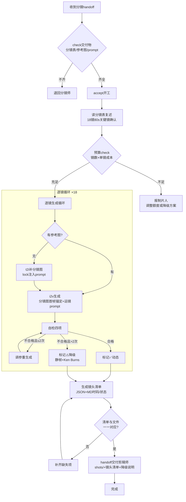

# 动画师 流程图（Mermaid）

> 版本 v1.0 | 2026-09-25

## 关键节点说明

| 节点 | 规则 |
|------|------|
| check门 | 分镜表JSON/参考图/prompt三要素，缺一退回 |
| 预算门 | 预估总耗>剩余额度→必须报制片人，禁止透支 |
| 重生成上限 | 每镜≤2次，超限走降级不硬磕 |
| 降级透明 | ⚠️降级镜显式标注在镜头清单，剪辑师知情 |
| 交付门 | 清单与文件一一对应才可交付 |
