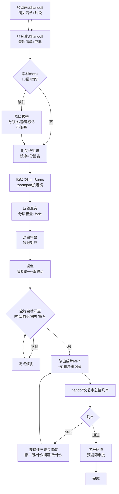

# 剪辑师 流程图（Mermaid）

> 版本 v1.0 | 2026-09-25

## 关键节点说明

| 节点 | 规则 |
|------|------|
| 素材门 | 缺件降级顶替不阻塞，但显式记录 |
| 镜序门 | 严格按分镜表，剪辑不越权改节奏 |
| 自检门 | 四查（时长/同步/黑帧/爆音）过才输出 |
| 交付门 | 成片+记录+handoff三件齐 |
| 终审门 | 艺术总监退件必须带三要素 |
