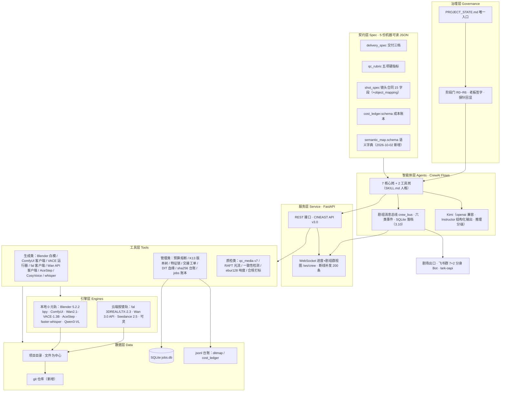
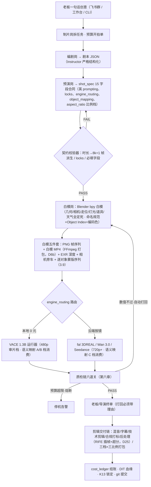
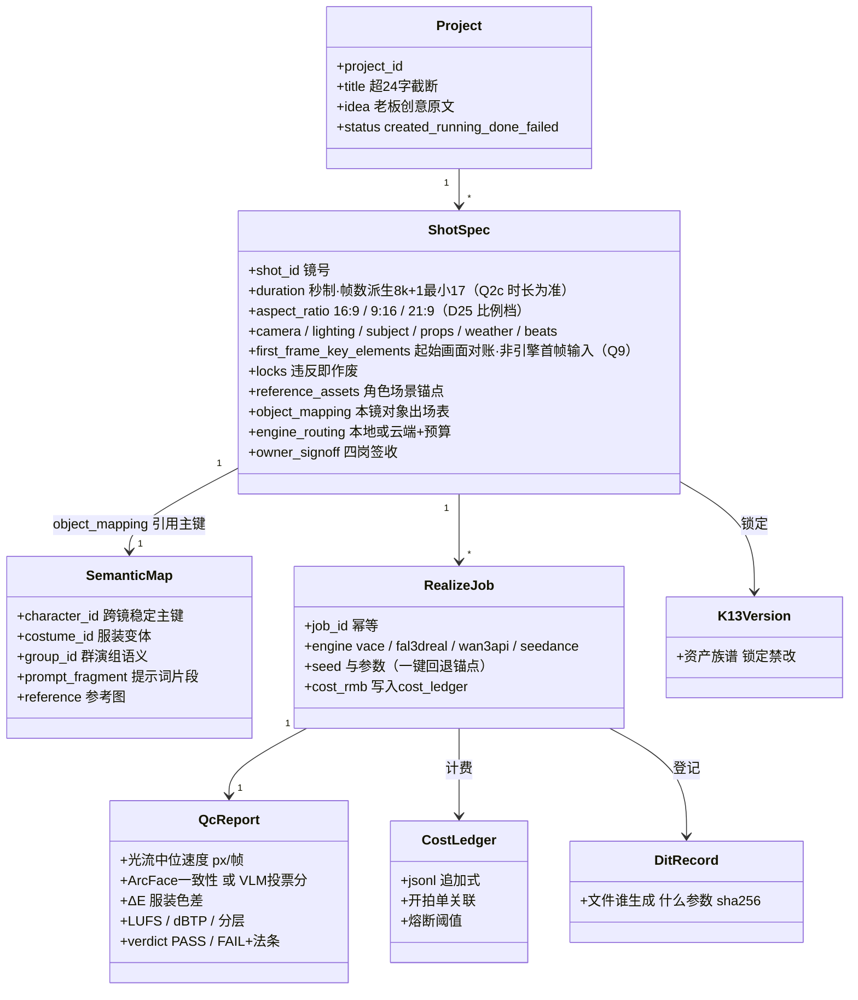
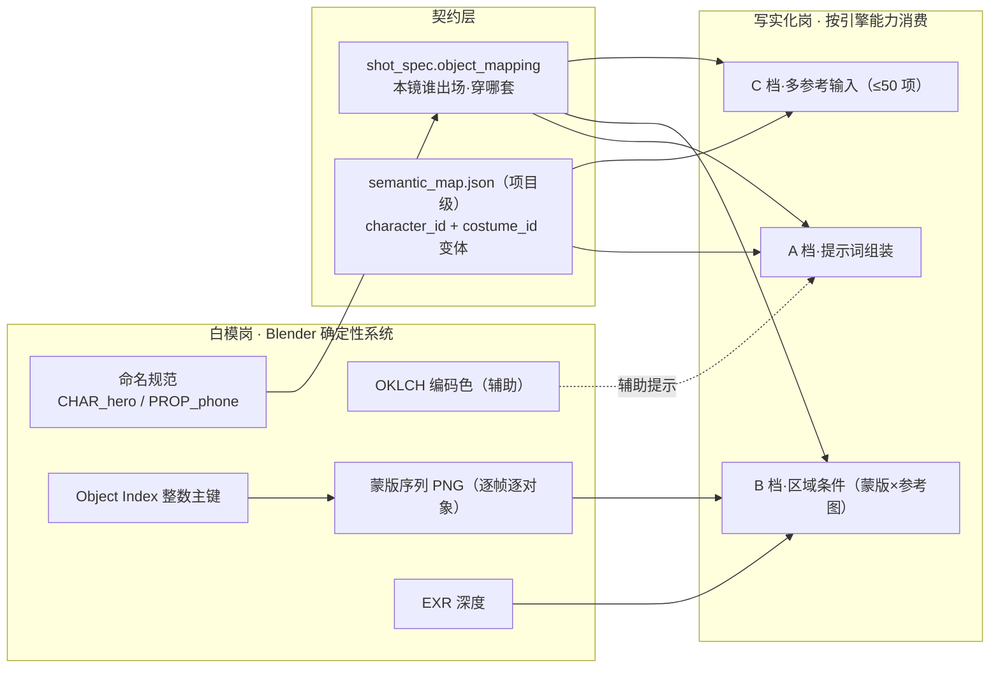
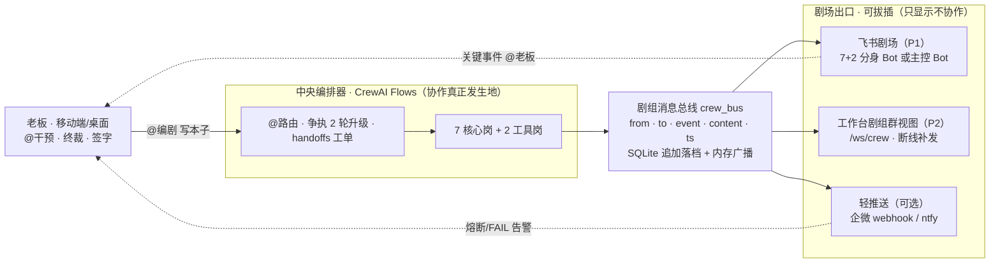
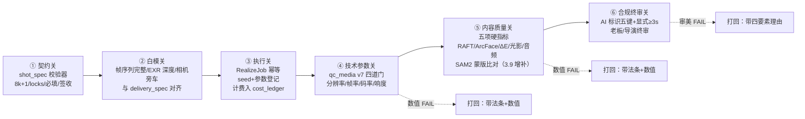

# AI 影视项目 · 三版融合方案（立项级）

> 项目代号：**C3（CINEAST-3，第三代）** ｜ 文档性质：立项实施方案
> 生成日期：2026-09-29 ｜ 增补日期：2026-10-02（三次增补：① 白模语义映射专题 → 3.9 节；② 导演室协作平台选型专题 → 3.10 节「剧组消息总线+剧场双出口」；③ 白模定位澄清 → 全链字段级修正：白模=整段动画视频喂引擎（非首帧参考图），新增白模 MP4 打包（D6b）与成片交付三档×三比例（D25），涉及 3.4/3.5/3.7/5.2/5.3/M7/M8/M16/M22/M25/7.2/8.4/9.3/11.3/11.4/附录 A 共 17 处）
> 编制依据：阶段一《项目内部资产盘点报告》+ 阶段二《外部生态调研汇总报告》（两轮调研顺序执行，先内部盘点后外部调研）+ 第三轮语义映射专题调研（2026-10-02，四路并行）+ 第四轮协作平台专题调研（2026-10-02，四路并行）+ 白模定位澄清专项核实（2026-10-02，本机实测+四引擎官方文档，见 negotiation/00 文档）
> 硬性原则：平等对待三个前代项目，114 条优点全部融合，无一条遗漏或轻视；增补不破坏基线——3.9/3.10 节为独立增补节，其余章节仅做字段级/条目级扩展

---

## 第一章 项目概述

### 1.1 项目名称与代号
- **项目名称**：一人剧组（ONE CREW）
- **内部代号**：**C3**（CINEAST-3，意为 CINEAST 血脉的第三代：里程碑1 出蓝图 → CINEAST 建成实干版 → v2 立制度 → C3 三脉合流）
- **推荐目录名**：`AI影视团队v3`（延续家族命名，老板无需适应新心智）

### 1.2 一句话定位
**白模定死一切、AI 只管写实、契约管住质量、剧组管住协作——一台一个人就能开机的个人 AI 影视制片厂。**

### 1.3 核心价值主张
1. **对创作者本人**：把三个历史版本里"已验证好用的东西"（飞书剧组、预算熔断、版本树、契约质检、白模路线）装进同一台机器，不再三处重复建设，不再推倒重来。
2. **对内容质量**：用 Blender 白模消灭抽卡（能定死的全定死），用五项硬指标把"AI 味"变成可判 FAIL 的数值——这正是全行业创作者抱怨最多的"可控性"痛点（阶段二 2.5.2：可控性是第一大抱怨）。
3. **对成本**：验证阶段 0 元（本地开源），量产阶段按镜付费约 **2~6 元/镜**，一部 45 秒样片制作成本可压到 **100 元以内**——不到传统真人短剧单集成本的 1/10。
4. **对商业化**：接单（1000~2000 元/单起）→ 参赛建品牌 → 课程/工作流分发 → 远期平台内核，四级火箭全部踩在阶段二调研验证过的真实收入数据上。

### 1.4 与三个前代项目的关系（继承 / 否定 / 超越）

| 关系 | 内容 |
|---|---|
| **继承（底盘全保留）** | CINEAST：飞书剧组形态、权力层级、预算熔断、K13 版本树、角色/场景特征锁、三视图、19 轨时间线思想、DIT 血缘、四道技术门（qc_media）、API 网关模式、节点图工作台、课程资产、《雨夜寻猫》全部产物。里程碑1：代码卫生标准（全类型注解零死代码）、严格 JSON+自动降级、WebSocket 补发 200 条、推理强度分级、REST 边界防护、"先小后大"方法论。v2：白模锁结构路线、三份机器可读契约、五项硬指标、阶段门 R0~R6、探针回显、唯一事实来源、sha256 台账、0 元纪律、7 岗体系、R4 的 121 帧白模产物、合规标识条款。 |
| **否定（只否定路线，不否定资产）** | 否定"文生图+图生视频直接生成"路线（88.9% 静图推拉的根因）；否定"多份文档并存"的文档文化；否定"岗位口径漂移"（9/15/18 三处对不齐）；否定"无 git 的不删铁律"（改用 git 管理）；否定"死等单一引擎"（VACE 权重补齐不再是唯一路径，云端 2 元/镜先行解锁）。 |
| **超越（三脉合流的新东西）** | ① 制度与工程首次同时成立：v2 的制度 + CINEAST 的工程完成度 + M1 的代码卫生，三者从未在同一项目里同时成立过（阶段一 4.6）；② 双引擎路由：本地 0 元轨 + 云端按镜轨写进契约（engine_routing），不再二选一；③ 质检链产品化：五项硬指标 + RAFT 光流 + 一致性检测全部有现成轮子（aigcqa/ayase/evalatar），检测工具与判据不再脱节；④ 成本账本从"规划"落成"实文件"（cost_ledger.jsonl）；⑤ 合规从条款落成自动打标工具链；⑥ **语义映射机制（2026-10-02 增补）**：白模对象 → 语义字典 → 蒙版/提示词/参考图三档消费，解决"灰盒子认不出谁是谁"的写实化识别难题（第三章 3.9）——第三轮调研确认业界无现成方案，属 C3 自主创新点与差异化资产；⑦ **平台解耦（2026-10-02 增补）**：剧组协作从「绑定飞书群」升级为「中央消息总线+可拔插剧场出口」（3.10）——Bot-to-Bot 限制、平台限速、平台政策三类风险一次性消失；「多 Agent 剧场式可观赏协作」经第四轮调研确认为业界空白，是继语义映射之后的第二个自主创新点。 |

### 1.5 三层目标（继承 v2 的 L1→L2→L3，数值化验收）
| 层 | 目标 | 验收标准 | 预算上限 |
|---|---|---|---|
| **L1 技术验证** | 跑通"白模进、写实出"的第一镜（R4） | 121 帧白模 → 1 支写实化视频 + QC 数值报告（五项硬指标全部有测量值） | ≤10 元（fal 3DREAL 约 2 元/镜） |
| **L2 能力样片** | 《雨夜寻猫》30~45 秒重制样片（R5） | ≥10 镜，每镜五项硬指标全绿；交付 L1/L2/L3 三档；预算账本全程留痕 | ≤100 元 |
| **L3 平台内核** | 可复用的制片厂内核（R6） | 新创意从输入到分镜规格全程无人工干预；接单工作流可复制 | 按商单收入滚动投入 |

> 类比：L1 是"发动机点火"，L2 是"整车下线"，L3 是"开一条装配线给别人造车"。

---

## 第二章 三项目优点全量融合清单

> 说明：共 114 条（CINEAST 40 + 里程碑1 34 + v2 40），与阶段一盘点报告一一对应，无删减。融合方式分四种：**直接继承**（原样保留）、**改造继承**（换实现保理念）、**制度继承**（写进规则而非代码）、**升级实现**（用调研发现的更优轮子落地）。

### 2.1 来自 CINEAST 的 40 条
| # | 优点 | 融合方式 | 在 C3 中的位置 |
|---|---|---|---|
| C1 | 唯一跑通全流程的实战经验 | 制度继承 | 第三章业务流程即以 CINEAST 流程为蓝本收口 |
| C2 | 《雨夜寻猫》全套真实产物 | 直接继承 | `projects/雨夜寻猫/`（v2 已迁移）作 R5 样片底本 |
| C3 | 飞书群聊剧组形态 | 改造继承（lark-oapi 重实现为「剧场出口」；协作骨干升级为剧组消息总线——2026-10-02，3.10 节） | 交互端一：剧组视图双载体（第八章 8.2） |
| C4 | 权力层级（老板终裁/制片/艺总/专业岗） | 直接继承 | `AGENTS.md` 全局规则（第五章 5.4） |
| C5 | 争执 2 轮强制升级机制 | 直接继承 | 协作协议（第五章 5.4） |
| C6 | "老板发言=终局"铁律 | 直接继承 | 协作协议（第五章 5.4） |
| C7 | 人格（SOUL.md）与规则（AGENTS.md）分离 | 改造继承（SKILL.md=人格，契约=规则） | 岗位卡体系（第五章） |
| C8 | 本地优先引擎栈（0 API 费） | 直接继承（与 v2"0 元纪律"合并） | 引擎层本地轨（第三章 3.2） |
| C9 | 显存锁（排队+心跳+30 分钟超时） | 直接继承（v2 已迁移 vram_lock） | 工具层（第四章 M9） |
| C10 | CPU/GPU 分工（whisper 走 CPU） | 直接继承 | 引擎层本地轨配置 |
| C11 | 预算点数制+熔断 | 升级实现（点数+人民币双轨，接 cost_ledger） | 成本管控（第四章 M11、第七章） |
| C12 | K13 版本树（族谱+锁定禁改） | 直接继承 | 资产版本管理（第四章 M14） |
| C13 | 角色/场景特征锁自动注入 | 改造继承（并入 shot_spec.reference_assets） | 契约层+一致性控制（第三章 3.7） |
| C14 | 三视图生成（换角度不变形） | 直接继承 | 角色资产生产（第四章 M20） |
| C15 | 交接工单制（27 条可追溯） | 直接继承 | 岗位协作（第五章 5.4） |
| C16 | 导演意图标准化文档 | 直接继承 | 预演岗输入（第五章 5.3） |
| C17 | 19 轨专业时间线 | 改造继承（白模时间轴为物理母版，19 轨作语义层） | 时间线契约（第三章 3.7） |
| C18 | 打回必须带具体理由（哪帧/哪秒/什么问题/改什么方向） | 直接继承 | 质检打回协议（第六章 6.4） |
| C19 | DIT 血缘登记台账 | 直接继承（v2 已迁移 dit_ingest） | 工具层（第四章 M13） |
| C20 | 四道交付技术门 | 直接继承（v2 已迁移 qc_media v7） | 质检链第 5 关（第六章） |
| C21 | CLI→HTTP 网关（17 接口） | 直接继承 | 服务层 API（第三章 3.6） |
| C22 | graph 原子写入+损坏检测+删除备份+"损坏≠不存在" | 直接继承 | 文件安全模块（第四章 M3） |
| C23 | 终端命令白名单/黑名单 | 直接继承 | 安全模块 |
| C24 | git 版本管理（8 次提交习惯） | 直接继承（**补齐 v2 的缺失**） | 代码维护（第九章 9.1） |
| C25 | 有测试且通过 | 直接继承+扩为"冒烟+契约"双测试 | 测试策略（第九章 9.1） |
| C26 | 验收报告自曝 P0 问题 | 制度继承 | 每阶段验收报告制度（第九章） |
| C27 | 运行痕迹留存（锁文件/日志/流水） | 直接继承 | logs/ + ditmap/ + cost_ledger |
| C28 | API 标题版本化 | 直接继承 | 服务层（CINEAST API v3.0） |
| C29 | 文件为中心的数据设计 | 直接继承 | 数据层（第三章 3.5） |
| C30 | SQLite 任务账本幂等防重 | 直接继承（v2 已迁移 jobs） | 工具层（第四章 M12） |
| C31 | 三端产品资产（官网/单文件/React 工作台） | 直接继承 | 前端资产库（第四章 M18） |
| C32 | 节点图工作台（React Flow/Zustand） | 直接继承 | 工作台"节点图模式"（第八章 8.2） |
| C33 | 课程方法论（6 模块+4 检查清单） | 直接继承 | 商业化第三级火箭（第七章 7.4） |
| C34 | 环境自动准备（p0_setup 探测下载） | 升级实现（断点续传+sha256 校验） | 环境模块（第四章 M21） |
| C35 | hf-mirror 镜像适配 | 直接继承 | 权重下载策略（第三章 3.2） |
| C36 | ComfyUI 三步异步客户端 | 直接继承 | comfyui 客户端（第四章 M20） |
| C37 | 音频四类分轨生成 | 直接继承 | 音频生产（第四章 M15） |
| C38 | 四轨分轨混音成母带 | 直接继承 | 交付链（第四章 M16） |
| C39 | 技术剪辑对齐交付规格 | 直接继承（融合 v2 三档） | 交付链（第四章 M22） |
| C40 | 岗位=人格+工具链双支撑 | 制度继承（7 岗同款） | 岗位体系（第五章） |

### 2.2 来自里程碑1 的 34 条
| # | 优点 | 融合方式 | 在 C3 中的位置 |
|---|---|---|---|
| M1 | 刻意做小的克制 | 制度继承 | L1→L2→L3 与 R 门同源（第九章 9.3） |
| M2 | 里程碑规划先行 | 直接继承（R0~R6 即里程碑制） | 演进路线（第九章 9.3） |
| M3 | 规划即蓝图（M2~4 被 CINEAST 验证） | 制度继承 | 需求定稿制度（第三章 3.1） |
| M4 | 全类型注解、零死代码 | 直接继承 | C3 代码规范（第九章 9.1） |
| M5 | 防御性编程 | 直接继承 | C3 代码规范 |
| M6 | 4 个冒烟测试真跑 | 直接继承 | 测试策略 |
| M7 | 测试针对真实风险设计 | 直接继承 | 测试策略（无密钥/JSON 鲁棒性保留） |
| M8 | json_schema 严格模式 | 升级实现（换 Instructor 库+Pydantic） | LLM 输出层（第三章 3.2） |
| M9 | 严格模式失败自动降级+提示词兜底 | 直接继承 | LLM 输出层 |
| M10 | openai 兼容 SDK 可换模型 | 直接继承 | LLM 层多大脑路由（Kimi 主/备选） |
| M11 | 推理强度分级省钱 | 直接继承 | 成本策略（第七章 7.1） |
| M12 | WebSocket 实时进度 | 直接继承 | 工作台反馈（第八章 8.3） |
| M13 | 断线补发 200 条历史 | 直接继承 | 工作台反馈（第八章 8.3） |
| M14 | 零框架/零 CDN/零构建前端 | 选择继承（单文件工作台保留该风格） | 前端资产库 |
| M15 | 8 依赖极简 | 制度继承（"依赖预算制"：新增依赖需说明理由） | 依赖策略（第九章 9.2） |
| M16 | 无 ORM 原生 sqlite3 | 制度继承（简单直接原则） | 数据层 |
| M17 | 两表极简数据模型 | 制度继承（能少一张表就少一张） | 数据层（第三章 3.5） |
| M18 | 状态机清晰（created→running→done/failed） | 直接继承（扩展 blocked/qc_failed） | 任务状态机（第三章 3.5） |
| M19 | 409 幂等防重 | 直接继承 | API 设计（第三章 3.6） |
| M20 | 空创意 400 边界拦截 | 直接继承 | API 设计 |
| M21 | 无密钥 400 防护 | 直接继承 | API 设计 |
| M22 | 小产物存库、大资产落文件的取舍 | 借鉴（分层存储原则） | 数据层 |
| M23 | 编剧职业人设（20 年经验） | 直接继承 | 编剧岗 SKILL（第五章 5.3） |
| M24 | 分镜师镜头语言视角 | 直接继承（升级为预演岗） | 预演岗 SKILL（第五章 5.3） |
| M25 | 分镜输出英文提示词（为文生图预留） | 直接继承 | 预演岗输出字段（shot_spec） |
| M26 | 前端四视图（时间线/卡片/表格/原始 JSON） | 直接继承 | 工作台展示（第八章 8.2） |
| M27 | API 职责单一 REST 风格 | 直接继承 | API 设计 |
| M28 | 标题超 24 字截断等边界处理 | 直接继承 | 细节规范 |
| M29 | 本地不上线的安全边界 | 改造继承（R6 商业化前不做公网暴露） | 安全策略（第十章） |
| M30 | 创意存档可回溯 | 直接继承 | 项目管理（第三章 3.5） |
| M31 | 需求边界诚实（明确写"未实现"） | 制度继承 | 文档治理（第九章 9.1） |
| M32 | 失败原因推给前端 | 直接继承 | 反馈机制（第八章 8.3） |
| M33 | 串行简单可靠（不引并发） | 制度继承（先串行后并发） | 流水线设计（第三章 3.4） |
| M34 | README 与代码一致 | 制度继承（并入唯一事实来源） | 文档治理（第九章 9.1） |

### 2.3 来自 v2 的 40 条
| # | 优点 | 融合方式 | 在 C3 中的位置 |
|---|---|---|---|
| V1 | 战略级根因分析（不修补推倒重来） | 制度继承 | 本方案即建立在三大根因分析之上（第一章 1.4） |
| V2 | 主观审美客观化（"AI 味"=不合格） | 直接继承 | qc_rubric 契约（第六章 6.2） |
| V3 | 白模锁结构路线（消灭抽卡） | 直接继承 | 制作管线主轴（第三章 3.4） |
| V4 | 三层目标 L1/L2/L3 | 直接继承 | 第一章 1.5 |
| V5 | 阶段门 R0~R6 签字不许跳步 | 直接继承 | 治理层（第九章 9.3） |
| V6 | "拍板 ≠ 开工许可" | 直接继承 | 治理层 |
| V7 | 探针回显（报已查必附证据） | 直接继承 | 治理层+质检报告 |
| V8 | 唯一事实来源制度 | 直接继承 | 文档治理（第九章 9.1） |
| V9 | 三份机器可读契约 | 升级实现（扩为五份，新增 cost_ledger+semantic_map） | 契约层（第三章 3.7） |
| V10 | 交付三档数值写死，"工具只执行不发明" | 直接继承 | delivery_spec（第三章 3.7） |
| V11 | 每条数值有"法条出处" | 直接继承 | 契约注释字段 |
| V12 | 五项硬指标数值化质检 | 直接继承 | qc_rubric（第六章 6.2） |
| V13 | 光流检测真运动（直击静图推拉） | 升级实现（用 RAFT/aigcqa 轮子落地） | 质检链第 3 关（第六章） |
| V14 | ArcFace 一致性 ≥0.75 | 改造继承（见风险 R-C1：InsightFace 商用许可备选） | 质检链第 3 关（第六章 6.2） |
| V15 | 服装主色差 ΔE≤12 | 直接继承 | 质检链第 3 关 |
| V16 | shot_spec 14 字段合同制 | 直接继承（2026-10-02 扩展为 15 字段，+object_mapping） | 契约层（第三章 3.7/3.9） |
| V17 | 帧数 8k+1 最小 17 数学约束 | 直接继承 | shot_spec 校验器 |
| V18 | locks"违反即作废" | 直接继承 | shot_spec 校验器 |
| V19 | engine_routing（引擎与成本入契约） | 升级实现（接真实价格表，见第七章） | 契约层+成本模块 |
| V20 | owner_signoff 责任到岗 | 直接继承 | 岗位协作（第五章 5.4） |
| V21 | 7 岗按管线重设 | 直接继承 | 岗位体系（第五章 5.2） |
| V22 | 旧 15 岗只留档收敛 | 直接继承 | 岗位体系 |
| V23 | 830 文件 sha256 逐文件台账 | 直接继承 | 资产迁移与复用（第四章 M13） |
| V24 | 0 元成本纪律 | 直接继承（验证 0 元、量产按镜预算） | 成本策略（第七章 7.1） |
| V25 | 云端按"开拍单"精准调用 | 直接继承 | engine_routing 执行 |
| V26 | cost_ledger.jsonl 成本账本 | 升级实现（从"规划"落成实文件） | 成本模块（第四章 M11） |
| V27 | bpy 直调、禁第三方 Blender MCP | 直接继承 | 白模工具（第四章 M7） |
| V28 | 试点先行（48 帧白模先验证） | 制度继承 | R4 执行方式（第十一章） |
| V29 | R4 白模 121 帧+EXR 深度+相机旁车 | 直接继承（直接作为 L1 验证输入） | R4 资产（第十一章 11.4） |
| V30 | 云端契约先定稿再调用（19 条） | 直接继承（接 fal 3DREAL/LTX 真实端点） | 云端写实化（第四章 M8） |
| V31 | 调研体系（竞品 20 家/fal 一手核验） | 直接继承（本立项两轮调研即延续） | 治理层 |
| V32 | 架构定稿+签字+47 项 QC 契约 | 直接继承 | 治理层 |
| V33 | 音频链独立设计（CosyVoice3+afir+ebur128） | 直接继承 | 音频生产（第四章 M15） |
| V34 | 旧 37 音频资产复用 | 直接继承 | 资产复用（R5 样片） |
| V35 | 冲突显式管理（冲突清单+挂起项） | 直接继承（本方案立即消解两处挂起冲突） | 文档治理（第十一章 11.4） |
| V36 | 待确认禁止猜测 | 直接继承 | 全文档"待确认"标注制度 |
| V37 | 归档+接合点（junction 传送门） | 直接继承 | 环境策略（第九章 9.4） |
| V38 | PROJECT_STATE.md 滚动维护 | 直接继承 | 治理层 |
| V39 | "换发动机保留底盘"的继承观 | 制度继承（本方案总原则） | 全文档 |
| V40 | 合规标识写进契约（显式 ≥3 秒+隐式五键） | 升级实现（落成自动打标工具） | 交付链（第四章 M19、第六章 6.5） |

---

## 第三章 技术架构

### 3.1 设计原则
1. **契约驱动**：规则全部机器可读（JSON 契约），工具只执行不发明（继承 v2 V9/V10）。
2. **文件为中心 + git 兜底**：人与 AI 都直接读写项目文件；一切代码与契约进 git（补齐 v2 缺失，继承 CINEAST C24）。
3. **本地优先、云端精用**：验证 0 元走本地；量产按"开拍单"路由云端（继承 C8/V24/V25）。
4. **轮子优先、自研克制**：能采用成熟轮子的不写（Instructor/RAFT/lark-oapi），自研只保留差异化资产（预算熔断、契约校验、岗位体系）（阶段二 2.3）。
5. **先串行后并发**：流水线默认串行（继承 M33），只在质检与下载处并行。

### 3.2 分层架构与选型理由



**逐层选型理由与替代方案对比：**

| 层 | 选型 | 理由 | 替代方案（为何不选） |
|---|---|---|---|
| 智能体编排 | **CrewAI Flows**（MIT，~50K stars，活跃） | role/goal/backstory 直接映射"剧组岗位"，Flows 自带状态/checkpoint（阶段二 2.2.8） | AutoGen（维护模式）；LangGraph（适合复杂状态机，留作 R6 备选）；MetaGPT（软件公司场景）；历史"Hermes 框架"身份待确认，不绑定 |
| LLM | **Kimi**（openai 兼容 SDK）+ **Instructor/Pydantic** 结构化输出 | 延续三项目血脉；Instructor 提供重试+校验，替代 M1 自研降级封装（阶段二 2.3） | 直调裸 API（重复造 M1 已造好的轮子） |
| 剧场出口集成 | **lark-oapi** 官方 SDK（MIT）+ **crew_bus 总线**（自研，进程内） | 官方维护；群内 @ 互看经逐 Bot 开 `include_bot` 权限验证可行（3.10.2）；协作骨干=crew_bus，飞书降级为可拔插显示出口，平台三类风险一次性消失 | Matrix 自托管（Synapse 需 1-2GB RAM、多 Agent 项目不成熟——3.10.5）；Mattermost（留作 R6 备选适配器）；feishu-bot-sdk（社区版更新弱） |
| 白模 | **Blender 5.2.2 + bpy 直调 + Object Index/Cryptomatte 官方蒙版通道** | 继承 v2 决策（禁第三方 MCP，依赖最小化）；GPL 以进程隔离规避；官方确定性蒙版通道支撑语义映射（3.9 节） | Blender MCP 类插件（引入第三方黑盒） |
| 本地写实化 | **Wan2.1-VACE-1.3B**（Apache 2.0，8.19GB VRAM<12G） | 0 元、可商用、5070 可跑（阶段二 2.2.3） | VACE-14B（需 35G+ 显存，5070 不可行）；HunyuanVideo（生态节点弱于 Wan） |
| 云端写实化 | **fal 3DREAL Strong-v2**（主，~2 元/镜）+ **Wan 3.0 API**（备，0.42 元/s）+ **Seedance 2.5**（质量上限） | render-to-real 端点专为白模设计、LoRA 权重开源；Wan 3.0 失败不计费；Seedance 30 秒+50 参考（阶段二 2.2.2/2.2.4） | Veo 3.1（无音频档贵）；Sora 2（API 已关闭）；可灵（按秒价高，多镜头场景留作备选） |
| 质检 | **qc_media v7（自有）+ RAFT 光流 + InsightFace/备选 + aigcqa/ayase + FFmpeg ebur128 + SAM2 蒙版比对（3.9 增补）** | 判据自有（差异化），测量用轮子（阶段二 2.2.9）；SAM2 逐对象蒙版比对验证语义映射一致性 | 全自研测量（重复造轮子）；全云端质检（不可复现） |
| 数据 | 文件 + SQLite + jsonl + **git** | 继承 C29/C30/V23；git 补齐 v2 回滚缺失 | 传统数据库（项目数据天然是媒体文件）；无 git（v2 教训） |
| 前端 | React 工作台（节点图）+ 单文件工作台 + 飞书 | 继承 C31/C32/M14/C3 | 重写前端（v1 资产已可复用） |

### 3.3 三项目技术栈融合策略
| 技术栈项 | 处置 | 说明 |
|---|---|---|
| Hermes 框架（v1） | **弃用** | 身份待确认、无绑定价值；其"人格文件"理念由 SKILL.md+CrewAI 承接 |
| 飞书群 9 机器人（v1） | **改造复用** | 换 lark-oapi 重实现，岗位从 9 收敛为 7+2；定位降级为「剧场出口」，协作骨干升级为 crew_bus 消息总线（3.10） |
| ComfyUI 本地引擎（v1） | **直接复用** | GPL 进程隔离合规；图片/视频生成保留 |
| Wan2.2 TI2V（v1） | **弃用** | 图生视频=抽卡路线根因之一 |
| Wan2.1-VACE-1.3B（v2） | **补齐启用** | 权重 4.31GB 补齐（约差 3.5GB），写 VACE 运行器 |
| fal 3DREAL（v2 契约） | **执行落地** | 19 条契约已定稿，接真实端点与价格 |
| Kimi K2.6/kimi-k3 | **直接复用** | openai 兼容层统一 |
| FastAPI 网关 17 接口（v1） | **升级复用** | v3.0：+进度 WS、+成本查询、+QC 报告 |
| M1 双 Agent 流水线 | **吸收** | 其"编剧→分镜"即 C3"编剧岗→预演岗"，代码卫生标准全盘继承 |
| qc_media v7 / jobs / dit_ingest / vram_lock（v1→v2） | **直接复用** | v2 已迁移，直接进入质检链 |
| React 工作台（v1/v2 同源拷贝） | **适配启用** | 对 v3 契约做适配（v2 遗留"待确认"项就此闭环） |
| 19 轨时间线（v1） | **语义层保留** | 白模时间轴为物理母版，19 轨作为镜头语义标注层 |
| CosyVoice3+afir+ebur128（v2 规划） | **落地实现** | R5 样片阶段启用，复用旧 37 音频资产 |

### 3.4 核心业务流程



> 类比：这个流程像装修房子——白模岗是"水电图纸"（定了就不能改），写实化岗是"贴瓷砖刷漆"（AI 只负责好看），质检链是"每道工序的验收单"（数值说话），契约是"施工合同"（谁签字谁负责）。

### 3.5 核心数据模型



- 大文件（PNG/EXR/MP4/WAV）落项目目录；小产物（shot_spec/QC 报告）JSON 存文件+索引进 SQLite；台账类（血缘/成本）用 jsonl 追加式（继承 M17/M22/C29）。
- 任务状态机扩展 M18 为：`created → running → done / failed / blocked（等权重）/ qc_failed（带数值）`。

### 3.6 API 接口设计（CINEAST API v3.0）
| 接口 | 方法 | 继承/新增 | 说明 |
|---|---|---|---|
| /api/health | GET | 继承 M1 | 健康检查 |
| /api/project、/api/intent、/api/budget/* | GET | 继承 C1 | 项目概览/意图/预算 |
| /api/projects、/api/projects/{pid}、/run | POST/GET | 继承 M1 | 400/409 防护保留 |
| /api/shots、/api/shots/{id} | GET/POST | 新增 | 契约 CRUD（原子写入） |
| /api/generate、/api/lock | POST | 继承 C1 | 生成闭环+K13 锁定 |
| /api/realize/{shot_id} | POST | 新增 | 触发写实化（本地/云端路由），幂等 409 |
| /api/qc/{shot_id} | GET | 新增 | QC 数值报告 |
| /api/cost/ledger、/api/cost/summary | GET | 新增 | 成本账本查询 |
| /api/assets、/api/handoffs、/api/versions、/api/graph | GET/POST | 继承 C1 | 资产/交接/版本树/节点图 |
| /ws/progress/{project_id} | WS | 继承 M1 | 进度推送+补发 200 条 |

### 3.7 关键规格契约（五份，全部机器可读）
1. **delivery_spec.json**（继承 v2，2026-10-02 白模澄清按 D25 重写三档）：三档=**最终成片交付档位**（白模按引擎规格出，不渲 4K 白模）——L1 草稿档 短边 480@30fps/H.264/6-10Mbps；L2 发布档 短边 1080@60fps/H.264/10-16Mbps；L3 商单档 短边 2160@120fps/**H.265**/12-24Mbps（H.264@4K@120 需 Level 6.0，超主流解码上限 L5.2=4K@60）；帧率由 **RIFE 插帧**达成、4K 由**超分**升档（引擎原生仅 24/30fps、最高 1080p）；**画面比例三档 16:9/9:16/21:9**（Q2d 拍板方案 A），分辨率按「短边×比例」派生：16:9=854×480/1920×1080/3840×2160，9:16=480×854/1080×1920/2160×3840，21:9=1120×480/2520×1080/5040×2160；响度 -14 LUFS ±0.5；AI 显式标识 ≥3 秒+隐式元数据五键；每条数值保留"法条出处"注释（源自 v1 翻车：fps 23.975 FAIL、码率 1919.8 不足）。
2. **qc_rubric.json**（继承 v2，v1.1.0）：五项硬指标+阈值（第六章 6.2 全表）。
3. **shot_spec.schema.json**（继承 v2，2026-10-02 扩展；白模澄清再修订）：15 必填字段+校验器（**duration 秒制→帧数 8k+1 派生（时长为准，D25⑤）**/locks/签收/**object_mapping 外键校验**——本镜出场对象的 character_id/costume_id 必须存在于 semantic_map，禁止字典外对象/**aspect_ratio 枚举 16:9|9:16|21:9（D25⑥）**；`first_frame_key_elements` schema 注释注明=起始画面对账字段、非引擎首帧输入，Q9）。
4. **cost_ledger.schema.json**（**新增**）：字段=开拍单号/镜号/引擎/单价/实际计费/币种/时间/预算桶；规则=追加式只写不改、超阈值触发熔断状态。另加 **真实价格表 prices.json**（第七章 7.2 数据），engine_routing 从价格表选路。
5. **semantic_map.schema.json**（**2026-10-02 新增**）：项目级语义字典——characters（character_id + variants 多服装变体）/props/groups 三类条目，每条含 prompt_fragment+reference；铁律=character_id 为跨镜稳定主键、Blender 对象按 TYPE_name 命名规范与字典一一对应、换装用变体表达不用改名（详见 3.9.3）。

### 3.8 与三个前代项目的技术架构差异
| 差异点 | 前代 | C3 |
|---|---|---|
| 智能体运行时 | Hermes（身份待确认）/自研流水线 | CrewAI Flows + SKILL.md + 契约校验器 |
| 写实化引擎 | v1 无此概念（文生图+图生视频）；v2 只有残缺 VACE；**三版均未解决白模对象识别** | 双引擎路由（本地 VACE + 云端 fal/Wan/Seedance），engine_routing 契约化；**语义映射四层机制（3.9）让引擎"知道每个灰盒子是谁"** |
| 质检 | v1 事后四门；v2 有判据无工具 | 判据（自有）+测量（RAFT/InsightFace 备选/aigcqa/ebur128）+报告（数值化）闭环 |
| 版本管理 | 仅 v1 有 git | 全仓 git + 资产 sha256 台账 + K13 三层保障 |
| 成本 | v1 点数制；v2 0 元纪律+规划账本 | 点数+人民币双轨 + cost_ledger 实文件 + 熔断 |
| 文档 | v1 多份冲突；M1 缺设计文档 | 唯一事实来源 + 签字位 + 探针回显 + 本立项文档归档 |

### 3.9 白模语义映射与写实化识别机制（2026-10-02 增补）

> 增补缘由：老板提出关键问题——白模全是灰色，AI 无法分辨画面中哪个盒子是哪个角色/道具/服装（主角多套服装、配角服饰、平面/正方形道具对应什么实物都要分清），写实化时如何分别赋予正确外观？本节为此完成第三轮外部调研（3D 行业标准 / 视频生成模型官方能力 / 中文创作者社区 / 学术论文四路并行），**先独立形成判断（3.9.2），再与初步方案（三层映射机制）融合（3.9.4）**。

#### 3.9.1 问题定义

白模路线把几何/走位/相机/灯光全定死了，但同时也把「这是谁、穿什么、拿什么」的信息全部抹掉了：主角和配角是两个灰色人形，手机和口琴是两个灰色方块。写实化引擎收到的只是一段「灰盒子动画」，它不知道该把哪个盒子渲染成穿黄雨衣的女主、哪个渲染成黑手机——**这不是渲染质量问题，是对象归属信息的缺失**。

#### 3.9.2 独立调研结论（第三轮，四路并行）

**① 3D/仿真行业如何给对象挂语义（已验证事实）**

| 来源 | 做法 | 对 C3 的启示 |
|---|---|---|
| NVIDIA Omniverse/Replicator 语义体系 | prim 上挂 `semanticType: semanticValue` 键值对（如 `class: car`），GUI 与 Python API 双通道写入 [$TRAE_REF](https://docs.omniverse.nvidia.com/extensions/latest/ext_replicator/semantics_schema_editor.html) | 「类型+值」两层语义结构是工业界成熟做法 |
| glTF KHR_materials_variants | 同一几何体定义多个材质变体，Blender 官方导出器原生支持 [$TRAE_REF](https://docs.blender.org/manual/en/dev/addons/import_export/scene_gltf2.html) | 「同一角色多套服装」=「变体」——变体 ID 机制可直接借用 |
| Blender 官方确定性通道 | Cryptomatte（每对象唯一加密蒙版，抗锯齿、考虑运动模糊）与 Object Index（整数 Pass Index，经 ID Mask 节点出蒙版）[$TRAE_REF](https://docs.blender.org/manual/en/dev//render/layers/passes.html) | **每对象的确定性蒙版可由 Blender 直接导出，零 AI 参与、零识别误差** |
| nuScenes/COCO panoptic/Cityscapes 标注结构 | 实例=「类别 token + 实例 token」双外键；nuScenes 用 `general_class_index×1000+instance_index` 合成 panoptic ID [$TRAE_REF](https://www.nuscenes.org/overview) | 语义字典的字段结构直接参照 |
| 影视剧本分解颜色惯例 | Cast=红、Props=紫、Wardrobe=橙的色码是行业通行做法 [$TRAE_REF](https://blog.studiovity.com/free-script-breakdown-template-for-every-filmmaker/) | 「按类型分色」有行业先例，但历史上只用于人眼阅读 |

**② 视频生成模型的官方多对象能力（已验证事实）**

| 引擎 | 官方确认的多对象控制输入 | 未确认/不具备 |
|---|---|---|
| Wan2.1-VACE | API 支持 1-3 张参考图+`obj_or_bg` 标签；video_edit 支持蒙版（白区重绘、黑区不变）；ComfyUI 官方 Inpainting 节点=「输入视频+首帧蒙版+参考图」 [$TRAE_REF](https://help.aliyun.com/en/model-studio/legacy-wanx-vace-api-reference)[$TRAE_REF](https://docs.comfy.org/tutorials/video/wan/vace) | 无「多参考图→自动绑定画面多对象」机制 |
| Seedance 2.5 | 单次 30 图+10 视频+10 音频共 50 项参考输入，官方明确支持多角色群像外观与声音稳定 [$TRAE_REF](https://research.doubao.com/en/blog/one-take-creation-flexible-referencing-introducing-seedance-2-5) | 未见对象数上限与逐对象绑定接口 |
| fal render-to-real | `video_url`（白模视频）+可选首帧锚点图，专为 3D/CG 渲染转写实设计；官方博客有完整 Blender 白模→写实短片案例 [$TRAE_REF](https://blog.fal.ai/from-clay-3d-render-to-a-real-action-short-a-3d-to-ai-pipeline-with-total-control/) | 多对象外观分离仍需外部规则 |
| Phantom/HunyuanCustom 等开源 | 多主体参考一致性（主体身份保持）[$TRAE_REF](https://phantom-video.github.io/Phantom/) | 同样没有对象级绑定接口 |

**四路共同结论**：所有主流引擎都接受「蒙版+参考图」这类**外部控制信号**，但**没有任何引擎能自己把灰色盒子对应到正确外观**——对象归属必须由管线外部（Blender+契约）决定，然后按引擎能力喂进去。

**③ 学术证据：为什么不能只靠颜色（关键发现）**

- **Color Bind**（2025）系统实验证明：文生图模型在多对象颜色绑定上表现差，且现有推理时技巧与编辑方法不能可靠修复多对象属性错配 [$TRAE_REF](https://arxiv.org/html/2508.19791v2)。
- **GenColorBench/NumColor** 给出颜色生成精度标尺：ΔE<5 才算「可接受」，ΔE<1 人类不可感知 [$TRAE_REF](https://moatifbutt.github.io/gencolorbench/)。
- 实例级控制的学术主流（GLIGEN/InstanceDiffusion/Boximator 等）全部走「空间位置锚定（bbox/坐标 token/蒙版）+实例独立文本」路线，而非颜色识别 [$TRAE_REF](https://arxiv.org/abs/2402.03290)。

**判断**：颜色编码可以做，但只能当「辅助视觉提示」；**对象主键必须是不依赖 AI 识别的东西**——整数 ID、蒙版、包围盒。

**④ 社区实践现状（重要信号）**

- 「Blender 白模→AI 写实化」路线已被多方实证：fal.ai 官方博客、NVIDIA RTX 指南（Blender 深度图→ComfyUI）、Flick.art（Blender 白模→Seedance Omni Reference）[$TRAE_REF](https://www.nvidia.cn/geforce/news/rtx-ai-video-generation-guide/)[$TRAE_REF](https://flick.art/blog/blender-ai-filmmaking)。
- ComfyUI 社区多对象实操=Regional Prompter（蒙版+分区提示词）、IP-Adapter Attention Mask（参考图×蒙版链式绑定）[$TRAE_REF](https://www.runflow.io/blog/comfyui-regional-prompting)。
- **「白模颜色编码→语义字典→提示词映射」的完整工作流，在中英文社区均未找到公开先例**——C3 需按本节方案自建，这同时是差异化资产与课程/工作流产品化的卖点（第七章 7.4 第三级火箭素材）。

#### 3.9.3 最终方案：四层语义映射机制（融合升级版）

> 类比：白模是「没有名牌的演员宿舍」。初步方案相当于「给每人发一件颜色不同的衣服」（编码色）+「登记住宿表」（语义字典）+「按表叫人上台」（提示词映射）。第三轮调研证明「看衣服认人」对 AI 不可靠（颜色会认错、会漂移、颜色会不够用），所以 C3 在三层之上补一层「地板上画站位+每人挂工牌」（蒙版与深度，由 Blender 确定性导出）——**AI 不用认人，照着站位表找人就行**。



**第一层：持久标识层（主键不是颜色）**

1. **命名规范**：`{TYPE}_{name}`，TYPE ∈ CHAR（角色）/PROP（道具）/SET（布景）/VEH（载具）/GRP（群组）。主角=CHAR_hero，手机=PROP_phone。跨镜同名=同一对象——命名是对象在 Blender 世界里的唯一身份。
2. **Object Index**（Blender Pass Index）：每个具名对象由工具链自动分配全局唯一整数 ID（从 semantic_map 派生），是蒙版导出与跨软件对账的机器主键。
3. **OKLCH 编码色**：工具链从感知均匀色板自动生成（相邻色 ΔE≥40），按 semantic_role 分色调区段（角色暖色/道具冷色/布景中性）——仅用于人眼审片与 A 档提示词辅助锚定，**管线正确性不依赖它**。

**第二层：语义字典层（semantic_map.json，第五份契约）**

```json
{
  "schema": "semantic_map.schema.json",
  "project_id": "rainy_night_cat",
  "characters": {
    "hero": {
      "display_name": "林晚",
      "variants": {
        "raincoat_wet": {
          "prompt_fragment": "a young woman in a soaked yellow raincoat, hood up, wet hair",
          "reference": "assets/chars/hero/raincoat_wet.png"
        },
        "casual_dry": {
          "prompt_fragment": "a young woman in a grey hoodie, dry hair",
          "reference": "assets/chars/hero/casual_dry.png"
        }
      }
    }
  },
  "props": {
    "phone": { "prompt_fragment": "a black smartphone with cracked screen", "reference": "assets/props/phone.png" }
  },
  "groups": {
    "market_crowd": { "count_range": [8, 16], "prompt_fragment": "night market pedestrians with umbrellas" }
  }
}
```

- 每镜的 `shot_spec.object_mapping` 只填「本镜谁出场、穿哪套变体」，外观细节全部回字典查——字典改一处，全项目提示词同步生效。
- 换装=同 character_id 下新增 variant，不改对象名、不断血缘（借 glTF KHR_materials_variants 的变体思想）。

**第三层：控制信号层（Blender 确定性导出，零 AI 参与）**

| 信号 | 产出方式 | 消费方 |
|---|---|---|
| 逐对象蒙版 PNG 序列 | Object Index → ID Mask 节点批量导出（Cryptomatte 留作合成期备选） | B 档区域条件、SAM2 一致性检查 |
| EXR 深度图 | 白模渲染已有产物，直接复用 | B/C 档空间理解 |
| 逐帧 2D 包围盒 | 蒙版自动求 bbox | bbox 锚定型引擎、遮挡判定 |

**第四层：引擎消费层（同一契约，三档吃法）**

| 档 | 引擎 | 消费方式 | 定位 |
|---|---|---|---|
| **A 档·提示词** | VACE 1.3B（本地审片档） | prompt_fragment 按 object_mapping 组装进提示词，辅以编码色锚定（"the figure in the green block is..."） | 最简验证，R4 先跑通 |
| **B 档·区域条件** | VACE video_edit / ComfyUI（IP-Adapter Attention Mask、Regional Prompter） | 蒙版×参考图逐对象绑定：CHAR_hero 蒙版区域=雨衣参考图+雨衣提示词 | **主力路线**：外观分离最稳 |
| **C 档·多参考** | Seedance 2.5 / fal render-to-real | 参考图集+object_mapping 描述随请求提交（Seedance ≤50 参考输入） | 高端档：模型自行对齐 |

> 换引擎=换消费档位，契约与字典不动——engine_routing 的解耦思想延伸到语义层。

#### 3.9.4 与初步方案（三层映射机制）的融合评估

| 初步方案要点 | 第三轮调研验证结果 | C3 处置 |
|---|---|---|
| 视觉编码：给白模分配不同编码色 | 部分支持：分色有行业惯例（剧本分解），但 Color Bind 实证模型多对象颜色绑定不可靠、GenColorBench 实证颜色漂移 | **保留但降级**：颜色=辅助视觉提示（人眼审片+A 档锚定），不当主键 |
| 在 Blender 中命名对象 | 强支持：命名规范是 3D 行业通行做法（Omniverse/UE 资产命名惯例） | **保留并制度化**：TYPE_name 规范写进白模岗铁律与 AGENTS.md |
| 语义字典：semantic_role/character_id/costume_id/reference_asset/prompt_mapping | 强支持：OpenUSD semantics、nuScenes 类别+实例双外键、glTF variants 全部同构 | **保留并升级**：独立成第五份契约；补 group_id（群演）与变体机制（换装） |
| 提示词映射：JSON 自动生成提示词 | 部分支持：提示词有效但颜色描述弱（Color Bind） | **升级**：提示词只是 A 档；新增蒙版×参考图的 B 档与多参考 C 档 |
| 扩展 shot_spec 的 object_mapping 字段 | 支持 | **保留**：object_mapping 成为 shot_spec 第 15 字段，外键引用 semantic_map |
| R4 先用最简单映射验证 | 支持（M1「先小后大」方法论一致） | **保留**：R4=A 档双对象验证；B/C 档排 R4.5/R5 |
| （初步方案未覆盖）对象位置的确定性获取 | 学术主流=空间锚定而非颜色识别；Blender 官方蒙版通道现成 | **新增第三层**：蒙版/深度/包围盒由 Blender 确定性导出——不靠 AI 认，靠系统给 |
| （初步方案未覆盖）生成结果的自动验证 | SAM2 video predictor 逐帧分割能力现成，ComfyUI 有集成 | **新增质检**：SAM2 分割 vs 白模蒙版 IoU 比对（6.3 ⑤关、M26） |

#### 3.9.5 极端情况与持久性设计（回应老板追问：颜色不够用/太相似怎么办）

**设计哲学**：一切极端情况的答案是同一个——**主键与颜色无关**。颜色只是皮，整数 ID/蒙版/字典才是骨。颜色世界的任何崩溃（不够分、太相似、生成时漂移）都不伤管线主干，这就是「持久性」的来源。

| # | 极端情况 | 应对机制 | 持久性保证 |
|---|---|---|---|
| 1 | 对象多于色板容量（颜色不够用） | 主键=Object Index 整数（无上限）；色板用尽后新对象复用色板，靠蒙版区分 | 蒙版由整数 ID 导出，与颜色无关；1 个对象与 1000 个对象同一套代码 |
| 2 | 颜色太相似/模型认错色 | 管线从不要求模型认色：B 档用蒙版定位对象；A 档提示词用语义+位置描述（"the figure in the foreground left"）而非「青色盒子」 | Color Bind 实证的错配被结构性绕开 |
| 3 | 生成时颜色漂移 | 颜色只存在于输入白模帧；输出验证用 SAM2 分割 vs 白模蒙版 IoU 比对（6.3 ⑤关），全程无颜色参与 | 验证闭环不依赖颜色 |
| 4 | 群演/重复道具数量爆炸 | group_id 组语义：GRP_market_crowd 一组一条映射，不逐个建模 | 组数远小于对象数；字典不膨胀 |
| 5 | 对象遮挡/出画 | 蒙版逐帧序列天然记录可见性；面积<2% 的帧标记 occluded，该帧跳过比对 | 序列数据自持久，事后可审计 |
| 6 | 同角色跨镜换装 | character_id 恒定+costume_id 变体：字典一套角色 N 套变体，每镜 object_mapping 指定本镜变体 | 角色血缘跨镜不断，一致性 QC 按 character_id 聚合 |
| 7 | 对象改名/场景重构 | semantic_map 以 character_id 为稳定主键，Blender 对象名只是引用；改名=改引用一处 | 字典进 git+K13 锁定，历史可回溯 |
| 8 | 引擎升级换代 | 三档消费对应现有全部引擎输入形态（提示词/蒙版/多参考）；新引擎=新增一档消费器 | 契约层资产，跨引擎保值 |

#### 3.9.6 R4 落地步骤（先小后大）

| 步 | 动作 | 产出 | 验收 |
|---|---|---|---|
| 1 | semantic_map.schema.json 定稿+雨夜寻猫最小字典（hero 2 变体+phone 1 道具） | 第五份契约 | 校验器跑通 demo |
| 2 | 白模重渲：v2 的 121 帧场景套上命名规范+Object Index+编码色 | 命名白模+色板 | 对象名/ID 与字典逐一对账（探针回显） |
| 3 | 蒙版序列批量导出（hero/phone 两对象×121 帧） | 蒙版 PNG 序列 | 抽 10 帧目检边界正确 |
| 4 | **A 档验证**：VACE 或 fal 按 prompt_fragment 组装提示词生成 1 镜 | 写实视频 1 支 | 五项硬指标+肉眼比对：角色与道具外观归属 100% 正确 |
| 5 | **B 档验证**（R4.5）：ComfyUI 蒙版×参考图区域条件重渲同一镜 | 写实视频 1 支 | 同镜 A/B 两档对比留档，外观分离正确率有提升 |
| 6 | **SAM2 一致性检查器试跑**（M26，P1）：生成视频分割 vs 蒙版 IoU 报告 | IoU 数值报告 | 阈值标定（初值 0.65，按《雨夜寻猫》好/坏样本回标定） |

### 3.10 导演室协作平台选型与剧组消息总线（2026-10-02 增补）

> 增补缘由：老板提出关键问题——飞书群作为「导演室」协作平台，是否应替换为更适合的平台，或改为自研？此前协作方对飞书做了初步评估（核实了 Bot 互聊限制，结论倾向 Matrix 协议自托管替换）。本节为此完成**第四轮外部调研**（飞书官方文档与政策 / Matrix 生态 / Mattermost+Slack+Discord / 自研与推送网关，四路并行），**先独立形成判断（3.10.2），再与初步评估融合（3.10.3）**。

#### 3.10.1 问题定义

C3 原方案（第八章 8.2）：飞书群=导演室，7+2 个岗位 Bot 在群内协作，老板旁观终裁。待决三问：
1. 飞书多 Bot 限制（Bot 不能私聊 Bot、Bot-to-Bot @ 需逐 Bot 开权限）是否硬伤？
2. 飞书产品团队并入豆包后，开放平台长期是否可靠？
3. 换 Matrix/Mattermost 自托管、换 Slack/Discord、走 OneBots 网关、还是自研？

#### 3.10.2 独立调研结论（第四轮，四路并行）

**① 飞书限制与政策核实（官方文档一手验证）**

| 初步评估的说法 | 官方核实结果 | 裁定 |
|---|---|---|
| Bot 发送的消息不触发其他 Bot 事件，平台层无法绕过 | 事件 im.message.receive_v1 可投递机器人消息，但群内 Bot-to-Bot @ 需每个应用开通 `im:message.group_at_msg.include_bot:readonly` 权限 [$TRAE_REF](https://open.feishu.cn/document/server-docs/im-v1/message/events/receive?lang=zh-CN)；Bot 私聊 Bot 明确不支持（错误码 230001）[$TRAE_REF](https://open.feishu.cn/document/faq/trouble-shooting/how-to-resolve-error-230001?lang=zh-CN) | **部分属实**：群内 @ 可用、私聊不行；社区成熟绕法=中央编排器单点收发 |
| 单租户单机器人 100 次/分钟、5 次/秒 | 该数值属**群自定义机器人（webhook）** [$TRAE_REF](https://open.larksuite.com/document/client-docs/bot-v3/use-custom-bots-in-a-group?lang=zh-CN)；自建应用发消息 API 为 1000 次/分钟、50 次/秒，群内全部机器人共享 5 QPS [$TRAE_REF](https://open.feishu.cn/document/server-docs/im-v1/message/create?lang=zh-CN) | **口径修正**：对剧场消息量级（每镜几十条）远够用，非硬伤 |
| 一个群最多 99 个机器人 | 手动添加上限 99 [$TRAE_REF](https://www.feishu.cn/hc/zh-CN/articles/360024984973)；API 建群场景上限 15 [$TRAE_REF](https://open.larksuite.com/document/server-docs/group/chat/create?lang=zh-CN) | 属实，7+2 岗位远未触顶 |
| 2026-07-30 飞书整体并入豆包，未来方向不确定 | 已核实为**组织架构调整而非产品合并**：产品团队与豆包整合、谢欣向赵祺汇报、GTM 并入火山引擎，飞书产品与服务保留 [$TRAE_REF](https://m.36kr.com/p/3917991880633990)[$TRAE_REF](https://news.bjd.com.cn/2026/07/30/11892708.shtml)；开放平台无已公布负面变化，2026-09-21 Lark CLI 开源 [$TRAE_REF](https://open.larkoffice.com/changelog)、9 月飞书 8.0 与豆包工作融合 [$TRAE_REF](https://www.news.cn/tech/20260915/5aa852a293b049778a4d08609e4f2710/c.html) | **性质修正**：投资延续信号为主、长期品牌方向存变数——降级为「低概率×中影响」风险（R-T5），非弃坑 |

**② Matrix 生态（初步评估的推荐路线）核实**

- 服务器实现分裂且各有硬伤：Synapse 活跃但重（小实例 1-2GB RAM+PostgreSQL）[$TRAE_REF](https://www.pistack.xyz/posts/2026-05-02-synapse-vs-dendrite-vs-continuwuity-self-hosted-matrix-server-guide/)；Dendrite 仅安全维护；Conduwuit 已归档弃坑 [$TRAE_REF](https://riskeratspizza.com/post/126846/291720)。
- 移动推送需 UnifiedPush+ntfy 自建链路，官方文档明言非开箱即稳 [$TRAE_REF](https://ems-docs.element.io/books/element-support/page/using-unified-push-and-ntfy-for-push-notifications)。
- **旗舰多 Agent 项目逐一核实（关键发现）**：Zooid 真实存在但仅约 36 stars（npm 小包）[$TRAE_REF](https://www.npmjs.com/package/zooid)；ActiveMatrix 实为 Ruby/Rails 的 Matrix SDK gem，非 Python 多 Agent 框架 [$TRAE_REF](https://rubygems.org/gems/activematrix/versions/0.0.15)；Sovereign AI Node 是商业产品官网而非开源框架 [$TRAE_REF](https://sovereign-ai-node.com/)。真实案例（Nous Research Hermes Agent [$TRAE_REF](https://hermes-agent.nousresearch.com/docs/user-guide/messaging/matrix)、MindRoom [$TRAE_REF](https://pypi.org/project/mindroom/2026.2.146/)）均属实验性质。
- 结论：把协作骨干押在 Matrix 上 = 单人单机新增一套需常年运维的服务器栈 + 依托不成熟生态——违背「0 元纪律」与「单人可维护」底线。

**③ Mattermost / Slack / Discord**

- Mattermost：免费 Team Edition 即含 Bot 账号+个人访问令牌+REST/WebSocket [$TRAE_REF](https://developers.mattermost.com/integrate/reference/bot-accounts/)；官方 MCP server 与 AI 插件生态活跃（mattermost-plugin-ai v1.14.1，2026-05）[$TRAE_REF](https://mattermost.com/blog/mattermost-mcp-server/)——**候选中最强官方 AI 生态**；但免费版无移动推送（推送代理需企业版 E10+）[$TRAE_REF](https://mattermost-docssandrospadaro.readthedocs.io/en/latest/deployment/mobile-app-deployment.html)、2GB RAM 起步 [$TRAE_REF](https://mintlify.wiki/mattermost/mattermost/quickstart)。
- Slack：免费版 90 天历史+最多 10 个应用 [$TRAE_REF](https://slack.com/help/articles/115002422943-Usage-limits-for-free-workspaces)，跨 Bot 事件投递无官方保证（事件按订阅方视角投递）[$TRAE_REF](https://docs.slack.dev/apis/events-api/)；付费 $7.25/用户/月 [$TRAE_REF](https://slack.com/intl/es-cl/pricing)——与 0 元纪律冲突。
- Discord：技术上 Bot 可接收其他 Bot 消息（MESSAGE_CREATE 含 bot 作者、需 MESSAGE_CONTENT 特权 intent、无官方禁令——初步评估「官方不支持」说法不准确）[$TRAE_REF](https://discord.js.org/docs/packages/discord-api-types/main/v10/GatewayMessageCreateDispatchData:Interface)[$TRAE_REF](https://discorddevs.zendesk.com/hc/en-us/articles/4404772028055-Message-Content-Privileged-Intent-FAQ)；但国内可达性差，直接出局。

**④ 自研与推送网关（初步评估未覆盖的选项）**

- **「多 Agent 剧场式可观赏界面」业界空白**：AutoGen Studio 偏调试 [$TRAE_REF](https://www.microsoft.com/en-us/research/blog/introducing-autogen-studio-a-low-code-interface-for-building-multi-agent-workflows/)、AgentScope Studio 偏监控 [$TRAE_REF](https://developer.volcengine.com/articles/7503399990631825458)、LangGraph Studio 绑定付费平台 [$TRAE_REF](https://www.langchain.com/blog/langgraph-platform-ga)、CrewHub 最接近但仍在开发 [$TRAE_REF](https://crewhub.dev/)——C3「9 岗位可观赏协作」恰是空白机会点，自建即差异化资产（与老板「要看角色协作」的核心偏好吻合）。
- 自研有现成零件：AutoGen UI 提供 React 聊天窗口/消息时间线/Agent 选择器组件 [$TRAE_REF](https://www.prompts.brightcoding.dev/blog/building-the-future-of-ai-collaboration-the-ultimate-guide-to-web-interfaces-for-multi-agent-llm-applications)；C3 已有 M17 WebSocket 推送+断线补发 200 条底座——剧组群视图约 3-7 人日（推测值，R2 校准）。
- **OneBots 网关核实**：真实存在且活跃（GitHub lc-cn/onebots，MIT，TypeScript，npm+Docker+文档齐全），实现 OneBot v11/v12+Satori+Milky 协议、20+ 平台适配器含飞书 [$TRAE_REF](https://onebot.dev/introduction)——多平台分发的现成轮子；但引入 Node.js 运行时，单平台场景不如直连 lark-oapi，列为 R6 备选。
- 移动轻推送：企业微信群机器人 webhook（免费、老板零安装）/ Server酱微信通道（免费 5 条/天）[$TRAE_REF](https://sct.ftqq.com/docs/getting-started/channels/) / ntfy 自托管（iOS 原生推送）[$TRAE_REF](https://blog.gntech.me/posts/2026-06-15-ntfy-self-hosted-push-notification-server-homelab/)。

**四路共同结论**：C3 的协作骨干本来就不应该是任何 IM 平台——阶段一已证实 CINEAST 的岗位间派活收活走的是内部工单系统（交接调度 27 条，阶段一 1.3），飞书群承担的是人机界面与过程显示。既然如此，正确的架构是**把协作放回中央编排器，把 IM 降级为可替换的显示出口**：Bot-to-Bot 限制、平台限速、平台政策三类风险一次性全部消失。

#### 3.10.3 与初步评估（Matrix 替换方案）的融合对照

| 初步评估观点 | 第四轮调研验证结果 | C3 处置 |
|---|---|---|
| Bot-to-Bot 消息不触发事件，平台层无法绕过 | 群内 @ 可用但需逐 Bot 开权限；私聊不支持（错误码 230001）；社区成熟绕法=中央编排器单点收发 | **采纳问题、否决结论**：C3 本就有中央编排器（CrewAI），协作根本不必经过 IM——IM 降级为显示出口，限制自动失效（3.10.4） |
| 速率限制 100 次/分钟、5 次/秒 | 口径修正：该值属 webhook 自定义机器人；自建应用为 1000 次/分钟、50 次/秒，群内共享 5 QPS | 非硬伤，剧场模式消息量级远够用 |
| 飞书整体并入豆包，平台方向不确定 | 性质修正：组织架构调整（产品保留、开放平台无负面变化、Lark CLI 开源为积极信号） | 风险降级为低概率×中影响，R-T5 数值化预警 |
| Matrix+Zooid/Sovereign AI Node 在四维优于飞书 | Zooid 约 36★；ActiveMatrix 实为 Ruby gem；Sovereign AI Node 为商业产品；Synapse 1-2GB RAM+推送链路复杂 | **冲突裁决：不采纳替换**。其合理内核（平台解耦+数据主权）由「总线+落档」零运维实现 |
| Discord 官方不支持 Bot 间通信 | 不准确：MESSAGE_CREATE 含 bot 消息，需特权 intent，无官方禁令 | 修正记录在案；Discord 因国内可达性出局 |
| 自研 WebSocket 工作量大 | 修正：已有 M17 底座+AutoGen UI 组件参考，剧组群视图 3-7 人日（推测）；剧场式可观赏界面为业界空白 | 自研从备选升级为协作骨干（总线）+保底出口（工作台视图） |
| （未覆盖）老板移动端告警 | 企微 webhook/ntfy/Server酱 等轻推送零成本可用 | 新增可选轻推送出口（M6 内 +0.5d） |

#### 3.10.4 最终方案：剧组消息总线（crew_bus）+ 剧场双出口

> 类比：把飞书群当「剧组办公室」，等于让 9 个演员只能隔着门缝递纸条（Bot 互相看不见私聊）、进楼还得排队登记（限速）。C3 的做法是把办公室搬回自家院里（中央编排器+总线），飞书群和工作台剧组视图只是挂在院墙上的两块「直播屏」——屏碎了换一块，院里的戏照演不误。



**总线事件格式（内部接口规范，非第六份契约——契约层管业务合同，总线是技术管道，字段从 jobs/handoffs 台账自然派生）**

```json
{
  "event_id": "evt_000042",
  "project_id": "rainy_night_cat",
  "from": "screenwriter",
  "to": "previz",
  "event": "handoff",
  "content": "剧本 v3 交付，共 12 镜，hero 雨夜湿身变体已写入 semantic_map",
  "visibility": "theater",
  "ts": "2026-10-02T21:30:00+08:00"
}
```

event ∈ 六类：chat（发言）/ handoff（交接）/ dispute（争执）/ escalate（升级）/ broadcast（播报）/ alert（告警）；全部事件追加式落 SQLite——**数据主权由总线保证，不由任何出口保证**。

**出口清单（可拔插）**

| 出口 | 载体 | 优先级 | 职责边界 | 退出成本 |
|---|---|---|---|---|
| 移动剧场 | 飞书群 7+2 分身 Bot（lark-oapi；已验证形态：CINEAST 9 Bot 跑通全流程）；简化备选=主控 Bot 单点收发 | P1（M6） | 老板移动端看戏+@干预+关键事件播报 | 拔掉即切纯工作台，总线零改动 |
| 桌面剧场 | 工作台「剧组群视图」（M18，聊天流组件参考 AutoGen UI，数据源 /ws/crew 复用断线补发） | P2（M18） | 全量消息桌面显示+平台无关保底 | 零（本地） |
| 轻推送 | 企微 webhook 或 ntfy | P1 可选（M6 内 +0.5d） | 纯告警：熔断/QC FAIL/超预算 | 零（一行 curl） |

**飞书侧实施细则**（R2 落地）：分身模式为默认（继承 C3 已验证形态）；每个岗位 Bot 开通 `group_at_msg.include_bot:readonly` 后即可互看 @；岗位间交接由编排器直接路由（**不依赖 Bot-to-Bot 直通**），同时播报到群里——「协作在总线、表演在群里」。

#### 3.10.5 候选平台对比矩阵与不选理由

| 方案 | Bot 间协作 | 数据主权 | 成本 | 移动端 | 运维负担 | 国内可达性 | C3 契合度 |
|---|---|---|---|---|---|---|---|
| **crew_bus 总线（自研）** | **进程内零限制** | **完全自有（SQLite）** | **0 元（复用现有栈）** | 企微 webhook/ntfy 轻推送 | **零（已在栈内）** | **优（本地）** | **✅✅ 协作骨干（业界空白=差异化资产）** |
| 飞书（剧场出口） | 群 @ 可用需逐 Bot 权限；私聊不支持 | 消息镜像落档（总线已保证） | 0 元（基础版） | **开箱即用（老板已习惯）** | 零 | **优** | **✅ 移动剧场出口（P1 先行）** |
| Matrix 自托管 | 原生支持 | 完全自有 | 0 元软件+1-2GB RAM 常驻 | UnifiedPush 自建，非开箱即稳 | **高**（服务器+DB+升级） | 自托管优 | ❌ 旗舰项目两虚一弱+运维违背单人 0 元纪律 |
| Mattermost 自托管 | Bot 账号可用 | 完全自有 | 0 元软件+2GB RAM | 免费版无推送（E10+ 才有） | 中（Docker+DB） | 自托管优 | ⚠️ R6 备选出口（官方 MCP 生态最强） |
| Slack | 无保证（事件按订阅方投递） | 云端 | $7.25/人/月 | 开箱即用 | 零 | 一般 | ❌ 付费+云端+免费版 90 天历史 |
| Discord | 技术可行（需特权 intent） | 云端 | 0 元 | 开箱即用 | 零 | **差** | ❌ 国内可达性出局 |
| OneBots 网关 | 取决于接入平台 | 转发层自有 | 0 元+Node 运行时 | 取决于平台 | 中（网关自运维） | 优 | ⚠️ R6 多平台分发备选 |

**不选理由速记**：Matrix=生态不成熟+运维过重（单人 0 元纪律不可承受）；Mattermost=免费版无移动推送+运维新增（R6 若需自托管 IM 再启用）；Slack=付费+云端+免费版 90 天历史；Discord=国内可达性差；OneBots=现成轮子但新增 Node 运行时，R6 多平台分发再上。

#### 3.10.6 演进与退出路径

| 阶段 | 动作 | 验收 |
|---|---|---|
| R2 剧组上岗 | M6：crew_bus 上线+飞书剧场出口（分身 7+2） | 群内 @编剧 得响应（总线路由）；争执 2 轮升级生效；总线事件 100% 落档 |
| R5 样片 | 轻推送出口按需启用（+0.5d） | 熔断/QC FAIL 告警直达手机 |
| R6 平台化 | M18 工作台剧组群视图=平台无关保底；如需多平台分发，评估 OneBots/Mattermost 出口适配器 | 三载体（飞书/工作台/推送）任一可独立下线，其余不受影响 |

**飞书退出条件（数值化，对应第十章 R-T5）**——以下任一公告出现即触发出口切换（纯工作台模式=零代码；Mattermost 适配器≈2-3 人日）：
1. 自建应用消息 API 开始收费或免费额度下调；
2. im.message.receive_v1 / 发消息接口下线或破坏性变更；
3. 基础版群机器人数量/用户数上限低于当前用量（9 Bot+1 老板）。

---

## 第四章 功能模块详表

> 优先级：P0=L1 验证必需；P1=L2 样片必需；P2=L3 平台/商业化。工作量按"单人有效工时"估算（1 人日=6h）。
> 编号说明：本表 **M1~M26 为 C3 功能模块编号**；第二章资产继承表中的 M1~M34 为**里程碑1 亮点编号**——两套编号相互独立。本表「依赖」列中的 M# 指本表模块，「来源」列中的 M#（如 M26=前端四视图）指第二章亮点。

| # | 模块 | 大白话描述 | 优先级 | 工作量 | 依赖 | 验收标准 | 来源 |
|---|---|---|---|---|---|---|---|
| M1 | 治理基座 | PROJECT_STATE 唯一入口+阶段门+签字记录 | P0 | 0.5d | — | R4 验收记录含签字时间戳 | v2 |
| M2 | git 初始化 | 全仓版本管理+忽略规则+首次基线 | P0 | 0.5d | — | 任意文件可回滚；commit 规范生效 | C24 |
| M3 | 配置中心+路径治理 | 消灭 195 处硬编码：根路径进 env+config，原子写入工具 | P0 | 2-3d | M2 | `rg` 扫描硬编码根路径=0；搬家测试通过 | C22/调研 2.4.3 |
| M4 | 五份契约落地 | 4 份已有+semantic_map.schema+prices.json | P0 | 1d | M2 | 校验器跑通 demo 契约（含 object_mapping 外键校验） | V9/V19/3.9 节 |
| M5 | CrewAI 运行时+7 岗位卡 | 岗位定义/编排/日志 | P0 | 2d | M4 | 编剧→预演接力产出合法 shot_spec | V21/C40 |
| M6 | 剧组消息总线+飞书剧场出口 | crew_bus 六类事件（chat/handoff/dispute/escalate/broadcast/alert）SQLite 追加落档+内存广播；lark-oapi 7+2 分身 Bot 出口（@路由/争执升级/关键事件播报）；可选企微 webhook/ntfy 轻推送 | P1 | 2.5d（轻推送 0.5d 可选） | M5 | 群内 @编剧 得响应（总线路由）；争执 2 轮升级生效；总线事件 100% 落档 | C3/C4/C5+3.10 节 |
| M7 | 白模管线 | bpy 脚本工具链+shot_spec 输入适配+**FFmpeg 白模 MP4 打包（复用 v2 pngseq_to_mp4.py 升级，D6b）** | P0 | 1.5d | M4 | R4 121 帧白模由契约自动驱动复现+**白模 MP4 落 video/ 子目录、打包参数回写 manifest** | V27/V29/D6b |
| M8 | 云端写实化客户端 | fal 3DREAL/LTX render-to-real（video_url 必填+image_url 写实参考图锚点，Q7/Q11）+Wan 3.0 API 封装（输出 30fps 与白模 24fps 错位适配 R4 实测）+**Seedance 2.5 三件套（白模视频传 motion+角色参考图传外观+提示词）** | P0 | 1.5d | M4,M11 | 一镜白模 MP4→写实 MP4 落 video/+计费入账本 | V30/调研 2.2.2/白模澄清 |
| M9 | 本地 VACE 运行器 | 权重补齐（4.31GB，sha256 校验）+推理代码+runner | P0 | 2-3d | M21 | 同一镜本地 0 元产出+QC 报告 | V3/调研 2.2.3 |
| M10 | 质检链组装 | qc_media v7+RAFT 光流+一致性+ebur128+报告生成 | P0 | 2-3d | M8 | 五项硬指标全部有数值输出；FAIL 带法条 | V12/V13/调研 2.2.9 |
| M11 | 成本账本+熔断 | cost_ledger 落地+点数/人民币双轨+熔断 | P0 | 1.5d | M4 | 超阈值自动停机+剧场告警（飞书 @老板/轻推送） | C11/V26 |
| M12 | 任务账本 jobs | v2 迁移件适配新状态机 | P0 | 0.5d | M2 | 幂等 409 验证 | C30/M19 |
| M13 | DIT 血缘+sha256 台账 | dit_ingest 迁移件+台账续接 | P0 | 0.5d | M12 | 新产物 100% 登记 | C19/V23 |
| M14 | K13 版本树+特征锁 | 锁定禁改+reference_assets 注入 | P1 | 1d | M13 | 锁定后重生成被拒绝并提示 | C12/C13 |
| M15 | 音频链 | AceStep/CosyVoice+afir 混响+ebur128 校验 | P1 | 2d | M10 | 旧 37 音频复用+新对白达 -14 LUFS | C37/V33 |
| M16 | 剪辑交付链 | FFmpeg 技术剪辑+四轨混音+**RIFE 插帧（30/60/120fps）+超分升 4K（本地 0 元，D25 后处理）**+三档×三比例转档（低/中档 H.264、高档 H.265） | P1 | 3d | M10 | tech 版过 delivery_spec 三档×三比例全查（插帧伪影/超分锐化过质检） | C38/C39/D25 |
| M17 | WebSocket 进度服务 | 进度推送+补发 200 条 | P1 | 1d | M5 | 断线重连不丢消息 | M12/M13 |
| M18 | 工作台 v3 适配 | React 工作台接新契约：节点图+时间线双模式+**剧组群视图（桌面剧场：/ws/crew 聊天流，组件参考 AutoGen UI，平台无关保底，3.10）** | P2 | 5d+剧组群视图 3-7d（推测，R2 校准） | M17 | 契约可视化编辑+QC 报告展示；**剧组群视图全量事件流显示+断线补发不丢消息** | C31/C32/M26/3.10 节 |
| M19 | 合规打标工具 | 显式标识 ≥3 秒+隐式元数据五键+平台标签 | P0 | 1d | M16 | ffprobe 校验元数据五键全在 | V40/调研 2.4.4 |
| M20 | 角色资产生产 | 三视图+特征锁+ComfyUI 客户端 | P1 | 1d | M14 | 三视图产出+锁定入库 | C14/C36 |
| M21 | 环境准备健壮化 | 断点续传+sha256 校验+hf-mirror | P0 | 1d | — | VACE 权重补齐校验通过（这是 v2 翻车点） | C34/C35 |
| M22 | 交付打包 | L1/L2/L3 三档×三比例（16:9/9:16/21:9）打包+交付单 | P1 | 1d | M16 | 三档×三比例包过全部技术门 | V10/C39/D25 |
| M23 | 官网/作品集更新 | 展示页更新+样片页 | P2 | 2d | — | 新样片上线 | C31 |
| M24 | 课程知识产品化 | 方法论+检查清单+工作流模板打包 | P2 | 5d | R5 完成 | 可交付课程包/工作流包 | C33/调研 2.6.5 |
| M25 | 语义映射工具链 | 命名规范校验器+Object Index/OKLCH 编码色分配器+**逐帧**蒙版批量导出（121 帧×N 对象，Q4/Q5 拍板）+prompt_fragment 组装器（A/B/C 三档消费）+semantic_map CRUD | P0 | 4d | M4,M7 | R4 双对象（1 角色+1 道具）全链跑通：白模 MP4→逐帧蒙版→提示词→写实化，肉眼比对外观归属 100% 正确；对象名/ID/字典对账探针回显齐全 | 3.9 节/第三轮调研/白模澄清 |
| M26 | SAM2 语义一致性检查器 | 生成视频逐对象分割 vs 白模蒙版 IoU 比对+occluded 帧跳过+数值报告 | P1 | 1.5d | M10,M25 | 试点镜 IoU 中位数报告产出；阈值初值 0.65 完成标定 | 3.9 节/调研 SAM2 |

合计：P0 约 18.5-21.5 人日（含 M25；M7 +0.5d FFmpeg 打包）；P1 约 13 人日（含 M6 总线与剧场出口、M26；M16 +1.5d RIFE/超分/三比例打包）；P2 约 15-19 人日（R6 阶段，含 M18 剧组群视图 3-7d 推测值）。

---

## 第五章 智能体与岗位体系设计

### 5.1 设计思想
继承 CINEAST 的"剧组即组织"洞察（权力层级、争执升级、工单交接）+ v2 的"岗位跟管线走"原则（7 岗为新管线定制）+ 阶段二的判断（显式 Agent 走向隐式 Agent——**岗位是可选视图，底层是契约驱动的流水线**，用户可以选择"看剧组"或"看流水线"）。

### 5.2 岗位清单（7 核心 + 2 工具岗）
| 岗位 | 类型 | 一句话职责 | 来源 |
|---|---|---|---|
| 导演岗 | 核心 | 守住艺术方向：解读老板意图、仲裁审美分歧（升级终点）、终审建议 | CINEAST 艺总/v2 导演 |
| 制片岗 | 核心 | 管钱管流程：拆任务、开拍单、预算路由、签字记录、交付 | CINEAST 制片/v2 制片 |
| 编剧岗 | 核心 | 一句话创意→结构化剧本 JSON | M1 编剧（人设保留） |
| 预演岗 | 核心 | 剧本→shot_spec 15 字段合同（含英文提示词、locks、**object_mapping 本镜出场表、aspect_ratio 画面比例档**） | M1 分镜师升级+v2 预演+3.9/D25 扩展 |
| 白模岗 | 核心 | shot_spec→Blender 白模（几何/相机/走位/灯光/道具/天气/时间轴全定死）→**五件套：帧序列+EXR+相机旁车+逐对象蒙版序列（命名规范+Object Index+编码色，3.9）+白模 MP4（FFmpeg 打包喂引擎，D6b）** | v2 白模岗+3.9/D6b 扩展 |
| 写实化岗 | 核心 | 按 engine_routing 路由执行本地 VACE / 云端 fal/Wan/Seedance；**按语义映射 A/B/C 档组装控制信号（提示词/蒙版×参考图/多参考）**，登记 seed 与参数 | v2 写实化岗+3.9 扩展 |
| 场记岗 | 核心 | 执行质检链、出数值报告、DIT 血缘、台账维护 | CINEAST 场记骨架+v2 场记 |
| 音效师 | 工具岗（P1） | BGM/音效/环境音/对白四轨+CosyVoice 配音 | CINEAST 音效师 |
| 剪辑师 | 工具岗（P1） | 四轨混音、技术剪辑、**后处理（RIFE 插帧+超分升档，D25）**、三档×三比例打包、合规打标 | CINEAST 剪辑师+D25 扩展 |

### 5.3 岗位 SKILL 定义（职责 / 输入 / 输出 / 铁律）
| 岗位 | 职责 | 输入 | 输出 | 铁律 |
|---|---|---|---|---|
| 导演岗 | 意图解读、方向仲裁、终审建议 | 老板创意、打回单 | 导演意图文档、终审意见 | 不发明数值（数值只在契约里）；打回必带"哪帧/哪秒/什么问题/改什么方向" |
| 制片岗 | 任务拆解、预算、交付 | 导演意图、prices.json | 开拍单、预算桶、交付单 | 无开拍单不花钱；超阈值必熔断；每阶段末提交签字包 |
| 编剧岗 | 剧本创作 | 创意、角色库 | 剧本 JSON（场次/角色/台词/时长/情绪） | 结构化输出不通过自动降级重试（Instructor）；不得替老板定方向级分歧 |
| 预演岗 | 镜头设计 | 剧本 JSON、特征锁、semantic_map | shot_spec（15 字段全填，含 object_mapping、aspect_ratio） | duration 秒制、帧数派生必须 8k+1 最小 17（时长为准，D25⑤）；aspect_ratio 只能取 16:9/9:16/21:9（D25⑥）；locks 必须显式列出"绝对不许变项"；英文提示词必填；**object_mapping 每个对象必须引用 semantic_map 已有主键——禁止发明字典外对象** |
| 白模岗 | 白模制作 | shot_spec、semantic_map | 五件套：PNG 帧序列+EXR 深度+相机旁车+逐对象蒙版序列+**白模 MP4（FFmpeg 打包，D6b）** | 禁用第三方 Blender MCP；locks 违反即作废重做；**对象命名必须走 TYPE_name 规范且与 object_mapping 一一对应；蒙版导出必须附探针回显（帧数+对象数）；打包参数回写 blockout_manifest** |
| 写实化岗 | 引擎执行 | shot_spec、开拍单、白模产物（含蒙版）、semantic_map | 写实视频+RealizeJob 记录 | 本地优先；云端必须先过开拍单；seed+参数必须登记（一键回退锚点）；**提示词必须由 prompt_fragment 按映射组装（禁止手写"青色盒子"类颜色指代）；B 档蒙版与参考图必须逐对象对应** |
| 场记岗 | 质检与台账 | 写实视频、qc_rubric、白模蒙版序列 | QC 数值报告、DIT 记录 | 报"已查"必须附探针回显（命令+原始输出）；FAIL 必须带法条出处；**语义 IoU FAIL=结构问题，打回白模岗而非重抽提示词（M26 上线后执行）** |
| 音效师 | 音频生产 | 剧本、场景 | 四轨音频+字幕 SRT | CPU 跑 whisper 不占显存；响度 -14 LUFS ±0.5 |
| 剪辑师 | 交付 | 四轨+视频+字幕 | L1/L2/L3 三档×三比例（16:9/9:16/21:9）交付包（RIFE 插帧+超分后处理） | 未过技术门的素材不得进交付；AI 标识缺失=FAIL；高档 4K@120 必须 H.265（D25） |

### 5.4 协作协议（继承 CINEAST 制度 + v2 契约制）
1. **消息路由**：剧组消息总线 crew_bus 为协作骨干（编排器内路由，六类事件 100% 落档，3.10）——岗位间交接、争执升级、老板干预全部经总线；飞书群 @谁谁响应降级为剧场出口（继承 C3）；工作台内岗位调用走 API+剧组群视图（/ws/crew）；多端口径一致——同一事件流，不同出口。
2. **权力层级**：老板终裁 → 导演管艺术 → 制片管流程 → 专业岗干本职；"老板发言=终局"。
3. **争执熔断**：平级 AI 争执最多 2 轮，第 3 轮强制升级导演岗；方向级分歧老板拍板。
4. **合同流转**：shot_spec 由预演岗填写→白模岗照做→写实化岗照路由→场记岗照验，四岗 owner_signoff 签收，一纸合同贯穿（继承 V16/V20）；**semantic_map 由预演岗创建、白模岗保持同步、全剧组只引用不另立——对象语义的唯一事实来源（3.9）**。
5. **交接工单**：派活/收活/退件全部记 handoffs（继承 C15），打回必带理由（继承 C18）。
6. **升级到隐式模式**：R6 平台化后，用户可关闭"剧组视图"，直接面对"创意→成片"单按钮流水线（阶段二 2.6.6 判断的落地）。

### 5.5 与三项目岗位体系的对比
| 维度 | CINEAST（9 全+6 空，规划 18） | M1（2 岗） | v2（7 岗） | C3（7 核心+2 工具） |
|---|---|---|---|---|
| 岗位跟什么走 | 跟剧组规模走（扩张先于能力→6 空壳） | 跟里程碑走（最小） | 跟管线走 | **跟管线走+按优先级分批上岗**（P0 只有 7 核心，音效/剪辑 P1 才启用） |
| 人格载体 | SOUL.md | Agent 人设 prompt | SKILL.md | SKILL.md（CrewAI backstory 双写） |
| 协作通道 | 飞书群 | 网页 | 文档+签字 | **crew_bus 消息总线骨干+剧场双出口（飞书群/工作台剧组群视图）+CLI（3.10）** |
| 质检归属 | 艺总审片+QC 工具 | 无 | 场记岗 | 场记岗+自动质检链+老板终审 |

---

## 第六章 质量保障体系

### 6.1 设计思想

1. **判据自有、测量用轮子**（继承 v2 V12/V13 + 阶段二 2.2.9）："多少分算合格"是本项目的差异化资产，必须自己定；"怎么测出来"用成熟轮子（RAFT/aigcqa/FFmpeg），不自研。
2. **数值说话，不评感觉**（继承 v2）：一切质量问题表达为"指标名 + 测量值 + 阈值 + 法条出处"，杜绝 v1"艺总说好看就过"的主观判。
3. **前置而非事后**（v1 教训）：v1 的四道技术门在交付时才查（fps 23.975、码率 1919.8 都是事后才 FAIL）；C3 把质检拆成六道关，最早在契约校验（开拍前）、最晚在终审（交付前），层层前置。
4. **检测与判据同时落地**（消解 v2 系统性缺口）：v2"光流模块待建"——判据有了、工具没有。C3 的 M10 质检链组装把这些判据全部接上真实测量工具。

> 类比：v1 是"菜端上桌才发现没熟"，v2 是"写好了菜谱但没买温度计"，C3 是"每道工序带温度计，菜谱+温度计+验收单一体"。

### 6.2 五项硬指标全表（qc_rubric.json v1.1.0，继承 v2 并接通测量工具）

| # | 指标 | 判据（阈值） | 级别 | 测量工具（C3 落地） | 治理的问题（v1 翻车实录） |
|---|---|---|---|---|---|
| 1 | 运动真实性 | 背景光流中位速度 ≥2px/帧；静图降级镜 ≤30%；无超 0.5 秒冻结 | 硬门 | RAFT 光流（P0）+ qc_media v7 | 88.9% 静图推拉——最大根因的直接克星 |
| 2 | 结构锁定 | 相机运动偏差 <20%；首帧关键元素完整；**逐对象蒙版 IoU 中位数 ≥0.65（初值，R4 标定，2026-10-02 增补）** | 半硬 | 白模帧序列 vs shot_spec.locks 自动比对 + **SAM2 分割 vs Object Index 蒙版比对（M26）** | 图生视频抽卡导致构图漂移；对象走位/换位漂移 |
| 3 | 角色一致性 | 人脸多帧投票相似度 ≥0.75；服装主色 ΔE≤12 | 硬门 | InsightFace（许可证许可范围内）/ **备选 Qwen3-VL 多帧投票打分**（规避商用许可风险，见第十章 R-C1） | 角色正反打对不上（行业头号抱怨） |
| 4 | 光影连续性 | 主光方位角跨镜 ≤30°；平均镜头长 2~5 秒 | 半硬 | EXR 深度图+光照数据自动计算 | 跨镜光线跳变 |
| 5 | 声音真实性 | 48kHz/24bit；响度 -14 LUFS ±0.5；真峰 ≤-1.5dBTP；环境声 ≥3 层 | 硬门 | FFmpeg ebur128/loudnorm + ffprobe | v1 音频过响/轨数不足 |

**硬门与半硬的区别**（通俗版）：硬门=红灯，数值不过直接打回，没有商量余地；半门=黄灯，数值不过需导演岗签字写理由才能放行。

### 6.3 质检链六道关（流水线位置图）



| 关卡 | 时点 | FAIL 去向 | 继承来源 |
|---|---|---|---|
| ① 契约关 | 开拍前 | 退回预演岗改 shot_spec | v2 校验器 |
| ② 白模关 | 白模渲染后 | 退回白模岗重渲 | v2 验收制 |
| ③ 执行关 | 写实化中 | 记 failed 状态+自动重试一次 | M18 状态机扩展 |
| ④ 技术参数关 | 写实化完成 | 退回写实化岗（换参数/换引擎） | C20 四道门 |
| ⑤ 内容质量关 | 技术关后 | **退回白模岗**（带数值——结构问题不从渲染层修）；**语义 IoU FAIL 同样退白模岗：对象走位错=结构错，不是渲染错（3.9）** | v2 五项硬指标+3.9 增补 |
| ⑥ 合规终审关 | 交付前 | 退回剪辑师补标识 / 退回导演岗 | V40+C18 |

### 6.4 打回协议（继承 C18，全链统一格式）

任何打回必须包含四要素，缺一即打回无效（系统强制校验）：

| 要素 | 示例 |
|---|---|
| 哪帧/哪秒 | "第 47 帧（00:01:57.6）" |
| 什么问题 | "背景光流中位速度 1.1px/帧 < 2.0 阈值，疑似静图推拉"（数值型）或"主角转身时机晚于节拍点 0.4 秒"（审美型） |
| 违反了什么 | "qc_rubric.json #1 运动真实性（硬门）"（法条）或"导演意图 v3 第 2 节：追逐戏节奏" |
| 改什么方向 | "改白模相机为横移并重渲，不要只调提示词" |

- 数值型打回由质检链自动生成，零人工成本；审美型打回由导演岗/老板手写。
- qc_failed 状态的任务在 jobs.db 中保留完整上下文（哪个契约、哪次渲染、哪个 seed），支持一键回退到上一版本（K13+seed 双锚点）。

### 6.5 合规打标工具链（V40 从条款落成代码）

| 动作 | 实现 | 校验 |
|---|---|---|
| 显式标识 | 片头/片尾 ≥3 秒"AI 生成"字样，位置/字号走 delivery_spec | ffprobe+抽帧 OCR 抽查 |
| 隐式标识 | 元数据五键写入 MP4 容器（内容来源/生成时间/模型名/项目 ID/责任声明） | ffprobe 校验五键齐全，缺一=交付 FAIL |
| 平台标签 | 发布清单列出抖音/B站/YouTube 各平台的标签勾选步骤（抖音"首次教育、多次限流"，B站不标无法发布） | 交付单含《平台发布检查清单》 |
| 备案适配 | 《微短剧备案办法》三类分级自检表（2026-09-01 施行） | 按投资额自动判定走二类/平台备案 |

依据：《人工智能生成合成内容标识办法》（2025-09-01 施行）要求显式+隐式双标识 [$TRAE_REF](https://www.gov.cn/zhengce/zhengceku/202503/content_7014286.htm)；《微短剧发展管理办法》按投资额分级备案 [$TRAE_REF](http://www.nrta.gov.cn/art/2026/7/31/art_1588_73827.html)。

### 6.6 探针回显制度（继承 v2 V32 派生纪律）

任何岗位报告"已检查/已验证/已完成"时，必须附带**探针回显**：所执行命令原文 + 工具原始输出。例如场记岗报"白模 121 帧已验"必须附 `ffprobe` 输出帧数行。没有回显的"已验"按未验处理——这是对 v1"文档说完成了但产物没有"的系统性防御。

### 6.7 与前代质检对比

| 维度 | CINEAST | 里程碑1 | v2 | C3 |
|---|---|---|---|---|
| 判据 | 四道技术门+艺总主观审 | 无 | 五项硬指标 v1.1.0（完整） | 继承 v2 全表+法条出处 |
| 测量工具 | qc_media（技术四门可用） | 无 | **光流/一致性待建（判据工具脱节）** | 全部接通：RAFT/InsightFace 备选/ΔE/ebur128/SAM2 蒙版比对 |
| 时点 | 事后 | — | 前置（设计） | 六道关分层前置（执行） |
| 打回质量 | 有理由但无结构 | — | 数值化打回（设计） | 四要素强制+系统校验（执行） |
| 防作弊 | 无 | — | 探针回显 | 探针回显+QC 报告入 git |

---

## 第七章 成本模型与商业可行性

### 7.1 三级成本策略（继承 V24 0 元纪律 + C11 熔断 + M11 推理分级）

| 层级 | 策略 | 依据 |
|---|---|---|
| **验证 0 元轨** | R1~R3 全部本地：Blender 白模、契约校验、剧本分镜全部 Kimi API 生成（文字成本以元计）；VACE 补齐后本地写实化也 0 元 | V24；电费实测约 0.07 元/镜（5070 250W×4 分钟）可忽略 |
| **量产按镜轨** | R4 起按 engine_routing 路由：审片档走本地 VACE 480p（0 元），发布档走云端（2~6 元/镜），**先过开拍单再调用** | V25 云端契约先定稿再调用 |
| **LLM 省钱轨** | Kimi 推理强度分级：剧本创作用高推理，改写/校对用低档（继承 M1 实测过的机制）；结构化输出走 Instructor 减少重试浪费 | M11 |

**熔断机制**（继承 C11，升级双轨）：预算以"点数+人民币"双轨记账。开拍单申请时锁定预算桶；cost_ledger 每笔计费实时扣减；单镜超限→本镜熔断停机；项目累计超限→全项目停机+剧场告警（飞书群 @老板，可选企微 webhook/ntfy 轻推送兜底，3.10）。**熔断后不自动恢复，必须老板签字解锁**——防止 v1"点数超了还在跑"的漏洞。

### 7.2 prices.json 真实价格表（V19 落地：engine_routing 从这里选路，数据源=阶段二 2.4.2 一手核验）

```json
{
  "version": "2026-09-29",
  "local": {
    "vace_1_3b": { "cost_rmb": 0, "vram_gb": 8.19, "note": "5070 12G 可跑 480p 审片档", "time_per_shot_min": 4 },
    "post_rife_superres": { "cost_rmb": 0, "note": "交付后处理 0 元档（D25）：RIFE 插帧 30/60/120fps+超分升 4K+分档分比例打包；模型 R5 选型实测", "time_per_shot_min": 3 },
  },
  "cloud": {
    "fal_3dreal_strong_v2": { "unit": "MPixel", "price": 0.0024075, "currency": "USD",
      "note": "render-to-real 端点，白模写实化专用，121帧720p≈$0.27/镜", "role": "P0 首镜解锁" },
    "wan3_api": { "unit": "second", "480p": 0.21, "720p": 0.42, "1080p": 0.84, "currency": "CNY",
      "note": "失败不计费；云端量产性价比之王", "role": "量产主力" },
    "ltx23_1080p": { "unit": "second", "price_usd": 0.08, "role": "备胎" },
    "seedance25_volcano": { "unit": "second", "480p": 0.67, "720p": 1.51, "currency": "CNY",
      "note": "30秒原生+50参考，质量上限选项", "role": "高端商单" },
    "kling30_pro": { "unit": "second", "price_usd": 0.112, "role": "多镜头叙事备选" },
    "veo31": { "unit": "second", "price_usd": 0.20, "note": "无音频档", "role": "不计入（无白模适配）" }
  },
  "circuit_breaker": { "per_shot_warn_rmb": 5, "per_shot_stop_rmb": 10, "project_default_rmb": 100 }
}
```

> 说明：Sora 2 已于 2026-09 关闭 API [$TRAE_REF](https://learn.microsoft.com/zh-cn/azure/ai-foundry/openai/concepts/video-generation)，不列入；可灵/即梦类按秒计费模型涨价风险高（即梦 15 秒成本 5.2→40.2 元实录 [$TRAE_REF](https://finance.sina.com.cn/wm/2026-04-13/doc-inhukefa4728806.shtml)），只作备选不作主力。

### 7.3 样片成本测算（《雨夜寻猫》45 秒重制，12 镜×4 秒=48 秒，720p）

| 方案 | 48 秒总成本 | 用途定位 |
|---|---|---|
| 本地 VACE 480p | **0 元**（时间 48-96 分钟） | 审片档：全片结构验证 |
| fal 3DREAL 720p | **约 24 元**（2 元/镜×12） | 发布档首选：白模直写实，结构保真 |
| Wan 3.0 API 720p | **约 20 元**（0.42 元/s×48） | 发布档备选：失败不计费 |
| Seedance 2.5（火山）720p | 约 73 元 | 商单档：30 秒原生+多参考 |

**推荐混合策略**：审片全走本地（0 元）→ 抽 2~3 镜上 fal 试档（约 5 元）→ 全片发布档走 fal 或 Wan（20~24 元）→ 总预算 **≤100 元**（L2 验收线），实测大概率 30 元内收官。对比：传统真人短剧 3000~20000 元/集，AI 全流程约 1000 元/集 [$TRAE_REF](https://paper.people.com.cn/rmrbhwb/pc/content/202605/11/content_30155877.html)——本方案样片成本约为传统单集成本的 **1/30~1/200**，为 AI 平均水平的 **1/10**。

### 7.4 商业化四级火箭（全部踩在已验证收入数据上）

| 级 | 引擎 | 定价/收入锚点 | 数据依据（阶段二 2.1.5/2.1.3） |
|---|---|---|---|
| **第一级：接单** | 用 C3 交付流程接商单（广告/短剧/宣传片） | 1000~2000 元/单起，周期 7~10 天，回报率可达 10 倍 | 周鹏案例（中国新闻网）；样片成本 30~100 元 → 单毛利 90%+ |
| **第二级：参赛建品牌** | 样片投 AI 电影节/创作者活动 | 直接收入有限，品牌溢价无限 | 鸽九楠千元 4 分钟短片入围戛纳 AI 电影奖；易小楠 80 分钟长片入围北影节 |
| **第三级：课程/工作流分发** | C33 课程资产（6 模块+4 检查清单）+ 工作流模板包（SKILL.md+契约+ComfyUI 工作流）产品化 | 课程按市场价 199~999 元/份；工作流包按 GitHub/HF 分发积累影响力 | 创作者付费方向已验证：工具订阅、API 算力、课程、接单渠道（阶段二 2.1.6） |
| **第四级：平台内核** | L3 后把"白模→写实→质检→交付"流水线封装为可复制服务 | 按商单收入滚动投入，不预设收入 | 全行业无单一工具覆盖全链路（阶段二 2.5.7），跨平台串联是常态=机会 |

**节奏纪律**（继承 M1 克制）：第一级跑通 3 单前不开第二级；第三级在 R5 样片+第一批商单完成后才启动（M24）；第四级仅做架构预留（契约层天然可复用），不做提前开发。

### 7.5 LLM 与维护性成本（常被忽略的两项）

| 项 | 估算 | 控制手段 |
|---|---|---|
| Kimi API（剧本/分镜/审片报告生成） | R5 样片全程约 10~30 元 | 推理分级（M11）+ 长文档缓存 + Instructor 减少重试 |
| 单人维护投入 | 常态 8~20 小时/月（阶段二 2.4.3 估算） | 依赖预算制（9.2）锁死升级频率；ComfyUI 锁版本不追新 |
| 一次性技术债偿还 | 195 处硬编码路径：脚本化批处理约 20~80 小时（M3 专项） | R1 阶段一次性还清，不做"边开发边欠" |

---

## 第八章 用户体验设计

### 8.1 设计思想

**"群聊做导演室，工作台做机房"**（阶段二 2.5.5 判断的直接落地）：飞书群适合创意发散与过程可见（发想法、看争执、做终审），不适合精细控制与版本管理；精细活在机房（工作台/CLI）干。两端口径同源——同一套契约、同一个 jobs.db，群里的每句话和机房里的每次操作都进同一台账。**（2026-10-02 平台解耦增补，3.10）：「导演室」升级为可拔插的剧场出口——协作骨干是剧组消息总线 crew_bus，飞书群与工作台剧组群视图只是挂在总线上的两块「直播屏」，屏碎了换一块，总线里的戏照演不误。**

**剧组视图是可选的，不是强加的**（阶段二 2.6.6 判断）：底层始终是"契约驱动的流水线"；老板可以开"剧组模式"看 7 个岗位表演协作，也可以一键切换"流水线模式"只见进度条——这正是"显式 Agent 走向隐式 Agent"趋势的架构预留（R6 默认切流水线模式）。

### 8.2 三端交互形态

| 端 | 角色 | 交互 | 继承来源 |
|---|---|---|---|
| **飞书剧组群**（移动剧场·导演室） | 老板的常驻地（手机端看戏+干预） | @编剧 写本子；@导演 仲裁争执；@制片 查预算；争执 2 轮自动升级；老板发言=终局 | C3/C4/C5/C6（lark-oapi 重实现为剧场出口，M6，3.10） |
| **React 工作台**（机房+桌面剧场） | 精细控制台 | **双模式**：节点图模式（Blender 几何节点风格，管线可视化、契约节点可拖拽连线）+ 时间线模式（分镜表格+播放预览）；契约编辑、QC 报告、成本账本、版本树全部可视化；**剧组群视图（P2，M18）：/ws/crew 全量事件流桌面显示——平台无关的剧场保底** | C32/M14 前端遗产（M18 适配 v3 契约） |
| **CLI**（应急通道） | 无 UI 时的保底 | 17 接口的命令行镜像（API 网关同源）；远程 SSH 也能开工 | C21 CLI→HTTP 网关模式 |

**节点图模式设计要点**（贴合老板审美偏好）：节点=岗位/引擎/质检关，连线=契约流转；锁定资产显示挂锁图标（Lucide 线性风格 SVG，禁 emoji 图标）；每个节点可展开看探针回显原始输出——"过程对人完全可见"。

### 8.3 实时反馈系统（继承 M12/M13，全部落地）

| 机制 | 行为 | 来源 |
|---|---|---|
| WebSocket 进度推送 | 白模渲染帧数、写实化排队位置、质检进度，全部实时推送到工作台 | M12 |
| 断线补发 200 条 | 网络闪断/关机重开，历史进度消息自动补发，不丢状态 | M13（已验证优秀） |
| 关键事件剧场播报 | 开拍、首镜完成、QC FAIL、熔断触发——四个关键事件主动 @老板（飞书剧场）；熔断/QC FAIL 可选企微 webhook/ntfy 轻推送兜底（3.10） | C3 群形态延伸→剧场出口 |
| 熔断可视化 | cost_ledger 仪表盘：预算桶余量、单镜成本对比条形图、超限红色横幅 | C11 升级 |

### 8.4 对行业十二条痛点的逐条回应（阶段二 2.5.3 全表吸收）

| # | 行业痛点（创作者原话） | C3 的答案 |
|---|---|---|
| 1 | 排队严重（Seedance 前 8 万人） | 本地 0 元轨优先；云端 fal/Wan 双备份互切 |
| 2 | 角色正反打对不上 | 白模走位定死+特征锁注入+**语义映射（每个角色/服装挂"工牌"，3.9）**+一致性硬门质检 |
| 3 | 抽卡烧 credits | 白模锁结构=抽卡终结者：结构一次定死，重渲只需写实层 |
| 4 | 提示词玄学 | 15 字段契约+英文提示词模板化（prompt_fragment 自动组装）+locks 显式声明 |
| 5 | 无法局部修改 | 单镜独立可重渲（Retake 思路）；白模改一处只重渲一镜 |
| 6 | 版本管理缺失 | K13 版本树+git+seed 登记三重回退 |
| 7 | 计费不透明 | cost_ledger 每笔入账+熔断可视化+开拍单前置审批 |
| 8 | 客服黑洞 | 自建无客服；全部日志+探针回显可自查 |
| 9 | 分辨率尴尬 | 三档交付规格按用途分（草稿 480p@30/发布 1080p@60/商单 4K@120 H.265，RIFE 插帧+超分达成）+三比例档 16:9/9:16/21:9 适配横竖屏平台（D25） |
| 10 | 物理崩坏 | Blender 物理引擎保证走位真实+光流硬门检测 |
| 11 | AI 味审美疲劳 | 五项硬指标把"AI 味"客观化为可判 FAIL 的数值（v2 核心遗产） |
| 12 | 节点图学习陡峭 | 双模式默认时间线/表单，节点图仅高级用户；群聊端零学习成本 |

### 8.5 与现有工具对比（阶段二 2.5.4 结论："没有任何单一工具实现全部最佳实践"——自建的意义）

| 体验实践 | Runway | LTX Studio | ComfyUI | 即梦类 | **C3** |
|---|---|---|---|---|---|
| 低清草稿→高清定稿两段式 | 部分 | 部分 | 手动 | 无 | **内置**（480p 审片档/720p 发布档路由） |
| Storyboard-first 分镜板先行 | 无 | 有 | 无 | 无 | **内置**（shot_spec 契约先行） |
| seed 锁定+可回退 | 手动 | 部分 | 有 | 无 | **自动化**（seed 登记+K13+git 三锚点） |
| 局部重渲染 Retake | 部分 | 有 | 手动 | 无 | **单镜级**（白模分镜天然可局部） |
| 队列状态可见 | 有 | 有 | 有 | 弱 | **有**（WS+补发 200 条） |
| 过程多智能体可见 | 无 | 无 | 无 | 无 | **独有**（剧场式多 Agent 协作：飞书群/工作台剧组群视图双出口，业界空白=差异化资产，3.10） |

---

## 第九章 维护与演进路线

### 9.1 代码维护制度（继承 C24/C25/M4/M5/M6/M7）

| 制度 | 内容 |
|---|---|
| **git 全仓管理** | 代码/契约/SKILL.md/QC 报告全进 git；commit 规范沿用 CINEAST（8 次提交习惯）；**补齐 v2 最大缺口**（无 git 的"不删铁律"改为可回滚的 git 历史） |
| **代码规范** | 全类型注解、零死代码、防御性编程——M1 标准全盘继承（4 个测试全过的卫生水准是准入线） |
| **双测试** | 冒烟测试（M1 的 4 个改造沿用：无密钥 400、JSON 鲁棒性）+ 契约测试（五份契约的校验器单测，含 object_mapping 外键校验） |
| **验收自曝** | 每阶段验收报告必须列出本阶段已知问题（继承 C26——v1 的自曝文化是资产不是缺陷） |
| **依赖预算制** | 现有 8 依赖为基线；每新增一个依赖必须在 PR 里写清"为什么没有现成轮子能替代"（M15/M16/M17 的克制制度化） |

### 9.2 依赖与升级策略

| 依赖 | 版本策略 | 升级频率 | 理由 |
|---|---|---|---|
| ComfyUI | **锁版本**（当前稳定版），每季度评估一次 | 2-4 周一版太频，不追新 | 400 万用户生态，节点接口稳定大于版本新鲜 |
| Blender | **锁 5.2 LTS**（维护至 2028-07） | LTS 周期内不动 | 官方长支持，白模管线 API 稳定 |
| CrewAI | 跟进 minor，锁 major | 月度 | MIT 活跃，Flows API 尚在演进 |
| Kimi/openai 兼容层 | 跟随时可换 | 随时 | M10 可换模型是设计冗余 |
| fal/Wan API | prices.json 月度核价 | 月度 | 云端价格波动是真实风险（即梦涨价 8 倍实录） |
| VACE/AceStep/CosyVoice | 权重 sha256 锁定 | 不动 | 权重即引擎，动了要重跑 QC 基线 |

### 9.3 阶段门演进路线（继承 v2 阶段验收制 + M2 里程碑制，R0~R6）

| 门 | 名称 | 进入条件 | 交付物 | 验收标准（数值） | 对应模块 |
|---|---|---|---|---|---|
| **R0** | 立项定稿 | 本文档老板签字 | git 仓库+五份契约基线（含 semantic_map.schema）+SKILL.md 9 张+prices.json | 校验器跑通 demo 契约；`rg` 硬编码=0 | M1~M4 |
| **R1** | 资产迁移 | R0 通过 | 830 文件台账续接+雨夜寻猫资产入库+配置中心 | 搬家测试：全仓换目录跑通 | M2/M3/M13/M21 |
| **R2** | 剧组上岗 | R1 通过 | CrewAI 7 岗+crew_bus 消息总线+飞书剧场 7+2 分身 Bot | 群内 @编剧 得响应（总线路由）；争执 2 轮升级生效；总线事件 100% 落档 | M5/M6 |
| **R3** | 白模自动驱动 | R2 通过 | shot_spec→bpy 自动复现 121 帧白模五件套：PNG 帧序列+**白模 MP4（FFmpeg 打包落 video/，D6b）**+EXR+相机旁车+**逐对象蒙版序列（M25）** | 契约驱动复现与 v2 存档逐帧一致（sha256 级）；白模 MP4 时长/fps/比例与 shot_spec 对账；**命名规范/Object Index/编码色三项全量落位（3.9.6 步 2-3）** | M7/M12/M14/M25 |
| **R4** | **首镜写实化（L1 验收）** | R3 通过 | 1 支写实视频+QC 数值报告 | 五项硬指标全有测量值；成本 ≤10 元（fal 约 2 元）；VACE 0 元档并行验证；**语义映射验证（2026-10-02 增补）：单镜 ≥2 具名对象（1 角色+1 道具）经 A 档映射生成，肉眼比对外观归属 100% 正确+蒙版导出探针回显齐全** | M8/M9/M10/M11/M25 |
| **R5** | **样片重制（L2 验收）** | R4 通过 | 《雨夜寻猫》30~45s 重制成片 | ≥10 镜全绿；三档×三比例（16:9/9:16/21:9，D25/Q2d）交付——样片本体按 16:9 制作，M22 三比例打包验证过全部技术门；预算 ≤100 元全程留痕；**hero 全部服装变体（≥2 套）在 semantic_map 登记并跨镜正确切换；B 档区域条件覆盖 ≥50% 镜头（3.9.6 步 5-6）** | M15~M17/M19/M20/M22/M23/M25/M26 |
| **R6** | 平台化（L3） | R5 通过+≥3 商单 | 工作台双模式+剧组群视图（桌面剧场保底）+隐式 Agent 单按钮+课程包 | 新创意从输入到分镜规格零人工；课程包可交付；**三载体（飞书/工作台/轻推送）任一可独立下线，其余不受影响（3.10.6）** | M18/M24 |

每个 R 门验收三件套：**签字记录（谁、何时、验了什么）+ 探针回显（命令+原始输出）+ 自曝清单（本阶段已知问题）**。任一缺失=该门未过。

### 9.4 环境与资产策略（继承 V37/V23/C34/C35）

1. **归档+接合点**：旧版本（v1/v2 目录）归档为只读，用 junction"传送门"指向新项目需要的资产——历史不删除、不搬家、按需引用。
2. **权重资产**：VACE 4.31GB 权重补齐走"断点续传+双源（HuggingFace 官方+hf-mirror）+sha256 校验"——M21 专项，针对 v2 翻车点（776MB 残缺权重未被察觉）的工程化防御。
3. **sha256 台账续接**：v2 的 830 文件台账继续追加，新产物 100% 登记；台账本身入 git。
4. **环境探针**：p0_setup 沿用 CINEAST 的自动探测下载思路，升级为"探测→下载→校验→报告"四步全留痕。

---

## 第十章 风险清单与应对

> 分级：概率（高/中/低）× 影响（高/中/低）。只列真实风险，不凑数；每条有预警指标（可观测，不是"多注意"）。

| ID | 风险 | 概率 | 影响 | 应对方案 | 预警指标 |
|---|---|---|---|---|---|
| **R-C1** | **InsightFace 预训练模型商用需授权**（代码 MIT 但模型仅限非商业学术用途，阶段二 2.2.9 一手核验） | 中 | 高 | 双轨：商单交付前完成商业授权 OR 切换 Qwen3-VL 多帧投票判据（已在 qc_rubric 中预留备选位，6.2 表） | 商单签约前触发授权检查清单 |
| **R-T1** | VACE 权重补齐再次失败（v2 翻车点） | 中 | 中 | M21 断点续传+双镜像+sha256 校验；**且已不是关键路径**——fal 3DREAL 约 2 元/镜云端先行解锁 R4 | M21 校验失败计数 |
| **R-T2** | 195 处硬编码路径修复超期（20-80 小时估算） | 低 | 中 | M3 脚本化批处理，R1 内一次性还清；验收=`rg` 扫描归零 | R1 工期偏差 |
| **R-T3** | 光流阈值 2px/帧 对分辨率敏感，480p 审片档可能误判 | 中 | 中 | 阈值按分辨率分表；R4 用《雨夜寻猫》已知好/坏样本回标定 | 首月 QC 误判率>10% |
| **R-T4** | **多对象外观错配**（2026-10-02 新增）：A 档提示词路线下，模型把女主的雨衣穿到配角身上——Color Bind 论文实证的属性错配风险 | 中 | 高 | 主键不依赖颜色（蒙版/ID 锚定，3.9.5）；B 档区域条件为外观分离主力；R4 双对象验证先行暴露问题；M26 IoU 检查兜底 | R4 A 档外观归属错误率>30% 即提前升级 B 档 |
| **R-T5** | **协作平台政策变动**（2026-10-02 新增）：飞书并入豆包后的开放平台政策/限速/接口变动，或分身 Bot 逐个权限配置的维护成本失控 | 低 | 中 | 剧场双出口架构（3.10.4）：协作骨干 crew_bus 在本地栈内，飞书拔掉即切纯工作台模式（零代码）；Mattermost 适配器备选（约 2-3 人日）；退场条件数值化监控 | 3.10.6 退出条件任一触发（API 收费/接口废弃/配额下调公告） |
| **R-M1** | 云端 API 涨价/关停（Sora 2 API 已关、即梦涨价 8 倍均为实锤） | 中 | 高 | fal+Wan 双引擎互备+本地 0 元兜底；prices.json 月度核价；引擎切换=改 engine_routing 一行 | 单镜成本环比涨幅>30% |
| **R-M2** | 依赖项目断供（AutoGen 进维护模式为先例） | 低 | 中 | 只选 MIT/Apache 且活跃项目（CrewAI 47K+ stars）；依赖预算制控制数量 | 依赖项 90 天无 commit 告警 |
| **R-M3** | 维护挤占创作时间（常态 8-20h/月） | 中 | 中 | ComfyUI/Blender 锁版本不追新；升级窗口每季度集中一次 | 月度维护工时>30h |
| **R-B1** | 接单收入不及预期 | 中 | 中 | 四级火箭互为对冲：第一级未达预期时第二级（参赛建品牌）与第三级（课程分发）不受阻；前 3 单零获客成本（样片即作品集） | 3 个月 0 商单 |
| **R-B2** | 平台限流/审核收紧（抖音"多次限流"、B站"不标无法发布"） | 低 | 高 | 合规打标列为 P0（M19）而非附属功能；备案自检表随交付单输出 | 交付包 ffprobe 五键校验失败=0 容忍 |
| **R-L1** | 版权纠纷（训练数据/肖像/IP 授权） | 低 | 高 | 商单合同明确素材授权责任归属；接单只用自有/已授权素材；AI 生成部分按北互判例（独创性投入者享有著作权）保留全过程记录作为证据链 | 商单素材来源清单缺失 |
| **R-O1** | 岗位口径漂移复发（v1 的 9/15/18 三处对不齐教训） | 低 | 中 | SKILL.md 为岗位唯一事实来源；飞书机器人人设与 SKILL.md 同源生成，禁止手改 | 岗位职责出现第二处定义 |
| **R-O2** | 文档失真复发（v1"文档说完成了但产物没有"） | 中 | 高 | 探针回显制度化（6.6）+QC 报告/jobs 记录自动入 git——文档与产物自动对账 | 验收包缺探针回显 |
| **R-S1** | VACE 显存边界（8.19GB 需求 vs 12GB 显存，长镜可能 OOM） | 中 | 低 | 480p 审片档+显存锁排队（vram_lock 已迁移）+镜头短切（8k+1 约束天然短镜） | vram_lock 排队时长 |
| **R-S2** | Blender GPL 传染疑虑 | 低 | 低 | bpy 以独立进程调用（进程隔离），v1 已验证的合规模式延续 | 合规复查触发时 |

**风险总评**：无"高×高"项；最重的三条（R-C1/R-M1/R-B2）全部有已落地的工程化应对（备选判据/双引擎/合规 P0），不依赖"小心谨慎"类软性承诺。

---

## 第十一章 立项建议与启动计划

### 11.1 立项结论：**建议立即立项（GO）**

一句话理由：三个前代项目已把学费交完——CINEAST 交了工程学费（全流程跑通+翻车实录）、里程碑1 交了设计学费（代码卫生标准）、v2 交了制度学费（契约+质检+阶段门）——C3 做的事是**把三份学费兑换成一台能开机的制片厂**，而不是从零探索。

量化依据：
1. **工作量可控**：P0 全部 18~21 人日（单人，含语义映射工具链 M25 的 4d），P1 约 11.5 人日（含 M6 剧组消息总线 2.5d），除 M25/M26/crew_bus 为自建创新点外均为成熟模块组装而非探索性开发。
2. **资金风险趋近于零**：L1 验证 ≤10 元、L2 样片 ≤100 元，对比传统单集 3000~20000 元——即使全部失败，损失不到一顿饭钱。
3. **无新增重大不确定性**：第四章 26 个模块中 18 个直接继承已验证资产，8 个新开发项（质检链组装/云端客户端/成本账本/合规打标/CrewAI 运行时/语义映射工具链/SAM2 检查器/剧组消息总线 crew_bus）中前 5 个有成熟轮子托底；语义映射工具链、SAM2 检查器与 crew_bus 虽无现成整体方案（第三/四轮调研确认业界空白），但全部由 Blender 官方通道（Object Index/蒙版）+引擎官方输入（蒙版/参考图）+成熟模型（SAM2）+栈内组件（FastAPI/SQLite/WebSocket）拼装，无算法自研。
4. **时机窗口明确**（见 11.2）。

### 11.2 为什么是现在（五个窗口）

| 窗口 | 事实 | 对本项目的意义 |
|---|---|---|
| 市场窗口 | 微短剧市场破 1000 亿、AI 剧漫剧上半年 220 亿（+138%）；AI 降本 60~85% 已成行业共识 | 需求真实存在且在爆发期，早入场者吃品牌红利 |
| 技术窗口 | fal 3DREAL 约 2 元/镜端点已上线——**v2 卡死的写实化步骤有了 2 元解锁键**；Wan 3.0 失败不计费 | 三项目都卡过的"写实化执行"不再是技术悬崖 |
| 政策窗口 | 标识办法+微短剧备案 2025-09/2026-09 刚施行，多数创作者还没建立合规习惯 | 合规打标内建=早合规者的分发红利（平台限流漏标者） |
| 硬件窗口 | 5070 12G 恰好覆盖 VACE 1.3B（8.19GB 需求） | 本地 0 元轨在这代硬件上刚好成立，无需升级显卡 |
| 案例窗口 | 周鹏 1000-2000 元/单、易小楠 80 分钟长片<1 万、鸽九楠千元入围戛纳 | 单人 AI 影视商业模式已被独立第三方验证，不是本方案的自说自话 |

不立项的代价：三个项目约 40% 的总资产投入继续冷置贬值；每次新创意仍需跨平台手工串联（3-5 小时/条的常态）；竞争窗口随大厂工具迭代收窄。

### 11.3 资源需求清单

| 资源 | 现状 | 新增需求 |
|---|---|---|
| 硬件 | RTX 5070 12G 已有（VACE 8.19GB 需求覆盖） | 无 |
| 软件 | 全开源：Blender 5.2/ComfyUI/CrewAI/lark-oapi 均免费 | 无 |
| API 充值 | Kimi 已有账户 | fal ≤10 元（R4）+ 全程预算 ≤100 元（R5） |
| 人力 | 单人（老板+AI 岗位团队） | P0 18.5~21.5 人日（含 M25 语义映射工具链 4d+M7 打包 0.5d）+ 常态维护 8~20 h/月 |
| 数据资产 | 三项目全部产物（雨夜寻猫全套/121 帧白模/830 文件台账/37 音频） | 无 |

### 11.4 R0 启动清单（立项后第一个开发日做什么）

| # | 动作 | 产出 | 消解的历史挂起项 |
|---|---|---|---|
| 1 | `git init` + 忽略规则 + 全仓基线提交 | 可回滚的仓库 | v2 无 git 缺口 |
| 2 | PROJECT_STATE.md 创建（唯一事实来源入口） | 治理基座 | v1 多文档冲突文化 |
| 3 | 五份契约定稿入库（delivery_spec/qc_rubric/shot_spec.schema/cost_ledger.schema/semantic_map.schema）+ prices.json | 契约层 | V9/V19/V26+3.9 节从规划落成实文件 |
| 4 | 9 张 SKILL.md 岗位卡编写（人格）+ AGENTS.md（全局规则） | 岗位体系 | C7 人格规则分离制 |
| 5 | v2 资产 junction 迁入（R4 白模 121 帧/EXR/相机旁车/830 台账） | 验证输入就位 | V29 直接复用 |
| 6 | **挂起冲突消解一**：React 工作台"待确认"适配问题——拍板：以 v3 契约为唯一适配目标，v2 同源拷贝降级为参考件（M18 执行） | 决策记录入 PROJECT_STATE | V35 承诺的"立即消解" |
| 7 | **挂起冲突消解二**：VACE 权重 4.31GB"待确认"——拍板：M21 sha256 断点续传补齐；**同时降级为非关键路径**（fal 云端先行，R4 不等 VACE） | 决策记录入 PROJECT_STATE | v2 最大翻车点的双保险 |
| 8 | R4 验收标准预写（五项硬指标+成本上限+**语义映射双对象验证**）+ 本文档老板签字归档 | 阶段门启动 | V32 签字制 |
| 9 | **语义映射准备（2026-10-02 增补）**：命名规范 TYPE_name 定稿入 AGENTS.md；semantic_map.schema.json 入契约包（四份→五份）；雨夜寻猫最小字典起草（hero 2 变体+phone 1 道具）；OKLCH 色板生成方案选型（相邻色 ΔE≥40） | 3.9 节落地的前置条件 | 业界空白点的自主创新资产 |
| 10 | **剧组消息总线契约预定义（2026-10-02 增补）**：crew_bus 六类事件（chat/handoff/dispute/escalate/broadcast/alert）+字段表（event_id/from/to/event/content/visibility/ts）写入 AGENTS.md 附录；飞书剧场形态拍板（7+2 分身 Bot vs 主控 Bot 单点收发）；轻推送出口选型（企微 webhook/ntfy） | 3.10 节落地的前置条件（M6 于 R2 实现，契约层先行） | 平台解耦架构的自主创新资产 |
| 11 | **白模定位澄清收尾（2026-10-02 增补）**：修 v2 `make_r4_l1_blockout.py` 第 6 行注释（写 Multilayer 实为 OPEN_EXR 单层多通道，本机构建实测）；shot_spec.schema 修订入库（duration 秒制派生/aspect_ratio 枚举 16:9|9:16|21:9/first_frame_key_elements 对账注释）；delivery_spec 三档按 D25 重写（480p@30/1080p@60/4K@120 H.265×三比例） | 澄清修正从文档落成契约实文件 | 白模澄清 00 文档+D6b/D25 |

### 11.5 需要老板拍板的六件事（决策请求）

| # | 决策项 | 选项 | 本方案推荐 |
|---|---|---|---|
| 1 | 立项与预算授权 | GO / NO-GO | **GO**（L1 ≤10 元、L2 ≤100 元、月维护 8~20h） |
| 2 | R4 首镜路线 | A. fal 云端先行（2 元/镜，当天可跑） / B. 死等 VACE 权重补齐（0 元，约 1~3 天不确定） | **A+B 并行**：fal 先出结果，VACE 补齐后补 0 元档验证 |
| 3 | ArcFace 商用策略 | A. 购买 InsightFace 商业授权 / B. 直接用 Qwen3-VL 投票判据 / C. 先 B 后 A（商单量起来再买） | **C**（先 VLM 投票，成本 0） |
| 4 | R5 样片底本 | A.《雨夜寻猫》45s 重制 / B. 全新剧本 | **A**（资产复用最大化：白模/音频/剧本全有，且新旧对比即最佳宣传片） |
| 5 | 飞书应用授权 | A. 7+2 分身 Bot（9 个应用，逐个开 `include_bot` 权限，完整剧场感，CINEAST 已验证形态）/ B. 主控 Bot 单点收发（1 个应用，老板 @ 一人，编排器路由） | **A**（看戏感=项目灵魂；需老板协助 GUI 操作约 1 小时；R2 落地，不阻塞 R0~R1） |
| 6 | 项目目录名 | `AI影视团队v3` / 其他 | 沿用家族命名 `AI影视团队v3` |

---

## 附录

### 附录 A 契约字段速查

| 契约 | 核心字段 | 铁律 |
|---|---|---|
| shot_spec（15 字段，2026-10-02 扩展+澄清修订） | shot_id / duration（秒制，帧数派生 8k+1 最小 17）/ aspect_ratio（16:9/9:16/21:9，D25）/ camera / lighting / subject / props / weather / beats / first_frame_key_elements（起始画面对账·非引擎首帧输入，Q9）/ locks / reference_assets / **object_mapping（本镜对象出场表：object_id·object_index·semantic_role·character_id·costume_id·prompt_fragment·encode_color·mask_globs）** / engine_routing / owner_signoff | locks 违反即作废；四岗签收齐才过契约关；**object_mapping 的主键必须存在于 semantic_map（外键校验）** |
| semantic_map（第五份契约，2026-10-02 新增） | characters（character_id+variants 多服装变体）/ props / groups 三类条目；每条含 prompt_fragment+reference | character_id 跨镜稳定主键；换装用变体不用改名；TYPE_name 命名与 Blender 对象一一对应；进 git+K13 锁定 |
| qc_rubric（五项） | 运动真实性（硬）/ 结构锁定（半硬）/ 角色一致性（硬）/ 光影连续性（半硬）/ 声音真实性（硬） | 硬门不过直接打回；半硬需导演签字 |
| delivery_spec（三档×三比例，2026-10-02 D25 重写） | L1 草稿 480p@30fps H.264；L2 发布 1080p@60fps H.264；L3 商单 4K@120fps H.265；比例档 16:9/9:16/21:9（分辨率按短边×比例派生）；帧率=RIFE 插帧、4K=超分（本地 0 元）；响度均 -14 LUFS ±0.5；AI 标识显式 ≥3s+隐式五键 | 每条数值带法条出处 |
| cost_ledger | 开拍单号 / 镜号 / 引擎 / 单价 / 实际计费 / 币种 / 时间 / 预算桶 | jsonl 追加式只写不改；超阈值触发熔断 |

### 附录 B 三项目资产迁移清单

| 处置 | 资产 | 去向 |
|---|---|---|
| **直接复用**（改配置即用） | 《雨夜寻猫》全套产物、R4 121 帧白模+EXR+相机旁车、830 文件 sha256 台账、37 音频资产、qc_media v7、jobs/dit_ingest/vram_lock 迁移件、K13 版本树、React 工作台骨架、M1 双 Agent 流水线代码、19 轨时间线语义层 | R1 junction 迁入，sha256 续接登记 |
| **改造复用**（换实现保理念） | 飞书 9 机器人（→lark-oapi 7+2，定位降级为剧场出口，协作骨干=crew_bus，3.10）、SOUL.md 人格（→SKILL.md）、kimi_client 结构化输出（→Instructor）、点数制预算（→双轨账本）、四道技术门（→质检链第④关） | R2/R4 逐项改造 |
| **仅存档**（不再使用，历史保留） | Hermes 框架绑定、Wan2.2 TI2V 抽卡路线、9/15/18 岗位旧口径、CINEAST API v1/v2 版本号 | 归档目录+junction，只读 |

### 附录 C 本方案对提示词第三阶段要求的自检对照

| 要求 | 落实位置 |
|---|---|
| 完整可执行的技术方案与实施计划 | 第三章（架构+3.9 语义映射+3.10 协作平台选型）+第四章（26 模块含工作量/依赖/验收）+第九章 R0~R6 |
| 最大化继承三项目优点（一条不漏） | 第二章 114 条全表（C40+M34+V40），每条标注融合方式与落点 |
| 详细的风险评估与应对 | 第十章 16 条（概率×影响×预警指标，含 2026-10-02 新增 R-T4 多对象外观错配、R-T5 协作平台政策变动） |
| 成本模型与商业化可行性 | 第七章（prices.json 实价+样片测算+四级火箭） |
| 明确的下一步行动建议 | 第十一章（GO 结论+R0 十件套+六项决策请求） |
| 诚实标注待确认项 | 11.4 两处挂起冲突消解记录；全文"待确认"仅存 VACE 权重尺寸一项（M21 校验后闭环） |
| （2026-10-02 增补）独立调研先于融合 | 3.9.2 先呈现四路调研结论（行业标准/引擎能力/学术证据/社区现状，全部附来源 URL），3.9.4 才做与初步方案的对照融合——不照搬初步方案；3.10.2 同样先完成第四轮四路独立调研（飞书政策/Matrix 生态/替代平台/自研推送），3.10.3 才做与初步评估（Matrix 替换方案）的对照融合 |
| （2026-10-02 增补）极端情况持久性 | 3.9.5 八种极端情况全表（颜色不够用/太相似/漂移/群演爆炸/遮挡/换装/改名/换引擎），核心原则=主键与颜色无关 |
| （2026-10-02 增补）完整解决方案六要素 | 机制设计（3.9.3 四层）/数据格式（semantic_map.json+object_mapping）/岗位职责（第五章 5.2/5.3）/契约扩展（3.7 五份）/R4 落地（3.9.6 六步）/验收标准（9.3 R3~R5+M25/M26）；平台侧同构六要素=机制（3.10.4 总线+双出口）/数据格式（crew_bus 事件 JSON）/岗位职责（5.4 消息路由）/模块（M6）/R2 落地（3.10.6）/验收（9.3 R2 总线事件 100% 落档） |
| （2026-10-02 增补）保持原文档结构与风格 | 3.9/3.10 为独立增补节；其余章节均为字段级/条目级扩展，原有章节无删改 |

### 附录 D 术语表

| 术语 | 通俗解释 |
|---|---|
| 白模（Blockout） | 灰色低细节 3D 草稿：把几何/相机/走位/灯光全定死，像装修前的水电图纸 |
| 写实化 | 把白模"贴瓷砖刷漆"变成照片级画面的 AI 渲染步骤 |
| 契约（Spec） | 机器可读的 JSON"施工合同"：字段、阈值、法条出处，程序自动验 |
| 熔断 | 花钱超过预设红线，系统自动停机+报警，像电闸跳闸 |
| 硬门/半硬 | 硬门=红灯直接打回；半硬=黄灯需导演签字才放行 |
| 探针回显 | 报"已检查"必须附命令原文+原始输出，像考试要写解题过程 |
| K13 版本树 | 资产族谱：每个文件谁是爹谁是儿子，锁定后禁止修改 |
| junction | Windows 的"传送门"快捷方式：旧目录不动，新项目按需引用 |
| 8k+1 | 帧数必须是 8 的倍数加 1（17/25/33...），视频模型的数学约束 |
| LUFS | 响度单位，-14 LUFS 是流媒体平台标准音量 |
| 语义映射（Semantic Mapping） | 给每个白模对象挂"工牌"：它是谁（character_id）、穿什么（costume_id）、长什么样（参考图）——让 AI 知道该把哪个灰盒子画成什么 |
| Object Index | Blender 给每个对象的整数编号，像身份证号——蒙版导出靠它，跟颜色无关 |
| Cryptomatte | Blender 官方的每对象加密蒙版通道，自动区分互相重叠的对象 |
| 蒙版（Mask） | 黑白图：白色=这个对象在画面中的位置，黑色=其他——AI 照着白色区域"贴瓷砖" |
| IoU | 交集/并集：两张蒙版重叠程度的数值（0~1），用来验证生成画面里对象还在白模指定的位置 |
| OKLCH | 感知均匀色彩空间：数值差相同=看起来差别相同，用它生成"彼此差距均匀"的编码色板 |
| prompt_fragment | 语义字典里每个对象预写好的英文描述片段，写实化时自动拼进提示词 |
| 变体（Variant） | 同一角色的多套外观（如雨衣湿身/便装干爽），换装=切变体，不改角色身份 |
| 剧组消息总线（crew_bus） | 剧组的"内部对讲系统"：所有岗位交接/争执/告警先经总线落档再广播——协作的真正发生地，任何 IM 平台都只是它的显示屏（3.10） |
| 剧场出口（Theater Exit） | 挂在总线上的"直播屏"：飞书群（移动剧场）、工作台剧组群视图（桌面剧场）、企微/ntfy 轻推送（纯告警屏）——可拔插，拔掉任何一个协作照常 |
| 分身 Bot | 每个岗位在飞书群里单独的机器人账号（有自己的名字头像），像剧组每位成员都在群里发言——7 核心岗+2 工具岗共 9 个，CINEAST 已验证形态 |
| 轻推送 | 一行 curl 就能发的手机通知（企微群机器人 webhook / ntfy 自托管）——只做告警不做交互，熔断/QC FAIL 时兜底叫老板 |
| OneBots 网关 | 多平台多协议机器人中台（开源，MIT）：一个网关同时接飞书/微信/Slack 等 20+ 平台——R6 多平台分发时的现成轮子备选 |

---

**（全文完。本文档为立项级方案，签署后进入 R0；执行过程中的变更走 PROJECT_STATE.md 变更记录，不修改本基线。）**