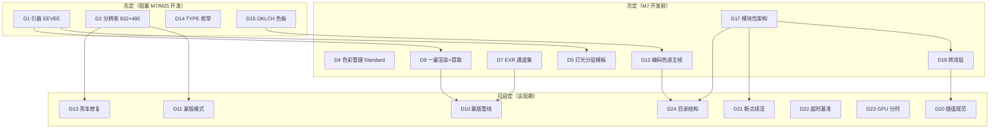

# 第一轮协商 · Blender 白模预渲染规格

> 日期：2026-10-02 ｜ 状态：✅ 已收官（26/26 已定：原 24 项 + 白模澄清新增 D6b/D25；R0 实测复核 4 条不阻塞）
> 证据基线：v2 真身两份白模脚本实测参数 + 《三.md》3.9 语义映射节 + 阶段二调研
> 文件位置：本文件 R0 立项后迁入 AI影视团队v3/docs/negotiation/

---

## 0. 证据基线（v2 真身实测，先亮牌）

v2 存在两份白模脚本，实测参数有分歧——这些分歧就是本轮要拍板的地方：

| 参数 | `tools/blockout_min_v1.py`（探针版） | `tools/make_r4_l1_blockout.py`（R4 正式产出 121 帧） | 状态 |
|---|---|---|---|
| 渲染引擎 | EEVEE | EEVEE | 一致 |
| 分辨率 | 960×540（默认参数） | **832×480**（VACE 原生档） | 分歧① |
| 帧率/帧数 | 24fps / 48 帧 | 24fps / 121 帧（8k+1, k=15） | 一致 |
| 灯光 | 剧情灯光：点光亮度/色温关键帧+弱冷天光 | 均匀照明：SUN 3.0 单灯 | 分歧② |
| 材质 | 统一灰 0.55（Principled BSDF） | **非纯灰**：主体淡黄 (0.95,0.92,0.62)+三墙微色差，shade_flat | 分歧③ |
| 输出 | PNG 序列（本机 Blender 无内建视频编码器，mp4 外置 ffmpeg） | PNG（rgb/）+ EXR Multilayer Z+Normal 32bit（exr/）+ camera_sidecar.json | — |
| 渲染遍数 | 1 遍 | **2 遍**（PNG 一遍、EXR 再一遍） | 效率点 |
| 动画插值 | BEZIER（含 slotted actions 兼容代码） | LINEAR（经 preferences 全局设置） | 分歧④ |
| 色彩管理 | 未显式设置 | 未显式设置 | 隐患（Blender 4.0+ 工厂默认 AgX，待 R0 复核 121 帧实际曲线） |

**已定项（三.md 已拍板，本轮不再重复问）**：8k+1 帧数约束；交付 24fps；Blender 5.2 LTS 锁版；bpy 独立进程+禁第三方 MCP；Object Index 整数主键；OKLCH 编码色 ΔE≥40；TYPE_name 命名规范；蒙版走 ID Mask 主路线+Cryptomatte 备选（3.9）。

**本轮新发现的 v2 隐藏缺陷（要修，见 D13）**：`blender/shots/r4_l1/camera_sidecar.json` 逐帧 `rotation_euler_rad` 全为 [0,0,0]——相机实际朝向由 TRACK_TO 约束求值产生，约束不写回本体欧拉角；脚本已取 `matrix_world` 却只提取了平移分量（m[0][3]），旋转信息全部丢失。

**2026-10-02 白模定位澄清增补（详见 [00-emergency-blockout-position.md](00-emergency-blockout-position.md)）**：白模=**整段动画视频**喂引擎（非首帧参考图），两处实测修正——① 本机构建（blender-5.2.2-windows-x64）无 OPEN_EXR_MULTILAYER 与 FFMPEG 输出能力（`file_format='FFMPEG'` 赋值 TypeError，运行时枚举 14 项无此二项，构建目录仅 6 个 DLL 无 FFmpeg 库）——v2 实际渲的是 **OPEN_EXR 单层多通道**，`make_r4_l1_blockout.py` 第 6 行注释有误（R0 登记修复）；「PNG 序列+外部 ffmpeg 打包」是踩坑后正确解法，正式化为 **D6b**。② 「帧序列→白模 MP4 打包」步骤在原 24 项决策中缺失，与成片交付三档（**D25**）一并补拍。

---

## 1. 核心决策（8 个，完整展开）

### D1 渲染引擎
- **背景**：白模是「结构母版」，引擎决定渲染速度、光影层次与通道能力。
- **候选**：
  | 方案 | 速度 | 光影层次 | Pass 能力（Z/Normal/IndexOB） | 备注 |
  |---|---|---|---|---|
  | A. EEVEE | 快（实时引擎） | 有 AO/软阴影 | 全支持 | v2 双脚本一致验证 |
  | B. Workbench | 最快 | 无（平面着色） | 部分（无 GTAO） | 极简但丢空间层次 |
  | C. Cycles | 慢（GPU 路径追踪） | 物理正确 | 全支持 | 灰盒不需要物理光；抢 12G 显存 |
- **推荐 A（EEVEE 延续）**：v2 已验证；灰盒只需基础空间层次（GTAO）；速度对断点续渲友好。
- **决策影响**：D5 灯光、D9 渲染遍数、渲染时长基准。
- **可逆性**：半可逆（重渲便宜，但已过 QC 的写实化对账基线会失效）。
- **来源**：v2 两脚本实测 + 三.md 3.2 选型表。

### D2 母版分辨率
- **背景**：白模帧是下游一切（蒙版/深度/旁车/写实化输入）的分辨率母版，牵一发动全链。
- **候选**：
  | 方案 | 本地 VACE 轨 | 云端轨（fal/Seedance） | 渲染成本 | 状态 |
  |---|---|---|---|---|
  | A. 832×480 | 原生零缩放（Wan 480p 档） | 480p 输入（fal 接受度待实测） | 最低 | v2 R4 已验证 |
  | B. 1280×720 | 需降采样 0.65× | 720p 直用（发布档友好） | 低 | 未验证 |
  | C. 双档渲染 | 各取所需 | — | 渲染×2+蒙版×2 | 复杂度高 |
- **推荐 A（832×480 先行 + 条件升级）**：R4/R5 审片为主，与 VACE 原生档零缩放误差；若 fal 实测 480p 白模输入质量不足（R4 花 2 元即可实测），触发升级 1280×720 重渲（分钟级成本）。**待确认项**：fal 3DREAL 对输入分辨率下限的要求（M8 落地时验证）。
- **决策影响**：D11 蒙版分辨率、D13 旁车记录、M25 全链产物尺寸。
- **可逆性**：可逆（重渲秒级/帧，但全链产物需同步重生成）。
- **来源**：v2 make_r4_l1_blockout.py 第 17 行 + 三.md 3.2（VACE 8.19GB/480p 审片档）。
- **✅ 拍板（2026-10-02）**：方案 A——先小后大：832×480 先跑通，花 2 元实测 fal，不行再换大重跑。老板：「做菜先尝咸淡，别一上来就做一锅」。

### D4 色彩管理（view transform）
- **背景**：v2 两脚本均未显式设置 view_transform；Blender 4.0 起工厂默认为 AgX（电影级 tone mapping）。若 121 帧实为 AgX 曲线渲染，OKLCH 编码色的 ΔE≥40 保证会被 AgX 的去饱和特性破坏。
- **候选**：
  | 方案 | 编码色保真 | 灰阶 | 状态 |
  |---|---|---|---|
  | A. Standard（显式设置） | 最好（中性传递） | 线性感知 | 需重渲 |
  | B. AgX（默认不动） | 差（高饱和色被压） | 电影感压缩 | v2 可能已在此曲线下 |
  | C. Filmic | 同 B 类问题 | — | 无必要 |
- **推荐 A（显式 Standard）**：编码色是 A 档提示词锚+人眼对账工具，必须保真；灰盒追求中性结构信息而非电影感。**待确认项**：R0 用 R4-L1 场景复核 v2 的 121 帧实际 view transform（脚本未设置，按工厂默认推断为 AgX——推断，需实测确认）。
- **决策影响**：D12 编码色有效性、D15 色板实测效果。
- **可逆性**：可逆（改设置重渲）。
- **来源**：Blender 官方（4.0 起默认 AgX，公开发布说明）+ v2 脚本代码（无 view_transform 设置）。

### D5 灯光策略
- **背景**：v2 内部存在两种做法（分歧②）：探针版用剧情灯光（路灯点光亮度/色温关键帧=「灯光即叙事」），R4 正式版用均匀 SUN（结构可读性最大化）。「白模锁结构」哲学下灯光该锁到什么程度，需要定调。
- **候选**：
  | 方案 | 做法 | 优点 | 缺点 |
  |---|---|---|---|
  | A. 均匀照明（R4-L1 式） | SUN 3.0 单灯 | 结构最纯净，写实化引擎自由度最大 | 丢失日夜/氛围语义 |
  | B. 剧情灯光（探针式） | 点光关键帧+氛围天光 | 光影语义预埋，帮 AI 理解夜戏 | 每镜手调成本；可能误导写实化 |
  | C. 分层模板 | R4 验证用 A；R5 起按 shot_spec 的 time_of_day/weather 自动套光照模板（夜=低强度冷色），保留关键帧微调 | 先纯净后语义，成本可控 | 模板库要建（半天工作量） |
- **推荐 C（分层模板）**：R4 验证阶段用 A（最纯净输入），R5 样片起模板化——光照方向也是结构信息（阴影方向错了写实化会拧巴），但交给模板而非逐镜手调。
- **决策影响**：shot_spec 光照相关字段的消费方式、白模岗铁律。
- **可逆性**：半可逆（模板可迭代，但已渲镜头跨策略对比会失真）。
- **来源**：v2 blockout_min_v1.py setup_lights() vs make_r4_l1_blockout.py 第 67-72 行。
- **✅ 拍板（2026-10-02）**：方案 C——两种都要、分阶段用：先均匀亮跑通，正式样片起按剧本自动套灯光模板。老板：光的方向是结构信息（夜戏主光从左来，AI 阴影就得画右边；光打错 AI 跟着错），接受半天建模板库。

### D9 渲染遍数与格式派生
- **背景**：v2 R4 现状渲两遍（PNG 一遍+EXR 一遍，`render.image_settings.file_format` 全局切换所致）。两遍渲染存在隐藏风险：EEVEE 的 TAA 采样带随机性，两遍结果可能存在像素级差异（蒙版与主帧若来自不同遍次，边界对不齐）。
- **候选**：
  | 方案 | 渲染次数 | 主帧/EXR 一致性 | 工具链 |
  |---|---|---|---|
  | A. 一遍 Multilayer EXR + 程序提取 PNG | 1 | 像素级一致（同源派生） | 需加提取步骤（OpenImageIO/Python） |
  | B. 两遍渲染（v2 现状） | 2 | 可能存在 TAA 随机差异 | 零新增 |
  | C. 两遍+固定随机种子 | 2 | 理论一致 | 需验证 EEVEE 种子控制 |
- **推荐 A（一遍 EXR+提取）**：渲染时间减半；PNG/EXR/蒙版全部同源，消除 TAA 随机性隐患。**待确认项**：EEVEE Next 两遍渲染是否真有帧间差异（R0 实测 10 帧对比）；提取工具选型（M7 内定）。
- **决策影响**：D7 EXR 通道集、M7 渲染调度、D10 蒙版管线。
- **可逆性**：可逆（切回两遍零成本）。
- **来源**：v2 make_r4_l1_blockout.py 第 107-120 行（两遍渲染结构）。
- **✅ 拍板（2026-10-02）**：方案 A 同意推荐。**澄清注记（2026-10-02 本机实测）**：本机构建无 OPEN_EXR_MULTILAYER（运行时 `file_format` 枚举 14 项无此格式）——落地形态=一遍 **OPEN_EXR 单层多通道**（RGBA+Z+Normal+IndexOB）+程序提取 PNG；v2 `make_r4_l1_blockout.py` 第 6 行注释写「Multilayer」与实际代码不符，登记 R0 修复。

### D10 蒙版导出实现
- **背景**：3.9 已定「Object Index → ID Mask 节点批量导出」为主路线、Cryptomatte 备选，但实现细节未定：compositor 节点图在渲染时同时出蒙版，还是从 EXR 的 IndexOB 通道离线提取。
- **候选**：
  | 方案 | 渲染开销 | 蒙版来源 | 灵活性 |
  |---|---|---|---|
  | A. 渲染时 compositor File Output（ID Mask 节点×N 对象） | 一次渲染全出 | 同源 | 节点图随对象数动态构建 |
  | B. IndexOB 进 EXR + 离线 Python 提取 | EXR 略增 | 同源存档 | 事后可重提取（不重渲） |
  | C. 逐对象 N 遍渲染 | ×N 倍 | 独立 | 慢，弃 |
- **推荐 A+B 混合**：渲染时 IndexOB 写入 EXR（存档+可重提取），compositor 同时输出逐对象 PNG（消费）；一次渲染全得。
- **决策影响**：M25 蒙版批量导出器、D11 蒙版格式、M26 IoU 比对输入。
- **可逆性**：半可逆（M25 核心工具链，定了后大改成本中等）。
- **来源**：三.md 3.9.3 第三层 + Blender 官方 compositor 文档。

### D12 编码色进不进主帧
- **背景**：3.9.6 步骤 2 写「白模重渲：套上命名规范+Object Index+编码色」——字面意思编码色渲进主帧；但 3.9.5 又强调颜色只是辅助。两处合并后需要明确：给 AI 的白模帧到底带不带颜色。
- **候选**：
  | 方案 | A 档提示词 | Color Bind 风险 | B/C 档 |
  |---|---|---|---|
  | A. 编码色渲进主帧 | 「the figure in the green block」有锚 | 存在（A 档双对象错配由 M26 兜底） | 蒙版定位不依赖色 |
  | B. 主帧中性灰+编码色仅参考帧集 | 无颜色锚（改用位置描述） | 最小 | 同 |
  | C. 双渲（编码色帧+灰帧各一套） | 两全 | 最小 | 灰帧备用 |
- **推荐 A（维持 3.9.6 原案）+ 触发条件补灰帧**：R4 的 A 档验证需要颜色锚（这是 3.9 设计的一部分）；B 档主力路线不依赖颜色；若 B/C 档实测颜色泄漏（VACE 蒙版重绘时编码色渗入输出），按镜补渲灰帧（分钟级）。
- **决策影响**：D15 色板、R4 验证步骤、M25 分配器。
- **可逆性**：可逆（材质改色重渲）。
- **来源**：三.md 3.9.3 图（编码色 -.辅助提示.-> A 档）/3.9.5 极端情况表/3.9.6 步骤 2。
- **✅ 拍板（2026-10-02）**：方案 A 同意推荐；澄清问 Q4 复核确认——编码色随材质**逐帧**渲进主帧（每一帧都带，非仅首帧）；颜色渗入风险由 B 档蒙版+SAM2（M26）兜底，实测泄漏按镜补渲灰帧（分钟级）。

### D13 相机旁车格式升级（含 v2 缺陷修复）
- **背景**：v2 已有 camera_sidecar.json（分辨率/帧率/lens_mm/逐帧 location+rotation_euler），但旋转数据实际全为 [0,0,0]（TRACK_TO 约束不写回本体欧拉角，见第 0 节缺陷说明）；且缺 FOV、传感器宽度、内参矩阵。
- **候选**：
  | 方案 | 修复方式 | 下游价值 |
  |---|---|---|
  | A. 继承 JSON+修复旋转（matrix_world 分解出四元数/欧拉）+补 fov_deg/sensor_width | 改 10 行代码 | 对账+引擎消费都够 |
  | B. 完整相机内外参（K 矩阵+R/t） | 计算机视觉标准格式 | 过度设计（无 SLAM 需求） |
  | C. 不修（消费方用 location+track_to 逻辑重建朝向） | 零改动 | 脆弱，语义隐藏在代码里 |
- **推荐 A**：matrix_world 已经在取，只是没提取旋转分量；补 FOV 供 B 档空间理解。修复属于 bug 级，顺手做。
- **决策影响**：M7 旁车导出器、写实话术对账基线。
- **可逆性**：半可逆（若下游已按旧格式写消费代码需同步）。
- **来源**：D:\AI影视团队v2\blender\shots\r4_l1\camera_sidecar.json（逐帧 rotation 全 0 实测）+ make_r4_l1_blockout.py 第 132-140 行。

---

## 2. 快决策（16 个，紧凑表）

| # | 决策点 | 候选 | 推荐 | 理由（一句话） | 可逆性 |
|---|---|---|---|---|---|
| D3 | 帧率 | 24 / 25 / 30 | **24fps**（白模母版） | v2 实测；交付档 30/60/120fps 由 D25 RIFE 插帧达成（白模不渲高帧率）；Wan 3.0 输出 30fps 错位 R4 实测适配 | 可逆 |
| D6 | 主帧格式 | PNG 8bit / EXR half / 双份 | **PNG 8bit RGB**（视频流帧） | PNG 序列=存档/QC/SAM2 比对用；**喂引擎主产物=白模 MP4（D6b 打包）**——本机 Blender 无视频编码器的坑已绕过 | 半可逆 |
| D7 | EXR 通道集 | Z+Normal（v2）/ Z only / Z+Normal+IndexOB | **Z+Normal+IndexOB** | 继承 v2 两通道+补 IndexOB（蒙版重提取免重渲） | 可逆 |
| D8 | EXR 位深 | 32bit full（v2）/ 16bit half | **32bit full 延续** | Z 深度远景精度敏感；832×480 体量可接受（约几 MB/帧） | 可逆 |
| D11 | 蒙版 PNG 格式 | 二值黑白 / 灰度抗锯齿 | **灰度抗锯齿** | 边缘覆盖率保留，SAM2 比对受益；VACE 白区重绘语义兼容 | 可逆 |
| D14 | TYPE 枚举定稿 | 5 类（CHAR/PROP/SET/VEH/GRP）/ +FX+MARK 保留字 | **5 类+2 保留字** | 3.9 已列 5 类够用；FX/MARK 预留命名空间不分配 ID | 半可逆 |
| D15 | OKLCH 色板规模 | 24 / 48 / 64 色 | **✅ 已定（P1改造 2026-10-02：三档 24/48/96）**——轻量档 24 色（单角色）/标准档 48 色（暖16+冷16+中性16）/重量档 96 色（群戏+复杂场景），档位进 palette.json 由项目规模场景驱动 | 远超单镜需求（≤8 对象）；一次定死入库 palette.json，档位配置见 config/scalability_config.json | 可逆 |
| D16 | 单镜具名对象上限 | ≤8 / ≤12 / 不限 | **✅ 已定（P1改造 2026-10-02：三档 ≤4/≤8/≤16）**——轻量档 ≤4（访谈类）/标准档 ≤8（GRP 群演算 1 个，SET 底板不计）/重量档 ≤16（群戏允许），档位由 shot_spec 复杂度字段驱动 | 管理成本与表达力平衡；M25 校验器按档位校验（硬规则） | 可逆 |
| D17 | 脚本架构 | v2 单文件硬编码式 / 模块包+CLI 子命令 | **模块包（build/light/render/export）+CLI** | M7 定义即「工具链+输入适配」；消灭硬编码路径家族问题 | 可逆 |
| D18 | 参数传递 | 直读 shot_spec.json / 转译层 blockout_manifest.json | **转译层** | 白模消费字段显式化，探针回显友好，契约变更不直接炸白模 | 可逆 |
| D19 | Blender 调用形态 | blender -b -P script.py --（v2）/ bpy as module | **延续 v2 CLI 式** | 便携版零 Python 版本耦合，已验证 | 半可逆 |
| D20 | 动画插值规范 | LINEAR（经 preferences）/ BEZIER 逐点显式 | **逐关键帧显式设置** | 消除全局偏好副作用；blockout_min 的 slotted actions 兼容代码可直接继承 | 可逆 |
| D21 | 断点续渲 | 文件存在+sha256 跳过 / jobs 状态机 | **文件级跳过+台账对账** | 复用 v2 jobs 模式，无需新状态机 | 可逆 |
| D22 | 渲染时长基准 | 待实测 / 固定健康线 | **✅ 已定（P1改造 2026-10-02：分档健康线 480p@2s / 720p@4s / 1080p@8s）**——按渲染分辨率×复杂度系数分档，分辨率越高健康线越宽；R0 用 R4-L1 场景实测后校准各档基线 | 单帧超时报警查设置（老板拍板）；基线数值 R0 用 R4-L1 场景实测；**健康线按白模档（引擎规格）计，非交付档** | 可逆 |
| D23 | GPU 共存策略 | vram_lock 统管 / 分时制 | **分时制** | 白模渲染期不跑推理（EEVEE 是 GPU 渲染）；纪律写进 AGENTS.md | 可逆 |
| D24 | 输出目录结构 | v2 平铺（rgb/exr/sidecar）/ 规范目录 | **shots/{shot_id}/{frames,masks,exr,cam,video}/+manifest** | 继承 v2 骨架+补 masks 目录+manifest（R1 搬家测试覆盖）；**+video/ 子目录**（白模 MP4+写实化 MP4，Q10 拍板） | 半可逆 |

### D6b 白模 MP4 打包（2026-10-02 澄清增补）
- **背景**：白模=整段动画视频喂引擎（fal 必填 `video_url`，VACE 需 src_video，Wan/Seedance 走参考视频），但 v2 只渲 PNG 序列无 MP4——「帧序列→白模 MP4」步骤在原 24 项决策中缺失。
- **候选**：
  | 方案 | 做法 | 问题 |
  |---|---|---|
  | A. Blender 直出 MP4 | `file_format='FFMPEG'` | **本机构建实测不可行**（赋值 TypeError，运行时枚举 14 项无 FFMPEG，构建目录无 FFmpeg 库——00 文档 8.1 三重证据） |
  | B. 管线自动 FFmpeg 打包 | PNG 序列→白模 MP4（H.264/yuv420p/24fps）落 video/ 子目录 | 复用 v2 `tools/pngseq_to_mp4.py` 升级进 M7 |
- **✅ 拍板（2026-10-02，Q1b 走推荐）**：方案 B——维持 PNG/EXR 主产物+管线自动 FFmpeg 打包；打包参数写入 blockout_manifest（探针回显）；多引擎变体（fps/码率）可从同一帧序列秒级重打包；帧序列主产物保断点续渲。
- **决策影响**：M7（+0.5d）、D24（video/）、白模岗输出五件套、M8 引擎输入。
- **可逆性**：可逆。

### D25 成片交付三档与画面比例（2026-10-02 澄清增补）
- **背景**：老板原提三档 30/60/120fps×480/1080/4K 与引擎实际能力（最高 1080p、原生 24/30fps）冲突——可行性核实后重新定义。
- **✅ 拍板（2026-10-02，Q1a/Q2a/Q2b/Q2c/Q2d 全走推荐）**，六项：
  1. **三档定位=最终成片交付档位**（对齐 delivery_spec L1/L2/L3）——白模按引擎需要的规格出（480p 档），不渲 4K 白模；
  2. **帧率实现**=AI 原生 24/30fps + RIFE 插帧达 30/60/120fps；
  3. **分辨率升档**=超分（1080p→4K）；
  4. **编码**=低/中档 H.264 yuv420p，高档 H.265（H.264@4K@120 需 Level 6.0，超主流解码上限 L5.2=4K@60）；
  5. **时长为准**：shot_spec 以秒计，帧数=时长×fps 按 8k+1 取整派生（固定帧数换档会导致时长 5→1 秒漂移，否决）；
  6. **画面比例三档=16:9 + 9:16 + 21:9**（Q2d 选方案 A），分辨率按「短边 480/1080/2160 × 比例」派生（Q2d-2 同意）：

  | 比例档 | 白模母版（16 倍数） | 低档 @30fps H.264 | 中档 @60fps H.264 | 高档 @120fps H.265 |
  |---|---|---|---|---|
  | 16:9 | 832×480 | 854×480 | 1920×1080 | 3840×2160 |
  | 9:16 | 480×832 | 480×854 | 1080×1920 | 2160×3840 |
  | 21:9 | 1120×480 | 1120×480 | 2520×1080 | 5040×2160 |

- **决策影响**：三.md 3.4/3.5/3.7/5.2/5.3/M7/M8/M16/M22/M25/7.2/8.4/11.3/附录 A；shot_spec aspect_ratio 值域；delivery_spec 三档重写。
- **可逆性**：可逆（比例档可增量：云引擎改参数、VACE 改 16 倍数尺寸；21:9 的 VACE 本地质量 R4 实测）。

---

## 3. 决策依赖图

---

## 4. 待老板拍板清单

> 老板只需在「选择」列填 A/B/C 或「同意推荐」。

| # | 决策 | 推荐 | 可逆性 | 选择 |
|---|---|---|---|---|
| D1 | 渲染引擎 | A. EEVEE | 半可逆 | ✅ 同意推荐（2026-10-02） |
| D2 | 母版分辨率 | A. 832×480+条件升级 | 可逆 | ✅ A（2026-10-02） |
| D3 | 帧率 | 24fps | 可逆 | ✅ 同意推荐（2026-10-02） |
| D4 | 色彩管理 | A. Standard 显式 | 可逆 | ✅ 同意推荐（2026-10-02） |
| D5 | 灯光策略 | C. 分层模板 | 半可逆 | ✅ C（2026-10-02） |
| D6 | 主帧格式 | PNG 8bit | 半可逆 | ✅ 同意推荐（2026-10-02） |
| D7 | EXR 通道集 | Z+Normal+IndexOB | 可逆 | ✅ 同意推荐（2026-10-02） |
| D8 | EXR 位深 | 32bit full | 可逆 | ✅ 同意推荐（2026-10-02） |
| D9 | 渲染遍数 | A. 一遍 EXR+提取 | 可逆 | ✅ 同意推荐（2026-10-02） |
| D10 | 蒙版管线 | A+B 混合 | 半可逆 | ✅ 同意推荐（2026-10-02） |
| D11 | 蒙版格式 | 灰度抗锯齿 PNG | 可逆 | ✅ 同意推荐（2026-10-02） |
| D12 | 编码色进主帧 | A. 进+条件补灰帧 | 可逆 | ✅ 同意推荐（2026-10-02） |
| D13 | 相机旁车升级 | A. 修复旋转+补 FOV | 半可逆 | ✅ 同意推荐（2026-10-02） |
| D14 | TYPE 枚举 | 5 类+2 保留字 | 半可逆 | ✅ 同意推荐（2026-10-02） |
| D15 | 色板规模 | 48 色 | 可逆 | ✅ 同意推荐（2026-10-02） |
| D16 | 对象上限 | ≤8 | 可逆 | ✅ 同意推荐（2026-10-02） |
| D17 | 脚本架构 | 模块包+CLI | 可逆 | ✅ 同意推荐（2026-10-02） |
| D18 | 参数传递 | 转译层 | 可逆 | ✅ 同意推荐（2026-10-02） |
| D19 | 调用形态 | blender -b -P | 半可逆 | ✅ 同意推荐（2026-10-02） |
| D20 | 插值规范 | 逐点显式 | 可逆 | ✅ 同意推荐（2026-10-02） |
| D21 | 断点续渲 | 文件级跳过 | 可逆 | ✅ 同意推荐（2026-10-02） |
| D22 | 超时基准 | R0 实测标定 | 可逆 | ✅ 实测+3s 健康线（2026-10-02） |
| D23 | GPU 共存 | 分时制 | 可逆 | ✅ 同意推荐（2026-10-02） |
| D24 | 目录结构 | 规范四目录+manifest | 半可逆 | ✅ 同意推荐（2026-10-02；+video/ 五子目录，Q10） |
| D6b | 白模 MP4 打包 | B. 管线自动 FFmpeg 打包 | 可逆 | ✅ Q1b 走推荐（2026-10-02） |
| D25 | 成片交付三档与比例 | 六项：交付档位/RIFE 插帧/超分/高档 H.265/时长为准/三比例 16:9+9:16+21:9 | 可逆 | ✅ Q1a~Q2d 全走推荐（2026-10-02，Q2d「走推荐+同意」） |

---

## 5. 下一轮预告

第二轮主题：**节点图设计**（工作台节点图模式的节点分类/Socket 类型系统/连线规则/数据模型/与 shot_spec 关系/React Flow 实现细节）。

## 6. 收官记录

2026-10-02：D2/D5/D22 老板逐项拍板（理由见各决策条目），其余 21 项老板「同意推荐」全部锁定。第一轮 24/24 收官，决策已写入 DECISIONS.md。R0 实测复核 4 条（fal 480p 接受度 / v2 已渲帧 view transform / EEVEE TAA 两遍差异 / 渲染时长基线）不阻塞，随 R0 回填。

2026-10-02（同日补记·白模定位澄清收官）：Q4~Q12 + Q1a~Q2d 共 16 问全部拍板——Q2d 老板「走推荐+同意」：**方案 A 三档 16:9+9:16+21:9 + 分辨率按短边 480/1080/2160×比例派生**。D3/D6/D9/D12/D22/D24 六项原地修正，新增 D6b/D25，本文件 26/26 收官；三.md 17 处联动同步、02 文档解除挂起（N1/N2/N3/N15 重评）、修正清单与 R0 登记项同步完成（详见 [00-impact-list.md](00-impact-list.md)）。第二轮节点图协商已恢复。
