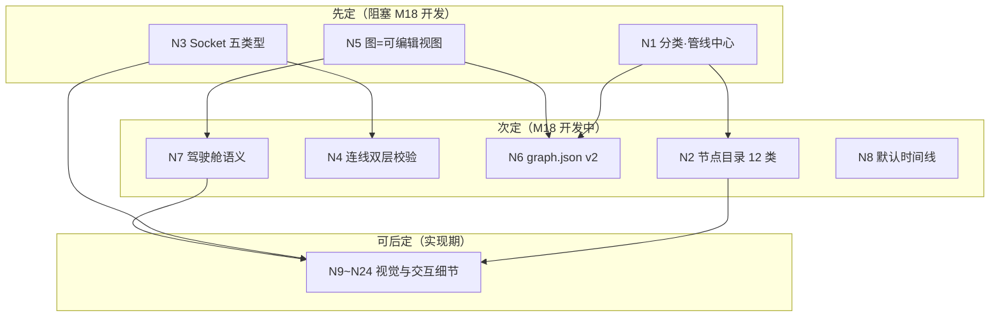

# 第二轮协商 · 节点图设计

> 日期：2026-10-02 ｜ 状态：✅ **已收官**——老板「第二轮直接 pass」（2026-10-02），24/24 全走推荐锁定；白模澄清重评四项（N1/N2/N3/N15）一并通过。R0/R2 实测待确认项 4 条转入 M18 开工前检查清单。第三轮（Agent 团队组成）启动
> 证据基线：v2 `web/react-workspace` 真身源码逐文件实测 + 《三.md》8.1/8.2/8.3/8.4/3.4/3.5/3.6/3.7/5.2/M4/M17/M18/M25
> 文件位置：本文件 R0 立项后迁入 AI影视团队v3/docs/negotiation/

---

## 0. 证据基线（先亮牌）

**好消息**：节点图不用从零画——CINEAST 遗产 `react-workspace` 是一套能跑的 React Flow 完整实现（v2 原样拷贝，package.json 与 v1 MD5 相同）。
**坏消息**：它的数据模型是「图=事实源」时代产物，与 C3「契约唯一事实源」纪律相悖，另有三处文档口径冲突、四处能力缺口。

### 0.1 三.md 已定口径（本轮不再重复问）

| 已定项 | 出处 |
|---|---|
| 工作台双模式：节点图（Blender 几何节点风格）+ 时间线（分镜表格+播放预览） | 8.2 |
| 节点承载岗位/引擎/质检关，连线=契约流转 | 8.2 |
| Lucide 线性风格 SVG 图标，禁 emoji | 8.2（老板长期偏好） |
| 每个节点可展开看探针回显原始输出 | 8.2/6.6 |
| 锁定资产显示挂锁图标 | 8.2 |
| 双模式默认时间线/表单，节点图仅高级用户 | 8.4 痛点12 |
| /api/graph GET/POST 接口保留 | 3.6 |
| WS 进度推送+断线补发 200 条（M17，P1） | 8.3/M17 |
| M18 工作台 v3 适配（P2 5d + 剧组群视图 3-7d） | 第四章 |
| **白模节点输出=五件套**：PNG 帧序列+白模 MP4（FFmpeg 打包 D6b）+逐对象蒙版+EXR+相机旁车 | 白模澄清 Q8/D6b |
| **shot_spec 含 aspect_ratio（16:9/9:16/21:9）+ duration 秒制 8k+1 派生** | D25⑤⑥/Q2c/Q2d |
| **交付=三档×三比例，后处理（RIFE 插帧+超分）归剪辑交付链（M16）** | D25/M16/M22 |

### 0.2 react-workspace 真身实测（可直接继承的资产）

| 层 | 现状（逐文件实测） | 判定 |
|---|---|---|
| 依赖栈 | @xyflow/react 12.3.5 / react 18.3.1 / zustand 5.0.1 / lucide-react 0.460 / vite 6.0.5 | ✅ 直接继承（React Flow v12 即当前主线） |
| 节点组件 CineastNode.jsx | 左入右出 Handle、lucide 16px 图标、状态色点、params 键值行、preview 缩略图、versions 版本条+locked 挂锁、tag | ✅ 骨架优秀，数据结构要换血（N5/N6） |
| 画布 NodeGraph.jsx | 受控模式、点状背景、右键菜单、双击加节点、缩放 0.3-2.5、状态徽章统计（已通过/进行中/未开始） | ✅ 直接继承 |
| 状态 useStore.js | zustand 单仓：连线去重、节点增删改、防抖 800ms 存档 POST /graph、loadGraph 损坏检测、resetGraph、生成/锁定闭环 | ✅ 骨架继承，接口换 v3 |
| 五视图 | graph / versions（版本树）/ budget（预算仪表盘）/ handoffs（交接时间线）/ storyboard（分镜） | ✅ 骨架继承 |
| 数据 nodes.js | 硬编码演示数据（林小雨/小白猫/雨夜巷——《雨夜寻猫》CINEAST 演示） | ⚠️ R0 清理为空画布+模板 |

### 0.3 冲突与缺口（本轮要拍的就是这些）

| # | 类型 | 内容 | 对应决策 |
|---|---|---|---|
| ① | 文档 vs 代码冲突 | 三.md 8.4 定「默认时间线」，旧代码 `activeView:'graph'` 默认节点图 | N8 |
| ② | 文档 vs 代码冲突 | 三.md 8.2 定「节点=岗位/引擎/质检关」，旧代码 nodeType=element/task/review/decision（资产/任务/审查/决策） | N1/N2 |
| ③ | 纪律冲突（最重） | 旧节点内嵌 prompt/params 且由前端 POST 保存——图=第二事实源；C3 纪律=契约唯一事实源 | N5/N6 |
| ④ | 能力缺口 | Handle 无类型、任何节点可连任何节点、零校验 | N3/N4 |
| ⑤ | 能力缺口 | 无撤销/重做 | N13 |
| ⑥ | 能力缺口 | 30 秒轮询拉数据，未接 WebSocket（M17 方案已定未接） | N20 |
| ⑦ | 能力缺口 | graph.json 无版本号、无 schema、无后端校验 | N6 |
| ⑧ | 遗留隐患 | package.json 与 v1 完全相同（拷贝未适配）；/generate 直连 ComfyUI 8188 是 CINEAST 时代路径 | R0 清理清单 |

---

## 1. 核心决策（8 个，完整展开）

### N1 节点分类体系（两套分类怎么统一）
- **背景**：8.2 设计要点写「节点=岗位/引擎/质检关」，但旧实现左栏已有岗位列表（agentList 9 岗），若节点再=岗位，两处重复；且「连线=契约流转」的主语是产物不是岗位（岗位是执行者，契约在产物之间流转）。
- **候选**：
  | 方案 | 节点代表 | 连线代表 | 问题 |
  |---|---|---|---|
  | A. 岗位中心 | 岗位（导演/编剧/白模岗…） | 岗位间交接 | 与左栏岗位列表重复；一个岗位干 12 镜时图会爆炸成蛛网 |
  | B. 产物中心（旧延伸） | 资产/任务/审查/决策 | 任务依赖 | 旧代码零改动；但「任务」与契约流转无对应关系 |
  | C. 管线中心 | 契约产物（剧本→shot_spec→白模→写实化→QC→交付） | 契约流转 | 节点头部挂**执行岗位徽章+引擎路由标签**（如写实化节点挂「VACE」）——岗位/引擎以徽章形式呈现 |
- **推荐 C（管线中心+岗位/引擎做徽章）**：与「连线=契约流转」严格一致；12 镜项目=12 条平行管线，比 9 个岗位节点+几百条线可读；质检关天然是一类节点（6.3 六道关）；老板签字保留为独立节点（旧 decision 节点遗产）。
- **🔄 澄清重评（2026-10-02，Q8/D6b 拍板后）**：推荐 C 不变，**白模节点产物清单更新为五件套**——PNG 帧序列（frames/）+白模 MP4（video/，FFmpeg 打包 D6b，喂引擎主产物）+逐对象蒙版序列（masks/）+EXR（exr/）+相机旁车（cam/）。管线图上白模节点的 media 输出口对应扩为「帧序列+视频」双产物；写实化节点的输入徽章挂引擎路由（VACE/fal/Wan/Seedance）不变。
- **决策影响**：N2 节点目录、N6 数据模型、M18 组件设计、剧组群视图直播口径（事件挂产物节点上解说更顺）。
- **可逆性**：半可逆（组件重写中等成本，graph.json 数据可迁移）。
- **来源**：三.md 8.2/3.4 核心业务流程/5.2 岗位清单；react-workspace LeftSidebar agentList + nodes.js 实测；白模澄清 Q8。

### N2 首发节点目录（节点类型清单）
- **背景**：管线中心制下，节点类型全集决定 M18 工作量与图表达力。
- **候选**：
  | 方案 | 节点类型 | 覆盖 |
  |---|---|---|
  | A. 精简 8 类 | 项目/剧本/shot_spec/白模/写实化/质检/交付/老板签字 | R0~R1 全流程最小可跑 |
  | B. 标准 12 类 | A + 语义字典/引擎选择/重渲 Retake/成本 | 覆盖 3.9 语义映射（M25 是 P0）+ Retake（痛点5）+ 熔断可视化（8.3） |
  | C. 全量 16+ 类 | B + 四轨音频/混音/合规打标/版本树 | P1/P2 全量 |
- **推荐 B（12 类）**：语义字典必须有可见入口（3.9 定为唯一事实来源，全剧组只引用不另立）；Retake 是行业痛点 5 的直接答案；成本节点让熔断可视化落到图上。C 的音频/合规属 P1/P2，M18 到阶段再加类型即可（类型可增量）。
- **🔄 澄清重评（2026-10-02，D25/Q2d 拍板后）**：推荐维持 **12 类不扩**，「交付」类**扩义吸收后处理**——D25 新增的 RIFE 插帧+超分+三档×三比例（16:9/9:16/21:9）打包属剪辑交付链内部步骤（三.md M16 一体：技术剪辑+混音+插帧+超分+转档全在一个模块），交付节点的参数面板呈现「档位 L1/L2/L3 × 比例」选择即可；单列第 13 类「后处理」节点属过度拆分（产物形态上插帧超分后的成片就是交付物前置形态，无独立契约对应）。
- **决策影响**：M18 工作量（12 类节点组件+参数面板）、N6 schema 枚举。
- **可逆性**：可逆（类型可增；减类型需迁移，R2 前不会发生）。
- **来源**：三.md 3.4/6.3/8.3/M16/M22/M25/痛点5；白模澄清 D25。

### N3 Socket 类型系统
- **背景**：旧 Handle 无类型（左右各一裸端口，任意连）。三.md 定「连线=契约流转」，契约产物有明确种类边界。
- **候选**：
  | 方案 | 类型数 | 校验能力 | 开发量 |
  |---|---|---|---|
  | A. 无类型（旧延续） | 0 | 无 | 0 |
  | B. 五类型 | contract（shot_spec）/ semantic（semantic_map）/ media（帧·视频·音频·蒙版）/ report（QC·成本·血缘）/ signoff（签字） | 「白模帧→交付」这类荒谬连线拖线瞬间被拒 | 中 |
  | C. 强类型+子类型 | 12+（media 再分 image/video/mask/audio） | 更细 | 大 |
- **推荐 B（五类型+Socket 色环）**：类型数=契约+产物大类，够校验；media 细分放节点参数面板（B 档蒙版输入是写实化节点的参数，不需要独立 Socket）；C 对单人项目过度设计。色环=Blender 几何节点风格要素（老板点名偏好）。
- **🔄 澄清重评（2026-10-02，D6b/D25 拍板后）**：五类型框架不变；**media 子类型枚举显式含「视频」**——media = 帧序列（PNG）/视频（白模 MP4、写实 MP4、三档×三比例成片）/蒙版/音频/参考图。白模节点→写实化节点的主连线走 media(video)（白模 MP4 是喂引擎主产物），帧序列/蒙版/EXR 是白模节点的辅助输出口（QC 与 B 档消费）。仍不升 C 强类型：视频细分在参数面板标注即可。
- **决策影响**：N4 校验规则、N10 视觉、节点组件 Handle 渲染。
- **可逆性**：半可逆（类型枚举进 schema，改动牵动校验器与存量图）。
- **来源**：三.md 3.7 五契约/8.2；Blender 手册几何节点 Socket 颜色惯例（docs.blender.org）；白模澄清 D6b。

### N4 连线规则与校验时机
- **背景**：类型系统定了，校验放哪层、违禁连线怎么反馈。
- **候选**：
  | 方案 | 前端 | 后端 | 反馈 |
  |---|---|---|---|
  | A. 双层校验 | 拖线即校验（isValidConnection 拦截，类型不符拖不出来） | /api/graph POST 时全图校验 | 即时+存档双保险 |
  | B. 仅保存时校验 | 随意连 | 校验 | 保存时才知错 |
  | C. 仅前端 | 拦截 | 信任前端 | 手改 graph.json 可绕过 |
- **推荐 A（双层）**：前端拦截给即时反馈；后端校验是纪律（与 M4 契约校验器同源规则，CLI/手改文件都逃不掉）。
- **决策影响**：M4 校验器新增 graph 规则、/api/graph。
- **可逆性**：可逆。
- **来源**：React Flow 官方文档 isValidConnection API（reactflow.dev）；三.md M4/9.1。

### N5 事实源方向（本轮最重的一个）
- **背景**：旧实现节点内嵌 prompt/params、前端 POST 保存——图是事实源。C3 纪律：shot_spec/semantic_map 契约唯一事实源（3.9.6 铁律「提示词必须由 prompt_fragment 组装，禁手写颜色指代」——若 prompt 可存图上，此铁律直接失效）。但全只读会沦为看板，违背 8.1「工作台=精细控制台」。
- **候选**：
  | 方案 | 图存什么 | 编辑方式 | 风险 |
  |---|---|---|---|
  | A. 纯视图 | 只存拓扑+布局，全部数据引用契约 ID | 只读，编辑跳契约 | 最干净但零自由度（备注/分组都要建契约字段） |
  | B. 可编辑视图 | 拓扑+布局+**白名单轻字段**归图；内容字段引用契约 | 轻字段图上改，重字段同屏滑出契约面板 | 白名单边界要守 |
  | C. 图=事实源（旧延续） | prompt/params 全存图 | 图上直接改 | 第二事实源，违反 v2/V9 纪律；M25 组装器被绕过 |
- **推荐 B**：白名单四字段=布局 position、节点备注 note、分组 group、显示开关；其余（prompt、engine_routing、locks、object_mapping）一律引用契约 ID。图上点 prompt 行→右侧同屏滑出契约编辑面板（不换页），保存走 /api/shots 原子写入，不走 /api/graph。
- **决策影响**：N6 schema、M18、/api/graph 语义收窄（只管图，不管内容）、M25 铁律的执行保证。
- **可逆性**：半可逆（若先按 C 开发再改，图数据要迁移清洗）。
- **来源**：三.md M1/V9/3.9.6/9.4；useStore.generate 实测（prompt 内嵌节点直发 /generate）。

### N6 graph.json v2 数据模型
- **背景**：旧 {nodes, edges} 无版本无校验。C3 要进 M4 校验器家族+git 版本管理（M2）。
- **候选**：
  | 方案 | 结构 | diff 友好度 |
  |---|---|---|
  | A. 延续+补丁 | nodes/edges 平铺 + graph_version:2 + JSON Schema 进 M4 校验器 | 中（拖动节点会污染 diff） |
  | B. 布局/语义分层 | layout.json（位置尺寸）与 graph.json（拓扑+契约引用）两文件 | 好（语义 diff 干净） |
  | C. 图进 SQLite | 节点表+边表，与 jobs.db 同源 | 差（不可 git diff） |
- **推荐 A 先行、R3 按需升 B**：R2 用 A 跑通（旧 store 防抖保存骨架直接保留）；「拖动污染 diff」先用「拖动结束才存档」缓解（旧防抖 800ms 已具备）；等真做图版本对比功能再拆 B，避免过早设计。
- **决策影响**：/api/graph、M2 git、未来版本 diff 功能。
- **可逆性**：可逆（A→B 兼容拆分）。
- **来源**：useStore.saveGraph 实测；三.md M2/M4/9.1。

### N7 执行语义（看戏还是开车）
- **背景**：8.1「工作台做机房=精细控制台」；旧实现有 generate 按钮直连 ComfyUI。C3 触发写实化要走开拍单（制片岗铁律：无开拍单不花钱）。图上放不放「执行」按钮？
- **候选**：
  | 方案 | 图上能干什么 | 纪律怎么守 |
  |---|---|---|
  | A. 驾驶舱 | 图上可触发 realize/retake/重渲白模/跑 QC | 按钮一律打后端接口，后端查开拍单，无单返回 409+弹「一键 @制片」引导 |
  | B. 监控台 | 只看+跳转，执行去时间线模式或 CLI | UI 无按钮=无绕过 |
  | C. 驾驶舱限免费动作 | 免费动作（白模重渲/QC）图上直接跑；花钱动作跳开拍单 | 双轨按钮 |
- **推荐 A（驾驶舱）**：纪律放 API 层而非 UI 层（UI 拦截形同虚设，CLI/飞书都能绕过）；驾驶舱效率是「机房」存在的意义；无开拍单时按钮不死——弹引导把纪律变成流程而非红绿灯。熔断触发时图上按钮全局置灰（M11 联动）。
- **决策影响**：M18、M11 熔断、M6 crew_bus（图上触发也广播剧场）。
- **可逆性**：可逆。
- **来源**：三.md 8.1/5.3 制片岗铁律/3.6 /api/realize 幂等 409。

### N8 默认模式与模式切换（冲突①裁决）
- **背景**：文档（8.4 痛点12）明确「默认时间线/表单，节点图仅高级用户」，旧代码默认 graph。文档口径已定，本轮拍的是落地细节。
- **候选**：
  | 方案 | 默认 | 记忆 | 入口 |
  |---|---|---|---|
  | A. 按文档改+记忆选择 | 时间线模式 | localStorage 记住上次选择 | Topbar 一键切换（旧视图栏继承） |
  | B. 旧延续 | 节点图 | — | — |
  | C. 首次引导弹窗 | 弹窗选一次 | 记住 | 首开弹窗 |
- **推荐 A**：文档口径执行；老板本机常用节点图——记忆选择后第二次进就是节点图，对老板无感；给未来课程用户/普通用户的默认=时间线（零学习成本，8.4 同源逻辑）。
- **决策影响**：M18 Topbar、R6 隐式模式预留。
- **可逆性**：可逆（一行默认值）。
- **来源**：三.md 8.4 痛点12；App.jsx `activeView:'graph'` 实测冲突。

---

## 2. 快决策（16 个，紧凑表）

| # | 决策点 | 候选 | 推荐 | 理由（一句话） | 可逆性 |
|---|---|---|---|---|---|
| N9 | 图标体系 | 沿用 6 枚 / 按类型扩 | **12 类节点各配 lucide 线性图标（16px/2px 描边）** | 旧 iconMap 机制继承只扩映射表；三.md 禁 emoji 明令 | 可逆 |
| N10 | Socket 视觉 | 色块 / 色环 | **五类型五色描边圆点（色环）** | Blender 几何节点风格要素（老板点名偏好） | 可逆 |
| N11 | 连线语义 | 旧实/虚线 / +箭头+动画 | **实线=已流转、虚线=待流转（继承）+箭头+执行中流动动画** | 旧语义已验证；动画让「谁在跑」一眼可见 | 可逆 |
| N12 | 节点状态色 | 重设计 / 继承 | **继承 5 色（green通过/yellow进行中/red FAIL/blue新产出/gray未开始）映射 QC verdict** | statusColors 实测可用；red 直连 qc_failed | 可逆 |
| N13 | 撤销重做 | 不做 / 快照 50 步 | **✅ 已定（P1改造 2026-10-02：两档 30 步快速 / 100 步精细）——zundo（zustand 官方 temporal 中间件）快照式，档位由 localStorage 记忆用户选择** | 图编辑器无 undo 不可接受；同作者兼容性 R0 实测 | 可逆 |
| N14 | 自动布局 | 手摆 / dagre / elkjs | **elkjs 一键层状布局+手动微调为主** | React Flow 官方布局方案之一，层状贴合管线 DAG | 可逆 |
| N15 | 缩略图预览 | 无 / 继承旧 | **继承+两处小改（澄清重评）：产物节点头部微缩帧改「白模视频首帧截图」（从白模 MP4 抽帧，非独立渲染帧）/写实首帧/QC 对比图），框比例随 aspect_ratio 自适应（16:9/9:16/21:9，默认 16:9），点击放大** | 旧 preview 机制已验证；三比例档缩略图不能锁死 16:9 框 | 可逆 |
| N16 | 版本条+挂锁 | 文字 / 图标化 | **继承 versions 条+Lucide Lock 挂锁；K13 锁定版本描金边** | 8.2 挂锁明令；接通 M14 K13 | 可逆 |
| N17 | 探针回显面板 | 外部页 / 节点内 | **节点展开抽屉：命令+原始输出+时间戳，只读** | 8.2「可展开看探针回显」明令 | 可逆 |
| N18 | 右键菜单 | 旧继承 / 扩展 | **继承+扩四项：重渲此镜/打回（四要素）/锁定/复制** | 旧 ContextMenu 已验证；打回走 6.4 协议 | 可逆 |
| N19 | 剧场联动 | 无 / 事件上总线 | **图上执行事件（realize 开始/QC FAIL/熔断）同步发 crew_bus** | 3.10 多端口径一致：同一事件流不同出口 | 可逆 |
| N20 | 实时刷新 | 30s 轮询（旧）/ WS | **换 /ws/progress+补发 200 条（M17），节点状态实时刷** | 旧轮询是缺口⑥；M17 方案直接接 | 可逆 |
| N21 | 图规模上限 | 不限 / 上限 | **✅ 已定（P1改造 2026-10-02：三档 ≤30 短片 / ≤60 标准 / ≤120 长片分章）——按项目规模档位配置，可读性护栏非性能护栏，超限提示** | React Flow 百节点无压力，上限是可读性护栏非性能护栏 | 可逆 |
| N22 | 子图/分组 | 嵌套 subflow / group 框选 | **R2 首发 group 框选命名（如「第一幕」），嵌套 subflow 不做** | 控复杂度；单人项目嵌套图过度设计 | 可逆 |
| N23 | 快捷键 | 无 / Blender 化 / 通用 | **通用桌面键位（Delete 删除（旧有）/Ctrl+D 复制/框选/空格平移）** | Web 编辑器用通用键位学习成本最低 | 可逆 |
| N24 | PNG 快照导出 | 无 / 有 | **html-to-image 一键导出 PNG（React Flow 官方导出示例同款），贴飞书剧场汇报用** | 老板汇报场景高频；开发半天 | 可逆 |

---

## 3. 决策依赖图

---

## 4. 拍板清单（2026-10-02 已收官：老板「第二轮直接 pass」，24/24 全走推荐 ✅）

> 2026-10-02 老板整体回复「第二轮直接 pass」——24 项全部按推荐锁定，无单项修改；澄清重评四项（N1/N2/N3/N15）随整体通过。

| # | 决策 | 推荐 | 可逆性 | 选择 |
|---|---|---|---|---|
| N1 | 节点分类体系 | C. 管线中心+岗位/引擎徽章；白模节点输出=五件套（含白模 MP4）🔄澄清重评 | 半可逆 | ✅ 走推荐 |
| N2 | 首发节点目录 | B. 12 类；「交付」类吸收后处理（插帧/超分/三档×三比例）🔄澄清重评 | 可逆 | ✅ 走推荐 |
| N3 | Socket 类型系统 | B. 五类型+色环；media 枚举含视频 MP4 🔄澄清重评 | 半可逆 | ✅ 走推荐 |
| N4 | 连线校验 | A. 双层（前端拦截+后端校验） | 可逆 | ✅ 走推荐 |
| N5 | 事实源方向 | B. 可编辑视图（白名单四字段归图） | 半可逆 | ✅ 走推荐 |
| N6 | graph.json v2 | A 先行（+版本号+schema），R3 按需分层 | 可逆 | ✅ 走推荐 |
| N7 | 执行语义 | A. 驾驶舱（纪律在 API 层） | 可逆 | ✅ 走推荐 |
| N8 | 默认模式 | A. 按文档默认时间线+记忆选择 | 可逆 | ✅ 走推荐 |
| N9 | 图标体系 | 12 类各配 lucide | 可逆 | ✅ 走推荐 |
| N10 | Socket 视觉 | 五色色环 | 可逆 | ✅ 走推荐 |
| N11 | 连线语义 | 实/虚线+箭头+流动动画 | 可逆 | ✅ 走推荐 |
| N12 | 状态色 | 继承 5 色映射 QC | 可逆 | ✅ 走推荐 |
| N13 | 撤销重做 | zundo 快照 50 步 | 可逆 | ✅ 走推荐（**P1改造 2026-10-02：两档 30/100，localStorage 记忆**） |
| N14 | 自动布局 | elkjs+手动微调 | 可逆 | ✅ 走推荐 |
| N15 | 缩略图预览 | 继承+白模视频首帧截图+比例自适应 🔄澄清重评 | 可逆 | ✅ 走推荐 |
| N16 | 版本条+挂锁 | 继承+接 K13+金边 | 可逆 | ✅ 走推荐 |
| N17 | 探针回显 | 节点内只读抽屉 | 可逆 | ✅ 走推荐 |
| N18 | 右键菜单 | 继承+扩四项 | 可逆 | ✅ 走推荐 |
| N19 | 剧场联动 | 执行事件上 crew_bus | 可逆 | ✅ 走推荐 |
| N20 | 实时刷新 | WS+补发 200 条 | 可逆 | ✅ 走推荐 |
| N21 | 图规模上限 | ≤60 节点 | 可逆 | ✅ 走推荐（**P1改造 2026-10-02：三档 ≤30/≤60/≤120 按项目规模**） |
| N22 | 子图/分组 | group 框选，不做嵌套 | 可逆 | ✅ 走推荐 |
| N23 | 快捷键 | 通用桌面键位 | 可逆 | ✅ 走推荐 |
| N24 | PNG 导出 | html-to-image | 可逆 | ✅ 走推荐 |

---

## 5. R0/R2 实测待确认项

1. zundo 与 zustand 5.0.1 兼容性（同作者，推测兼容，R0 实测）
2. elkjs 60 节点布局耗时（推测 <100ms，R2 实测）
3. @xyflow/react 12.3.5 锁版策略（M18 开工时评估是否升级小版本）
4. 剧组群视图「组件参考 AutoGen UI」具体参考对象（M18 描述，R2 调研补源）

## 6. 下一轮预告

第三轮主题：**Agent 团队组成**（7+2 岗位的 CrewAI role/goal/backstory 细化、职责边界与铁律落地、Skill/MCP/Tool/Function Calling 分工、记忆机制、Flows 工作流、失败处理与升级、权限控制）。

## 7. 收官记录（2026-10-02）

白模定位澄清期间本文件挂起冻结，Q2d 拍板后全链同步完成、本节恢复抛出；同日老板回复「第二轮直接 pass」，**24 项（N1~N24）全部按推荐锁定**——重评四项（N1 白模节点五件套 / N2 交付类吸收后处理 / N3 media 含视频 / N15 缩略图首帧截图+比例自适应）随整体通过，其余 20 项按原文推荐锁定。决策已写入 [DECISIONS.md](DECISIONS.md) 第二轮表。R0/R2 实测待确认项 4 条（zundo 兼容性 / elkjs 布局耗时 / @xyflow 锁版策略 / AutoGen UI 参考对象）转入 M18 开工前检查清单。进入第三轮：**Agent 团队组成**。
