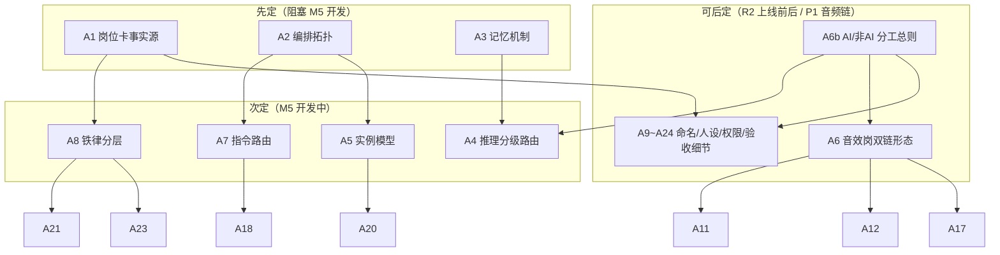

# 第三轮协商 · Agent 团队组成

> 日期：2026-10-02（当日岗位配置修正版）｜ 状态：⏸️ **挂起待审计**——27 个决策点已提交一刀切审计，审计报告见 [03-one-size-fits-all-audit.md](03-one-size-fits-all-audit.md)
> 证据基线：《三.md》第五章（5.1~5.5 岗位体系）+ 3.2（CrewAI Flows 选型）/3.10（crew_bus+剧场双出口）+ 第四章 M5/M6/M15/M16 + 7.1/7.5（推理分级与 LLM 成本）+ 5.4 协作协议 + CrewAI 官方文档三项核实（Flows checkpoint / memory / agents.yaml）+ **v2 音频链实读（acestep_client.py/tts_generator.py/gen_bgm.py/gen_sfx.py/gen_ambient.py/build_mix.py/audio_cues_v1.json）+ 板块①b 调研（音质链模型许可/显存核实）+ 老板 2026-10-02 新口径（团队可 AI+非 AI 混合；音效岗=BGM/音效生成模型+高级 TTS）**
> 文件位置：本文件 R0 立项后迁入 AI影视团队v3/docs/negotiation/

---

## 0. 证据基线（先亮牌）

**好消息**：岗位体系的三分之二已在《三.md》定死——7+2 岗位清单与铁律（5.2/5.3）、协作协议（5.4：总线路由/权力层级/争执 2 轮升级/合同流转）、编排选型（3.2：CrewAI Flows，role/goal/backstory 映射岗位）、crew_bus 六类事件（3.10）。本轮不推翻任何已定项，只拍「CrewAI 落地时三.md 没写到的细节」。
**坏消息**：三.md 留了四个真空带——岗位卡双写机制（5.5 只写了一句「SKILL.md（CrewAI backstory 双写）」没定谁是事实源）、记忆机制（CrewAI 自带 memory 全文未提）、推理分级路由表（7.1 只说有分级没说哪岗哪档）、工具岗的 Agent 化程度（音效师/剪辑师是真人 LLM 岗还是工具链）。
**2026-10-02 当日修正（老板新口径，刻进基线）**：① 老板明确**团队可以 AI+非 AI 混合**——不是所有岗位都必须是 AI Agent，需一条总判据（本轮新增 A6b）；② 老板点名**音效岗=BGM/音乐/音效生成模型（开源本地/API）+高级 TTS（像真人配音）**——音效岗从笼统的「纯工具链」重新定性为「双链 AI 模型工具链」（本轮 A6 重写），且 v2 家底实读确认：ACE-Step 1.5 ComfyUI 客户端已存在且 smoke 通过（`tools/acestep_client.py`+`05_audio/bgm/acestep_smoke.flac`），TTS 现用 edge-tts（板块①b 判 🔴 违反微软自动化条款待换），BGM/SFX/环境主力仍是程序合成（gen_bgm 泛音钢琴/gen_sfx 白噪声滤波/gen_ambient 白噪声），三.md M15/R3 定稿方向为 CosyVoice3+afir+ebur128。
**2026-10-02 四层深度调研收官（层五映射，详见配套 03a 报告）**：25 决策点经四层外部证据逐项检验——**22 项维持或强化、0 项推翻**（A2 获 CrewAI 官方「生产应用从 Flow 开始」原文背书；A14「2 轮」与辩论负面实证三重吻合——MAD vs CoT 胜率<20%；A8/A21 获 Snowball 级联逃逸率 89.3% 硬理由），**2 项新增**：A25 场记 QC 评分校准（LLM-as-judge 三偏差治理）+A26 任务级预算信封（重试循环成本硬顶）；另标注 2 项原创风险（A19 权限矩阵、A6b 台账驱动演化——无先例≠错，R2 实测是唯一验证途径）。

### 0.1 三.md 已定口径（本轮不再重复问）

| 已定项 | 出处 |
|---|---|
| 编排框架=CrewAI Flows（MIT，~50K stars；Flows 自带状态/checkpoint） | 3.2 |
| 岗位=7 核心（导演/制片/编剧/预演/白模/写实化/场记）+2 工具岗（音效师/剪辑师 P1） | 5.2 |
| 每岗位有职责/输入/输出/铁律四件套（SKILL 定义表） | 5.3 |
| 协作骨干=crew_bus 总线（六类事件 100% 落 SQLite）；飞书/工作台=剧场出口 | 3.10 |
| 权力层级：老板终裁→导演管艺术→制片管流程；「老板发言=终局」 | 5.4 |
| 争执熔断：平级最多 2 轮，第 3 轮强制升级导演；方向级分歧老板拍板 | 5.4 |
| 合同流转：shot_spec 四岗 owner_signoff；semantic_map 预演创建、全剧组只引用 | 5.4 |
| LLM=Kimi（openai 兼容）+Instructor/Pydantic 结构化输出；推理分级存在 | 3.2/7.1 |
| M5 验收=编剧→预演接力产出合法 shot_spec（P0，2d） | 第四章 |
| R6 隐式模式：用户可关闭剧组视图，单按钮流水线 | 5.4 |

### 0.2 CrewAI 官方文档核实（2026-10-02 三路验证）

| 核实项 | 结论 | 来源 |
|---|---|---|
| Flows API | `@start`/`@listen` 装饰器 + `CheckpointConfig(location, on_events)` 断点续跑——3.2 「Flows 自带状态/checkpoint」属实且是当前主线 API | [Checkpointing](https://docs.crewai.com/en/concepts/checkpointing) |
| Memory | 四种记忆（Short-Term/Long-Term/Entity/User），默认 **OpenAI text-embedding-3-large embedder** + lancedb 存储——RAG 检索式召回，非确定性 | [Memory](https://docs.crewai.com/concepts/memory) |
| 岗位配置 | role/goal/backstory 必填，标准工程结构 `config/agents.yaml`+`config/tasks.yaml`+`crew.py`，每 Agent 可单独指定 llm | [Agents](https://docs.crewai.com/concepts/agents)、[First Crew](https://docs.crewai.com/guides/crews/first-crew) |

### 0.3 本轮要拍的真空带

| # | 真空带 | 对应决策 |
|---|---|---|
| ① | 岗位卡双写：SKILL.md 与 agents.yaml 谁是事实源 | A1 |
| ② | 编排拓扑：Flows 与 Crew（对话单元）怎么分工 | A2 |
| ③ | 记忆机制：CrewAI memory 开不开 | A3 |
| ④ | 推理分级路由：哪岗哪档 | A4 |
| ⑤ | 岗位实例模型：单实例还是多实例 | A5 |
| ⑥ | 工具岗形态与 AI/非 AI 分工：音效师双链 AI 模型工具链的具体构成；全队 9 岗 AI/非 AI 定性判据 | A6/A6b |
| ⑦ | 老板指令路由：@岗位 怎么执行 | A7 |
| ⑧ | 铁律执行层：backstory 软约束还是代码硬闸 | A8 |
| ⑨ | QC 评分可信度：场记判断类打分（构图/叙事/审美）的 LLM-as-judge 三偏差治理 | A25 |
| ⑩ | 任务内成本硬顶：LLM 自我修正循环烧 token 无上限（开拍单管不到） | A26 |

---

## 1. 核心决策（11 个，完整展开）

### A1 岗位卡事实源与双写策略
- **背景**：5.5 定「人格载体=SKILL.md（CrewAI backstory 双写）」——但两套定义并存必须定谁是事实源，否则就是第二个「graph.json 无版本」式隐患（第二轮 N5/N6 刚拍完的教训）。SKILL.md 是 v2 血统（人格细节/铁律/输入输出全在里面），agents.yaml 是 CrewAI 运行时格式（role/goal/backstory/llm/tools）。
- **候选**：
  | 方案 | 事实源 | 同步方式 | 风险 |
  |---|---|---|---|
  | A. SKILL.md 事实源 | SKILL.md（v2 血统人格全文） | 脚本解析 SKILL.md 头部结构化区块→生成 agents.yaml，CI/M4 校验器查漂移 | 解析器要写（约 0.5d） |
  | B. agents.yaml 事实源 | CrewAI 原生格式 | SKILL.md 由脚本反向生成文档 | SKILL.md 沦为生成物，人格细节（长 backstory/案例）塞不进 YAML 惯例 |
  | C. 手工双写 | 两个都是 | 靠自觉 | 必然漂移，违反契约纪律 |
- **推荐 A**：契约纪律的延伸——「一处定义，处处派生」（同 graph.json v2 的 N5/N6 逻辑、提示词必须组装器生成的 3.9.6 逻辑）。SKILL.md 头部用 YAML frontmatter 存机器字段（role/goal/llm 档位/tools 绑定/agent_id），正文 Markdown 存人格细节（backstory 全文/铁律/案例）——解析器只读 frontmatter+backstory 段，agents.yaml 全自动生成。
- **决策影响**：A9/A10/A17（命名/字段/人设全在 SKILL.md 里定）、M5 工作量（+0.5d 解析器）、9.1 维护制度。
- **可逆性**：可逆（格式调整不丢内容）。
- **来源**：三.md 5.5/9.1/V9；第二轮 N5/N6 先例；[CrewAI agents.yaml 结构](https://docs.crewai.com/guides/crews/first-crew)。

### A2 编排拓扑（Flows 与 Crew 怎么分工）
- **背景**：3.2 已定 CrewAI **Flows** 做总编排（状态机+checkpoint），但 5.4 的协作场景有两类性质完全不同的流程——①线性主管线（剧本→预演→白模→写实化→质检→交付，天然状态机）；②多轮对话（平级争执 2 轮、导演仲裁、终审建议，天然是对话）。Flows 不擅长自由多轮对话，Crew 恰好擅长。
- **候选**：
  | 方案 | 主管线 | 争执/仲裁 | 复杂度 |
  |---|---|---|---|
  | A. 单一大 Flow | Flow 状态机 | 也在 Flow 里写 if-else 循环 | 对话逻辑塞状态机，代码丑且难调 |
  | B. 纯 Crew 接力 | Crew sequential/hierarchical | Crew 天然支持 | 主管线失去 checkpoint/断点续跑；层级 Crew 的 manager 与导演岗语义冲突 |
  | C. Flows 骨架+节点内嵌小 Crew | Flow 管主干（每阶段一个节点） | 争执仲裁/终审=按需组建 2-3 岗位小 Crew，对话完回流 Flow | 两套范式各干擅长的事 |
- **推荐 C**：「Flow 管流程、Crew 管对话」——主管线用 Flow（checkpoint 支撑 R4 式断点续跑：白模渲到 60 帧崩了从 checkpoint 恢复）；争执仲裁（编剧 vs 预演 2 轮）动态组建小 Crew（涉事双方+导演），对话记录全程发 crew_bus（dispute→escalate 事件）。老板 @干预走 A7 的路由层注入对应 Flow 节点。
- **决策影响**：A7 路由层、M5 模块设计、crew_bus 事件模型（dispute/escalate 事件的载体）。
- **可逆性**：半可逆（骨架重排成本中等）。
- **来源**：三.md 3.2/5.4/3.10；[Flows checkpoint](https://docs.crewai.com/en/concepts/checkpointing)；阶段二 2.2.8。

### A3 记忆机制（CrewAI memory 开不开）——本轮最有 C3 特色的一条
- **背景**：CrewAI 自带四种记忆（Short-Term/Long-Term/Entity/User），听起来很香，但对照 C3 纪律逐条检查全亮红灯。
- **候选**：
  | 方案 | 记忆配置 | 后果 |
  |---|---|---|
  | A. 全关——契约即记忆 | memory=False，上下文=任务注入（shot_spec/semantic_map/相关台账按需注入 prompt） | 干净可复现；需要什么由编排器显式给 |
  | B. 开 Short-Term | 当前执行内 RAG 召回近期交互 | 召回内容每次不同（RAG 非确定性），探针回显无法复现 |
  | C. 全开（含 Long-Term/Entity） | 跨会话知识沉淀 | **默认 OpenAI text-embedding-3-large embedder**——引入第二个 LLM 供应商+embedding 费用，违背 Kimi-only 栈与 0 元纪律 |
- **推荐 A（全关）**，三点理由：①**可复现性**——RAG 召回是概率性的，同一输入两次跑召回不同上下文，直接违反探针回显制度（6.6：报什么必须附原始输出）；②**供应商纪律**——memory 默认走 OpenAI embedder，要么花钱要么换 embedder（又一堆配置），而 C3 的「记忆」早已由设计承载：semantic_map=对象记忆、handoffs=协作记忆、cost_ledger=成本记忆、jobs.db=执行记忆；③**岗位人格稳定**——记忆会让岗位「越来越像自己训练过的样子」，跨项目漂移不可控。**留一个可逆点记录在案**：若 R2 实测发现某岗位确实缺跨会话上下文（如编剧续写第二稿忘了第一稿风格决策），单岗位评估开 Short-Term（embedder 换本地 bge-small，0 元），届时回 DECISIONS.md 修订。
- **决策影响**：所有岗位卡（backstory 不写「记住」类承诺）、M5 配置、探针回显可复现性。
- **可逆性**：可逆（配置开关）。
- **来源**：三.md V9/6.6/7.1（0 元纪律）；[CrewAI Memory 默认 embedder](https://docs.crewai.com/concepts/memory)。

### A4 LLM 推理分级路由表
- **背景**：7.1/7.5 已定「推理分级」存在且 Kimi 全程 10~30 元，但哪岗位用哪档没写。**三档模型路由**：
  | 档位 | 模型/配置 | 适用场景 | 成本特征 |
  |---|---|---|---|
  | **低档** | Kimi + Instructor/Pydantic 结构化输出 | 格式转换、填表、参数组装、分类 | 最省（<1 分/次） |
  | **中档** | Kimi 标准推理（无 Instructor） | 常规理解、简单生成、报告撰写 | 中等（几分/次） |
  | **高档** | Kimi 深度推理（max_tokens 放宽+思维链） | 意图解读、争执仲裁、终审意见、审美权衡 | 最贵（几毛/次） |

  岗位任务性质天然分两档：**格式转换型**（输入输出都是结构化数据，规则明确）与**判断型**（开放式理解/权衡/裁决）。
- **候选**：
  | 方案 | 分档依据 | 问题 |
  |---|---|---|
  | A. 按岗位 | 导演/编剧高档，其余低档 | 编剧 80% 工作是结构化输出（场次/台词 JSON），全高档浪费 |
  | B. 按任务类型 | 结构化输出→低档+Instructor；意图解读/仲裁/终审→高档 | 同一岗位不同任务不同档，路由表稍复杂 |
  | C. 全统一档 | 先跑通再说 | 简单但放弃成本控制手段 |
- **推荐 B（按任务分档）**：路由表落 config（model_routing），与 prices.json 同目录同源管理。初版路由表：

  | 任务 | 档位 | 理由 |
  |---|---|---|
  | 编剧：一句话创意→剧本 JSON | 低档+Instructor | 格式转换，schema 校验兜底 |
  | 预演：剧本→shot_spec 15 字段 | 低档+Instructor | 填表任务，铁律可校验 |
  | 导演：意图解读/争执仲裁/终审意见 | 高档 | 判断型，质量敏感 |
  | 制片：任务拆解/预算路由 | 低档 | 规则明确（prices.json 查表） |
  | 白模岗/写实化岗/场记 | 低档 | 工具链编排为主，LLM 只做参数组装与报告生成 |
  | 路由层（A7）：意图分类 | 低档 | 分类任务 |

  R2 样片后按 cost_ledger 实测数据调档（谁贵谁降档）。
- **决策影响**：M11 成本账本字段（model 档位入账）、7.5 成本测算、M5 配置。
- **可逆性**：可逆（改配置即改档）。
- **来源**：三.md 7.1/7.5/3.2（推理分级）；第二轮 D22 先例（首跑实测+健康线）。

### A5 岗位实例模型（1 岗 1 Agent 还是多实例）
- **背景**：12 镜项目里白模渲染/写实化执行天然并行，岗位要不要开多实例（12 个写实化岗 Agent 同时跑）？
- **候选**：
  | 方案 | 结构 | 问题 |
  |---|---|---|
  | A. 1 岗=1 Agent 全串行 | 决策+执行都在岗位内 | 12 镜排队跑，速度不可接受 |
  | B. 1 岗=N Agent | 12 个写实化 Agent 实例并行 | 人格×12（剧场谁在说话？）、台账写竞争、crew_bus 事件归属混乱 |
  | C. 1 岗=1 Agent（决策）+工具层并行（执行） | 岗位 Agent 只做决策/组装参数，执行发 RealizeJob 队列并行 | 决策串行毫秒级、执行并行小时级，各得其所 |
- **推荐 C**：决策单实例（人格一致、台账无竞争、剧场归属清晰），执行并行放工具层（RealizeJob 队列 12 镜并发引擎调用，进度走 /ws/progress）——「岗位是视图，管线是本体」（5.1 设计思想）的直接技术落地。剧场里看到的仍是「写实化岗」一个身份在播报 12 镜进度。
  - **05反思修正（2026-10-02 22:21，老板「继续」授权）**：音效师/剪辑师为零 LLM 纯工具链岗（见 A6b），**不创建 Agent 实例**——它们仅是工具链客户端（FFmpeg/RIFE/超分/双链生成模型），无决策/对话需求。故「方案 C」准确表述为 **7 核心 Agent（导演/编剧/预演/制片/白模/写实化/场记）+ 2 工具链客户端（音效师/剪辑师）**，而非「9 岗全 Agent 实例」。
- **决策影响**：M5/M8/M12（jobs 队列）、A17 剧场人设、节点图（写实化节点=1 节点多 job，与第二轮 N1 不冲突）。
- **可逆性**：可逆。
- **来源**：三.md 5.1/3.6（jobs 状态机）/M12；3.10 剧场身份。

### A6 音效岗形态（双链 AI 模型工具链）——2026-10-02 依老板新口径重写
- **背景（老板新口径，2026-10-02）**：① 团队可以 **AI+非 AI 混合**；② **音效岗要的是「目前开源本地/API 可生成 BGM 音乐音效的模型 + 高级 TTS（像真人配音一样）」**。原推荐 A「纯工具链+剧场身份播报」方向正确（无 LLM 判断增量）但表述笼统——「纯工具链」在 v2 现状下会被误读为程序合成（泛音钢琴/白噪声滤波），与老板要求的「模型生成」不符。本轮把音效岗的**实体构成**精确化为两条技术链+一条后处理链：
  - **BGM/音乐·音效生成链**：开源本地/API 音乐音效生成模型（候选池见下，逐一待第三步调研核实）
  - **TTS 配音链**：高级 TTS，目标「像真人配音一样」——表演级情感控制（哭腔/惊喜/哽咽）而非念稿
  - **混音后处理链**：afir 卷积真 IR 混响+ebur128 两遍 loudnorm -14 LUFS+四轨混音（R3 已定稿，确定性 FFmpeg，非 AI）
- **候选**：
  | 方案 | 音效岗形态 | LLM 判断 | 剧场表现 |
  |---|---|---|---|
  | A. 双链 AI 工具链+剧场身份播报 | 生成=AI 模型（ACE-Step/CosyVoice 等，**模型是工具不是判断者**）；调度/tags/情绪参数=组装器从剧本契约映射；后处理=FFmpeg 确定性 | 0 | 身份在、话是模板（含「BGM 生成完毕/对白轨 8 条 -14.1 LUFS 达标」类播报） |
  | B. A+低档 LLM 组装生成参数 | 同 A，但 BGM tags、TTS instruct 情绪指令由低档 LLM 生成 | 每次<1 分钱 | 灵活一点，但违反「组装器唯一出口」 |
  | C. 完整 Agent 对话 | 可被 @、能争论 | 持续产生 | 混音参数是契约定的，没得争 |
- **推荐 A**（B 作升级路径）：**「生成模型是执行，不是判断」**——ACE-Step 的 tags（ambient/piano/slow tempo）、CosyVoice 的 instruct 情绪指令（「用温柔哽咽的语气说」）全部可由组装器从剧本 JSON 的情绪/场景字段确定性映射（3.9.6「提示词禁手写、必须组装器生成」铁律的音频版）；LLM 无判断增量则不加 LLM。剧场身份播报机制保留——crew_bus broadcast 事件带 from 字段，音效师以岗位身份上线报进度，「剧场身份≠必须有 LLM」的解耦不变。
- **候选池（终版——03a 调研报告 2026-10-02 逐项核实，详见该报告层二）**：
  | 链 | 候选 | 核实结论（2026-10-02） | 定位 |
  |---|---|---|---|
  | BGM/音乐 | **ACE-Step 1.5 XL Turbo** | **权重 MIT+文本编码器 Apache-2.0（①b 遗留的「Apache vs MIT」许可不一致已终核解决，商用风险低）**；DiT-only ≥4GB、LLM+DiT ≥6GB、12GB 需 offload+INT8；ComfyUI 原生节点，v2 客户端已有+smoke 通过 | **本地首选**（零成本主力） |
  | BGM/音乐 | DiffRhythm 2 | 代码+权重双 Apache-2.0；最低 8GB/推荐 12–16GB；4–5 分钟 | 本地备选（纯音乐/编曲向） |
  | BGM/音乐 | Suno / Udio | 仅云端付费商用（~$10–30/月档），不可本地 | 云端升级档（人声歌曲需求时） |
  | SFX | Stable Audio 3.0 Small SFX | 开放权重+Stability 社区许可（年营收<$100 万免费商用）；SFX/环境声专用，消费级硬件可跑；Open 1.0 不支持真实人声 | SFX 本地首选 |
  | SFX | CC0 素材库（Freesound 逐文件核验/Mixkit/99Sounds） | 免费+可商用，但 Freesound 是 CC0/CC-BY/CC-BY-NC 混合需逐条筛 | 素材底库（猫叫/门声等具象音效优先走素材） |
  | SFX | v2 程序合成（gen_sfx 白噪声滤波） | 确定性 0 成本但质量=「MVP 档」 | 兜底链 |
  | TTS | **CosyVoice 3（0.5B，Fun-CosyVoice3-0.5B-2512）** | 代码 Apache-2.0；权重许可两轮口径不一（①b 09-27 核得「Apache-2.0 含权重」，本轮 10-02 未抓到原文——**R0 下载后读 LICENSE 文件终核**）；4GB+ 可运行/8GB+ 推荐；instruct 指令控情绪+18 方言；论文口径：中文仍落后真人（英文 1.5B 超真人，但 1.5B 未公开） | **本地共首选**（情绪指令控制证据最全） |
  | TTS | **Qwen3-TTS（0.6B/1.7B，2026-01 开源，新晋候选）** | 代码+权重双 Apache-2.0（明确可商用）；0.6B 约 4GB/1.7B 约 8GB；instruct 控制+声音克隆+声音设计；API 0.115 USD/万字符（≈0.8 元）为云端最低价 | **本地共首选**（许可最干净，与 LLM 栈同厂） |
  | TTS | GPT-SoVITS v4 / Chatterbox | 官网 MIT / MIT 口径；GPT-SoVITS v4 原生 48kHz+5s 零样本克隆；Chatterbox 0.5B 多语言中文+情感夸张控制 | 本地备选（克隆需求优先 GPT-SoVITS） |
  | TTS 云端升级档 | MiniMax speech-2.8-hd（3.5 元/万字符）/ Qwen3-TTS API（≈0.8 元/万字符）/ 豆包（4.5 元/万字符，商用需书面许可） | 板块①b+本轮双核价；MiniMax 中文 CER 0.83%（Seed-TTS 榜单口径）为云端质量标杆 | 成片级配音升级档（按镜计费可控） |
  | 排除 | ~~IndexTTS-2~~（Bilibili Model Use License 有条件限制）/ ~~F5-TTS 官方权重~~（CC-BY-NC；社区 OpenF5 Apache 版可关注）/ ~~Spark-TTS 权重~~（CC-BY-NC-SA）/ ~~Fish Speech~~（商用需书面授权）/ ~~MusicGen·YuE·MMAudio·JASCO~~（权重全 CC-BY-NC）/ ~~edge-tts~~（违反微软自动化条款） | 许可一票否决——商用成片纪律 | 不进候选池 |
- **v2 程序合成链的处置**：gen_bgm（泛音钢琴）/gen_sfx（白噪声滤波）/gen_ambient（白噪声）降级为**兜底链**——模型不可用/超预算/无网时的保底，不再是主力；audio_cues_v1.json 的四轨事件模型（对白/环境/音乐/音效+trigger_ref 时码）直接继承为音效岗输入契约。
- **显存治理（新增关注点）**：CosyVoice 3 需 6–8GB、ACE-Step <4GB，与写实化岗引擎调用并发时会挤 12GB 显存——处置：音频 GPU 工序走 **vram_lock 排队**（v2 已有工具）与写实化错峰；whisper 转写维持 CPU（铁律不变）；CosyVoice 备 CPU 档（慢但零显存）。音效师铁律从「CPU 跑 whisper 不占显存」扩为「音频 GPU 工序走 vram_lock 错峰；响度 -14 LUFS ±0.5」。
- **决策影响**：M15 模块设计（双链客户端+组装器+播报钩子）、A6b（全队定性总则）、A11（上岗时点不变）、A12（工具白名单）、A17（播报模板）、三.md 5.2/5.3 音效师行与 M15 行的措辞同步（列入第三轮拍板后待修订清单）。
- **可逆性**：可逆（换模型=换客户端+登记 sha256，架构不动）。
- **来源**：老板口径 2026-10-02；三.md 5.2/5.3/M15/6.2；v2 实读 `tools/acestep_client.py`（CHECKPOINT=ace_step_1.5_turbo_aio.safetensors）、`tools/tts_generator.py`（edge-tts 待换）、`pipeline/audio_cues_v1.json`、`docs/R3-架构定稿.md:159`；板块①b 调研表（CosyVoice 3 首选/GPT-SoVITS 备用/edge-tts 🔴/ACE-Step 许可待核）。

### A6b AI / 非 AI 岗位分工总原则（新增，老板口径「团队可以 AI+非 AI 混合」的制度化）
- **背景**：老板明确团队不要求全员 AI Agent。这需要一条**总判据**回答：什么岗位必须是 AI Agent、什么可以是纯工具链、什么是混合——判据必须可检验（不能靠感觉），且与 7.1 推理分级、A4 路由表、A6 工具岗形态互相咬合。
- **候选**：
  | 方案 | 判据 | 问题 |
  |---|---|---|
  | A. 按岗位出身 | 名字像「师」的都是 Agent | 随意；音效师/剪辑师也是「师」但不需要 LLM |
  | B. 按判断力归属 | 岗位核心职能中存在「参数未在契约里、需开放式理解/权衡/裁决」的决策点→LLM 决策岗；参数 100% 契约化→纯工具链岗；两者兼有→混合岗 | 判据可代码化（每次 LLM 调用须能指认对应决策点，否则就是浪费） |
  | C. 全员 Agent 化 | 都是 Agent 才像剧组 | 违 0 元纪律；LLM 无判断增量还花钱=「剧场式浪费」；R6 课程用户也不需要工具岗会聊天 |
- **推荐 B（判断力归属三分法）**：
  | 定性 | 判据 | 岗位 | LLM 用法 |
  |---|---|---|---|
  | **LLM 决策岗**（AI Agent） | 核心职能含开放式判断：意图解读/审美权衡/创意生成/裁决 | **导演**（意图解读/仲裁/终审·高档）、**编剧**（创意生成·低档+Instructor）、**预演**（镜头设计判断·低档）、**制片**（任务拆解理解·低档） | 判断即产品，不可省 |
  | **LLM 轻决策+工具执行岗**（混合岗） | 判断已契约化，LLM 只做参数组装/报告生成；执行=确定性工具 | **白模**（组装 bpy 参数）、**写实化**（路由+引擎参数）、**场记**（QC 报告生成） | 低档+Instructor，省不了也多不了 |
  | **纯工具链岗**（无 LLM） | 参数 100% 契约化，调度=脚本；**链内 AI 生成模型算工具不算判断** | **音效师**（双链 AI 模型工具链，A6）、**剪辑师**（FFmpeg 主干+RIFE/超分 AI 模型后处理档） | 0 |
  - **关键澄清**（回应老板「AI+非 AI 混合」的准确翻译）：**「AI 工具链岗」的 AI 指 ACE-Step/CosyVoice/RIFE 这类生成模型，不含 LLM——模型是工具不是判断者。判断力归属 LLM，执行力归属工具链，生成模型归入工具。** 团队的「AI 含量」分层即：判断层全 AI（LLM 决策岗+混合岗的轻决策），执行层 AI 工具（生成模型）与非 AI 工具（FFmpeg/bpy）按工序混用。
  - **豁免条款**：任何纯工具链岗临时需要开放式判断时（如组装器覆盖不到的情绪映射、SFX 素材检索歧义），**不为此把岗位升格为 Agent**——走「导演岗代判断」或单次低档 LLM 调用+记台账（进 A15 决策日志），事后沉淀回组装器映射表（豁免用一次少一次）。
  - **换岗判据（成长性）**：某岗位 LLM 调用记录（A15 台账）显示同一类判断反复出现→该判断值得固化（进契约/组装器）或该岗位该升档（进 A4 路由表）——**台账数据驱动的岗位演化**，不靠拍脑袋。
- **决策影响**：A4 路由表（每岗档位与本表咬合）、A6（音效师定性）、A11/A12/A17（上岗/工具/人设）、5.2 岗位表「类型」列（第三轮拍板后同步为四类定性）、7.1 成本测算。
- **可逆性**：可逆（岗位定性变更=岗位卡版本+台账证据，走 A16）。
    - **来源**：老板口径 2026-10-02（「我的团队可以 AI+非 AI 混合」）；三.md 5.1（岗位是视图，管线是本体）/5.2/7.1；A3（契约即记忆——同理「契约即参数源」）。

### A6b-1 任务级脑力分配矩阵（05反思升级，2026-10-02 22:21 老板「继续」授权）

- **问题**：原 A6b 三分法按"岗位"贴死标签，掩盖了"同一岗位不同任务用不同脑"的事实（如编剧 80% 工作是低档执行脑转 shot_spec）。老板要求"问题不要孤立地看"。
- **升级方案（两层矩阵）**：
  - **第一层（岗位定性，保留 A6b 三分法）**：判断力归属决定岗位是否有 LLM 调用资格——有效，不动。
  - **第二层（任务级脑力分配，新增）**：同一岗位不同任务用不同脑。加粗 = 该任务占岗位 60%+ 工作量（核心脑模式）。

  | 岗位 | 创作脑（高档 LLM） | 判断脑（中档 LLM） | 执行脑（低档 LLM+Instructor） | 零 LLM |
  |---|:--:|:--:|:--:|:--:|
  | **导演** | 写人设、终审风格 | 审 shot_spec、裁争议 | — | 闲聊防御 |
  | **制片** | — | 熔断裁决 | 开拍单审批、资源路由 | — |
  | **编剧** | **写初稿** | 与预演争优先级 | **转 shot_spec、改格式**（80%） | — |
  | **预演** | — | 读剧本提问 | 白模参数组装、参数调试 | — |
  | **白模** | — | 修 TAA bug（罕见） | 参数适配 | 渲染/打包（bpy+FFmpeg） |
  | **写实化** | — | 质量评估、reroll | 提示词组装 | 调引擎 API |
  | **场记** | — | 构图/叙事 LLM 评分 | schema 校验、台账记录 | IoU/响度检测（代码化） |
  | **音效师** | — | — | — | **全部**（双链模型+FFmpeg） |
  | **剪辑师** | — | — | — | **全部**（RIFE/超分/FFmpeg） |

- **连带影响**：A4 路由表应从"任务类型→档位"细化为"岗位 × 任务类型→档位"（A4 与 A6b-1 咬合）；A5 据此明确音效师/剪辑师不建 Agent 实例。
- **来源**：05b-reflection.md 第三节（A6b 修正方案）。

### A7 老板指令路由（@岗位 怎么执行）
- **背景**：3.10 定老板 @干预走总线路由（编排器决定执行），但「老板发言=终局」的终裁语义与日常指令（@编剧 写本子）与闲聊（哈哈哈）语义完全不同，路由层必须分类处理。
- **候选**：
  | 方案 | 路由 | 问题 |
  |---|---|---|
  | A. 编排器统一解析 | 所有 @消息进路由层：意图分类（指令/终裁/闲聊）→分发 | 路由层多一个 LLM 调用（低档，毫秒级） |
  | B. @谁谁直接响应 | 消息直达被 @岗位 | 「@编剧 写本子」绕过导演意图文档流程（5.3 编剧铁律：不得替老板定方向级分歧——绕过导演就没人守这条） |
  | C. 导演岗全中转 | 老板的话全过导演 | 导演成瓶颈；技术指令（重渲 3 号镜）也过导演纯属浪费 |
- **推荐 A（路由层三分类）**：
  | 路由 | 识别特征 | 执行动作 | 例 |
  |---|---|---|---|
  | **指令注入** | 动词开头/指定岗位/具体任务 | 注入 Flow 对应节点，岗位执行前后各发一条 crew_bus 事件 | "@编剧 写本子" / "重渲 3 号镜" |
  | **终裁广播** | 裁决词（"裁定"/"选 A"/"听 X 的"）/争执上下文 | 双事件广播（escalate 解决+broadcast 全场），争执小 Crew 立即收敛 | "选方案 A" / "听导演的" |
  | **闲聊过滤** | 无指令意图/表情/感叹词 | 场记岗模板回应，不进 Flow | "哈哈哈" / "不错" / "辛苦了" |

  路由意图分类用低档模型+few-shot（分类任务）。终裁识别不了的模糊情况按指令处理并提示老板可显式说「裁定：」前缀。
- **决策影响**：A18 闲聊防御、M6 剧场（@路由已定验收）、5.4 权力层级的技术保证。
- **可逆性**：可逆。
- **来源**：三.md 3.10/5.4；M6 验收（群内 @编剧 得响应）。

### A8 铁律的执行层（backstory 软约束 vs 代码硬闸）
- **背景**：5.3 给每岗位写了铁律（制片「无开拍单不花钱」、写实化「禁手写颜色指代」、场记「FAIL 必带法条」…），但 backstory 只是 prompt——LLM 可能违反且违反了不报错。必须回答：每条铁律靠什么保证？
- **候选**：
  | 方案 | 保证方式 | 后果 |
  |---|---|---|
  | A. 全靠 backstory | prompt 里写「你必须…」 | 软约束，长上下文下 LLM 会漂；违反无感知 |
  | B. 分层：可代码化全代码化 | 代码闸=保证层；backstory=理解层+判断型铁律 | 每条铁律标注保证方式，责任清晰 |
  | C. 全代码层，backstory 不写铁律 | 铁律只存在于校验器 | 岗位「不知道」自己有铁律，报错时 LLM 无法自解释 |
- **推荐 B（铁律三档分层+判断型细化）**：
  | 档 | 铁律类型 | 保证方式 | 例 |
  |---|---|---|---|
  | **硬闸** | 可校验的格式/流程违规 | 代码拦截（M4 schema 校验、API 层开拍单 409、M25 组装器唯一出口） | 无开拍单不花钱；prompt 必须组装器生成；duration 8k+1 |
  | **硬闸** | 数值越界 | 校验器+熔断 | aspect_ratio 只能取三档；响度 -14±0.5 |
  | **软约束+强判断审** | 判断型（质量敏感，需导演终审） | backstory 写明+**导演岗终审验证**（非场记） | 导演意图解读分歧；审美权衡类铁律 |
  | **软约束+弱判断审** | 判断型（常规质量，场记 QC 可验证） | backstory 写明+场记岗 QC 事后验证 | 打回必带四要素；不发明数值 |
  原则：**能代码化的一律代码化，backstory 不承担安全职责**——铁律表（5.3）每条标注保证档位，R0 落成 iron_rules.json 进 M4 校验器家族。**判断型铁律分两档**：强判断（导演终审，质量敏感/不可回退）与弱判断（场记 QC，常规质量/可打回重做）。
- **决策影响**：M4（iron_rules.json 新增）、M5 岗位卡生成（A1 解析器读铁律档位）、5.3 表补「保证方式」列。
- **可逆性**：半可逆（铁律表结构进契约后改动走版本）。
- **来源**：三.md 5.3/6.6/V9；第二轮 N5/N7 先例（纪律在 API 层不在 UI 层——同理纪律在代码不在 prompt）。

### A25 场记 QC 评分校准制度（新增，03a 层五映射暴露的真空带）
- **背景（03a 层三 3.2 证据）**：场记岗 QC 含 LLM 判断成分（构图/叙事/审美类），而 LLM-as-judge 有三系统偏差——**length preference（偏好长回复不论质量）/ position bias（偏给前面高分）/ verbosity preference（偏好冗长解释）**，Microsoft Learn 一手文档明确建议 50–100 条人工标注校准样本+计算 judge 与人类评分相关性。未校准的评分不可信。
- **候选**：
  | 方案 | 做法 | 问题 |
  |---|---|---|
  | A. 直接用 LLM 评分 | 场记 QC 全走 LLM 打分 | 三偏差系统性污染 QC 结果 |
  | B. 分层+校准 | 机器可验证项（schema/IoU/响度/冻结）全代码化不走 LLM；判断型评分先建 **50–100 条人工校准样本集**，维度独立输出 score+pass/fail；R2 首验时计算 judge 与老板评分的相关性 | 校准集构建成本（约 0.5d） |
  | C. 全机器指标 | 不用 LLM 评分 | 构图/叙事类无法代码化，QC 覆盖率不足 |
- **推荐 B**：与 A8 铁律分层同构（可代码化全代码化，LLM 只补判断型）；校准集是 LLM 评分可信的唯一证据（业界标准做法）。
- **决策影响**：M4 校验器家族新增 qc_calibration.json；A23 行为验收补「LLM 评分与老板评分相关性≥0.7」；R2 首验时必跑校准验证。
- **可逆性**：可逆（校准集可扩充重建）。
- **来源**：03a 层三 3.2；[Microsoft Learn LLM-as-judge](https://learn.microsoft.com/en-us/training/modules/aaai-design-evaluation-frameworks-multi-agent-azure/3-implement-model-judge-multi-agent-evaluation)。

### A26 任务级预算信封（新增，03a 层五映射暴露的真空带）
- **背景（03a 层三 3.1/3.3 证据）**：开拍单管「花钱动作授权」（按镜），A13 管「工具失败重试」（2 次），但**任务内 LLM 自我修正循环**（agent 反复尝试不同方案烧 token）无硬顶——ATXP 识别的 retry loop amplification 正是此漏洞；且 CrewAI 无内置预算熔断（须自建）。
- **候选**：
  | 方案 | 做法 | 问题 |
  |---|---|---|
  | A. 只靠开拍单 | 按镜授权花钱 | LLM 循环烧 token 不触发开拍单（LLM 调用不在「花钱动作」口径内） |
  | B. 开拍单+任务级信封 | 每任务（Flow 节点/仲裁 Crew）设 token/调用数硬顶，耗尽即停+FAIL 事件+上报制片 | 信封数值需实测标定 |
  | C. 全局月度预算 | 只限总额 | 单任务失控烧完全局额度才熔断，粒度太粗 |
- **推荐 B**：per-task envelope 有工程先例（ATXP）；信封初值 R2 按 cost_ledger 实测分布定（如 P95×1.5），进 M4 校验器并与 A15 日账联动。
- **决策影响**：M4 校验器新增 task_envelope.json；A15 决策日志补「任务级 token 累计」字段；A13 重试策略与 A26 信封协同（重试消耗信封额度）。
- **可逆性**：可逆（配置数值）。
- **来源**：03a 层三 3.1/3.3；ATXP 工程先例（调研 Agent 返回口径，URL 待补）。

---

## 2. 快决策（16 个，紧凑表）

| # | 决策点 | 候选 | 推荐 | 理由（一句话） | 可逆性 |
|---|---|---|---|---|---|
| A9 | agent_id 命名 | 中文/英文/混合 | **英文 snake_case（director/producer/screenwriter/previz/blockout/realizer/script_supervisor/sound_editor/editor）+SKILL.md frontmatter 存中文名映射** | crew_bus from 字段已用英文（3.10 事件示例 screenwriter）；代码无编码坑 | 可逆 |
| A10 | 岗位卡字段标准 | CrewAI 三件套/扩展 | **frontmatter：agent_id/中文名/role/goal/llm 档位/tools 铁律引用；正文：backstory 全文+铁律明细+案例** | A1 双写机制的数据结构；对应 5.3 四件套（职责/输入/输出/铁律） | 可逆 |
| A11 | 分批上岗节奏 | R2 一次 9 岗/按里程碑 | **R2 先 7 核心（M5 验收编剧→预演接力）；音效/剪辑随 M15/M16 在 P1 阶段以工具链身份上岗——音效师按 A6 双链 AI 模型工具链、剪辑师按 FFmpeg+后处理工具链（A6b 定性）** | 5.2 已定 P0/P1 方向，本轮拍执行时点 | 可逆 |
| A12 | 工具绑定 | 全员全工具/按岗绑定 | **每岗位白名单绑定（白模岗=bpy 封装/FFmpeg；写实化=引擎客户端×3；场记=qc 工具族；制片=账本工具；音效师=AceStep 客户端+TTS 客户端+FFmpeg 音频族 afir/ebur128/loudnorm；剪辑师=FFmpeg/打包/RIFE/超分）** | 最小权限+岗位卡即文档；CrewAI tools 原生支持；A6 双链落地 | 可逆 |
| A13 | 工具调用失败策略 | 无限重试/固定重试 | **重试 2 次（指数退避）→FAIL 事件上总线+生成打回单（四要素）** | 与 6.4 打回协议同源；避免死循环烧钱 | 可逆 |
| A14 | 升级协议数值化 | 模糊「几轮」/精确计数 | **dispute 事件按（from,to,topic）三元组计数，同对第 3 条自动转 escalate 强制进导演仲裁** | 5.4「2 轮争执」的机器执行口径；总线计数天然落档 | 可逆 |
| A15 | 岗位决策日志 | 不落/全量落 | **LLM 调用全量落 SQLite（prompt/response/token/耗时/model 档位+档位配置），探针回显数据源** | 6.6 探针回显制度的数据底座；按 7.5 进成本账 | 可逆 |
| A16 | 岗位卡版本管理 | 不进 git/进 git | **SKILL.md 进 git；改人格=commit 记录；影响剧场人设的重大改动提示老板** | M2 版本管理自然延伸；人格漂移可回滚 | 可逆 |
| A17 | 剧场人设表 | 各 Bot 随意/统一调性 | **三档人设模板+一段话表**： • **严肃正剧风**：自称职务（"导演组"/"制片办"）、语气克制、零表情符号，适合剧情片/悬疑片 • **标准剧组风**（默认）：自称岗位名（"我是场记"）、语气专业但亲切、偶尔用"～"，适合标准剧集 • **轻松喜剧风**：自称昵称（"小场记"）、语气活泼、可用 emoji，适合短视频/轻喜剧 9 岗位人设一段话表（头像/自称/语气/口头禅边界——禁浮夸），随 SKILL.md frontmatter 维护，R2 上线前老板过目；工具岗人设=播报模板风格（音效师播报含模型生成事件/剪辑师播报含打包进度） | **P0改造完成（2026-10-02）**：人设从一段话固定扩展为三档可调模板，适配不同项目风格 | 可逆 |
| A18 | 闲聊防御 | 全响应/全忽略/礼貌挡回 | **路由层分类为闲聊→场记岗模板回应（「收到～这事记下了，需要开工随时 @我」）+不进 Flow** | 全响应浪费 token 且污染台账；全忽略显得死板 | 可逆 |
| A19 | 契约读写权限表 | 全员读写/按岗授权 | **semantic_map：预演创建+白模同步+其余只读；shot_spec：预演写+三岗读+签收；台账：岗位写自己的+读全部** | 5.4 已定方向，本轮落成权限矩阵进 M4 校验器 | 半可逆 |
| A20 | 并发写保护 | 文件锁/队列/原子写 | **M3 原子写入工具+岗位决策单实例（A5）双保险，无需额外锁** | 决策串行化后竞争窗口只剩工具层（引擎调用无共享文件） | 可逆 |
| A21 | 打回路由表 | 人工判断/规则表 | **QC FAIL 类型→责任岗位映射表（语义 IoU FAIL→白模岗（3.9 已定）；技术指标 FAIL→写实化岗重试；响度 FAIL→音效师）** | 5.3 场记铁律的执行细则；打回不再靠场记「想」 | 可逆 |
| A22 | CrewAI 版本策略 | 追新/锁版 | **R0 锁当前稳定版+pyproject 固定；升级走 9.2 依赖预算制（季度评估），同 ComfyUI 锁版逻辑** | 单人维护纪律；Flows API 大版本兼容风险隔离 | 可逆 |
| A23 | 岗位行为验收 | 只验正例/加负例 | **M5 验收=编剧→预演接力（已定）+每岗位最小行为用例含铁律负例（故意诱导违反，验证硬闸拦截）** | A8 分层的验收配套；负例测试是铁律可信的证明 | 可逆 |
| A24 | 隐式模式预留 | 专门开发/架构天然支持 | **确认架构零改动预留：岗位照常跑总线，「关闭剧组视图」只是工作台/剧场的显示开关（5.4 R6 条款的技术确认）** | 避免为 R6 过早设计；确认 A5/A6 解耦使然 | 可逆 |

---

## 3. 决策依赖图

---

## 4. 待老板拍板清单

> 老板只需在「选择」列填 A/B/C 或「同意推荐」。

> **老板「继续」授权（2026-10-02 22:21）**：整体按 05b-reflection.md 推荐候选执行。本清单 A5、A6b 两行已据反思升级（见正文 A5 澄清与 A6b-1）；D15=72色、D22=√像素健康线数值修正见 DECISIONS.md 第一轮表。其余项维持推荐，待对应代码模块落地时纳入；「选择」列维持 ⏳ 表示"方案已授权、待实现"。

| # | 决策 | 推荐 | 可逆性 | 选择 |
|---|---|---|---|---|
| A1 | 岗位卡事实源 | A. SKILL.md 事实源+脚本派生 agents.yaml | 可逆 | ⏳ |
| A2 | 编排拓扑 | C. Flows 骨架+节点内嵌小 Crew（争执仲裁） | 半可逆 | ⏳ |
| A3 | 记忆机制 | A. 全关——契约即记忆（RAG 不可复现+默认 OpenAI embedder 违纪） | 可逆 | ⏳ |
| A4 | 推理分级路由 | B. 按任务分档（结构化低档/判断高档），路由表落 config | 可逆 | ⏳ |
| A5 | 岗位实例模型 | C. 决策单实例+工具层并行执行（准确表述：7 核心 Agent + 2 工具链客户端；音效师/剪辑师零 LLM 不建 Agent 实例） | 可逆 | ⏳ |
| A6 | 音效岗形态 | A. 双链 AI 模型工具链（BGM/音效生成链+TTS 配音链+FFmpeg 后处理链）+剧场身份播报，参数组装器唯一出口 | 可逆 | ⏳ |
| A6b | AI/非 AI 分工总原则 | B. 判断力归属三分法（保留为第一层）+ A6b-1 任务×岗位两层矩阵（第二层，解决"同岗不同任务用不同脑"问题） | 可逆 | ⏳ |
| A7 | 老板指令路由 | A. 路由层三分类（指令/终裁/闲聊） | 可逆 | ⏳ |
| A8 | 铁律执行层 | B. 三档分层（硬闸/数值/软约束），iron_rules.json 落 M4 | 半可逆 | ⏳ |
| A9 | agent_id 命名 | 英文 snake_case+中文名映射 | 可逆 | ⏳ |
| A10 | 岗位卡字段 | frontmatter+正文双区 | 可逆 | ⏳ |
| A11 | 分批上岗 | R2 七核心，工具岗随 P1 | 可逆 | ⏳ |
| A12 | 工具绑定 | 按岗白名单 | 可逆 | ⏳ |
| A13 | 失败重试 | 2 次退避→FAIL+打回单 | 可逆 | ⏳ |
| A14 | 升级数值化 | dispute 三元组计数第 3 条强制升级 | 可逆 | ⏳ |
| A15 | 决策日志 | LLM 调用全量落 SQLite | 可逆 | ⏳ |
| A16 | 岗位卡版本 | 进 git，重大改动提示老板 | 可逆 | ⏳ |
| A17 | 剧场人设表 | 9 岗位人设一段话，R2 前老板过目 | 可逆 | ⏳ |
| A18 | 闲聊防御 | 场记岗模板挡回，不进 Flow | 可逆 | ⏳ |
| A19 | 契约权限矩阵 | 按岗读写授权进 M4 | 半可逆 | ⏳ |
| A20 | 并发写保护 | 原子写+单实例双保险，不加锁 | 可逆 | ⏳ |
| A21 | 打回路由表 | FAIL 类型→责任岗位映射 | 可逆 | ⏳ |
| A22 | CrewAI 锁版 | R0 锁版+季度评估 | 可逆 | ⏳ |
| A23 | 岗位行为验收 | 正例+铁律负例测试 | 可逆 | ⏳ |
| A24 | 隐式模式预留 | 架构零改动确认 | 可逆 | ⏳ |
| A25 | 场记 QC 评分校准 | B. 分层+校准（机器可验证项全代码化；判断型评分建 50–100 条人工校准样本集） | 可逆 | ⏳ |
| A26 | 任务级预算信封 | B. 开拍单+任务级信封（每任务设 token/调用数硬顶，耗尽即停+FAIL+上报制片） | 可逆 | ⏳ |

---

## 5. R0/R2 实测待确认项

1. CrewAI 当前稳定版在 Windows 本机 + Python 环境的 Flows checkpoint 可用性（R0，M5 开工前）
2. Kimi openai 兼容端点跑 CrewAI Agent 的 tool calling 稳定性（R0——若 tool calling 兼容性差，A4 路由表首当其冲）
3. 推理分级实际省钱幅度（R2 样片后按 cost_ledger 实测数据调 A4 路由表）
4. A3 可逆点验证：R2 观察编剧续写场景是否真的缺跨会话上下文（缺则单岗位开 Short-Term+本地 embedder，回 DECISIONS.md 修订）
5. 剧场 9 Bot 人设调优（R2 上线后按老板反馈迭代 A17 人设表）
6. **A6 音效双链实测（P1/M15 前）**：① ACE-Step 1.5 许可终核（下载后读 LICENSE 文本，文档 Apache-2.0 vs HF 权重卡 MIT 不一致）+ 12 镜样片 BGM 质量实测（提示词遵循度）② TTS 候选横向试听（CosyVoice 3 vs Qwen3-TTS vs GPT-SoVITS，《雨夜寻猫》8 句对白各生成一遍盲听打分）③ CosyVoice 3/Qwen3-TTS 与 VACE 的 12GB 显存错峰实测（vram_lock）④ 权重 sha256 登记（V37 口径）
7. **A6b 台账驱动演化首轮检查（R2 后）**：A15 决策日志按岗位统计 LLM 调用类型，验证「豁免条款」是否被滥用、混合岗是否有判断升级迹象
8. **A25 QC 校准集构建（R2 前）**：创建 50–100 条人工标注 QC 样本（构图/叙事/审美类），R2 首验时计算 LLM judge 与老板评分的相关性（目标≥0.7）
9. **A26 预算信封初值标定（R2 后）**：基于 cost_ledger 实测数据设定 P95×1.5 阈值，进 M4 校验器

## 6. 下一轮预告

第四轮主题：**工具与 MCP/Function Calling**（生成/管理/质检三类工具的封装规范、Blender 禁第三方 MCP 边界、引擎客户端统一接口、Function Calling schema 管理、工具注册表与版本化）。

## 7. 等待老板回应（2026-10-02 抛出，当日岗位配置修正+四层调研收官版）

27 个决策点（A1~A24+A6b+A25/A26）基于三.md 第五章+3.2/3.10 已定口径、CrewAI 官方文档核实、v2 音频链实读与板块①b 调研产出、四层深度调研外部证据检验，不推翻任何既有决策，只填真空带。可整体回复「同意推荐」，或对核心九项（尤其 A3 记忆全关、A6 音效岗双链、A6b AI/非 AI 分工总则、A8 铁律分层、A25 QC 校准、A26 任务级信封这六个最有 C3 特色也最反直觉的）单独指定。拍板后决策写入 DECISIONS.md，进入第四轮（工具与 MCP/Function Calling）。
配套调研报告：`03a-agent-team-research.md`（四层调研：团队本身/每个成员/团队↔成员/成员↔成员+层五映射，含 BGM/SFX/TTS 候选池逐项核实——ACE-Step 1.5 权重 MIT 已终核、Qwen3-TTS 新晋 TTS 一线候选、IndexTTS-2/F5-TTS/Spark-TTS/MusicGen/YuE/MMAudio 因许可排除；22 项维持或强化、0 项推翻、2 项新增）。
