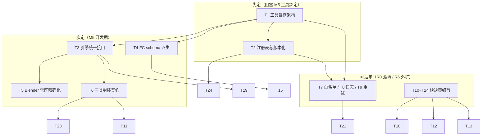

# 第四轮协商 · 工具与 MCP / Function Calling

> 日期：2026-10-02（起草）｜ 状态：🔄 **进行中（起草完成，待老板拍板）**
> 证据基线：《三.md》3.2（工具层分类/引擎选型）/3.3（技术栈融合）/第四章 M7/M8/M12/M15/M16/M19/M20/M25 + V27（禁第三方 Blender MCP）/C36（ComfyUI 异步客户端）/A12（工具白名单）/A13（重试+FAIL）/A15（LLM 日志）+ **v2 工具层家底实读（tools/ 目录 ~30 个脚本 + api_server.py 逐文件实测）**
> 文件位置：本文件 R0 立项后迁入 AI影视团队v3/docs/negotiation/

---

## 0. 证据基线（先亮牌）

**好消息**：工具层的"物理资产"异常厚实——v2 已经把生成/管理/质检三大类工具基本写完了，不是白纸。三.md 也把工具层分类、引擎选型、白模禁 MCP 边界定了。本轮**不推翻任何已定项**（V27/C36/三类划分/A12 方向），只填五个真空带——① CrewAI 智能体怎么调用这些工具（暴露架构：MCP vs Function Calling vs 进程内注册表）；② 工具注册表与版本化（当前完全没有）；③ 引擎客户端统一接口（comfyui_client 只服务 ComfyUI 系，音频/Blender 各自为政）；④ Function Calling schema 管理（当前零 schema，Kimi 无工具可用）；⑤ 白模禁第三方 MCP 的精确边界（V27 只有一句，需落成可执行的禁区清单）。

**坏消息**：v2 的工具是「散装 CLI 脚本 + 一个只裹了 8 个脚本的 REST 桥」，**没有 MCP、没有 Function Calling schema、没有注册表、没有版本化**。智能体层（第三轮定稿的 CrewAI Flows + 7 核心 Agent）目前**没有任何机制能调用这些工具**——A12 定了"每岗白名单绑定"，但白名单的"绑定对象"和"调用机制"是真空。这是本轮必须填的最大洞。

**2026-10-02 v2 家底实读（关键发现）**：
- 工具形态 = **独立 CLI 脚本 + JSON stdout**，无统一封装基类，无 MCP/无 schema。
- `api_server.py` = FastAPI REST 桥，仅包裹 **8 个** CLI（k13/budget/asset/handoff/intent/scene_lock/charlock/comfyui）；**音频/视频/质检/whisper/jobs 全部游离在外**，REST 桥覆盖不到。
- `comfyui_client.py` 三步异步（check_status/submit_workflow/poll_history/download_output/upload_image）被 comfyui_generator / wan22_client / three_view_client / acestep_client **4 个客户端复用**，但 `build_workflow` 各自重写——共享网络基元、缺失统一接口。
- 音频客户端（acestep/tts）走 ComfyUI 通道，但 `tts_generator.py` 用 **edge-tts 🔴 违规待换**（第三轮 A6 已判）。
- `vram_lock.py` 仅 wan22_client 接入，其他 GPU 工具（blender/comfyui/acestep）未接——显存错峰纪律未贯穿。
- `jobs.py` 已具备 **idempotency key / handle / recover / 计费**，注释明确"对齐 MCP 2026-07-28 对副作用操作的第一要求"——是注册表层很好的现成底座，但 `api_server` 和其余工具都没用它。
- `budget_manager.py` 仅生成类接入（comfyui_generator / three_view_client），管理/质检类不计成本。
- QC：`vlm_check.py`（Qwen3-VL 本地 VLM，consistency/anatomy/motion 三预设）+ `qc_media.py`（ffprobe 技术门 v7，响度/分辨率/帧率/AIGC 标识）。

### 0.1 三.md / 前序轮已定口径（本轮不再重复问）

| 已定项 | 出处 | 对本轮约束 |
|---|---|---|
| 工具层分三类：生成/管理/质检 | 3.2 架构图 | 注册表分类维度固定为 gen/mgmt/qc |
| 白模=Blender 5.2.2 + bpy 直调 + 官方蒙版通道，**禁第三方 Blender MCP** | 3.2 选型表 / V27 | 边界精确化只许放行 bpy-subprocess，不许任何 MCP 黑盒 |
| ComfyUI 三步异步客户端直接继承 | C36 / M20 | comfyui_client 是统一引擎接口的蓝本 |
| 每岗位工具白名单绑定 | A12 | 注册表必须支持 per-tool allowed_agents 闸门 |
| 工具调用失败：重试 2 次指数退避 → FAIL 事件 + 打回单 | A13 | 重试封装必进注册表 runner |
| LLM 调用全量落 SQLite（A15 决策日志） | A15 | 工具调用可观测性应复用同一日志底座 |
| 依赖极简（M15）/ 无额外 ORM 锁（M22） | M15/M22 | 不引入 MCP SDK 常驻服务（违反 M15）；sqlite3 原生 |
| jobs 幂等防重 / vram_lock / budget 直接继承 | C30/C9/V10 | 三者进注册表 runner 标准件，不重写 |

### 0.2 v2 家底实读清单（工具清单，带归属/问题标记）

| 文件 | 类 | 现状 / 问题 |
|---|---|---|
| `comfyui_client.py` | 生成·基元 | **共享网络基元**，被 4 客户端复用；缺统一 engine 接口抽象 |
| `comfyui_generator.py` | 生成 | SDXL/SD1.5 文生图，接 budget；游离 api_server 之外 |
| `wan22_client.py` | 生成 | Wan2.2 TI2V 视频，接 vram_lock；游离 api_server |
| `three_view_client.py` | 生成 | 三视图 txt2img + prompt 身份承载，接 budget；游离 |
| `acestep_client.py` | 生成 | ACE-Step 1.5 BGM，走 ComfyUI；游离 api_server |
| `tts_generator.py` | 生成 | **edge-tts 🔴 违规**（A6 判换）；游离；硬编码 DIALOGUE 清单 |
| `gen_bgm.py` / `gen_sfx.py` / `gen_ambient.py` | 生成 | 程序合成兜底链（A6 降级定位） |
| `build_mix.py` | 生成 | 四轨混音 afir/ebur128 |
| `gen_audio_manifest.py` | 生成 | 音频 manifest 组装 |
| `whisper_transcribe.py` | 生成 | 转写（CPU），游离 |
| `blockout_min_v1.py` / `make_r4_l1_blockout.py` / `p0_setup.py` | 生成 | Blender bpy 白模脚本（subprocess 调用） |
| `measure4.py` / `pngseq_to_mp4.py` | 生成 | FFmpeg 打包/测量（D6b 白模 MP4 升级件） |
| `budget_manager.py` | 管理 | 预算熔断（status/set/add/spend/check/history），仅生成类接入 |
| `k13_version_tree.py` | 管理 | 版本树锁定，被 api_server 包裹 |
| `asset_manager.py` | 管理 | 资产管理，被 api_server 包裹 |
| `handoff_manager.py` | 管理 | 交接工单，被 api_server 包裹 |
| `director_intent.py` | 管理 | 导演意图，被 api_server 包裹 |
| `scene_lock_writer.py` / `character_lock_writer.py` | 管理 | 场景/角色锁，被 api_server 包裹 |
| `jobs.py` | 管理 | **异步作业账本**（idempotency/handle/recover/cost），注释对齐 MCP 副作用要求；但全工具层未用 |
| `d1_model_queue.py` | 管理 | 模型下载队列（一次性脚本） |
| `seed_data.py` | 管理 | 种子数据 |
| `vlm_check.py` | 质检 | Qwen3-VL 本地 VLM（consistency/anatomy/motion） |
| `qc_media.py` | 质检 | ffprobe 技术门 v7（响度/分辨率/帧率/AIGC 标识） |
| `vram_lock.py` | 基础设施 | 显存独占锁（仅 wan22 接入） |
| `api_server.py` | 基础设施 | FastAPI REST 桥，**仅裹 8 个 CLI**，音频/视频/质检/jobs 全漏 |

### 0.3 本轮要拍的真空带

| # | 真空带 | 对应决策 |
|---|---|---|
| ① | 智能体怎么调用工具：MCP 服务器 vs Function Calling vs 进程内注册表 | T1 / T10 |
| ② | 工具注册表与版本化（当前零机制） | T2 / T24 |
| ③ | 引擎客户端统一接口（comfyui_client 只服务 ComfyUI 系） | T3 |
| ④ | Function Calling schema 管理（Kimi 无工具可用） | T4 / T15 |
| ⑤ | 白模禁第三方 MCP 的精确边界（V27 只有一句） | T5 |
| ⑥ | 三类工具封装契约（stdout 信封/异步作业模型/超时）不统一 | T6 / T11 / T23 |
| ⑦ | 工具白名单执行机制（A12 只定方向） | T7 |
| ⑧ | 工具可观测性（A15 是 LLM 日志，工具调用未覆盖） | T8 |
| ⑨ | 工具失败重试封装（A13 只定方向） | T9 |
| ⑩ | 进程隔离/成本 hook/vram 贯穿/产物目录等横切规范 | T12 / T13 / T19 / T20 |

---

## 1. 核心决策（9 个，完整展开）

### T1 工具暴露架构（MCP vs Function Calling vs 进程内注册表）——本轮中心决策

- **背景**：第三轮定稿 CrewAI Flows 单进程编排 + 7 核心 Agent，但**没有任何机制让 Agent 调用 v2 工具**。v2 工具是 JSON-stdout CLI，REST 桥只裹 8 个。本轮主题"MCP/Function Calling"要回答：智能体层与工具层之间用什么"总线"？
- **候选**：
  | 方案 | 架构 | 后果 |
  |---|---|---|
  | A. 常驻 MCP 服务器 | 启一个 MCP server 暴露全部工具，CrewAI 用 MCP client 调用（stdio/SSE 传输） | 引入 MCP SDK（违反 M15 依赖极简）；进程间序列化开销；CrewAI 与工具本就同机同进程，绕一圈多余；仅外部客户端才有 MCP 价值 |
  | B. 进程内 Tool Registry | 单一 Python 注册表模块：每个工具=注册项{name/category/input_schema(Pydantic)/runner(可调 callable)/cost/owner/version}；CrewAI Agent 经白名单拿子集，**进程内 Python 调用**（runner 内部可 subprocess 调 v2 CLI 或直调函数）；Function Calling schema 由 Pydantic 自动派生给 Kimi | 零新增传输层、零额外依赖；复用 v2 CLI 不重写 30 个脚本；schema 自动生成；天然满足 A12 白名单（注册表闸门）与 A15 日志（runner 统一埋点） |
  | C. 纯 REST 调用 | Agent 经 api_server 的 HTTP 接口调工具（扩展现有桥） | 异步/长任务轮询语义重；api_server 当前只裹 8 个要补全；Agent 调本地 HTTP 比进程内慢且脆弱；超时/错误治理重复造 |
- **推荐 B（进程内 Tool Registry + 可选 MCP 出站适配器）**：理由——①CrewAI 单进程 Flows（A2）下，智能体↔工具同进程，**进程内 Python 调用是零成本正解**，MCP 的进程/传输边界在此场景是负资产；②M15 依赖极简纪律**禁止为内部调用引入 MCP SDK 常驻服务**；③v2 已写好的 ~30 个 CLI 不该重写，注册表 runner 用 subprocess 包裹即可渐进迁移；④Function Calling（给 Kimi）与 MCP（给外部）**都是注册表的派生输出**——同一份 Pydantic schema 既能生成 OpenAI function spec，也能生成 MCP tool manifest，注册表是唯一事实源。
  - **MCP 的定位**：**可选出站适配器**（`mcp_adapter` 模块），仅在"外部客户端（IDE/商单方系统/其他 App）要驱动 C3 工具"或"某商用工具只暴露 MCP"时才实现，把注册表 over-the-wire 暴露出去——**R6 前不建常驻 MCP 服务器**（T10 落定）。这样"MCP/Function Calling"两个词都覆盖了：Function Calling 是主路径（智能体），MCP 是可选外扩（不阻塞开发）。
- **决策影响**：T2 注册表（事实源）/ T3 引擎接口（runner 的一种）/ T4 schema 派生 / T7 白名单闸门 / T8 日志埋点 / M5（CrewAI 工具绑定落地）/ A12（落地机制）。
- **可逆性**：可逆（架构换 MCP 只需重写注册表 transport，工具本体不动）。
- **来源**：三.md 3.2（工具层/引擎层）/M15（依赖极简）/A2（单进程 Flows）/C36（ComfyUI 异步）；v2 `api_server.py`（REST 桥覆盖不全）+ `jobs.py`（注释对齐 MCP 副作用要求——参考其 handle+幂等键范式）。

### T2 工具注册表与版本化

- **背景**：当前 ~30 个工具散在 `tools/` 目录，无注册、无版本、无清单。Agent 不知道有哪些工具、参数如何、谁能用。A12 白名单也无"名单"可绑。
- **候选**：
  | 方案 | 形态 | 问题 |
  |---|---|---|
  | A. 注册表模块（`tools/registry.py` + `tools/registry.json`） | 每项={name, category(gen/mgmt/qc), description, version, input_schema(Pydantic), runner_callable, cost_cny, allowed_agents[], engine?}；CI 校验 schema 合法 + 无孤儿工具 | 需一次性登记 30 项（约 1d），但一劳永逸 |
  | B. 纯约定（文件即文档） | 各 CLI 自描述，靠约定 | 回到"散装"老路，A12 白名单无处挂 |
  | C. 全数据库化 | 工具存 SQLite | 过度设计，工具是代码不是数据 |
- **推荐 A**：注册表是 T1 方案的"事实源"。`registry.json` 存声明（version/owner/allowed_agents/category/cost），`registry.py` 存 runner 代码引用与 Pydantic 模型。`version` 字段走 **additive 演进**（T15）：改输入必须升小版本，旧调用方不破。`M4 CI 校验`（T24）保证 registry 与代码不漂移（同 A1 双写先例）。
- **决策影响**：T1（事实源）/ T4（schema 源）/ T7（白名单源）/ T24（CI）/ A12（落地）。
- **可逆性**：可逆（加项/改版本都是普通代码变更）。
- **来源**：第三轮 A1（SKILL.md 双写事实源先例）/N5（graph 事实源先例）；v2 无注册表的实测缺口。

### T3 引擎客户端统一接口

- **背景**：`comfyui_client.py` 的三步异步（check_status→submit→poll→download）是优秀范式，但只服务 ComfyUI 系。Wan2.2 / 三视图 / AceStep 各自 import 它但 `build_workflow` 重写；Blender 走 `blender -b -P`（完全不同生命周期，无 HTTP）；云端 fal/Wan3.0/Seedance 是 HTTP 但无统一 client。引擎层（三.md 3.2 本地+云端双轨）缺一个统一抽象。
- **候选**：
  | 方案 | 形态 | 问题 |
  |---|---|---|
  | A. 抽象基类 `BaseEngineClient` | 接口：health()→status、submit(payload)→handle、poll(handle)→{state,progress}、fetch(handle)→path、cancel(handle)；适配层=ComfyUIAdapter(复用 comfyui_client)/BlenderAdapter(subprocess blender -b -P，长任务轮询文件)/VACEAdapter/falAdapter/WanAdapter/SeedanceAdapter/AceStepAdapter/CosyVoiceAdapter（音频） | 需写 8+ 适配器（约 2d），但统一了 status 形状与 vram_lock 接入点 |
  | B. 维持各客户端独立 | 各自调各自 | 返回形状不一、vram_lock/超时/错误治理各写一遍（v2 现状） |
  | C. 全改 ComfyUI 协议 | 所有引擎伪装成 ComfyUI workflow | Blender/云端 API 强行套 workflow 是削足适履 |
- **推荐 A**：不重写可用客户端，只**加一层适配器接口**统一方法签名与返回信封（T6/T23），让注册表 runner 与 vram_lock 能一致地对待所有引擎；`health()` 形状统一（comfyui 已有，Blender 用 `blender --version` 探测，云端用 `/health`）。vram_lock 接入点统一收口到 `BaseEngineClient.submit` 内部（解决 T19 vram 贯穿）。
- **决策影响**：T1（runner 的一种）/ T5（Blender 适配器是禁区边界的执行点）/ T6（异步作业模型）/ T19（vram 统一）/ M8（云端客户端统一）/ M7（白模客户端）。
- **可逆性**：可逆（适配器是薄封装，不动引擎本体）。
- **来源**：三.md 3.2（引擎层本地+云端双轨）/C36（ComfyUI 异步继承）；v2 `comfyui_client.py`（蓝本）+ `wan22_client.py`（vram_lock 接法）+ `blockout_min_v1.py`（bpy subprocess）。

### T4 Function Calling schema 自动派生

- **背景**：第三轮 A4 路由表定 Kimi 三档，但 Kimi（openai 兼容）当前**没有任何工具可调**——Agent 拿着 LLM 却调不动 v2 工具。需要把每个工具的描述/参数变成 OpenAI function-calling spec 喂给 Kimi。
- **候选**：
  | 方案 | 形态 | 问题 |
  |---|---|---|
  | A. 注册表 Pydantic → 自动派生 | 每个工具用 Pydantic 模型定义入参；注册表统一 `to_openai_function(name, model)` 生成 `{name, description, parameters(JSON Schema)}`；同一 Pydantic 也能生成 MCP manifest（T1） | 需为 30 个工具补 Pydantic 模型（与 T2 合并做） |
  | B. 手写 JSON schema 字典 | 每工具手维护一份 function spec | 与代码双份维护必漂移（N5 教训） |
  | C. 不接 Kimi 工具，改 CLI 硬编码 | Agent 只能输出"调用某某 CLI"的文本，靠解析 | 回到脚本拼接老路，失去结构化校验 |
- **推荐 A**：**schema 是 Pydantic 模型的派生产物，不是独立资产**（同 N6 graph.json v2 的"派生不重复"逻辑）。注册表一处定义，Function Calling（Kimi）与 MCP（外部）双路自动生成。Kimi 调用走 Instructor/Pydantic 结构化输出（三.md 3.2 已定）+ 原生 function calling 二选一，由 A4 路由表决定低档任务直接走 Instructor 结构化（不需 function calling），高档判断任务才让 Kimi 自主选工具。
- **决策影响**：T1（派生源）/ T2（schema 存 Pydantic）/ A4（路由表对接）/ M5（CrewAI tool 绑定）。
- **可逆性**：可逆（改模型即改 schema）。
- **来源**：三.md 3.2（Kimi openai 兼容 + Instructor）；第三轮 A4（推理分级）；OpenAI function-calling 规范。

### T5 Blender 禁第三方 MCP 边界精确化（V27 落成可执行禁区）

- **背景**：V27 一字"bpy 直调、禁第三方 Blender MCP"；三.md 3.2 选型表把"Blender MCP 类插件（引入第三方黑盒）"列为拒绝项。但"禁区"没落成可执行的清单——什么算第三方 MCP、bpy 能不能在 Agent 进程 import、Blender 怎么被调用都需钉死。
- **候选**：
  | 方案 | 边界 | 后果 |
  |---|---|---|
  | A. 精确禁区清单（放行/禁止双列） | **放行**：①`blender -b -P script.py` 子进程调用（v2 blockout_*.py / p0_setup.py / make_r4_l1_blockout.py 同款）；② 官方蒙版通道 Object Index / Cryptomatte；③ bpy 脚本内用 FFmpeg 后处理；④ Blender 以**独立进程**运行（GPL 以进程隔离规避许可，三.md 3.2 已定）。**禁止**：① 任何 Blender MCP 插件/服务器（blender-mcp 类、第三方"AI 控制 Blender"服务）；② 在 Agent/服务进程内 `import bpy`（GPL 污染 + 许可风险）；③ 把 Blender 控制权交给外部 LLM 黑盒的桥；④ 经 MCP 协议"连接"Blender 而非"调用"Blender | 禁区可执行，CI 可查（禁止 import bpy / 禁止起 MCP server） |
  | B. 只重复"禁第三方 MCP" | 不展开 | 边界模糊，R0 落地时各人理解不一（v2 已吃过"文档/代码冲突"的亏，N1 先例） |
- **推荐 A**：把 V27 落成**可执行禁区双列表**。核心判据：**Blender 永远是"被调用的可执行工具"（subprocess），不是"被连接的 MCP 服务"**；bpy 模块**绝不进 Agent 进程**（GPL 许可 + 进程隔离双保险）。Blender 在注册表里就是 `blender` 这一个工具，runner=`subprocess.run(["blender","-b","-P",script])`，落 T3 的 BlenderAdapter。CI（T24）加一条：grep 禁止业务代码 `import bpy`、禁止启动 MCP server 监听。
- **决策影响**：T1（Blender=注册表一项）/ T3（BlenderAdapter 是禁区执行点）/ A12（白模岗白名单含 blender）/ M7（白模管线）。
- **可逆性**：半可逆（禁区是纪律，放宽需老板拍板）。
- **来源**：V27 / 三.md 3.2 选型表（"Blender MCP 类插件（引入第三方黑盒）"拒绝项）+ 252 行 GPL 进程隔离说明；v2 `blockout_min_v1.py` / `p0_setup.py`（subprocess 调用范式）。

### T6 三类工具封装契约（统一异步作业模型）

- **背景**：v2 工具 stdout 格式不一（comfyui_generator 用 `{status:"generated"}`，wan22 用 `{status:"done"}`，budget 用 `{status:"spent"}`，jobs 用 `job=.. state=..` 文本），错误信封各异，异步作业模型只有 comfyui 系规范。三类工具（生成/管理/质检）需要统一契约，否则注册表 runner 无法一致处理。
- **候选**：
  | 方案 | 契约 | 问题 |
  |---|---|---|
  | A. 统一信封 + 统一异步模型 | ① stdout 统一 JSON 信封 `{status: ok|error|blocked, data?, error?, tool, cost?}`；② 所有副作用工具接 `jobs.py`（begin/handle/done/fail/cost）做幂等+对账（继承其已验证范式）；③ 长任务统一 submit→poll(handle)→fetch 三步（comfyui 蓝本），短任务同步返回；④ 超时分级（T11） | 需回填 v2 现有工具的信封（约 1d），但一次性 |
  | B. 维持各工具现状 | 不统一 | 注册表 runner 要写 N 个分支解析，脆弱 |
  | C. 全改成同步 | 长任务也同步阻塞 | Wan2.2 30 分钟生成会卡死 Agent |
- **推荐 A**：信封统一（T23 落定）+ **异步作业模型统一到 comfyui_client 三步范式**，所有生成类与长质检类经 jobs.py 拿 handle 后轮询（复用其 idempotency/recover 已验证代码）。管理类短操作（budget/k13）同步返回但也要过信封。空集成的工具（whisper/音频/质检）补齐信封。
- **决策影响**：T1（runner 解析信封）/ T3（引擎接口统一返回）/ T9（重试基于信封）/ T11（超时）/ T23（错误信封）/ M12（jobs 状态机）。
- **可逆性**：可逆（改 stdout 格式不丢功能）。
- **来源**：v2 `comfyui_client.py`（三步异步蓝本）+ `jobs.py`（idempotency/recover 已验证）+ `comfyui_generator.py`（budget 联动范式）。

### T7 工具白名单执行机制（A12 落地）

- **背景**：A12 定"每岗位白名单绑定（白模岗=bpy+FFmpeg；写实化=引擎客户端×3；场记=qc 工具族；制片=账本；音效师=AceStep+TTS+FFmpeg 音频族；剪辑师=FFmpeg+打包+RIFE+超分）"，但"绑定"的执行机制是真空——谁在什么时候检查这个白名单？
- **候选**：
  | 方案 | 执行点 | 问题 |
  |---|---|---|
  | A. 注册表闸门（调用前校验） | 注册表每项带 `allowed_agents[]`；runner 执行前校验"当前 agent_id ∈ allowed_agents"，否则抛 `ToolForbidden`（同 API 409 纪律，N7 先例） | 一处校验全局生效，零遗漏 |
  | B. 靠 Agent 自觉 | prompt 里写"你只能用这些工具" | backstory 软约束会漂（A8 教训），越权无感知 |
  | C. CrewAI tools 装饰器分散声明 | 每 Agent 各自 @tool 注册 | 白名单散在 9 个地方，改一处要动九处 |
- **推荐 A**：**白名单在注册表一处定义、runner 一处校验**（同 A8 铁律"纪律在代码不在 prompt"）。agent_id 由 CrewAI 上下文传入 runner；越权调用返回 `ToolForbidden` 信封（类比 API 层 409），记 A15 日志。白名单数据来自 A12 已定清单，本轮只定执行机制不重定清单。
- **决策影响**：T1（runner 校验点）/ T2（allowed_agents 字段）/ A12（机制落地）/ A8（代码硬闸先例）。
- **可逆性**：可逆（改注册表字段）。
- **来源**：第三轮 A12（白名单方向）+ A8（代码硬闸先例）+ 第二轮 N7（纪律在 API 层不在 UI）。

### T8 工具可观测性 + A15 联动

- **背景**：A15 定"LLM 调用全量落 SQLite（prompt/response/token/耗时/档位）"，但**工具调用**（LLM 之外的真实开销：GPU 时长、云端费用、文件产出）完全没记录。Agent 调工具花了多少、成没成功、耗时多久，无迹可查，也无法回溯打回责任（A21）。
- **候选**：
  | 方案 | 埋点 | 问题 |
  |---|---|---|
  | A. 注册表 runner 统一埋点 | 每次工具调用，runner 自动写 A15 日志表（tool_name/agent_id/args_hash/result/耗时/cost_cny/engine/handle），与 LLM 日志同库同表 | 零侵入（集中埋点），全工具自动覆盖 |
  | B. 各工具自己打日志 | 每个 CLI 内 print/log | 格式不一、漏工具的永远漏 |
  | C. 不记录工具调用 | 只记 LLM | 工具层是黑盒，打回路由（A21）无证据 |
- **推荐 A**：runner 集中埋点（同 A15 底座，扩字段），**工具调用与 LLM 调用同入决策日志**，使 A15 从"LLM 日志"升级为"Agent 行为全日志"。打回单（A21）的责任字段可直接从日志溯源。
- **决策影响**：T1（runner 埋点）/ A15（扩字段）/ A21（打回溯源）/ M11（成本账本数据源）。
- **可逆性**：可逆（加字段）。
- **来源**：第三轮 A15（日志底座）+ A21（打回路由需溯源）；v2 `jobs.py audit 表`（已记 ev/detail 的先例）。

### T9 工具失败重试封装 + A13 + crew_bus FAIL

- **背景**：A13 定"工具调用失败：重试 2 次指数退避 → FAIL 事件上总线 + 生成打回单（四要素）"，但这是"原则"，工具层的重试封装是真空——每个 CLI 自己 try/except 各写一遍，且没有统一 FAIL 上总线。
- **候选**：
  | 方案 | 封装 | 问题 |
  |---|---|---|
  | A. 注册表 runner 内置重试 + FAIL 广播 | runner 包一层：调用失败按 A13 重试 2 次指数退避；仍失败→发 crew_bus FAIL 事件（带 tool/args/error/retry_count）+ 生成打回单四要素 | 一处实现全局生效，与 A13 完全咬合 |
  | B. 各工具自己重试 | 每 CLI 写 try/except + sleep | 退避参数各异、FAIL 上总线没人做 |
  | C. 不重试直接报错 | 失败即返回 error 信封 | 瞬态错误（引擎排队/网络抖动）误伤，烧钱重跑（A13 防的就是死循环烧钱） |
- **推荐 A**：**重试与 FAIL 广播进 runner 标准件**（同 A13 数值：2 次 + 指数退避），与 A8 铁律硬闸、A21 打回路由、crew_bus 六类事件同源。重试消耗 A26 任务级预算信封（第三轮已定 per-task envelope），避免自我修正循环烧 token。
- **决策影响**：T1（runner 标准件）/ A13（落地）/ A21（打回单）/ A26（预算信封联动）/ M6（crew_bus FAIL 事件）。
- **可逆性**：可逆（改 runner）。
- **来源**：第三轮 A13（重试+FAIL）+ A21（打回路由）+ A26（预算信封）；v2 各 CLI 零散 try/except 的现状缺口。

---

## 2. 快决策（15 个，紧凑表）

| # | 决策点 | 候选 | 推荐 | 理由（一句话） | 可逆性 |
|---|---|---|---|---|---|
| T10 | MCP 引入范围 | 常驻 MCP 服务器 / 可选出站适配器 / 不引入 | **可选出站适配器（注册表派生，R6 前不建常驻服务器）** | M15 依赖极简禁止为内部调用引 MCP SDK；外部客户端需要时才 over-the-wire 暴露 | 可逆 |
| T11 | 工具调用超时分级 | 统一 30s / 分级（管理 30s·生成 300s·长视频 1800s） | **分级**（继承 comfyui 180s / wan22 1800s 实测值） | 管理类秒回、生成类分钟级、长视频半小时，一刀切会误杀或卡死 | 可逆 |
| T12 | 工具进程隔离策略 | 全部同进程 / 按风险隔离 | **Blender·GPU 引擎·whisper 子进程隔离；纯 Python 管理类可同进程** | bpy GPL 须隔离（T5）；GPU 引擎独占显存须隔离；budget/k13 无副作用可同进程省开销 | 可逆 |
| T13 | 成本 hook 统一接入 | 仅生成类 / 全副作用工具 | **全副作用工具接 budget（spend 前校验+后扣减）+ jobs.cost 记账** | 管理/质检类也有成本（云端质检/转写），漏记则 A15 成本账不全 | 可逆 |
| T14 | idempotency key 规范扩展 | 仅 jobs / 扩到所有副作用工具 | **所有副作用工具（生成/锁定/扣费/转写）带 idem key，复用 jobs.begin 语义** | 断网/重试重复计费是 v2 实测痛点（jobs.py 注释第一条），统一根治 | 可逆 |
| T15 | schema 版本演进 | 改就破 / 加性演进 | **加性演进**（改入参升小版本，旧调用方不破；破坏性变更升主版本并保留兼容期） | 工具接口是契约，乱改炸 Agent（同 N6 graph 版本纪律） | 半可逆 |
| T16 | 工具自检规范 | 各工具随意 / 统一 selftest 约定 | **每工具提供 `--selftest` 或 `selftest()`，离线跑幂等/错误信封/超时三条**（继承 jobs.selftest 范式） | R0 验收与 M4 CI 需要可自动验证的工具健康度 | 可逆 |
| T17 | 引擎健康检查统一 | 各引擎各异 / 统一 health() 形状 | **BaseEngineClient.health() 返回 {status, vram?, missing_models?, version}**（comfyui 已有蓝本） | 调度前先探活，避免提交到死引擎白烧钱 | 可逆 |
| T18 | 音频工具链纳入注册表 | 游离 / 注册 | **acestep/tts(换 CosyVoice)/gen_bgm/sfx/ambient/build_mix/whisper 全部注册 + tts 换掉 edge-tts（A6）** | 音频工具现全在 api_server 外，Agent 调不到；edge-tts 🔴 必换 | 可逆 |
| T19 | vram_lock 统一接入 | 仅 wan22 / 全 GPU 工具 | **所有 GPU 引擎（comfyui/wan22/acestep/blender 渲染）submit 前经 vram_lock 错峰** | 显存挤占是 v2 实测痛点，目前只 wan22 接，其余裸跑会抢显存 | 可逆 |
| T20 | 产物落盘目录约定 | 各工具随意 / 统一 shots/assets 树 | **沿用 v2 `assets/<type>/` + `shots/<shot_id>/{frames,masks,exr,cam,video}/`（D24 五子目录）+ 引擎产物进 jobs.file** | D24 已定目录树，工具须一致落盘否则契约断裂 | 可逆 |
| T21 | 工具↔节点图联动语义 | 无联动 / 节点触发工具 | **写实化/白模/质检类节点执行=调对应注册表工具，进度走 M17 WS（N19/N20 先例）** | 节点图是事实源（N5），点"运行"应调真工具而非 mock | 可逆 |
| T22 | CLI 保留 vs 纯 Python API | 全 CLI / 全 Python / 共存 | **共存：v2 CLI 保留（运维/调试用），注册表 runner 优先直调 Python 函数，CLI 作 fallback 包裹** | 不重写 30 脚本（省 ~5d），渐进提取 Python API | 可逆 |
| T23 | 错误信封统一 | 各工具各异 / 统一三类 | **统一 `{status:error, code, message, detail?, tool}`**（code 取自 iron_rules 风格枚举）** | 重试（T9）/ 白名单（T7）/ 日志（T8）都依赖统一错误形状 | 可逆 |
| T24 | 注册表存放 + CI 校验 | 无 / registry.json + M4 CI | **`tools/registry.json` 存声明 + `M4` 校验脚本查：schema 合法·无孤儿工具·无 `import bpy`·无禁区 MCP** | 同 A1 双写 CI 防漂移；T5 禁区可机器核查 | 半可逆 |

---

## 3. 决策依赖图

---

## 4. 待老板拍板清单

> 老板只需在「选择」列填 A/B/C 或「同意推荐」。

| # | 决策 | 推荐 | 可逆性 | 选择 |
|---|---|---|---|---|
| T1 | 工具暴露架构 | B. 进程内 Tool Registry（事实源）+ 可选 MCP 出站适配器（R6 前不建常驻 MCP 服务器） | 可逆 | ⏳ |
| T2 | 工具注册表与版本化 | A. `tools/registry.py`+`registry.json`，每工具版本化+CI 校验 | 可逆 | ⏳ |
| T3 | 引擎客户端统一接口 | A. `BaseEngineClient` 抽象 + 8+ 适配器（不重写可用客户端） | 可逆 | ⏳ |
| T4 | Function Calling schema | A. 注册表 Pydantic 自动派生（Kimi + MCP 双路） | 可逆 | ⏳ |
| T5 | Blender 禁第三方 MCP 边界 | A. 精确禁区双列表（放行 bpy-subprocess / 禁止 MCP 服务与进程内 import bpy） | 半可逆 | ⏳ |
| T6 | 三类工具封装契约 | A. 统一 JSON 信封 + comfyui 三步异步作业模型 + jobs 幂等接入 | 可逆 | ⏳ |
| T7 | 工具白名单执行机制 | A. 注册表 `allowed_agents[]` + runner 调用前校验（类比 409） | 可逆 | ⏳ |
| T8 | 工具可观测性 + A15 | A. runner 集中埋点，工具调用与 LLM 同入决策日志 | 可逆 | ⏳ |
| T9 | 工具失败重试 + A13 | A. runner 内置重试 2×退避 + crew_bus FAIL 广播 + 打回单 | 可逆 | ⏳ |
| T10 | MCP 引入范围 | 可选出站适配器（R6 前不建常驻服务器） | 可逆 | ⏳ |
| T11 | 调用超时分级 | 分级（管理 30s/生成 300s/长视频 1800s） | 可逆 | ⏳ |
| T12 | 进程隔离策略 | Blender·GPU·whisper 子进程；纯 Python 管理类同进程 | 可逆 | ⏳ |
| T13 | 成本 hook 统一 | 全副作用工具接 budget + jobs.cost | 可逆 | ⏳ |
| T14 | idempotency 扩展 | 所有副作用工具带 idem key，复用 jobs.begin | 可逆 | ⏳ |
| T15 | schema 版本演进 | 加性演进（小版本兼容，主版本保留兼容期） | 半可逆 | ⏳ |
| T16 | 工具自检规范 | 每工具 `--selftest`，继承 jobs.selftest 范式 | 可逆 | ⏳ |
| T17 | 引擎健康检查统一 | `health()` 返回 {status,vram?,missing_models?,version} | 可逆 | ⏳ |
| T18 | 音频工具链纳入注册表 | 全注册 + tts 换 CosyVoice（A6 去 edge-tts） | 可逆 | ⏳ |
| T19 | vram_lock 统一接入 | 所有 GPU 引擎 submit 前错峰 | 可逆 | ⏳ |
| T20 | 产物落盘目录 | 沿用 D24 五子目录 + assets 树 | 可逆 | ⏳ |
| T21 | 工具↔节点图联动 | 节点执行=调注册表工具，进度走 WS | 可逆 | ⏳ |
| T22 | CLI 保留 vs Python API | 共存（CLI 保留，runner 优先直调 Python） | 可逆 | ⏳ |
| T23 | 错误信封统一 | 统一三类 `{status:error,code,message,detail,tool}` | 可逆 | ⏳ |
| T24 | 注册表存放 + CI | `registry.json` + M4 CI 查漂移/禁区 | 半可逆 | ⏳ |

---

## 5. R0/R2 实测待确认项

1. **T1 实测**：CrewAI Flows 单进程内直接 call Python tool 函数（不绕 MCP/HTTP）的调用开销与稳定性（R0，M5 前）——验证"进程内注册表"优于 MCP 的假设。
2. **T4 实测**：Pydantic → OpenAI function spec 自动派生在 Kimi openai 兼容端点的字段兼容（R0，M5 前）——确认 Kimi 能正确解析生成的 tools 参数。
3. **T3 实测**：BlenderAdapter 以 `blender -b -P` 子进程跑白模的启动开销与超时阈值（R0，M7 前）——确认比 ComfyUI 长任务超时（1800s）是否需要单独档。
4. **T5 合规实测**：本机查 Agent/服务进程是否真无 `import bpy`、无 MCP server 监听（R0，CI 跑 T24 脚本）——落实 GPL 进程隔离。
5. **T18 实测**：CosyVoice 3 / Qwen3-TTS 替换 edge-tts 后的 TTS 客户端接入注册表（P1/M15 前，沿用第三轮 A6 音效双链实测项 ②）。
6. **T19 实测**：comfyui / acestep / blender 渲染三者在 12GB 显存下经 vram_lock 错峰的实际吞吐（R2，接第三轮 A6 实测项 ③）。
7. **T13 实测**：云端质检（fal/Seedance 类）与 whisper 转写的成本入账口径（R2，cost_ledger 实测后定）。

---

## 6. 下一轮预告

第五轮主题：**契约与数据模型**（shot_spec / semantic_map / handoff / 各类 schema.json 的字段级定稿、版本演进策略、契约校验器家族落 M4、git 流转规范）。本轮工具注册表定义的 `input_schema` 将直接消费第五轮定稿的契约 schema。

---

## 7. 等待老板回应（2026-10-02 起草）

24 个决策点（T1~T24）基于《三.md》3.2/3.3/V27/C36/A12/A13/A15 已定口径 + v2 工具层家底实读（tools/ 目录 ~30 脚本 + api_server.py 逐文件实测）产出，不推翻任何既有决策，只填五个真空带（暴露架构/注册表/引擎接口/FC schema/Blender 禁区精确化）。可整体回复「同意推荐」，或对中心决策 T1（MCP vs 进程内注册表）与 T5（Blender 禁区）单独指定——这两条最反直觉也最影响后续所有模块（M5/M7/M8）。拍板后决策写入 DECISIONS.md，进入第五轮（契约与数据模型）。
