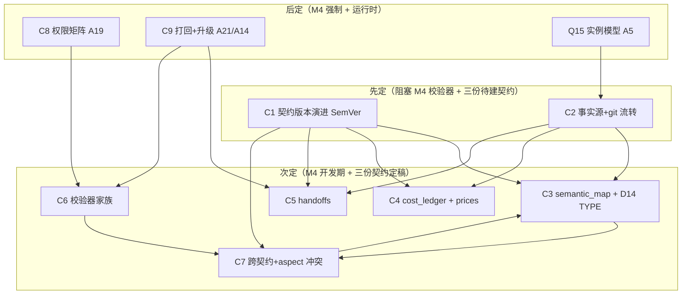

# 第五轮协商 · 契约与数据模型（Contracts & Data Models）

> 日期：2026-10-02（起草）｜ 状态：🔄 **进行中（起草完成，待老板拍板 / 团队讨论+投票）**
> 证据基线：《三.md》3.5（核心数据模型）/3.7（五份契约）/3.9（四层语义映射）+ V9/V10/V16/V19/V26/V40 + **v2 真身契约实读**（`spec/shot_spec.schema.json`、`spec/delivery_spec.json` v2.0、`pipeline/delivery_spec.json` v1.7、`spec/qc_rubric.json` v1.1.0）+ DECISIONS.md（D1–D25 / N1–N24 / A1–A26 / T1–T24）+ 外部标准调研（SemVer / JSON Schema·OpenAPI / CrewAI Flows / OpenTimelineIO / USD·OpenUSD / EBUCore）。
> 文件位置：本文件 R0 立项后迁入 AI影视团队v3/docs/negotiation/
> 老板新指令（本轮执行方式）：以「讨论/投票」解决剩余真空带，遵守四条原则——① **不一刀切**（多选项+默认推荐+可逆性，承 P2 精神）；② **决策互联**（每条显式回链既有 D/N/A/T）；③ **不重造轮子**（调研现成标准并引源）；④ **全面且灵活**（schema 版本演进、跨模块一致、机器+人可读、对接 N5 事实源）。
> **团队评审（2026-10-02）**：架构师起草 → PM（产品经理透镜）+ QA（健壮性/风险/可测性透镜）评审投票 → 主理人收敛。**团队共识：25 点全通过（推荐 A 为团队立场）**；3 争议点三方一致 2 项（aspect 收紧、TYPE 静态+扩展），A5 热备档 PM 支持/QA 反对→按 QA 风险改「按 shot_id 分片并行」替代双实例；采纳 PM 3 条 + QA 3 条补强，见 §9 团队评审纪要。

---

## 0. 证据基线（先亮牌）

**好消息**：契约层的"物理资产"比第四轮工具层更厚实——v2 已经把**四份机器可读契约**写完了，不是白纸：
- `spec/shot_spec.schema.json`：JSON-Schema draft-07，`$id: cineast.shot_spec/1.0`，`additionalProperties:false`，15 字段全约束（duration 秒制→帧数 8k+1、`locks`、`owner_signoff`、`engine_routing`、`object_mapping`）。
- `spec/delivery_spec.json`：v2.0，**L1/L2/L3 三档**交付规格（分辨率/帧率/码率/声道/响度/AI 标识的唯一定义处），引用 GY/T 377-2023、EBU R128、GB 45438-2025、T/CEAP 1-2025。
- `pipeline/delivery_spec.json`：v1.7 旧两档（web1080/review720）遗留，v2.0 已 supersede 但保留不删。
- `spec/qc_rubric.json`：v1.1.0，hard/soft/creative 三层门 + 五项硬指标阈值（运动/身份/声音）。

**坏消息（本轮要填的真空带）**：
1. **三份契约待建**：`semantic_map.schema.json`、`cost_ledger.schema.json`、`handoffs` 工单 schema 在《三.md》3.7 列为"新增/2026-10-02 新增"，但 v2 无实体文件——是本轮**必须字段级定稿**的对象。
2. **契约版本演进无纪律**：`shot_spec.schema.json` `$id` 写死 `/1.0`，无 MAJOR.MINOR.PATCH 策略；与 N6（graph 版本）、T15（schema 加性演进）尚未咬合。
3. **跨契约引用完整性无校验器**：`shot_spec.object_mapping` 应外键引用 `semantic_map.character_id`，但 v2 无跨文件校验，字典外对象可混进镜头。
4. **doc/code 冲突（Principle ② 必须裁定）**：`shot_spec.schema.json` 的 `aspect_ratio` 正则允许 `2.39:1|1:1|4:3`，而 D25⑥ +《三.md》3.7.3 已把比例**收紧为 `16:9|9:16|21:9`**——两处口径打架，不裁定则契约层自相矛盾。
5. **五条 P2 遗留项需档位化并入**：D14（TYPE 动态注册表）、A5（双实例热备）、A19（权限矩阵两档）、A21（打回路由两档）、A14（升级协议三档）——本轮以"多选项+默认+可逆"方式落定，不一刀切。

### 0.1 本轮要拍的真空带

| # | 真空带 | 对应决策 |
|---|---|---|
| ① | 契约版本演进策略（加性 vs 破坏性） | C1 / 接 N6·T15 |
| ② | 五份契约的事实源归属 + git 流转 | C2 / 接 N5·V9·V10·A3 |
| ③ | `semantic_map` 定稿 + D14 TYPE 动态注册表 | C3 / 接 D14·V9·3.9 |
| ④ | `cost_ledger` + `prices.json` 定稿 | C4 / 接 V26·M11·A26 |
| ⑤ | `handoffs` 工单契约定稿 | C5 / 接 C15·5.4·A21 |
| ⑥ | 契约校验器家族落 M4 | C6 / 接 M4·T24·A1 |
| ⑦ | 跨契约引用完整性 + aspect_ratio 冲突裁定 | C7 / 接 D25⑥·V16·D2 |
| ⑧ | 权限矩阵（A19 两档） | C8 / 接 A19·N5 |
| ⑨ | 打回路由（A21 两档）+ 升级协议（A14 三档） | C9 / 接 A21·A14·A13 |
| ⑩ | 运行时实例模型（A5 双实例热备） | Q 快决策 / 接 A5·N21 |

### 0.2 外部标准引用（Principle ③，不重造轮子）

| 标准 | 出处 | 本轮复用点 |
|---|---|---|
| **SemVer 2.0.0** | semver.org（Tom Preston-Werner, 2013） | C1 契约版本号 `MAJOR.MINOR.PATCH`：破坏性=MAJOR，加性兼容=MINOR，修复=PATCH |
| **JSON Schema**（draft-07 / 2020-12）+ **OpenAPI 3.1** | json-schema.org；OpenAPI 3.1 完全对齐 JSON Schema draft 2020-12 | C1/C2/C6：`$id` 版本化、加性变更（加可选字段/放宽约束=安全）、破坏性变更（删/改名/收紧=需升版）；CI 用 spectral/openapi-diff 查兼容 |
| **CrewAI Flows** 结构化状态 | docs.crewai.com（Flow[StateModel]、@start/@listen/@router/@persist、JSON 可序列化状态、SQLite/JsonProvider 持久化） | C2/C6：跨模块"数据契约"=Flow 的 typed Pydantic state；契约校验器=Task Guardrails；状态是唯一 shared blackboard |
| **OpenTimelineIO（OTIO）** | ASWF/Pixar（2016 起，2019 入 ASWF）；clips/tracks/transitions/markers/metadata，引用外部媒体，JSON 底层，适配器转 EDL/AAF/FCPXML | C5/C7：时间线/镜头序列与 DIT 血缘采用"引用外部媒体 + 携带 metadata"的 OTIO 思想，不内嵌 essence |
| **USD（Universal Scene Description / OpenUSD）** | ASWF/Pixar；prim + 语义属性 | C3：`semantic_map` 镜像 USD 的"prim 上挂语义"结构；Object Index ~ USD prim path 作为机器主键 |
| **EBUCore / IPTC / SMPTE / GY·T 377-2023** | EBU R128、EBUCore 媒体元数据、IPTC 权利元数据 | C4/C7：成本账本与 DIT 记录的元数据字段采用 EBUCore/IPTC 范式；响度口径沿用 delivery_spec 已引标准 |

---

## 1. 核心决策（10 个，完整展开）

### C1 契约版本演进策略（SemVer + JSON Schema $id）

- **背景**：v2 `shot_spec.schema.json` 写死 `$id: cineast.shot_spec/1.0`，无版本演进纪律。N6 已定 graph 走 `graph_version:2`，T15 已定工具 schema "加性演进"——但**契约文件自身的版本号规则**未与二者咬合，且未定义"什么算破坏性变更"。
- **候选**：
  | 方案 | 版本规则 | 后果 |
  |---|---|---|
  | A. SemVer + `$id` 版本化（推荐） | 每份契约 `$id` = `cineast.<name>/<MAJOR>.<MINOR>.<PATCH>`；**MINOR=加性兼容（新增可选字段、放宽约束、新增枚举值于末尾）**；**MAJOR=破坏性（删/改名/收紧 required/收窄枚举）**；保留旧版本兼容期（旧消费方在兼容期内不破） | 与 N6/T15 同源；机器可读版本语义；CI 用 spectral 查"MINOR 不得破坏旧实例" |
  | B. 单数字滚动（v1→v2→v3） | 只升整数，不分兼容/破坏 | 丢失"是否破坏性"信息，Agent 消费方无法判断要不要重适配 |
  | C. 永不破（严格加性，禁止 MAJOR） | 只加字段，旧字段永不变 | 长期累积冗余（废弃字段不能删），契约膨胀；但最安全 |
- **推荐 A**：采用 **SemVer 2.0.0**（semver.org）作为契约版本号事实标准——它把"是否破坏兼容"编码进数字，机器可读（同 Go modules 哲学）。`$id` 携带 MAJOR 即可做"同主版本内兼容"路由（OpenAPI/JSON Schema 的 `$id` 版本化先例）。**MAJOR 破坏性变更允许但必须保留兼容期 + 写迁移说明**（不采用 C 的"永不破"，否则字典会无限膨胀）。
- **QA 补强（已采纳）**：CI 须显式「破坏性变更判定规则」——枚举收窄 / required 新增 / 改名 / 删除 = MAJOR 且须附迁移说明，否则 PR 自动拦（详见 §9）。
- **决策影响**：C2（git 流转）/ C6（校验器按版本校验）/ C3·C4·C5（三份待建契约从 1.0.0 起）/ N6（graph 版本同源）/ T15（工具 schema 同源）。
- **可逆性**：可逆（改版本号规则是普通约定变更）。
- **来源**：SemVer 2.0.0（semver.org）；JSON Schema `$id` 版本化（ajv/jsonschema 文档）；N6（graph_version）/ T15（加性演进）。

### C2 五份契约的事实源归属 + git 流转

- **背景**：V9 定"三份机器可读契约"、V10 定"工具只执行不发明"、N5 定"节点图=可编辑视图事实源"、A3 定"契约即记忆"。但五份契约各自的**唯一事实源位置、谁可写、git 流转规范**未定稿——否则会出现"旧项目 19 轨 305 项 signoff 全 null"那种契约层空壳。
- **候选**：
  | 方案 | 事实源与流转 | 后果 |
  |---|---|---|
  | A. 文件为中心 + 契约=唯一事实源 + git 兜底（推荐） | 五份契约存 `spec/*.schema.json`（结构化契约）+ `projects/<片>/<契约实例>.json`（项目实例，如 `shots/<id>/shot_spec.json`）；**契约实例进 git，谁改谁 commit**；节点图（N5）只引用契约 ID，不内嵌契约内容；CrewAI Flows 的 typed state 与契约同源派生（同 CrewAI 官方"State=shared blackboard"） | 满足 N5/V9/V10/A3；人+AI 都直读文件；git 提供回溯（接 M17 git 纪律） |
  | B. 数据库为中心 | 契约存 SQLite/Postgres | 违反 V10"文件为中心"、M17 git 纪律；无人工可读 diff |
  | C. 散落各处 | 各模块自存 | 回到旧项目"多份冲突文档"老路 |
- **推荐 A**：契约是**唯一事实源（single source of truth）**，节点图/工作台/Flow state 都是它的"视图或派生"（同 N5 逻辑：图是 editable view，内容引用契约 ID）。项目级契约实例（如某片的 semantic_map、cost_ledger）**追加式 + git 提交**，与 CrewAI Flows 的 `@persist` 思想一致（状态落 SQLite/Json，可 resume/fork）。**机器可读 + 人可读（schema 注释写"法条出处"字段，继承 V11）**。
- **决策影响**：C3/C4/C5（三份待建契约的存储位置）/ C6（校验器读 git 版本文档）/ N5（图引用契约 ID）/ A3（契约即记忆）。
- **可逆性**：可逆。
- **来源**：《三.md》3.1（契约驱动+文件为中心+git 兜底）/3.5（数据模型）/N5/N6/A3；CrewAI Flows 状态持久化（docs.crewai.com）。

### C3 semantic_map 契约定稿（含 D14 TYPE 动态注册表·档位化）

- **背景**：《三.md》3.7.5 + 3.9 把 semantic_map 列为**第五份契约**（项目级语义字典），给白模的"灰盒子"赋予身份（character_id/costume_id/group_id + prompt_fragment + reference）。D14 已拍板 TYPE 枚举=5 类（CHAR/PROP/SET/VEH/GRP）+ FX/MARK 保留字。但**字典 schema 未字段级定稿**，且 D14 的"TYPE 枚举"要不要做成**可动态注册**（接 T2 工具注册表思路）是真空。
- **候选（D14 档位化——不一刀切）**：
  | 档位 | TYPE 注册方式 | 适用 | 可逆性 |
  |---|---|---|---|
  | **A.（推荐）静态枚举 + 项目级扩展点** | `spec/semantic_map.schema.json` 固定 TYPE∈{CHAR,PROP,SET,VEH,GRP}，FX/MARK 为保留字；**项目实例可在 `semantic_map._extensions` 挂自定义 TYPE**（如 VR/HAZARD），但须显式声明且走校验器白名单 | 绝大多数项目；纪律优先，防字典爆炸 | 可逆 |
  | B. 全动态注册表 | TYPE 完全由 `registry.json`（接 T2）运行时注册，无预置枚举 | 需频繁引入新型对象的实验性项目 | 半可逆（注册表漂移风险） |
  | C. 纯硬编码枚举 | TYPE 写死 5 类，无任何扩展 | 最严纪律但僵化，否决 | — |
- **推荐 A**：D14 的 5 类枚举作为**契约硬约束**（保证跨镜稳定主键语义），同时留**项目级 `_extensions` 扩展点**满足"不一刀切"（P2 精神）。字典 schema 字段直接对照《三.md》3.9.3 示例 + 3.9.4 融合评估（借 glTF KHR_materials_variants 的变体思想、nuScenes 类别+实例双外键、OpenUSD prim 语义）。**character_id 为跨镜稳定主键**（借 USD prim path 思想），换装=同 id 下新增 variant（不破坏血缘）。
- **决策影响**：C7（object_mapping 外键校验）/ M25（语义映射工具链）/ D14（TYPE 定稿）/ 3.9（四层语义映射的"契约层"）。
- **可逆性**：可逆（改 schema 是普通变更）。
- **来源**：《三.md》3.7.5/3.9.3/3.9.4（semantic_map 示例 + 融合评估，引 Omniverse semantics、glTF variants、nuScenes、OpenUSD）；D14（TYPE 枚举）；T2（注册表思路，仅扩展点可参考）。
- **附：semantic_map.schema.json 字段骨架（待建）**
  ```json
  {
    "schema": "cineast.semantic_map/1.0.0",
    "project_id": "rainy_night_cat",
    "characters": { "<character_id>": { "display_name": "林晚",
      "variants": { "<costume_id>": { "prompt_fragment": "…", "reference": "assets/…" } } } },
    "props": { "<prop_id>": { "prompt_fragment": "…", "reference": "assets/…" } },
    "groups": { "<group_id>": { "count_range": [8,16], "prompt_fragment": "…" } },
    "_extensions": { "TYPE": ["VR","HAZARD"] }
  }
  ```

### C4 cost_ledger + prices.json 契约定稿

- **背景**：V26 定"cost_ledger.jsonl 成本账本"从规划落成实文件；M11 定成本账本+熔断；A26 定任务级预算信封（P95×1.5）。但**账本 schema 未定稿**，且《三.md》7.2 的"真实价格表 prices.json"也未建——engine_routing 选路依赖它。
- **候选**：
  | 方案 | 形态 | 问题 |
  |---|---|---|
  | A. jsonl 追加式账本 + prices.json 价格表（推荐） | `cost_ledger.jsonl` 每行一条 `{开拍单号, shot_id, engine, unit_price, charged, currency, ts, budget_bucket, status}`；**追加式只写不改**（继承 M17/M22/C29）；超阈值置 `status:over_budget` 触发熔断；`prices.json` 独立存引擎单价，engine_routing 从价格表选路 | 与 V26/M11/A26 同源；追加式保证审计可追溯 |
  | B. 单 JSON 数组 | 数组追加 | 大文件整文件重写，并发写易损（违背 A20 原子写纪律） |
  | C. 数据库表 | 存 SQLite | 与 git 流转（C2）冲突，且小额账本无需 DB |
- **推荐 A**：账本**追加式 jsonl**（同 jobs.py audit 表哲学，只写不改），元数据字段采用 **EBUCore/IPTC 范式**（媒体/资产元数据业界标准）。`prices.json` 与账本分离（价格会变，账本不变）。熔断阈值联动 A26 任务级信封（per-task P95×1.5）。账本条目可挂 `dit_record` 的 sha256（接 C7 DIT 血缘）。 **PM 补强（已采纳）：新增项目级 `budget_tier` 三档（low/standard/premium），对齐 D15/D16，驱动 A26 任务级信封初值与熔断阈值——给制片多元预算选择，不一刀切。**
- **决策影响**：M11（成本账本+熔断）/ A26（预算信封）/ V26（账本落成）/ C2（git 流转）。
- **可逆性**：可逆。
- **来源**：《三.md》3.7.4（cost_ledger 字段定义）/M11/A26/V26；EBUCore/IPTC 媒体元数据标准。

### C5 handoffs 交接工单契约定稿

- **背景**：C15 定"派活/收活/退件全部记 handoffs"；5.4 定"打回必带理由"；A21 定 FAIL→责任岗位映射。但**handoffs 工单 schema 未定稿**——旧项目"打回只口头"导致责任不清。handoffs 与 crew_bus 的 `handoff`/`dispute`/`escalate` 事件同源（《三.md》3.10.4 明确"总线事件字段从 jobs/handoffs 台账自然派生"）。
- **候选**：
  | 方案 | 形态 | 问题 |
  |---|---|---|
  | A. handoffs.jsonl 工单 + 引用 crew_bus 事件（推荐） | 每条 `{handoff_id, from_role, to_role, shot_id?, contract_ref, type(派活/收活/退件/打回), reason(四要素:哪帧/哪秒/什么问题/改什么), ts, status, crew_bus_event_id}`；追加式；`type=打回` 必须带 reason（继承 C18） | 与 C15/5.4/A21 同源；责任可溯源到 A15 日志 |
  | B. 散落对话记录 | 只在群聊里说 | 回到旧项目"口头打回"老路，否决 |
  | C. 全进 crew_bus | 不单独建 handoffs 文件 | 总线是技术管道（《三.md》3.10.4 明确"非第六份契约"），工单是业务合同，需独立落档 |
- **推荐 A**：handoffs 是**业务合同层**（独立于 crew_bus 技术管道），但每条工单 `crew_bus_event_id` 回链总线事件（同 OTIO"引用外部媒体 + 携带 metadata"思想——工单引用总线事件而非内嵌）。`type=打回` 的四要素 reason 直接喂给 A21 打回路由（C9）。
- **决策影响**：A21（打回路由）/ C15/5.4（协作协议）/ crew_bus（M6）/ C9。
- **可逆性**：可逆。
- **来源**：《三.md》3.10.4（总线事件从 handoffs 台账派生）/5.4（协作协议）/C15/C18；OpenTimelineIO 的"引用+metadata"范式。

### C6 契约校验器家族落 M4

- **背景**：M4 定"五份契约落地"；T24 定"注册表 CI 查漂移"；A1 定"SKILL.md 双写 + CI 查漂移"。但**校验器怎么组织、校验什么**是真空——尤其跨契约外键校验（C7）需要专门校验器。
- **候选**：
  | 方案 | 形态 | 问题 |
  |---|---|---|
  | A. 每契约一个 validator + 跨契约引用校验器（推荐） | `spec/validators/`：shot_spec_validator（8k+1/locks/必填/签收）、delivery_spec_validator（档位阈值）、qc_rubric_validator、semantic_map_validator（新建）、cost_ledger_validator（新建）、**cross_contract_validator（object_mapping→semantic_map 外键、aspect_ratio 一致性）**；CI（M4）在 commit 时跑全部 | 与 M4/T24/A1 同源；跨契约完整性有专器 |
  | B. 单一大校验脚本 | 一个脚本校验所有 | 难以增量维护，违反"一处定义" |
  | C. 不建校验器 | 靠人工 | 回到旧项目"约定不校验"老路，否决 |
- **推荐 A**：校验器家族 = **CrewAI Flows 的 Task Guardrails 同构**（官方推荐"validate task outputs before accepted"）；每契约一个 validator，外加**跨契约引用校验器**（C7 的执行点）。CI 在 M4 落地，validator 失败时阻断 commit（同 A1 双写 CI 防漂移、T24 禁区 CI）。schema 版本（C1）决定校验器按 `$id` MAJOR 路由。
- **决策影响**：M4（契约落地）/ T24（CI）/ A1（双写 CI）/ C7（跨契约校验执行点）。
- **可逆性**：可逆。
- **来源**：M4/T24/A1；CrewAI Flows Task Guardrails（docs.crewai.com production-architecture）。

### C7 跨契约引用完整性 + aspect_ratio 冲突裁定（Principle ② 必裁）

- **背景**：v2 无跨文件校验，`shot_spec.object_mapping` 可混入 semantic_map 不存在的对象。更紧迫的是**一处 doc/code 冲突**必须裁定：
  - `shot_spec.schema.json` 的 `aspect_ratio` 正则 = `^(16:9|2.39:1|1:1|4:3|21:9)$`（允许 2.39:1 / 1:1 / 4:3）
  - 但 D25⑥ + 《三.md》3.7.3 已把比例**收紧为 `16:9|9:16|21:9`**，且 delivery_spec 的分辨率派生表只覆盖这三档。
  - 两处口径打架——不裁定则 `shot_spec` 能写出 delivery_spec 无法交付的比例。
- **候选（冲突裁定）**：
  | 方案 | 处置 | 后果 |
  |---|---|---|
  | A.（推荐）收紧 shot_spec 对齐 D25⑥ | `aspect_ratio` 枚举改为 `16:9|9:16|21:9`，与 D25⑥ + delivery_spec 派生表完全一致；2.39:1/1:1/4:3 作为**未来加性 MINOR**（新增比例档时需同步扩 delivery_spec 派生表） | 消除冲突；交付标准化胜出；宽银幕 2.39:1 暂不可写但留加性通道 |
  | B. 扩 D25⑥ 覆盖 shot_spec | delivery_spec 增加 2.39:1/1:1/4:3 的派生表 | 交付链复杂度陡增（每加一比例要补三档分辨率×码率），违背 D25⑥"比例可随时增量但不首发"的老板原话 |
  | C. 两处都保留 | 不裁定 | 契约层自相矛盾，否决 |
- **推荐 A（裁定）**：**shot_spec 的 `aspect_ratio` 收紧到 D25⑥ 三档**（Principle ②：新决策必须回链并消除与既有 D25 的冲突）。同时**跨契约外键校验**由 C6 的 `cross_contract_validator` 执行：`shot_spec.object_mapping` 的每个 `character_id/costume_id/prop_id` 必须存在于对应 `semantic_map`，禁止字典外对象（继承 V16/V19 外键纪律）。另注：`shot_spec.fps: const 24` 是**创作基准帧率**（白模/分镜），交付帧率 30/60/120 由 RIFE 插帧达成（D25②），二者不冲突，需在 schema 注释写清（Q9 同款"对账字段非交付帧率"）。
- **决策影响**：D25⑥（比例档）/ V16（shot_spec 合同制）/ D2（母版比例）/ C3（semantic_map 主键）/ C6（校验器）。
- **可逆性**：半可逆（收紧是硬改，放宽需走 MINOR 加性）。
- **来源**：`spec/shot_spec.schema.json`（实读正则）/ D25⑥ / 《三.md》3.7.3 / delivery_spec.json（派生表）/ V16/V19。

### C8 权限矩阵（A19 两档·档位化）

- **背景**：A19 已拍板方向"semantic_map 预演创建+白模同步+余只读；shot_spec 预演写+三岗读+签收；落 M4"。但**矩阵粒度**未定——是"最小只读多数"还是"完整角色×契约权限矩阵"。
- **候选（A19 档位化——不一刀切）**：
  | 档位 | 矩阵粒度 | 适用 | 可逆性 |
  |---|---|---|---|
  | **A.（推荐）角色×契约读写矩阵** | 显式矩阵：`semantic_map`(预演=写,白模=同步写,余=读)、`shot_spec`(预演=写,白模/写实/场记=读+签收,余=无)、`cost_ledger`(制片=写,余=读)、`handoffs`(全员=写)、`delivery_spec/qc_rubric`(全员=读,无写) | 标准剧/商单（需明责） | 可逆 |
  | B. 最小只读多数 | 仅 semantic_map/shot_spec 按 A19 原方向，其余全只读 | 短片/快速迭代 | 可逆 |
- **推荐 A**：采用**角色×契约读写矩阵**（A19 方向的字段级落地），直接喂给 T7 的注册表闸门（runner 调用前校验 agent_id 权限）——A19 与 T7 是同一套"代码硬闸"纪律（同 A8 先例）。矩阵在 M4 校验器里强制（无权限写 → 类比 409）。 **PM+QA 补强（已采纳）：① 默认按 N21 项目规模选档——短片→B 最小只读、标准/长片→A 矩阵，提升新手友好；② 权限矩阵增"外部协作方"只读分级（全可见 / 仅成片 / 仅状态）；③ 项目级 `export_formats` 多选项（默认 OTIO+EDL，可加 AAF/FCPXML/USD）——对接商单客户审阅。QA 强调越权须显式 409 + 日志，禁静默吞。**
- **决策影响**：A19（权限矩阵方向）/ T7（白名单闸门）/ M4（校验器强制）/ N5（图引用契约的读权限）。
- **可逆性**：可逆。
- **来源**：A19（已拍板方向）/ T7（白名单执行）/ A8（代码硬闸先例）。

### C9 打回路由（A21 两档）+ 升级协议（A14 三档·档位化）

- **背景**：A21 已拍板"FAIL→责任岗位映射（语义 IoU→白模岗；技术指标→写实化岗；响度→音效师）"；A14 已拍板"dispute 按 (from,to,topic) 三元组计数，同对第 3 条强制 escalate 导演仲裁"。但**路由表粒度与升级档位**未定稿。
- **候选（A21 两档 + A14 三档）**：
  | A21 档位 | 路由粒度 | | A14 档位 | 升级触发 |
  |---|---|---|---|---|
  | **A.（推荐）类型→责任岗映射表** | `reject_routes.json`：`{qc_gate: hard_1_motion→白模岗, hard_3_identity→写实化岗, hard_5_audio→音效师, soft_*→标注归因}`；接 qc_rubric 的 gate 名 | | **A.（推荐）三档升级** | ① 同对第 1 条：场内协商解决；② 第 2 条：升级导演仲裁（单轮）；③ 第 3 条（同对累计）：强制 escalate 导演终审（A14 原案） |
  | B. 单一默认路由 | 所有 FAIL→导演 | | B. 两档 | ① 协商；② 直接导演终审（跳过中间档） |
- **推荐 A（两者均推荐，团队立场）**：A21 的**类型→责任岗映射表**直接由 qc_rubric.json 的 `gates` 名驱动（保证 QC 门与打回责任一一对应，不靠场记"想"——A21 原话）。A14 的**三档升级协议**按 (from,to,topic) 三元组计数，第 3 条强制 escalate（同《三.md》5.4"争执 2 轮升级"的机器执行口径）。两者都写入 `handoffs` 工单（C5）的 reason 四要素 + 升级记录，可溯源到 A15 日志。**QA 补强：escalate 卡住须设超时/兜底路径（如超时自动升级导演终审），避免流程死锁。**
- **决策影响**：A21（打回路由）/ A14（升级协议）/ A13（重试+FAIL）/ C5（handoffs）/ M6（crew_bus escalate 事件）。
- **可逆性**：可逆。
- **来源**：A21/A14/A13（已拍板方向）/《三.md》5.4（协作协议升级）/ qc_rubric.json（gate 名）。

### C10（并入快决策）运行时实例模型（A5 双实例热备·档位化）

> A5 已拍板"决策单实例+工具层并行执行（RealizeJob 队列）"。但老板新指令要求对**性能敏感场景**给多选项，且 QA 指出"双实例热备"会打破 A5/A20 的"单实例串行化 + 不加锁"前提、引入 jsonl 并发竞态。故 A5 的"单实例"作为默认，**高规模场景的可选档改为"按 shot_id 分片并行（无共享写）"**——多实例各写不同 shot 分片，无共享写冲突、无竞态，仍给性能出口（详见 §2 快决策表 Q-A5 与 §9）。本项不单列核心，以档位化形式落快决策，承接 A5 + N21（图规模三档）。

---

## 2. 快决策（16 个，紧凑表）

| # | 决策点 | 候选 | 推荐 | 理由（一句话） | 可逆性 |
|---|---|---|---|---|---|
| Q1 | 契约 `$id` 版本格式 | 单数字 / SemVer / 永不破 | **SemVer `MAJOR.MINOR.PATCH` + `$id` 带 MAJOR**（C1） | 机器可读"是否破坏性"，同源 N6/T15 | 可逆 |
| Q2 | 破坏性变更兼容期 | 无 / 留兼容期 / 永久 | **留兼容期 + 写迁移说明**（C1） | 旧消费方（Agent/工具）不破，避免重适配雪崩 | 可逆 |
| Q3 | 契约存储位置 | DB / 散落 / 文件+git | **`spec/*.schema.json` + `projects/<片>/*.json`，进 git**（C2） | 满足 N5/V9/V10/A3；人+AI 可读可 diff | 可逆 |
| Q4 | 契约实例可读性 | 纯机器 / 机器+人注释 | **机器+人可读（schema 注释写法条出处，继承 V11）** | 旧项目"多份冲突文档"教训；契约即文档 | 可逆 |
| Q5 | semantic_map TYPE 注册 | 硬编码 / 动态注册表 / **静态枚举+扩展点** | **静态 5 类枚举 + 项目级 `_extensions`**（C3/D14） | 纪律优先+不一刀切（P2），接 T2 思路 | 可逆 |
| Q6 | character_id 主键 | 对象名 / 整数 ID / **character_id 字符串主键** | **character_id 跨镜稳定主键**（C3） | 借 USD prim path 思想；改名=改引用一处不破血缘 | 可逆 |
| Q7 | cost_ledger 形态 | 数组 / DB / **jsonl 追加式** | **jsonl 追加只写不改 + prices.json 分离**（C4） | 审计可追溯；价格变账本不变；接 A26 信封 | 可逆 |
| Q8 | handoffs 形态 | 群聊 / 全进总线 / **jsonl 工单+引总线事件** | **jsonl 工单 + crew_bus_event_id 回链**（C5） | 业务合同独立于技术管道（OTIO 引用思想） | 可逆 |
| Q9 | 校验器组织 | 单一 / **每契约+跨契约** | **每契约 validator + cross_contract_validator**（C6） | 跨契约外键有专器；Task Guardrails 同构 | 可逆 |
| Q10 | aspect_ratio 冲突裁定 | 扩 D25 / 两处保留 / **收紧对齐 D25⑥** | **shot_spec 收为 16:9\|9:16\|21:9**（C7） | 消除 doc/code 冲突；交付标准化胜出 | 半可逆 |
| Q11 | 跨契约外键校验 | 不校验 / **强制校验** | **object_mapping→semantic_map 外键强制**（C7） | 禁字典外对象；继承 V16/V19 | 可逆 |
| Q12 | 权限矩阵粒度 | 最小只读 / **角色×契约矩阵** | **角色×契约读写矩阵**（C8/A19） | 接 T7 闸门；明责 | 可逆 |
| Q13 | 打回路由粒度 | 默认导演 / **类型→责任岗表** | **qc_gate→责任岗映射表**（C9/A21） | 接 qc_rubric gate 名；不靠场记想 | 可逆 |
| Q14 | 升级协议档位 | 两档 / **三档** | **三档（协商→单轮仲裁→强制终审）**（C9/A14） | 机器执行"争执 2 轮升级" | 可逆 |
| Q15 | 运行时实例模型（A5） | 单实例 / **单实例默认+按shot_id分片并行** | **默认单实例；高规模可选按 shot_id 分片并行（无共享写，替代双实例热备）**（接 A5/N21） | 不一刀切；性能敏感场景有出口且不破 A5/A20 串行化 | 可逆 |
| Q16 | 实体媒体元数据范式 | 自定义 / **EBUCore/IPTC/SMPTE** | **DIT 记录与账本元数据采 EBUCore/IPTC**（C4/C7） | 不重造轮子；业界标准 | 可逆 |

---

## 3. 决策依赖图



---

## 4. 待老板拍板 / 团队投票清单

> 老板可整体回复「同意推荐」，或对标注 ★ 的反直觉项单独指定。P2 五项（D14/A5/A19/A21/A14）已以档位化形式并入，投票时请选档位。

| # | 决策 | 推荐 | 可逆性 | 选择 |
|---|---|---|---|---|
| C1 | 契约版本演进 | A. SemVer + `$id` 版本化（加性=MINOR，破坏=MAJOR+兼容期） | 可逆 | ⏳ |
| C2 | 事实源+git 流转 | A. 文件为中心 + 契约=唯一事实源 + git 兜底 | 可逆 | ⏳ |
| C3 | semantic_map 定稿 | A. 静态 5 类枚举 + 项目级 `_extensions`（D14 档位A） | 可逆 | ⏳ |
| C4 | cost_ledger 定稿 | A. jsonl 追加式 + prices.json 分离 | 可逆 | ⏳ |
| C5 | handoffs 定稿 | A. jsonl 工单 + 引 crew_bus 事件 | 可逆 | ⏳ |
| C6 | 校验器家族 | A. 每契约 validator + cross_contract_validator | 可逆 | ⏳ |
| C7 | 跨契约+aspect 冲突 | A. 收紧 shot_spec 对齐 D25⑥ + 外键强制校验 | 半可逆 | ⏳ ★ |
| C8 | 权限矩阵 | A. 角色×契约读写矩阵（A19 档位A） | 可逆 | ⏳ |
| C9 | 打回+升级 | A. 类型→责任岗表（A21 档位A）+ 三档升级（A14 档位A） | 可逆 | ⏳ |
| Q5 | TYPE 注册（D14） | 静态枚举+扩展点 | 可逆 | ⏳ |
| Q10 | aspect_ratio 冲突（D25⑥） | 收紧对齐三档 | 半可逆 | ⏳ ★ |
| Q15 | 实例模型（A5） | 默认单实例+按 shot_id 分片并行（替代双实例热备） | 可逆 | ⏳ |
| Q1~Q4,Q7~Q9,Q11~Q14,Q16 | 其余快决策 | 各表推荐 | 可逆 | ⏳ |

---

## 5. R0/R2 实测待确认项

1. **C7 实测**：契约校验器对 `aspect_ratio` 冲突的裁定（收紧后旧 shot_spec 实例是否仍 validate）——R0，M4 前。
2. **C3 实测**：semantic_map TYPE 动态注册表（`_extensions`）在 T2 注册表思路下的接入与校验——R0，M4/M25 前。
3. **C4 实测**：cost_ledger jsonl 追加式只写不改 + 熔断阈值联动 A26 信封（P95×1.5）——R0，M11 前。
4. **Q15 实测**：**按 shot_id 分片并行**在 N21 图规模三档（≤30/≤60/≤120）下的吞吐与一致性（替代原「双实例热备」方案，验证无共享写冲突、无 jsonl 竞态）——R2，M5 后。
5. **C1 实测**：契约 schema 加性 MINOR 变更后，旧消费方（CrewAI tool / 校验器）不破——R0，M4 CI。
6. **C6 实测**：cross_contract_validator 对"字典外 object_mapping"的拦截率（雨夜寻猫 demo）——R0，M4 前。

---

## 6. 下一轮预告

第六轮主题：**质检与质量保障**（qc_rubric 五项硬指标的工具落地、LLM-as-judge 校准集 A25、external adversarial review 机制、QC 报告 schema 与契约层对接）。本轮定稿的 `qc_rubric.json` gate 名（hard_1_motion 等）将直接驱动 C9 的打回路由表。

---

## 7. 团队争议点（最高分歧，供 PM/QA 评审+投票）

> 以下 3 点为本轮分歧最大者，已列双方理由，请团队讨论投票后回填 DECISIONS.md（主协调人在投票后登记，本轮不预填）。

### 争议①：aspect_ratio 枚举范围（C7 / Q10）
- **反方（创作自由度）**：shot_spec 当前允许 `2.39:1`（宽银幕电影感）、`1:1`（方形短视频）、`4:3`（复古）——这些是真实创作需求，收紧到三档会限制艺术表达；且 `2.39:1` 在影视工业是主流画幅。
- **正方（交付标准化）**：D25⑥ 已把比例收紧为 `16:9|9:16|21:9`，delivery_spec 的分辨率/码率派生表只覆盖这三档；若 shot_spec 能写 2.39:1，则"契约层自相矛盾"——写得出交付不了。宽银幕可作为**未来 MINOR 加性**（需同步扩 delivery_spec 派生表），但不首发。
- **裁定倾向**：推荐正方（收紧对齐 D25⑥），但为反方留加性通道。

### 争议②：semantic_map TYPE 注册表动态化程度（C3 / Q5 / D14）
- **反方（灵活性）**：白模对象类型会演化（VR/特效/新型道具），应做"全动态注册表"（档位 B），由 T2 注册表运行时注册，避免字典僵化。
- **正方（纪律）**：D14 已定 5 类+保留字，静态枚举保证跨镜主键语义稳定；全动态会让字典爆炸、校验器失守；项目级 `_extensions` 已满足"不一刀切"（档位 A）。
- **裁定倾向**：推荐正方（静态枚举+扩展点），动态注册表作为实验性项目的备选。

### 争议③：A5 运行时实例模型——要不要双实例热备（Q15 / A5）
- **反方（一致性/成本）**：A5 已定"决策单实例"，单实例保证人格一致+无竞争+归属清晰；双实例热备引入状态同步复杂度与双倍 GPU/API 成本，违背 M15 依赖极简。
- **正方（可用性/性能）**：长片（N21 ≤120 图）或商单高吞吐场景，单实例是瓶颈；双实例热备（档位）可在故障/高峰时不中断，属"性能敏感场景的多选项"。
- **裁定倾向（团队收敛）**：**默认单实例 + 高规模场景可选档**（不一刀切）。但 QA 反对"双实例热备"档——其依赖 A5/A20 的"单实例串行化 + 不加锁"前提，双实例并发追写 jsonl 会引入 TOCTOU 竞态（同 shot 双扣、idem 去重失效、决策态分裂）。**团队改以"按 shot_id 分片并行（无共享写）"替代双实例热备**：多实例各写不同 shot 分片，无共享写冲突，仍给性能敏感场景出口（PM 的"档位化"精神保留，但用安全形态落地）。如未来确需热备，须 M4 加 single-writer 仲裁 + 竞态测试（详见 §9）。

---

## 8. 等待老板回应（2026-10-02 起草）

10 个核心决策（C1~C9 + C10 并入快决策）+ 16 个快决策基于《三.md》3.5/3.7/3.9 + v2 真身四份契约实读 + DECISIONS.md（D/N/A/T 全量）+ 外部标准调研（SemVer/JSON Schema·OpenAPI/CrewAI Flows/OpenTimelineIO/USD/EBUCore）产出。不推翻任何既有决策，只填五个真空带（三份待建契约定稿 / 版本演进纪律 / 跨契约校验 / doc-code 冲突裁定 / 五条 P2 档位化并入）。可整体回复「同意推荐」，或对 ★ 标注的 C7（aspect_ratio 冲突裁定）与 Q10 单独指定——这两条最反直觉也最影响交付链（M4/M7/M19）。拍板后由主协调人写入 DECISIONS.md，进入第六轮（质检与质量保障）。

---

## 9. 团队评审纪要（PM · QA 投票 + 主理人收敛）

> 第五轮草案经产品经理（灵活性透镜）与 QA（健壮性/风险/可测性透镜）评审投票，主理人收敛为团队立场后呈老板拍板。

### 9.1 逐项结论
- **PM**：通过 19 项；建议修改 6 项（C4/C7/C8/C10、Q10/Q12/Q15）——均属「应再给用户更多分档/选项」，无否决。
- **QA**：通过约 17 项；标「有风险需补强」8 项（C1/C4/C5/C7/C8/C9/Q15 等），全部给出可落 M4 的具体测试/校验，无否决。

### 9.2 三项争议点 · 团队投票
| 争议 | 架构师 | PM | QA | **团队立场** |
|---|---|---|---|---|
| ① aspect_ratio 收紧对齐 D25⑥ | 正方 | 正方 | 正方 | **一致通过**（留 MINOR 加性通道，M4 须测旧实例迁移+拒绝用例） |
| ② TYPE 静态枚举+_extensions | 正方 | 正方 | 正方 | **一致通过**（动态注册表否决：炸字典+破 cross_contract_validator 可测性） |
| ③ A5 实例模型 | 默认单实例+可选热备 | 支持档位化（三档） | **反对热备档**（jsonl 竞态） | **收敛：默认单实例 + 高规模可选「按 shot_id 分片并行（无共享写）」，不采用双实例热备** |

### 9.3 采纳的 PM 补强（不一刀切 / 多元选择）
1. **budget_tier 三档**（low/standard/premium，对齐 D15/D16）：驱动 A26 信封初值与熔断阈值（并入 C4/A26）。
2. **default_delivery_tier 随规模**（短片→L1 / 标准→L2 / 长片→L3，对齐 N21）：逐交付物可 override；C8 默认按规模选档（短片→B 最小只读）。
3. **外部协作方只读分级 + export_formats 多选项**（全可见/仅成片/仅状态；默认 OTIO+EDL，可加 AAF/FCPXML/USD）（并入 C8/Q16）。

### 9.4 采纳的 QA 补强（健壮性 / 可测性）
1. **C1 CI 破坏性变更判定规则**：枚举收窄/required 新增/改名/删除 = MAJOR 且须附迁移说明，PR 自动拦。
2. **C4/C5 jsonl 并发+幂等+崩溃测试**：8 进程各 append 1000 行→总数 8000 无误行；同 idem_key 重试 3 次→仅落 1 条；kill -9 中途→validator 跳过/修复截断尾行不整文件报废。
3. **C9 escalate 超时/兜底路径**：escalate 卡住须超时自动升级导演终审，防流程死锁。
4. **C8 越权显式 409+日志**，禁静默吞；**C7 旧实例迁移+收紧拒绝用例必测**（先核查 v2 是否已有 2.39:1/1:1/4:3 存量）；**C3 _extensions 须进 cross_contract_validator 白名单**。

### 9.5 待老板拍板
老板可整体回复「同意推荐」（团队立场 = 全部推荐 A + §9.3/§9.4 补强），或对任意项（尤其 ★ 项 C7/Q10 aspect 收紧、Q15 实例模型）单独指定。
