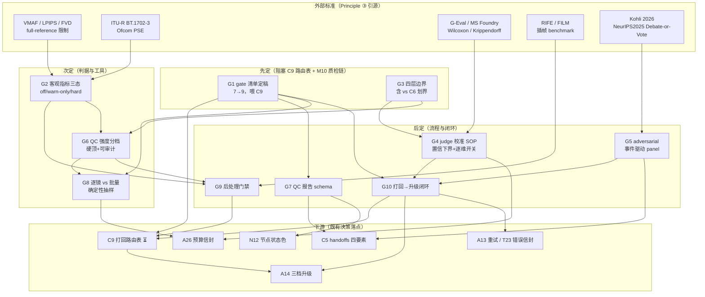

# 第六轮协商 · 质检与质量保障（QC & Quality Assurance）

> 日期：2026-10-02（起草）→ 2026-10-03（团队评审投票收敛）｜ 状态：🔄 **团队立场已收敛，待老板拍板**
> 证据基线：《三.md》第六章（质量保障体系 6.1~6.7）+ 3.7.3（delivery_spec）+ 5.3（场记岗铁律）+ 7.2 + 11.4 + 第十章 R-C1/R-T3/R-O2 + **v2 真身实读**（`spec/qc_rubric.json` v1.1.0、`spec/delivery_spec.json` v2.0、`tools/qc_media.py` v7、`tools/vlm_check.py`、`tools/whisper_transcribe.py`、`tools/dit_ingest.py`）+ DECISIONS.md（D1–D25 / N1–N24 / A1–A26 / T1–T24 / C1–C9 + 05-Q1–Q16）+ 外部标准调研（VMAF / LPIPS / FVD·FID / ITU-R BS.1770-5·EBU R128 / ITU-R BT.1702-3·Ofcom·Harding FPA / G-Eval / Microsoft Foundry judgesync / PoLL / Kohli 2026 / NeurIPS 2025《Debate or Vote》/ D3 / Trust-or-Escalate / RIFE·FILM / Interra BATON·Vidchecker）。
> 文件位置：本文件 R0 立项后迁入 AI影视团队v3/docs/negotiation/
> 老板四原则（本轮执行方式）：① **不一刀切**（QC 强度分档 + 分引擎阈值 + 分交付档 + 逐维度/逐镜 override，每项附默认推荐+可逆性）；② **决策互联**（每条显式回链 D/N/A/T/C，说明依赖与冲突）；③ **不重造轮子**（调研现成标准并引源）；④ **全面且灵活**（逐镜 vs 批量、机器可验证 vs 判断型、成本入账、打回闭环、后处理门禁、校准集构建全覆盖）。
> **编号约定（本轮最终版，正文/拍板清单/§7/§9 四处已统一）**：核心决策 = **G1~G10**（G=Gate）；快决策 = **J1~J18**（J=Judgement/快决）。与第五轮 Q 系列**独立编号**，跨轮引用请带轮次（如「06-J4」）。
> ⚠️ 本轮**不改动 DECISIONS.md**（主协调人在老板拍板后统一登记）。文档内「推荐」= 架构师立场，「**团队立场**」= PM+QA 投票后主理人收敛，「待拍板」= 需老板定夺。

---

## 0. 证据基线（先亮牌）

### 0.1 v2 真身已经有什么（实读结论，非推测）

| 资产 | 实读结论 | 本轮利用方式 |
|---|---|---|
| `spec/qc_rubric.json` v1.1.0 | 三层门：`hard[hard_1_motion, hard_3_identity, hard_5_audio]` / `soft[soft_2_structure, soft_4_lighting]` / `creative[creative_performance, creative_cinematic_score]`；**共 7 个 gate**；已内置 `external_adversarial_review{required:true, verdicts:[REVISE,MINOR,OK], rule:批评与分歧同时记录}`；`rubric_versioning` 条款：历史评分必须记录当时 rubric_version | G1 定稿基线 / G4 校准 / G5 敌意审查 |
| `spec/qc_rubric.json` 检查项 | hard_1_motion：M1~M6（光流 ≥2.0px/帧、静图降级 ≤30%、相机可追溯、无 >0.5s 冻结、**闪白 ≤3 次/s**、无 judder）；hard_3_identity：I1~I5（ArcFace ≥0.75 且 \|yaw\|<45°、VLM 判动物、ΔE≤12、道具状态机、口型 Sync-C≥5）；hard_5_audio：A1~A6（48k/24bit/2ch、-14 LUFS±0.5、真峰 ≤-1.5dBTP、LRA≥8LU、对白差 ∈[-1,+4]LU、环境声 ≥3 层）；soft_2_structure：S1~S4；soft_4_lighting：L1~L5 | G3 分层 / G6 阈值分档输入 |
| `spec/qc_rubric.json` 基线期望 | `industry_discard_rate: 60-80%`（弃片率基线）；`why` 原文：**"88.9% 静图就是在『零返工』口号下被降级交付吞掉的"** | G4 校准集好坏比 / G6 防放水 |
| `tools/qc_media.py` v7 | **只读**技术门，数值口径全部来自 `pipeline/delivery_spec.json`；输出 `{file, profile, stage, spec_schema, spec_source, measured{}, info{}, fail[], warn[], verdict:PASS\|FAIL}`；**退出码 3 = FAIL**；含 ebur128 两遍法、对白窗口相对响度、`blackdetect`/`freezedetect`、AIGC 隐式元数据五键校验、血缘 `kind` 统计；**stage=preview vs final 分级判硬软** | G7 schema 真身蓝本 / G1 缺口发现 |
| `tools/vlm_check.py` | Qwen3-VL-4B 本地，preset=`anatomy`\|`motion`\|`consistency`，输出 `{verdict, issues[{type,desc,severity}]}`，有 `parse_error` 兜底 | G4 judge 落地形态 |
| `tools/whisper_transcribe.py` | faster-whisper，输出 srt + json（词级时间戳） | G3 口型同步 I5 测量源 |
| `spec/delivery_spec.json` v2.0 | L1/L2/L3 三档；响度 -14 LUFS±0.5、真峰 ≤-1.5 dBTP、48k/24bit/2ch | G6 分交付档 / G9 后处理门禁 |
| 《三.md》第六章 | 六道关（①契约 ②白模 ③执行 ④技术参数 ⑤内容质量 ⑥合规终审）；打回四要素；探针回显制度；6.7 与前代对比 | G8 粒度 / G10 关→gate 映射 |

### 0.2 本轮要填的真空带（Principle ②：全部来自对既有决策的回链检查）

| # | 真空带 | 来源（回链） | 对应决策 |
|---|---|---|---|
| ① | **qc_rubric gate 名未定稿为机器可读清单** —— C9 点名要本轮交付 | 第五轮 C9/Q13 ⏳ | **G1** |
| ② | **qc_media.py 有 3 类 FAIL 无 gate 归属**（详见 0.3） | 本轮代码实读新发现 | **G1** |
| ③ | **契约校验（C6）vs QC 边界未划清** | 第五轮 C6 | **G3** |
| ④ | **客观指标（VMAF/LPIPS/FVD）选型未定** | 三.md 6.1④ / R-T3 | **G2** |
| ⑤ | **A25 LLM-as-judge 校准只定方向未定流程** | A25 ⏳ | **G4** |
| ⑥ | **adversarial review 只有 `required:true`，机制未定义** | qc_rubric.json 既有条款 | **G5** |
| ⑦ | **QC 强度一刀切** | 老板原则① | **G6** |
| ⑧ | **QC 报告无 schema** | T6 / V7 / T13 | **G7** |
| ⑨ | **逐镜 vs 批量粒度未定** | 三.md 6.3 / C18 | **G8** |
| ⑩ | **后处理（RIFE 插帧 + 超分）无质量门禁** | D25②③ / M16 | **G9** |
| ⑪ | **QC 失败→打回→升级闭环未闭合**（含 ERROR 态缺失） | C9 / A21 / A14 / A13 / T23 | **G10** + J4·J15 |
| ⑫ | **QC 成本不入账** | T13 实测项 7 ⏳ | J14 |

### 0.3 ⭐ 关键发现：qc_media.py 存在 3 类「无主 FAIL」（本轮最硬发现）

逐行比对 `tools/qc_media.py` v7 的 `fails.append(...)` 与 `qc_rubric.json` 的 gate 表，发现 **v2 的技术门会产出 qc_rubric 里根本没有 gate 的 FAIL**：

| qc_media.py 的 FAIL 项 | 能否归入现有 7 gate | 实际归属 |
|---|---|---|
| 帧率 ≠ spec（±tolerance） | ❌ 无 | 第④关「技术参数关」，源=delivery_spec |
| 分辨率 ≠ spec | ❌ 无 | 同上 |
| 视频码率 < min_video_kbps | ❌ 无 | 同上 |
| 采样率/声道 ≠ spec | ✅ `hard_5_audio.A1` | — |
| 程序响度 / 真峰 / LRA / 对白窗口 | ✅ `hard_5_audio.A2/A3/A4/A5` | — |
| 意外黑帧 | ✅ `hard_1_motion.M4` | — |
| 血缘 kind≠video 镜占比 | ✅ `hard_1_motion.M2` | — |
| **AIGC 隐式元数据五键缺失**（GB 45438-2025） | ❌ 无 | 第⑥关「合规终审关」，源=V40 |
| **AI 显式标识无证据** | ❌ 无 | 同上 |

**后果**：若按第五轮 C9 原案只把 qc_rubric 的 7 个 gate 名喂给打回路由表，则**分辨率不符 / AIGC 元数据缺失 / AI 标识缺失这三类 FAIL 没有责任岗**，退回「场记自己想该打回谁」——正是 A21 要消灭的老毛病。

**本轮处置**：G1 把 gate 清单从 7 个**扩到 9 个**，新增 `tech_6_delivery` 与 `compliance_7_labeling`，编号沿用 qc_rubric「五项硬指标 ①~⑤」的空位 ⑥⑦。

### 0.4 外部标准引用（Principle ③，不重造轮子）

| 标准 / 轮子 | 出处 | 本轮复用点 |
|---|---|---|
| **VMAF** | Netflix 开源 2016，Technology & Engineering Emmy；融合 VIF/DLM/运动特征 + SVR，训练自人类 MOS；ffmpeg 内置 | G2/G9。⚠️ **full-reference —— 必须有参考片** |
| **LPIPS** | Zhang et al., CVPR 2018 | G2/G9：超分前后感知相似度 |
| **FVD / FID / KID / CLIP-Score** | Unterthiner et al., ICLR 2019（Google, I3D）；**官方建议每文件夹 50–100 条片段才稳定** | G2：分布级指标只做引擎变体回归 |
| **SSIM / MS-SSIM / PSNR** | Wang et al., IEEE TIP 2004 | G9：插帧自参考 fidelity |
| **ITU-R BS.1770-5 (2023) / EBU R128 / ATSC A/85** | ITU-R；EBU；ATSC（CALM Act） | 响度口径。注：-23 LUFS=EBU R128 广播、-24 LKFS=ATSC A/85、≈-27 LKFS=点播。**本项目 -14 LUFS 是自定响亮档，不可写成「符合 R128」** |
| **ITU-R BT.1702-3 (2023) / Ofcom Rule 2.12 / Harding FPA / DPP PSE** | ITU-R；Ofcom（英国 2019 起强制播前 PSE 测试） | **J7：qc_rubric M5「≤3 次/s 闪白」= PSE 检测**。判据：1 秒内 >3 次闪光 + 覆盖 >25% 屏幕面积 + 亮度差 ≥20 cd/m²。BATON/Vidchecker 内置 |
| **G-Eval** | Liu et al., 2023 | G4：结构化 rubric + CoT + **概率加权打分** |
| **Microsoft Foundry LLM-judge 偏差治理 / `judgesync`** | Microsoft Tech Community 2025；Zheng et al. 2023 | G4：回归建模量化偏差 + 配对统计检验 |
| **配对 Wilcoxon 符号秩检验** | 非参数统计标准方法 | G4（QA 采纳）：偏差检测功效高于 OLS |
| **Krippendorff's α** | Krippendorff, 1980 | G4（strict 档）：多评委/多维度一致性，可处理缺失值 |
| **PoLL（Panel of LLM evaluators）** | Verga et al., 2024 | G5：跨厂商小模型 panel 比单大模型相关性更高，成本约 1/7 |
| **Kohli et al.,「Nine Judges, Two Effective Votes」** | 2026, arXiv 2605.29800 | G5 ⚠️ **反直觉：7 家族 9 judge 只值 2.18 个独立意见** |
| **Choi, Zhu & Li,「Debate or Vote」** | NeurIPS 2025, arXiv 2508.17536 | G5：多数投票本身解释了辩论的大部分收益；辩论不提升期望正确率 |
| **D3（Debate, Deliberate, Decide）** | arXiv 2410.04663 | G5：MT-Bench 86.3% vs 单 judge 72.5%、κ=0.60；**58% 二轮收敛，省约 40% token** |
| **Trust or Escalate / 选择性判定** | LLM-as-judge 综述；Manning《LLM Evaluation and Alignment》第 4 章 | G4：judge 自评低置信→弃权升级 |
| **RIFE** | Huang et al., ECCV 2022；官方 benchmark **HD PSNR 32.14 / Vimeo90K 35.615·SSIM 0.9779 / MiddleBury IE 1.956**；README 明示 4K 用 `--scale=0.5`、`--fps` 会移除音频 | G9：门禁锚点 + 两条已知坑 |
| **FILM** | Google Research | G9：遮挡/大运动更优但慢 5–10×（RTX 4090 1080p 2×：RIFE≈85fps vs FILM≈12fps） |
| **Interra BATON / Telestream Vidchecker / Venera Pulsar** | 厂商；BATON 内置 Netflix/iTunes/DPP/CableLabs 分发商 testplan + PSE 检查 | G6：借鉴「testplan/分发商模板」思想（`qc_profile` 是其同构物），**不自研 QC 平台**（M15 依赖极简） |
| **Cohen's κ / Fleiss' κ / Spearman ρ / Kendall τ** | Cohen 1960；Fleiss & Cohen 1973 | G4/J13：ordinal 用 Spearman，二分类用 κ |

---

## 1. 核心决策（10 个，完整展开）

### G1 qc_rubric gate 名机器可读清单定稿（喂 C9 打回路由）

- **背景**：第五轮 C9 已拍板（团队推荐，⏳ 待老板）"打回路由 = `qc_gate→责任岗` 映射表，`reject_routes.json`"，理由原文"接 qc_rubric 的 gate 名……**不靠场记想**"。该表**依赖本轮交付的 gate 名清单**——第五轮 §6 明写"本轮定稿的 `qc_rubric.json` gate 名将直接驱动 C9 的打回路由表"。当前 gate 名只存在于 `qc_rubric.json` 的 `layers.*.gates` 字符串数组，**无责任岗、无检查项清单、无法条出处、无路由分支**，无法直接当路由表用。
- **候选**：
  | 方案 | 形态 | 后果 |
  |---|---|---|
  | **A.（推荐/团队一致通过）独立 `spec/qc_gates.json`** | schema `cineast.qc_gates/1.0.0`，每条含 `{id, layer, name, source(法条出处), route(责任岗), checks[], version}`；qc_rubric.json 继续持有检查项与阈值，两文件以 `gate_id` 外键咬合，由 C6 的 `cross_contract_validator` 校验一致 | 判据与路由分离（改阈值不动路由）；C9 直接消费 |
  | B. 把 route/checks 塞进 qc_rubric.json | 单文件 | 判据与路由耦合，改阈值要动路由表，漂移风险 |
  | C. 不建清单，路由表手写 | 无 | 回到"场记想"，否决 |
- **团队立场 A + 清单扩到 9 个**（修正 §0.3 无主 FAIL 黑洞）：

```json
{
  "schema": "cineast.qc_gates/1.0.0",
  "version": "1.0.0",
  "note": "gate id 全局稳定，改名=MAJOR；新增=MINOR。route 值对齐 9 岗位 agent_id（A9）",
  "gates": [
    { "id": "hard_1_motion",      "layer": "hard",     "name": "①运动真实性（治 PPT 感）",
      "source": "qc_rubric.json#gates.hard_1_motion", "route": "blockout",
      "route_reason": "运动来自白模相机关键帧，结构问题不从渲染层修（三.md 6.3 第⑤关）",
      "checks": ["M1","M2","M3","M4","M5","M6"],
      "check_route_overrides": { "M6": "editor" } },
    { "id": "soft_2_structure",   "layer": "soft",     "name": "②结构锁定（白模有没有被听话）",
      "source": "qc_rubric.json#gates.soft_2_structure", "route": "blockout",
      "route_reason": "对象走位错=结构错不是渲染错（语义 IoU FAIL 同退白模岗）",
      "checks": ["S1","S2","S3","S4"], "attribution_required": ["ENGINE","BLOCKOUT","BOTH"] },
    { "id": "hard_3_identity",    "layer": "hard",     "name": "③角色一致性（治五官奇怪）",
      "source": "qc_rubric.json#gates.hard_3_identity", "route": "realizer",
      "route_reason": "技术指标类 FAIL→写实化岗（A21 原案）",
      "checks": ["I1","I2","I3","I4","I5"],
      "check_route_overrides": { "I4": "previs" },
      "check_route_reasons": { "I4": "道具状态机是 shot_spec.props.state 字段核对（契约问题），非渲染问题；若 spec 本身写错应退预演岗改契约，不是重抽提示词" } },
    { "id": "soft_4_lighting",    "layer": "soft",     "name": "④光影连续性",
      "source": "qc_rubric.json#gates.soft_4_lighting", "route": "blockout",
      "route_reason": "L1/L2 主光方位与色温由白模灯光模板定（D5）；L3/L4/L5 实为剪辑节奏与导演判断，非光影",
      "checks": ["L1","L2","L3","L4","L5"], "attribution_required": ["ENGINE","BLOCKOUT","BOTH"],
      "check_route_overrides": { "L3": "editor", "L4": "editor", "L5": "director" },
      "check_route_reasons": { "L3": "相邻镜景别跨度=剪辑节奏", "L4": "ASL 平均镜长=剪辑节奏", "L5": "跨轴=视线方向判断，属导演" } },
    { "id": "hard_5_audio",       "layer": "hard",     "name": "⑤声音真实性",
      "source": "qc_rubric.json#gates.hard_5_audio", "route": "sound",
      "route_reason": "响度类 FAIL→音效师（A21 原案）；A1 若源于转档→editor 分支",
      "checks": ["A1","A2","A3","A4","A5","A6"],
      "route_branches": { "A1_container_derived": "editor" } },
    { "id": "tech_6_delivery",    "layer": "hard",     "name": "⑥交付技术参数（本轮新增）",
      "source": "spec/delivery_spec.json v2.0", "route": "editor",
      "route_reason": "分辨率/帧率/码率由剪辑交付链转档决定（M16）",
      "checks": ["T1_resolution","T2_fps","T3_min_kbps"],
      "why_new": "填补 qc_media.py v7 实测产出但 qc_rubric 无归属的 FAIL（§0.3）" },
    { "id": "compliance_7_labeling","layer": "hard",   "name": "⑦AIGC 合规打标（本轮新增）",
      "source": "V40 / GB 45438-2025 /《标识办法》2025-09-01", "route": "editor",
      "route_reason": "显式+隐式标识由剪辑师在交付链写入（三.md 6.5）",
      "checks": ["C1_implicit_metadata_5keys","C2_explicit_label_ge_3s"],
      "why_new": "同上" },
    { "id": "creative_performance","layer": "creative","name": "表演/情绪/节奏",
      "source": "qc_rubric.json#gates.creative_performance", "route": "director",
      "judge": "boss", "rule": "废片理由必填到帧/秒（C18 四要素）" },
    { "id": "creative_cinematic_score","layer":"creative","name": "实拍感总评（VLM rubric）",
      "source": "qc_rubric.json#gates.creative_cinematic_score", "route": "director",
      "judge": "vlm_calibrated",
      "dims": ["运动连贯","光影一致","材质细节","表演","空间纵深","噪点结构"], "scale": "1-5 逐维独立" }
  ]
}
```

- **QA 补强（已采纳，写入落地要求）**：**M4 必须落双向断言**——① 正向：`qc_media.py` 能产出的**每一类 FAIL 都能映射到某个 gate**（覆盖率 100%）；② 反向：`qc_gates.json` 中每个 gate 至少有一条可执行检查（无悬空 gate）。**验收指标：无主 FAIL = 0、悬空 gate = 0**，任一条不成立则 CI 红。
- **✅ 已落地：`check_route_overrides{}` 子项分流**（另一路架构师代码级复查实证 → 主理人采纳，见 §9.6④）

  **缺陷性质与 J4 的 ERROR 态同类**——都会让 **A21 路由表从第一天就不准**（交叉引用 J4 / G10 第一段）。gate 级**整条路由**会把明显不属于该岗的检查项打给错误岗位，形成「责任岗改不动」的死循环。三个实证实例：

  | 检查项 | 整条路由的错误归属 | 实际性质 | 修正后 |
  |---|---|---|---|
  | **I4 道具状态机** | → 写实化岗 | `shot_spec.props.state` **字段核对**（契约问题），不是渲染问题 | → **`previs`**（预演岗改契约，不是重抽提示词） |
  | **M6 judder / 帧率漂移** | → 白模岗 | 容器时基缺陷，**与 `tech_6_delivery→editor` 同源** | → **`editor`** |
  | **L3 景别跨度 / L4 ASL / L5 跨轴** | → 白模岗 | 剪辑节奏（L3/L4）与导演视线判断（L5），**根本不是光影** | L3/L4 → **`editor`**；L5 → **`director`** |

  **处置**：复刻已有的 `route_branches`（A1）与 `attribution_required`（soft 层）机制，在 gate 内加 `check_route_overrides{check_id: 岗位}` 做**子项分流**——gate 级 route 保留为默认，子项 override 优先。上表已写进 §1 的 `qc_gates.json` 骨架（见 `hard_1_motion` / `hard_3_identity` / `soft_4_lighting` 三条的 `check_route_overrides` 字段）。
  > 注：`soft_4_lighting` 的 L1/L2（主光方位角、色温）确属白模侧，**保留 blockout**——分流只动 L3/L4/L5，不动 L1/L2。
- **决策影响**：**C9（打回路由 ⏳）** 唯一输入源；C6（`cross_contract_validator` 增 `source` 可解析校验）；C5（handoffs 的「违反了什么」引用 `gate_id + check_id`）；A21；N12（J4 状态色映射）；G10（打回闭环的路由依据）。
- **可逆性**：**可逆**（纯新增文件；`tech_6_delivery`/`compliance_7_labeling` 为新增，不动既有 7 个 gate 名）。gate id 改名按 C1 SemVer 计 MAJOR。
- **来源**：`spec/qc_rubric.json` v1.1.0 实读；`tools/qc_media.py` v7 实读；第五轮 C9/Q13；三.md 6.3；A21/A9。

---

### G2 客观指标选型（VMAF / LPIPS / FVD / FID）

- **背景**：《三.md》6.1 定"**判据自有、测量用轮子**"，点名 RAFT 光流、InsightFace 备选、aigcqa/ayase、ebur128。但客观指标的**选型与适用边界**从未拍板——v2"光流模块待建"是典型"判据有、工具没有"，C3 不能重演。**R-T3**（光流阈值分辨率敏感）与 **R-C1**（InsightFace 商用许可）两条风险登记项挂在本决策上。
- **核心技术裁定（架构师原判）**：
  > **VMAF / FVD / FID / LPIPS / SSIM 全部是「有参考」或「分布级」指标，没有一条能回答「这段 AI 生成视频像不像实拍」——AI 生成视频不存在 ground truth 参考片。**
  > - **VMAF** = full-reference，必须有参考片；AI 首创镜头的参考片是什么？没有。
  > - **FVD/FID** = 分布级，官方建议 **50–100 条片段**才稳定，不可能逐镜判。
  > - **LPIPS/SSIM/PSNR** = 两图比对，只适用于「产物 vs 某个已知基准」。
- **团队收敛（主理人裁定）**：**不写死"感知指标永不进硬门"，改三态开关 `off / warn-only / hard`**，按档位启用：
  | 档位 | VMAF 状态 | 说明 |
  |---|---|---|
  | **lite** | `warn-only` | 记录进 `objective_metrics{}`，不阻塞 |
  | **standard（默认）** | `warn-only` | 同上 |
  | **strict** | **`hard`（作附加门，与光流 AND）** | PM 论点成立：**「VMAF 高但静图」的假阳性只在 VMAF 作唯一门时成立；与光流 AND 后不成立**（静图光流过不了） |
  | 后处理门禁（G9） | `hard`（参考片合法存在） | **VMAF 唯一天然合法的 hard 场景** |
  > 三档 VMAF 阈值（0–100 分制）：**strict 95 / standard 90 / lite 85**，且**必须减掉纯编码损失基线**（见 G9 约束 b）。FVD/FID 仍**不进任何 gate**，只做引擎变体批量回归。
- **✅ 已落地硬约束：`reference_available` 前置条件**（架构师提出 → **主理人采纳并提升为正文正式约束**，见 §9.6①）

  VMAF 是 full-reference，**"无参考片"不是精度问题而是可计算性问题——指标根本算不出来**（不是"算不准"）。AI 首创镜头没有 ground truth，实现上只剩两条路：静默跳过（strict 档附加门实际是**空门**，用户以为加了门）或返回默认值（**直接误判 FAIL，比假阳性更糟**）。故三态开关**必须**带前置条件：

  | `reference_available` | 行为 | 明令禁止 |
  |---|---|---|
  | **`true`**（G9 后处理：参考片 = 处理前原生母版） | 按档位状态生效（strict 可 `hard`） | — |
  | **`false`**（AI 首创镜头，无 ground truth） | **自动降级 `warn-only`** + 报告写 `objective_metrics[].skipped = "no_reference"` | **禁止静默跳过**、**禁止返回默认值判 FAIL** |

  → **M4 CI 断言**：VMAF 检查项在 `reference_available=false` 时，输出必须是 `skipped:"no_reference"` 且 `verdict` **不得**为 `FAIL`。**VMAF 唯一天然合法的 hard 场景仍是 G9 后处理**（交叉引用 G9：`interpolation`/超分门禁的参考片是处理前原片）。
- **分引擎 / 分分辨率阈值表**（回链 R-T3）：
  | 判据 | 480p（L1） | 1080p（L2） | 2160p（L3） | 备注 |
  |---|---|---|---|---|
  | 光流中位速 M1 | ≥1.2 px/帧 | ≥2.0 px/帧（v2 原值） | ≥4.0 px/帧 | 阈值 ∝ 分辨率；**初值，R4 用《雨夜寻猫》好/坏样本回标定** |
  | 闪白/爆闪 M5 | ≤3 次/s（三档一致） | 同 | 同 | **对齐 ITU-R BT.1702-3 / Ofcom PSE**；安全项不分档 |
  | 冻结 M4 | 无 >0.5s | 同 | 同 | 安全/观感底线。**⚠️ 判据正确但工具参数不符**——代码实为 `freezedetect=n=-50dB:d=1.2` 且 **>3 次才 warn**，硬门实际未执行；**修正走工具参数而非阈值，见 G6 ③** |
  | 身份 I1 | ArcFace ≥0.75 且 \|yaw\|<45° | 同 | 同 | 余弦相似度与分辨率弱相关 |
  | 服装色 ΔE I3 | ≤12 | ≤12 | ≤12 | LAB 色差分辨率无关 |
- **R-C1 联动（商用许可）**：`hard_3_identity.I1` 主判据 ArcFace（InsightFace）**代码 MIT 但预训练模型仅限非商业学术用途**（三.md R-C1 一手核验）。两档：**A. 商单交付前完成商业授权** / **B. 切换 Qwen3-VL 多帧投票判据**（qc_rubric 已预留备选位，vlm_check.py 已实装）。默认：**非商单走 ArcFace；商单走 B**。
- **决策影响**：G9（VMAF 唯一合法 hard 场景 + 编码损失基线）/ G3（有参考项归 L1）/ G6（分档阈值）/ R-T3·R-C1 落地 / M10 / T2（新指标工具进 registry）。
- **可逆性**：**可逆**（三态开关是配置；不改任何已定判据）。
- **来源**：VMAF（Netflix 2016）；LPIPS（Zhang et al., CVPR 2018）；FVD（Unterthiner et al., ICLR 2019，50–100 clips）；SSIM（Wang et al., IEEE TIP 2004）；ITU-R BT.1702-3/Ofcom/Harding（PSE）；三.md 6.1/6.2/R-T3/R-C1。

---

### G3 机器可验证 vs 判断型分层边界（接 A8 · 划清与 C6 契约校验的边界）

- **背景**：**A8** 已拍板"三档分层 + 判断型细化"：可代码化铁律全代码化（硬闸）+ 数值校验 + **判断型分强/弱两档**（强=导演终审，弱=场记 QC）。老板明确要求本轮"划清契约校验（结构性）vs QC（质量性）边界，不要重复造轮子"。
- **裁定一：契约校验（C6）≠ QC，问题域不同，不得互相替代**

  | 维度 | 契约校验器（第五轮 C6） | QC（本轮） |
  |---|---|---|
  | 回答的问题 | 「这份 **JSON 合不合法**」 | 「这个**媒体产物好不好**」 |
  | 输入 | 契约文件（shot_spec/semantic_map/cost_ledger/handoffs/delivery_spec/qc_rubric） | 媒体实体（MP4/PNG/WAV）+ 血缘 + 契约引用 |
  | 判据来源 | schema 结构/类型/必填/外键/枚举 | qc_rubric 阈值 + 外部客观指标 + judge |
  | 输出 | `{schema_valid: bool, violations[]}` | `{verdict, measured, evidence, attribution}`（G7） |
  | 落点 | M4 CI，commit 时阻断 | 管线运行时，打回单上游 |
  | 共享 | **共享同一份阈值表**（如 delivery_spec 响度值），但**不共享执行器** | 同左 |

  → **不重复造轮子**：契约已有的结构性约束（8k+1 帧数、locks 必填、aspect_ratio 三档、object_mapping 外键）**一律不进 QC**。

- **裁定二：QC 内部四层（A8 三档在 QC 场景的展开）**

  | 层 | 名称 | 判据形态 | 执行者 | 接 A8 | 消耗 LLM |
  |---|---|---|---|---|---|
  | **L0** | 契约/结构 | schema、外键、必填 | C6 校验器（**非 QC**） | 可代码化硬闸 | 否 |
  | **L1** | **机器可验证** | 确定性数值 vs 阈值（光流/ArcFace/ΔE/ebur128/freezedetect/血缘 kind/分辨率/元数据五键） | 代码硬闸（qc_media.py 族） | 可代码化硬闸 | **否** |
  | **L2** | **弱判断** | 逐维 1–5 分（构图/叙事/审美/材质/噪点） | 场记岗 VLM/低档 LLM（A4 低档） | **弱判断** | 是（低档） |
  | **L3** | **强判断** | 表演/情绪/节奏/终审 | 导演 + 老板终裁 | **强判断** | 是（高档）+ 人 |
  | **L4** | **敌意审查** | 异厂商 critic verdict REVISE/MINOR/OK | 外部模型 | 独立于 A8（"反方"非"裁判"） | 是（异厂商） |
- **团队立场（一致通过）**：边界判据 = **可阈值性**（能写出 `measured vs threshold` 且可复现 → 必归 L1 代码化，**禁止走 LLM**；写不出阈值的才归 L2）。与 A25 原案"机器可验证项全代码化不走 LLM"一字不差。
- **豁免通道（不一刀切）**：确需把 L1 项临时交 LLM 判，须在 `qc_profile_overrides` 显式声明 + 记豁免账本 + 消耗 A26 信封（同 A6b 豁免条款精神）。
- **决策影响**：A8（三档分层的 QC 展开）/ A25（校准只对 L2 生效——L1 免校准，这是省成本的关键）/ G4（校准范围）/ G6（档位只作用于 L2/L4 与抽样密度，不作用于 L1）/ C6。
- **可逆性**：**可逆**（分层是执行约定；但把 L1 下放到 L2 会让校准集负担陡增，属半可逆）。
- **来源**：A8；A25；第五轮 C6；三.md 6.1②③；A4。

---

### G4 LLM-as-judge 校准流程落地（A25 从方向到可执行）

- **背景**：**A25** 已拍板"B. 分层+校准……先建 50–100 条人工校准样本集，维度独立输出 score+pass/fail；**R2 首验时计算 judge 与老板评分相关性（目标 ≥0.7）**"。但**校准集怎么建、维度怎么独立打分、相关性怎么算、偏差怎么治**未落流程——A25 会停在口号。
- **偏差治理四件套（架构师原案，保留）**：① **逐维单点评分**（1–5 逐维单点、不做 pairwise，**位置偏差在结构上被消灭**）；② **结构化 JSON 输出 + 禁自由文本**（治冗长偏差，vlm_check.py 已实装）；③ **judge 与生成模型不同厂商**（治自偏好）；④ **G-Eval 概率加权打分**（读 rating token 概率加权平均，粗整数→连续分）。
- **团队收敛（PM+QA 两条都采纳）**：

  **(a) QA 的统计严谨性 —— binding 判据从点估计改为置信下界 + 假阳性率**

  | 项 | 收敛结论 |
  |---|---|
  | **binding 门槛** | **ρ 的 95%CI 下界 ≥0.60 且 κ 下界 ≥0.50 且「judge PASS / 老板 FAIL」假阳性率 ≤ 阈值**，三者同时满足才可 binding。**只看点估计 ρ≥0.7 不够** |
  | **小样本** | **见下方「✅ 已落地：小样本逐维度判定」**（原 `n<100 一律 warn-only` 已按架构师意见改为逐维度判定），并在报告**强制标注 n 与 CI 宽度** |
  | **校准集好坏比** | **须贴近真实弃片率 60–80%**（qc_rubric `baseline_expectations`），**禁止人为 50/50** —— 50/50 会虚增 κ（类别均衡时 κ 天花板更高），是统计幻觉 |
  | **stale-by-construction** | `rubric_version` / judge 模型版本 / 阈值文件 hash **任一变化 ⇒ `calibration_state = stale`**，judge 自动降 advisory，**且禁止出现在任何交付证书与 Pass 判据中** |
  | **稳定性验证** | 校准须带 **70/30 划分验证**，两段 ρ 差 **>0.15 判不稳定** → 不得 binding |
  | **偏差检测方法** | 改用**配对 Wilcoxon 符号秩检验**（功效高于 OLS）；OLS 回归 `Score=β0+β1(产物来源)+β2(归一化长度)+ε` **仅作探索性输出**，不作判据 |

  **(b) PM 的逐维度独立开关 binding 效力**（主理人认定这是本轮最典型的一刀切）

  不同维度的可判性天差地别（"运动连贯"可判，"材质细节"主观性极强），**逐维度独立决定 advisory / binding**。门槛写成三档阈值表进 `spec/qc_thresholds.json`：

  | 档位 | ρ 下界要求 | κ 下界要求 | 附加 | binding 效力 |
  |---|---|---|---|---|
  | **strict** | ≥0.75 | ≥0.70 | + **Krippendorff α** | 允许 binding |
  | **standard（默认）** | ≥0.70 | ≥0.60 | — | 允许 binding |
  | **lite** | ≥0.60 | — | 仅 warn-only | **永不得 binding** |

- **校准流程 SOP（6 步）**：
  1. **建集**：抽取人工标注样本 **50 / 100 / 150 条（随 N21 规模：短片 50、标准剧 100、长片 150）**，覆盖 L2 六维度；**好坏比贴近真实弃片率 60–80%**。
  2. **老板打分**：老板按同 rubric 逐维打 1–5 → 人类基准（**不可由 AI 代打**）。
  3. **judge 打分**：`vlm_check.py --preset cinematic` 扩 prompt 为六维 + **temperature=0**（G-Eval 标准，保证可复现，接 V7 探针回显）+ 逐维**独立**输出 `{dim, score, pass_fail, reason}`（禁止一次调用打全维度总分——维度耦合会让偏差互相污染）。
  4. **算相关性 + 稳定性**：Spearman ρ（ordinal）+ Cohen's κ（二分类），**报 95%CI 下界**；70/30 划分验证（ρ 差 >0.15 判不稳定）；偏差检测用**配对 Wilcoxon**。
  5. **逐维裁定**：按上表三档门槛逐维度决定 advisory / binding，结果写 `qc_thresholds.json`。
  6. **弃权 + 升级**（Trust or Escalate）：judge 自评置信度/概率加权分离散度超阈值 → **弃权（`ABSTAIN`）→ 升级导演/老板**（接 G10 升级协议）。**judge 不是无条件真理，是误差可度量的指标。**
- **rubric 版本纪律**：每份报告记 `rubric_version` + `thresholds_version`（G7）；改 rubric ⇒ `calibration_state=stale` ⇒ 重校准。
- **✅ 已落地：小样本逐维度判定**（架构师提出 → **主理人采纳并提升为正文正式约束**，见 §9.6②）

  原 `n<100 一律 warn-only` 与 J12「短片 50 条」直接冲突——**短片档校准集就是 50 条，永远 <100 ⇒ 永远只能 warn-only ⇒ A25 对短片项目形同虚设**。故改为**逐维度判定**（与已通过的「逐维度独立开关 binding 效力」同一思路，下沉到样本量维度）：

  | 整体样本量 n | binding 判定 | 约束 |
  |---|---|---|
  | **n ≥ 100** | 按 (a) 置信下界门槛逐维度判定 | 常规路径 |
  | **50 ≤ n < 100** | **允许单维度 binding** —— 须同时满足：① 该维度**有效样本量足够**（该维度有评分的样本数，非整体 n）；② **ρ 95%CI 下界 ≥0.60 且 κ 下界 ≥0.50**；③ **通过 70/30 稳定性检验**（两段 ρ 差 ≤0.15） | **报告强制标注 `n` 与 CI 宽度**；不达标维度仍 advisory |
  | **n < 50** | **一律 warn-only**（任何维度都不足以支撑 binding） | **口子不可再开大** |

  → 三条叠加后下限仍然稳：**点估计仍不够（要看 CI 下界）+ 稳定性仍要验 + n<50 兜底**。
- **决策影响**：A25（落地）/ G3（校准只覆盖 L2，L1 免校准）/ G5（ABSTAIN 是 panel 触发事件之一）/ G10（弃权升级通道）/ A26（judge 调用消耗信封）/ A4（judge 走低档）/ J11·J12·J13。
- **可逆性**：**可逆**（校准集与 rubric 都是资产；但**校准集重建成本高**，rubric 变更须谨慎——半可逆）。
- **来源**：A25；G-Eval（Liu et al. 2023）；Microsoft Foundry judgesync；配对 Wilcoxon；Krippendorff α；Manning 第 4 章（Spearman/Kendall/Cohen's κ 与样本量 CI）；Trust or Escalate；`qc_rubric.json` rubric_versioning + baseline_expectations 60–80%。

---

### G5 adversarial review 机制（接 qc_rubric 既有条款）

- **背景**：`qc_rubric.json` 已内置 `external_adversarial_review{required:true}`，v2 原文理由："创作者不能自己当裁判……独立 critic（另一家厂商的模型）对每个 pilot 都返回 REVISE，部分意见真的改了片子，部分被导演逐帧驳回——**批评与分歧同时记录才有价值**"。但**机制未定义**：几家 critic、verdict 如何用、分歧怎么落档、要不要辩论。
- **团队立场（主理人采纳 QA「绑事件不绑身份」，否决 PM「绑交付档/budget_tier」）**：

  | 项 | 收敛结论 |
  |---|---|
  | **默认配置** | **单 critic（不同厂商）**，逐镜覆盖 hard+soft+creative，verdict ∈ {REVISE, MINOR, OK}；批评与**分歧**同时落 handoffs（v2 原文保留） |
  | **加强档（PoLL panel）触发条件** | **事件驱动**：`单 critic = REVISE` **OR** `judge = ABSTAIN` **OR** `分歧未收敛`。**不绑 L3 交付档、不绑 premium budget_tier** |
  | **为什么绑事件** | QA 论证成立：L3/premium 只是**重要性代理变量**——同一批镜因预算不同而判据不同 ⇒ **报告不可比（可复现性硬伤）**；且成本 ×3–5 却花在**已 PASS 的镜**上。Kohli 2026 说明 panel 的真价值是**分歧检测**而非平均分，只该当 tie-breaker |
  | **导演 override** | 采纳 PM 提案，但**降级为单镜级 override 且计入 A26 信封**（防滥用），全量进豁免账本 |
  | **采纳差异率监控** | 记录 **panel vs 单 critic 的采纳差异率**，**<5% 时下次自动降回单 critic**；触发率过高 ⇒ 说明该**换 critic**，而非常态化加 panel |
  | **预算停止** | 借鉴 D3 Budgeted Stopping Rule：**58% 的辩论第二轮即收敛**，故辩论最多 2 轮、score gap 稳定即停，省约 40% token；每轮计入 A26 信封 |
  | **高 stakes 可选档** | D3 法庭式（advocate/judge/jury，MT-Bench 86.3% vs 单 judge 72.5%、κ=0.60）保留为**可选**，不常设 |
- **保留的硬约束**：critic **必须异厂商**（写死）——这条与 PoLL 前提一致；**否决"多 critic 委员会"常设档**（Kohli 2026：7 家族 9 judge 只值 2.18 个独立意见；NeurIPS 2025《Debate or Vote》：多数投票本身解释了辩论的大部分收益，且自信的错误 agent 会把群体拉向更差答案）。
- **决策影响**：qc_rubric.json 既有条款（只补机制不推翻）/ C5（分岐落 handoffs）/ G10（ABSTAIN 与分歧进升级链路）/ A26 / A4 / G4。
- **可逆性**：**可逆**（机制是流程配置）。
- **来源**：`qc_rubric.json` `external_adversarial_review` 实读；PoLL（Verga et al. 2024）；Kohli et al. 2026（arXiv 2605.29800）；Choi/Zhu/Li NeurIPS 2025（arXiv 2508.17536）；D3（arXiv 2410.04663）；Zheng et al. 2023。

---

### G6 QC 强度分档（严 / 标 / 松 + 分引擎阈值 + 分交付档）

- **背景**：老板原则①要求分档。但分档有**放水风险**——qc_rubric `why` 原文："**88.9% 静图就是在『零返工』口号下被降级交付吞掉的**"。**PM 与 QA 罕见一致：都反对"松档需老板逐项目批准"**（人工审批既拖进度又不可靠）。
- **团队立场：把「事前人工审批」换成「事后可审计 + 事前机器硬顶」五条**

  | # | 机制 | 内容 |
  |---|---|---|
  | ① | **每类可调维度设硬下限** | 抽样密度下限（PSE 硬 30% 不可降）、后处理门禁阈值下限、judge 弃权阈值上限等，配在 `qc_thresholds.json`，**低过硬下限的配置直接拒绝加载** |
  | ② | **豁免额度上限** | 因抽样跳过的检查条目**占比 / 绝对数**超阈 ⇒ **自动升档 + 告警** |
  | ③ | **override 全量进 append-only 豁免账本** | 记 `{actor, reason, git_diff}`，只追加不改（接 C4 jsonl 哲学 + A20 原子写） |
  | ④ | **交付单强制标注** | profile + 豁免统计 |
  | ⑤ | **收尾汇报** | 每项目收尾向老板报一次**累计豁免率** |
- **附加（PM 采纳）**：松档必须同时打**降档交付标记**，锁死「L1 审片挂 L2 名义交付」。
- **核心防放水原则（架构师原案，团队保留）**：**硬门（L1 机器可验证层）判据恒定不分档**；"严/标/松"只作用于四个可调维度：① soft WARN→FAIL 升级 ② **抽样密度** ③ 后处理门禁阈值 ④ judge 弃权阈值。
- **QA 的两条 M4 CI 硬断言（已采纳）**：
  1. **任一 profile 下 `hard` 层 `unchecked_count == 0`** —— QA 指出**抽样密度是比阈值更隐蔽的放水通道**（阈值不动、把检查抽没了一样放水）。
  2. **归因准确率回归** —— 归因=ENGINE 的件，重跑后是否真由写实化岗修复；**否则归因退化成填空**（soft 层 `attribution_required` 会变成走过场）。
- **三轴矩阵**

  **轴一：强度档**
  | 项 | 严 | **标（默认）** | 松 |
  |---|---|---|---|
  | soft WARN→FAIL | 自动升级 | 需归因后决定 | 仅记录不升级 |
  | L2/L4 抽样密度 | 全量 | 硬门全量 + soft/L2 30% | 硬门全量 + soft/L2 10%（**PSE 仍 ≥30%**） |
  | 后处理门禁（G9） | PSNR ≥34dB、超分 LPIPS ≤0.10 | **≥32dB / ≤0.15** | ≥30dB / ≤0.20 |
  | judge 弃权阈值 | 低（易弃权→多升级人工） | 中 | 高（少弃权） |
  | 适用 | 商单 / 长片 / 外部平台交付 | **标准剧（默认）** | 短片 / 内部审片 / 预算紧 |

  **轴二：分引擎阈值**（不同引擎原生运动特征不同，一刀切会误杀）
  | 引擎 | 光流阈值修正 | 备注 |
  |---|---|---|
  | fal 3DREAL | ×1.0（基准） | R4 实测档 |
  | Wan 2.2 | 待 R0 标定（30fps 输出错位已知） | 标定后补 |
  | 本地 VACE | 待 R0 标定 | M9 |
  | Seedance | 待 R0 标定 | Q11 三件套 |

  **轴三：分交付档（接 D25）**
  | 交付档 | 分辨率 | QC 范围 | 后处理门禁 |
  |---|---|---|---|
  | L1 | 480p | 硬门全量 + soft 抽检；**不插帧是合法交付**（G9） | 无 |
  | L2 | 1080p | 硬门全量 + soft 30% + creative | 插帧门禁 |
  | L3 | 2160p | 全量全层 + PSE 强制 | 插帧 + 超分门禁 |

- **`qc_profile`（借 BATON testplan）**：三轴组合成命名 profile（如 `standard_L2`）写进项目配置；报告记 `profile_version`（G7），保证可比、可重跑、可回归。
- **✅ 已落地：全局 `qc_profile_overrides` 两层 + 可比性缓解三件套**（PM 提案；架构师附加条件 → **主理人采纳并提升为正文正式约束**，见 §9.6③）

  `qc_profile_overrides` 分**项目级 + 逐镜级**两层，G4/G5/G6/G8 的档位均可手动指定（原草案只有 G6 写了 override，属遗漏）。

  **逐镜级 override 必须套用与 G6 相同的缓解三件套**（否则与 G5 已确立的原则自洽性破裂）：

  | # | 三件套 | 内容 |
  |---|---|---|
  | **(a)** | **进 append-only 豁免账本** | 记 `{profile_version, override 原因, actor, git_diff}`，只追加不改（接 C4 jsonl 哲学 + A20 原子写） |
  | **(b)** | **交付单聚合披露** | 交付单须披露 **override 比例**（override 镜数 / 总镜数），不可逐镜隐藏 |
  | **(c)** | **M4 断言仍成立** | override 后 `hard` 层 **`unchecked_count == 0`** 必须仍然成立（override 不得把硬门检查抽没） |

  > **为什么必须套三件套（内部一致性论证）**：QA 在 G5 反对「绑交付档 / budget_tier」的**核心理由**是"**同一批镜因外部属性不同而判据不同 ⇒ 报告不可比**"。而**逐镜级 override 造成的问题完全一样**——同一批镜内不同镜用不同判据，同样破坏可比性。**不能在 G5 用这个理由否决 A、又在另一个地方用同样的模式放行 B。** 三件套的作用不是禁止 override，而是让 override 与 G5/G6 已确立的可比性原则自洽。
- **✅ 已落地：两条代码级实证修正**（另一路架构师 v2 真身复查 → 主理人采纳，见 §9.6⑤⑥）

  **② LRA 双边带缺口（真实质检漏洞）**

  `qc_rubric.json` 的 **A4 是下界**（LRA ≥8 LU，防"压缩成一堵墙"），`delivery_spec.json` 的 `lra_max=14` **是上界**——二者互补，构成双边带。但 `tools/qc_media.py` v7 **只实现了上界一行**：

  ```python
  if L.get("input_lra", 0) > PL.get("lra_max", 99):
      warns.append("LRA %.1f > %s" % (L["input_lra"], PL["lra_max"]))
  ```

  **A4 下界（≥8 LU）从未被任何代码检查** ⇒ **被压缩成墙的混音现在能全绿通过**。这是本轮最直接的质检漏洞。

  | 项 | 落地 |
  |---|---|
  | **入 G6 阈值表** | LRA **双边带：`8 LU ≤ LRA ≤ 14 LU`**（下界来自 rubric A4 = 硬门；上界来自 delivery_spec `lra_max` = warn） |
  | **补代码实现** | `qc_media.py` 增下界判断 `if L["input_lra"] < 8: fails.append(...)`；**下界为 FAIL（硬门）、上界维持 warn**——与 rubric 的硬/半硬分层一致 |
  | **进 R0/R2 实测** | 见 §5 第 11 条 |

  **③ 冻结帧 M4：改工具参数，不改阈值**

  G6/G2 阈值表写 `0.5s`，代码里却是 `freezedetect=n=-50dB:d=1.2` 且 **>3 次才 warn**——**硬门实际未执行**（判据与实现对不上，且噪声门限 `-50dB` 与 rubric 的 `-60dB` 也不同）。

  | 项 | 处置 | 理由 |
  |---|---|---|
  | **阈值 0.5s** | **不动** | 判据是对的，《三.md》6.1「**判据自有、测量用轮子**」——判据是本项目资产，不因工具现状妥协 |
  | **工具参数** | **改**：`d=1.2 → d=0.5`、`n=-50dB → n=-60dB` | 工具是实现层，向判据对齐 |
  | **warn→fail** | 由「>3 次才 warn」改为**单次即判**（硬门） | 硬门不能靠累计次数触发 |
  | **"静图镜属预期"的例外** | **交给已有的血缘 `kind` 判据处理**（J6：kind 为主、光流为辅），**不在冻结帧里重复造例外** | 例外已有归属，重复造会两套口径打架 |

- **决策影响**：D25 / N21 / A26（抽样密度决定 QC 成本）/ G9 / G3 / G4·G5·G8（override 作用域）/ C4（豁免账本同源）/ 第五轮 PM 补强 2 / **G2（M4 阈值行已加指针，两处不许打架）**。
- **可逆性**：**可逆**（改 profile 重跑即可；已记 profile_version，历史分数可比）。
- **来源**：老板原则①；`qc_rubric.json` `why`/`baseline_expectations`；三.md 6.2（硬门=红灯无商量）；D25⑥/N21；Interra BATON testplan 思想。

---

### G7 QC 报告 schema 与契约层对接

- **背景**：v2 `qc_media.py` 有输出形态但**无统一 schema、无 rubric_version、无成本字段、无探针回显字段、无 gate_id 归属**——导致 C5 handoffs 无法机器引用、T13 无处记账、V7 探针回显无法制度化。三.md 6.7 明写 C3 要"探针回显 + **QC 报告入 git**"。
- **团队立场 A**：`spec/qc_report.schema.json`（`cineast.qc_report/1.0.0`）；逐镜落 `projects/<片>/qc/<shot_id>.qc.json`；汇总落 `qc_ledger.jsonl` 追加式只写不改（接 C4）；**进 git**。

```json
{
  "schema": "cineast.qc_report/1.0.0",
  "qc_report_id": "qc_rainy_4-1_0007",
  "shot_id": "4-1",
  "project_id": "rainy_night_cat",
  "qc_profile": "standard_L2",
  "profile_version": "1.0.0",
  "rubric_version": "1.1.0",
  "thresholds_version": "1.0.0",
  "gates_version": "1.0.0",
  "contract_ref": { "shot_spec": "…/4-1/shot_spec.json", "contract_check_id": "chk_0007" },
  "stage": "final",
  "results": [
    { "gate_id": "hard_1_motion", "check_id": "M1", "layer": "L1",
      "measured": { "value": 2.4, "unit": "px/frame" },
      "threshold": { "op": ">=", "value": 2.0 },
      "verdict": "PASS",
      "evidence": { "cmd": "ffmpeg -vf …", "stdout_sha256_norm": "ab12…", "raw_excerpt": "…" },
      "cost": { "tool": "qc_media", "charged": 0.0, "currency": "CNY" } }
  ],
  "judge": [ { "dim": "运动连贯", "score": 4, "pass_fail": true, "binding": true,
               "judge_model": "Qwen3-VL-4B", "confidence": 0.82 } ],
  "adversarial": { "critic_model": "…", "verdict": "MINOR", "criticism": "…", "dissent": "…" },
  "objective_metrics": { "vmaf": { "value": 91.3, "state": "warn-only",
                                   "reference": "post_interp_source", "skipped": null } },
  "verdict": "PASS",
  "attribution": null,
  "ts": "2026-10-02T22:30:00Z"
}
```

- **QA 补强三字段（已采纳）**：
  1. **`thresholds_version` / `profile_version`** —— 阈值外置后没有它**历史报告不可比、不可回归**（与 `rubric_version` 同理）。
  2. **`cost` 必填**（不可为空/null）—— 否则 T13 成本账不全。
  3. **`evidence` 存归一化 stdout 的 sha256**（去时间戳 / 绝对路径 / 随机临时名）—— **否则 golden 回归必然失败**（J18 `--selftest` 依赖此字段）。
- **字段回链理由**：`contract_ref.contract_check_id` = 对接 C6（引用校验结果，不重复校验）；`evidence` = V7 探针回显；`cost` = T13；`attribution` = soft 层必填 ENGINE/BLOCKOUT/BOTH；`adversarial.dissent` = G5 分歧必录；`objective_metrics[].state` = G2 三态开关的落点（含 `skipped:no_reference`）。
- **决策影响**：C5 / C6 / T6 / T13 / V7·R-O2 / N12（J4 状态色）/ C1 / C4 / G4（stale 判定读这三个 version）。
- **可逆性**：**可逆**（新增 schema；加性 MINOR 演进不破旧消费方）。
- **来源**：`tools/qc_media.py` v7 实读；`qc_rubric.json` rubric_versioning；三.md 6.6/6.7/R-O2；第五轮 C1/C4/C5/C6；第四轮 T6/T13。

---

### G8 逐镜 vs 批量 QC 粒度

- **背景**：三.md 6.3 六道关是流水线位置，但 **QC 自身的执行粒度**未定。`soft_4_lighting.L1`（主光方位角跨镜 ≤30°）与 `L4`（ASL 2–5s）**本质是跨镜统计量，逐镜算不出来**；而打回四要素要求"哪帧/哪秒"，批量报告给不了。
- **团队立场 A（一致通过）：双层报告** —— L1 硬门**必逐镜全量**（打回要精确到帧/秒）；soft 层与 L2/L4 走**批量统计 + 抽检**；产出 `qc/<shot_id>.qc.json`（逐镜）+ `qc/program_qc.json`（聚合，含跨镜统计量）。
- **抽样规则（随 G6 强度档）**
  | 层级 | 严 | 标（默认） | 松 |
  |---|---|---|---|
  | L1 硬门（逐镜） | 全量 | **全量** | 全量 |
  | soft 层（可批量） | 全量 | 30% | 10% |
  | L2 judge | 全量 | 30% | 10% |
  | L4 critic | 全量 | 全量 | 50% |
  | **PSE 安全项（M5）** | 全量 | **≥30%** | **≥30%（硬下限不可降）** |
  | program 级聚合 | 必跑 | 必跑 | 必跑 |
  > **性能硬约束（v2 实测）**：`signalstats` 全片跑极慢（**1080p30/120s 实测 29.56s**，qc_rubric M5 原注：必须抽样）。但 M5 同时是**安全项**（PSE），故**抽样下限 30% 即使松档也不可降**（QA 追加）。
- **确定性抽样（J16）**：抽检必须用 **`shot_id` 哈希 + 固定种子**确定性选取，**否则同一批镜两次跑结论不同、报告不可回归**。
- **决策影响**：G6（抽样密度是可调维度之一）/ C18·6.4（打回四要素要求逐镜粒度）/ G2（PSE 抽样下限）/ A26（抽样密度决定 QC 成本）/ N20 / J16。
- **可逆性**：**可逆**（抽样是执行参数）。
- **来源**：三.md 6.3/6.4；`qc_rubric.json` M5 note + L1/L4 跨镜判据；A26。

---

### G9 后处理（RIFE 插帧 + 超分）质量门禁（接 D25 ②③ · M16）

- **背景**：D25 已定"AI 原生 24/30fps + **RIFE 插帧**达 30/60/120fps；**超分**升 4K"；三.md M16 验收写"tech 版过 delivery_spec 三档×三比例全查（**插帧伪影/超分锐化过质检**）"——但**判据从未定义**，M16 会无门可守。
- **核心技术洞察**：插帧/超分是本项目**唯一天然存在 ground truth 参考片**的环节——参考片就是**处理前的原片**。
  - **插帧**：把结果**隔帧抽回**（只留原帧位置）与原片比对 → PSNR/SSIM/LPIPS。**原片帧必须被完整保留**（RIFE 在原帧位置输出原帧）；抽回后与原片差异大 = 插帧器污染了原帧 = 严重缺陷。
  - **超分**：full-reference 直接可用（超分不改语义），用 **LPIPS** + **VMAF**（此处参考片合法）。
  - 这两处是 **VMAF 在本项目唯一天然合法的 hard 用场**（呼应 G2）。
  - **与 G2 的口径咬合（交叉引用，两处不许打架）**：G2 的 `reference_available` 前置条件在此处取值恒为 **`true`**——插帧的参考片是**隔帧抽回后的原片序列**，超分的参考片是**处理前原片**，二者都是**原生母版**，不是 AI 生成的近似。因此 G9 是 VMAF 唯一可以合法开 `hard` 的位置；**G2 中内容质量类 hard 门（AI 首创镜头）`reference_available=false`，必须降级 warn-only 且不得静默判 FAIL**。
- **团队立场：有条件通过，采纳 QA 全部硬约束**

  | # | 硬约束 | 内容 |
  |---|---|---|
  | **(a)** | **对齐自检** | M10 的 `rife_gate` 必须加**对齐自检**——抽回序列须**严格等于 `[0,2,4…]`**（烧帧 marker 校验）；**对齐失败直接 `ERROR`**，**禁止「有数字就算通过」**（错位会让 PSNR 数字看起来很好但毫无意义） |
  | **(b)** | **编码损失基线** | 先测**纯编码损失基线**（不插帧、仅 H.264 重编码的 PSNR）；**三档阈值 = 官方锚点 − 编码损失**。否则会把编码器的锅算到插帧器头上 |
  | **(c)** | **边界用例必修** | ① 场景切换 / 黑帧 / 静态卡；② **24→60fps 非整除**（2.5× 插帧，RIFE `--exp` 只能取 2 的幂，需定义策略）；③ **`--fps` 删音频后 `hard_5_audio` A1–A6 全项复测** |
  | **(d)** | **标定前 WARN 上线** | **R2 标定前，95/90/85（VMAF 三档阈值）一律以 WARN 上线、不得 FAIL**；profile 加 `unenforced_thresholds:true` |
- **门禁判据（推荐 A）**
  | 交付档 | 后处理 | 门禁 |
  |---|---|---|
  | L1（480p） | **不插帧（`interpolation: none`）是合法交付** | 无门禁 |
  | L2（1080p） | RIFE 插帧 | 抽回 **PSNR ≥32dB / SSIM ≥0.96** + 伪影抽检 30%；不启用 VMAF |
  | L3（2160p） | RIFE 插帧 + 超分 | 上述 + **超分 LPIPS ≤0.15** + **VMAF ≥95(strict)/90(standard)/85(lite)** |
  > 锚点来源：RIFE 官方 benchmark **HD PSNR 32.14 / Vimeo90K 35.615·SSIM 0.9779**。
- **PM 补强（已采纳）**：**`interpolation: none|rife|film` 逐镜可选**；**L1 不插帧是合法交付而非降级**（写进 delivery_spec 注释，防止被当成"降级交付"误判）。
- **引擎分档（接 G6 轴二）**：RIFE 在简单线性运动优秀、复杂遮挡/快速非线性运动出 warping/ghosting；Google **FILM** 遮挡与大运动更好但**慢 5–10×**（RTX 4090 1080p 2×：RIFE≈85fps vs FILM≈12fps）。**常规镜 RIFE（默认）；英雄镜/遮挡密集镜可选 FILM**（成本换质量）。
- **RIFE 已知坑（写入流程纪律）**：官方 README 明示 4K 高分辨率建议 `--scale=0.5`（否则可能 disordered pattern）；**`--fps` 参数会移除音频** ⇒ **插帧必须在混音前执行，或插帧后重挂音轨并复测 `hard_5_audio` 全项**（否则 A1 采样率/声道直接 FAIL）。这是 G9 与 G1 `hard_5_audio` 的隐藏耦合。
- **决策影响**：D25②③ / M16 / G2（VMAF 唯一合法 hard 场景）/ G1（后处理后需复测 `hard_5_audio` 与 `tech_6_delivery`）/ D25④（H.265）/ A26。
- **可逆性**：**可逆**（阈值是配置；但插帧一旦烧进成片，重做成本高 ⇒ **门禁必须前置到后处理出口**，不能等终审）。
- **来源**：RIFE（Huang et al., ECCV 2022 官方 benchmark + README 两条已知坑）；FILM（Google Research）；VMAF（Netflix，full-reference）；LPIPS（Zhang et al., CVPR 2018）；D25/M16。

---

### G10 QC 失败 → 打回 → 升级闭环（接 C9 / A21 / A14 / A13）

> **本条为团队评审后新增的核心决策**（原草案把打回闭环拆进了 G1/G5/G7，PM 指出应独立成条——老板任务书决策点⑫本就单列）。

- **背景**：前九条定义了"怎么判"，但**判完之后怎么办**没有一条完整链路：verdict 如何变成打回单、打回给谁、工具故障怎么办、争执如何升级、超时如何兜底。第五轮 C9 定的是**静态路由表**，本条定的是**动态闭环**。
- **候选**：
  | 方案 | 形态 | 后果 |
  |---|---|---|
  | **A.（推荐）五段闭环 + ERROR 前置分流** | `verdict 归一(J4)` → `ERROR 先重试(A13/T23)` → `gate→责任岗路由(C9/G1)` → `handoff 四要素(C5)` → `升级三档(A14) + 超时兜底(J15)` | 覆盖工具故障，不污染路由表 |
  | B. 直接打回 | verdict → handoff | **工具崩溃会被判成 FAIL 打回给白模岗**，污染 A21 路由表（QA 发现） |
  | C. 全部升级导演 | 任何 FAIL→导演 | 导演变瓶颈，违背 A21 分责初衷 |
- **团队立场 A**。闭环五段：

  **① verdict 归一（J4）**：`PASS / WARN / FAIL / ERROR / ABSTAIN` 五态。**ERROR = 工具崩溃/超时/解析失败，绝不可判成 FAIL**——否则 C9 会把「工具故障」打回给白模岗，直接污染 A21 路由表（QA 关键发现）。

  **② ERROR 前置分流（A13 / T23）**：ERROR 走 **T23 统一错误信封** `{status:error, code, message, detail, tool}` + **A13 重试 2 次指数退避**；**重试用尽才转 FAIL，且归因 = `TOOL`**（不是 ENGINE/BLOCKOUT），打回给**工具/运维侧**而非创作岗。

  **③ 路由（C9 + G1）**：`qc_gates.json` 的 `route` 字段 → 责任岗；`route_branches` 处理分支（如 A1 转档问题 → editor）。

  **④ 打回单（C5 四要素）**：数值型打回**由质检链自动生成**（零人工成本），四要素中「违反了什么」直接引用 `gate_id + check_id` + 法条出处；审美型由导演/老板手写。

  **⑤ 升级（A14 三档 + J15 兜底）**：dispute 按 `(from, to, topic)` 三元组计数——第 1 条场内协商 / 第 2 条导演单轮仲裁 / 第 3 条强制 escalate 导演终审。
- **J15 escalate 超时兜底（QA 追加，已采纳）**：必须同时定义**三要素**，否则**死锁变活锁**：
  | 要素 | 内容 |
  |---|---|
  | **时长** | 每档升级的响应超时（如仲裁档 30 分钟、终审档 60 分钟），超时自动升下一档 |
  | **预算上限** | 单次 dispute 的 token/调用数上限（接 A26 信封），耗尽即强制终审 |
  | **可观测超时态** | 节点图（N12）须显示 `escalating / escalate_timeout` 态 + WS 推送（N20），**不允许"卡住但看起来没事"** |
- **决策影响**：C9（路由表的运行时执行）/ A21 / A14 / A13 / T23 / C5 / N12（超时态上色）/ N20（超时告警）/ A26 / G1 / G4（ABSTAIN 进升级）/ G5（分歧未收敛触发 panel）。
- **可逆性**：**可逆**（流程配置）。
- **来源**：第五轮 C9/A14/A13；第四轮 T23/A13；三.md 5.4/6.4；A21；N12/N20。

---

## 2. 快决策（18 个，紧凑表）

> 较原计划 16 项增补两条：**J15**（escalate 超时兜底，QA 提出）、**J16**（抽检确定性，QA 提出）。编号 J=Judgement/快决，与第五轮 Q 系列独立。

| # | 决策点 | 候选 | 团队立场 | 理由（一句话） | 可逆性 |
|---|---|---|---|---|---|
| J1 | gate 清单文件形态 | 内嵌 qc_rubric / **独立 qc_gates.json** / 手写 | **独立 `spec/qc_gates.json`（G1 档A）** | 判据与路由分离；cross_contract_validator 可校验 | 可逆 |
| J2 | gate id 改名策略 | 随意改 / **稳定 id + SemVer MAJOR** | **id 全局稳定，改名=MAJOR 并留兼容期**（接 C1） | 路由表/报告/handoffs 全引用 gate_id | 半可逆 |
| J3 | 光流阈值分辨率分表 | 单值 2.0 / **分分辨率** | **1.2 / 2.0 / 4.0 px/帧（480p/1080p/4K），初值待 R4 标定**（R-T3） | R-T3 已登记"按分辨率分表" | 可逆 |
| J4 | **verdict 归一（含 ERROR）** | 二值 / 四值 / **五值** | **`PASS / WARN / FAIL / ERROR / ABSTAIN`** → N12 五色映射 green/yellow/red/**blue(ABSTAIN 待人工)**/gray；**ERROR 单独走 T23+A13，不得判 FAIL** | QA：工具报错绝不可判 FAIL，否则污染 A21 路由表 | 可逆 |
| J5 | 身份判据（R-C1 许可） | 强制 ArcFace / **分场景** / 强制 VLM | **非商单 ArcFace；商单切 Qwen3-VL 多帧投票** | R-C1 商用许可风险；vlm_check.py 已实装备选 | 可逆 |
| J6 | 静图判定主判据 | 光流 / 血缘 kind / **两者并列** | **血缘 kind 为主（dit_ingest），光流为辅** | qc_media.py v7 明写"静图/真动一律由 dit_ingest 的 kind 溯源判定"（第五批标定否证光流：最佳 16/18） | 可逆 |
| J7 | 闪白检测标准 | 自定 ≤3 次/s / **对齐 PSE** | **对齐 ITU-R BT.1702-3 + Ofcom Rule 2.12**（>3 次/s + >25% 面积 + ≥20 cd/m²）；**抽样下限 30% 不可降** | 安全项不重造轮子；BATON/Vidchecker 内置 | 可逆 |
| J8 | VMAF 引入范围 | 全量 / **分档三态** / 不引 | **`off / warn-only / hard` 三态**：standard+lite = warn-only；strict = 附加门（AND 光流）；后处理门禁 = hard。**三档 95/90/85，须减编码损失基线** | 不写死"永不进硬门"（PM），但保住"无参考不可判"（架构师）；**VMAF 在「白模 vs 写实」这条链上物理上算不出来（非同源、无参考），只能在同源的前后处理对比上用**——避免工程实现踩空 | 可逆 |
| J9 | QC 报告落盘 | 散落 / **逐镜 JSON + jsonl 汇总** | **`projects/<片>/qc/<shot_id>.qc.json` + `qc_ledger.jsonl` 追加式，进 git** | 接 C4 追加式哲学 + C18 逐镜粒度 | 可逆 |
| J10 | QC 报告版本 | 无版本 / **SemVer + 三 version** | **`cineast.qc_report/1.0.0`**，必带 `rubric_version` + `thresholds_version` + `profile_version` | 阈值外置后没有它历史报告不可比、不可回归 | 可逆 |
| J11 | judge 温度与投票 | 采样多次 / **temperature=0** | **temperature=0（可复现，接 V7）；平行采样仅用于校准期** | G-Eval 标准做法；采样破可复现且加倍成本 | 可逆 |
| J12 | 校准集规模与构成 | 50 / **100** / 150 | **随 N21：短片 50 / 标准剧 100 / 长片 150**；**好坏比贴近真实弃片率 60–80%，禁 50/50**（50/50 虚增 κ） | 不一刀切；A25 原区间不破 | 可逆 |
| J13 | 相关性指标 | Pearson / **Spearman+κ** | **ordinal 用 Spearman ρ；pass/fail 用 Cohen's κ**；**binding 看 95%CI 下界 + 假阳性率**，报 n 与 CI；strict 档加 Krippendorff α | 秩相关适配序数分；点估计不够（QA） | 可逆 |
| J14 | QC 成本入账 | 不入账 / **全量入账** | **报告 `cost` 必填 → cost_ledger.jsonl；云端质检/whisper 转写/judge/critic 调用全记账，消耗 A26 信封** | T13 实测项 7 原文"质检类也有成本，漏记则成本账不全" | 可逆 |
| J15 | **escalate 超时兜底** | 无兜底 / **三要素兜底** | **必须同时定义：时长（响应超时自动升档）+ 预算上限（耗尽强制终审）+ 可观测超时态（N12 显示 + N20 推送）** | 无兜底死锁；只定义"会自动升级"而无时长/预算/可观测 = 活锁 | 可逆 |
| J16 | **抽检确定性** | 随机 / **确定性哈希** | **抽检用 `shot_id` 哈希 + 固定种子**确定性选取 | 否则同批镜两次跑结论不同、报告不可回归 | 可逆 |
| J17 | QC 进度可见性 | 轮询 / **WS 推送** | **各 gate 进度走 /ws/progress 实时推送**（N20 已定），粒度=逐镜 + 全片百分比 | 三.md 9.x 已列"质检进度实时推送" | 可逆 |
| J18 | QC 工具自检 | 无 / **`--selftest`** | **每 QC 工具 `--selftest`（幂等/错误信封/超时三条 + golden 样本对阈值回归）**；golden 比对依赖 `evidence.stdout_sha256_norm` | 阈值是核心资产，改阈值必须能回归验证（T16） | 可逆 |

---

## 3. 决策依赖图



---

## 4. 待老板拍板清单

> 老板可整体回复「同意团队立场」（28 项一次通过），或对标注 ★ 的反直觉项单独指定。**原 ⚠️ 三项架构师补强已于 2026-10-03 由主理人全部采纳并并入 G2/G4/G6 正文（见 §9.6），无需单独裁定。**

| # | 决策 | 团队立场 | 可逆性 | 选择 |
|---|---|---|---|---|
| G1 | gate 名机器可读清单 | A. 独立 `qc_gates.json` + **7→9 个 gate**；M4 双向断言（无主 FAIL=0、悬空 gate=0） | 可逆 | ⏳ |
| G2 | 客观指标选型 | 三态 `off/warn-only/hard`；standard+lite=warn-only；strict=附加门 AND 光流；VMAF 95/90/85 减编码损失基线 | 可逆 | ⏳ ★ ⚠️ |
| G3 | 机器可验证 vs 判断型 | 边界判据=可阈值性；四层 L0–L4；划清 vs C6 | 可逆 | ⏳ |
| G4 | LLM-judge 校准 SOP | 置信下界 binding（ρ_ci≥0.60 & κ_ci≥0.50 & 假阳性率）+ stale-by-construction + 70/30 稳定性 + 配对 Wilcoxon + **逐维度独立开关** | 可逆 | ⏳ ⚠️ |
| G5 | adversarial review | 默认单 critic（异厂商）；panel **事件驱动**（REVISE/ABSTAIN/分歧未收敛），**不绑 L3/premium**；采纳差异率 <5% 自动降回 | 可逆 | ⏳ ★ |
| G6 | QC 强度分档 | 硬门恒定不分档 + **事后可审计五条 + 事前机器硬顶**；M4 断言 `unchecked_count==0` + 归因准确率回归 | 可逆 | ⏳ |
| G7 | QC 报告 schema | `cineast.qc_report/1.0.0` + 三 version + cost 必填 + `stdout_sha256_norm` | 可逆 | ⏳ |
| G8 | 逐镜 vs 批量 | 双层报告；硬门逐镜全量；PSE 抽样下限 30% 不可降；确定性哈希抽样 | 可逆 | ⏳ |
| G9 | 后处理门禁 | 对齐自检（抽回序列==[0,2,4…]）+ 编码损失基线 + 边界用例 + R2 前 WARN 上线；`interpolation: none/rife/film` 逐镜可选 | 可逆 | ⏳ |
| **G10** | **打回→升级闭环** | **五段闭环（ verdict 归一→ERROR 重试→路由→四要素→升级 ）+ J15 超时三要素兜底** | 可逆 | ⏳ |
| J3 | 光流阈值分表 | 1.2 / 2.0 / 4.0（R4 标定） | 可逆 | ⏳ |
| J4 | verdict 归一 | 五态含 **ERROR**；ERROR 走 T23+A13，重试用尽才转 FAIL（归因=TOOL） | 可逆 | ⏳ |
| J5 | 身份判据（R-C1） | 非商单 ArcFace；商单 Qwen3-VL | 可逆 | ⏳ |
| J7 | 闪白检测 | 对齐 ITU-R BT.1702-3/Ofcom；抽样下限 30% | 可逆 | ⏳ |
| J8 | VMAF 范围 | 三态开关（见 G2） | 可逆 | ⏳ |
| J12 | 校准集规模与好坏比 | 50/100/150 随 N21；**好坏比贴近 60–80%，禁 50/50** | 可逆 | ⏳ |
| J13 | 相关性指标 | Spearman + Cohen's κ，看 CI 下界 | 可逆 | ⏳ |
| J14 | QC 成本入账 | 全量入账，消耗 A26 | 可逆 | ⏳ |
| J15 | escalate 超时兜底 | 时长 + 预算上限 + 可观测超时态，三者缺一不可 | 可逆 | ⏳ |
| J16 | 抽检确定性 | `shot_id` 哈希 + 固定种子 | 可逆 | ⏳ |
| J1/J2/J6/J9/J10/J11/J17/J18 | 其余快决策 | 各表团队立场 | 可逆 | ⏳ |
| **全局** | **`qc_profile_overrides` 两层** | 项目级 + 逐镜级，G4/G5/G6/G8 档位均可手动指定 | 可逆 | ⏳ ⚠️ |

---

## 5. R0/R2 实测待确认项

1. **J3/G2 实测（R0，M10 前）**：光流阈值分表（480p 1.2 / 1080p 2.0 / 4K 4.0）用《雨夜寻猫》好/坏样本回标定——**R-T3 触发条件"首月 QC 误判率 >10%"，实测须 <10%**。
2. **G1 实测（R0，M4 前）**：M4 双向断言——`qc_media.py` 全部 FAIL 项 ↔ gate 清单**覆盖率 100%**、**无主 FAIL=0**、**悬空 gate=0**；`qc_gates.json` 的 `source` 全部可解析。
3. **G4 实测（R2，M10 后）**：A25 首验——judge 与老板 **Spearman ρ 的 95%CI 下界 ≥0.60** 且 **κ 下界 ≥0.50** 且**假阳性率达标**；**70/30 划分 ρ 差 ≤0.15**；偏差检测用配对 Wilcoxon。**不达标则该维度自动降 advisory**。校准集**好坏比须贴近 60–80%**。
4. **G9 实测（R2，M16 前）**：① RIFE 抽回 PSNR/SSIM 实测基线（对照官方 HD 32.14 / Vimeo90K 35.615）；② **纯编码损失基线**（仅 H.264 重编码的 PSNR）；③ **对齐自检**在场景切换/黑帧/静态卡/24→60 非整除四类边界用例下不误判；④ **`--fps` 删音频后 `hard_5_audio` A1–A6 复测**。
5. **G6 实测（R2，M16 后）**：分引擎阈值标定——fal 3DREAL / Wan 2.2 / 本地 VACE / Seedance 四引擎同批镜光流基线差异，填 G6 轴二空表。
6. **J8 实测（R2，M16 前）**：本机 ffmpeg 是否支持 VMAF（libvmaf）——**不支持则 L3 超分门禁改用 LPIPS 单指标**（M15 依赖极简优先，不为 VMAF 引新依赖）；并实测**无参考片场景的降级行为**（应 `skipped:no_reference` 而非静默 FAIL）。
7. **J14 实测（R2，M11 后）**：QC 成本占 A26 信封的实际比例（云端质检 / whisper / judge / critic 四类分别记账），据此定 P95×1.5 信封初值中的 QC 分量。
8. **J18 实测（R0，M4 CI）**：QC 工具 `--selftest` 的 golden 样本对（已知 PASS 1 条 + 已知 FAIL 1 条），依赖 `evidence.stdout_sha256_norm` 归一化生效；改阈值时 CI 须回归通过。
9. **G10/J15 实测（R2，M5 后）**：escalate 超时兜底三要素实测——注入"导演不响应"故障，验证超时自动升档 + 预算上限强制终审 + N12/N20 超时态可见，**不得出现静默卡死**。
10. **G5 实测（R2 后）**：**采纳差异率监控**——panel 与单 critic 的采纳差异率；**<5% 触发自动降回单 critic**，并记录触发率用于评估是否该更换 critic。
11. **G6② LRA 双边带实测（R0，M10 前）**：补代码实现后，用**已知被压缩的混音样本**（LRA <8 LU）验证 `qc_media.py` **必须判 FAIL**（当前会全绿通过）；同时验证 LRA >14 LU 仍为 warn 不误升 FAIL。**这是当前唯一"明摆着的漏检"的回归门**。
12. **G6③ 冻结帧参数修正实测（R0，M10 前）**：`freezedetect` 改 `d=0.5`/`n=-60dB` 后，验证 ① 单处 >0.5s 冻结**即判硬门 FAIL**（不再等 >3 次）；② **静图镜不误判**——血缘 `kind≠video` 的镜由 J6 的 kind 判据豁免，冻结帧侧不再重复造例外；③ 与 M2 静图降级占比判据不冲突。

---

## 6. 下一轮预告

第七轮主题：**成本模型与商业可行性**（三.md 第七章）。本轮交付的四项将直接喂给第七轮：
- **J14 的 QC 成本入账口径** → 第七轮 cost_ledger 的 `budget_bucket` 需新增 `qc` 桶（含 judge / critic / 云端质检 / 转写四类子项）；
- **G6 的强度三档 × 抽样密度** → 第七轮"QC 成本占单镜成本比例"的核心变量，是报价模型的直接输入；
- **G4 的校准集规模 50/100/150** → 第七轮"人工校准成本"（老板打分 100 条的人力投入须计入 R2 预算）；
- **G5 的 panel 事件驱动触发** → 第七轮"critic 成本是变动成本"（取决于 REVISE 率，需在成本模型中做成概率加权项而非固定项）。

另：第七轮需回链本轮未决的 **G9 插帧/超分 GPU 机时成本**（RIFE 85fps vs FILM 12fps 的速度差直接换算为机时，影响"英雄镜用 FILM"这一档的经济可行性）。

---

## 7. 团队争议点（最高分歧，供老板终裁）

> 以下 3 点为 PM/QA 投票后分歧最大者，§9.2 有完整投票表。编号与正文 G 系列一致。

### 争议①：客观指标（VMAF / FVD）要不要进硬门（G2）★

- **正方（客观化 / 不重造轮子 —— PM）**：VMAF 是 Netflix 开源、Emmy 获奖、BATON/Vidchecker/Pulsar 全行业采用的感知质量金标准，与人类 MOS 相关性最高；FVD 是 AI 生成视频的学界通用指标。把它们引入硬门能让质检从"自定阈值"升级为"业界公认标尺"，对外（商单/客户）更有说服力，符合老板原则③。**且"感知指标永不进硬门"不该写死**——应给三态开关。
- **反方（架构师原案）**：**VMAF 是 full-reference，必须有参考片**；AI 首创镜头的参考片只能拿白模灰盒，而拿写实片与灰盒比 VMAF = 比"像不像灰盒"，语义荒谬。**FVD 官方建议 50–100 条片段才稳定**，单镜 FVD 无统计意义，进逐镜门等于放一个随机数当判据。硬门应继续由 v2 自有判据把守——这正是三.md 6.1①"**判据自有、测量用轮子**"的字面含义。
- **团队立场（主理人收敛）**：**三态开关**。PM 关于"假阳性只在 VMAF 作唯一门时成立、AND 后不成立"的论证成立 ⇒ strict 档允许 VMAF 作附加门（AND 光流）；standard/lite 保持 warn-only；**FVD/FID 仍不进任何 gate**。**✅ 架构师的可实施性意见已被采纳并写入 G2 正文（§9.6①）：VMAF 三态开关带 `reference_available` 前置条件——无参考片时 VMAF 不可计算，自动降级 warn-only 且禁止静默判 FAIL。**

### 争议②：adversarial review 要不要堆 critic 数量（G5）★

- **正方（多元视角 / 更民主 —— PM）**：单个 critic 只代表一家厂商偏见；PoLL 实证跨厂商 panel 比单 GPT-4 judge 相关性**更高**且成本约 **1/7**——"多"既便宜又好。D3 法庭式（MT-Bench 86.3% vs 72.5%）也证明结构化多方辩论显著优于单方。qc_rubric 的 `why` 本身就强调"批评与分歧同时记录才有价值"。
- **反方（架构师原案）**：**堆量与独立性是两回事**。Kohli 2026 实测：7 家族 9 judge 只值 **2.18 个独立意见**——模型在同一批题上犯同样的错，名义 9 票里 3/4 独立性凭空消失。NeurIPS 2025《Debate or Vote》更不利：多数投票本身解释了通常归因于辩论的大部分收益，辩论不提升期望正确率，且**自信的错误 agent 会把其他人拉向它的答案**。PoLL 成立前提是"跨厂商小模型"，不是"更多同族模型"。
- **团队立场（主理人收敛，采纳 QA「绑事件不绑身份」）**：默认单 critic（异厂商）；panel **事件驱动**（REVISE / ABSTAIN / 分歧未收敛），**不绑交付档与预算档**；保留导演**单镜级** override（计入 A26）；**采纳差异率 <5% 自动降回单 critic**。**否决常设多 critic 委员会。**

### 争议③：QC 强度分档会不会稀释 A8 铁律（G6）⚠️

- **正方（不一刀切 —— PM）**：老板原则①明文要求多元选择。短片/内部审片用商单级强度是浪费；抽样 10% 与全量的成本差是数量级的。第五轮 PM 已把 `budget_tier` 三档、`default_delivery_tier` 随规模写进 C4/C8，QC 没有理由例外。**分档不等于放水**——用户明知选择并承担后果，正是"可逆性 + 知情选择"。
- **反方（铁律不可稀释 —— QA + 架构师）**：`qc_rubric.json` 的 `why` 原文是本项目最痛教训——"**88.9% 静图就是在『零返工』口号下被降级交付吞掉的**"。松档一旦存在，压力之下必然被常态化使用（与 A6b 预警的"豁免条款滥用"同构）。A8 已拍板"可代码化铁律全代码化"——铁律之所以是铁律，就在于不随项目档位浮动。
- **团队立场（PM 与 QA 罕见一致）**：**松档存在，但把「事前人工审批」换成「事后可审计 + 事前机器硬顶」五条**（硬下限 / 豁免额度上限 / append-only 豁免账本 / 交付单强制标注 / 收尾汇报累计豁免率）+ **降档交付标记** + M4 断言 `unchecked_count==0` + **归因准确率回归**。**硬门判据恒定不分档这条被完整保留**——88.9% 静图那类结构性缺陷在任何档位下都会被拦。

---

## 8. 等待老板回应（2026-10-03 团队收敛版）

10 个核心决策（**G1~G10**）+ 18 个快决策（**J1~J18**）基于《三.md》第六章 + v2 真身实读（`qc_rubric.json` v1.1.0 / `delivery_spec.json` v2.0 / `qc_media.py` v7 / `vlm_check.py` / `whisper_transcribe.py`）+ DECISIONS.md（D/N/A/T/C 全量）+ 外部标准调研产出。

**不推翻任何既有决策**，只填十二条真空带，其中最重要的是：**G1 交付 C9 点名要的 gate 机器可读清单**（实读中发现并修复 qc_media.py 三类「无主 FAIL」路由黑洞，gate 7→9），以及**团队评审新增的 G10 打回闭环**（含 QA 发现的 ERROR 态缺失——工具故障被判 FAIL 会直接污染 A21 路由表）。

可整体回复「**同意团队立场**」（G1~G10 + J1~J18 共 28 项一次通过）。如需单独过目，建议看 ★ 两项（**G2 三态开关**、**G5 事件驱动 panel**）；**架构师三条补强（G2 参考片前置条件 / G4 小样本逐维 binding / 全局逐镜 override 可比性三件套）已由主理人全部采纳并落地到 G2/G4/G6 正文（§9.6），随整体通过即可，无需单独裁定**。拍板后由主协调人写入 DECISIONS.md，进入第七轮（成本模型与商业可行性）。

---

## 9. 团队评审纪要（PM · QA 投票 + 主理人收敛）

> 第六轮草案经产品经理（灵活/多元选择透镜）与 QA（健壮性/风险/可测性透镜）评审投票，主理人收敛为团队立场后呈老板拍板。**本节编号已与正文 G1~G10 / J1~J18 统一。**

### 9.1 逐项结论

| # | 决策 | PM | QA | 团队立场 |
|---|---|---|---|---|
| G1 | gate 清单定稿 | 无条件通过 | 通过 + 追加 M4 **双向断言**（覆盖率 100%、无主 FAIL=0、悬空 gate=0） | **一致通过（含 QA 补强）** |
| G2 | 客观指标选型 | **有分歧**：要求「永不进硬门」不要写死，改三态 | **认同** VMAF/FVD 不进硬门（单镜 FVD 无统计意义） | **收敛：三态 off/warn-only/hard**；standard/lite=warn-only，strict=附加门 AND 光流；VMAF 95/90/85 减编码损失基线 |
| G3 | 机器可验证 vs 判断型 | 通过 | 通过（"可阈值性"边界干净，与 C6 划界正确） | **一致通过** |
| G4 | judge 校准 SOP | 提**逐维度独立开关** binding 效力 | 提**统计严谨性**（置信下界/假阳性率/stale/70-30/Wilcoxon） | **两条都采纳**（见 9.5③） |
| G5 | adversarial review | 提 panel 绑高 stakes + 导演 override | **反对绑身份**，提**绑事件**；提采纳差异率监控 | **采纳 QA 绑事件不绑身份**（见 9.5①） |
| G6 | QC 强度分档 | **反对**"松档需老板逐项目批准" | **同样反对**人工审批 | **一致：事后可审计 + 事前机器硬顶**（见 9.5②） |
| G7 | QC 报告 schema | 通过 | 通过 + 补三字段（thresholds_version/profile_version、cost 必填、stdout_sha256_norm） | **通过（含 QA 三字段）** |
| G8 | 逐镜 vs 批量 | 通过 | 通过 + PSE 抽样下限 30% 不可降 + 抽样确定性 | **一致通过** |
| G9 | 后处理门禁 | 提 `interpolation: none/rife/film` 逐镜可选，L1 不插帧是**合法交付** | 提四条硬约束（对齐自检/编码损失基线/边界用例/标定前 WARN 上线） | **有条件通过（QA 四约束 + PM 补强全采纳）** |
| G10 | 打回→升级闭环 | **提新增**（原草案拆在 G1/G5/G7 里，应独立成条） | 发现 **ERROR 态缺失**（工具崩溃被判 FAIL 会污染 A21 路由表） | **新增并通过**（含 J4 ERROR + J15 超时兜底） |
| J4 | verdict 归一 | — | **发现漏 ERROR 态** | **补五态；ERROR 走 T23+A13，重试用尽才转 FAIL（归因=TOOL）** |
| J15 | escalate 超时兜底 | — | 支持但须定义时长/预算/可观测态 | **采纳三要素（否则死锁变活锁）** |
| J16 | two-pass 抽检 | 比例可接受 | 须**确定性抽样**（shot_id 哈希固定种子） | **采纳** |
| 全局 | profile override | 提 **`qc_profile_overrides` 两层**（项目级 + 逐镜级） | — | **采纳** + 架构师可比性缓解三件套（**已落地进 G6 正文**，见 §9.6③） |

### 9.2 三项争议点 · 团队投票

| 争议 | 架构师裁定 | PM | QA | **团队立场** |
|---|---|---|---|---|
| ① G2 客观指标要不要进硬门 | 不进（VMAF full-reference 无参考片） | **反对写死，要求三态** | 认同不进硬门 | **收敛：三态开关**；standard/lite=warn-only，strict=附加门 AND 光流；FVD/FID 永不进 gate。**✅ 架构师参考片前置条件意见已被采纳并写入 G2 正文（§9.6①）** |
| ② G5 要不要堆 critic 数量 | 否（Kohli 2026：9 judge≈2.18 独立意见） | **是（PoLL 更便宜更好）** | **否，且反对绑身份** | **收敛：默认单 critic；panel 仅事件驱动；否决常设委员会** |
| ③ G6 QC 分档会不会稀释 A8 | 硬门恒定不分档 + 如实标注 | 要分档，但**反对人工审批** | 要防放水，但**也反对人工审批** | **一致：硬门恒定 + 事后可审计五条 + 机器硬顶 + M4 断言 unchecked_count==0** |

### 9.3 采纳的 PM 补强（不一刀切 / 多元选择）

1. **G2 三态开关**（off / warn-only / hard）—— 不写死"感知指标永不进硬门"，strict 档允许 VMAF 作附加门与光流 AND。
2. **G4 逐维度独立开关 binding 效力** —— 不同维度可判性天差地别，"运动连贯"可 binding、"材质细节"可 advisory；三档门槛表进 `qc_thresholds.json`（strict 0.75/0.70 + Krippendorff α；standard 0.70/0.60；lite 0.60 仅 warn-only 永不得 binding）。主理人认定**这是本轮最典型的一刀切**。
3. **G5 导演手动 override** —— 采纳但**降级为单镜级 override 且计入 A26 信封**（防滥用）。
4. **G9 `interpolation: none|rife|film` 逐镜可选** —— **L1 不插帧是合法交付而非降级**（写进 delivery_spec 注释）。
5. **G6 降档交付标记** —— 松档必须同时打标记，锁死"L1 审片挂 L2 名义交付"。
6. **全局 `qc_profile_overrides` 两层**（项目级 + 逐镜级）—— G4/G5/G6/G8 档位均可手动指定。原草案只有 G6 写了 override，属遗漏。**逐镜级 override 须套用 G6 的可比性缓解三件套**（§9.6③ 已落地进 G6 正文）。

### 9.4 采纳的 QA 补强（健壮性 / 可测性）

1. **G1 M4 双向断言** —— `qc_media` 全部 FAIL 项 ↔ gate 清单覆盖率 100%、无主 FAIL=0、悬空 gate=0。
2. **G4 统计严谨性四条** —— ① binding 判据从**点估计**改为**置信下界 + 假阳性率**（ρ 95%CI 下界 ≥0.60 且 κ 下界 ≥0.50 且"judge PASS/老板 FAIL"假阳性率达标才 binding）；② **n<100 一律 warn-only**；③ 校准集**好坏比贴近真实弃片率 60–80%，禁止 50/50**（50/50 会虚增 κ，是统计幻觉）；④ **stale-by-construction**（rubric_version / judge 模型版本 / 阈值 hash 任一变 ⇒ `calibration_state=stale`，自动降 advisory 且**禁止出现在任何交付证书与 Pass 判据中**）。
3. **G4 稳定性与检验方法** —— **70/30 划分验证**（两段 ρ 差 >0.15 判不稳定）；偏差检测改用**配对 Wilcoxon**（功效高于 OLS），OLS 回归仅作探索性输出。
4. **G6 两条 M4 硬断言** —— ① 任一 profile 下 `hard` 层 **`unchecked_count == 0`**（**抽样密度是比阈值更隐蔽的放水通道**）；② **归因准确率回归**（归因=ENGINE 的件重跑后是否真由写实化岗修复，否则归因退化成填空）。
5. **G7 三字段** —— `thresholds_version` / `profile_version`（阈值外置后没有它历史报告不可比不可回归）、`cost` **必填**、`evidence` 存**归一化 stdout 的 sha256**（去时间戳/绝对路径，否则 golden 回归必然失败）。
6. **G9 四条硬约束** —— ① `rife_gate` 加**对齐自检**（抽回序列须严格等于 `[0,2,4…]`，烧帧 marker 校验，对齐失败直接 ERROR，**禁止"有数字就算通过"**）；② **先测纯编码损失基线**，三档阈值 = 官方锚点 − 编码损失；③ 边界用例必修（场景切换/黑帧/静态卡、24→60fps 非整除、`--fps` 删音频后 A1–A6 全项复测）；④ **R2 标定前 95/90/85 一律 WARN 上线、不得 FAIL**（profile 加 `unenforced_thresholds:true`）。
7. **G10/J4 ERROR 态** —— **工具崩溃/超时绝不可判 FAIL**，否则 C9 会把"工具故障"打回白模岗，**直接污染 A21 路由表**；ERROR 走 T23 统一错误信封 + A13 重试，重试用尽才转 FAIL（归因=TOOL）。
8. **J15 超时兜底三要素** —— 时长 + 预算上限 + 可观测超时态，**否则死锁变活锁**。
9. **J16 确定性抽样** —— `shot_id` 哈希 + 固定种子；否则同一批镜两次跑结论不同、报告不可回归。
10. **G5 采纳差异率监控** —— 记录 panel vs 单 critic 的采纳差异率，**<5% 时下次自动降回单 critic**；触发率过高说明该**换 critic** 而非常态化加 panel。

### 9.5 主理人收敛说明

**① G5 为什么采 QA 弃 PM（绑事件 vs 绑身份）**

PM 主张 panel 绑"高 stakes"身份（L3 交付档 / premium budget_tier），QA 主张绑事件。采 QA，三条理由：
- **可复现性硬伤**：L3/premium 只是**重要性的代理变量**，不是判据本身的属性。**同一批镜因预算不同而判据不同 ⇒ 报告不可比**，这直接违反 QC 存在的意义（分数可比、可回归）。
- **成本错配**：panel 成本 ×3–5，绑身份会把它**花在已 PASS 的镜上**（L3 项目里绝大多数镜是 PASS 的），真正的分歧镜反而未必多拿资源。
- **Kohli 2026 的正确读法**：panel 的真价值是**分歧检测**而非提高平均分——所以它的正确位置是 **tie-breaker**，只在已经出现分歧/REVISE/ABSTAIN 时介入。事件驱动正是这个语义。

PM 的合理内核已保留：导演 override（降为单镜级 + 计入 A26）。

**② G6 为什么 PM 与 QA 罕见一致**

两边都反对"松档需老板逐项目批准"，但出发点不同、结论相同：
- **PM**：人工审批拖进度，且违背"知情选择 + 可逆性"——用户选了松档就该承担后果，不需要家长式审批。
- **QA**：人工审批不可靠（审批者不会逐条看豁免明细），且**不可审计**（口头批准不留痕）。
- **共识**：把控制点从"事前人"移到"**事前机器硬顶 + 事后可审计**"。机器保证底线不被击穿（硬下限、额度上限、CI 断言），审计保证滥用可被追责（append-only 账本、交付单标注、收尾汇报）。这比人工审批**更硬也更便宜**。

架构师的"硬门恒定不分档"作为底线被完整保留——它正是"机器硬顶"的第一条。

**③ G4 为什么两条都采纳**

PM 与 QA 的补强**作用在不同维度，不冲突**：
- **QA 管的是"可不可信"**：置信下界、假阳性率、stale、稳定性、检验方法——回答"这个 judge 的分数能不能信"。这是**纵向**的严谨性。
- **PM 管的是"用不用它"**：逐维度独立开关——回答"即使可信，这个维度该不该让它 binding"。这是**横向**的灵活性。
- 二者组合后逻辑自洽：**先由 QA 的门槛判定"可不可信"，再由 PM 的开关决定"用不用它"**。缺前者会把噪声当判据，缺后者会把"材质细节"这种高主观维度强行 binding（这是另一种一刀切）。
- 且 PM 的"lite 档永不得 binding"与 QA 的小样本限制方向一致，二者叠加后下限更稳（小样本规则已按 §9.6② 细化为逐维度判定 + `n<50` 封底）。

**④ 为什么架构师的六条补强全部采纳**

六条性质相同，**都不是推翻团队立场，而是补齐落地条件或修正代码实现**——团队决定"做什么"，这六条决定"怎么做才不出事"：

| 条 | 团队决定的"做什么" | 补强解决的"怎么做才不出事" | 若缺失的后果 |
|---|---|---|---|
| ① G2 | strict 档允许 VMAF 作附加门 | 补 `reference_available` 前置条件 | 无参考片时 VMAF **算不出来** → 要么门是空的（用户以为加了门），要么误判 FAIL（比假阳性更糟） |
| ② G4 | binding 看置信下界 + 逐维度开关 | 补小样本**逐维度**判定 + `n<50` 封底 | 短片档（校准集就是 50 条）永远 <100 ⇒ **A25 对短片形同虚设** |
| ③ 全局 | `qc_profile_overrides` 两层 | 补可比性缓解三件套 | 用"报告不可比"这个刚在 G5 否决绑身份的理由，**在另一个地方放行同样的模式** → 原则自相矛盾 |
| ④ G1 | gate 级 `route` 决定责任岗 | 补 `check_route_overrides{}` 子项分流 | I4/M6/L3·L4·L5 打给改不动的岗位 → **死循环**；**路由表从第一天就不准** |
| ⑤ G6 | LRA 归 `hard_5_audio` 管 | 补 **A4 下界**代码实现（现只有上界） | **被压缩成墙的混音全绿通过**——明摆着的漏检 |
| ⑥ G6 | 冻结帧 M4 阈值 0.5s | 改**工具参数**（不改阈值）+ 例外交给血缘 kind | 判据与实现对不上，**硬门实际未执行**；另在冻结帧里重复造例外会与 J6 两套口径打架 |

**③ 与 ④ 尤其关键**：二者都不是"要不要"的分歧，而是**同一条原则必须在全文一致适用**——③ 是不允许在 G5 用"报告不可比"否决 A、又在 override 上放行同样的模式；④ 是不允许路由表在 gate 层正确、在子项层错误。**④ 与 J4（ERROR 态）是同一类缺陷：都会让 A21 路由表从第一天就不准**，故优先级并列最高。

### 9.6 架构师六条补强 —— ✅ **主理人全部采纳，已提升为正文正式约束**

> **状态更新（2026-10-03）**：以下六条为架构师侧补强（①~③ 来自主架构师对收敛结论的部分异议，④~⑥ 来自另一路架构师对 v2 真身的**代码级复查实证**），经主理人复核**全部采纳**，已从"保留意见"**提升为正文正式约束**，落位如下：
> - **①** → **G2 正文**（`reference_available` 前置条件表 + M4 CI 断言），并在 **G9 加交叉引用**防口径打架；
> - **②** → **G4 正文**（小样本逐维度判定表，含 `n<50` 兜底）；
> - **③** → **G6 正文**（全局 `qc_profile_overrides` 两层 + 可比性缓解三件套）；
> - **④** → **G1 正文**（`check_route_overrides{}` 子项分流）+ 与 **J4/G10** 交叉引用；
> - **⑤** → **G6 正文 + §5 实测第 11 条**（LRA 双边带，补代码实现）；
> - **⑥** → **G6 正文 + §5 实测第 12 条**（冻结帧改工具参数不改阈值）+ **G2 阈值表加指针**。
>
> 六条的共同性质：**不推翻任何团队立场，只补齐落地条件或修正代码实现**——团队决定"做什么"，这六条决定"怎么做才不出事"。**六条不新增编号，总数仍为 28 项**（G1~G10 + J1~J18）。老板拍板时按正文执行即可，无需单独裁定。

**① G2：VMAF 三态开关需加 `reference_available` 前置条件（可实施性问题，非风险偏好问题）**

团队收敛让 strict 档可把 VMAF 开成 hard 附加门。PM 关于"AND 后假阳性不成立"的论证**在逻辑上成立**——但**VMAF 还有一个更前置的问题：它是 full-reference，没有参考片时指标根本算不出来**（不是"算不准"）。
- 在**内容质量 hard 门**场景，AI 首创镜头没有 ground truth，VMAF **不可计算**；
- 若代码在无参考时静默跳过，则 strict 档的"附加门"实际未生效（用户以为加了门，其实是空的）；
- 若代码在无参考时返回 0 或默认值，则**直接误判 FAIL**——比假阳性更糟。
- **✅ 已落地**：三态开关加前置条件 `reference_available`。无参考时自动降级 `warn-only` 并在报告写 `objective_metrics[].skipped = "no_reference"`，**禁止静默跳过、禁止静默判 FAIL**；M4 CI 断言此时 `verdict` 不得为 `FAIL`。
- 补充：VMAF 唯一天然合法的 hard 场景仍是 G9 后处理（参考片 = 处理前原生母版），已在 G9 正文加交叉引用锁定口径。

**② G4：`n<100 一律 warn-only` 会让短片项目拿不到 binding judge**

QA 的统计严谨性完全正确，但"n<100 一律 warn-only"与 J12 的"短片 50 条"直接冲突：**短片档（N21 短片）校准集就是 50 条，永远 <100 ⇒ 永远只能 warn-only ⇒ A25 对短片形同虚设**。
- **✅ 已落地（逐维度判定）**：整体 `50 ≤ n < 100` 时，允许"**该维度有效样本量足够 + CI 下界达标（ρ_ci≥0.60 且 κ_ci≥0.50）+ 通过 70/30 稳定性检验**"的**单维度** binding，并在报告**强制标注 n 与 CI 宽度**。
- **✅ 已落地（口子封底）**：**整体 `n < 50` 时仍一律 warn-only**——50 条以下任何维度都不足以支撑 binding，避免口子开太大。
- 这样既保住 QA 的严谨性（点估计仍不够、CI 仍要看、稳定性仍要验），又不让 A25 在短片项目上空转。这与 §9.3 已采纳的"逐维度独立开关"是同一思路，只是把它下沉到样本量维度。

**③ 全局：逐镜级 `qc_profile_overrides` 需配可比性缓解措施**

PM 的 `qc_profile_overrides`（项目级 + 逐镜级）已采纳，我支持。但需指出一处**内部一致性风险**：
- QA 在 G5 中反对"绑交付档/budget_tier"的**核心理由**是"**同一批镜因外部属性不同而判据不同 ⇒ 报告不可比**"；
- 而**逐镜级 override 会造成同样的问题**——同一批镜里不同镜用不同判据，同样破坏可比性。
- **✅ 已落地**：逐镜 override 必须套用与 G6 相同的缓解三件套——(a) 记 `profile_version` + override 原因进 **append-only 豁免账本**；(b) 交付单**聚合披露 override 比例**；(c) M4 断言 override 后的 `hard` 层 **`unchecked_count == 0`** 仍然成立。
- 这不是反对 override，而是**让 override 与 G5/G6 已确立的可比性原则自洽**——否则我们会用一个刚被否决的理由（身份决定判据）在另一个地方放行。

**④ G1：`check_route_overrides{}` 子项分流（与 J4 同类缺陷，优先级并列最高）**

gate 级**整条路由**会把明显不属于该岗的检查项打给错误岗位，形成「责任岗改不动」的死循环。**缺陷性质与 J4 的 ERROR 态同类**——都会让 **A21 路由表从第一天就不准**（已在 G1 与 J4/G10 之间加交叉引用）。三个实证实例：
- **I4 道具状态机** = `shot_spec.props.state` **字段核对**（契约问题）却整条打给写实化岗 → 应退 **`previs`** 改契约，不是重抽提示词；
- **M6 judder** = 容器时基缺陷（与 `tech_6_delivery→editor` 同源）却打给白模岗 → 应 **`editor`**；
- **L3 景别跨度 / L4 ASL / L5 跨轴** = 剪辑节奏与导演判断（**根本不是光影**）却打给白模岗 → L3/L4 → **`editor`**，L5 → **`director`**。

**✅ 已落地**：复刻已有的 `route_branches`（A1）与 `attribution_required`（soft 层）机制做**子项分流**；gate 级 route 保留为默认，`check_route_overrides` 优先。**L1/L2（主光方位角、色温）确属白模侧，保留 blockout 不动**——分流只动 L3/L4/L5。

**⑤ G6：LRA 双边带缺口（真实质检漏洞，本轮最直接的一条）**

rubric **A4 是下界**（≥8 LU，防"压缩成一堵墙"），delivery_spec `lra_max=14` **是上界**，二者互补构成双边带。但 `qc_media.py` **只实现了上界一行判断**——**A4 下界从未被任何代码检查** ⇒ **被压缩成墙的混音现在能全绿通过**。
- **✅ 已落地**：LRA **双边带 `8 LU ≤ LRA ≤ 14 LU`** 入 G6；补代码实现 `input_lra < 8 → FAIL`（下界=硬门，与 rubric 硬/半硬分层一致；上界维持 warn）；进 §5 实测第 11 条。

**⑥ G6：冻结帧 M4——改工具参数，不改阈值**

阈值表写 `0.5s`，代码里却是 `freezedetect=n=-50dB:d=1.2` 且 **>3 次才 warn**，**硬门实际未执行**（噪声门限 `-50dB` 也与 rubric 的 `-60dB` 不同）。
- **✅ 已落地**：**阈值 0.5s 不动**（判据是对的，《三.md》6.1「判据自有、测量用轮子」——判据是本项目资产，不因工具现状妥协）；**改工具参数** `d=1.2→0.5`、`n=-50dB→-60dB`，且由「>3 次才 warn」改为**单次即判硬门 FAIL**；**"静图镜属预期"的例外交给已有的血缘 `kind` 判据处理（J6），不在冻结帧里重复造例外**。G2 阈值表已加指针，进 §5 实测第 12 条。

> **附（另一路架构师支持意见）**：J8 理由栏已补一句——**VMAF 在「白模 vs 写实」这条链上物理上算不出来（非同源、无参考），只能在同源的前后处理对比上用**，避免工程实现踩空。这与 §9.6① 的 `reference_available` 前置条件是同一判断的两种表述。

### 9.7 待老板拍板

老板可整体回复「**同意团队立场**」——即 **G1~G10 + J1~J18 共 28 项**按 §4 团队立场执行，含 §9.3 PM 六条补强 + §9.4 QA 十条补强 + **§9.6 架构师三条补强（主理人已全部采纳，已并入 G2/G4/G6 正文，无需单独裁定）**。

如需逐项确认，优先级如下（**★ 项为反直觉项，建议老板单独过目**）：

| 优先级 | 项 | 说明 |
|---|---|---|
| ★★ | **G2** | 三态开关 `off/warn-only/hard` + **`reference_available` 前置条件**（§9.6① 已落地：无参考 ⇒ 降级 warn-only + `skipped:"no_reference"`，禁静默跳过、禁静默判 FAIL） |
| ★★ | **G5** | 事件驱动 panel（REVISE/ABSTAIN/分歧未收敛），不绑 L3·premium；导演单镜级 override 计入 A26；采纳差异率 <5% 自动降回单 critic |
| ★ | **G4** | 置信下界 binding（ρ_ci≥0.60 且 κ_ci≥0.50）+ 逐维度开关 + **小样本逐维判定（`n<50` 封底）**（§9.6② 已落地） |
| ★ | **G6** | 事后可审计五条 + 机器硬顶（硬门恒定不分档已一致）+ **`qc_profile_overrides` 两层 + 可比性三件套**（§9.6③ 已落地） |
| ○ | **G1** | gate 7→9 + M4 双向断言（无主 FAIL=0、悬空 gate=0） |
| ○ | **G7 / G8** | 报告三 version + `stdout_sha256_norm` / 双层报告 + 确定性哈希抽样 + PSE 30% 下限 |
| ○ | **G9 / G10** | 后处理门禁四条硬约束 / 打回闭环五段 + J15 超时三要素 + J4 ERROR 态 |
