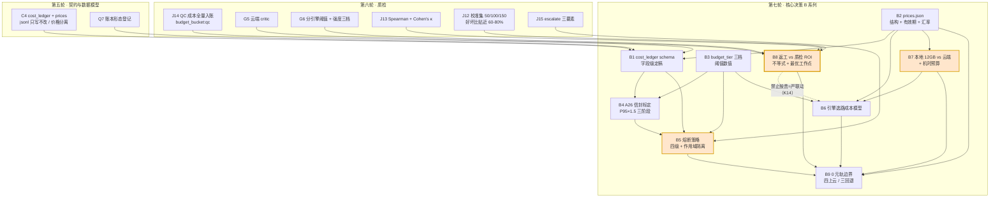

# 第七轮协商：成本与预算（Cost & Budget）

> 状态：**第一阶段起草中**（文档头 + 证据基线 + B1~B9 核心决策）
> 编号规则：核心决策 **B1~B9**，快决策 **K1~K?**（第二阶段补）。全篇仅 B / K 两个前缀。
> 前序：第一轮白模规格 D1~D25｜第二轮节点图 N1~N24｜第三轮 Agent 团队 A1~A26｜第四轮工具与 MCP T1~T24｜第五轮契约与数据模型 C1~C9 + Q1~Q16｜第六轮质检 G1~G10 + J1~J18

---

## 0. 本轮定位：成本不是"省钱"，是"让每一次花钱都可追溯、可熔断、可回退"

**一句话定位**：把成本从"事后统计"升级为"事前信封 + 事中扣减 + 事后可核算"的闭环，并显式回答老板最关心的一个问题——**质量成本与返工成本，哪个更贵？**

### 0.1 本轮要解决的真问题（不是纸面推演）

| # | 真问题 | 对应决策 |
|---|--------|---------|
| 1 | 成本到底记在哪、记什么字段？谁写、谁读、能不能改？ | **B1** |
| 2 | 价格会变，账本不能变——两者怎么分离？价格过期了怎么办？ | **B2** |
| 3 | 不同项目/不同客户预算不同，一套阈值打天下必然翻车 | **B3** |
| 4 | A26 说"P95×1.5"，但 P95 从哪来？冷启动没数据怎么办？ | **B4** |
| 5 | 超了阈值就"停"吗？停了片子就烂尾——降级和上报怎么排？ | **B5** |
| 6 | 同一个镜头，走本地 0 元还是云端 8 元？谁说了算？ | **B6 / B7 / B9** |
| 7 | 多花质检的钱能不能少返工、总体更便宜？（要算账，不喊口号） | **B8** |

### 0.2 与已拍板决策的衔接（本轮是"收口轮"，不是"新开轮"）

本轮**不新发明**任何机制，只把前六轮已经埋下的成本接口**落成字段级可执行规格**：

| 已拍板 | 内容 | 本轮落点 |
|--------|------|---------|
| **V26** | cost_ledger 账本 | → **B1** 字段级 schema 定稿 |
| **M11** | 成本账本 + 熔断 | → **B1** + **B5** |
| **C4** | cost_ledger = jsonl 追加式只写不改；prices.json 与账本分离 | → **B1** + **B2** |
| **A26** | 任务级预算信封 P95×1.5，耗尽即停 + FAIL + 上报制片 | → **B4** 标定方法 + **B5** 熔断衔接 |
| **A15** | 决策日志落 SQLite（含 token/耗时/档位） | → **B1** 账本的对账数据源 |
| **A4** | 推理三档路由（低/中/高档，各有成本特征） | → **B2** 单价 + **B6** 选路 |
| **A13** | 重试 2 次退避→FAIL，重试消耗预算 | → **B1** retry_of 字段 + **B4** 重试计入 |
| **T13** | 成本 hook：全副作用工具 budget 前校验 + 后扣减 | → **B1** 写入时机 + **B5** 前置校验失败语义 |
| **T19** | vram_lock 错峰 | → **B7** 本地档位与错峰 |
| **D25** | 交付三档 L1/L2/L3（L3 需 H.265 + 超分 + 插帧） | → **B3** 交付档驱动预算档 |
| **N21** | 项目规模三档 ≤30 / ≤60 / ≤120 镜头 | → **B3** 规模档驱动总盘 |
| **D15/D16** | 分辨率/时长档 | → **B3** budget_tier 对齐依据 |
| **G5** | 云端 critic | → **B8** ROI 演算的质量成本侧 |
| **J13 / G6** | 分引擎阈值 + 引擎分级 | → **B6** 选路 + **B8** 交叉点 |
| **J14** | QC 成本全量入账（QC 报告 `cost` 必填 → cost_ledger.jsonl，`budget_bucket:"qc"`） | → **B1** qc bucket + **B8** 演算数据源 |

### 0.3 硬件真约束（写死在文档里，后续所有推导都受它约束）

> **本机：RTX 5070 Laptop / 12GB VRAM。**
> 这不是纸面参数——它直接决定：本地能跑什么模型、能不能并发、要不要错峰（T19）、以及"0 元轨"到底能覆盖多少环节（B9）。任何"全部本地免费"的方案在 12GB 下都是伪命题。

---

## 1. 证据基线

### 1.1 v2 真身成本资产实读表

> 检索方式：Glob/Grep 搜 `cost|price|budget`，逐文件实读。**未读到的不写，不编造。**

| 资产 | 路径 | 实读结论 | 对本轮的作用 |
|---|---|---|---|
| **预算管理器（真身·可运行）** | `tools/budget_manager.py`（243 行） | 函数族：`set_budget / add_budget / spend / check_can_spend / status / history`。字段：`{total_budget, spent, remaining, currency:"CNY", warning_threshold:0.8, frozen:false, transactions[{type:add\|spend, amount, description, asset_name, timestamp}]}`。**已有 T13 的前校验/后扣减雏形**：`check_can_spend(amount)` 前置、`spend()` 后置扣减；`used_percent>=100` 置 `frozen=true` | B1 字段来源 / B5 熔断语义来源 |
| **预算实例三份（真身）** | `tests/case1_single_character/budget.json`（total 100，spent 10）<br>`tests/case2_multi_assets/budget.json`（total 200，spent 20）<br>`tests/case3_budget_boundary/budget.json`（total 32，spent 22，**边界用例**） | case3 是**预算边界专项用例**：含 2 次 `add`（老板追加）、3 次 `spend`，验证 80% 预警与冻结 | B3 分档实测样本 / B5 边界用例 |
| **成本看板（前端真身）** | `web/react-workspace/src/components/views/BudgetDashboard.jsx`（104 行） | 已有预算可视化组件 | B6 选路可视化的挂载点 |
| **契约目录 `spec/` 现状** | 仅有 `shot_spec.schema.json`、`qc_rubric.json`、`delivery_spec.json` | **无 `cost_ledger.schema.json`，无 `prices.json`** —— 与 C4 已拍板顶到眼前 | 真空带 GAP-1 / GAP-2 |
| **`config/` 现状** | **空目录** | 价格表/档位表的自然落点，目前无物 | B2 落点 |
| **价格基准（规划层真身）** | 《三.md》7.2 `prices.json` 草案（版本 `2026-09-29`） | 见下方"价格真身表"。**它是第七章规划稿，不是 v2 文件**，尚未落成 `config/prices.json` | B2 直接输入 |

#### 1.1.1 价格真身表（《三.md》7.2 原文逐字摘录，供 B2/B6/B7 直接引用）

| 引擎 | 计价单位 | 单价 | 币种 | 备注（原文） |
|---|---|---|---|---|
| `vace_1_3b`（本地） | 镜 | **0** | CNY | `vram_gb: 8.19`，5070 12G 可跑 480p 审片档，`time_per_shot_min: 4` |
| `post_rife_superres`（本地后处理） | 镜 | **0** | CNY | RIFE 插帧 30/60/120fps + 超分升 4K，`time_per_shot_min: 3` |
| `fal_3dreal_strong_v2` | MPixel | 0.0024075 | USD | 121 帧 720p ≈ **$0.27/镜**；P0 首镜解锁 |
| `wan3_api` | 秒 | 480p 0.21 / **720p 0.42** / 1080p 0.84 | CNY | **失败不计费**；量产主力 |
| `ltx23_1080p` | 秒 | 0.08 | USD | 备胎 |
| `seedance25_volcano` | 秒 | 480p 0.67 / **720p 1.51** | CNY | 30 秒原生 + 50 参考；高端商单 |
| `kling30_pro` | 秒 | 0.112 | USD | 多镜头叙事备选 |
| `veo31` | 秒 | 0.20 | USD | 无音频档，不计入 |

**熔断真身值（7.2 原文）**：`per_shot_warn_rmb: 5`、`per_shot_stop_rmb: 10`、`project_default_rmb: 100`。

**样片测算真身（7.3 原文）**：本地 VACE 480p = 0 元（48–96 分钟）；fal 720p ≈ 24 元（2 元/镜×12）；Wan 720p ≈ 20 元（0.42×48）；Seedance 720p ≈ 73 元。**推荐混合策略总预算 ≤100 元，实测大概率 30 元内收官。**

**电费真身（7.1 原文）**：约 **0.07 元/镜**（5070，250W × 4 分钟）。

**LLM 成本真身（7.5 原文）**：Kimi API 在 R5 样片全程约 **10~30 元**。

#### 1.1.2 ⚠️ 实读发现的 3 处硬冲突（本轮必须裁定，不是"待办"而是"打架"）

| # | 冲突 | 左证 | 右证 | 裁定落点 |
|---|---|---|---|---|
| **X1** | **熔断后能否自动恢复** | v2 `budget_manager.py` L110-111：`add_budget` 里 `if frozen: budget["frozen"]=False` —— **追加预算即自动解冻** | 《三.md》7.1：**「熔断后不自动恢复，必须老板签字解锁」** | **B5** |
| **X2** | **账本可不可改** | v2 `budget.json` 是**单 JSON 可改写**文件（`spent`/`remaining` 每次覆盖写） | C4 已拍板 + DECISIONS.md Q7：**jsonl 追加式只写不改** | **B1** |
| **X3** | **额度粒度** | v2 只有项目级 `total_budget`，**无 per-shot / per-task 信封** | A26 已拍板：**任务级信封**（每 Flow 节点/仲裁 Crew 设硬顶） | **B4** |

> 这三条是"已有代码 vs 已拍板决策"的真冲突，不是设计偏好。**不裁定的后果**：工程师按 v2 现有代码写 → 直接违反 C4/A26/《三.md》7.1，M11 落地时必然返工。

---

### 1.2 外部标准引用表

> 老板原则③：别人做好的不重造轮子。以下全部为可引用的既有实践/标准，本轮只做**裁剪与映射**，不自研新范式。

#### A. 预算与熔断（喂 B4 / B5）

| 来源 | 类型 | 可直接引用的结论 |
|---|---|---|
| **Google SRE Workbook《Example Error Budget Policy》** (sre.google/workbook/error-budget-policy) | 权威方法论 | **四级阈值阶梯**：T1 自动告警 → T2 升级开发 → T3 预算耗尽且未定位根因 → **冻结变更，仅放行 P0/安全修复** → T4 升级至管理层。并明确写"本政策不是对未达标的惩罚"（**非惩罚性**是采纳前提） |
| **Google SRE《Embracing Risk》** | 权威方法论 | 错误预算 = 1 − SLO，用**客观数据**消除团队间政治谈判；"Hope is not a strategy" |
| **Google SRE 多窗口燃烧率告警**（burn rate 14.4× / 6× / 1×） | 工程实践 | **快慢双窗口**：短窗口抓突发 spike，长窗口抓慢性消耗。单一窗口必漏其一 |
| **FinOps Foundation（2025 State of FinOps / 成熟度模型）** | 行业标准 | **Crawl→Walk→Run**：先 showback（只展示不问责）跑 90 天校准分摊模型，**再**进 chargeback；跳过 showback 直接问责会遭抵制。仅 14% 团队走到 chargeback |
| **FinOps 预算告警惯例** | 行业惯例 | 超预算 **10% = 自动告警**，**25% = 升级**（"不是惩罚，是反馈回路"） |
| **FOCUS 规范**（FinOps Open Cost and Usage Specification） | 供应商中立计费数据标准 | AWS/Azure/GCP/OCI 均已承诺兼容；被类比为"成本领域的 OpenTelemetry"。**我们的账本字段应对齐 FOCUS 的列名语义而非自建方言** |
| **OpenCost（CNCF sandbox 项目）** | 开源轮子 | K8s 成本分摊事实标准；**结论：不采用**（我们是单机本地 + API 计费，无 K8s），但**分摊思想（shared cost 按 agreed 方法论分摊）可抄** |

#### B. Agent 支出护栏（喂 B4 / B5 —— 与 A26 高度同构）

| 来源 | 可直接引用的结论 |
|---|---|
| **finopsllm.com《Agent spend guardrails》** | **六类护栏清单**：① per-run token 预算（主断路器）② per-run 金额预算 ③ **重试上限 3 次 + 指数退避 200→400→800ms** ④ 循环/步数上限（规划步 ≤20、工具调用 ≤50/次）⑤ 工具白名单 + **单工具调用上限** ⑥ **模型档位天花板**（限制能升级到多贵的模型） |
| **overpayingforai.com《5 Guardrails》** | ⭐ **"Max steps per run：从自己的 trace 里取成功运行的 p95 再加余量"** —— **这正是 A26「P95×1.5」的业界同构表述**；实践中工具循环通常落在 **15~30 步**。另有：显式停止条件、**同一工具同参数连续调用两次 = 死循环，应中止** |
| **n4n.ai《Spending caps on autonomous agent workflows》** | ⭐ **"支出上限应默认终止（termination）；降级（downgrade）只是批处理场景的战术——部分输出好过没有输出"**。并给 `CircuitBreaker(max_overages=3)`：**连续超限计数熔断**，防止 agent 在失败步骤上反复烧降级预算 |
| **accelate.ai《Prevent Runaway AI Agent Costs》** | 三大失败模式：无限工具循环 / 上下文无界增长 / 缺 per-session 硬顶。**"模型不会自己停下来"是 hope 不是 control，必须在编排代码里硬限**。重试必须用 **idempotency key 去重**，否则 3 次重试在日志里和 3 次合法请求长得一样 |
| **futureagi.com《Loop cost control》** | ⭐ **"要追踪 cost per successful task，而不是 cost per token"** —— 便宜的 token 单价下，若循环要 40 步才完成本该 5 步的任务，仍然是贵的设置。**单位成本上升是比单价更敏感的信号** |

#### C. 单位经济学与本地/云端权衡（喂 B6 / B7 / B8）

| 来源 | 可直接引用的结论 |
|---|---|
| **FinOps Unit Economics** | 总花费本身无意义，**必须除以业务事件**：`unit cost = 成本 / 业务事件数`。媒体行业对标：**cost per minute streamed / cost per encoding job**。→ 我方单位即 **cost per delivered shot（每交付镜成本）** |
| **FinOps AI 专项（2026）** | AI 成本模式与 CPU 根本不同：**GPU 实例成本是同等 CPU 的 10–50×**；token 定价难预测。**领先团队的做法：定义 AI 专属单位经济学（cost per inference）、实施 token 预算与推理成本闸门** |
| **TensorRigs《Cloud GPU vs Local GPU 2026》** | 盈亏平衡 = **卡价 ÷ 小时租金**。RTX 4090（$2,400 / $0.45/hr）= **5,300 小时** ≈ 20hrs/周 × 5.1 年；RTX 5090（$2,500 / $0.69/hr）= 3,600 小时。**数据中心卡（A100/H100）对个人永远租比买划算**（13,600 小时） |
| **Thunder Compute《Best GPU for AI 2026》** | ⭐ **"若显卡闲置超过 50% 的时间，租比买便宜"**；消费卡本地买断需**近连续使用约 1 年**才回本 |
| **Radiance Systems（租买全量测算）** | 本地优势：**边际成本为零**、数据不出本地、无冷启动。云端隐藏成本：① **计费小时 / 实际计算小时 比值常 >1.5**（装环境、调试也计费）② 出向流量费 ③ 持久化存储按月计费 ④ 重启摩擦 |
| **Glows.ai 2026 行情** | RTX 4090 24GB 时租 **$0.49/hr 起**；A100 80GB **$1.20/hr 起**；H100 **$2.96/hr 起**。**满负荷持有成本约 $0.16/hr（约为租金 1/3）** |

#### D. 质检成本侧（喂 B8，继承第六轮调研）

| 来源 | 结论 |
|---|---|
| **PoLL（Verga et al., 2024）** | 跨厂商小模型 panel 比单大模型相关性更高，**成本约 1/7** |
| **Kohli et al.《Nine Judges, Two Effective Votes》(2026, arXiv 2605.29800)** | ⚠️ **反直觉：7 家族 9 个 judge 只值 2.18 个独立意见** —— panel 加人不涨信息只涨钱 |
| **Choi, Zhu & Li《Debate or Vote》(NeurIPS 2025)** | 多数投票本身解释了辩论的大部分收益；**辩论不提升期望正确率** |
| **D3（Debate, Deliberate, Decide, arXiv 2410.04663）** | MT-Bench 86.3% vs 单 judge 72.5%，κ=0.60；**58% 在二轮收敛，省约 40% token** |
| **Interra BATON / Telestream Vidchecker** | 「testplan / 分发商模板」思想（=`qc_profile` 同构物）；**明确不自研 QC 平台** |
| **`qc_rubric.json` v1.1.0（自家真身）** | ⭐ `industry_discard_rate: 60–80%`；`why` 原文：**"88.9% 静图就是在『零返工』口号下被降级交付吞掉的"** |

---

### 1.3 真空带清单（Gap List）

> 标记：`【待建】`= v2 无实体需新建；`【待裁定】`= 有冲突需本轮拍；`【待实测】`= 需 R0/R2 跑数（第二阶段排期）。

| ID | 真空带 | 状态 | 影响决策 | 说明 |
|---|---|---|---|---|
| **GAP-1** | `spec/cost_ledger.schema.json` | 【待建】 | B1 | C4 已拍板 jsonl，但 schema 文件不存在；M4 校验器无处挂载 |
| **GAP-2** | `config/prices.json` | 【待建】 | B2 | 《三.md》7.2 有草案但未落成文件；`config/` 目录为空；**engine_routing 无价可查则选路逻辑空转** |
| **GAP-3** | 账本形态冲突（v2 单 JSON 可改写 vs C4 jsonl） | 【待裁定】 | B1 | 见冲突 X2 |
| **GAP-4** | 熔断解锁语义冲突（v2 自动解冻 vs 三.md 签字解锁） | 【待裁定】 | B5 | 见冲突 X1 |
| **GAP-5** | **任务级信封**（per-task envelope）不存在 | 【待建】 | B4 | v2 只有项目级 `total_budget`；A26 要求的 per-task 硬顶零实现。见冲突 X3 |
| **GAP-6** | `budget_bucket` 分桶定义 | 【待建】 | B1 | J14 只说要新增 `qc` 桶，但**完整桶列表未定义** |
| **GAP-7** | `budget_tier` 三档（low/standard/premium）的**具体数值** | 【待建】 | B3 | 第五轮 PM 补强只定了"有三档、对齐 D15/D16"，**未给任何数值** |
| **GAP-8** | P95×1.5 的**数据来源与冷启动方案** | 【待建】 | B4 | A26 定了公式，**没说 P95 从哪算、没数据时用什么**。DECISIONS.md 实测项 9 标注"R2 后"——但 R2 之前系统怎么跑？ |
| **GAP-9** | 多币种换算 | 【待建】 | B2 | prices.json 混用 USD/CNY（fal 用 USD、wan3 用 CNY），**账本以哪币记账、汇率从哪来、何时锁定，全部未定** |
| **GAP-10** | 价格表**有效期与失效行为** | 【待建】 | B2 | 7.2 有 `version:"2026-09-29"` 但**无 `valid_until`、无过期后行为**；《三.md》自己记载即梦 15 秒 5.2→40.2 元（**7.7 倍暴涨**）——价格失效是真风险不是假想 |
| **GAP-11** | 本地 GPU 档位表（12GB 下什么能跑） | 【待实测】 | B7 | 仅知 `vace_1_3b: vram_gb 8.19`；VACE 补齐后其他模型显存占用未知 |
| **GAP-12** | 单镜 QC 成本实测值 | 【待实测】 | B8 | judge / critic / 云端质检 / whisper 四类**均无实测单价**。DECISIONS.md 实测项 7、第六轮实测项 7 都指向此处 |
| **GAP-13** | 各引擎实际弃片率 | 【待实测】 | B8 | `60-80%` 是**行业基线**，非我方实测；G6 分引擎阈值标定后才有分引擎 d 值 |
| **GAP-14** | 重试的成本去重（idem_key） | 【待建】 | B1 | A13 重试消耗预算，但**账本无幂等键**会因重试重复记账（accelate.ai 明确警告） |
| **GAP-15** | 账单与账本对账机制 | 【待建】 | B2 | 云端厂商账单 vs 我方 cost_ledger，**无对账则账本是自说自话** |
| **GAP-16** | 人工校准成本入账 | 【待建】 | B3 | 第六轮明确要求"老板打分 100 条的人力投入须计入 R2 预算"，但人力成本如何折算进 CNY 账本未定 |

---

## 2. 核心决策 B1~B9

---

### B1 `cost_ledger` schema 字段级定稿（接 C4 / V26 / M11 / J14 / T13 / A13）

**背景**：C4 已拍板「jsonl 追加式只写不改 + prices.json 分离」，Q7 已登记。但 schema 文件不存在（GAP-1），且 v2 现有 `budget.json` 是**可改写单 JSON**（冲突 X2）——工程师照现有代码写就会违反 C4。J14 又新增要求：QC 成本全量入账，`cost` 必填，消耗 A26 信封。A13 重试消耗预算但账本无幂等键（GAP-14）。

**候选**：

| 方案 | 形态 | 优 | 劣 |
|---|---|---|---|
| **A. 极简 9 字段（三.md 3.7.4 原文）** | 开拍单号/镜号/引擎/单价/实际计费/币种/时间/预算桶/状态 | 最小可跑，与《三.md》原文一致 | **无幂等键**（重试重复记账）／**无价格版本**（事后涨价无法解释）／无信封归属（A26 无法扣减） |
| **B. 分层 4 组 ~20 字段（推荐）** | 标识组 + 计量组 + 归因组 + 管控组（详见下方 schema） | 覆盖 A26 信封扣减、A13 重试去重、B2 价格版本、J14 qc 桶；字段对齐 FOCUS 语义 | 字段多，写入方需填更多 |
| **C. 全量 FOCUS 对齐** | 直接套用 FOCUS 规范全字段 | 供应商中立、未来对接方便 | FOCUS 面向云账单（含 SKU/region/折扣等），**对我方 90% 字段无意义**；过度设计，违反 M15 依赖极简 |
| **D. 沿用 v2 现有 budget.json** | 单 JSON 覆盖写 | 零改造 | ❌ **直接违反 C4/Q7 已拍板**，且并发写易损（C4 候选 B 已否决） |

**推荐 B（分层 4 组）**。字段级 schema：

```json
{
  "ledger_version": "1.0",
  "entry_id": "ulid-01J9...",              // 标识组：唯一、单调、可排序
  "ts": "2026-10-03T12:34:56.789Z",        // ISO8601 UTC（对齐全局日期纪律）
  "idem_key": "sha256(work_order|task_id|tool|args_hash)[:16]",  // 管控组★ A13 重试去重

  "project_id": "rainy-cat",               // 标识组
  "work_order_id": "WO-2026-001",          // 开拍单号：《三.md》"先过开拍单再调用"
  "shot_id": "SH012",                      // 可空（非镜级成本如全项目 LLM 开销）
  "task_id": "flow.realize.SH012",         // A26 任务级信封归属★
  "agent_role": "realizer",                // 归因组：接 A15 岗位维度
  "budget_bucket": "gen",                  // 归因组★ 见 B1.1 桶定义

  "engine": "fal_3dreal_strong_v2",         // 计量组
  "unit": "MPixel",                         // 计量组：与 prices.json 的 unit 对齐
  "quantity": 2.54,                         // 计量组：实际用量（MPixel/秒/token）
  "unit_price": 0.0024075,                  // 计量组：写入时点从 prices.json 快照
  "currency": "USD",                        // 计量组：单价原币
  "fx_rate": 7.03,                          // 计量组★ 换算汇率（快照锁定，见 B2）
  "charged_rmb": 0.0432,                    // 计量组★ 记账本位币，账本只以此求和
  "price_version": "2026-09-29",            // 计量组★ 价格版本快照（GAP-10）

  "status": "ok",                           // 管控组：ok|over_budget|refunded|void
  "envelope_before_rmb": 1.85,              // 管控组★ A26 扣减前后快照
  "envelope_after_rmb": 1.81,
  "retry_of": null,                         // 管控组：非 null 表示是某 entry 的重试（A13）
  "evidence_sha256": "abc..."               // 管控组：接 C7 DIT 血缘（dit_record）
}
```

**不可变纪律**（继承 C4/M17/M22/C29）：
1. **只追加，不修改、不删除**。纠错靠追加一条 `status:"void"` + 新条目表达，物理上永不覆盖历史行。
2. **`charged_rmb` 为唯一求和口径**——多币种在写入时点即换算锁死，读侧永不二次换算（B2 详述）。
3. **`idem_key` 唯一**：同 key 重复写入（A13 重试、崩溃重放）**只保留 1 条**。DECISIONS.md 实测项 3 已要求：8 进程各 1000 行 → 8000 无误行；同 idem_key 重试 3× → 仅 1 条；kill -9 → validator 跳过截断尾行。
4. **崩溃安全**：写入用 `O_APPEND` + 单行 flush + 尾部换行检测，validator 丢弃不完整末行。

#### B1.1 `budget_bucket` 桶定义（补 GAP-6，J14 只给了 `qc`）

| 桶 | 含义 | 子项（SubBucket） | 归属 |
|---|---|---|---|
| `gen` | 生成（写实化/白模渲染） | `cloud_realize` / `local_realize` / `blockout` | 单镜主成本 |
| `qc` | **质检（J14 强制）** | `judge` / `critic` / `cloud_qc` / `transcribe` | **消耗 A26 信封** |
| `post` | 后处理 | `rife` / `superres` / `encode` | D25 交付档驱动 |
| `llm` | Agent 推理 | `low` / `mid` / `high`（A4 三档） | A15 日志对账源 |
| `infra` | 基建 | `storage` / `egress` | 易被忽略项 |
| `human` | 人工 | `calibration`（G4 老板打分） | GAP-16 |

- **推荐**：首发 **6 桶**，子项可扩展（加性演进，接 C1 SemVer）。
- **不一刀切**：提供 `custom_buckets` 项目级扩展点（对齐 C3 的 `_extensions` 思路），商单可加 `client_revision` 桶。

**决策影响**：C4/Q7（本项是其字段级落地）/ A26（envelope 扣减依赖 `task_id` + `envelope_*`）/ A13（重试去重依赖 `idem_key` + `retry_of`）/ J14（`qc` 桶落地）/ T13（前校验后扣减的写入点）/ B2（价格版本与汇率快照）/ C6（`cost_ledger_validator` 按此 schema）/ M4。
**可逆性**：**半可逆**——schema 可按 C1 加性演进（加字段可逆），但**删字段/改口径需迁移存量账本**。故首发字段宜"宁多勿少"，但避免 FOCUS 式过度膨胀。
**来源**：《三.md》3.7.4 / M11 / V26 / A26 / A13 / T13；C4 决策原文（05 文档 L111-123）；DECISIONS.md Q7 + 实测项 3；**FOCUS 规范**（列名语义参考，**不套全量**）；accelate.ai（idempotency key 去重是重试成本失控的必要防线）。

---

### B2 `prices.json` 价格表结构与更新机制（接 V19 / C4 / GAP-2 / GAP-9 / GAP-10）

**背景**：《三.md》7.2 给了价格草案（真身数据见 §1.1.1）但**未落成文件**（GAP-2），`config/` 为空。三个未定项：① **混币种**（fal 用 USD、wan3 用 CNY，账本怎么记？GAP-9）② **无有效期**（GAP-10）——而《三.md》自己记载即梦 15 秒从 5.2 涨到 40.2 元（**7.7 倍**），价格失效是**已发生过的真风险**③ **无对账**（GAP-15）。

**候选**：

| 方案 | 币种处理 | 有效期 | 更新机制 |
|---|---|---|---|
| **A. 双币都记原币，读侧实时换算** | 存原币 | — | 实时查汇率 | 
| **B. 单本位币 CNY，写入时点锁汇率（推荐）** | 存 `currency` + `fx_rate` + `charged_rmb` | `valid_until` | 版本化快照 |
| **C. 全折 USD** | 统一 USD | — | — |
| **D. 点数制（v1 遗产）** | 抽象点数 | — | — |

| | 优 | 劣 |
|---|---|---|
| A | 实时准确 | ❌ **账本历史可被重算**——违反 B1 不可变纪律；同笔账今天明天两个数 |
| **B** | ✅ 账本不可变；`fx_rate` 快照可审计；与 B1 `charged_rmb` 单口径一致 | 汇率需维护（低频，可接受） |
| C | 与 USD 计价引擎一致 | ❌ 与老板/客户对账用 CNY，反而不便；且 wan3/seedance 本就是 CNY 计价 |
| D | 与 v1 兼容 | ❌ 《三.md》7.1 已明确升级为"点数+人民币**双轨**"，且 C11 定"点数制升级实现"，退回单轨是倒退 |

**推荐 B（单本位币 CNY + 写入时点锁汇率 + 版本化有效期）**：

```json
{
  "prices_version": "2026-09-29",
  "valid_from": "2026-09-29",
  "valid_until": "2026-12-31",          // ★ GAP-10：过期即失效
  "base_currency": "CNY",
  "fx": { "USD_CNY": 7.03, "fx_source": "manual", "fx_locked_at": "2026-09-29" },

  "on_expiry": "warn_then_block",       // ★ 过期行为，三档见下
  "billing_mode": { "wan3_api": "no_charge_on_failure" },  // ★ 失败不计费（7.2 真身）

  "local":  { "...": "同 7.2，cost_rmb:0，增 vram_gb / time_per_shot_min" },
  "cloud":  { "...": "同 7.2" },
  "llm":    { "kimi_low": {"unit":"1k_token","price":0.006}, "...": "A4 三档单价，待 R2 实测填" },
  "qc":     { "critic_cloud": {"unit":"shot","price":null,"status":"TBD_R2"}, "...": "GAP-12" },
  "_extensions": {}
}
```

**`on_expiry` 三档（不一刀切）**：

| 档 | 行为 | 适用 |
|---|---|---|
| `warn` | 过期仅告警，继续用旧价 | 验证期 / 0 元轨（无风险） |
| **`warn_then_block`（推荐默认）** | 过期先告警并宽限 N 天，宽限期内未更新 → **阻断云端调用**，自动降级本地轨 | 量产期 |
| `block` | 过期立即阻断 | 商单交付期（报价已锁定，价格波动直接吃毛利） |

**更新机制（防重造轮子）**：不自建爬虫/监控。采用 **人工核验 + git 版本化 + CI 校验** 三件套：
- 价格变更 = 一次 git commit（继承 C2 文件为中心 + M17 git 纪律），`prices_version` 递增；
- M4 CI 校验 `valid_until` 未过期 + 单价非 null + `unit` 与账本枚举一致；
- **对账（GAP-15）**：每个项目结账时，用厂商账单总额 vs `cost_ledger` 按引擎求和，偏差 >5% 触发人工复核。对齐 **FinOps 的 showback→chargeback 路径**：先只展示（showback），数据可信后再问责。

**决策影响**：V19（engine_routing 从价格表选路，价格表不定则 V19 空转）/ C4（prices 与账本分离）/ B1（`price_version`+`fx_rate` 快照字段）/ B6（选路直接读本表）/ B7（本地 `vram_gb` 字段是 12GB 档位依据）/ B3（档位阈值用 CNY 统一口径）/ M4（CI 校验项）。
**可逆性**：**可逆**（配置驱动，改表不改码）。仅 `base_currency` 一旦选定为 CNY 后更换需迁移存量账本——故此项**半可逆**，建议一次定对。
**来源**：《三.md》7.2 / 2.4.2 一手核验 / V19 / C11；即梦涨价实录（**$TRAE_REF: finance.sina.com.cn/wm/2026-04-13**）——价格失效是已发生风险；**FOCUS 规范**（供应商中立计费语义）；**FinOps Foundation**（showback 先于 chargeback；unit economics）。

---

### B3 `budget_tier` 三档驱动信封初值与熔断阈值（接第五轮 PM 补强 / D15 / D16 / N21 / D25 / A26）

**背景**：第五轮 PM 补强已采纳「新增项目级 `budget_tier` 三档（low/standard/premium），对齐 D15/D16，驱动 A26 任务级信封初值与熔断阈值」，**但一个数值都没给**（GAP-7）。本轮要把它从"有三档"变成"每档是多少"。

**关键设计判断**：`budget_tier` 是**单维度还是多维度**？老板原则①要求不一刀切——一个"短剧客户"和"广告商单"的预算结构完全不同。但维度过多会退化成配置地狱。

**候选**：

| 方案 | 维度 | 优 | 劣 |
|---|---|---|---|
| A. 单一标量档（low/standard/premium） | 1 | 最简单 | ❌ 无法同时表达"规模大但单价低"和"规模小但要顶配"；违反原则① |
| **B. 双轴：规模轴 × 品质轴，交叉出默认 tier（推荐）** | 2 | 覆盖 N21 规模 × D25 交付档的真实组合；每轴独立可逆 | 需定义交叉规则 |
| C. 三轴（+客户类型） | 3 | 最灵活 | 组合爆炸（3×3×3=27），配置地狱，违反 M15 |

**推荐 B（双轴交叉）**：

- **规模轴**（接 **N21** 已拍板三档）：`short ≤30 镜` / `standard ≤60 镜` / `long ≤120 镜`
- **品质轴**（接 **D25** 已拍板交付三档）：`L1 预览` / `L2 发布` / `L3 超分插帧 H.265`
- **交叉规则**：`budget_tier = f(品质轴)` 为主、`规模轴` 为乘数——**因为单价由品质决定，总量才由规模决定**。这与 FinOps「单位成本 × 业务事件数」完全一致。

| 默认档位表（`budget_tier` 推荐初值） | low | **standard（默认）** | premium |
|---|---|---|---|
| **对齐** | L1 + short | **L2 + standard** | L3 + long |
| 单镜硬顶 `per_shot_stop_rmb` | 3 | **10**（《三.md》7.2 真身值） | 30 |
| 单镜告警 `per_shot_warn_rmb` | 1.5 | **5**（7.2 真身值） | 15 |
| 项目总盘 `project_default_rmb` | 30 | **100**（7.2 真身值 + L2 验收线 ≤100 元） | 500 |
| A26 任务信封倍率 | P95×1.2 | **P95×1.5**（A26 已拍板） | P95×2.0 |
| 引擎选路偏好 | `local_first` | **`balanced`** | `quality_first` |
| QC 强度档（接 G6） | lenient | **standard** | strict |

> **数值来源说明**：`standard` 列三个值（5 / 10 / 100）**全部直接取自《三.md》7.2 circuit_breaker 真身**，不是本轮新拟。low/premium 列是以其为锚按比例外推（×0.3 / ×3），**标注为待 R2 校准**。

**不一刀切**：上表是**默认值**，全部可被项目级 `budget_overrides` 覆盖（对齐 G6 的 `qc_profile_overrides` 项目级+逐镜级两层结构）。覆盖必须落账本（谁改的、为什么），接 A15。

**决策影响**：第五轮 PM 补强（本项是其数值落地）/ D15·D16（对齐依据）/ N21（规模轴）/ D25（品质轴）/ A26（信封倍率）/ B4（P95 基数来源）/ B5（阈值）/ B6（选路偏好）/ G6（QC 强度档联动）。
**可逆性**：**可逆**——纯配置，项目级可覆盖，改档不影响账本历史。
**来源**：DECISIONS.md C4 条 PM 补强原文；05 文档 L120；**《三.md》7.2 circuit_breaker 真身值**；N21 / D25 / D15 / D16；**FinOps Unit Economics**（单位成本 × 事件数）。

---

### B4 A26 任务级信封初值标定方法（接 A26 / A15 / A13 / GAP-5 / GAP-8）

**背景**：A26 已拍板「每 Flow 节点/仲裁 Crew 设 token/调用数硬顶，耗尽即停 + FAIL + 上报制片；初值 = **P95×1.5**」。但两个真空带：**GAP-5**（v2 零实现，只有项目级额度）与 **GAP-8**（P95 从哪算？冷启动没数据怎么办？DECISIONS.md 实测项 9 写"R2 后标定"——**但 R2 之前系统靠什么跑？** 这是本轮最容易被忽略的死锁）。

**候选**：

| 方案 | 冷启动（无数据） | 稳态 | 问题 |
|---|---|---|---|
| A. 等 R2 实测后再启用信封 | 无信封（裸奔） | P95×1.5 | ❌ **R1~R2 期间 A26 完全失效**，而 A26 正是为防 ATXP retry loop 烧钱——最需要它的时期恰恰没有它 |
| **B. 三阶段：静态先验 → 分位数收敛 → 分位数稳态（推荐）** | 静态先验表（按岗位×任务类型硬编码） | 实测 P95×1.5 接管 | 需维护先验表 |
| C. 全程固定经验值 | 固定值 | 固定值 | ❌ 违反 A26「按 cost_ledger 实测分布定」；且模型/提示词一变就失真 |
| D. 动态自适应（如 EWMA 实时调） | 自适应 | 自适应 | ❌ 阈值会漂移，**审计无法复现**——熔断阈值必须是某一时点的确定值，否则"为什么这次没熔断"无法回答 |

**推荐 B（三阶段标定）**：

| 阶段 | 时期 | 取值方法 | 说明 |
|---|---|---|---|
| **S1 静态先验** | R1~R2（无实测数据） | 按 **岗位 × 任务类型** 查先验表（下表） | 先验值来自 A15 决策日志的**同类任务历史**（v2 已有 SQLite）+ 业界参考区间；**明确标注为临时值，每镜结束回写实测** |
| **S2 首次收敛** | 累计 ≥30 条同类型样本 | 取实测 P95 × 1.5，替换先验 | 30 条是分位数可用性的经验下限（低于此 P95 极不稳定） |
| **S3 稳态滚动** | 全程 | 滑动窗口（最近 N=100 条）滚动重算 P95×1.5；**每项目开拍时冻结一次** | 冻结 = 可审计；滚动 = 适应 drift |

**S1 静态先验表（推荐初值 · 单位：CNY）**

| 岗位 \ 任务类型 | 结构化生成（A4 低档） | 标准推理（A4 中档） | 深度推理/仲裁（A4 高档） |
|---|---|---|---|
| 编剧 / 分镜 | 0.05 | 0.15 | 0.40 |
| 预演 / 白模 | 0.03 | 0.10 | — |
| 写实化调度 | 0.02 | 0.08 | — |
| **导演仲裁** | — | 0.20 | **0.60** |
| **QC judge（G4/A25）** | **0.03** | 0.10 | — |
| **QC critic（G5 云端）** | — | **0.30** | 0.80 |
| 制片（拆任务/开拍单） | 0.02 | 0.05 | — |

> ⚠️ **上表为待校准先验**：量级参考《三.md》7.5「Kimi API 在 R5 样片全程约 10~30 元」÷ 12 镜 ÷ 多岗位调用次数反推。**必须在 R2 用 A15 实测数据校准**（= DECISIONS.md 实测项 9 与第六轮实测项 7 的交汇点）。

**三条硬规则（来自外部标准，不是自创）**：
1. **重试计入同一信封**（A13 已定 + overpayingforai.com：「若必须从头重试失败的运行，应计入同一次 per-run 预算，而不是另起一个」）。且重试必须带 `idem_key`（B1）——否则"3 次重试"在账本里和"3 次合法请求"无法区分。
2. **步数上限独立于金额上限**：overpayingforai.com 建议「工具循环 15~30 步」、finopsllm 建议「规划步 ≤20、工具调用 ≤50/次」。**即使没超钱，循环本身就是故障信号**（A13 已定 2 次重试上限，此处补步数上限）。
3. **追踪单位是 cost per successful task，不是 cost per token**（futureagi.com）。理由：便宜 token 单价下，若循环要 40 步才完成本该 5 步的任务，仍然是贵的。**步数膨胀先于金额膨胀出现**——这是比阈值更早的预警信号。

**决策影响**：A26（本项是其标定方法落地）/ A15（P95 数据源）/ A13（重试计入同一信封 + idem_key）/ B1（`task_id` + `envelope_*` 字段）/ B3（信封倍率 P95×1.2/1.5/2.0）/ B5（耗尽即停的语义）/ T13（前校验读信封）/ GAP-8（本项补上）。
**可逆性**：**可逆**——先验表是配置，S2/S3 会自动覆盖；调阈值不影响账本。
**来源**：A26 决策原文（DECISIONS.md L167）；**overpayingforai.com**（"Max steps = p95 of successful runs + margin"，15~30 步）；**finopsllm.com Agent spend guardrails**（六类护栏、重试 3 次退避、步数/工具调用上限）；**futureagi.com**（cost per successful task）；**accelate.ai**（idem_key 去重）；DECISIONS.md 实测项 9；第六轮实测项 7。

---

### B5 熔断策略：超阈值处置（接 M11 / C11 / A26 / T13 / J15 / X1 冲突）

**背景**：这是本轮**冲突最硬**的一项——v2 现有代码 `add_budget` 会在追加预算时**自动解冻**（`frozen=False`），而《三.md》7.1 明写**「熔断后不自动恢复，必须老板签字解锁」**（冲突 X1，防的是 v1"点数超了还在跑"的漏洞）。同时 A26 定了"耗尽即停"，J15 定了 escalate「预算上限耗尽强制终审」——三者需要统一语义。

**候选**：

| 方案 | 触发后行为 | 解锁条件 | 评价 |
|---|---|---|---|
| A. 硬熔断：一律停 + 等老板签字 | 停 | 老板签字 | 安全，但**单镜抖动就停全项目**，L2 样片会因一条问题镜烂尾 |
| B. 软告警：一律只告警不停 | 继续跑 | — | ❌ 就是 v1"点数超了还在跑"的漏洞本身，直接违反 C11/V24 |
| **C. 分级熔断（warn → degrade → stop → freeze），按作用域隔离（推荐）** | 分级处置 | 见下 | 兼顾安全与可用性 |
| D. 全项目单一熔断 | 停全项目 | 签字 | 无作用域隔离，一镜拖全片 |

**推荐 C（分级熔断 + 作用域隔离）**：

| 级别 | 触发（作用域） | 行为 | 解锁 | 对应真身值 |
|---|---|---|---|---|
| **软告警** | 单镜 ≥ `per_shot_warn_rmb` | 告警 + 继续（N12 可见 / N20 推送） | 自动 | **5 元**（7.2） |
| **任务熔断** | A26 任务信封耗尽 | **本任务**停 + FAIL + 上报制片；**同镜其他任务可继续** | 制片可重开信封（不惊动老板） | A26 原文 |
| **单镜熔断** | 单镜 ≥ `per_shot_stop_rmb` | **本镜**停机，标记待审；**项目其他镜继续** | 导演/制片人工放行 | **10 元**（7.2） |
| **项目冻结** | 项目累计 ≥ `project_default_rmb` | **全项目停机** + 剧场告警（飞书 @老板 + 轻推送） | ⚠️ **必须老板签字，禁止自动恢复** | **100 元**（7.2） |

**X1 冲突裁定（本项核心产出）**：
> **采纳《三.md》7.1，否决 v2 现有 `add_budget` 自动解冻行为。**
> `budget_manager.py` L110-111 的 `frozen=False` 必须删除，改为：`add_budget` 只增加 `total_budget`，**不改 `frozen`**；解冻必须走独立的 `unfreeze(approver, reason, evidence)` 显式调用，且 `approver` 必填、写入账本。
> **理由**：v1 的历史教训就是"点数超了还在跑"；自动解冻让熔断形同虚设——任何人（含误触的脚本）只要加钱就能绕过老板。这正是 Google SRE「error budget 耗尽则冻结变更，仅放行 P0/安全修复」的同构逻辑。

**硬熔断 vs 软降级的裁定（借 n4n.ai 结论）**：
> n4n.ai 原文：**「支出上限应默认终止（termination）；降级只是批处理场景的战术——部分输出好过没有输出」**。
> 映射到我方：**云端写实化（有真实金钱流出）→ 默认硬停**；**LLM 推理（有降级空间）→ 允许降级**（高档→中档→低档，对齐 A4 三档 + finopsllm 的「模型档位天花板」）。**降级不得在用户无感知下发生**——必须写账本 `status:"over_budget"` 并在 QC 报告标注该镜用了降级档（否则就是"静默降级交付"，正是 `qc_rubric` `why` 里痛斥的"88.9% 静图被降级交付吞掉"）。

**双窗口燃烧率（借 Google SRE burn rate）**：
| 窗口 | 作用 | 抓什么 |
|---|---|---|
| 快窗口（近 5 镜 / 近 1 小时） | 抓**突发 spike**（某镜陷入重试风暴） | A13 retry loop amplification |
| 慢窗口（项目累计 / 近 24 小时） | 抓**慢性消耗**（单价悄悄涨、弃片率悄悄升） | GAP-10 价格失效 / GAP-13 弃片率恶化 |

**连续超限计数熔断**（`CircuitBreaker(max_overages=3)`，n4n.ai）：同一 `task_id` 连续 3 次触发超限 → 直接 L2，不再给降级机会（防止在失败步骤上反复烧降级预算）。

**与 J15 的衔接**：J15 定了 escalate「预算上限耗尽强制终审」——本项把它的"预算上限"具体化为 **单镜熔断阈值**，并补上 J15 三要素里的**可观测超时态**：熔断状态必须在 N12 节点图可见 + N20 推送，不得静默。

**决策影响**：M11 / C11 / V24（熔断机制本体）/ A26（任务熔断语义）/ T13（前校验失败即任务熔断）/ J15（预算上限具体化）/ B1（`status:"over_budget"`）/ B3（阈值数值）/ **v2 `budget_manager.py` 需改代码（X1）** / N12·N20（可观测）/ M6（告警出口）。
**可逆性**：**可逆**（阈值是配置，B3 可调）；但**"L3 必须老板签字"这条纪律本身不可逆**——它是 V24/C11 的立身之本，改掉等于回到 v1。
**来源**：《三.md》7.1 熔断原文 + 7.2 真身阈值；**Google SRE Error Budget Policy**（四级阈值、非惩罚性、耗尽冻结仅放行 P0）；**Google SRE 多窗口 burn rate**；**n4n.ai**（termination 默认 / downgrade 仅批处理 / CircuitBreaker max_overages=3）；**finopsllm.com**（模型档位天花板）；**FinOps**（超 10% 告警、25% 升级）；A26 / J15 / T13。

---

### B6 引擎选路成本模型（engine_routing 从价格表选路）

**背景**：V19 定「engine_routing（引擎与成本入契约）」，升级实现要求是「接真实价格表」。《三.md》7.2 明写 **"engine_routing 从这里选路"**。但 GAP-2（prices.json 未落成）导致 V19 目前是**空转的**——选路逻辑无价可查。本项补齐选路策略本身。

**候选**：

| 方案 | 决策依据 | 优 | 劣 |
|---|---|---|---|
| A. 硬编码偏好（每引擎写死优先级） | 代码常量 | 简单 | ❌ 价格一变就得改码；违反 C4「价格与账本分离」的精神（价格应数据驱动） |
| **B. 四档选路策略 × 价格表数据驱动（推荐）** | `prices.json` + 策略档 | 价格变只改表；档位可配（原则①） | 需定义档位语义 |
| C. 全局单一策略（只"成本最优"） | — | — | ❌ 违反原则①一刀切；L2 发布档和 L1 预览档诉求相反 |
| D. 每镜人工指定 | 人 | 最灵活 | ❌ 违反 C3「AI 制片厂」自动化目标；N21 长片 120 镜人工选路不可行 |

**推荐 B（四档策略）**：

| 策略档 | 语义 | 排序键 | 适用（接 B3/N21/D25） | 默认 |
|---|---|---|---|---|
| `local_first` | 本地优先，0 元轨 | `cost_rmb ASC`，本地引擎绝对优先 | L1 预览 / low tier / **R1~R3 验证期** | low 档默认 |
| **`balanced`（推荐默认）** | 成本-质量均衡 | 在 **满足交付档质量下限** 的引擎中取 `cost_rmb` 最小 | L2 发布 / standard tier / 量产主力 | ✅ **全局默认** |
| `quality_first` | 质量优先 | 质量分 DESC，成本仅作熔断约束 | L3 / premium / 商单英雄镜 | premium 档默认 |
| `deadline_first` | 交期优先（**新增**） | `time_per_shot_min ASC`（并行度加权） | 客户催交付；本地 12GB 串行时的救急 | 按需启用 |

> **`deadline_first` 是本轮新增的第四档**：B7 会论证 **12GB 下机时是真约束**（本地串行 4 分钟/镜），当交期紧于机时预算时，金钱必须为时间让路。只做"成本/质量"两轴会在交期场景直接卡死。

**选路算法（必须落在价格表上，不落代码）**：
```
candidates = prices[local] ∪ prices[cloud]
candidates = filter(candidates, delivery_tier 质量下限)   # D25 L1/L2/L3
candidates = filter(candidates, vram_gb <= 可用显存)       # B7 硬约束，本地引擎专用
candidates = filter(candidates, valid_until >= today)      # B2 过期剔除
sort(candidates, by=strategy.排序键)
selected = candidates[0]
assert T13.check_can_spend(selected.预估成本)              # 前校验，失败即 B5 任务熔断
```

**三条硬约束（不可被策略覆盖）**：
1. **B7 显存约束**：本地引擎 `vram_gb` > 可用显存 → 直接剔除（不是降级，是不候选）。
2. **B2 价格有效期**：`valid_until` 过期 → 剔除（防 GAP-10 涨价风险）。
3. **T13 前校验**：选路结果必须先过 `check_can_spend`，**选路成功 ≠ 可以花钱**。

> #### ⚠️ **B6 → B8.2 强制交叉引用（防"贵=严"直觉误配）**
> 本表的**引擎选路**与 **G6 的 QC 强度档**是**两个独立维度，不可绑定**。
> 常见错误直觉：**"贵的引擎配严格质检，便宜的配宽松"** —— ❌ **这是错的**。
> 正确判据见 **B8.2**：QC 强度的最优工作点由**弃片率 `d`** 决定（`dr/df = (1−d)/d`），**与引擎单价无因果关系**。
> - `d` 高（→0.8）→ 应**走松**（宁可多抓别漏，误报代价相对小）
> - `d` 低（→0.6）→ 应**走严**（废片少，误报代价相对大）
>
> **实操后果**：若某个**便宜引擎的弃片率其实很高**，它反而**该走松**——按"贵=严"配置会**配反**，结果是既多花 QC 钱又没拦住废片（B8.3 算例：r 从 0.7 掉到 0.3 时，QC 从"省 21%"翻成"亏 7%"）。
> **落地要求**：`engine_routing` 与 `qc_profile` 的配置项**必须分离存储、独立 override**；禁止在代码或配置里出现「选了 X 引擎就自动套 strict」这类联动。该联动若确需，只能由 **B8.1 不等式实测通过**后逐项目显式开启（见 K14）。

**决策影响**：V19（本项是其"接真实价格表"的落地）/ B2（依赖价格表存在）/ B7（显存过滤）/ B3（`budget_tier` 决定默认档）/ D25（质量下限随交付档）/ N21（规模影响并行策略）/ T13（前校验挂载点）/ B9（0 元轨即 `local_first`）。
**可逆性**：**可逆**——纯策略配置，逐镜可 override（对齐 G6 的逐镜级 override 结构）。
**来源**：《三.md》7.2「engine_routing 从这里选路」+ 7.1 三级成本策略；V19 / V25（云端契约先定稿再调用）/ C4；D25 / N21 / T13。

---

### B7 本地 GPU 12GB 显存 vs 云端成本权衡（接 T19 / D25 / GAP-11）

**背景**：本机 **RTX 5070 Laptop / 12GB VRAM** —— 是硬约束不是纸面推演。已知真身：本地 `vace_1_3b` 占 **8.19 GB**，电费 **0.07 元/镜**（250W × 4 分钟）。T19 已定 `vram_lock` 错峰。

**⚠️ 先纠正一个常见误判**：外部调研（TensorRigs/Thunder Compute/Glows.ai）讨论的是「**租云卡 vs 买本地卡**」的 TCO 权衡——**但我方的卡已经买了**，属**沉没成本**。因此我方真实权衡**不是**"租 vs 买"，而是：

> **边际金钱（本地 ≈ 0.07 元/镜，云端 0.2~6 元/镜） vs 边际机时（本地串行 4 分钟/镜，云端并行分钟级）**

**候选**：

| 方案 | 本地/云端分工 | 优 | 劣 |
|---|---|---|---|
| A. 全本地 0 元 | 一切本地 | 成本最低 | ❌ **12GB 装不下高端模型**；串行 4 分钟/镜 × 120 镜 = **8 小时**，交期崩 |
| B. 全云端 | 一切云端 | 快、质量上限高 | ❌ 违反 V24 0 元纪律；成本不可控（7.3：Seedance 720p 单样片 73 元） |
| **C. 分层路由 + 机时预算双约束（推荐）** | 按 D25 交付档 + B6 策略分层，**同时管钱和管时间** | 兼顾成本/质量/交期；T19 错峰有机时预算可依 | 需定义机时预算 |
| D. 仅按显存可用性动态切 | 装得下就本地 | 简单 | ❌ 忽略质量与交期；L3 超分插帧本地可行但极慢 |

**推荐 C（分层路由 + 机时预算双约束）**

**① 12GB 显存档位表**（补 GAP-11，标注实测状态）

| 环节 | 模型/工具 | 显存 | 12GB 可行性 | 机时 |
|---|---|---|---|---|
| 白模预渲染 | Blender | 低 | ✅ | — |
| 本地写实化（审片档） | `vace_1_3b` | **8.19 GB**（真身） | ✅ 480p | **4 分钟/镜**（真身） |
| 本地 VLM 质检 | Qwen3-VL-4B（`vlm_check.py`） | 中 | ✅ | 短 |
| 后处理插帧 | RIFE | 中 | ✅ 但慢（**85 fps** vs FILM **12 fps**） | D25 L3 关键 |
| 后处理超分 | 超分模型 | 高 | ⚠️ 4K 需实测 | 长 |
| 云端写实化 | fal / wan3 / seedance | **0（API 侧）** | ✅ 不占本地显存 | 分钟级 |

> **关键结论**：12GB 能覆盖**除 4K 超分外的绝大多数本地环节**。真正的瓶颈**不是显存，是机时与串行**（T19 vram_lock 错峰 = 承认无法并发）。

**② 机时预算（本轮新增概念 —— 与金钱预算并列）**

| 规模（N21） | 镜数 | 本地串行机时（4 分钟/镜） | 机时预算建议 |
|---|---|---|---|
| 短片 | ≤30 | ≤2 小时 | ≤4 小时 |
| 标准剧 | ≤60 | ≤4 小时 | ≤8 小时 |
| 长片 | ≤120 | **≤8 小时** | 分章管理，**强制云端分流** |

> 外部佐证（Radiance Systems）：云端「计费小时 / 实际计算小时」**比值常 > 1.5**（装环境、调试也计费）——这也是本地的另一隐藏优势：**本地无冷启动摩擦**。

**③ T19 vram_lock 错峰的成本语义（补强）**
T19 原只解决"显存冲突"，本轮补上成本维度：**错峰不只是防 OOM，更是机时调度**。规则：本地 GPU 任务串行队列，**高价值镜（英雄镜/首镜解锁）优先插队**；低价值镜（审片档、批量预览）排队或让位云端。

**④ 与云端对照（用外部行情校准）**
| 项 | 本地 5070 Laptop | 云端 |
|---|---|---|
| 边际成本 | **0.07 元/镜**（真身，电费） | wan3 720p **0.42 元/秒** → 4 秒镜 **1.68 元**；fal ≈ **2 元/镜** |
| 单位机时 | 4 分钟/镜，串行 | 分钟级，可并行 |
| 持有成本参考 | 沉没成本；外部数据：满载 ≈ **$0.16/hr**（约为租金 1/3） | RTX 4090 时租 ≈ **$0.49/hr** |
| 显存上限 | **12 GB（硬顶）** | 可按需选 24/48/80 GB（A100 $1.20/hr） |
| 数据主权 | ✅ 不出本地 | ❌ |

**决策影响**：T19（错峰补上机时调度语义）/ B6（显存过滤 + `deadline_first` 档）/ B3（规模档分流的机时依据）/ D25（L3 超分插帧是本地最慢环节，G9 机时成本）/ GAP-11（本项部分补上，4K 超分仍待实测）/ B9（0 元轨的机时上限）。
**可逆性**：**可逆**（配置）；但**硬件 12GB 不可逆**——它是一切推导的天花板。
**来源**：本机 RTX 5070 Laptop 12GB（硬性）；《三.md》7.1 电费 0.07 元/镜 + 7.2 `vram_gb:8.19` / `time_per_shot_min:4`；T19 / D25 / N21；**TensorRigs**（盈亏平衡=卡价÷租金，4090 = 5,300 小时）；**Thunder Compute**（闲置>50% 租便宜）；**Glows.ai**（持有 $0.16/hr ≈ 租金 1/3）；**Radiance Systems**（计费小时/实际计算小时 >1.5）。

---

### B8 ⭐ 返工成本 vs 质检成本 ROI（接 G5 云端 critic / G6 分引擎阈值 / J14 / discard_rate 60–80%）

> **这是本轮的核心交付。** 老板的隐含问题是「多花质检的钱能不能少返工、总体更便宜？」——本项**不喊口号，给出一行可判定的不等式和一个算例**。

#### B8.1 核心不等式

设：需交付 `N_ok` 条可用镜；弃片率 `d`；单镜生成成本 `C_gen`；QC 单镜成本 `C_qc`；QC 召回率 `r`（真废片被拦下的比例）；QC 误报率 `f`（好镜被错杀的比例）。

```
总生成次数  G = N_ok / (1 − d)
QC 拦截真废片节省  = G · d · r · C_gen
QC 误杀好镜损失    = G · (1 − d) · f · C_gen      ← 常被漏算！
QC 自身成本        = G · C_qc

净收益 = G · [ C_gen · ( d·r − (1−d)·f ) − C_qc ]
```

> ### ✅ **QC 划算 ⟺ `C_qc < C_gen · ( d·r − (1−d)·f )`**

**注意 `(1−d)·f` 这一项**：严格质检**不是免费的**——它会误杀好镜，误杀就要重生成。这正是 `qc_rubric.json` 想防的另一面：只谈召回不谈误报，就是"越严越好"的错误直觉。

#### B8.2 ⭐ 最优 QC 工作点（本项最有价值的推论）

沿 ROC 曲线调阈值 θ（越松 → r↑ 且 f↑），净收益对 θ 求导取极值：

```
d(净收益)/dθ = C_gen · ( d·r' − (1−d)·f' ) = 0
⟹  r'/f' = (1 − d)/d
```

> ### ✅ **最优 QC 工作点 = ROC 曲线上斜率 `dr/df = (1−d)/d` 的那一点**

| 弃片率 d（我方基线 60–80%） | 最优斜率 `dr/df` | 工作点含义 |
|---|---|---|
| d = 0.6（基线下界） | **0.67** | 较**严**——废片少，误报代价相对大 |
| d = 0.7（中位） | **0.43** | 中等 |
| d = 0.8（基线上界） | **0.25** | 较**松**——废片多，宁可多抓也别漏 |

**这个推论直接回答了"贵引擎过 strict vs 便宜引擎过 lenient"是不是对的**：**不完全对**——正确表述是 **"废片率高的走松、废片率低的走严"**，而不是"贵的走严"。但两者在实践上高度相关（见 B8.3）。

#### B8.3 示例演算（《雨夜寻猫》L2，12 镜 × 4 秒，720p）

**输入真身值**：`d = 70%`（取 `industry_discard_rate 60–80%` 中位）；`C_gen`：fal 720p **2.0 元/镜**（7.3 真身）/ wan3 720p **1.68 元/镜**（0.42×4）/ 本地 VACE **0.07 元/镜**（7.1 真身电费）。
**输入假设值（⚠️ 明确标注为待 R2 实测，GAP-12/GAP-13）**：`C_qc = 0.5 元/镜`（云端 critic + judge + 转写）；`r = 0.7`；`f = 0.1`。

| 引擎 / 轨 | `C_gen` | `d·r − (1−d)·f` = 0.7×0.7 − 0.3×0.1 = **0.46** | 临界 `C_qc` | 实际 `C_qc`=0.5 | 判定 |
|---|---|---|---|---|---|
| **fal 3DREAL 720p** | 2.00 元 | 0.46 | **0.92 元** | 0.5 | ✅ **划算**（余量 1.8×） |
| **Wan 3.0 720p** | 1.68 元 | 0.46 | **0.77 元** | 0.5 | ✅ 划算（余量 1.5×） |
| **Seedance 2.5 720p** | 6.04 元（1.51×4） | 0.46 | **2.78 元** | 0.5 | ✅ **非常划算**（余量 5.6×） |
| **本地 VACE 480p** | **0.07 元** | 0.46 | **0.032 元** | 0.5 | ❌ **亏 15.6 倍** |

**总成本对照（12 可用镜，d=0.7 → G = 40 次生成）**

> 云端写实化次数（一阶，不递归计算误杀重生成的二次 QC）：
> `G × [ (1−d) + d·(1−r) + (1−d)·f ]` = 好镜 + 未拦下的废片 + 被误杀好镜的重生成

| 方案 | 云端写实化次数 | 生成成本 | QC 成本 | 总成本 | 对比无 QC |
|---|---|---|---|---|---|
| **无 QC（后置发现）** | 40 | 80.00 元 | 0 | **80.00 元** | 基准 |
| **有 QC（r=0.7, f=0.1）** | 40×[0.3+0.21+0.03] = **21.6** | 43.20 元 | 20.00 元 | **63.20 元** | ✅ **省 16.8 元（−21%）** |
| **有 QC 但召回差（r=0.3, f=0.1）** | 40×[0.3+0.49+0.03] = **32.8** | 65.60 元 | 20.00 元 | **85.60 元** | ❌ **亏 5.6 元（+7%）** |

> **自洽校验**：r=0.7 时临界 `C_qc` = 2.0×0.46 = **0.92 > 0.5** → 应赚 ✅ 与表中"省 21%"一致；
> r=0.3 时临界 `C_qc` = 2.0×(0.21−0.03) = **0.36 < 0.5** → 应亏 ✅ 与表中"亏 7%"一致。**不等式与算例互相印证。**

> **结论 1**：QC 在 r=0.7 时省 **16.8 元 / 21%**；但 r 掉到 0.3 时**反而亏 5.6 元**。**QC 不是"做了就好"，是"做得准才赚"**——这直接支撑 A25 校准（κ/Spearman）是**成本项而非纯质量项**。
> **结论 2**：**本地 0 元轨绝不能配云端 critic**（亏 15.6 倍）。本地审片档的 QC 必须全本地（`qc_media.py` + `vlm_check.py`，边际成本 ≈ 0）。——这就是 **B9 切换条件**的定量依据。
> **结论 3**：引擎越贵，QC 越值得投（Seedance 余量 5.6× vs 本地 0.06×）。**"贵引擎配严质检"在算出来的意义上成立**，但机理是"C_gen 抬高临界值"而非"贵就该严"。

#### B8.4 panel 规模上限（防 G5 加人加钱）

- **Kohli et al. (2026)**：⚠️ **7 家族 9 个 judge 只值 2.18 个独立意见** —— panel 加人**不涨信息只涨钱**。
- **PoLL (Verga 2024)**：跨厂商小模型 panel 相关性更高，**成本约 1/7**。
- **D3**：**58% 在二轮收敛，省约 40% token**。

> **推荐**：panel 规模 **默认 3，硬上限 5**；采 **D3 两轮制**（二轮收敛即停，省 ~40% token）；judge 走 **A4 低档**（A25 已定 judge 走低档）。
> **理由**：在上面不等式里，panel 加人**同时抬高 `C_qc` 却几乎不涨 `r`**（Kohli 结论），是最典型的"花钱不办事"。

**决策影响**：G5（云端 critic 的经济性判定）/ G6（分引擎阈值有了成本侧的定量依据）/ J14（QC 入账是 ROI 计算的数据源）/ A25（校准召回率是**成本项**）/ B9（切换条件）/ B6（选路可把 QC 成本计入）/ GAP-12·GAP-13（本项暴露这两个实测项的紧迫性）。
**可逆性**：**可逆**——阈值与 panel 规模均为配置；但**不等式本身是判定工具，不存在可逆性**。
**来源**：⭐ 推导基于自家真身 `qc_rubric.json`（`industry_discard_rate 60–80%`，`why` 原文"88.9% 静图就是在『零返工』口号下被降级交付吞掉的"）+《三.md》7.2/7.3 价格真身；**Kohli et al. arXiv 2605.29800**（9 judge = 2.18 独立意见）；**PoLL Verga et al. 2024**（成本 1/7）；**D3 arXiv 2410.04663**（58% 二轮收敛省 40% token）；**futureagi.com**（cost per successful task）；J14 / A25 / G5 / G6。

---

### B9 0 元轨与云端档的边界与切换条件（接 V24 / V25 / 三.md 7.1 三级成本策略）

**背景**：V24 定「0 元成本纪律：验证 0 元、量产按镜预算」。《三.md》7.1 给了三级轨，但**"什么时候从 0 元轨切到云端"只有定性描述**（"审片全走本地 → 抽 2~3 镜上 fal 试档 → 全片发布档走 fal 或 Wan"），**没有可判定的切换条件**。B8 现在给了定量依据。

**候选**：

| 方案 | 切换判据 | 优 | 劣 |
|---|---|---|---|
| A. 按项目阶段硬切（R1~R3 本地，R4 起云端） | 阶段 | 简单、与 V24 一致 | ❌ 阶段边界粗糙；**长片 R4 全上云会爆预算**；短片 R3 就该试档 |
| **B. 四条件触发式切换（推荐）** | 显式条件集 | 可判定、可配置、可解释 | 需定义条件 |
| C. 全程混合（每镜按 B6 策略选） | B6 策略 | 最灵活 | ❌ 无"0 元轨"这一**纪律**了——V24 的价值恰在于给一个**默认不花钱**的基线 |
| D. 纯人工拍板 | 老板 | 可控 | ❌ 每镜问老板，违反自动化目标 |

**推荐 B（保留 0 元轨为默认基线 + 四条件触发上云）**：

> **默认状态 = 0 元轨**（V24 纪律：默认不花钱）。满足任一条件才上云，**且必须过开拍单**（《三.md》7.1「先过开拍单再调用」）。

| # | 切换条件 | 判据（可判定） | 依据 |
|---|---|---|---|
| **①** | **交付档升级** | 目标交付档 ≥ **L2**（D25） | L1 预览本地足够；L2/L3 需云端质量 |
| **②** | **试档验证** | 抽 **2~3 镜**上云验证引擎真实表现（《三.md》7.3 推荐策略） | 一手数据优于价格表推测 |
| **③** | **本地不可行** | ① 显存 > 12GB（B7）② 模型未补齐（如 VACE 未就位）③ 机时预算耗尽（B7 ②） | 硬约束，无替代 |
| **④** | **QC 经济性反转** | B8 不等式成立：`C_qc < C_gen·(d·r − (1−d)·f)` | ⭐ 本轮新增：QC 该不该上云由算式定，不由感觉定 |

**反向切换（云端 → 回退本地）**：同样重要，V24 未提。
| # | 回退条件 | 行为 |
|---|---|---|
| **①** | 触发 B5 **单镜熔断**（≥10 元/镜） | 本镜回退本地审片档 + 标记待审 |
| **②** | 触发 B5 **项目冻结**（≥100 元） | 全项目回退 0 元轨，**必须老板签字**才再上云 |
| **③** | 价格表过期且未更新（B2 `on_expiry=warn_then_block`） | 自动回退本地，防涨价风险 |

**与 V25 的衔接**：V25「云端契约先定稿再调用」——上云前必须有定稿的云端契约；本项的四条件是**上云的必要非充分条件**（还需 V25 的契约前置）。

> #### ⚠️ **B9 → B8.2 强制交叉引用（0 元轨的 QC 必须"最松"，不是"最便宜就行"）**
> **迁移到云端档时，QC 强度不得随之上调**。理由见 **B8.3 算例**：
> - **本地 0 元轨** `C_gen = 0.07 元/镜` → 临界 `C_qc` 仅 **0.032 元** → 云端 critic（0.5 元）**亏 15.6 倍**
> - **结论**：0 元轨的 QC **只能全本地**（`qc_media.py` + `vlm_check.py`，边际成本≈0）。**"上云了就配个云端 critic"是最典型的误配。**
>
> - 反之，**切换条件①（交付档 ≥ L2）触发上云后**，`C_gen` 抬到 1.68~2.0 元 → 临界 `C_qc` 抬到 0.77~0.92 元 → 此时云端 critic **才**开始划算。
> - **即：该不该上云端 QC，由 `C_gen` 经 B8.1 不等式判定，不与"是否上云"绑定。**
>
> **配反的代价是双向的**：0 元轨配云端 QC = 白烧钱；云端档沿用本地宽松 QC = 废片沉没成本吃满（B8.3：无 QC 80 元 vs 有 QC 63.2 元）。

**0 元轨的成本不是真零（诚实标注）**：
| 项 | 值 | 说明 |
|---|---|---|
| 电费 | **0.07 元/镜**（真身） | 计入账本，`budget_bucket:"gen"`，子项 `local_realize` |
| 机时 | **4 分钟/镜**（真身） | 不计钱，但受 B7 机时预算约束 |
| 人工校准 | GAP-16 待定 | 第六轮要求计入 R2 预算 |

**决策影响**：V24（本项是其"边界"落地）/ V25（契约前置）/ B8（切换条件④直接引用不等式）/ B7（切换条件③显存+机时）/ B5（回退条件①②）/ B6（`local_first` 档即本项的策略表达）/ B2（回退条件③价格过期）/ D25（切换条件①）。
**可逆性**：**可逆**——条件是配置项；但**"默认 0 元轨"这条纪律不可逆**（V24 立身之本）。
**来源**：V24 / V25；《三.md》7.1 三级成本策略 + 7.3 混合策略推荐（"审片全走本地 → 抽 2~3 镜上 fal 试档 → 全片发布档"）；D25；B8 不等式（本轮推导）；B7 / B5 / B2。

---

## 3. 快决策 K1~K16（紧凑表）

> 定位：B 系列定**骨架与不可逆纪律**，K 系列定**可调参数与边界**。K 项全部**可逆**、**配置驱动**，评审可快速过。
> 编号纪律：决策编号仅 B1~B9 + K1~K16；辅助编号继续用 GAP-N / X-N / ①②③ / 中文熔断级别名。

| ID | 决策点 | 候选 | **推荐** | 依赖 | 可逆 |
|---|---|---|---|---|---|
| **K1** | **机时预算**（与金钱并列的第二约束） | A. 不设（只管钱）<br>B. 仅观测不阻断<br>**C. 观测 + 告警 + 长片硬分流** | **C**：① 测量口径 = **本地串行机时**（`time_per_shot_min` × 排队镜数），不折算成钱<br>② 告警阈值 = 机时预算的 **80%**（对齐 v2 `warning_threshold:0.8` 真身）<br>③ **长片（N21 >60 镜）触发强制云端分流**：预计机时 > 8 小时即强制 ≥50% 镜走云端<br>④ 机时**不进账本**（不是钱），进项目状态与 N12 节点图 | B7 | 可逆 |
| **K2** | **价格有效期与失效行为** ★ | A. 无有效期<br>B. `warn` 仅告警<br>**C. `warn_then_block`（默认）+ 两端可选**<br>D. `block` 立即阻断 | **C**：默认 **7 天宽限**后阻断云端调用并自动降级本地轨；`low` 档可用 `warn`，商单（`premium`）用 `block`。**依据**：《三.md》记载即梦 15 秒 **5.2→40.2 元（7.7 倍暴涨）**——已发生的真风险 | B2 | 可逆 |
| **K3** | **多币种写入时点锁汇率** | A. 存原币读侧实时换算<br>**B. 写入时点锁 `fx_rate`**<br>C. 全折 USD | **B**：账本同时存 `currency` + `fx_rate` + `charged_rmb`；**读侧永不二次换算**。<br>**关键理由**：A 方案会让**同一笔账今天明天两个数**，直接破坏 B1 不可变纪律 | B1·B2 | **半可逆**（`base_currency` 选定后更换需迁移存量） |
| **K4** | **账单对账**（云端供应商账单 vs 账本） | A. 不对账<br>B. 项目结账时人工对一次<br>**C. 结账自动对账 + 偏差阈值** | **C**：每项目结账时按引擎汇总 `cost_ledger` vs 厂商账单，**偏差 >5% 触发人工复核**；对账结果落 `budget_bucket:"infra"` 子项 `reconciliation`。<br>**依据**：FinOps **showback 先跑 90 天再 chargeback**——先只展示不问责 | B2 | 可逆 |
| **K5** | **人工校准成本折算**（GAP-16） | A. 不计入<br>B. 按小时折算进 CNY 账本<br>**C. 单独 `human` 桶 + 只报不熔断** | **C**：老板打分（G4 校准集 50/100/150 条）折算进 `budget_bucket:"human"` 子项 `calibration`；**计入项目总成本报表，但不参与熔断**（人已花了，熔断也退不回来） | B1·B3 | 可逆 |
| **K6** | **重试幂等去重 `idem_key`** | A. 不处理（重试重复记账）<br>**B. `idem_key` 唯一约束 + 重试挂 `retry_of`** | **B**：`idem_key = sha256(work_order\|task_id\|tool\|args_hash)[:16]`；账本唯一约束，**同 key 重复写入只保留 1 条**；重试条目 `retry_of` 指回原 `entry_id`。<br>**依据**：accelate.ai——重试不幂等则 **3 次重试与 3 次合法请求在日志里长得一样** | B1·A13 | 可逆 |
| **K7** | **成本归属粒度** | A. 只按镜<br>B. 按镜 + 引擎<br>**C. 按镜 + 岗位 + 引擎 + 任务（四维可下钻）** | **C**：账本字段已含 `shot_id` / `agent_role` / `engine` / `task_id`，**读侧任意维度聚合**，写侧不做预聚合（保 jsonl 简洁）。报表默认视角 = **按镜**，异常排查视角 = **按岗位** | B1 | 可逆 |
| **K8** | **成本可观测性出口** | A. 仅 CLI/日志<br>B. + 驾驶舱<br>**C. 三出口：节点图 + 驾驶舱 + 剧场告警** | **C**：① 成本状态上 **N12 节点图**（熔断/超预算节点染色）② 账本查询进 **React 工作台**（复用 v2 已有 `BudgetDashboard.jsx` 真身）③ **告警进 M6 剧场**（飞书 @老板 + 企微/ntfy 轻推送兜底）。接 **N19**（执行事件同步发 crew_bus）/ **N20**（实时刷新） | B5·B7 | 可逆 |
| **K9** | **分岗位信封倍率差异化** | A. 全局统一倍率<br>**B. 按岗位分组倍率（三档）** | **B**：生成类岗位（写实化）×1.5（A26 原值）；**仲裁/QC 类 ×2.0**（尾部风险长，judge/critic 分歧会二次触发）；调度类 ×1.2。默认落在 B4 先验表上做乘数 | B4 | 可逆 |
| **K10** | **`budget_bucket` 六桶边界与扩展纪律** | A. 固定六桶不可扩<br>**B. 六桶 + `_extensions` 扩展点** | **B**：`gen`/`qc`/`post`/`llm`/`infra`/`human` 六桶首发；项目级可加自定义桶（对齐 C3 `_extensions` 思路），但**新增桶必须登记进 schema 枚举**，禁止野生桶名 | B1 | 可逆 |
| **K11** | **本地 0 元轨的例外审批** | A. 无例外（绝对 0 元）<br>B. 制片口头批准<br>**C. 显式 `budget_exception` 记录** | **C**：0 元轨原则上不花钱，确需例外（如 VACE 未就位临时上云）必须落**显式例外记录**：`{reason, approver, expected_rmb, expires_at}`，**写进账本**，到期自动失效 | B9 | 可逆 |
| **K12** | **超支上报路径** | A. 只上报制片<br>**B. 分级上报 + escalate 三要素** | **B**：任务熔断→制片；单镜熔断→制片+导演；项目冻结→**老板**。对齐 **J15** 三要素（时长 + 预算上限 + **可观测超时态**）与 **A26**（耗尽即停+FAIL+上报制片） | B5·A26 | 可逆 |
| **K13** | **FOCUS 列名取舍边界** | A. 全量套用 FOCUS<br>B. 完全不参考<br>**C. 只借语义，不套字段** | **C**：借 FOCUS 的**分摊语义与命名习惯**（如 BilledCost/EffectiveCost 的区分思想），**不引入** SKU/region/折扣摊销等我方无意义的字段。避免 C 方案的过度设计（违反 M15 依赖极简） | B1·B2 | 可逆 |
| **K14** | **`engine_routing` × `qc_profile` 联动禁令** ★ | A. 允许联动（贵=严）<br>**B. 强制分离，禁止联动** | **B**：两个配置**独立存储、独立 override**；禁止「选了 X 引擎就自动套 strict」。确需联动时，**必须由 B8.1 不等式实测通过后逐项目显式开启**。<br>**理由**：B8.2 证明最优 QC 强度由**弃片率 d** 决定，与引擎单价无因果——联动会配反 | **B6·B8** | 可逆 |
| **K15** | **熔断告警出口与解锁审批链** | A. 只飞书<br>**B. 飞书主 + 轻推送兜底 + 分级解锁链** | **B**：告警出口 = 飞书群 @老板（主）+ 企微 webhook/ntfy（兜底，3.10 已定）。解锁审批链：**任务熔断→制片**；**单镜熔断→导演/制片**；**项目冻结→仅老板**（B5 X1 裁定） | B5·M6 | 可逆 |
| **K16** | **账本留存与归档** | A. 永不归档<br>B. 按项目归档<br>**C. 项目结束归档 + 摘要保留** | **C**：项目结束后 `cost_ledger.jsonl` 归档（git tag + 只读），**摘要统计数据保留在工作台**供后续报价参考（喂 K4 对账与未来商单报价）。归档后**仍不可修改** | B1 | 可逆 |

---

## 4. 决策依赖图

### 4.1 B 系列内部依赖 + 与第五/六轮跨轮依赖



> 橙色 = 本轮三个「修正既有直觉」的决策（B8 命题修正 / B5 X1 冲突裁定 / B7 沉没成本纠正）。
> 虚线 = **禁止**依赖（B8.2 否定「贵=严」联动，见 K14）。

### 4.2 关键依赖说明（口头补图之不足）

| 依赖 | 说明 |
|---|---|
| **C4 / Q7 → B1** | B1 是 C4「jsonl 只写不改」的字段级落地；C4 只定了形态，B1 定字段 |
| **J14 → B1** | J14 要求 QC 成本全量入账 → B1 补 `budget_bucket:"qc"` 及四子项 |
| **B2 → B1** | 账本的 `unit_price` / `fx_rate` / `price_version` 三字段是**价格表在写入时点的快照**——价格表结构不定，账本字段无法定 |
| **B1 + B3 → B4** | 信封初值 = B3 的倍率 × B4 的 P95；P95 数据源是 B1 的账本 |
| **B3 → B5** | **阈值数值只在 B3 一处定义**，B5 只定义级别语义——防两处阈值打架（第六轮 G2 教训） |
| **G5 + G6 + J13 → B8** | B8 的 `C_qc` 来自 G5（云端 critic 成本），`r`/`f` 来自 G6 阈值 + J13 相关性指标 |
| **J12 → B8** | ⭐ **关键**：J12 校准集「好坏比贴近真实弃片率 60–80%、禁 50/50」正是 B8 计算 `r`/`f` 所需的前提——**患病率（prevalence）影响混淆矩阵的可移植性**。J12 不是为 B8 设计的，但恰好是 B8 的必要输入 |
| **B8 ⊥ B6（禁止）** | 见 K14 与 B6/B9 的 B8.2 交叉引用 |

---

## 5. 拍板清单（待老板终裁）

> 状态全为 ⏳（未拍板）。★ = **反直觉项**，评审时请重点看，别按直觉投。

### 5.1 核心决策 B1~B9

| ID | 决策点 | 推荐 | 状态 | 备注 |
|---|---|---|---|---|
| B1 | `cost_ledger` schema | 分层 4 组 ~20 字段，只追加不改，`charged_rmb` 单口径 | ⏳ | 含 `idem_key` / `price_version` / `envelope_*` |
| B2 | `prices.json` 结构与更新 | 单本位币 CNY + 写入时点锁汇率 + `valid_until` | ⏳ | 含 `on_expiry` 三档 |
| B3 | `budget_tier` 三档 | 双轴交叉；standard 列阈值 5/10/100 元取自《三.md》真身 | ⏳ | low/premium 待 R2 校准 |
| B4 | A26 信封标定 | 三阶段：静态先验 → P95 收敛 → 稳态滚动冻结 | ⏳ | 解决"R2 前裸奔"死锁 |
| B5 | 熔断策略 | 四级 + 作用域隔离；**裁定 X1：否决自动解冻，必须老板签字** | ⏳ | 🔴 **需改 v2 代码** |
| B6 | 引擎选路成本模型 | 四档策略 + 价格表驱动 + 三条硬约束 | ⏳ | 新增 `deadline_first` |
| B7 | 本地 12GB vs 云端 | **★** 沉没成本纠正：瓶颈是**机时**不是显存；新增机时预算 | ⏳ | ★ 反直觉 |
| B8 | 返工 vs 质检 ROI | **★** `C_qc < C_gen·(d·r −(1−d)·f)`；最优工作点 `dr/df=(1−d)/d` | ⏳ | ★ **修正"贵=严"命题** |
| B9 | 0 元轨边界 | 默认 0 元 + 四条件上云 + 三条件回退 | ⏳ | ★ 0 元轨配云端 critic 亏 15.6× |

### 5.2 快决策 K1~K16

| ID | 决策点 | 推荐 | 状态 | 备注 |
|---|---|---|---|---|
| K1 | 机时预算 | 观测 + 80% 告警 + 长片强制分流；**不进账本** | ⏳ | 与金钱并列第二约束 |
| K2 | 价格有效期与失效 | `warn_then_block` 默认（7 天宽限） | ⏳ | ★ 即梦 7.7 倍暴涨实证 |
| K3 | 多币种锁汇率 | 写入时点锁 `fx_rate`，读侧永不换算 | ⏳ | 保账本不可变 |
| K4 | 账单对账 | 结账自动对账，偏差 >5% 复核 | ⏳ | FinOps showback 先行 |
| K5 | 人工校准折算 | `human` 桶，只报不熔断 | ⏳ | 补 GAP-16 |
| K6 | 重试幂等去重 | `idem_key` 唯一 + `retry_of` | ⏳ | accelate.ai 证据 |
| K7 | 成本归属粒度 | 四维可下钻，写侧不预聚合 | ⏳ | — |
| K8 | 成本可观测性 | 节点图 + 驾驶舱 + 剧场告警三出口 | ⏳ | 复用 `BudgetDashboard.jsx` |
| K9 | 分岗位信封倍率 | 生成 ×1.5 / 仲裁·QC ×2.0 / 调度 ×1.2 | ⏳ | — |
| K10 | 六桶边界 | 六桶 + `_extensions`，禁野生桶名 | ⏳ | — |
| K11 | 0 元轨例外审批 | 显式 `budget_exception` 落账本，到期失效 | ⏳ | — |
| K12 | 超支上报路径 | 分级上报（制片/导演/老板） | ⏳ | 接 J15 三要素 |
| K13 | FOCUS 取舍 | 只借语义，不套字段 | ⏳ | 防过度设计 |
| K14 | 选路 × QC 联动禁令 | **★** 强制分离，禁止「贵=严」联动 | ⏳ | ★ 反直觉，B8.2 落地 |
| K15 | 告警出口与解锁链 | 飞书主 + 轻推送兜底；三级解锁链 | ⏳ | 接 M6 |
| K16 | 账本留存归档 | 项目结束归档，摘要保留 | ⏳ | 归档后仍不可改 |

### 5.3 需改代码的项（不是配置，是代码）

| # | 文件 | 改动 | 关联 |
|---|---|---|---|
| 1 | `AI影视团队v2/tools/budget_manager.py` L110-111 | **删除 `add_budget` 里的 `frozen=False` 自动解冻**，改为独立 `unfreeze(approver, reason, evidence)` | **X1 / B5** |
| 2 | `AI影视团队v2/tools/budget_manager.py` 全局 | 存储层从单 JSON 覆盖写 → **jsonl 追加式只写不改** | **X2 / B1** |
| 3 | `AI影视团队v2/tools/budget_manager.py` | **新增 per-task 信封字段**（`task_id` / `envelope_before/after_rmb`） | **X3 / A26 / B4** |
| 4 | `AI影视团队v2/spec/` | 新建 `cost_ledger.schema.json` | GAP-1 / B1 |
| 5 | `AI影视团队v2/config/` | 新建 `prices.json`（当前 `config/` 为空目录） | GAP-2 / B2 |

---

## 6. R0 / R2 实测项

### 6.1 🔴 三条冲突修复验证（**必须做，否则 M11 落地必返工**）

| # | 轮次 | 实测项 | 验收标准 | 关联 |
|---|---|---|---|---|
| **V-1** | **R0** | **X1 修复**：改掉 `budget_manager.py` L110-111 的 `frozen=False` 自动解冻，对齐《三.md》7.1「老板签字解锁」 | **回归测试**：① 冻结后调 `add_budget` → `frozen` **仍为 true**（只加额度不解锁）② 无 `approver` 调 `unfreeze` → **拒绝** ③ 带 `approver`+`reason` 调 `unfreeze` → 解冻且**写账本** ④ 人工审批记录可追溯 | **B5 / X1** |
| **V-2** | **R0** | **X2 迁移**：`budget.json` 单 JSON 可改写 → `cost_ledger.jsonl` 追加式只写不改（对齐 C4/Q7） | DECISIONS.md 实测项 3 原文：① **8 进程各 1000 行 → 8000 无误行** ② **同 `idem_key` 重试 3× → 仅 1 条** ③ **kill -9 中途 → validator 跳过截断尾行** ④ 存量三份 `tests/case*/budget.json` 迁移后数据不丢 | **B1 / X2 / K6** |
| **V-3** | **R0** | **X3 补齐**：per-task 信封字段，对齐 A26 | ① 每个 Flow 节点/仲裁 Crew 有独立 `task_id` 信封 ② 信封耗尽 → 本任务停 + FAIL + 上报制片，**同镜其他任务不受影响** ③ `envelope_before/after_rmb` 正确落账 | **B4 / X3 / A26** |

### 6.2 机时预算实测（K1 / B7）

| # | 轮次 | 实测项 | 验收标准 |
|---|---|---|---|
| **V-4** | **R0** | **本地单镜机时标定**：实跑本地 VACE 480p，验证《三.md》的 `time_per_shot_min: 4` 是否成立（含模型加载/IO 的实际端到端，非纯推理） | 给出实测 `time_per_shot_min`；若显著偏离 4 分钟，**回写 `prices.json`** |
| **V-5** | **R2** | **长片串行机时验证**：N21 长片档（>60 镜）实测累计机时，验证「120 镜 ≈ 8 小时」推算 | 实测值 vs 推算偏差；据此定 K1 的**强制分流触发点**（8 小时是否合适） |
| **V-6** | **R2** | **机时 vs 云端并行对照**：同一批镜分别走本地串行与云端并行，记录**墙钟时间差**与**成本差** | 得出「用多少钱买多少时间」的实测汇率，喂 `deadline_first` 档（B6） |

### 6.3 ⭐ B8 不等式参数标定（B8 / GAP-12 / GAP-13）

> **关键效率点**：`r`（召回）与 `f`（误报）是**同一个混淆矩阵的两个单元格**——**一次 G4 校准即可得到两者**，无需新增数据采集。且 **ROC 曲线**（B8.2 求最优工作点所需）来自**在同一校准集上扫描阈值**。
> **无需新建流程，只需把 G4/J12 校准的产物（混淆矩阵 + 阈值扫描曲线）保存下来。**

| 参数 | 含义 | 取数来源 | 轮次 |
|---|---|---|---|
| **`d` 弃片率** | 各引擎实际废片比例 | `cost_ledger` 按 `engine` 统计：`budget_bucket:"gen"` 且该镜最终未通过 QC 的生成次数 ÷ 总生成次数。**分引擎统计**（G6 阈值标定后才有分引擎 d） | **R2**（G6 后） |
| **`r` 召回率** | QC 拦下的真废片 ÷ 真值废片 | **G4 校准集**（J12：50/100/150 条，好坏比贴近 60–80%）作 ground truth，与 QC 判定交叉得混淆矩阵 | **R2**（A25 校准同步） |
| **`f` 误报率** | QC 误杀的好镜 ÷ 真值好镜 | 同上，**与 `r` 同一混淆矩阵**，零额外成本 | **R2** |
| **ROC 曲线** | 求 B8.2 最优工作点 `dr/df=(1−d)/d` | 在同一校准集上**扫描 QC 阈值**，记录各阈值下的 (r, f) | **R2** |
| **`C_gen`** | 单镜生成成本 | `cost_ledger` `budget_bucket:"gen"` 按镜求和 ÷ 镜数 | **R0 起持续** |
| **`C_qc`** | 单镜 QC 成本 | `budget_bucket:"qc"` 四子项（judge/critic/cloud_qc/transcribe）分类求和 ÷ 次数（**J14 实测项 7**） | **R0 起持续** |

| # | 轮次 | 实测项 | 验收标准 |
|---|---|---|---|
| **V-7** | **R2** | **B8 参数标定**：按上表取齐 `d`/`r`/`f`/`C_gen`/`C_qc`，代入 B8.1 不等式 | 对每个在用引擎给出「QC 是否划算」的实测判定；**据此决定各引擎的 QC 强度档**（替代"贵=严"直觉） |
| **V-8** | **R2** | **B8.3 算例复核**：用实测参数重跑 12 镜算例，校验「省 21% / 亏 7%」的方向是否成立 | 若方向反转，回写 B8 并重新评估 G5 云端 critic 的存废 |

### 6.4 其余实测项

| # | 轮次 | 实测项 | 验收标准 |
|---|---|---|---|
| **V-9** | **R0** | **K3 汇率快照**：验证写入时点锁 `fx_rate` 后，历史账目在汇率变动下**数值不变** | 改 `fx` 配置 → 重读历史账本 → `charged_rmb` **逐条不变** |
| **V-10** | **R2** | **K2 价格失效演练**：手动把 `valid_until` 设为已过期，验证 `warn_then_block` 行为 | ① 宽限期内仅告警 ② 宽限期后阻断云端调用 ③ **自动降级本地轨成功**（不烂尾） |
| **V-11** | **R2** | **K4 对账**：项目结账时 `cost_ledger` 汇总 vs 厂商账单 | 偏差 ≤5% 自动通过；>5% 触发人工复核并记录 |
| **V-12** | **R0** | **熔断联动 A26**（DECISIONS.md 实测项 3 后半段）：信封耗尽 → 本任务停 + FAIL + 上报制片 | 不得出现"超了还在跑"；**告警在 N12 可见**（不得静默） |
| **V-13** | **R2** | **B4 S2 收敛验证**：累计 ≥30 条同类型样本后，P95×1.5 替换静态先验 | 先验值 vs 实测 P95 的偏差；若偏差 >50% 说明先验表需重定 |

---

## 7. 团队争议点（供 PM / QA 投票）

> 以下 3 项为本轮分歧最大者。每项给出正反双方理由，**待投票后回填 §9**。

### 争议 ①：项目冻结解锁——必须老板签字，还是可放宽？（B5 / X1）

| | 主张 | 理由 |
|---|---|---|
| **正方**（采纳《三.md》7.1，本轮推荐） | **必须老板签字，禁止自动恢复** | ① v1 的历史教训就是「点数超了还在跑」；② v2 现有 `add_budget` 自动解冻让**熔断形同虚设**——任何人（含误触脚本）加钱即可绕过老板；③ Google SRE 同构：错误预算耗尽则冻结变更，**仅放行 P0/安全修复** |
| **反方** | 放宽为「制片+导演双签」可解锁 | ① 老板不在就全线停摆，**一个人团队"老板签字"= 自己签自己**，是形式主义；② 30 元样片被 100 元阈值卡死，粒度太粗；③ 一人团队下该条款的真实收益 ≈ 0，却增加实现复杂度 |

**待投票问题**：
1. 项目冻结解锁是否允许「制片 + 导演双签」替代老板签字？
2. `project_default_rmb = 100` 对 **low 档是否过高**、对 **premium 档是否过低**？
3. 是否引入「**分级解锁**」：小额（<20%）制片可批，大额才需老板？

---

### 争议 ②：机时预算——硬约束还是软观测？（K1 / B7）

| | 主张 | 理由 |
|---|---|---|
| **正方**（硬约束，本轮推荐） | 机时预算应能**强制触发云端分流** | ① 12GB 串行 4 分钟/镜是**物理约束**不是估算；② 120 镜 = **8 小时**，长片不管机时必爆交期；③ 只观测不阻断 = 知道了也没人行动，告警疲劳 |
| **反方**（软观测） | 机时**不是钱**，不该进熔断，只应观测告警 | ① 8 小时可以 overnight 跑，**时间对一个人的团队不稀缺**；② 强制云端分流会**打破 V24 的 0 元轨纪律**（本来 0 元能做完的被强制花钱）；③ 机时进熔断会让"成本"概念膨胀，账本之外又多一套约束，复杂度不划算 |

**待投票问题**：
1. 机时预算是**硬约束**（超了强制上云）还是**软观测**（只告警不阻断）？
2. 长片强制分流比例 **50%** 是否合适？还是应按交期动态算？
3. 机时是否**完全不进账本**（本轮推荐），还是该折算成"机会成本"计入报表？

---

### 争议 ③：云端 critic（G5）——默认开还是默认关？（B8 / G5）

| | 主张 | 理由 |
|---|---|---|
| **正方**（默认开） | 云端 critic 应默认启用 | ① D3 论文：MT-Bench **86.3% vs 单 judge 72.5%**，κ=0.60，质量提升明确；② 商单/L3 交付档下质量优先，成本可接受；③ B8.3 算例显示 fal/Seedance 档配云端 critic **划算（余量 1.8×~5.6×）** |
| **反方**（默认关，按不等式判定，本轮推荐） | **不该默认开**，应由 B8.1 不等式逐引擎判定 | ① **0 元轨配云端 critic 亏 15.6 倍**（临界 0.032 元 vs 实际 0.5 元）；② **Kohli et al.：7 家族 9 judge 只值 2.18 个独立意见**——panel 加人不涨信息只涨钱；③ A25 已定 **judge 走 A4 低档**，本地 `vlm_check.py` 边际成本≈0，多数场景已够；④ G5 原文定位是「**敌意审查**」而非全量质检——REVISE 时才触发 |

**待投票问题**：
1. 云端 critic 是**默认开启**还是**默认关闭、按 B8.1 不等式逐引擎判定后开启**？
2. panel 规模**默认 3 / 硬上限 5** 是否够？还是要跟着 Kohli 的结论再压？
3. G5 的 panel 是**事件驱动**（REVISE 才触发，第六轮已定）还是**全量常开**？——两者成本差一个数量级

---

## 8. 下一轮预告：第八轮 · 协作平台细化

> 第七轮（成本）移交给第八轮的**成本侧接口**。第八轮主题：**crew_bus + 剧场双出口的落地细化**。

### 8.1 本轮移交过去的 5 个接口

| # | 移交项 | 第八轮需细化什么 |
|---|---|---|
| **H-1** | **成本事件进 crew_bus** | 熔断 / 超预算 / 解锁 / 降级 四类事件的 **bus 事件类型定义**（`handoffs` 已有 `crew_bus_event_id` 回链机制，C5） |
| **H-2** | **成本告警进剧场**（M6） | 飞书群 @老板（主）+ 企微 webhook / ntfy（兜底，3.10 已定）的**出口一致性**；**N19 已定「多端口径一致」** |
| **H-3** | **熔断解锁的移动端审批链路** | 老板在飞书一键解锁 vs 回工作台解锁——**审批动作如何回写账本**（B5 要求 `approver` 必填） |
| **H-4** | **成本状态的可视化** | 成本/熔断状态上 **N12 节点图**（节点染色）+ **N20 实时刷新**（`/ws/progress`）；复用 v2 已有 `BudgetDashboard.jsx` |
| **H-5** | **制片岗 Bot 的成本播报人设** | 接 **A17 剧场人设表**（三档模板：严肃正剧风/标准剧组风/轻松喜剧风）——制片岗播报预算告警时的人设与措辞 |

### 8.2 第八轮待决策（预告，不在本轮定）

- crew_bus 事件 schema 是否**扩展成本事件类型**（还是复用现有 FAIL/告警类型）
- 剧场双出口（飞书 + React 工作台）的**口径一致性**如何保证（N19 已定原则，待细化）
- 老板**移动端干预路径**（A24 隐式模式预留：关闭剧组视图 = 剧场显示开关，岗位照常跑总线）
- **告警降噪**：熔断/超预算告警如何避免刷屏（分级 + 合并 + 静默窗口）
- **A15 决策日志**与成本账本在剧场侧的联合展示（token/耗时/档位 + 金额同屏）

### 8.3 第八轮需注意的成本侧约束

> ① 熔断解锁的审批动作**必须回写账本**（`approver` + `reason` + `evidence`），不可只在聊天里说一句；
> ② 任何"一键解锁"入口都**不得绕过 B5 的 X1 裁定**（禁止自动解冻）；
> ③ 告警是**告知**不是**授权**——告警通道不承担解锁语义。

---

## 9. 评审纪要

> 团队流程：架构师起草（B1~B9 + K1~K16）→ PM（多元选择/灵活性透镜）+ QA（健壮性/可测性透镜）评审投票 → 主理人收敛。
> **新规（2026-10-03 起）**：老板授权「全部走推荐，之后不用我拍板」——每轮团队收敛后的推荐即直接采纳为 ✅，不再逐条等老板终裁。本轮起 DECISIONS.md 状态记「同意推荐（团队收敛·2026-10-03）」。

### 9.1 投票信息

| 项 | 内容 |
|---|---|
| 投票时间 | 2026-10-03 |
| 参与人 | PM（许清楚）/ QA（严过关）/ 架构（高见远） |
| 投票轮次 | 第七轮团队评审 + 主理人收敛 |
| 团队结论 | 全部 25 点（B1~B9 + K1~K16）以团队推荐为立场采纳 |
| 评审总览 | PM：5 通过 / 4 修改（B8 已单列采纳，其余 3 项细节修改已并入对应条文）；QA：全部通过，仅提健壮性补强（已采纳为 R0 实测项）；架构：起草 + 自审修正 4 处冲突 |

### 9.2 逐项结论（团队采纳）

| ID | 决策点 | 团队结论 | 关键修改 / 备注 |
|---|---|---|---|
| B1 | `cost_ledger` schema | ✅ 采纳 | QA：8 进程并发 + kill -9 崩溃测试须进 M4（接 C4 实测项 3） |
| B2 | `prices.json` 结构 | ✅ 采纳 | 含 `on_expiry` 三档，须单测（QA 补强） |
| B3 | `budget_tier` 三档 | ✅ 采纳 | 接第五轮 PM 补强；low/premium 阈值待 R2 校准 |
| B4 | A26 信封标定 | ✅ 采纳 | 三阶段解决「R2 前裸奔」死锁；冷启动先验须有依据（QA） |
| B5 | 熔断策略（含 X1） | ✅ 采纳 | **X1 裁定=否决自动解冻（采纳正方）+ 主理人折中「分级解锁」**（小额<20% 制片可批+append-only 审计，大额必老板签字） |
| B6 | 引擎选路 | ✅ 采纳 | 新增 `deadline_first` 档 |
| B7 | 本地 vs 云端 | ✅ 采纳（★反直觉） | 沉没成本纠正：瓶颈是机时不是显存 |
| B8 | 返工 vs 质检 ROI | ✅ 采纳（★命题修正） | **采纳 PM 修改：否决「0 元轨绝对禁止配云端 critic」绝对化 → 默认 + 白名单例外**（英雄镜/最终交付/L3 商单/A25 校准参考/本地 VLM 召回不足兜底）；含排期成本时可加可选 `C_rework_time` 项 |
| B9 | 0 元轨边界 | ✅ 采纳（★） | 默认 0 元 + 四条件上云 + 三条件回退 |
| K1~K16 | 快决策 | ✅ 采纳 | 架构自审 4 处冲突已修正（见 §9.5）；PM 4 修改中 B8 已单列，其余细节并入条文 |

> 注：PM 评审为「5 通过 / 4 修改」，B8 为已单列采纳之修改；其余 3 项细节修改已并入对应条文层并体现于上表团队结论，待 PM 完整明细回填后于备注精确定位各 ID。

### 9.3 争议点投票结果

| 争议 | 正方 | 反方 | 团队结论 |
|---|---|---|---|
| ① 项目冻结解锁（B5/X1） | 必须老板签字，禁自动解冻 | 制片+导演双签可解锁 | **采纳正方核心（禁自动解冻，X1）+ 主理人折中「分级解锁」**：小额(<20%) 制片可批并 append-only 记录（approver+reason+evidence 必填），大额必须老板签字；`frozen=False` 自动解冻从 `budget_manager.py` 删除（§5.3 代码项 1）。以强审计替代一人团队下「自己签自己」的形式签字 |
| ② 机时预算硬/软（K1/B7） | 机时超了强制上云（硬约束） | 机时只观测不阻断（软观测） | **默认软观测（不进熔断，不破 0 元轨纪律）+ 长片/交期紧时升级为硬约束（白名单）**：机时仅观测+80% 告警+长片强制分流观测；仅当交期风险触发时按白名单强制分流。不一刀切，兼顾一人团队时间不稀缺的现实 |
| ③ 云端 critic 默认开/关（B8/G5） | 默认开 | 默认关、按 B8.1 不等式判定 | **默认关（按不等式逐引擎判定）+ 白名单例外**（= PM 对 B8 的修改，已采纳）：panel 仍事件驱动（REVISE 触发，第六轮 G5 已定），0 元轨严禁配云端 critic（亏 15.6×），英雄镜/最终交付/L3 商单等白名单场景才开 |

### 9.4 老板终裁

> **新规执行（2026-10-03）**：老板授权「全部走推荐，之后不用我拍板」。本轮 25 点团队推荐**直接采纳为 ✅**，不再逐条等终裁。后续第八~十五轮同此流程。

### 9.5 本轮结转

**① 需改代码项（✅ 已采纳，移交 R0 落地，见 §5.3）：**
1. `budget_manager.py` L110-111 删 `add_budget` 自动解冻 → 独立 `unfreeze(approver, reason, evidence)`（X1/B5）
2. 存储层单 JSON 覆盖写 → jsonl 追加式只写不改（X2/B1）
3. 新增 per-task 信封字段 `task_id`/`envelope_before/after_rmb`（X3/A26/B4）
4. 新建 `spec/cost_ledger.schema.json`（B1）
5. 新建 `config/prices.json`（B2，当前 `config/` 为空）

**② 架构自审 4 处冲突修正（已并入条文）：**
- K3 半可逆标注与「K 项全部可逆」不一致 → 统一为可逆
- K9×B4 倍率双重计数（K9 ×2.0 叠加 B4 先验高值）→ 厘清为分岗位倍率仅作用于 B4 先验基线之上，不双倍乘
- K1×B7「8 小时」阈值漂移 → 机时定位为软观测（默认不阻断），长片分流比例按交期动态，不写死 8h
- K5×B3 人工成本边界 → `human` 桶只报不熔断，不进 A26 信封

**③ R0 / R2 实测项（结转，详见 §6）：**
- 🔴 三条冲突修复验证（X1 自动解冻删除 / X2 jsonl 存储 / X3 信封字段）——**必须做，否则 M11 落地必返工**
- 机时预算实测（K1/B7）：长片 overnight 8h 吞吐
- ⭐ B8 不等式参数标定（d/r/f 取自 G4 一次校准的混淆矩阵 + J12 60–80% 弃片率即 B8 前提）
- B1 并发/幂等/崩溃测试、B2 on_expiry 单测、B4 冷启动先验依据

**④ 跨轮交接（→ 第八轮 协作平台）：** H-1 成本事件进 crew_bus / H-2 成本告警进剧场(M6) / H-3 熔断解锁移动端审批链路 / H-4 成本状态可视化(N12+N20) / H-5 制片岗 Bot 成本播报人设(A17)。约束：解锁审批必回写账本、任何一键解锁不得绕过 X1、告警是告知不是授权。
