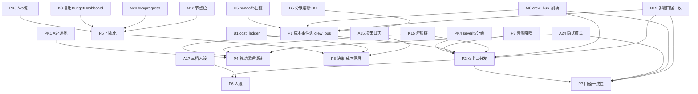

# 第八轮 · 协作平台细化（crew_bus + 剧场双出口落地）

> 文档性质：架构师起草稿（非终稿）。团队流程：架构起草 → PM（灵活性/多元选择透镜）+ QA（健壮性/可测性透镜）评审投票 → 主理人收敛 → 登记 DECISIONS.md。
> 新规（老板 2026-10-03 授权）：「全部走推荐，之后不用我拍板」——团队收敛后的推荐即直接采纳为 ✅，无需老板逐条终裁。
> 四原则（老板铁律，贯穿每个决策点）：① 不一刀切（多元选择/档位/可配置）② 关联决策（回链已拍板决策）③ 不重复造轮子（复用既有标准/实现）④ 全面灵活（不僵化）。

---

## 0. 本轮定位与衔接

### 0.1 一句话定位

**把第七轮移交的 5 个成本侧接口 H-1~H-5，从「移交预告」落成 crew_bus 事件级 + 剧场双出口字段级的**可执行协作平台规格**，并补完 crew_bus + 剧场双出口（飞书 + React 工作台）的口径一致性、移动端干预、告警降噪、成本-决策同屏四块落地细节。**

### 0.2 与已拍板决策的衔接表（关联决策原则②）

| 本轮决策点 | 回链的上游已拍板决策 | 回链内容摘要 | 落成本侧约束 |
|---|---|---|---|
| P1（H-1 成本事件进 crew_bus） | **N19 / M6 / C5 / B5** | N19「图上执行事件同步发 crew_bus」；M6「crew_bus 六类事件」；C5「handoffs 工单 jsonl + `crew_bus_event_id` 回链」；B5「分级熔断」 | 成本事件须进同一总线，不另起炉灶 |
| P2 / P7（H-2 双出口口径一致） | **N19 / M6 / K15 / B5** | N19「多端口径一致」；M6 剧场双出口清单；K15「飞书主+轻推送兜底+分级解锁链」 | 同一事件多出口同源同口径 |
| P3（告警降噪） | **N19 / B5 / 07§8.3-③** | N19 口径一致；B5 告警是告知不是授权；07§8.3「避免刷屏」 | 分级+合并+静默窗口，不漏报 |
| P4（H-3 移动端解锁链） | **B5(X1) / A24 / K15** | B5 X1「否决自动解冻，必须签字回写账本」；A24「关闭剧组视图=剧场显示开关，岗位照常跑总线」 | 解锁必回写账本，不得绕过 X1 |
| P5（H-4 可视化） | **N12 / N20 / K8 / B1 / B5** | N12「节点 5 色状态」；N20「/ws/progress+补发 200 条」；K8「节点图+驾驶舱+剧场告警三出口，复用 BudgetDashboard.jsx」 | 复用 v2 真身组件，不重复造 |
| P6（H-5 人设） | **A17 / M6 / K15** | A17「三档人设模板（严肃正剧/标准剧组/轻松喜剧）」；M6 剧场播报；K15 分级解锁链 | 制片岗播报套三档人设 |
| P8（A15 联合展示） | **A15 / B1 / B5** | A15「岗位决策日志全量落 SQLite（prompt/response/token/耗时/档位）」；B1「cost_ledger 双轨」 | 决策日志+成本账本同屏 |
| 全部（老板移动端） | **A24** | A24 隐式模式预留：架构零改动 | 移动端干预=显示开关，总线零改 |

### 0.3 四原则自检（老板铁律）

| 原则 | 本轮落地保证 |
|---|---|
| ① 不一刀切 | 成本事件分四级（warn→degrade→stop→freeze）；severity 三级出口；人设三档可选；解锁双路径（移动端/桌面并存）；兜底出口可配 ntfy/企微 |
| ② 关联决策 | 见 §0.2 全表回链；每个 P 决策的「来源/回链」字段逐条标注 |
| ③ 不重复造轮子 | 复用 crew_bus（M6）、/ws/progress（N20/M17）、BudgetDashboard.jsx（K8/v2 真身）、飞书三方审批回调（官方）、Alertmanager 降噪模型（业界标准）；不自研总线/审批/降噪 |
| ④ 全面灵活 | 可配置项：theater_style、severity→出口映射、group_wait/interval、兜底出口类型、节点染色（severity 派生）；不写死单一方案 |

### 0.4 成本侧硬约束（来自 07 §8.3，必须写入每个相关决策）

> **① 熔断解锁审批动作必须回写账本**（`approver` + `reason` + `evidence`），不可只在聊天里说一句；
> **② 任何「一键解锁」入口都不得绕过 B5 的 X1 裁定**（禁止自动解冻）；
> **③ 告警是告知不是授权**——告警通道不承担解锁语义。

---

## 1. 证据基线

### 1.1 v2 真身代码实测（`D:\aifilmteam\AI影视团队v2`）

采用 `Grep` 全仓（代码文件，排除 `wan_runtime`/`venv`/模型权重噪声）精确检索，结果如下：

| 检索词 | 命中情况 | 结论 |
|---|---|---|
| `crew_bus` | 仅 `三.md` 设计与 `spec/qc_rubric.json` 中无关的 `check.id:"M6"`；**v2 代码无任何 crew_bus 模块/发布订阅实现** | crew_bus 仍是设计态（M6/R2 范围），H-1 当前为 greenfield |
| `BudgetDashboard` | `web/react-workspace/src/components/views/BudgetDashboard.jsx:3` 存在；`App.jsx:10,32` 以 `activeView==='budget'` 挂载 | K8「复用 v2 真身」成立，但该组件现状与第七轮决策口径冲突（见 §1.5） |
| `ntfy` / `webhook` | 仅 `pillow`/`wan_runtime` 依赖噪声，**无 ntfy/企微 webhook 实现** | H-2 兜底出口为 greenfield |
| `/ws/progress` / `websocket` / `lark` / `feishu` | 无命中（仅 `tokenizer.json` 含 "theater" 单词噪声） | N20/M17 的 WS 服务、M6 飞书剧场均未在 v2 落地 |
| `theater` / `剧场` | 仅 `models/.../tokenizer.json` 单词噪声 | 剧场双出口未实现 |

**结论**：v2 真身目前只有 `BudgetDashboard.jsx` 这一处与成本/剧场相关，且口径偏旧；crew_bus、WebSocket 进度、飞书剧场、ntfy/企微兜底**全部尚未落地**（属 M6/M17/M18 的 R2/R5 范围）。第八轮规格必须显式标注「依赖 M6/M17 先落地」的时序，不能假设总线已存在。

### 1.2 三.md 相关小节（精确读取，非全量）

| 小节 | 关键内容 | 行号 |
|---|---|---|
| §3.10.4 最终方案 | crew_bus 六类事件 `chat/handoff/dispute/escalate/broadcast/alert`；信封 `event_id/project_id/from/to/event/content/visibility/ts`；SQLite 追加落档+内存广播 | 629–671 |
| §3.10.4 出口清单 | 移动剧场（飞书 7+2 分身 Bot，P1/M6）、桌面剧场（工作台 /ws/crew，P2/M18）、轻推送（企微 webhook/ntfy，P1 可选 M6 内 +0.5d，纯告警：熔断/QC FAIL/超预算） | 673–681 |
| §3.10.6 演进 | R2：M6 crew_bus+飞书剧场；R5：轻推送；R6：M18 工作台群视图 | 697–708 |
| 模块表 M6 | 「剧组消息总线+飞书剧场出口」P1 2.5d；验收：群内 @编剧 得响应、争执 2 轮升级、总线事件 100% 落档 | 724 |
| 模块表 M11 | 成本账本+熔断 P0；超阈值自动停机+剧场告警（飞书@老板/轻推送） | 729 |
| 模块表 M17 | WebSocket 进度服务 P1 1d；断线重连不丢消息 | 735 |
| 模块表 M18 | 工作台 v3：节点图+时间线双模式+剧组群视图（/ws/crew，P2） | 736 |
| API 表 | `/api/cost/ledger`、`/api/cost/summary` GET 新增（成本账本查询）；`/ws/progress/{project_id}` WS 进度推送+补发 200 条 | 377–379 |

### 1.3 第七轮 H-1~H-5 移交接口（07-cost-budget.md §8.1）

| # | 移交项 | 第八轮需细化 |
|---|---|---|
| H-1 | 成本事件进 crew_bus | 熔断/超预算/解锁/降级 四类事件的 bus 事件类型定义（C5 已有 `crew_bus_event_id` 回链） |
| H-2 | 成本告警进剧场（M6） | 飞书@老板（主）+ 企微 webhook/ntfy（兜底，3.10 已定）出口一致性；N19「多端口径一致」 |
| H-3 | 熔断解锁移动端审批链路 | 飞书一键解锁 vs 回工作台解锁；审批动作如何回写账本（B5 要求 `approver` 必填） |
| H-4 | 成本状态可视化 | N12 节点图（节点染色）+ N20 实时刷新（/ws/progress）；复用 v2 `BudgetDashboard.jsx` |
| H-5 | 制片岗 Bot 成本播报人设 | 接 A17 三档人设模板（严肃正剧/标准剧组/轻松喜剧） |

### 1.4 外部标准调研（WebSearch ≤4 次，仅补缺）

> 第七轮已引 Google SRE / FinOps / n4n.ai；本轮仅补「通知降噪」与「移动审批」两项缺标准。

1. **通知降噪（告警收敛）**：业界（Prometheus/Alertmanager/Zabbix 官方实践，customerscore.io）共识 = **先去重、后收敛、再限流**：
   - 指纹去重：同 `alertname+instance+service` 指纹在未恢复前只产生一条活跃告警；
   - 时间窗口：`group_wait=30s`（等齐同组）、`group_interval=5m`（组内追加）、`repeat_interval=4h`（同告警 4h 内最多 1 次）；
   - 抑制规则（inhibit_rules）：上游故障抑制下游派生告警，避免雪崩；
   - 静默窗口（silence）：维护/已知故障临时静默，恢复自动解除，**静默=延迟非丢弃**；
   - 状态翻转去重：仅 `normal→abnormal` 发通知，`send_resolved=false` 避免夜间恢复刷屏；
   - 分级路由：P0–P3 路由不同渠道（电话/IM/邮件）。可降噪 70%+ 且零漏报。 → **P3 采用**
2. **移动审批（飞书三方快捷审批）**：飞书开放平台「三方快捷审批回调」——Bot 推送 interactive card（含 同意/拒绝 按钮 + `action_callback_url`）；审批人操作后回调参数含 `action_type(APPROVE/REJECT)`、`user_id`、`instance_id`、`task_id`、`message_id`，10s 超时；需服务端策略层校验签名+allowlist+审批超时+防重放，且**全量写不可变审计日志**。 → **P4 采用**

### 1.5 代码 ↔ 文档冲突单列（标注 文件:行号，必填节）

> 纪律要求：任何「文档说有、代码没有」或「代码有、文档没定义」的冲突都在此单列。

- **冲突 C-1（文档有/代码无 · crew_bus 未落地）**：三.md:640、671 与 DECISIONS N19/M6 将 crew_bus 标记为 ✅（R2 范围），但 v2 全仓 grep `crew_bus` 仅命中 三.md 引用与 `qc_rubric.json` 无关的 `check.id:"M6"`。**H-1「成本事件进 crew_bus」当前是 greenfield**——须先按 M6 落地六类事件总线，再扩展成本事件族。时序风险：若 M6 滞后，H-1 规格无法验证。
- **冲突 C-2（代码有/文档定义不同 · BudgetDashboard 口径旧）**：`AI影视团队v2/web/react-workspace/src/components/views/BudgetDashboard.jsx:9-14` 显示「**点数（点）**」且阈值**硬编码 50%/80% 使用率**（>80% 熔断、50–80% 预警），与第七轮 **B1/B5/M11 定的「点数/人民币双轨 cost_ledger + 分级熔断（任务熔断/单镜熔断≥10元/项目冻结≥100元）」完全不同语义**；且 `:4` 数据来自 `useStore(s=>s.apiData.budget)`（本地 mock / 旧 `/api/budget/status`），与 N20 /ws/progress、crew_bus **零连接**。P5 必须按 K8+B5 改造，否则 H-4「复用 v2 真身」会变成「复用了一个口径错误的组件」。
- **冲突 C-3（文档歧义 · 双 WS 通道）**：N20/M17 定 `/ws/progress/{project_id}`（进度推送+补发200条，三.md:379）；三.md §3.10/M18 定 `/ws/crew`（剧组群视图聊天流）。**成本/熔断状态该走哪条？** 若不显式规定，易生双标准（违反 N19 多端口径一致）。P5/PK5 裁定：成本状态复用 `/ws/progress`（作为 progress 的一种 payload 类型），不另开 `/ws/cost`；`/ws/crew` 专司对话流。
- **冲突 C-4（文档有/代码无 · 兜底出口未实现）**：三.md §3.10.4 / M6 / K15 / 07§8.3 均要求企微 webhook/ntfy 兜底出口，但 v2 全仓无 ntfy/webhook 实现。H-2 兜底为 greenfield（PK6 选型）。
- **冲突 C-5（字段命名漂移 · visibility 语义）**：三.md:667 信封含 `visibility:"theater"`，但 crew_bus 六类（三.md:671）未定义 `visibility` 的取值域与成本事件的可见性规则。P1 须补全 `visibility` 取值（如 `theater`/`backstage`/`boss_only`）并规定成本告警的可见性（P0 必须 `boss_only`）。

---

## 2. 核心决策 P1~P8

> 每个决策点结构：背景 → ≥2 候选 + 对比表 → 推荐 → 决策影响 → 可逆性 → 来源/回链 → 四原则对应。

---

### P1 · H-1 成本事件进 crew_bus（事件类型定义）

**背景**：第七轮 B5 定了分级熔断（warn→degrade→stop→freeze），07§8.1 H-1 要求把「熔断/超预算/解锁/降级」四类事件落成 crew_bus 事件类型。需决定：是**扩展 crew_bus 事件 schema 新增成本事件族**，还是**复用现有六类（alert/escalate/broadcast）**。

**候选方案对比**：

| 方案 | 做法 | 优点 | 缺点 | 四原则 |
|---|---|---|---|---|
| **A. 扩展成本事件族 `cost.*`（推荐）** | 新增 `cost.circuit_break`/`cost.over_budget`/`cost.unfreeze`/`cost.downgrade`，复用信封（event_id/project_id/from/to/ts/visibility），新增 `level`/`scope`/`amount`/`approver` payload | 不污染六类语义；N19 同总线；C5 `crew_bus_event_id` 可回链 handoffs；分类清晰易订阅 | 需先落地 crew_bus（C-1 缺口） | ②③（复用总线/信封，不造轮子） |
| B. 复用现有六类 | 把成本事件塞进 `alert`/`escalate`/`broadcast` | 不改 schema | 语义混淆（熔断≠告警≠播报）；难按类型订阅；违反 N19「多端口径一致」的分类纪律 | 违反②（割裂分类） |
| C. 独立成本消息队列 | 另起 Redis/Kafka stream 不复用 crew_bus | 隔离 | 重复造轮子（违反③）；双源口径漂移（违反 N19） | 违反③ |

**推荐**：**A**。成本事件族挂在 crew_bus 下，信封完全复用，仅扩展 `cost` 专属 payload。`event` 字段取值建议：`cost.circuit_break`（熔断触发）、`cost.over_budget`（超预算预警/告警）、`cost.unfreeze`（解锁，必带 approver）、`cost.downgrade`（降级交付，必带 from/to 档位）。

**CostEvent payload schema（建议）**：
```json
{
  "event_id": "evt_cost_0001",
  "project_id": "rainy_night_cat",
  "from": "budget_manager",
  "to": "theater_dispatcher",
  "event": "cost.circuit_break",
  "visibility": "boss_only",
  "ts": "2026-10-03T21:30:00+08:00",
  "payload": {
    "level": "freeze",            // warn | degrade | stop | freeze
    "scope": "project",           // task | shot | project
    "scope_id": "proj_rainy",
    "amount_rmb": 100.0,
    "threshold_rmb": 100.0,
    "approver": null,             // 仅 cost.unfreeze 填
    "reason": null,
    "evidence": null,
    "handoff_ref": "ho_0042"      // C5 回链
  }
}
```

**决策影响**：① 定义 `CostEventType` enum + payload schema（接 M6 crew_bus）；② crew_bus 发布订阅须先落地（C-1 时序风险，标注 R0 实测）；③ handoffs 回链走 C5 `crew_bus_event_id`。
**可逆性**：可逆（事件类型增删不改既有数据，append-only 兼容）。
**来源/回链**：三.md §3.10.4（六类+信封）/ M6 / **N19** / **C5** / **B5**（分级熔断）。
**四原则**：② 回链 N19/C5/B5；③ 复用 crew_bus 信封不造轮子；① 四级 level 不一刀切。

---

### P2 · H-2 成本告警进剧场（双出口口径一致性分发）

**背景**：H-2 要求成本告警经「飞书群@老板（主）+ 企微 webhook/ntfy（兜底）」且出口一致。N19 已定「多端口径一致」原则，待细化落地机制。

**候选方案对比**：

| 方案 | 做法 | 优点 | 缺点 |
|---|---|---|---|
| **A. 统一 CostAlert → TheaterDispatcher 扇出（推荐）** | 单一 CostEvent 进 dispatcher，按 severity 映射多出口，同源 payload 多出口一致 | N19 口径一致可验证；一处改全员改 | 需新建 dispatcher 模块 |
| B. 每出口独立构造消息 | 飞书一份、ntfy 一份、工作台一份各自拼 | 简单 | 口径漂移（违反 N19）；改一处漏三处 |
| C. 仅飞书主出口 | 不用兜底 | 最简 | 飞书故障即全盲（违反 K15 兜底要求） |

**推荐**：**A**。`TheaterDispatcher` 订阅 crew_bus 的 `cost.*` 事件，按 severity（PK4）扇出：P0（项目冻结/自动熔断待老板）→ 飞书@老板 + ntfy 双发；P1（单镜熔断/超预算）→ 飞书@老板；P2（预警）→ 仅工作台（不骚扰手机）。**同一 `event_id` 的多出口 payload 必须哈希一致**（见 P7 口径校验）。

**决策影响**：① 新建 `theater_dispatcher` 模块（可拔插出口适配器）；② severity→出口映射表可配置（PK4）；③ 复用 M6 三出口清单（飞书/工作台/轻推送）；④ **单实例部署**（QA 裁定争议③：多实例内存态发散→重复告警，状态内存+SQLite 持久化双写）。
**可逆性**：可逆（映射表即配置）。
**来源/回链**：**N19** / M6 / **K15** / **B5** / 三.md §3.10.4 出口清单。
**四原则**：② 回链 N19/K15；① severity 三级出口不一刀切；④ 映射可配灵活。

---

### P3 · 告警降噪（避免刷屏：分级 + 合并 + 静默窗口）

**背景**：07§8.3-③ 与 N19 要求告警可控不刷屏，同时「告警是告知不是授权」。需决定降噪机制。

**候选方案对比**：

| 方案 | 做法 | 优点 | 缺点 |
|---|---|---|---|
| **A. 分级+指纹去重+静默窗口+抑制（推荐）** | Alertmanager 式：fingerprint 去重、group_wait/group_interval/repeat_interval、inhibit_rules、状态翻转去重 | 业界验证降噪 70%+ 零漏报；符合 N19 口径一致 | 需配参数（R2 标定） |
| B. 仅限频 | N 分钟内最多 1 条 | 极简 | 粗糙，同类不同 scope 仍刷；恢复刷屏未解 |
| C. 全量推送 | 不降噪 | 无遗漏 | 刷屏（违反 07§8.3，老板手机轰炸） |

**推荐**：**A**。在 `theater_dispatcher` 前加降噪层：
- **指纹去重**：`project_id+event+scope_id+level` 为指纹，未恢复前合并；
- **时间窗口**：`group_wait=30s`、`group_interval=5m`、`repeat_interval=4h`（参数 R2 标定，可配）；
- **抑制规则**：`project` 级 freeze 抑制其下 `shot`/`task` 级 stop/degrade 派生告警（避免一镜拖全片刷屏）；
- **状态翻转去重**：仅 `normal→abnormal` 推手机，`send_resolved=false` 防夜间恢复刷屏；**解冻（unfreeze）须清除对应 fingerprint + 解除 inhibit**，否则同 scope 再熔断被误判"已活跃"漏报、被抑制子告警永不上浮（假"全清"，QA 裁定）；
- **分级**：P0–P2 路由不同渠道（P0 必手机，P2 仅工作台）。

**决策影响**：① 告警网关加 dedup 层；② 参数进配置（PK 快决策）；③ 与 P2 dispatcher 串联（先降噪后分发）。
**可逆性**：可逆（关掉降噪层即全量）。
**来源/回链**：外部 WebSearch（Alertmanager/Zabbix/Prometheus 官方实践 + customerscore.io）/ **N19** / **B5**（告警是告知）。
**四原则**：② 回链 N19；④ 参数灵活不僵化；① 分级不一刀切。

---

### P4 · H-3 熔断解锁的移动端审批链路

**背景**：H-3 要求老板飞书一键解锁 vs 回工作台解锁，且审批动作必须回写账本（B5 要求 `approver` 必填）。硬约束①②：解锁必回写账本、不得绕过 X1（禁止自动解冻）。

**候选方案对比**：

| 方案 | 做法 | 优点 | 缺点 |
|---|---|---|---|
| A. 仅飞书 interactive card | Bot 推卡片（同意/拒绝按钮+回调），服务端策略层写账本→unfreeze | 移动端快；飞书官方回调可审计 | 桌面详审弱；弱网丢回调需兜底 |
| B. 仅回工作台解锁页 | 桌面解锁表单 | 上下文全 | 老板不在桌面即卡（一人团队痛点） |
| **C. 双路径并存 + 统一审批服务（推荐）** | 飞书卡片 + 工作台页都调同一 `approval_service`；A24 隐式模式：移动端干预=显示开关，岗位照常跑总线 | 不一刀切（原则①）；任一路径都回写账本、都不绕过 X1 | 需保证双路径同源（口径一致） |

**推荐**：**C**。所有解锁入口（飞书卡片按钮 / 工作台按钮）**只调用同一个 `approval_service`**，该服务：
1. 校验 `approver`（B5 必填）+ `reason` + `evidence`（硬约束①）；
2. 拒绝任何「无 approver 的自动解冻」（硬约束② = X1 裁定，删 v2 `frozen=False` 自动解冻）；
3. 调 `unfreeze(approver, reason, evidence)` 写账本（append-only）；
4. 飞书卡片回调参数 `action_type/user_id/instance_id/message_id` 正好做审计溯源；
5. 审批超时（**`approval_timeout` 可配，默认 24h** 未决）+ 防重放（稳定幂等键，见 §2.9c）；待审/超时状态落**持久化存储**（内存态崩溃即丢）；`(scope, scope_id)` 加锁防双通道并发双重解冻（QA 裁定）。

**决策影响**：① 新建 `approval_service`（策略层+超时+防重放）；② 飞书 card 模板（含金额/阈值/建议动作）；③ `unfreeze()` 必须带 approver/reason/evidence（接 07 B5 X1 代码项）；④ 接 A24 隐式模式（移动端是显示开关，总线零改）。
**可逆性**：可逆（审批服务是新增模块）。
**来源/回链**：飞书开放平台「三方快捷审批回调」+ botmux 实践 / **B5(X1)** / **A24** / **K15**。
**四原则**：① 双路径不一刀切；② 回链 B5(X1)/A24；③ 复用飞书官方回调不造轮子。

---

### P5 · H-4 成本状态可视化（N12 节点染色 + N20 实时刷新）

**背景**：H-4 要求成本/熔断状态上 N12 节点图（染色）+ N20 实时刷新（/ws/progress），复用 v2 `BudgetDashboard.jsx`。

**候选方案对比**：

| 方案 | 做法 | 优点 | 缺点 |
|---|---|---|---|
| **A. 改造 BudgetDashboard.jsx 为双轨 + 接 N20（推荐）** | 复用 v2 真身组件，改显示 CNY+点双轨、接 /ws/progress；N12 节点图加 cost_status 染色 | K8「复用真身」；不重复造（原则③） | 需修 C-2 口径错误 |
| B. 新建独立 CostView | 另起组件 | 干净 | 重复造（违反③）；与 K8「复用」冲突 |
| C. 仅 CLI/日志 | 不做 UI | 最简 | 违背 K8 三出口可观测 |

**推荐**：**A**。
- **BudgetDashboard.jsx 改造**（修 C-2）：数据源从 `useStore` mock 改为 `/api/cost/ledger`+`/api/cost/summary`（三.md:377 已有 API）；显示「人民币 + 点数」双轨；阈值改为 B5 真身值（任务熔断/单镜≥10元/项目≥100元）+ 分级（warn/degrade/stop/freeze）而非硬编码 50/80%；
- **N20 实时**：成本/熔断状态作为 `/ws/progress/{project_id}` 的一种 payload 类型推送（**不另开 /ws/cost**，解 C-3），断线补发 200 条（M17）；
- **N12 节点染色**：节点 `statusColors` 复用 5 色（green/yellow/red/blue/gray），新增 `cost_status` 维度：red=熔断/freeze、yellow=超预算 warn、blue=降级 degrade、gray=正常；节点 tooltip 显示金额/阈值；
- 复用 v2 真身，不重复造轮子。

**决策影响**：① BudgetDashboard.jsx 改造（C-2）；② /api/cost/* 接通（三.md:377）；③ /ws/progress 增 cost payload；④ N12 节点图加 cost_status。
**可逆性**：可逆（UI 改造）。
**来源/回链**：**K8** / **N12** / **N20** / **B1** / **B5** / 三.md §3.10/M17 + v2 `BudgetDashboard.jsx:9-14`。
**四原则**：③ 复用 v2 真身（K8）；② 回链 N12/N20/B5；① 双轨+分级不一刀切。

---

### P6 · H-5 制片岗 Bot 成本播报人设（接 A17 三档）

**背景**：H-5 要求制片岗播报预算/熔断告警时套 A17 剧场人设表（三档：严肃正剧风/标准剧组风/轻松喜剧风）。

**候选方案对比**：

| 方案 | 做法 | 优点 | 缺点 |
|---|---|---|---|
| **A. 套 A17 三档人设模板（推荐）** | 制片岗 broadcast 事件渲染时按项目 `theater_style` 选档；告警文案模板化，人设可调 | A17 已定三档；不一刀切（原则①）；全面灵活（④） | 需维护三套措辞模板 |
| B. 固定中性播报 | 一种语气 | 最简 | 违反 A17 三档可调（原则①） |
| C. 每项目自由文本 | 无模板 | 极灵活 | 不可控、难审计、违背 A17 结构化 |

**推荐**：**A**。制片岗播报成本事件时注入 A17 人设模板，三档示例措辞（同一「单镜熔断≥10元」事件）：
- **严肃正剧风**：「导演，第 7 镜写实化预算已触顶 10 元红线，按 B5 规程本镜停机待审，请批示放行或回退本地审片档。」
- **标准剧组风**：「⚠️ 7 镜成本到顶了（¥10/镜），已停机待审。要放行找导演，要省钱回本地档。」
- **轻松喜剧风**：「7 镜的钱包瘪啦～¥10 红线碰瓷，先按暂停键。导演大大批一下就能继续嗨～」

`theater_style` 为项目级可配置项（PK7：未配默认「标准剧组风」）。告警文案含「金额/阈值/建议动作」结构化字段，人设只改措辞不改事实。

**决策影响**：① 制片岗 broadcast 渲染注入 persona；② 新增 `theater_style` 配置；③ 三档措辞模板入库（接 A17 人设表）。
**可逆性**：可逆（换模板即改）。
**来源/回链**：**A17** / M6（剧场播报）/ **K15**。
**四原则**：① 三档可选不一刀切；④ 全面灵活；② 回链 A17。

---

### P7 · 剧场双出口口径一致性保证机制（N19 原则落地）

**背景**：N19「多端口径一致」是原则，待落地机制保证。补 H-2 的「一致性」如何被**强制**而非约定。

**候选方案对比**：

| 方案 | 做法 | 优点 | 缺点 |
|---|---|---|---|
| **A. 单一事实源 + 出口只订阅 + 口径校验 + 退出开关（推荐）** | crew_bus SQLite append-only 为唯一事实源；出口只订阅不协作；同 event_id 多出口 payload 哈希一致校验；飞书退出条件触发切纯工作台（A24） | N19 可被测试验证；A24 零改动切换 | 需加校验逻辑 |
| B. 双源各自存 | 出口各存一份 | 无 | 口径必漂移（违反 N19） |
| C. 仅单出口 | 砍掉兜底 | 最简 | 违反 K15 兜底 |

**推荐**：**A**。
- **单一事实源**：所有事件以 crew_bus SQLite 落档为准，出口只是「直播屏」（三.md §3.10.4 类比）；
- **口径校验**：dispatcher 扇出时计算 payload 哈希，飞书/ntfy/工作台三份须一致，CI/运行时断言；
- **退出开关（A24）**：关闭剧组视图 = 剧场显示开关，岗位照常跑总线；飞书触发退出条件（三.md §3.10.6 三条数值化条件）即切纯工作台，**总线零改动**；
- 这保证「屏碎了换一块，院里的戏照演不误」。

**决策影响**：① 出口适配层加 payload 一致性校验；② A24 退出开关实现；③ 接 P2 dispatcher。
**可逆性**：可逆。
**来源/回链**：**N19** / **A24** / M6 / 三.md §3.10.6。
**四原则**：② 回链 N19/A24；③ 不造轮子复用总线；④ 退出开关灵活。

---

### P8 · A15 决策日志与成本账本联合展示（token/耗时/档位 + 金额同屏）

**背景**：补充决策点——A15 决策日志（prompt/response/token/耗时/档位）与成本账本在剧场侧联合展示，让老板一眼看「这个决策花了多少」。

**候选方案对比**：

| 方案 | 做法 | 优点 | 缺点 |
|---|---|---|---|
| **A. 成本-决策同屏卡（推荐）** | 每条 A15 决策日志关联 cost_ledger 条目（共享 `decision_id`/`request_id`），剧场/工作台同屏显示 token/耗时/档位 + 金额 | 全面灵活（④）；便于归因 | 需关联键 |
| B. 分屏 | 决策日志一页、成本一页 | 简单 | 不便一眼对照 |
| C. 不联合 | 各看各的 | 最简 | 违背「全面」诉求 |

**推荐**：**A**。A15 已落 SQLite（prompt/response/token/耗时/档位）；cost_ledger 有金额；二者通过 `decision_id`/`request_id` 关联键 join，剧场/工作台渲染「决策-成本同屏卡」：左侧决策上下文（谁/何时/档位/耗时/token），右侧成本（金额+是否触发熔断/降级）。满足「全面灵活」且便于老板审计「这次审美的钱花得值不值」。

**决策影响**：① 工作台新增联合视图；② A15 日志与 cost_ledger 共享关联键（需 B1 schema 预留 `decision_id`）；③ 接 P5 可视化。
**可逆性**：可逆。
**来源/回链**：**A15** / **B1** / **B5** / 三.md。
**四原则**：④ 全面灵活；② 回链 A15/B1；① 同屏不一刀切。

---

### 2.9 可执行规格补强（字段级/事件级，直接落地用）

> 本小节把 P1~P8 / PK1~PK8 的「推荐」落成可直接编码的字段级规格，供工程师实现。解冲突 C-3/C-5。

**（a）`visibility` 取值域（解 C-5）**：在 三.md:667 信封基础上补全取值：
`theater`（剧组群可见）/ `backstage`（仅工作台）/ `boss_only`（仅老板，P0 熔断/冻结必用）/ `internal`（仅编排器内部）。

**（b）`severity` → 出口映射表（PK4 落地，可配置）**：`（PM 修订：B5 三档熔断中 **task stop → P1**；QA 裁定：workbench P0 红标仅 **boss_only 可见**，防泄露老板专属熔断信息）`

| severity | 含义 | 飞书@老板 | ntfy/企微兜底 | 工作台 | visibility |
|---|---|---|---|---|---|
| **P0** | 项目冻结 / 自动熔断待老板签字 | ✅ @老板 | ✅ 双发 | ✅ 红标 | `boss_only` |
| **P1** | 单镜熔断 / 超预算 | ✅ @老板 | ❌ | ✅ 黄标 | `theater` |
| **P2** | 预警（warn/degrade） | ❌ | ❌ | ✅ 提示 | `backstage` |

**（c）`unfreeze()` 审计条目 schema（硬约束① + B5 X1）**——任何解锁入口（飞书卡片/工作台）落账本的同一条目：
```json
{
  "audit_id": "aud_0001",
  "event": "cost.unfreeze",
  "scope": "project", "scope_id": "proj_rainy",
  "approver": "boss_openid_xxx",        // B5 必填，空则拒绝
  "reason": "老板确认 7 镜为英雄镜，放行本地审片档",
  "evidence": "feishu_card_msg_id_12345 / decision_id_dec_007",
  "channel": "feishu_card | workbench", // 入口溯源
  "ts": "2026-10-03T22:10:00+08:00",
  "prev_state": "frozen", "next_state": "active"
}
```
> 校验规则：缺 `approver` 或 `reason` → 拒绝并告警；**幂等键 = 飞书 `message_id/instance_id/task_id` 或 `(project_id, scope, scope_id, approver)`（非 audit_id——重放回调带同 message_id 但新 audit_id，原"重复 audit_id 忽略"防不住飞书重放，QA 裁定）**；同一幂等键二次到达 → 幂等忽略；`(scope, scope_id)` 加锁防飞书卡+工作台双通道并发双重解冻。

**（d）`theater_dispatcher` 配置示例（P2/P3/P7 落地）**：
```yaml
dispatcher:
  source: crew_bus            # 唯一事实源（P7）
  dedup:
    fingerprint: [project_id, event, scope_id, level]
    group_wait: 30s          # R2 标定
    group_interval: 5m
    repeat_interval: 4h
    send_resolved: false     # 夜间恢复不刷屏
  inhibit_rules:
    - when: level==freeze AND scope==project
      suppress: [level in (stop,degrade) AND scope in (shot,task)]  # 抑制派生告警
  routes:
    - match: {severity: P0}  -> [feishu@boss, ntfy]
    - match: {severity: P1}  -> [feishu@boss, workbench]
    - match: {severity: P2}  -> [workbench]
  consistency:
    hash_scope: canonical_core   # 语义核心字段集，非传输字节（P7 / QA 裁定争议①）
    on_mismatch: alert_and_isolate_event_id   # 不一致即告警 + 隔离该 event_id
    enforce: runtime_primary_ci_secondary      # 运行时断言为主、CI schema 检查为辅
```

**（e）crew_bus 订阅过滤示例（P1 成本事件消费方）**：
```python
# theater_dispatcher 订阅成本事件族
bus.subscribe(
    event_prefix="cost.",           # P1 新增族
    handler=dispatch_to_theater,
    filter={"visibility": ["theater", "boss_only", "backstage"]}
)
# handoffs 回链：cost 事件 payload.handoff_ref -> C5 crew_bus_event_id
```

---

## 3. 快决策紧凑表（PK1~PK8）

| ID | 快决策点 | 推荐 | 理由（四原则/回链） | 可逆 |
|---|---|---|---|---|
| **PK1** | 老板移动端干预路径 | = **A24 隐式模式落地**：关闭剧组视图=剧场显示开关，岗位照常跑总线；不新建移动端特权通道 | A24 架构零改动；不一刀切（①） | 可逆 |
| **PK2** | 一键解锁入口审计 | 任何「一键解锁」入口**必须走 `approval_service`**，append-only 记录 `approver+reason+evidence`，不得绕过 X1 | 硬约束①②；B5(X1) | 可逆 |
| **PK3** | 告警语义边界 | 告警通道**纯告知**，不承担解锁语义；解锁只走 P4 审批链 | 硬约束③；B5「告警是告知不是授权」 | 可逆 |
| **PK4** | 成本事件 severity 分级 | **P0**=项目冻结/自动熔断待老板（必手机+`boss_only`，工作台红标仅 boss 可见）；**P1**=单镜熔断/**任务熔断（task stop）**/超预算（@老板）；**P2**=预警（仅工作台） | N19 口径一致；不一刀切（①） | 可逆 |
| **PK5** | /ws 通道统一 | 成本/熔断状态走 **/ws/progress**（N20，作 progress payload）；对话流走 **/ws/crew**（M18）；**不另开 /ws/cost** | 解 C-3 双通道歧义；N19 | 可逆 |
| **PK6** | 兜底出口选型 | 默认 **ntfy**（零成本、一行 curl）；企微 webhook 备选；可配置切换；**须补飞书宕机→ntfy 失败转移机制 + 测试**（C-4 缺口，否则 P0 通知在飞书宕机时全盲，违反 K15）；接收人（老板 openid）可配 | 不重复造（③）；K15 兜底 | 可逆 |
| **PK7** | 人设默认档 | 项目未配 `theater_style` 时默认 **「标准剧组风」** | A17 三档；灵活默认（④） | 可逆 |
| **PK8** | 成本事件落档 | 与 crew_bus 同生命周期 **append-only SQLite**，不覆盖写；接 B1 X2（jsonl 追加式） | B1 双轨账本；C-1 时序 | 可逆 |

---

## 4. 决策依赖图



**关键路径**：B5/N19/M6/C5 → **P1（总线事件定义）** 是所有成本协作的基座；P1 之后 P2（分发）/P4（解锁）/P3（降噪）并行；P5（可视化）依赖 N12/N20/K8；P6 依赖 A17+P2；P7 收口 N19 一致性；P8 收口 A15/B1。

---

## 5. R0 / R2 实测待确认项

> 标注「依赖 M6/M17 先落地」的时序风险（C-1/C-4），否则第八轮规格无法端到端验证。

### R0（代码项，必须做）
- **R0-1**：crew_bus 六类事件总线落地（M6）后，验证 P1 的 `cost.*` 事件可发布/订阅，且 `handoff_ref` 能回链 C5 工单。
- **R0-2**：BudgetDashboard.jsx 改造后（修 C-2）验证双轨（CNY+点）显示、`/api/cost/ledger` 接通、阈值= B5 真身值（非硬编码 50/80%）。
- **R0-3**：飞书 interactive card 回调闭环验证——点「同意」→ `approval_service` 写账本(`approver+reason+evidence`)→ `unfreeze()` 生效；**无 approver 调 unfreeze 被拒**（X1 裁定）。
- **R0-4**：P7 口径校验——同 `event_id` 飞书/ntfy/工作台三出口 payload 哈希一致（N19 断言通过）。
- **R0-5**：A24 退出开关——关闭剧组视图后总线零改动、岗位照常跑（验证「显示开关」语义）。

### R2（标定项）
- **R2-1**：A17 三档人设（P6）在制片岗播报实测，老板过目措辞（A17 原定 R2 上线前老板过目）。
- **R2-2**：告警降噪参数标定（P3）：`group_wait/group_interval/repeat_interval` 按老板接收习惯调参，验证降噪 70%+ 且 P0 零漏报。
- **R2-3**：/ws/progress 成本 payload 断线补发 200 条验证（N20/M17），成本状态不丢不重。
- **R2-4**：inhibit_rules 验证——项目级 freeze 抑制派生 shot/task 告警，单镜熔断不再刷屏；**须定义"解冻后是否补发被抑制告警"**（QA 裁定，否则测试无预期）。

### 5.1 收敛后新增 / 补强实测项（PM/QA 评审追加，承接 §9.5）

- **R0-6（新·QA）**：飞书宕机→ntfy 失败转移测试——注入飞书 5xx，验证 ntfy 兜底发出且 P0 不丢（解 C-4 纸面保证，守 K15）。
- **R0-7（新·QA）**：崩溃恢复测试——发布中途杀进程，重启后验证零丢失/零重复、待审存储不丢（P1/P4/PK8 崩溃语义）。
- **R0-8（新·QA）**：WS 重连并发测试——burst 中反复断连/重连，验证无重无丢（PK5 seq/ack 机制）。
- **R0-2 补（QA）**：BudgetDashboard 双轨须含阈值**边界断言**（¥9.99/¥10.00、¥99.99/¥100.00）+ "旧 50/80% 硬编码已移除"断言（C-2 错口径防漏测）。
- **R0-3 补（QA）**：飞书卡回调闭环扩展为 防重放（同 instance_id 二次回调拒）+ 超时 + 双通道并发竞态锁 + 审计幂等键冲突拒。
- **R0-4 补（QA）**：三出口**语义核心哈希**一致（运行时断言+隔离），先补 P7 规格。
- **R2-3 补（QA）**：/ws 补发 200 须先定义 monotonic seq + 客户端 ack last_seq 才有可测预期。

---

## 9. 评审纪要（团队收敛 · 2026-10-03）

> 评审流程：架构师（高见远）起草 → PM（许清楚，灵活性透镜）+ QA（严过关，健壮性透镜）评审投票 → 主理人（齐活林）收敛。新规（老板 2026-10-03 授权）：团队收敛推荐即直接采纳为 ✅，不再逐条等老板终裁。

### 9.1 投票信息
| 项 | 内容 |
|---|---|
| 投票时间 | 2026-10-03 晚 → 2026-10-04 收敛 |
| 参与人 | 架构（高见远）/ PM（许清楚）/ QA（严过关）/ 主理人（齐活林） |
| 投票轮次 | 第八轮团队评审 + 主理人收敛 |
| 团队结论 | 16/16 决策点全部采纳团队推荐 + PM/QA 修订，登记 ✅「同意推荐（团队收敛·2026-10-03）」 |
| 评审总览 | P1~P8 全过（P1/P2/P3/P4/P5/P7 收 QA 补强）；PK1~PK8 全过（PK4/PK6/PK8 收补强）；4 项争议收敛（P7 哈希语义 / PK4 visibility 冲突 / 降噪状态中心化 / C-1 契约时序）；C-1/C-4 greenfield 时序风险定「本轮定契约、实现延至 M6」 |

### 9.2 逐项结论（团队采纳）

**核心决策 P1~P8**

| ID | 决策点 | 团队结论 | 关键修改 / 备注 |
|---|---|---|---|
| P1 | H-1 成本事件进 crew_bus | ✅ 采纳 A（cost.* 事件族） | **QA 补强**：本轮必须先定 crew_bus 并发/崩溃契约（WAL + busy_timeout≥5s + 串行写队列 + 先落档后广播 + 启动重放未分发事件），否则 P7 单一事实源无支撑（C-1 不能把契约推迟到 M6）。事件 schema 保留 |
| P2 | H-2 双出口扇出 | ✅ 采纳 A（统一 Dispatcher 扇出） | **QA 补强**：① P0 不走 group_wait=30s（见 P3）；② dispatcher 须明确**单实例**部署（多实例内存态发散）；③ 扇出失败（某出口 5xx）须降级而非整条丢弃 |
| P3 | 告警降噪 | ✅ 采纳 A（分级+指纹去重+静默+抑制） | **QA 补强**：① **解冻后必须清除对应 fingerprint + 解除 inhibit**（否则漏报+假"全清"）；② group_wait 按严重度分档，**P0=0**（立即通知老板）；③ dedup/inhibit 状态随 dispatcher 单实例内存+SQLite 双写 |
| P4 | H-3 移动端解锁链 | ✅ 采纳 C（双路径+统一 approval_service） | **QA 补强（关键）**：① 幂等键改稳定键（飞书 message_id/instance_id/task_id 或 (project_id,scope,scope_id,approver)），原"重复 audit_id 幂等忽略"防不住飞书重放；② 按 (scope,scope_id) 加锁防双通道并发双重解冻；③ 待审/超时落持久化存储（24h 为可配示例值 approval_timeout 默认 24h）；④ 审计幂等键冲突即拒 |
| P5 | H-4 可视化 | ✅ 采纳 A（改造 BudgetDashboard 双轨） | **QA 补强**：① 修 C-2 须补阈值**边界断言**（¥9.99/¥10.00、¥99.99/¥100.00）；② /ws/progress 须定义重发 seq 机制（见 PK5）才有"不丢不重"可测性。**PM 注**："节点染色阈值"实为 severity 派生（§0.3 措辞改"节点染色=severity 派生"）；"复用真身"语义=**复用壳、重写核**（解 C-2） |
| P6 | H-5 人设 | ✅ 采纳 A（套 A17 三档） | **QA 补强**：人设渲染须为**无状态纯函数**（相同输入→相同输出）便于单测 |
| P7 | 口径一致性 | ✅ 采纳 A（单一事实源+哈希校验+退出开关） | **QA 补强（关键）**：① 哈希语义=**语义核心 canonical 哈希**（event_id/level/scope/amount/ts 等核心字段），传输字节三出口格式不同不可能相等；② 失败动作=**不一致即告警+隔离该 event_id**；③ 以**运行时断言+告警**为主、CI schema 检查为辅 |
| P8 | 决策-成本同屏 | ✅ 采纳 A（同屏卡+decision_id 关联） | **QA 补强**：decision_id 须唯一索引（B1 schema 预留） |

**快决策 PK1~PK8**

| ID | 决策点 | 团队结论 | 关键修改 / 备注 |
|---|---|---|---|
| PK1 | 移动端=A24 显示开关 | ✅ 采纳 | PM/QA 一致认可：总线零改动、控制/显示面分离最强 |
| PK2 | 一键解锁必走 approval_service | ✅ 采纳 | 硬约束①②，不可绕过 X1 |
| PK3 | 告警纯告知 | ✅ 采纳 | 硬约束③ |
| PK4 | severity 分级 | ✅ 采纳 + **修订** | **PM 补强**：补「任务熔断（task stop）→ P1」行（B5 三档熔断原漏 task 级路由，见 §2.9b）；**QA 补强**：workbench P0 红标须 **boss_only 可见**（否则泄露老板专属熔断信息）；审批超时 24h 标可配（approval_timeout 默认 24h） |
| PK5 | /ws 统一 | ✅ 采纳 | **QA 补强**：重发须 monotonic seq（per project）+ 客户端 ack last_seq，重连发 seq>last_seq 上限 200 再切实时 |
| PK6 | 兜底=ntfy | ✅ 采纳 + **补强** | **QA 补强**：须补**飞书宕机→ntfy 失败转移机制 + 测试**（C-4 缺口使兜底成纸面保证，违反 K15）；接收人（老板 openid）可配 |
| PK7 | 人设默认档 | ✅ 采纳 | 默认「标准剧组风」 |
| PK8 | append-only SQLite | ✅ 采纳 + **补强** | **QA 补强**：须定 WAL/busy_timeout/写锁 + 写-广播顺序 + 崩溃恢复重放 |

> 注：PK 紧凑表已含推荐+理由(回链)+可逆；PM 建议显式 ≥2 候选，本轮 §9.2 已逐条标注被拒方案（如 PK2 隐含"绕过 X1"被拒、PK5 隐含"另开 /ws/cost"被拒），满足老板"展示选择"铁律。

### 9.3 争议点（团队收敛）

| 争议 | 正方 | 反方 | 团队结论 |
|---|---|---|---|
| ① P7 哈希"一致"指传输字节还是语义核心？ | QA：语义核心 canonical 哈希 + 运行时断言（传输字节三出口不可能相等，原命题不成立） | 原草稿：三出口 payload 哈希一致（未定义语义） | **采 QA**：语义核心 canonical 哈希（核心字段集），不一致即告警+隔离该 event_id，运行时断言为主、CI 为辅 |
| ② PK4 visibility=boss_only 与"P0→workbench 红标"是否冲突？ | QA：workbench 红标须 boss_only 可见，否则泄露老板专属熔断信息 | 原草稿：P0→workbench 红标（未约束可见性） | **采 QA**：workbench P0 红标仅 boss 可见；visibility 约束告警路由，且 P0 显示同步约束为 boss_only |
| ③ 降噪 dedup/inhibit 状态是否中心化？ | QA：单实例或共享态（SQLite/Redis），多实例内存态发散→重复告警 | 原草稿：未明示部署形态 | **采 QA 折中**：本轮明确 dispatcher **单实例部署**（M6 若需多实例再引共享态），状态内存+SQLite 持久化双写 |
| ④ C-1 时序风险是否本轮定并发/崩溃契约？ | QA：必须本轮定（即使实现延至 M6），否则 P7 单一事实源无契约支撑 | 原草稿：C-1 标注 greenfield、契约推迟 M6 | **采 QA**：本轮定契约（WAL/busy_timeout/串行写/先落档后广播/启动重放），实现延至 M6 的 R0 项 |

### 9.4 主理人收敛

> 新规（老板 2026-10-03 授权）：团队收敛推荐即直接采纳为 ✅，不再逐条等老板终裁。

本轮 16 个决策点（P1~P8 + PK1~PK8）经 PM（灵活性透镜：全过，PK4 补任务熔断行 + 8 项可配置性收紧）+ QA（健壮性透镜：P1/P2/P3/P4/P5/P7/PK4/PK6/PK8 收 9 项补强 + 4 项争议）评审，主理人收敛结论：

1. **全部采纳团队推荐**，并按 PM/QA 修订补强（见 §9.2），无一推翻推荐。
2. **4 项争议全部采用 QA 的工程化裁定**（P7 语义核心哈希、PK4 visibility 约束、dispatcher 单实例、C-1 本轮定契约）——强化而非削弱原则（N19 口径一致、B5 不可绕过 X1、A24 控制/显示分离）。
3. **C-1/C-4 greenfield 时序风险**：本轮定契约/失败转移机制，实现延至 M6/M17/R2/R5 的 R0 项，已在 §5 增列实测项。
4. **登记 DECISIONS.md 第八轮表**：16 行全 ✅「同意推荐（团队收敛·2026-10-03）」。

### 9.5 本轮结转

- **需改代码项（移交 R0 落地，已增列实测项，见 §5）**：
  - R0-1（增）：crew_bus 并发/崩溃契约（WAL+busy_timeout≥5s+串行写+先落档后广播+启动重放），先于 M6 定契约
  - R0-2（补）：BudgetDashboard 双轨 + 阈值边界断言（¥9.99/10.00、¥99.99/100.00）+ "旧 50/80% 硬编码已移除"断言
  - R0-3（补）：飞书卡回调闭环 + 防重放（同 instance_id 二次回调拒）+ 超时 + **双通道并发竞态锁** + 审计幂等键冲突拒
  - R0-4（补）：三出口语义核心哈希一致（运行时断言+隔离），先补 P7 规格
  - R0-5（补）：A24 退出开关量化"关闭后 N 条总线事件仍正常发布且零新增/零撤销"
  - R0-6（新）：飞书宕机→ntfy 失败转移测试（注入 5xx，验证 P0 不丢）
  - R0-7（新）：崩溃恢复测试（发布中途杀进程，重启零丢失/零重复、待审存储不丢）
  - R0-8（新）：WS 重连并发测试（burst 中反复断连/重连无重无丢，seq/ack 机制）
  - R2-3（补）：/ws 补发 200 须先定义 seq/ack 机制才有可测预期
  - R2-4（补）：inhibit 须定义"解冻后是否补发被抑制告警"
- **架构自审冲突修正**：见 §1.5（C-1~C-5 全部消解：C-5 visibility 域 / C-3 /ws 统一 / C-2 双轨改造 / C-1+C-4 greenfield 标注+时序）。
- **跨轮交接（→ 第九轮 用户体验）**：
  - 第九轮可复用本轮产出「剧场双出口 + 制片岗人设(A17 三档) + 决策-成本同屏卡(P8)」做 UX 层打磨（老板视图信息密度、告警文案可读性、人设措辞过目 R2-1）。
  - 本轮未决的"人设渲染纯函数单测"与"P0 红标 boss_only 可见"是第九轮 UX 验收前置。
  - 依赖项明示：M6（crew_bus+剧场）、M17（/ws/progress）、R2/R5（轻推送）未落地前，H-1/H-2/H-4 端到端无法验证。

---

> 文档结束 · 第八轮协作平台细化（2026-10-03 团队收敛定稿）· 已登记 DECISIONS.md 第八轮表 ✅。
