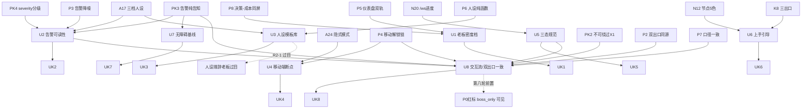

# 第九轮协商草稿 · 用户体验（UX）细化

> 起草：架构师 高见远 ｜ 轮次：第九轮（UX 打磨层）｜ 日期：2026-10-03
> 定位：在第八轮「协作平台细化」已落地的协作骨架之上，做**体验层打磨**——老板/用户如何"看得懂、用得顺、不焦虑"。
> 纪律：本轮起草期**不登记 DECISIONS.md**（留给主理人收敛后登记）；§9 评审纪要已填；所有决策点候选≥2、推荐有理由、逐条回链已拍板决策。**已于 2026-10-03 团队收敛，DECISIONS.md 第九轮表 16/16 登记 ✅。**

---

## §0 定位与衔接

### §0.1 一句话定位
第八轮解决了"协作平台怎么跑（总线/双出口/告警/移动解锁/可视化/人设/同屏卡）"，第九轮解决"这些跑出来的东西，**老板和用户怎么看得懂、用得顺、不焦虑**"——即信息密度、告警可读性、人设措辞过目、老板视图、移动端（A24 隐式模式）、空/错/加载态、上手引导、无障碍与交互流程。

### §0.2 与已拍板决策的衔接表（关联决策原则②，逐条回链）

| 已拍板决策 | 出处 | 第九轮 UX 接管点 | 关联原则 |
|---|---|---|---|
| A17 三档人设（严肃正剧/标准剧组/轻松喜剧）+9岗人设 | DECISIONS.md:159 | U3 人设措辞模板库 + 过目机制（R2-1） | ① 不一刀切 ④ 全面灵活 |
| N12 节点5色（green/yellow/red/blue/gray）映射 QC verdict | DECISIONS.md:110 | U8 状态语义统一图例；§1.5-9 文案直连 | ② 关联决策 |
| N20 实时刷新（/ws/progress+补发200） | DECISIONS.md:118 | U5 加载态规范（骨架屏接 /ws 流） | ② 关联决策 |
| K8 成本可观测性（节点图+驾驶舱+剧场告警三出口） | DECISIONS.md:352 | U1 老板视图密度；U8 双出口 UX 一致性 | ② 关联决策 |
| P5 H-4 可视化（BudgetDashboard 双轨改造） | DECISIONS.md:388 | U1 信息密度档位；U5 空/错态；§1.5-1/2 | ② 关联决策 ① 不一刀切 |
| P6 H-5 人设（套 A17 三档，纯函数渲染） | DECISIONS.md:390 | U3 纯函数 + 过目清单；UK2 | ④ 全面灵活 |
| P7 口径一致性（单一事实源+哈希+退出开关 A24） | DECISIONS.md:391 | U8 双出口同源文案；§1.5-8 三套状态语义收敛 | ② 关联决策 |
| P8 决策-成本同屏（decision_id 关联） | DECISIONS.md:391 | U1 老板视图密度；U8 同屏卡信息组织 | ② 关联决策 |
| A24 隐式模式（关闭剧组视图=显示开关，零改动） | DECISIONS.md:166 | U4 移动端视图；UK4 首屏关键指标 | ③ 不重复造轮子 ① 不一刀切 |
| PK2 一键解锁必走 approval_service（不可绕过 X1） | DECISIONS.md:393 | U8 审批卡（纯告知不授权） | ② 关联决策 |
| PK3 告警纯告知（不承担解锁语义） | DECISIONS.md:394 | U2 告警文案结构化；U7 aria-live=polite | ② 关联决策 |
| PK4 severity 分级（P0 boss_only 红标 / P1 task stop / P2 预警） | DECISIONS.md:395 | U2 告警字段 severity；§1.5-6 P0 红标实现 | ② 关联决策 |
| B5 熔断（四级+作用域隔离，X1 否决自动解冻） | DECISIONS.md:340 | U2/U8 熔断相关告警可读性 | ② 关联决策 |
| P3 告警降噪（分级+指纹去重+静默窗口+抑制） | DECISIONS.md:387 | U2 告警可读性（降噪后内容须可读） | ② 关联决策 |
| P2 双出口扇出（theater_dispatcher 同源） | DECISIONS.md:386 | U8 飞书/React 双出口同构文案 | ② 关联决策 ③ 不重复造轮子 |
| P4 移动端解锁链（双路径 + approval_service） | DECISIONS.md:387 | U4 移动端视图；UK4 | ② 关联决策 |
| 第八轮结转项（§9.5） | 08:566-568 | 老板视图信息密度 / 告警文案可读性 / 人设措辞过目 R2-1 / 人设纯函数单测 / P0 红标 boss_only 可见 | ② 关联决策 |

### §0.3 四原则自检表（老板四原则，贯穿每个决策点）

| 原则 | 本轮落地方式 | 对应决策 |
|---|---|---|
| ① 不一刀切（多元选择/档位/可配置） | 信息密度三档、人设三档措辞、移动端断点分级、空错态分级 | U1 U3 U4 U5 |
| ② 关联决策（回链已拍板，不孤立） | 全部决策回链 A17/N12/N20/K8/P5~P8/A24/PK2~PK4/B5/P3/P2/P4 | 全表 §0.2 |
| ③ 不重复造轮子（调研复用标准） | 复用 WCAG 2.1、NN/g 通知设计、NN/g 状态可见性启发、既有人设/告警骨架 | U4 U5 U7 U8 |
| ④ 全面灵活（不僵化） | 显示开关零改动、密度可切、引导可跳过可重看、人设只改措辞不改事实 | U1 U3 U4 U6 |

### §0.4 本轮硬约束（继承，不可动摇）

1. **告警是告知不是授权（PK3）**：所有告警通道（飞书/React 工作台/ntfy）只告知，**不承担解锁/审批语义**；审批必须走 `approval_service`（PK2）。UX 层不得在告警卡内嵌"一键解冻/批准"按钮。
2. **不可绕过 X1（PK2/B5）**：任何 UX 交互（含移动端、含告警卡）调用的解锁动作，底层强制经 `approval_service` append-only 记 `approver+reason+evidence`，不得提供绕过入口。
3. **A24 显示开关零改动**：关闭"剧组视图"= 剧场显示开关，岗位照常跑总线。UX 层只消费该开关的可见性结果，**不得改动架构/总线**。
4. **P0 红标 boss_only 可见（第八轮裁定）**：工作台 P0 红标/熔断告警仅 `boss_only` 可见；该规则归属 **PK4**（P0=项目冻结/自动熔断待老板，PK4 定出口与可见性，B5 定熔断触发与作用域隔离，非新增 B5）；UX 层须实现可见性过滤（当前 v2 零实现，见 §1.5-6）。
5. **人设只改措辞不改事实（P6）**：人设渲染为无状态纯函数，相同输入→相同输出；UX 层只调措辞模板，**不得改写金额/阈值/状态等事实字段**。

---

## §1 证据基线

### §1.1 v2 真身 React 组件实测（Grep 结果表）

> 路径：`D:\aifilmteam\AI影视团队v2\web\react-workspace\src`，使用 Grep 精确检索，未全量 Read。

| 组件 | 路径 | 实测发现（UX 相关） | 行号 |
|---|---|---|---|
| App.jsx | `src/App.jsx` | 5 视图按 `activeView` 切换；无路由骨架、无全局加载/错误边界、无 onboarding、无 lang | 14-40 |
| BudgetDashboard.jsx | `src/components/views/BudgetDashboard.jsx` | **无 loading/empty/error 态**；API 未就绪时 fallback 写死假数据（spent=34/limit=50、categories 写死 4 条）误导用户；阈值硬编码 50%/80%（状态色与文案）；无折叠/分档 | 8-21, 13-14, 29-101 |
| RightSidebar.jsx | `src/components/RightSidebar.jsx` | 仅「节点详情」有 empty-state（"未选中节点"）；「最近交接」handoffs 为空时 fallback 写死假时间线（20:00/20:15…）误导；有 genError/lockError 内联错误（AlertCircle）；预览图 onError 隐藏 | 129, 252-278, 186-190, 222-226 |
| Storyboard.jsx | `src/components/views/Storyboard.jsx` | 仅 ``；**无 loading/empty/error 态** | 55-57 |
| VersionTree.jsx | `src/components/views/VersionTree.jsx` | 仅 ``；**无 loading/empty/error 态** | 119-120 |
| HandoffTimeline.jsx | `src/components/views/HandoffTimeline.jsx` | **无 loading/empty/error 态**（84 行全量未读） | — |
| NodeGraph.jsx | `src/components/NodeGraph.jsx` | status-badge 三处（缩放/状态/操作 hint）；tooltip 用 title 属性；无 aria/role | 121-133 |
| theme.css / views.css | `src/styles/theme.css`,`src/styles/views.css` | **全站零响应式**：theme.css 仅 `--radius-*` 变量，无任何 `@media` 断点；有 `.empty-state`（:617）但仅 RightSidebar 用 | theme.css:22-23, views.css:617-628 |
| 全局 | src | **无 toast/Snackbar/全局 alert 组件**；无 `aria-live`/`role`/`tabindex`/`lang`；仅 img `alt` 与少量 `title` | — |

### §1.2 三.md / DECISIONS 相关小节

- DECISIONS.md 已拍板 UX 相关：A17 / N12 / N20 / K8 / P5 / P6 / P7 / P8 / A24 / PK2 / PK3 / PK4 / B5 / P3 / P2 / P4（详见 §0.2 回链表，行号已列）。
- 外部标准调研见 §1.4；第八轮 H-1~H-5 接口见 §1.3。

### §1.3 第八轮 H-1~H-5 落地的 UX 接口（第九轮接管面）

| 第八轮产出 | UX 接口契约 | 第九轮 UX 打磨点 |
|---|---|---|
| H-1 成本事件进 crew_bus（P1） | `cost.*` 事件族信封 + payload（含 visibility 域：theater/backstage/boss_only/internal） | U2 告警卡 severity/visibility 字段渲染；U7 aria-live |
| H-2 双出口扇出（P2） | `theater_dispatcher` 同源扇出（severity→多出口） | U8 飞书/React 双出口同构文案（P7 口径一致） |
| H-3 移动端解锁链（P4） | 双路径（飞书卡回调 + React 工作台）+ 统一 `approval_service` | U4 移动端视图断点；UK4 首屏关键指标 |
| H-4 可视化（P5） | `BudgetDashboard` 双轨（节点图+驾驶舱）接 N20 | U1 密度档位；U5 空/错态；§1.5-1/2 |
| H-5 人设（P6） | 套 A17 三档，无状态纯函数渲染，persona 只改措辞 | U3 措辞模板库 + 过目清单；UK2 |

### §1.4 外部 UX 标准调研（≤4 次，已用 2 次）

1. **NN/g 通知设计（nngroup.com）**：通知须 timely/relevant/specific/self-sufficient；区分 reactive/proactive/optimization；**action-required vs passive**——本项目告警属 passive（印证 PK3 纯告知）；>5 条突发须合并为单条（印证 P3 降噪，bundle）。移动 microsession：通知须自包含、不截断、点击直达对应页。
2. **NN/g 状态可见性（Indicators vs Validations vs Notifications）**：系统状态须始终可见（NN/g 十大启发之一）；indicator 被动、contextual、conditional；validation 须指明如何修复。→ 支撑 U5 三态规范、U8 状态语义统一。
3. **WCAG 2.1（w3.org/TR/WCAG21）**：响应式用 `@media` 适配视口/缩放（字体放大 200% 不横向滚动）；2.4.1 Bypass Blocks、2.4.3 Focus Order、2.4.7 Focus Visible；ARIA live region（`role=status`/`role=alert`/`aria-live`）用于状态/错误；4.1.2 Name/Role/Value。→ 支撑 U4 响应式、U7 无障碍基线、U2 告警 `aria-live=polite`。
4. （预留 2 次额度：仅在 R0/R2 实测暴露新缺口时补缺，如 microcopy 库/移动密度专项。）

### §1.5 代码↔文档冲突单列（必填：文件:行号）

> 以下为 v2 真身实测与第八轮文档/DECISIONS 的冲突，第九轮须消解。

1. **BudgetDashboard 缺 loading/empty/error 态 + 假数据 fallback**：`BudgetDashboard.jsx:8-21` 在 `apiData.budget` 未就绪时直接 `?? 34 / ?? 50` 与写死 categories，呈现"假满"仪表盘，与 R0-2「双轨 + 阈值边界断言」及"系统状态可见"冲突。
2. **预算阈值硬编码 50%/80%**：`BudgetDashboard.jsx:13-14` 状态色与文案写死，R0-2 要求「旧 50/80% 硬编码已移除」断言——视图层仍硬编码，与配置化（原则①不一刀切）冲突。
3. **全站零响应式**：`theme.css:22-23` 仅 radius 变量，无任何 `@media` 断点——A24 隐式模式 / P4 移动解锁链在 React 工作台侧无手机视图支撑。
4. **空/错态覆盖不全**：HandoffTimeline/Storyboard/VersionTree/BudgetDashboard 均无 loading/empty/error；RightSidebar「最近交接」空时 fallback 写死假时间线 `RightSidebar.jsx:252-278` 误导。
5. **无障碍基础缺失**：无可见 `lang`、无 `aria-live`（告警/状态仅 inline `gen-msg`）、无 `role`/焦点管理、仅 img `alt`、无 bypass block——WCAG 2.4.1/2.4.3/2.4.7/ARIA live 不达标。
6. **P0 红标 boss_only 可见零实现**：PK4 裁定 workbench P0 红标仅 boss 可见（第八轮 UX 验收前置），v2 无任何可见性过滤实现。
7. **信息密度无分档**：BudgetDashboard 一屏塞满 hero 环 + 分类条形 + 熔断规则三段，无折叠/分档，移动端不可读；老板视图无密度档位。
8. **状态语义三套并存无统一图例**：节点图 status-badge（N12 5色） vs 预算仪表盘三档文案（正常/预警/熔断）vs 告警 severity 三档（P0/P1/P2）——无统一口径（P7 口径一致需在 UX 层落地）。
9. **节点状态文案不直连 N12**（归属 U6 消解：节点色图例引导）：`RightSidebar.jsx:92-95` 节点状态「已完成/审查中/已退回/进行中/未开始」与 N12 的 QC verdict 映射未直连说明，用户难懂其来源含义——U6 以节点色图例（N12:110）作为引导一环，正文 §2.9 补 `NODE_STATUS_TO_N12` 跨接表。

---

## §2 核心决策 U1~U8

> 每点结构 = 背景 → ≥2 候选 + 对比表 → 推荐 → 决策影响 → 可逆性 → 来源/回链 → 四原则对应。

### U1 老板视图信息密度档位（分档 + 可折叠）

- **背景**：老板主看 P8 决策-成本同屏卡 + P5 仪表盘 + 告警。现状一屏塞满（§1.5-7），难聚焦。第八轮结转明确要求"老板视图信息密度"打磨。
- **候选对比**：

| 候选 | 描述 | 优点 | 缺点 |
|---|---|---|---|
| A. 三档密度 + 可折叠分区（推荐） | 概览/标准/专家三档；每区（预算/告警/决策/节点）可折叠 | 不一刀切；新手/老板/技术各取所需；可配置 | 需维护密度配置 |
| B. 单一摘要卡 + 下钻 | 仅一张老板摘要卡，点开下钻 | 极简 | 信息被藏深，老板需多次点击 |
| C. 维持现状一屏全量 | 不变 | 零成本 | 信息过载、移动端崩溃（§1.5-3/7） |

- **推荐**：A。关联 P8（同屏卡）/P5（仪表盘）/第八轮结转「老板视图信息密度」；可配置（原则④），不一刀切（①）。
- **决策影响**：BudgetDashboard 与决策同屏卡需接「密度档 + 折叠」状态；移动端默认"概览"档；密度偏好持久化（localStorage）+ 默认=标准（UK1 契约：桌面默认标准、手机<768 强制概览且用户可 override）。
- **可逆性**：✅ 可逆（纯前端展示开关，不影响数据层）。
- **来源/回链**：P8:391、P5:388、K8:352（成本可观测性三出口，老板视图是其中之一）、08:567、§1.5-7。
- **四原则对应**：① 不一刀切 ④ 全面灵活。

### U2 告警文案可读性（结构化字段 + 人设措辞）

- **背景**：P3 降噪 + PK4 分级后，告警"量"降了但"质"（可读性）未定；PK3 纯告知。第八轮结转"告警文案可读性"。
- **候选对比**：

| 候选 | 描述 | 优点 | 缺点 |
|---|---|---|---|
| A. 结构化字段卡 + 三档人设开场白（推荐） | 卡含 severity/metric/current/threshold/suggested_action + 人设开场白（A17 三档） | 看得懂、自包含（NN/g）、不一刀切 | 需维护模板 |
| B. 纯文本自由措辞 | 一段自然语言 | 灵活 | 易截断、口径漂移（违 P7） |
| C. 仅机器字段无措辞 | 只显示数值 | 极简 | 老板看不懂（违可读性目标） |

- **推荐**：A。关联 PK3（纯告知，卡内不授权）/PK4（severity 分级）/P3（降噪后内容须可读）/A17（三档人设）/R2-1（措辞过目）；人设只改开场白不改事实（P6、§0.4-5）。
- **决策影响**：人设纯函数（P6）扩展"告警开场白"入参；告警卡 schema 见 §2.9。
- **可逆性**：✅ 可逆（文案层，不影响告警路由）。
- **来源/回链**：PK3:394、PK4:395、P3:387、B5:340（熔断告警语义须可读）、A17:159、R2-1(08:472)、§0.4-1/5。
- **四原则对应**：① 不一刀切 ② 关联决策。

### U3 人设三档措辞模板库 + 过目机制

- **背景**：A17 已定三档人设 + 9 岗人设；P6 要求无状态纯函数渲染；R2-1 要求"A17 三档人设播报老板过目措辞"。
- **候选对比**：

| 候选 | 描述 | 优点 | 缺点 |
|---|---|---|---|
| A. 三档模板库（每岗×每档开场白/收尾语）+ 纯函数 + 过目清单（推荐） | 模板即数据，纯函数渲染；R2 前出过目清单 | 可测（P6 QA 补强）、可过目、不一刀切 | 模板维护量 |
| B. 仅默认档（标准剧组风）措辞 | 只维护一套 | 省事 | 违 A17 三档（原则①） |
| C. 自由 LLM 生成措辞 | 运行时生成 | 灵活 | 不可测、易跑偏（违 P6「只改措辞不改事实」） |

- **推荐**：A。关联 A17/P6/R2-1；纯函数满足 P6 QA「相同输入→相同输出便于单测」；过目防跑偏（P6）。
- **决策影响**：人设纯函数须覆盖"播报/告警开场白"两类模板；**新增「人设风格选择器」机制**——默认「标准剧组风」，激活=项目级配置(`theater_style`)或老板开关，运行时按选择器取档（PM 裁定，原则① 把选择真正交付给用户/项目）；模板库文件见 §2.9；R2 前老板过目清单（UK3）。
- **可逆性**：✅ 可逆（措辞数据，不影响事实字段）。
- **来源/回链**：A17:159、P6:390、R2-1(08:472)、§0.4-5。
- **四原则对应**：① 不一刀切 ④ 全面灵活 ② 关联决策。

### U4 移动端体验（A24 隐式模式下手机视图 + 断点）

- **背景**：A24 隐式模式（关闭剧组视图=显示开关，零改动）+ P4 移动解锁链；v2 全站零响应式（§1.5-3）。
- **候选对比**：

| 候选 | 描述 | 优点 | 缺点 |
|---|---|---|---|
| A. 响应式断点 + A24 开关联动（推荐） | ≥1280 桌面 / 768–1279 平板 / <768 手机（抽屉+单列+关键指标优先）；消费 A24 可见性结果 | 复用响应式标准（WCAG）；零架构改动（A24）；不一刀切 | 需补 CSS 断点 |
| B. 独立移动端 H5 | 另起一套 | 体验可定制 | 重复造轮子（违 ③）、双份维护 |
| C. 维持桌面-only | 不变 | 零成本 | 违 A24/P4 移动诉求 |

- **推荐**：A。关联 A24/P4；复用 WCAG 2.1 响应式（原则③），显示开关零改动（§0.4-3），不一刀切（①）。
- **决策影响**：新增 `@media` 断点；移动端首屏仅关键指标（UK4）；A24 关闭剧组视图时工作台隐藏剧组相关区但保留控制面。
- **可逆性**：✅ 可逆（纯 CSS/布局，不改总线）。
- **来源/回链**：A24:166、P4:387、§1.5-3、WCAG 2.1(§1.4-3)。
- **四原则对应**：③ 不重复造轮子 ① 不一刀切 ② 关联决策。

### U5 空/错/加载态规范

- **背景**：v2 缺 loading/empty/error（§1.5-1/4），且用假数据 fallback 误导（§1.5-1/4）。NN/g 系统状态可见性启发要求状态始终可见。
- **候选对比**：

| 候选 | 描述 | 优点 | 缺点 |
|---|---|---|---|
| A. 统一三态规范 + 组件库（推荐） | 骨架屏/Spinner 加载、空态插画+引导、错误态+重试+降级；接 N20 /ws 流 | 消除假数据误导；一致；可复用 | 需新增 3 个组件 |
| B. 仅错误态 | 只做 error | 省事 | loading/empty 仍缺失 |
| C. 维持现状（假数据 fallback） | 不变 | 零成本 | 误导用户（§1.5-1/4），不可接受 |

- **推荐**：A。关联 NN/g 状态可见性（§1.4-2）、N20（/ws 加载流）；消解 §1.5-1/4。
- **决策影响**：新增 `Loading`/`EmptyState`/`ErrorState` 组件 + **全局 ErrorBoundary**（§1.1 全站无错误边界，单视图抛错会白屏整站）；BudgetDashboard/HandoffTimeline/Storyboard/VersionTree 全部接入；API 未就绪显示骨架而非假数；**明文承诺：预算阈值改为配置读取、断言无硬编码 50/80（接第八轮 R0-2）**。
- **可逆性**：✅ 可逆（展示层）。
- **来源/回链**：N20:118、P5:388（仪表盘双轨改造）、§1.5-1/4、NN/g(§1.4-2)。
- **四原则对应**：③ 不重复造轮子（复用状态模式）② 关联决策。

### U6 上手引导 / Onboarding

- **背景**：v2 无引导，节点图操作仅靠 `title` hint（NodeGraph.jsx:133），多岗/多视图新手迷航。本轮定位"用得顺"。
- **候选对比**：

| 候选 | 描述 | 优点 | 缺点 |
|---|---|---|---|
| A. 首次分步引导 + 常驻「？」帮助 + 命令面板（推荐） | 聚焦节点图/右侧栏/预算/告警；可跳过可重看 | 降焦虑、全面灵活 | 工作量中 |
| B. 仅工具提示 | 沿用 title | 省事 | 不成体系 |
| C. 无引导 | 不变 | 零成本 | 新手高焦虑 |

- **推荐**：A。关联 N12（节点色图例引导）/K8（三出口说明）；可跳过可重看（原则④）。
- **决策影响**：新增 onboarding 流程组件 + 帮助入口；节点色图例（N12）作为引导一环。
- **可逆性**：✅ 可逆（纯前端，可关闭）。
- **来源/回链**：N12:110、K8:352、§1.5（无引导）。
- **四原则对应**：④ 全面灵活 ② 关联决策。

### U7 无障碍基础（WCAG 2.1 AA 基线）

- **背景**：§1.5-5 无障碍缺失（无 lang/aria-live/role/焦点管理）。
- **候选对比**：

| 候选 | 描述 | 优点 | 缺点 |
|---|---|---|---|
| A. AA 基线（推荐） | lang 声明、语义标签、skip-link 跳转主内容（2.4.1）、焦点顺序（2.4.3）、告警 aria-live=polite+role=status、键盘可达、焦点可见、对比度校验、Reflow 320px 不横滚 | 复用 WCAG 标准（③）；接住 §1.5-5 全部缺口（含 2.4.1/2.4.3）；覆盖 PK3 纯告知告警 | 需补 ARIA + CI axe-core |
| B. 仅对比度 + alt | 最小改动 | 省事 | 键盘/读屏仍不友好 |
| C. 无 | 不变 | 零成本 | 不合规 |

- **推荐**：A。复用 WCAG 2.1（§1.4-3，原则③）；告警用 `aria-live=polite`+`role=status` 契合 PK3 纯告知（不抢焦点、不中断）。
- **决策影响**：全局加 `lang="zh-CN"` 且 **落 documentElement、React 挂载不覆盖**；skip-link 跳主内容（2.4.1）+ 显式焦点顺序（2.4.3）；告警/状态区加 `aria-live`；交互元素键盘可达 + 焦点可见；图片 `alt` 补全；**对话框/抽屉/引导弹层焦点陷阱**（role=dialog + Esc + 焦点归还）；**`ErrorState` 升 `role=alert`（assertive 播报但不移动焦点，AA 兼容，仍不阻断操作）**；CI 接 axe-core（jest-axe / Playwright+axe-core），每视图 + 状态切换（loading/empty/error）跑 `toHaveNoViolations()` 回归，防 AA 静默回归。
- **可逆性**：✅ 可逆（不改变功能）。
- **来源/回链**：PK3:394、WCAG 2.1(§1.4-3)、§1.5-5。
- **四原则对应**：③ 不重复造轮子 ② 关联决策。

### U8 交互流程：解锁审批 / 告警处理一键操作流 + 双出口 UX 一致性

- **背景**：PK2 不可绕过 X1、P4 双通道、P2 双出口扇出、P7 口径一致。现状工作台内无审批卡、无告警处理流。
- **候选对比**：

| 候选 | 描述 | 优点 | 缺点 |
|---|---|---|---|
| A. 工作台内「审批卡」（读+跳转 approval_service，纯告知不授权）+ 告警「已知悉/查看详情」一键 + 飞书/React 双出口同构文案（推荐） | 统一UX；不授权（PK3）；双出口同源（P2/P7） | 需协调两出口模板 | 
| B. 仅跳转链接 | 点到飞书/审批页 | 简单 | 无"已知悉"闭环、双出口文案漂移 |
| C. 现状（无） | 不变 | 零成本 | 老板/用户无法在工作台处理 |

- **推荐**：A。关联 PK2（不可绕过 X1）/PK3（纯告知不授权）/P2（双出口同源）/P4（移动解锁）/P7（口径一致）；不一刀切（双出口同源，①）。
- **决策影响**：新增"审批卡/告警处理条"组件，动作只调 `approval_service`；飞书卡与 React 卡共用同一渲染模板（P7 口径一致）；P0 红标受 boss_only 过滤（§1.5-6）。
- **可逆性**：✅ 可逆（UX 层，不改动审批内核）。
- **来源/回链**：PK2:393、PK3:394、P2:386、P4:387、P7:391、B5:340（熔断告警 UX 可读性）、N12:110（节点 5 色图例双出口同构）、§1.5-6/8。
- **四原则对应**：② 关联决策 ④ 全面灵活 ① 不一刀切。

### §2.9 可执行规格补强（字段级 / 交互级，直接落地用）

**① 人设措辞模板库（A17 三档 × 9 岗，样例）**
- 结构：`<persona_id, style, role, opener, closer>`，纯函数 `renderLine(style, role, kind, ctx)`（`kind∈{broadcast, alert_opener}`）。
- 样例（标准剧组风 / 制片岗 / alert_opener）："制片向各位同步一条成本提醒："。
- 样例（严肃正剧风 / 导演岗 / broadcast）："导演组郑重通告：本镜已进入预演终校。"。
- 样例（轻松喜剧风 / 场记岗 / broadcast）："场记小喇叭广播啦～这条交接别漏接！"。
- 约束：模板只含措辞占位，**禁止**写入金额/阈值/状态事实（P6、§0.4-5）。

**② 告警卡片 schema（U2 落地）**
```
{
  severity: 'P0'|'P1'|'P2',          // PK4
  visibility: 'theater'|'backstage'|'boss_only'|'internal', // P1 信封
  metric: 'budget_usage'|'qc_fail'|'task_stop'|...,
  current: number, threshold: number, unit: string,
  suggested_action: string,            // 自包含、可操作（NN/g）
  persona_opener: string,              // A17 三档注入，只改措辞
  source_decision_id?: string,         // P8 同屏关联
  timestamp: ISO8601
}
```
- 渲染与可见性过滤：P0（含项目冻结/自动熔断——PK4 已定 P0=冻结/熔断待老板签字）及其下所有熔断/冻结类告警 `visibility=boss_only` 且仅 boss 可见（§1.5-6）；该规则为 **PK4 出口规则的延伸**（B5 负责熔断触发与作用域隔离，PK4 负责出口与可见性，非新增 B5 规则）；过滤须落在 `theater_dispatcher` 扇出层（P2）+ 工作台渲染层双重校验；`aria-live=polite`（U7/UK7）。**实现层提示（验收备注·非阻塞）**：工作台渲染层须从**可注入的 `visibility-scope`**（prop/hook）读取"当前用户可见域"，而非全局隐式态，以便 R0-UX-5 注入 boss / 非 boss 双分支断言。

**③ 老板视图信息密度档位（U1 落地）**
| 档 | 显示 | 折叠默认 | 适用 |
|---|---|---|---|
| 概览 | 关键指标（预算剩余/未读P0/进行中镜数）+ 决策同屏卡摘要 | 全折叠 | 手机/老板首屏 |
| 标准 | 概览 + 分类消耗 + 近 5 条告警 + 节点图缩略 | 仅节点图折叠 | 默认 |
| 专家 | 标准 + 全量阈值明细 + 全部交接 + 熔断规则原文 | 无 | 技术/制片 |

**④ 空/错/加载态规范（U5 落地）**
- Loading：骨架屏（结构占位）+ 非阻塞 Spinner；接 N20 /ws，不在未就绪时显示假数据。
- Empty：插画/图标 + 一句话说明 + 引导动作（如"选中节点查看详情""尚无交接记录"）。
- Error：图标 + 可读错误 + 「重试」按钮 + 降级提示（如"成本服务暂不可达，显示上次缓存"）。
- 复用：统一 `Loading`/`EmptyState`/`ErrorState` 三组件，全视图接入。
- **aria-live 分级（U7/UK7）**：Passive 告警（PK3）/Loading/Empty → `aria-live=polite`+`role=status`（不抢焦点、不中断）；`ErrorState` 升 `role=alert`（assertive 播报但不移动焦点，AA 兼容，仍不阻断操作）；P0 熔断告警受 boss_only 过滤（见 ② / §0.4-4）。

**⑤ 移动端布局断点（U4 落地）**
- `≥1280px` 桌面：现状三栏（左栏+画布+右栏）+ 底栏。
- `768–1279px` 平板：右栏转抽屉，画布为主。
- `<768px` 手机：单列；顶栏汉堡；首屏仅关键指标（UK4）。
- **A24 区域映射契约（稳定选择器，U4 可测）**：以 `data-region` 属性划分 —— `data-region="theater"`（剧组相关：节点图/版本树/分镜/交接时间线/人设播报区）在 A24 关闭时隐藏；`data-region="control"`（控制面：顶栏/预算仪表盘/审批卡/告警处理条/设置）常驻。U4 测试以 `data-region` 选择器断言（不依赖文本/层级），确保 A24 零改动下可测。
- **Reflow（WCAG 1.4.10，非 1.4.4 Resize Text）**：逻辑视口宽度 320px（≈字体放大 200% 等效）下不出现横向滚动、内容不截断、不丢失信息。

**⑥ 对比度校验色板（U7 落地，消 §1.5-5 对比度风险）**
- 经 axe-core / 手动校验的色板：N12 五色（green/yellow/red/blue/gray）与预算三档状态色（正常/预警/熔断）在既定浅底上须满足 WCAG 1.4.3（普通文本 4.5:1、大文本/图形 3:1）。
- 重点风险：N12 `yellow` 与预算"预警"金/黄在浅底易破 1.4.3 —— 须改用深黄/加描边/加图标区分，且不得仅以颜色传达状态（兼 1.4.1 Use of Color）。
- 色板以 CSS 变量集中管理（`--accent-*` 已存在），新增/修改须经 `contrast-check` 脚本断言后合入。

---

## §3 快决策紧凑表 UK1~UK8

| ID | 点 | 推荐 | 理由（回链） | 可逆 |
|---|---|---|---|---|
| UK1 | 老板视图默认密度档 | 视口感知：桌面(≥768)默认=标准；手机(<768)强制=概览但用户可 override | U1/P8 同屏卡；不一刀切（①）；消 U1/UK4 默认语义冲突 | ✅ |
| UK2 | 告警卡必含"建议动作"字段 | 必含 + 人设只改开场白不改事实 | U2/P6；NN/g 自包含；P6 事实不动（§0.4-5） | ✅ |
| UK3 | 人设措辞库过目机制 | R2 上线前出老板过目清单 | U3/R2-1（08:472）；防跑偏 | ✅ |
| UK4 | 移动端首屏渲染范围 | 仅关键指标（预算剩余/未读P0/进行中镜数） | U4/A24；消 §1.5-3 | ✅ |
| UK5 | 全局三态组件库 | 统一 Loading/Empty/Error，强制各视图接入 | U5；消 §1.5-1/4 | ✅ |
| UK6 | 首次引导开关 | 可跳过、可重看；A24 关闭时不强制 | U6；全面灵活（④） | ✅ |
| UK7 | 告警可读性与读屏 | aria-live=polite + role=status（纯告知不抢焦点） | U7/PK3；印证 PK3 纯告知 | ✅ |
| UK8 | 双出口文案同源 | 飞书/React 共用告警 schema 模板渲染 | U8/P7/P2；口径一致（P7） | ✅ |

---

## §4 决策依赖图（mermaid）



---

## §5 R0/R2 实测待确认项（UX 可测点）

> 承接第八轮 §5.1 与 §9.5 结转。下列为 UX 层可测点，供 PM/QA 评审与 R0/R2 实测回填。

| 项 | 可测点 | 消解冲突 | 阶段 |
|---|---|---|---|
| R0-UX-1 | BudgetDashboard 接三态组件后，API 未就绪显示骨架而非假数据（34/50） | §1.5-1 | R0 |
| R0-UX-2 | 预算阈值改为配置读取，断言无硬编码 50/80（接 R0-2） | §1.5-2 | R0 |
| R0-UX-3 | 响应式断点落地，<768 首屏仅关键指标（UK4） | §1.5-3 | R0 |
| R0-UX-4 | 各视图空/错态覆盖率 100%（Budget/Handoff/Storyboard/VersionTree） | §1.5-4 | R0 |
| R0-UX-5 | P0 红标 boss_only 可见过滤实现（第八轮 UX 验收前置） | §1.5-6 | R0 |
| R0-UX-6 | 节点状态文案与 N12 映射直连图例（统一三套状态语义） | §1.5-8/9 | R0 |
| R2-UX-1 | 人设三档措辞老板过目（R2-1）清单通过 | U3/R2-1 | R2 |
| R2-UX-2 | 告警文案可读性 A/B（自包含+建议动作）用户测试 | U2 | R2 |
| R2-UX-3 | 信息密度三档用户偏好分布（老板/技术） | U1 | R2 |
| R2-UX-4 | 移动端断点真机验证（A24 关剧组视图后零改动） | U4/A24 | R2 |
| R0-UX-7 | 自动化 a11y 回归（jest-axe 组件 + Playwright axe-core E2E）CI `toHaveNoViolations()` | U7/§9.5 | R0 |
| R0-UX-8 | 对比度校验测试（N12 五色/预算三档色对底≥3:1、文字对色≥4.5:1） | U7/§9.5 | R0 |
| R0-UX-9 | 人设事实字段 lint（模板正则禁数字/货币/阈值词，断言 renderLine 输出与 ctx 事实值无关） | U3/§9.5 | R0 |
| R0-UX-10 | 可见性过滤单测/集成（注入 currentRole + 规则覆盖 P0+熔断） | U8/§9.5 | R0 |
| R0-UX-11 | A24 零改动不变量（切换剧组视图断言不发出新 crew_bus 事件、不改总线） | U4/§9.5 | R0 |
| R0-UX-12 | 密度偏好持久化（默认=标准、可存可取） | U1/UK1/§9.5 | R0 |
| R0-UX-13 | 全局 ErrorBoundary + 测试（单视图抛错渲染兜底非白屏） | U5/§9.5 | R0 |
| R0-UX-14 | renderLine 幂等/确定性表驱动单测（3档×9岗×2kind） | U3/§9.5 | R0 |
| R0-UX-15 | ErrorState 重试+降级交互测试 | U5/§9.5 | R0 |

---

## §9 评审纪要（团队收敛 · 2026-10-03）

> 评审流程：架构师（高见远）起草 → PM（许清楚，灵活性透镜）+ QA（严过关，健壮性/可测/无障碍透镜）评审投票 → 主理人（齐活林）收敛。新规（老板授权）：团队收敛推荐即直接采纳为 ✅，不再逐条等老板终裁。

### §9.1 投票信息
| 项 | 内容 |
|---|---|
| 投票时间 | 2026-10-03 晚 → 2026-10-04 收敛 |
| 参与人 | 架构（高见远）/ PM（许清楚）/ QA（严过关）/ 主理人（齐活林） |
| 投票轮次 | 第九轮团队评审 + 主理人收敛 |
| 团队结论 | 16/16 决策点全部采纳团队推荐 + PM/QA 修订，登记 ✅「同意推荐（团队收敛·2026-10-03）」 |
| 评审总览 | U1~U8 全过（U3 收 PM「风格选择器」+ QA「事实字段 lint/确定性单测」；U5 收 QA「全局 ErrorBoundary」；U7 收 QA「a11y 自动化/对比度/焦点陷阱/2.4.1/2.4.3」）；UK1~UK8 全过（UK4 收 QA「DOM 契约」）；5 项争议收敛（WCAG 1.4.10 / boss_only 扩熔断 / 错误态 role=alert / 禁运行时人设生成 / 首屏 DOM 契约） |

### §9.2 逐项结论（团队采纳）

**核心决策 U1~U8**

| ID | 决策点 | 团队结论 | 关键修改 / 备注 |
|---|---|---|---|
| U1 | 老板视图信息密度 | ✅ 采纳 A（三档+折叠） | **PM**：补 K8:352 回链；密度偏好持久化(localStorage)+默认=标准(UK1)契约 |
| U2 | 告警可读性 | ✅ 采纳 A（结构化+三档人设开场白） | **PM**：补 B5:340 回链；**QA**：suggested_action 升 schema 非空约束+测试；persona_opener 不含事实字段静态校验 |
| U3 | 人设三档模板库 | ✅ 采纳 A（模板库+纯函数+过目） | **PM 关键修改**：补「人设风格选择器」机制（默认标准剧组，激活=项目级配置或老板开关）；**QA**：模板禁事实字段 lint(正则禁数字/货币/阈值词)+renderLine 确定性表驱动单测+硬性禁运行时 LLM 生成 opener(guard 测试) |
| U4 | 移动端体验 | ✅ 采纳 A（响应式+断点+A24 联动） | **PM**：断点/密度常量抽 theme token；**QA**：UK4 首屏 DOM 契约 + A24「剧组区/控制面」稳定选择器映射 + A24 零改动不变量测试 |
| U5 | 空/错/加载态 | ✅ 采纳 A（三态组件库） | **QA 关键补强**：① 增**全局 ErrorBoundary**（§1.1 全站无错误边界，单视图抛错白屏整站）；② "无假数据"双断言(静态 grep 删 34/50 + 运行时骨架不渲染数据值)；③ ErrorState 重试+降级测试；**PM**：补 P5:388 回链；**PM/U5 明文承诺**：预算阈值改为配置读取、断言无硬编码 50/80（接第八轮 R0-2） |
| U6 | 上手引导 | ✅ 采纳 A（分步+？+命令面板） | **QA**：命令面板/抽屉/引导弹层焦点陷阱(role=dialog+Esc+焦点归还)；A24 关时不强制落地测试；**PM**：§1.5-9 归属 U6（节点色图例引导），正文引 N12:110 |
| U7 | 无障碍 AA 基线 | ✅ 采纳 A + **补强** | **QA 关键补强**：① 补 2.4.1 Bypass Blocks(skip-link)+2.4.3 Focus Order（§1.5-5 自认缺口未接住）；② 引入自动化 a11y 回归(jest-axe 组件 + Playwright axe-core E2E) CI `toHaveNoViolations()`；③ 对比度校验(N12 五色/预算三档色对底≥3:1、文字对色≥4.5:1)+测试；④ 焦点陷阱(dialog/drawer)；⑤ lang 落 documentElement 且 React 挂载不覆盖；⑥ **错误态 aria-live 分级**（passive 告警 role=status(polite)；ErrorState role=alert(assertive，不移动焦点)）；⑦ **WCAG 引用修正 1.4.4→1.4.10 Reflow + 320px 逻辑宽测试** |
| U8 | 交互流/双出口一致 | ✅ 采纳 A（审批卡+告警处理+双出口同源） | **PM**：补 B5:340 + N12:110 回链；**QA**：P0(及熔断)boss_only 可见性过滤"当前用户可见域"来源须定义+单测；双出口同源渲染契约/快照测试防 P7 漂移 |

**快决策 UK1~UK8**

| ID | 决策点 | 团队结论 | 关键修改 / 备注 |
|---|---|---|---|
| UK1 | 默认密度=标准 | ✅ 采纳 + **修订** | **PM**：视口感知（桌面默认标准，手机<768 强制概览且用户可 override），消 U1/UK4 默认语义冲突 |
| UK2 | 告警必含建议动作 | ✅ 采纳 | **QA**：升 schema 非空约束+测试，与"不含事实字段"联动 |
| UK3 | 措辞过目清单 | ✅ 采纳 | 过目清单附 renderLine 单测基线 |
| UK4 | 移动首屏关键指标 | ✅ 采纳 + **补强** | **QA**：缺精确 DOM 契约（哪些渲染/隐藏，data-testid/role）→ 须先补元素清单才可使测 |
| UK5 | 全局三态组件 | ✅ 采纳 | **QA**：强制接入枚举(Budget/Handoff/Storyboard/VersionTree + RightSidebar handoffs + ErrorBoundary)；补"假数据"静态断言 |
| UK6 | 引导可跳过可重看 | ✅ 采纳 | **QA**：A24 关时不强制落地测试 |
| UK7 | aria-live=polite+role=status | ✅ 采纳 + **分级** | **QA**：passive 告警 role=status(polite) 正确实现 PK3；ErrorState 升 role=alert(assertive 不移动焦点) |
| UK8 | 双出口同源 | ✅ 采纳 | **QA**：同 schema 契约测试 |

> 注：UK 候选继承自父 U，结构可接受；PM/QA 修订已逐条标注。

### §9.3 争议点（团队收敛）

| 争议 | 正方 | 反方 | 团队结论 |
|---|---|---|---|
| ① WCAG 引用精度（"缩放不横滚"归 1.4.4 还是 1.4.10） | QA：应归 1.4.10 Reflow（1.4.4 是 Resize Text），并补 320px 逻辑宽测试 | 原草稿：引 1.4.4 | **采 QA**：改引 1.4.10，补 320px 逻辑宽测试 |
| ② boss_only 规则范围（仅 P0 还是含熔断） | QA：§0.4-4「P0 红标/熔断告警」都 boss_only，须与 PK4/B5 对齐明确"熔断告警→boss_only" | 原草稿：PK4 仅列 P0/P1/P2，未提熔断 | **采 QA**：熔断告警→boss_only 是 PK4+B5 合并规则，显式落到过滤实现 |
| ③ 错误态 aria-live 级别 | QA：ErrorState 用 role=alert(assertive，仍不移动焦点)，passive 告警维持 role=status(polite) | 原草稿：UK7 统一 polite | **采 QA 分级**：passive=status(polite) 契合 PK3；ErrorState=alert(assertive) 及时播报，AA 兼容 |
| ④ 是否禁运行时人设生成 | QA：明文+guard 测试锁定 P6「只改措辞不改事实」，防未来动态 opener | 原草稿：候选 C 已否但未明文禁 | **采 QA**：明文禁止 + guard 测试 |
| ⑤ "首屏仅关键指标"语义 | QA：须定 DOM 契约（首屏以上折 vs 该断点仅渲染这些），否则 UK4 不可测 | 原草稿：未定 | **采 QA**：定义精确 DOM 元素清单(data-testid/role) 作为 UK4 可测契约 |

### §9.4 主理人收敛（齐活林）

> 新规（老板授权）：团队收敛推荐即直接采纳为 ✅，不再逐条等老板终裁。

本轮 16 个决策点（U1~U8 + UK1~UK8）经 PM（灵活性透镜：全过，U3 加风格选择器 + 6 项收紧）+ QA（健壮性/可测/无障碍透镜：U7 收 a11y 自动化等补强、U5 收全局 ErrorBoundary、UK4 收 DOM 契约 + 11 项新测试项 + 5 项争议）评审，主理人收敛结论：

1. **全部采纳团队推荐**，并按 PM/QA 修订补强（见 §9.2），无一推翻推荐。
2. **5 项争议全部采用 QA 的工程化裁定**（WCAG 1.4.10 / boss_only 扩熔断 / 错误态 role=alert / 禁运行时人设生成 / 首屏 DOM 契约）——强化原则（PK3 纯告知不抢焦点、P6 只改措辞不改事实、A24 零改动）。
3. **缺 DOM 契约 / 当前用户可见域 / A24 区域映射 / 静态断言 / axe 自动化**等可测契约，已作为 R0/R2 新增项（见 §5）与 §2.9 规格补全，落实 QA「登记前先定义契约」要求。
4. **登记 DECISIONS.md 第九轮表**：16 行全 ✅「同意推荐（团队收敛·2026-10-03）」。

### §9.5 本轮结转

- **需改代码项（移交 R0/R2 落地，已增列实测项）**：
  - R0-UX-1（补）：骨架非假数——双断言（静态 grep 删 `??34/??50` + 运行时 API pending→断言 budget 区无 "34/50" 且骨架 role 存在）
  - R0-UX-2（补）：阈值配置化——静态 grep 无字面 50/80 + 运行时阈值(色边界+数值)来自 config（接第八轮 R0-2）；**U5 明文承诺**
  - R0-UX-3（补）：断点+<768 首屏——Playwright resize + UK4 DOM 契约元素清单断言
  - R0-UX-4（补）：三态覆盖——枚举 4 视图×3 态 + RightSidebar handoffs 空态 + **全局 ErrorBoundary**；补"假时间线"删除断言
  - R0-UX-5（补）：P0(及熔断) boss_only 可见性过滤——定义"当前用户可见域"来源 + 正负用例（P0+非boss→不可见；P0+boss→可见；P1→全员）
  - R0-UX-6（补）：节点状态↔N12 跨接表 fixture——§2.9 补 `NODE_STATUS_TO_N12` 映射 + 图例组件渲染该映射测试
  - R2-UX-1（补）：人设过目清单附 renderLine 单测基线
  - R2-UX-2（补）：告警可读性可转可测——schema 强制 suggested_action 非空 + persona_opener 无事实字段 lint
  - **R0-UX-7（新·QA）**：自动化 a11y 回归（jest-axe 组件 + Playwright axe-core E2E）CI `toHaveNoViolations()`
  - **R0-UX-8（新·QA）**：对比度校验测试（N12 五色/预算三档色对底≥3:1、文字对色≥4.5:1）
  - **R0-UX-9（新·QA）**：人设事实字段 lint（模板正则禁数字/货币/阈值词，断言 renderLine 输出与 ctx 事实值无关）
  - **R0-UX-10（新·QA）**：可见性过滤单测/集成（注入 currentRole + 规则覆盖 P0+熔断）
  - **R0-UX-11（新·QA）**：A24 零改动不变量（切换剧组视图断言不发出新 crew_bus 事件、不改总线）
  - **R0-UX-12（新·QA）**：密度偏好持久化（默认=标准、可存可取）
  - **R0-UX-13（新·QA）**：全局 ErrorBoundary + 测试（单视图抛错渲染兜底非白屏）
  - **R0-UX-14（新·QA）**：renderLine 幂等/确定性表驱动单测（3档×9岗×2kind）
  - **R0-UX-15（新·QA）**：ErrorState 重试+降级交互测试
  - **R2-UX-4（补）**：移动真机 + "零改动"不变量可测（R0-UX-11）
- **架构自审冲突修正**：见 §1.5（9 项代码↔文档冲突全部消解，已逐条对应 R0-UX 实测项）。
- **跨轮交接（→ 第十轮 运维与部署）**：
  - 第九轮产出的「三态组件库 + 全局 ErrorBoundary + a11y 自动化 + 响应式断点 + 密度档」是第十轮运维/部署的可观测性与稳定性底座（健康检查、灰度、回滚时的 UX 降级、移动端运维视图）。
  - 本轮未决的"人设纯函数单测基线"与"P0 红标 boss_only 可见"是第十轮验收前置。
  - 依赖项明示：第八轮 crew_bus/剧场双出口(M6/M17) 未落地前，U2/U4/U8 的双出口 UX 端到端无法验证。

---

> 文档结束 · 第九轮用户体验（UX）细化草稿（2026-10-03 架构师高见远起草）· 已团队收敛，DECISIONS.md 第九轮表 16/16 登记 ✅。
