# 第十轮协商草稿 · 运维与部署（Ops & Deployment）

> 起草：架构师 高见远 ｜ 轮次：第十轮（运维与部署）｜ 日期：2026-10-03
> 定位：在第九轮 **UX 底座**（三态组件库 / 全局 ErrorBoundary / 响应式断点 / 密度档 / 无障碍 AA）之上，做"**怎么部署、怎么健康运行、怎么灰度/回滚、怎么运维可观测**"的落地决策——把第八轮 M6/M17 总线与双出口、第九轮 U 系列体验打磨，接进一套能长期健康跑、可观测、可回滚、可审计的运维骨架。
> 纪律：本轮起草期不登记 DECISIONS.md，待主理人收敛后登记；**已于 2026-10-03 团队收敛，DECISIONS.md 第十轮表 16/16 登记 ✅**。§9 评审纪要已填收敛结论；所有决策点候选≥2、推荐有理由、逐条回链已拍板决策（带 ID + DECISIONS.md 行号）。

---

## §0 定位与衔接

### §0.1 一句话定位

第八轮解决了"协作平台怎么跑（总线/双出口/告警/移动解锁）"、第九轮解决了"跑出来的东西老板/用户怎么看得懂用得顺"，第十轮解决"**这套东西怎么被部署、怎么保持健康、怎么在出错时灰度与回滚、怎么让运维与成本自己说话**"——即部署形态、进程自愈、健康探针、可观测三支柱、发布与回滚、CI 门禁、数据持久化、密钥安全。

### §0.2 与已拍板决策的衔接表（关联决策原则②，逐条回链）

| 已拍板决策 | 出处 | 第十轮 Ops 接管点 | 关联原则 |
|---|---|---|---|
| D23 GPU 共存策略（分时制） | DECISIONS.md:40 | O1 部署形态（本地 GPU 容器）/O12 GPU 运维调度；AGENTS 纪律 | ① 不一刀切 ② 关联决策 |
| T19 vram_lock 统一接入 | DECISIONS.md:210 | O1/O2/O12：vram_lock 全引擎接入 + health 探 vram | ② 关联决策 ③ 不重复造轮子 |
| T12 进程隔离策略 | DECISIONS.md:203 | O1 容器隔离 / O2 进程管理 | ② 关联决策 |
| B7 本地 12GB vs 云端（机时瓶颈） | DECISIONS.md:342 | O1 部署形态（本地串行为主、上云为补充） | ① 不一刀切 ② 关联决策 |
| B9 0 元轨边界（默认本地、上云四条件） | DECISIONS.md:344 | O1 混合部署开关（默认本地、四条件上云） | ① 不一刀切 |
| B5 熔断（四级+作用域隔离+X1 否决自动解冻） | DECISIONS.md:340 | O5 回滚/灰度（熔断即回滚触发）/O6 门禁/§1.5-3 | ② 关联决策 |
| T17 引擎健康检查统一 | DECISIONS.md:208 | O3 探针信封 {status,vram?,missing_models?,version} | ② 关联决策 ③ 不重复造轮子 |
| M6 剧场（crew_bus/双出口） | 第八轮 M6 模块 | O3/O4/O7：总线 WAL+重放、双出口同源 | ② 关联决策 |
| K8 成本可观测性（三出口） | DECISIONS.md:352 | O4 可观测三支柱（接 K8 驾驶舱/剧场告警出口） | ② 关联决策 |
| A15 岗位决策日志 | DECISIONS.md:157 | O4 traces（决策因果链）/O7 持久化 | ② 关联决策 |
| J17 QC 进度可见性（/ws） | DECISIONS.md:310 | O3/O4：/ws/progress 实时进度接入 | ② 关联决策 |
| B1 cost_ledger schema（追加不改） | DECISIONS.md:336 | O7 持久化（jsonl 追加 + idem_key） | ② 关联决策 |
| C4 cost_ledger+prices（jsonl 追加） | DECISIONS.md:241 | O7 追加式存储；§1.5-3 冲突消解 | ② 关联决策 |
| C1 SemVer 契约版本演进 | DECISIONS.md:238 | O5 灰度（兼容期双版本）/O6 版本绑定 | ② 关联决策 ③ 不重复造轮子 |
| C6 契约校验器家族 | DECISIONS.md:243 | O6 CI 门禁（cross_contract_validator 阻断） | ② 关联决策 |
| T24 注册表 + CI | DECISIONS.md:215 | O6 CI 禁区扫描（import bpy / MCP 监听） | ② 关联决策 |
| A26 任务级预算信封 | DECISIONS.md:168 | O4 metrics（信封耗尽事件）/O7 | ② 关联决策 |
| P1 crew_bus 进总线（WAL+重放） | DECISIONS.md:384 | O3/O4/O7：总线崩溃恢复（R0-7） | ② 关联决策 |
| P3 告警降噪（指纹/静默/抑制） | DECISIONS.md:386 | O9 运维告警视图（降噪后可读） | ② 关联决策 |
| P7 口径一致性（单一事实源） | DECISIONS.md:390 | O4 单一事实源（监控不漂移） | ② 关联决策 |
| A24 隐式模式（显示开关零改动） | DECISIONS.md:166 | O10 移动端运维视图联动 | ② 关联决策 ③ 不重复造轮子 |
| PK6 兜底出口（ntfy/企微） | DECISIONS.md:397 | O8 外部回调签名校验 / O9 告警出口 | ② 关联决策 |
| PK5 /ws 通道统一（成本走 /ws/progress，对话走 /ws/crew，不另开 /ws/cost） | DECISIONS.md:396 | O3/O4：/ws/progress 实时进度承接（§1.5-5 已拍板依据） | ② 关联决策 |
| PK8 落档 append-only | DECISIONS.md:399 | O7 追加式持久化 | ② 关联决策 |
| C-1 crew_bus 并发/崩溃契约 | DECISIONS.md:403（R0-1） | O4/O7：WAL+busy_timeout+重放 | ② 关联决策 |
| T5 禁第三方 MCP 边界 | DECISIONS.md:196 | O8 安全（禁区 CI 持续校验） | ② 关联决策 |
| T7 白名单执行机制 | DECISIONS.md:198 | O8 安全（调用前校验/网关策略） | ② 关联决策 |
| T23 错误信封统一 | DECISIONS.md:214 | O8 外部回调 / O4 结构化日志 | ② 关联决策 |
| N20 /ws/progress 实时刷新 | DECISIONS.md:118 | O3/O4：进度通道落地 | ② 关联决策 |
| K15 告警出口与解锁链 | DECISIONS.md:359 | O8/O9：飞书/ntfy 出口 + 签名 | ② 关联决策 |
| G1 QA 门禁（路由端到端） | DECISIONS.md:317 | O6 CI 门禁（契约校验阻断 commit） | ② 关联决策 |
| M4 校验器 CI | 第八轮 M4 模块 | O6 部署前门禁 | ② 关联决策 |
| U2 告警可读性 / U4 移动端 / U7 无障碍 | DECISIONS.md:427 / 429 / 09 §2.7 | O9/O10 运维告警在工作台与手机可读 | ② 关联决策 ③ 不重复造轮子 |
| T22 CLI 保留 vs Python API | DECISIONS.md:213 | O1/O6：CLI fallback + 版本绑定 | ② 关联决策 |

### §0.3 四原则自检表（老板四原则，贯穿每个决策点）

| 原则 | 本轮落地方式 | 对应决策 |
|---|---|---|
| ① 不一刀切（多元选择/档位/可配置） | 部署形态四候选（本地/Compose/混合/K8s）、进程管理多后端、探针多档、灰度多策略、密钥多环境 | O1 O2 O3 O5 O8 |
| ② 关联决策（回链已拍板，不孤立） | 全部决策回链 D23/T19/T12/B7/B9/B5/T17/K8/A15/J17/B1/C4/C1/C6/T24/A26/P1/P3/P7/A24/PK6/PK8/C-1/T5/T7/T23/N20/K15/G1/M4/U2/U4/U7/T22 | 全表 §0.2 |
| ③ 不重复造轮子（调研复用标准） | 复用 Kubernetes 探针/重启策略、SRE 错误预算与金丝雀、Prometheus/Grafana 三支柱、12-factor、systemd/Docker 自愈、CI 门禁 | O1 O2 O3 O4 O5 O6 |
| ④ 全面灵活（不僵化） | 部署可单机可混合、灰度可按错误预算驱动、密钥可本地可 vault、回滚可蓝绿可金丝雀；不强制单一形态 | O1 O5 O7 O8 |

### §0.4 本轮硬约束（继承，不可动摇）

1. **总线崩溃可重放（P1/C-1）**：crew_bus 必须 WAL + `busy_timeout≥5s` + 串行写 + 先落档后广播 + 启动重放；任何进程管理方案（O2）不得破坏该契约，自愈重启后须重放未确认事件（R0-7）。
2. **追加不改（B1/C4/PK8）**：cost_ledger / handoffs / crew_bus 落档一律 jsonl 追加式只写不改，带 `idem_key`；禁止 `budget_manager` 式全量覆盖写（§1.5-3 冲突，违 B1/C4 且触碰 B5-X1 自动解冻禁区）。
3. **X1 不可绕过（B5）**：运维/发布/回滚脚本调用的任何"解冻/解锁"动作，底层强制经 `approval_service` append-only 记 `approver+reason+evidence`；回滚本身不是"解冻"，但回滚触发条件若含熔断，须与 B5 作用域隔离一致。
4. **T5 边界持续校验（T5/T7）**：CI 门禁（O6）必须持续扫描 `import bpy` 与 MCP 监听端口，禁止 Blender 被连成服务、禁止禁区内 MCP；该扫描是部署前硬门，不依赖人工 backstory。
5. **密钥不出仓库（O8）**：`.env` / 密钥文件禁止提交明文密钥；运行时从环境变量或 secrets 注入；飞书/ntfy 等外部回调必须做签名（HMAC）校验，否则视为不可信入口（接 T23 错误信封）。
6. **A24 零改动（A24）**：移动端运维视图（O10）只消费 A24 可见性结果，不得改动总线/架构；显示开关零改动。
7. **O9/O10/O11/O12 处理策略**：本轮以 **O1~O8 为主、OK1~OK8 为辅**；监控告警运维视图（O9）、移动端运维视图（O10）、依赖与版本锁（O11）、资源调度与 GPU 运维（O12）作为已识别扩展点，**吸收进 OK 系列与 §2.9 规格**，不再单列 O 主决策，保持结构清晰（待后续轮次如需深化可升格）。

---

## §1 证据基线

### §1.1 v2 真身运维实测（Grep 结果表）

> 路径：`D:\aifilmteam\AI影视团队v2`，使用 Grep 精确检索 `tools/`、`web/`、`agents/`，未全量 Read 大文件。

| 组件 / 文件 | 路径 | 实测发现（运维相关） | 行号 |
|---|---|---|---|
| api_server.py 启动 | `tools/api_server.py` | `uvicorn.run(app, host, port)` 直跑，**无进程管理/无自愈/无 daemon** | 376-391 |
| api_server.py 绑定 | `tools/api_server.py` | `HOST="127.0.0.1"` 仅本机，硬编码；`PORT=8190` | 23-24 |
| api_server.py CORS | `tools/api_server.py` | `allow_origins=["*"]` 全开，无鉴权前缀 | 153-158 |
| api_server.py /health | `tools/api_server.py` | 仅 `{"status":"ok","project":...}`，**无依赖探活**（未查 ComfyUI/GPU/DB/disk），与 T17 信封不符 | 219-221 |
| api_server.py run_tool | `tools/api_server.py` | `subprocess.run` 调 CLI，`timeout=30`（generate=180），**无队列/无 worker 守护/无重试编排** | 43-63, 352 |
| api_server.py 日志 | `tools/api_server.py` | 仅 `print()` + uvicorn 默认，**无结构化日志/无 rotation/无文件落盘** | 376-387 |
| api_server.py /metrics | `tools/api_server.py` | **无 Prometheus 指标端点** | — |
| api_server.py /ws | `tools/api_server.py` | **无 WebSocket 端点**（N20/PK5/M17 未落地） | —（全文件无 ws） |
| api_server.py graph 删除 | `tools/api_server.py` | 重置时 `rename` 成 `graph_{stamp}.deleted` 备份，**局部手动回滚模式（正面证据）** | 303-322 |
| vram_lock.py | `tools/vram_lock.py` | 进程级独占锁 `O_CREAT|O_EXCL`+心跳+TTL+原子替换；**仅 wan22 接入** | 2, 120, 161 |
| wan22_client.py | `tools/wan22_client.py` | 唯一 `with _vram_lock("wan22")`；其余引擎裸跑抢显存 | 107 |
| comfyui_client.py | `tools/comfyui_client.py` | 读 `COMFYUI_URL` 环境变量，**未接 vram_lock、无 health()** | 41 |
| budget_manager.py 写 | `tools/budget_manager.py` | `open(path,"w")` **全量覆盖写**；`transactions.append` 内存累加 | 44-49, 103-113 |
| budget_manager.py 解冻 | `tools/budget_manager.py` | `add_budget` 后 `budget["frozen"]=False`（**自动解冻，触碰 B5-X1 禁区**） | 110-111 |
| jobs.py | `tools/jobs.py` | `PRAGMA journal_mode=WAL` + 崩溃恢复自检（**追加/WAL 正面证据**） | 47, 196-221 |
| agents/_legacy_roles/*/.env | `agents/_legacy_roles/producer/.env` 等 | **明文存 FEISHU_APP_SECRET / KIMI_CN_API_KEY**；`GATEWAY_ALLOW_ALL_USERS=true` | producer/.env:6-27 |
| 仓库根 | 项目根 | **无 Dockerfile / docker-compose / requirements.txt / pyproject.toml / 无 .github CI** | Glob 结果 |
| web/react-workspace/src/api/client.js | `web/react-workspace/src/api/client.js` | 前端仅 `fetch('/health')` 探活，**无 /ws 客户端**（后端亦无 ws） | 20 |

### §1.2 三.md / DECISIONS 相关小节

- DECISIONS.md 已拍板运维相关：D23 / T19 / T12 / B7 / B9 / B5 / T17 / K8 / A15 / J17 / B1 / C4 / C1 / C6 / T24 / A26 / P1 / P3 / P7 / A24 / PK6 / PK8 / C-1 / T5 / T7 / T23 / N20 / K15 / G1 / M4 / M6 / M17（详见 §0.2 回链表，行号已列）。
- 三.md 部署/运维章节：本轮检索显示三.md 以"架构/契约/协作/UX"为主，**未系统覆盖 CI/CD、监控告警、容灾、密钥管理**——相关空白由本轮回填（见 §0.2 回链与 §2）。若三.md 确有对应章节，以 `DECISIONS.md` 已拍板项为准，不重复。
- 外部标准调研见 §1.4；第八轮 M6/M17 与第九轮 U 系列接管面见 §1.3。

### §1.3 上游接口接管面（第八/九轮产出 → 第十轮运维接管）

| 上游产出 | 运维接口契约 | 第十轮接管点 |
|---|---|---|
| 第八轮 M6 剧场 + crew_bus（P1） | `cost.*` 事件族 + `crew_bus` WAL（C-1 并发/崩溃契约） | O3 探活总线 / O4 总线 metrics+trace / O7 总线持久化+重放（R0-7） |
| 第八轮 M17 WS（N20/J17） | `/ws/progress` + 补发 200（monotonic seq + ack） | O3 就绪探针接 ws / O4 进度可观测 |
| 第八轮 双出口扇出（P2/PK6/K15） | `theater_dispatcher` 同源扇出（飞书主 + ntfy 兜底） | O8 回调签名 / O9 运维告警出口可读 |
| 第八轮 H-4 可视化（P5/K8） | `BudgetDashboard` 双轨接 N20 | O4 Grafana 驾驶舱接 K8 三出口 |
| 第九轮 U2 告警可读性 / U7 无障碍 | 结构化告警卡 + aria-live + AA | O9 运维告警在工作台可读 / O10 移动端可读 |
| 第九轮 U4 移动端断点 / A24 | 响应式断点 + A24 显示开关零改动 | O10 移动端运维视图联动 A24 |
| 第七轮 T22 CLI 保留 | CLI fallback + runner 优先 Python | O1 部署包含 CLI / O6 版本↔契约绑定 |

### §1.4 外部运维标准调研（≤4 次 WebSearch，已用 3 次）

1. **Kubernetes 配置与 Pod 生命周期最佳实践（kubernetes.io，2025-11 配置实践 + Pod Lifecycle 文档）**：用 Deployment/StatefulSet 管理 Pod 以获得"自愈 + 滚动更新 + 即时回滚"；kubelet 三类探针——**liveness（何时重启）/ readiness（何时接流量）/ startup（启动保护）**；配置入版本控制、YAML 优先、Service DNS 发现。→ 支撑 O1（容器化）、O2（restart 自愈）、O3（探针标准）。
2. **Google SRE：错误预算（Error Budget）+ 金丝雀发布（Canarying Releases）+ 渐进式发布**：错误预算 = 1 − SLO，预算内才允许发布；金丝雀将流量小比例切到 release candidate 对比 control，异常则**先回滚后诊断**（roll back first, diagnose after）；监控三输出 = Page/Ticket/Log。→ 支撑 O5（灰度/回滚由错误预算驱动）、O4（告警分级）。
3. **Prometheus + Grafana 可观测三支柱（prometheus.io 官方文档）**：Prometheus 采用 **pull 模型**（`/metrics` 端点暴露时序指标）+ Alertmanager 告警 + Grafana 仪表盘；指标四类型 Counter/Gauge/Histogram/Summary。→ 支撑 O4（metrics 支柱 + 驾驶舱）、O9（告警面板）。
4. （预留 1 次额度：仅在 R0/R2 实测暴露新缺口时补，如"多租户/边缘节点 Prometheus Agent 模式""systemd 单元最佳实践"等。）

### §1.5 代码↔文档冲突单列（必填：文件:行号）

> 以下为 v2 真身实测与已拍板决策/DECISIONS 的冲突，第十轮须消解。

1. **`/api/health` 与 T17 信封冲突**：`api_server.py:219-221` 仅返 `{"status":"ok"}`，未实现 T17:208 要求的 `health(){status, vram?, missing_models?, version}` 依赖探活——探针无诊断价值。
2. **vram_lock 仅 wan22 接入（确认 T19 缺口）**：`wan22_client.py:107` 唯一调用；`comfyui_client.py:41` 与 Blender 脚本（`blockout_min_v1.py`/`make_r4_l1_blockout.py`）**未接 vram_lock**，T19:210 所述"其余裸跑抢显存"属实——GPU 调度无统一兜底。
3. **budget_manager 全量覆盖写 + 自动解冻（违 B1/C4/B5）**：`budget_manager.py:44-49` 用 `open("w")` 覆盖；`:103-113` `add_budget` 后 `frozen=False` 自动解冻，触碰 B5-X1 禁区（DECISIONS:364 明示"删除 add_budget 自动解冻"）。与 B1:336/C4:241 jsonl 追加式只写不改 + `idem_key` 冲突。
4. **无容器化 + 无自愈（vs D23/T12/O2 标准）**：Glob 确认仓库根**无 Dockerfile/docker-compose**；`api_server.py:376-391` 直跑无 `restart=always`/systemd——进程崩即停，违反"部署形态须可自愈"与 D23 分时纪律的工程化承载。
5. **无 /ws 端点（vs N20/PK5/M17）**：`api_server.py` 全文件无 WebSocket；前端 `client.js:20` 仅 `fetch('/health')`——N20:118 / PK5:396（/ws 通道统一） / M17 的实时进度通道在 v2 完全缺失，进度不可观测。**已拍板依据 PK5:396（成本走 /ws/progress、对话走 /ws/crew，不另开 /ws/cost）**，本轮回填为 O3 /ws 进度落地点。
6. **无结构化日志 / 无 /metrics（vs K8/A15/J17）**：`api_server.py:376-387` 仅 `print()`；无日志文件/rotation、无 `/metrics`——K8:352 三出口可观测、A15:157 决策日志、J17:310 /ws 进度的"运维可观测"底座缺失。
7. **明文 .env 密钥 + 宽松网关（vs T5/T7/O8）**：`agents/_legacy_roles/producer/.env:6-27` 明文 `FEISHU_APP_SECRET`/`KIMI_CN_API_KEY`，且 `GATEWAY_ALLOW_ALL_USERS=true`；无中央密钥管理、无回调签名——违 T5:196 边界/T7:198 白名单/O8 安全。
8. **CORS 全开 + 仅本机绑定（vs O1 发布面）**：`api_server.py:155` `allow_origins=["*"]`；`HOST=127.0.0.1`（`:23`）。发布到局域网/云须反向代理 + 鉴权 + CORS 收口，当前无标准暴露面治理。
9. **无 CI 门禁（vs T24/C6/G1/M4）**：Glob 确认无 `.github/workflows`；T24:215 / C6:243 / G1:317 / M4 的契约校验 + 禁区扫描 + QA 门禁**全部未落地为部署前自动门**——合入即可能带入破坏契约或 T5 禁区。

---

## §2 核心决策 O1~O8

> 每点结构 = 背景 → ≥2 候选 + 对比表 → 推荐 → 决策影响 → 可逆性 → 来源/回链 → 四原则对应。

### O1 部署形态（本地单机 / Docker Compose 单机 / 云端 K8s / 混合）

- **背景**：v2 为本地原型（`api_server.py` 直跑、无容器，§1.5-4）。D23:40 定 GPU 分时、B7:342 定"瓶颈是机时不是显存"、B9:344 定"默认本地、四条件上云"。需在"可跑通、可长期健康、不绑死单一形态"间取舍。
- **候选对比**：

| 候选 | 描述 | 优点 | 缺点 |
|---|---|---|---|
| A. **Docker Compose 单机**（本地 GPU 容器化 + 云端推理可选开关）（推荐） | 一个 compose 编排 api / gpu-engine / comfyui / prometheus / grafana；云端推理按 B9 四条件切换 | 一致隔离（T12）、可 restart 自愈（O2）、本地 GPU 必留、上云可拔插 | 需写镜像/compose（一次性成本） |
| B. 纯本地裸跑（现状） | `python api_server.py` | 零改造 | 无自愈/无隔离/无标准发布（§1.5-4） |
| C. 云端 K8s 全编排 | Deployment + GPU 节点池 | 弹性最强 | 本地 GPU 串行瓶颈（B7）未解、复杂度/成本高、过度工程 |
| D. 混合：本地 GPU 引擎容器 + 云端推理 API | 本地跑 Blender/ComfyUI，云端 fal/阿里云按 B9 切换 | 兼顾机时（B7）与弹性 | 双环境运维面 |

- **推荐**：**A 为落地基线**，预留 **D 的混合开关**（B9 四条件触发上云）。关联 D23（分时纪律进 AGENTS/启动序）、T12（容器隔离）、B7（本地串行为主）、B9（默认本地、上云条件）；不一致刀切（①）。
- **决策影响**：新增 `Dockerfile` + `docker-compose.yml`（服务划分见 §2.9-①）；`HOST` 改为可配置（0.0.0.0 + 反向代理收口，消 §1.5-8）；CLI（`tools/*`）随镜像保留作 fallback（T22）。
- **可逆性**：✅ 可逆（部署外衣，不改业务代码；裸跑仍可用）。
- **来源/回链**：D23:40、T19:210、T12:203、B7:342、B9:344、T22:213、§1.5-4/8。
- **四原则对应**：① 不一刀切 ② 关联决策。

### O2 进程管理与自愈（systemd / pm2 / supervisor / Docker restart=always）

- **背景**：`api_server.py:376-391` 直跑无管理，崩即停（§1.5-4）。M6 剧场依赖 crew_bus 崩溃重放（P1:384 R0-7:409），自愈不得破坏 WAL 契约（§0.4-1）。
- **候选对比**：

| 候选 | 描述 | 优点 | 缺点 |
|---|---|---|---|
| A. **容器 `restart: always`**（与 O1-A 一致，推荐为主） | compose 中 `restart: always` + kubelet liveness 探针 | 自愈与部署同层、零额外进程 | 依赖容器化（O1） |
| B. **systemd unit**（裸机/Compose 之外备用） | `.service` + `Restart=always` + `ExecStart` | 无容器也能自愈、boot 自启 | 需写 unit、与容器二选一 |
| C. pm2 / supervisor | Node/Python 混管 | 通用 | 引入额外运行时、与容器重叠 |
| D. 现状（手动 nohup） | — | 零成本 | 不可接受（§1.5-4） |

- **推荐**：**A 为主，B 为裸机 fallback**；自愈抽象与部署形态解耦，使 O1 可单机可裸机（不一刀切 ①）。自愈重启须触发 crew_bus 重放（§0.4-1）。
- **决策影响**：compose 服务加 `restart: always`；裸机场景提供 `aifilm.service` 模板；启动序保证 GPU 引擎先于 api（D23 分时）。
- **可逆性**：✅ 可逆（运维层）。
- **来源/回链**：M6（P1:384）、T12:203、T19:210、§1.5-4、§0.4-1。
- **四原则对应**：① 不一刀切 ③ 不重复造轮子（systemd/Docker 标准）。

### O3 健康检查与就绪探针（/health 接 T17、依赖探活、/ws 进度）

- **背景**：`api_server.py:219-221` 仅返 ok 不探活（§1.5-1）；T17:208 要求 `health(){status,vram?,missing_models?,version}`；N20:118/M17 的 `/ws/progress` 缺失（§1.5-5）。
- **候选对比**：

| 候选 | 描述 | 优点 | 缺点 |
|---|---|---|---|
| A. **/health(liveness) + /ready(readiness 探依赖) + /ws 进度**（推荐，接 T17 信封） | /health 基础存活；/ready 探 ComfyUI(8188)/GPU vram/DB；/ws/progress 接 N20 | 探针有诊断价值、进度可观测、契合 K8s 探针 | 需补依赖探活实现 |
| B. 仅 /health（现状） | 返 ok | 零成本 | 无诊断、进度不可见（§1.5-1/5） |
| C. 纯外部探针 | K8s 探针直调下游 | 不改代码 | 容器内仍无标准端点、难复用 |

- **推荐**：A。/health 与 /ready 返回 T17 信封 `{status, vram?, missing_models?, version, deps:{comfyui,gpu,db}}`；/ready 任一依赖死则 `503`（明确**摘流契约**：K8s 据此摘流量、进程存活不误杀）；/ws/progress 接 PK5:396/N20:118 实现实时进度，**心跳须带 monotonic seq + 客户端 ack last_seq 重发**（接第八轮 R0-8）；**liveness 须加稳定阈值/失败预算 + startupProbe 保护窗**（防 ComfyUI 短暂抖动即 503 触发 restart:always 连环重启风暴，QA R-CR2）。
- **决策影响**：`api_server.py` 增 `/ready` + `/ws/progress`（seq+ack）；`comfyui_client.py:41` 补 `health()`；vram 探活复用 `vram_lock.status`（O12）；探针配置含 startupProbe 保护窗 + liveness 失败计数门槛（防重启风暴）。
- **可逆性**：✅ 可逆（新增端点，不改旧行为）。
- **来源/回链**：T17:208、N20:118、M17（第八轮）、J17:310、P1:384、§1.5-1/5。
- **四原则对应**：② 关联决策 ③ 不重复造轮子（K8s 探针标准）。

### O4 可观测性三支柱（logs / metrics / traces，接 K8/A15/M17）

- **背景**：`api_server.py:376-387` 仅 print，无结构化日志/无 `/metrics`（§1.5-6）；K8:352 三出口可观测、A15:157 决策日志、J17:310 /ws 进度均缺运维底座。
- **候选对比**：

| 候选 | 描述 | 优点 | 缺点 |
|---|---|---|---|
| A. **三支柱：结构化日志(JSON+rotate) + Prometheus /metrics + 链路(trace)**（推荐） | 日志 JSON 落盘+轮转；/metrics 暴露 GPU/vram/job/成本/契约校验；trace 接 crew_bus 因果链 | 接 K8 驾驶舱、可 Grafana、可告警（O9） | 需埋点（一次性） |
| B. 仅日志（现状） | print | 零成本 | 难定位、无指标、无趋势 |
| C. 仅 metrics | /metrics | 有趋势 | 缺日志难溯源、缺 trace 难因果 |

- **推荐**：A。复用 Prometheus/Grafana 标准（§1.4-3）：日志结构化（消 §1.5-6）+ `/metrics`（GPU 利用率/vram 占用/job 数/成本速率/契约校验失败数）+ trace（crew_bus 事件链接 A15/A26）。Grafana 驾驶舱接 K8:352 三出口之一。
- **决策影响**：引入 `logging` 配置 + `/metrics` 端点（Prometheus 拉）；Grafana 看板接 K8；日志接入 ntfy/飞书告警（O9，接 P3 降噪）。
- **可逆性**：✅ 可逆（观测层，可降级关埋点）。
- **来源/回链**：K8:352、A15:157、J17:310、P3:386、P7:390、A26:168、C-1（R0-1:403）、§1.5-6。
- **四原则对应**：② 关联决策 ③ 不重复造轮子（Prometheus/Grafana）。

### O5 灰度 / 金丝雀 / 蓝绿发布与回滚（接 B5 熔断、A24 退出开关、C1 契约兼容期）

- **背景**：v2 无发布/回滚机制（仅 graph 局部 `.deleted` 备份，§1.1）；B5:340 熔断须与回滚联动；A24:166 退出开关零改动；C1:238 SemVer 兼容期需双版本并存。
- **候选对比**：

| 候选 | 描述 | 优点 | 缺点 |
|---|---|---|---|
| A. **金丝雀 + 蓝绿双轨 + 契约兼容期**（推荐，错误预算驱动） | 小比例切流对比 control；异常先回滚后诊断（SRE）；C1 兼容期内双版本并存 | 风险可控、回滚快、接 SLO | 需发布编排 |
| B. 仅蓝绿（双环境切换） | 一套切一套 | 回滚简单 | 无渐进、全量才暴露 |
| C. 直接覆盖（现状） | 替换文件 | 零成本 | 风险高、无回滚（§1.5） |
| D. 仅配置开关（A24 式） | 零改动切换 | 安全 | 仅适用功能开关，不适版本发布 |

- **推荐**：A。灰度由 **错误预算** 驱动（§1.4-2）：预算内才推进、超阈值自动回滚（接 B5 熔断触发）；C1 兼容期内 `MAJOR` 双版本并存；部署包版本 ↔ 契约 `$id` 绑定（T22）；A24 退出开关作为"零改动回退"保留。**回滚硬不变量（QA R-ROL1）**：① 契约向后兼容——回滚后老客户端（旧 response schema）请求仍 `2xx`；② job 幂等——回滚不重跑已提交 job、不重复扣预算（`idem_key` 去重，接 K6/B1）；③ 解冻不被回滚/重启复活（自动解冻只能经 `approval_service`，接 B5-X1）。
- **决策影响**：发布 runbook（§2.9-⑥）含金丝雀比例/错误预算阈值/回滚步骤 + **回滚契约兼容校验 + job 幂等断言**；CI（O6）卡"破坏性变更须兼容期 + 迁移说明"（C1）；回滚触发与 B5 作用域隔离一致；回滚不变量进 §5 实测（R0-O14 / R2-O3）。
- **可逆性**：✅ 可逆（发布层）。
- **来源/回链**：B5:340、A24:166、C1:238、T22:213、B9:344、C-1、§1.4-2。
- **四原则对应**：① 不一刀切 ② 关联决策 ③ 不重复造轮子（SRE 金丝雀）。

### O6 CI/CD 与契约校验门禁（接 M4/T24、C6 校验器、G 系列 QA 门禁）

- **背景**：仓库根无 `.github/workflows`（§1.5-9）；C6:243 cross_contract_validator、T24:215 禁区扫描、G1:317 QA 门禁、M4 校验器**均未落地为部署前自动门**。
- **候选对比**：

| 候选 | 描述 | 优点 | 缺点 |
|---|---|---|---|
| A. **CI 门禁：契约校验 + 禁区扫描 + 依赖锁 + 灰度门**（推荐） | PR 触发 cross_contract_validator（C6）+ `import bpy`/MCP 监听扫描（T5/T7/T24）+ 依赖锁 + 破坏性判定（C1）阻断合入 | 把 G1/M4 门禁自动化、防漂移/防禁区 | 需建 CI 配置（一次性） |
| B. 仅本地 lint | 开发机跑 | 轻 | 不强制、易漏 |
| C. 无 CI（现状） | — | 零成本 | 不可接受（§1.5-9） |

- **推荐**：A，且**明确定义强制 vs 可选口径（PM c-4）**：**① 禁区扫描 = 不可关闭硬门（§0.4-4）+ 须设为 required check、失败 `exit 1` 阻断合入与 deploy**——覆盖 `import bpy`/MCP 监听（T5/T7/T24）+ 明文密钥（`gitleaks detect` + 禁 `*.env` 含非空密钥值）+ `GATEWAY_ALLOW_ALL_USERS=true` + `allow_origins=["*"]`（CORS*）+ `open(path,"w")` 覆盖写 + `frozen=False` 自动解冻赋值（B5-X1 禁区）；② 契约校验器（C6）+ cross_contract_validator（C1 破坏性判定）、③ 依赖锁（`requirements.lock`，O11）、④ 灰度门（兼容期检查 C1）为**可配置 CI 步骤**（建议全开，但非硬门）。接 G1:317 / M4。
- **决策影响**：新增 `.github/workflows/ci.yml` 或等价（依 O1 形态）；**禁区扫描设为 required check，任一命中 `exit 1` 阻断**；契约 `$id` 变更须 PR 注明（C1）；扫描规则落地见 §2.9-④ 可执行命令。
- **可逆性**：✅ 可逆（CI 配置可关）。
- **来源/回链**：C6:243、T24:215、G1:317、M4（第八轮）、T5:196、T7:198、C1:238、R0-1:403、§1.5-9。
- **四原则对应**：② 关联决策 ③ 不重复造轮子（CI 门禁标准）。

### O7 备份 / 灾备 / 数据持久化（接 C4 jsonl 追加、PK8/C-1 append-only、crew_bus WAL）

- **背景**：`budget_manager.py` 全量覆盖写（§1.5-3）违 B1:336/C4:241；crew_bus 未落地（P1:384）；`jobs.py:47` WAL 为正面证据；graph 有 `.deleted` 备份（§1.1）。
- **候选对比**：

| 候选 | 描述 | 优点 | 缺点 |
|---|---|---|---|
| A. **追加式存储(jsonl/WAL) + 定期快照 + 版本备份**（推荐，接 C4/PK8） | cost_ledger/handoffs/crew_bus 全 jsonl 追加；budget 改 jsonl；jobs 复用 WAL；本地+云盘版本快照 | 可追溯、崩溃安全、接 B1/C4/PK8 | 需改造 budget_manager |
| B. 覆盖写 + 手动备份（现状） | 直接写文件 | 省事 | 易丢、违 B1/C4、违 X1（§1.5-3） |
| C. 全量 DB | 迁 SQLite/PG | 强一致 | 重、与追加审计哲学冲突 |

- **推荐**：A。所有落档走 **jsonl 追加 + `idem_key`**（B1/C4）；`budget_manager.py` 改 jsonl 追加（消 §1.5-3，并去自动解冻以合 B5-X1）；crew_bus 落 WAL（C-1）；备份策略：本地日快照 + 云盘版本保留；graph 沿用 `.deleted` 模式。**覆盖写 + 自动解冻同时进 O6 禁区扫描**（CI 阻断，呼应 QA R-CR1/R-ROL2），从根上堵"改回覆盖写/重启复活自动解冻"。
- **决策影响**：`budget_manager.py:44-49,103-113` 改 jsonl 追加 + 删自动解冻（并经 O6 禁区扫描持续拦截）；新增备份脚本（§2.9-⑤），**备份前先 checkpoint 再原子拷贝**防 WAL 不一致（QA R-CR3）；R0 实测接 C4 实测项3（并发/崩溃）+ R0-O16（快照/WAL 一致）。
- **可逆性**：✅ 可逆（存储格式可迁移）。
- **来源/回链**：C4:241、PK8:399、P1:384、C-1（R0-1:403）、B1:336、jobs.py:47、§1.5-3。
- **四原则对应**：② 关联决策 ③ 不重复造轮子（WAL/append-only 标准）。

### O8 安全与密钥 / 凭证管理（接 T5 禁区、T7 白名单、T23 错误信封、外部回调签名）

- **背景**：`producer/.env:6-27` 明文密钥 + `GATEWAY_ALLOW_ALL_USERS=true`（§1.5-7）；`api_server.py:155` CORS 全开（§1.5-8）；飞书/ntfy 回调无签名（PK6:397/K15:359）。
- **候选对比**：

| 候选 | 描述 | 优点 | 缺点 |
|---|---|---|---|
| A. **中央密钥管理（.env.example + 运行时注入 + secrets vault）+ 回调 HMAC 签名 + CORS 收口**（推荐） | 密钥不入仓库；飞书/ntfy 回调验签；CORS 白名单；T5 禁区 CI 持续校验 | 合 T5/T7/O8、防泄露/防伪造 | 需改造加载与网关 |
| B. 明文 .env（现状） | 直接读 | 省事 | 泄露风险、违 T5/T7（§1.5-7） |
| C. 硬编码 | 写死代码 | — | 最差，禁止 |

- **推荐**：A，**升为硬约束（QA R-SEC1，呼应 §0.4-5）**：`.env` 仅 `.env.example` 占位（字段见 §2.9-③），运行时从环境变量/secrets 注入并 `.gitignore`；**HMAC 签名校验不可降级为明文/无签名**（接 T23 错误信封、PK6 兜底出口）；CORS 收口白名单（消 §1.5-8）；T5 禁区扫描进 CI（O6）。**密钥存储后端不一刀切（PM c-3，原则①）**：secret 注入支持 **本地 .env 或 vault 两种**，由 `DEPLOY_MODE` 决定——本地 env 合法、禁止的是明文提交仓库，而非禁止本地部署；二者均为"运行时注入、不入仓库"。**明文密钥 / `GATEWAY_ALLOW_ALL_USERS=true` / `allow_origins=["*"]` 升为"强制 + CI 阻断"**（R-SEC1）：回滚/部署不得带回明文配置（否则密钥重新暴露）。**`/metrics` 端点限内网或加 auth**（R-SEC3，与 O8 收口同层，防成本/拓扑信息泄露）。
- **决策影响**：清理 `agents/_legacy_roles/*/.env` 明文 → 迁 `.env.example` + 启 vault 可选路径；新增回调验签中间件；网关策略 `GATEWAY_ALLOW_ALL_USERS` 默认 `false` 且 CI 拦截 `true`；CORS 白名单进配置且 CI 拦截 `*`；`/metrics` 加 auth/限内网。
- **可逆性**：✅ 可逆（配置层）。
- **来源/回链**：T5:196、T7:198、T23:214、PK6:397、K15:359、producer/.env、§1.5-7/8。
- **四原则对应**：② 关联决策 ③ 不重复造轮子（12-factor / HMAC 标准）。

> **O9~O12 扩展点说明（吸收进 OK/§2.9，不单列 O 主决策）**：O9 监控告警运维视图（接 K8:352/N20:118/P3:386 + U2:427/U7 无障碍，使运维告警在 React 工作台与移动端可读）→ 落 OK5/OK6；O10 移动端运维视图（接 A24:166/U4:429/P4:387）→ 落 OK7；O11 依赖与版本锁（接 T22:213/C1:238）→ 落 OK3；O12 资源调度与 GPU 运维（接 T19:210/D23:40）→ 落 OK8。保持 O1~O8 为主结构清晰（§0.4-7）。

### §2.9 可执行规格补强（字段级 / 交互级，直接落地用）

**① 部署清单（docker-compose 服务划分，O1 落地）**
```
services:
  api:          build: ., restart: always, ports: [8190], depends_on: [gpu-engine, comfyui, prometheus]
  gpu-engine:   # 本地 Blender/Wan 推理容器，挂载 GPU，vram_lock 串行
  comfyui:      image: comfyui, restart: always, ports: [8188]
  prometheus:   #  scrape /metrics，retention 15d
  grafana:      #  接 prometheus，驾驶舱接 K8 三出口
  # 云端推理按 B9 四条件经 env DEPLOY_MODE=local|cloud 切换（O1-D）
```

**② 探针与指标端点 schema（O3/O4 落地）**
```
GET /health  -> {status:'ok'|'degraded', version, uptime_s}
GET /ready   -> {status:'ready'|'not_ready', deps:{comfyui:bool, gpu_vram_free_mb:int, db:bool},
                 missing_models:[...], vram?:{total,free,used}}   # 信封接 T17:208
GET /metrics -> Prometheus 文本：aifilm_gpu_vram_used_bytes / aifilm_job_inflight / aifilm_cost_rmb_rate / aifilm_contract_validate_fail_total
WS  /ws/progress -> N20 信封 {shot_id, pct, stage, seq}           # 接 J17:310
```

**③ 密钥清单（.env.example 字段，O8 落地）**
```
FEISHU_APP_ID= FEISHU_APP_SECRET=        # 占位，运行时注入，禁止提交明文
KIMI_CN_API_KEY=                          # 同上
COMFYUI_URL=http://comfyui:8188
GATEWAY_ALLOW_ALL_USERS=false             # 改白名单（T7）
NTFY_TOPIC= NTFY_TOKEN=                   # 兜底出口（PK6）
CALLBACK_HMAC_SECRET=                     # 外部回调验签（O8）
DEPLOY_MODE=local|cloud                   # O1-D 混合开关
```

**④ CI 门禁步骤（O6 落地，`.github/workflows/ci.yml`）**
```
1. contract-validate: python -m tools.validate (C6 cross_contract_validator + C1 破坏性判定)
2. forbidden-zone-scan: grep 'import bpy' 工具层; 扫 MCP 监听端口 (T5/T7/T24)
3. dep-lock-check: diff requirements.lock (OK3/O11)
4. compatibility-gate: MAJOR 变更须带兼容期说明 (C1)
# 任一失败 -> 阻断合入与 deploy
```

**⑤ 备份脚本契约（O7 落地）**
```
backup.sh:
  - cost_ledger.jsonl / handoffs.jsonl / crew_bus.sqlite -> 本地日快照 + 云盘版本保留(保留 N 版)
  - 备份前校验 jsonl 末尾非截断 (接 C4 实测项3)
  - 恢复: 原子 replace + 启动重放 crew_bus WAL (C-1)
```

**⑥ 灰度 / 回滚 runbook 字段（O5 落地）**
```
runbook:
  canary_pct: 5                          # 首版切流比例
  error_budget_slo: 99.9%                # 驱动推进/回滚 (SRE)
  rollback_trigger: error_rate_canary >> control 或 熔断(B5) 触发
  compat_window: 接 C1 MAJOR 兼容期
  switch_zero_change: A24 退出开关 (零改动回退)
```

---

## §3 快决策紧凑表 OK1~OK8

> **纪律注记（PM c-5）**：OK1~OK8 为紧凑快决策，**候选继承自对应 O 主决策**（O1~O8 已各列 ≥2 候选 + 对比表），此处不再重复列候选，仅给推荐结论 + 回链 + 可逆性，保持全轮"决策点 ≥2 候选"纪律一致。

| ID | 点 | 推荐 | 理由（回链） | 可逆 |
|---|---|---|---|---|
| OK1 | 部署基线 | Docker Compose 单机（本地 GPU 容器 + 云端推理可选开关），预留 K8s/裸机适配 | O1/D23:40/B9:344；不一刀切（①） | ✅ |
| OK2 | 进程自愈 | `restart: always` 为主，裸机 fallback systemd；重启触发 crew_bus 重放（R0-7） | O2/P1:384/§0.4-1 | ✅ |
| OK3 | 依赖与版本锁 | 引入 `requirements.lock` + 服务版本 ↔ 契约 `$id` 绑定 | O6/T22:213/C1:238；防漂移 | ✅ |
| OK4 | 探针标准 | `/health`(liveness) + `/ready`(readiness 探依赖) + `/ws` 进度，信封接 T17 | O3/T17:208/N20:118 | ✅ |
| OK5 | 运维可观测 | 结构化日志(JSON+rotate) + `/metrics`(Prometheus) + Grafana 驾驶舱接 K8 | O4/K8:352/§1.4-3 | ✅ |
| OK6 | 告警运维视图 | 复用 P3 降噪 + 飞书/ntfy 双出口（PK6/K15）在工作台可读（U2/U7） | O9/P3:386/U2:427/U7 | ✅ |
| OK7 | 移动端运维视图 | 接 A24/U4 移动断点，关键运维指标手机可读（P4 解锁链） | O10/A24:166/U4:429/P4:387 | ✅ |
| OK8 | GPU 运维调度 | vram_lock 全引擎接入 + D23 分时纪律写入 AGENTS/启动序 | O12/T19:210/D23:40 | ✅ |

---

## §4 决策依赖图（mermaid）

```mermaid
graph TD
    %% 已拍板前置（外部）
    D23[D23 GPU分时] --> O1
    D23 --> O12[OK8 GPU运维]
    T19[T19 vram_lock] --> O1
    T19 --> O2
    T19 --> O12
    T12[T12 进程隔离] --> O1
    T12 --> O2
    B7[B7 机时瓶颈] --> O1
    B9[B9 0元轨] --> O1
    B5[B5 熔断X1] --> O5
    B5 --> O6
    T17[T17 健康检查] --> O3
    N20[N20 /ws] --> O3
    N20 --> O4
    K8[K8 成本可观测] --> O4
    A15[A15 决策日志] --> O4
    C4[C4 jsonl追加] --> O7
    B1[B1 cost_ledger] --> O7
    PK8[PK8 append-only] --> O7
    C1[C1 SemVer] --> O5
    C1 --> O6
    C6[C6 校验器] --> O6
    T24[T24 CI] --> O6
    G1[G1 QA门禁] --> O6
    T5[T5 禁区] --> O8
    T7[T7 白名单] --> O8
    T23[T23 错误信封] --> O8
    PK6[PK6 兜底出口] --> O8
    PK6 --> O9[OK6 告警视图]
    A24[A24 隐式模式] --> O10[OK7 移动运维]
    U2[U2 告警可读] --> O9
    U7[U7 无障碍] --> O9
    U7 --> O10
    P1[P1 crew_bus WAL] --> O3
    P1 --> O7
    C1_1[C-1 崩溃契约] --> O7

    %% 本轮核心
    O1[O1 部署形态] --> OK1
    O1 --> O2[O2 进程自愈]
    O2 --> OK2
    O3[O3 健康探针] --> OK4
    O3 --> O4[O4 可观测三支柱]
    O4 --> OK5
    O4 --> O9
    O5[O5 灰度回滚] --> OK_rollback[runbook]
    O6[O6 CI门禁] --> OK3
    O6 --> OK_ci[ci.yml]
    O7[O7 备份持久化] --> OK_backup[backup.sh]
    O8[O8 密钥安全] --> OK_sec[.env.example+验签]
    O12 --> OK8

    %% 跨轮验收前置
    O2 -.->|重启重放| VERIFY1[crew_bus WAL 重放 R0-7]
    O7 -.->|budget改jsonl| VERIFY2[消 §1.5-3 违 B1/C4/B5-X1]
    O8 -.->|清明文密钥| VERIFY3[消 §1.5-7 违 T5/T7]
```



---

## §5 R0/R2 实测待确认项（运维可测点）

> 承接第八轮 §5.1、第九轮 §5 与 P1 R0-7（DECISIONS:409）。下列为运维层可测点，供 PM/QA 评审与 R0/R2 实测回填。

| 项 | 可测点 | 消解冲突 | 阶段 |
|---|---|---|---|
| R0-O1 | vram_lock 全引擎接入实测（comfyui/blender 不抢显存、串行提交） | §1.5-2 / T19:210 | R2 |
| R0-O2 | `/ready` 依赖探活实测（ComfyUI 8188 死 → `/ready`=503，K8s 摘流） | §1.5-1 / T17:208 | R0 |
| R0-O3 | `/metrics` 暴露 + Grafana 看板接 K8 三出口（GPU/vram/job/成本/契约失败） | §1.5-6 / K8:352 | R0 |
| R0-O4 | `budget_manager` 改 jsonl 追加 + 并发/崩溃测试（接 B1/C4 实测项3）+ 删自动解冻 | §1.5-3 / B5-X1:364 | R0 |
| R0-O5 | crew_bus WAL+重放崩溃恢复（发布中途杀进程，重启零丢失/零重复、待审不丢） | P1:384 / R0-7:409 / C-1 | R0 |
| R0-O6 | CI 门禁实测：cross_contract_validator + T5 禁区扫描（`import bpy`/MCP 监听）通过并阻断坏 PR | §1.5-9 / T24:215 / C6:243 | R0 |
| R0-O7 | 明文密钥清除 + `.env.example` + 飞书/ntfy 回调 HMAC 验签通过 | §1.5-7 / T5:196 / PK6:397 | R0 |
| R0-O8 | Docker Compose 起停 + `restart: always` 自愈实测（kill 后自动拉起、 crew_bus 重放） | §1.5-4 / O1-O2 | R0 |
| R2-O1 | 灰度金丝雀错误预算驱动回滚实测（canary 错误率超 control → 自动回滚，接 B5 熔断） | O5 / §1.4-2 | R2 |
| R2-O2 | 移动端运维视图真机验证（A24 联动、关键运维指标手机可读） | O10 / A24:166 | R2 |
| R0-O9 | 结构化日志 JSON+rotate 实测（日志可接入 ntfy/飞书告警，链路接 A15 决策日志） | §1.5-6 / A15:157 | R0 |
| R0-O10 | 备份/恢复实测（jsonl 末尾非截断校验 + 原子恢复 + 启动重放） | O7 / C4:241 / PK8:399 | R0 |
| R0-O11 | **CI 阻断实测（O6/O8 硬门）**：required check 跑 `gitleaks detect` + grep 规则，断言仓库内无 `*.env` 含 `=` 后非空密钥值、无 `GATEWAY_ALLOW_ALL_USERS=true`、无 `allow_origins=["*"]`、无 `open(path,"w")` 覆盖写、无 `frozen=False` 自动解冻赋值；命中即 PR 被拒 | §1.5-3/7/8 / O6 禁区扫描 / O8 / B5-X1:364 | R0 |
| R0-O12 | **/ws/progress 实测（O3）**：N20/M17/PK5 进度推送，断言 seq 单调 + 客户端 ack last_seq 重发 + 断连重连无重无丢 | §1.5-5 / PK5:396 / N20:118 / R0-8(第八轮) | R0 |
| R0-O13 | **HOST + CORS 收口实测（O1/O8）**：`HOST` 改 `0.0.0.0` + 反向代理 + CORS 白名单（`allow_origins` 非 `*`）生效，消 §1.5-8 | §1.5-8 / O1 决策影响 / O8 | R0 |
| R0-O14 | **回滚不变量实测（O5/R-ROL1）**：蓝绿切 v2 后回滚 v1，断言老客户端旧 response schema 仍 2xx、在途 job 状态一致、预算不因回滚重复扣减（同 idem_key 不二次计） | O5 回滚硬不变量 / B5-X1 / K6 / B1 | R0 |
| R0-O15 | **探针稳定窗防重启风暴实测（O3/R-CR2）**：注入 ComfyUI 短暂 503，断言 liveness 在 startupProbe/失败预算窗口内不重启、readiness 摘流但进程存活、恢复后自动接流 | O3 / §1.4-1(K8s 探针) | R0 |
| R0-O16 | **备份快照与 WAL 一致实测（O7/R-CR3）**：写入中 kill 备份进程，断言恢复后 jsonl 行数 == WAL checkpoint 后持久化事件数、无半行截断、crew_bus 无孤儿未确认事件 | O7 / §2.9-⑤ / C-1 | R0 |
| R0-O17 | **crew_bus 崩溃重放零丢失零重复（O2/O3/O7 前置）**：落地 crew_bus 后，kill -9 发布进程，重启断言未确认事件全重放、已确认不重复（idem_key 计数相等）、待审不丢 | P1:384 / R0-7(第八轮) / C-1 | R0 |
| R2-O3 | **回滚契约向后兼容 + job 幂等双断言（O5/R-ROL1，接 R0-O14）**：真机灰度后回滚，验证老客户端与在途 job 不破 | O5 回滚硬不变量 | R2 |

---

## §9 评审纪要（团队收敛 · 2026-10-03 已收敛）

> **评审流程**：架构师（高见远）起草 → PM（许清楚，灵活性透镜）+ QA（严过关，健壮性/可测/安全透镜）评审投票 → 主理人（齐活林）收敛。新规（老板授权 2026-10-03）：团队收敛推荐即直接采纳为 ✅，不再逐条等老板终裁。
> **本轮状态**：**已团队收敛**，O1~O8 + OK1~OK8 共 16 项全部以团队推荐为立场采纳（✅ 同意推荐·团队收敛·2026-10-03）；已登记 DECISIONS.md 第十轮表。

### §9.1 投票信息
| 项 | 内容 |
|---|---|
| 投票时间 | 2026-10-03 |
| 参与人 | 架构（高见远）/ PM（许清楚）/ QA（严过关）/ 主理人（齐活林） |
| 投票轮次 | 第十轮团队评审 + 主理人收敛 |
| 团队结论 | **O1~O8 全部采纳（含 7 项主理人收敛修订）+ OK1~OK8 全部采纳**，共 16/16 ✅ |
| 评审总览 | PM：灵活性底子扎实（①每 O 三~四候选、③真复用 K8s/SRE/Prometheus），仅 4 处软缺口；QA：9 项冲突全部属实，3 个 P0（crew_bus v2 未实现 / CI 门禁未坐实 / O8 明文-宽松网关措辞弱）+ 多个 P1。两者互补无实质冲突；主理人将 P0/P1 全部转为主理人收敛修订 + 新增 7 条 R0 测试项。 |

### §9.2 逐项结论（团队采纳 · 主理人收敛修订标注）

**核心决策 O1~O8**
| 决策 | 团队结论 | 主理人收敛关键修改 |
|---|---|---|
| O1 部署形态 | ✅ 采纳（A 基线 + D 混合开关） | 维持；HOST 可配 0.0.0.0 + 反向代理收口（§1.5-8），新增 R0-O13 |
| O2 进程自愈 | ✅ 采纳（restart:always + systemd fallback） | 维持；重启须触发 crew_bus 重放（依赖第八轮 P1/C-1，v2 未落地，见 §9.5） |
| O3 健康探针 | ✅ 采纳（/health+/ready+/ws 接 T17） | **补强**：/ready 须 503 摘流契约、/ws 须 seq+ack（PK5/N20）、liveness 加稳定窗+startupProbe 防重启风暴（R-CR2）；新增 R0-O12/R0-O15 |
| O4 可观测三支柱 | ✅ 采纳（logs+metrics+traces） | 维持；/metrics 端点限内网或加 auth（R-SEC3，与 O8 同层收口） |
| O5 灰度回滚 | ✅ 采纳（金丝雀+蓝绿+错误预算） | **补强**：回滚硬不变量（契约向后兼容 + job 幂等不重复扣预算 + 解冻不复活）；新增 R0-O14/R2-O3 |
| O6 CI 门禁 | ✅ 采纳，**口径统一**（c-4） | **收紧**：禁区扫描=不可关闭硬门 + required check 失败 exit 1；给出可执行 grep/gitleaks 规则（覆盖写/自动解冻/明文/CORS*/GATEWAY）；其余 CI 步骤可配但建议全开 |
| O7 备份持久化 | ✅ 采纳（jsonl 追加+WAL+快照） | **收紧**：budget 覆盖写+自动解冻进 O6 禁区扫描（CI 阻断）；备份前先 checkpoint 再原子拷贝（R-CR3）；新增 R0-O16 |
| O8 密钥安全 | ✅ 采纳，**升硬约束** | **收紧**：HMAC 不可降级 + 明文/宽松网关/CORS* 升"强制+CI 阻断"（R-SEC1）；密钥双路径（本地 env ↔ vault 由 DEPLOY_MODE 决定，不一刀切）；/metrics 收口（R-SEC3） |

**快决策 OK1~OK8**：全部 ✅ 采纳（候选继承自对应 O 主决策，见 §3 纪律注记）。

### §9.3 争议点（团队收敛）
| 争议 | 正方 | 反方 | 团队结论 |
|---|---|---|---|
| 密钥是否一刀切禁本地 env（O8） | — | QA 疑"推荐/建议"措辞弱 | 主理人裁定：禁止的是**明文提交仓库**，本地 env 合法；secret 注入支持 env/vault 双路径由 DEPLOY_MODE 决定（不一刀切①），但明文提交 + 宽松网关一律 CI 阻断（R-SEC1） |
| crew_bus 崩溃恢复不变量是否悬空（O3/O7/R0-O5） | 架构：已接 P1 R0-7 | QA：v2 实测 crew_bus 未实现，恢复不变量无对象 | 主理人裁定：O3/O7 设计承诺采纳，但 R0-O5/R0-O17 + OK2"重启重放"**挂牌 pending crew_bus 落地**（第八轮 P1/C-1 已定契约、实现延至 M6）；不因此否决决策，须显式标注依赖 |
| 默认部署形态 Compose vs 裸机 systemd | — | — | 无争议：A 为基线、B 为裸机 fallback，不一刀切 |
| GPU 调度是否强制 vram_lock 全接入（OK8） | 架构 | QA：comfyui 裸跑抢显存属 T19 缺口 | 无争议：OK8 强制全接入（T19:210 已拍板），comfyui 未接为 v2 实测缺口，R0-O1 实测消 |

### §9.4 主理人收敛（齐活林）
本轮 16 项全部采纳。P0/P1 风险不靠"建议"兜底，已下沉为**硬约束 + CI 阻断 + 新增 7 条 R0 测试项（R0-O11~R0-O17）**：① O6/O8 明文/覆盖写/自动解冻/CORS*/GATEWAY 进 required CI 硬门（R-CI1/R-SEC1/R-CR1）；② O3/O5 补回滚契约兼容 + job 幂等 + 探针稳定窗（R-ROL1/R-CR2）；③ O7 备份先 checkpoint 再拷贝（R-CR3）。唯一诚实保留项：crew_bus v2 未实现 → O3/O7 崩溃恢复重放与 R0-O5/R0-O17 挂牌 pending 落地，不伪装已验证。PM 的 4 处软缺口（PK5 回链、/ws+CORS 专属测试、O8 双路径、O6 强制/可选口径、OK 候选继承注）已全部补入正文。

### §9.5 本轮结转
- 需改代码项（移交 R0/R2 落地）：§5 实测项 R0-O1~R0-O17 / R2-O1~R2-O3，其中 **R0-O5、R0-O17、OK2"重启重放" 依赖 crew_bus 落地（pending，第八轮 P1/C-1 已定契约）**。
- 架构自审冲突修正：§1.5 共 9 项代码↔文档冲突，逐条对应 §5 实测项消解（含本次新增 R0-O11~O17）。
- 跨轮交接（→ 第十一轮及以后）：O9/O10/O11/O12 已识别为扩展点，本轮吸收进 OK/§2.9；若深化需求出现可升格为独立轮次 O 主决策。
- **crew_bus 实现缺口提示**：第八轮 P1/C-1 已定 crew_bus 并发/崩溃契约（WAL+busy_timeout≥5s+串行写+先落档后广播+启动重放），但 v2 实测无 crew_bus 模块（仅 jobs.py 有 WAL）。建议在 M6 开工前优先落地 crew_bus，否则 O2/O3/O7 的崩溃恢复承诺与 R0-O5/R0-O17 暂无法实证。

---

> 文档结束 · 第十轮运维与部署（Ops & Deployment）· 2026-10-03 架构师高见远起草 + 主理人齐活林收敛 · **已登记 DECISIONS.md 第十轮表（16/16 ✅ 团队收敛）**。
