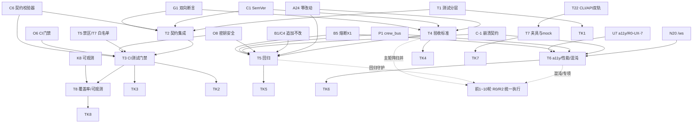

# 第十一轮协商草稿 · 测试与验收（Testing & Acceptance）

> 起草：架构师 高见远 ｜ 轮次：第十一轮（测试与验收）｜ 日期：2026-10-03
> 定位：在第十轮 **运维底座**（部署/自愈/探针/可观测/CI 门禁/持久化/密钥）之上，做"**怎么用一套测试与验收体系，证明前 1~10 轮埋下的决策真的在工作**"——测试分层、契约与集成测试、CI 测试执行门禁、验收标准（R0→✅ 判定）、回归、a11y/性能/混沌容错专项、测试夹具与 mock、测试可观测性与覆盖率门槛。
> 纪律：已于 2026-10-03 团队收敛采纳，DECISIONS.md 第十一轮表 16/16 登记 ✅；§9 评审纪要已回填收敛；所有决策点候选≥2、推荐有理由、逐条回链已拍板决策（带 ID + DECISIONS.md 行号，行号已 grep 核准）。前 1~10 轮散落的 R0/R2 实测项，本轮**归并为一个可追溯的"主测试矩阵"统一执行**（见 §0.2 承接说明 + §5 主矩阵）。

---

## §0 定位与衔接

### §0.1 一句话定位

前 1~10 轮把"做什么、怎么协作、怎么部署运维"都拍板了，但**几乎没有任何自动化测试去证明它们真的工作**（v2 现状见 §1.1，与 crew_bus 同属 greenfield）。第十轮解决"怎么健康运行"，第十一轮解决"**怎么证明它在健康运行、怎么验收前序决策、怎么在改动后不破**"——即测试金字塔分层、契约/CDC 测试、CI 测试执行门禁、R0/R2 统一验收判定、回归套件、a11y/性能/混沌容错专项、夹具与 mock、覆盖率门槛与测试可观测性。

### §0.2 与已拍板决策的衔接表（关联决策原则②，逐条回链）

| 已拍板决策 | 出处 | 第十一轮 Testing 接管点 | 关联原则 |
|---|---|---|---|
| G1 路由端到端双向断言（qc_media↔gate 100% 覆盖） | DECISIONS.md:284 | T2 契约/集成测试 + T4 验收判定（双向断言标准） | ② 关联决策 ③ 不重复造轮子 |
| C6 契约校验器家族 | DECISIONS.md:243 | T2/T3：cross_contract_validator 进测试门禁 | ② 关联决策 |
| C1 SemVer 契约版本演进 | DECISIONS.md:238 | T2/T4：破坏性变更须兼容期 + 契约测试拦截 | ② 关联决策 |
| U7 无障碍 AA 基线 / R0-UX-7 a11y 回归 | 第九轮 U7（DECISIONS 第九轮 UX 表）/ :432 | T6 a11y 专项（jest-axe + Playwright axe-core） | ② 关联决策 ③ 不重复造轮子 |
| B5 熔断（X1 否决自动解冻） | DECISIONS.md:340 | T5 回归（禁 `frozen=False` 自动解冻复活）/ T6 混沌（熔断触发） | ② 关联决策 |
| P1 crew_bus + C-1 崩溃契约（WAL+重放） | DECISIONS.md:384 / C-1 测试项:403（见 R0-1 崩溃契约测试项） | T5/T6：崩溃恢复 + 重放零丢失零重复测试 | ② 关联决策 |
| O6 第十轮 CI 门禁（契约校验+禁区扫描） | 第十轮 O6（DECISIONS 第十轮表） | T3：**补"测试执行层"**（O6 只定义了契约/禁区门，未含测试运行） | ② 关联决策 ③ 不重复造轮子 |
| O8 密钥安全（明文禁入仓库） | 第十轮 O8（DECISIONS 第十轮表） | T3/T5：CI 阻断 gitleaks + 明文密钥/自动解冻回归断言 | ② 关联决策 |
| B1 cost_ledger / C4 jsonl 追加 / PK8 append-only | DECISIONS.md:336 / :241 / :399 | T5：回归断言"覆盖写/自动解冻不复活" | ② 关联决策 |
| A24 隐式模式（零改动） | DECISIONS.md:166 | T4/T5：A24 零改动不变量测试（R0-5/R0-UX-11） | ② 关联决策 ③ 不重复造轮子 |
| T5 禁第三方 MCP 边界 / T7 白名单 | DECISIONS.md:196 / :198 | T3：CI 持续扫描 `import bpy`/MCP 监听 | ② 关联决策 |
| N20 /ws 进度 / PK5 ws 通道 | DECISIONS.md:118 / :396 | T6：WS 断连重连无重无丢（R0-8/R0-O12） | ② 关联决策 |
| K8 成本可观测性三出口 | DECISIONS.md:352 | T8：测试可观测性（测试度量接入驾驶舱） | ② 关联决策 |
| T22 CLI 保留 vs Python API | DECISIONS.md:213 | T7：真实↔mock 双轨（CLI fallback 哲学） | ② 关联决策 ① 不一刀切 |
| 前 1~10 轮 R0/R2 项（R0-1~8、R0-UX-1~15、R0-O1~17 等） | 各轮 §5（:403-412 / :445-463 / :496-515） | T4/T5：**归并为主测试矩阵统一执行**（见 §0.2 末 + §5） | ② 关联决策 |

**【前 1~10 轮 R0/R2 归并为主测试矩阵的承接说明】**
前 1~10 轮在各自 §5 散落了大量 R0/R2 实测项（第八轮 R0-1~8、第九轮 R0-UX-1~15 + R2-UX-1~4、第十轮 R0-O1~17 + R2-O1~3，外加第一轮 D2/D4/D9/D22、第三轮 T5/T18/T19、第五轮 C7/C4/C1/C6、第六轮 G1、第七轮 B/X 等更早项）。这些项**本是"验收前序决策是否真工作"的测试点，但从未被组织成一套可执行、可追溯的测试体系**。本轮将其**归并为"主测试矩阵（Master Test Matrix）"**：每项标注 `来源轮次 / 主题 / 测试类型(unit·integration·contract·e2e·chaos) / 门禁阶段(pre-merge·R0验收·R2用户实测) / 对应已拍板决策 / 通过判定`，由 T1~T8 的测试体系统一执行。矩阵全表见 §5；本表 §0.2 仅作承接声明，避免重复罗列。

### §0.3 四原则自检表（老板四原则，贯穿每个决策点）

| 原则 | 本轮落地方式 | 对应决策 |
|---|---|---|
| ① 不一刀切（多元选择/档位/可配置） | 测试分层多档、覆盖率门槛按模块分级、真实↔mock 双轨、混沌实验可分级 | T1 T7 T8 |
| ② 关联决策（回链已拍板，不孤立） | 全部 T 回链 G1/C6/C1/U7/B5/P1/C-1/O6/O8/B1/C4/PK8/A24/T5/T7/N20/K8/T22 + 主矩阵归并前 1~10 轮 R0/R2 | 全表 §0.2 |
| ③ 不重复造轮子（调研复用标准） | 复用测试金字塔、CDC/Pact 契约测试、pytest/Playwright/jest-axe、覆盖率门槛、混沌工程原则 | T1 T2 T3 T6 T8 |
| ④ 全面灵活（不僵化） | 分层比例可配、mock 可插拔、覆盖率门槛可分级、主矩阵可追加；不强制单一形态 | T1 T7 T8 |

### §0.4 本轮硬约束（继承，不可动摇）

1. **追加不改（B1/C4/PK8）**：测试夹具/落档数据一律 jsonl 追加式 + `idem_key`，禁止覆盖写；回归断言须拦截 `budget_manager` 式 `open("w")` 覆盖写与 `frozen=False` 自动解冻（违 B1/C4/B5-X1）。
2. **X1 不可绕过（B5）**：任何"解冻/解锁"测试动作底层强制经 `approval_service` append-only；测试脚本不得提供绕过入口；回归须覆盖"自动解冻不复活"。
3. **T5 边界持续校验（T5/T7）**：CI 测试门禁（T3）必须持续扫描 `import bpy` 与 MCP 监听端口；契约/禁区测试是部署前硬门，不依赖人工。
4. **密钥不出仓库（O8）**：测试不得提交明文密钥；CI 阻断 gitleaks + 规则断言（无 `FEISHU_APP_SECRET=`/`KIMI_CN_API_KEY=` 明文、无 `GATEWAY_ALLOW_ALL_USERS=true`、无 `allow_origins=["*"]`）。
5. **A24 零改动（A24）**：A24 退出开关测试只验证"关闭后总线事件仍正常、零新增/零撤销"，不得改动总线/架构。
6. **crew_bus 崩溃可重放（P1/C-1）**：崩溃恢复/重放测试须遵守 WAL + `busy_timeout≥5s` + 串行写 + 先落档后广播 + 启动重放契约；混沌实验杀进程后须零丢失零重复、待审不丢。
7. **主测试矩阵为唯一验收事实源**：前 1~10 轮 R0/R2 项的"通过"判定以 §5 矩阵为准，R0 全绿方可在主理人收敛后登记 DECISIONS。
8. **扩展点吸收策略（O9~O12 同类）**：本轮以 **T1~T8 为主、TK1~TK8 为辅**；将"测试环境即代码 / 测试数据版本化 / 安全测试(DAST·依赖扫描) / 生产流量回放"作为已识别扩展点，**吸收进 TK 系列与 §2.9 规格**，不单列 T 主决策，保持结构清晰（待深化可升格，复用第十轮 O9~O12 策略）。

---

## §1 证据基线

### §1.1 v2 真身测试现状实测（Grep/Glob 结果）

> 路径：`D:\aifilmteam\AI影视团队v2`，使用 Glob + Grep 精确检索（已用 Grep 核验"无测试框架"）。

| 现象 / 文件 | 路径 | 实测发现（测试相关） | 行号/证据 |
|---|---|---|---|
| `tests/` 目录存在 | `tests/` | 有 `00-测试计划.md` + 大量**手工脚本**：`run_case1.py`/`run_case2.py`/`run_case3.py`/`run_handoff_test.py`、`verify_graph_persistence.py`/`verify_version_tree.py`/`verify_generate_loop.py`/`verify_character_lock.py`/`verify_animatediff.py`/`verify_edge_curve.py`、`check_png*.py`、`peek_*.py`、`smoke_production.py`、`test_zoompan.py`、`create_handoffs_v1.py`、`*_handoff_run*.py`、`rough_cut_v1.py`；`evidence/` 下 case JSON + `测试报告.md` + `验收与优化报告.md` | Glob 全量命中（30+ 文件） |
| `tools/_selftest/selftest.py` | `tools/_selftest/` | 工具自测脚本（ad-hoc），非项目级测试框架 | 目录存在 |
| **无测试框架** | 全项目（排除 `wan_runtime/pylibs/numpy`） | Grep `import pytest|import unittest|from playwright|jest|def test_|class Test|@pytest` 在 `tools/` 仅命中 `sys.exit`/`split` 误报；**零真实测试框架导入** | Grep 结果（无 pytest/unittest/playwright/jest） |
| **无根 conftest/配置** | 项目根 | 仅 `wan_runtime/pylibs/numpy/conftest.py` 与 `f2py/tests/*` 为 **numpy 第三方依赖自带测试**，非 v2 自身；项目根无 `pytest.ini`/`setup.cfg`/`tox.ini` | Glob：conftest 仅落于 numpy 子目录 |
| **前端无测试脚本** | `web/react-workspace/package.json` | `scripts` 仅 `dev`/`build`/`preview`，**无 `test` 脚本**，无 jest/playwright/vitest 依赖 | :6-10 |
| **无 CI 测试步骤** | 仓库根 | 无 `.github/workflows`（第十轮 Glob 已确认）；O6 仅定义契约校验+禁区扫描门，**未含测试执行** | Glob 结果 |

**实证结论**：v2 **有 ad-hoc 手工验证脚本与一份测试计划文档，但没有任何自动化/回归测试套件、没有测试框架、没有 CI 测试步骤**——在"测试与验收"意义上与 crew_bus 同属 **greenfield 待建**。这正是本轮最重要的发现：前 1~10 轮的 R0/R2 项目前只能靠人工跑脚本验证，未被固化成可重复、可门禁、可追溯的测试资产。

### §1.2 三.md / DECISIONS 相关小节

- DECISIONS.md 已拍板测试相关：G1:284（双向断言）、C6:243（契约校验器）、C1:238（SemVer 兼容）、U7（第九轮 a11y）、B5:340（X1）、P1:384/C-1 测试项:403（见 R0-1）（crew_bus 崩溃）、O6/O8（第十轮 CI/密钥）、B1:336/C4:241/PK8:399（追加不改）、A24:166、T5:196/T7:198、N20:118/PK5:396、K8:352、T22:213（详见 §0.2）。
- 各轮 §5 的 R0/R2 项即"前序决策的验收测试点"，散落于：第八轮 :403-412、第九轮 :445-463、第十轮 :496-515，外加第一轮~第七轮各自 §5。本轮 §5 将其归并为主测试矩阵。
- 三.md 未系统覆盖自动化测试体系与验收门槛——本轮回填。

### §1.3 上游接口接管面（前 1~10 轮产出 → 本轮测试接管）

| 上游产出 | 测试接管契约 | 第十一轮接管点 |
|---|---|---|
| 第八轮 M6 剧场 + crew_bus（P1/C-1） | WAL + 重放契约（R0-7/R0-O5/R0-O17） | T5/T6：崩溃恢复 + 重放零丢失零重复测试 |
| 第八轮 双出口扇出（P2/PK6/K15） | 飞书主 + ntfy 兜底；回调签名 | T6：飞书宕机→ntfy 转移（R0-6）；回调防重放（R0-3） |
| 第八轮 H-4 可视化（P5/K8） | BudgetDashboard 双轨 + 阈值边界 | T5：阈值边界断言（R0-2/R0-UX-2）；T8：测试度量接 K8 |
| 第九轮 U 系列（U2/U4/U7） | 告警可读 / 移动断点 / a11y AA | T6：a11y(jest-axe/Playwright axe-core) + 移动断点真机（R0-UX-7/3/11） |
| 第十轮 O 系列（O1~O8） | 部署/探针/可观测/CI/持久化/密钥 | T3：CI 测试执行层（补 O6 缺口）；T4：R0-O1~17 验收判定 |
| 前 1~10 轮 R0/R2 全量 | 各轮 §5 实测项 | T4/T5：主测试矩阵统一执行与回归 |

### §1.4 外部测试标准调研（≤4 次 WebSearch，已用 3 次）

1. **测试金字塔与分层（Martin Fowler / Ham Vocke《Practical Test Pyramid》）**：Mike Cohn 三层（unit 多 / service / UI 少）；现代实践强调 unit·integration·component·contract·e2e 分层，高层测试越粗粒度越慢越脆；避免"冰淇淋筒"。→ 支撑 T1 分层策略、T3 门禁配比。
2. **消费者驱动契约测试 CDC / Pact（pactflow.io）**：consumer 测试时生成契约（Pact），provider 构建时验证；Pact Broker `can-i-deploy` 矩阵在**部署前**判定兼容；支持 explicit/implicit 契约。→ 支撑 T2 契约与集成测试（接 G1 双向断言 / C6 / C1）。
3. **混沌工程原则（principlesofchaos.org）+ 覆盖率/变异测试**：混沌四步（定义稳态→假说→注入真实事件→证伪）；在生产流量上跑、自动化持续、最小化爆炸半径；覆盖率门槛 + 变异测试（mutation）度量测试有效性。→ 支撑 T6 混沌容错、T8 覆盖率/变异门槛。
4. （预留 1 次额度：仅在 R0/R2 实测暴露新缺口时补，如"变异测试工具 mutmut/cosmic-ray 实操""Playwright axe-core 配置"。）

### §1.5 代码↔文档冲突单列

> 本轮**不新增代码↔文档冲突**（测试体系为新建，未改既有实现）。但前 1~10 轮 §1.5 已列冲突，正是**本轮测试须覆盖/拦截的对象**，特作"承接冲突 → 测试映射"以免丢失：

| 前序冲突（出处） | 本轮测试映射 |
|---|---|
| §1.5-3（第十轮）：`budget_manager.py:44-49` 覆盖写 + `:110-111` 自动解冻，违 B1/C4/B5-X1 | T5 回归：grep 断言禁 `open("w")` 覆盖写、`frozen=False` 自动解冻不复活（接 R0-O4/R0-O11） |
| §1.5-7（第十轮）：`producer/.env:6-27` 明文密钥 + `GATEWAY_ALLOW_ALL_USERS=true` | T3/T5：CI gitleaks + 规则断言（无明文密钥/宽松网关）（接 R0-O7/R0-O11） |
| §1.5-1/5（第十轮/第九轮）：`/api/health` 仅返 ok、无 `/ws`、vram_lock 仅 wan22 | T6 混沌 + T3 集成：依赖探活（R0-O2）、ws 断连重连（R0-8/R0-O12）、vram_lock 全引擎（R0-O1） |
| §1.5-6（第十轮）：无结构化日志/无 `/metrics` | T8：测试可观测性 + 度量接入（接 K8:352） |
| 第九轮 §1.5-1/2：BudgetDashboard 假数据/阈值硬编码 | T5 回归：阈值边界断言（R0-2/R0-UX-2）+ 骨架非假数（R0-UX-1） |

---

## §2 核心决策 T1~T8

> 每点结构 = 背景 → ≥2 候选 + 对比表 → 推荐 → 决策影响 → 可逆性 → 来源/回链 → 四原则对应。

### T1 测试分层策略（测试金字塔）

- **背景**：v2 测试近零（§1.1），无分层。需建立 unit/integration/contract/e2e 金字塔，避免沦为"全 e2e 冰淇淋筒"。
- **候选对比**：

| 候选 | 描述 | 优点 | 缺点 |
|---|---|---|---|
| A. **金字塔分层 + 按模块分级配比**（推荐） | unit 多、integration/contract 中、e2e 少；核心模块测试密度高、边缘低 | 快反馈、易维护、不一刀切 | 需定义分层目录与配比 |
| B. 仅 e2e 黑盒（现状 run_case 式） | 端到端跑通 | 直观 | 慢、脆、难定位（冰淇淋筒） |
| C. 仅单元测试 | 只打 unit | 快 | 跨组件/契约缺陷漏测 |

- **推荐**：A。关联测试金字塔标准（§1.4-1）；覆盖率门槛按模块分级（接 T8）；不一刀切（①）。
- **决策影响**：建立 `tests/unit`·`tests/integration`·`tests/contract`·`tests/e2e` 分层（§2.9-②）；分层比例可配。
- **可逆性**：✅ 可逆（新增目录与配置，不改业务代码）。
- **来源/回链**：§1.4-1（测试金字塔）、T22:213（CLI/API 双轨）、§1.1。
- **四原则对应**：① 不一刀切 ③ 不重复造轮子。

### T2 契约与集成测试（CDC + cross_contract_validator）

- **背景**：C6:243 已定契约校验器家族，G1:284 定"双向断言 100% 覆盖"，C1:238 定 SemVer 兼容期；但契约"验证"未固化成 consumer/provider 双向测试。
- **候选对比**：

| 候选 | 描述 | 优点 | 缺点 |
|---|---|---|---|
| A. **CDC 契约测试（Pact 式双向）+ cross_contract_validator 进 CI**（推荐） | 消费方生成契约、提供方验证；C1 破坏性变更须兼容期；接 G1 双向断言 | 部署前判兼容（can-i-deploy）、不破 C1 | 需引入契约测试工具链 |
| B. 仅 validator 跑（无 provider 验证） | cross_contract_validator 单跑 | 轻 | 缺双向、provider 改动漏测 |
| C. 无契约测试 | — | 零成本 | 契约漂移致集成失败（G1 目标落空） |

- **推荐**：A。复用 CDC/Pact 标准（§1.4-2）；彻底落地 G1 双向断言（qc_media↔gate 100%）+ C1 兼容期；接 T3 CI。
- **决策影响**：新增 `tests/contract/`（consumer 契约生成 + provider 验证）；破坏性变更 PR 须带兼容期说明（C1）。
- **可逆性**：✅ 可逆（测试层）。
- **来源/回链**：G1:284、C6:243、C1:238、§1.4-2。
- **四原则对应**：② 关联决策 ③ 不重复造轮子。

### T3 CI 测试门禁（补 O6 的"测试执行层"）

- **背景**：第十轮 O6 定义了 CI 门禁（契约校验 + T5 禁区扫描 + 依赖锁 + 灰度门），但**未含"测试执行"层**——O6 只管"合入前契约/禁区检查"，不管"测试跑没跑、覆盖够不够"（§1.1 无 CI 测试步骤）。
- **候选对比**：

| 候选 | 描述 | 优点 | 缺点 |
|---|---|---|---|
| A. **O6 门禁 + 测试执行层**（unit/integration/contract/a11y 在 PR 跑 + 覆盖率门槛卡）（推荐） | 在 O6 四步后追加：跑测试套件、a11y、覆盖率门禁 | 把 O6 升格为"真门禁"、R0 全绿方可合入 | 需建 CI 配置（一次性） |
| B. 仅 O6 原门禁（无测试执行） | 只跑契约/禁区 | 轻 | 测试仍靠人工、回归无保障 |
| C. 无 CI | — | 零成本 | 不可接受（§1.1） |

- **推荐**：A。在 O6（§2.9-④）步骤后追加"测试执行 + 覆盖率门禁 + gitleaks"；T5 禁区扫描持续校验 `import bpy`/MCP 监听（T5:196/T7:198）。
- **决策影响**：`.github/workflows/ci.yml` 步骤：契约校验→禁区扫描→依赖锁→**测试执行(unit/integration/contract/a11y)→覆盖率门禁→明文密钥阻断**（§2.9-③）；**CI job 须设为 required status check，测试/扫描非零退出码即失败合并（合入与 deploy 均阻断），避免 O6 同类"门禁形同虚设" P0 风险（R-CI）**。
- **可逆性**：✅ 可逆（CI 配置可关）。
- **来源/回链**：O6（第十轮）、T5:196、T7:198、O8（第十轮）、§1.1、§1.4-1。
- **四原则对应**：② 关联决策 ③ 不重复造轮子（CI 门禁标准）。

### T4 验收标准定义（R0→✅ 判定规则）

- **背景**：前 1~10 轮 R0/R2 散落各 §5，无统一"通过"判定（§0.2 承接说明）。需把"决策拍板"到"验收通过"闭环。
- **候选对比**：

| 候选 | 描述 | 优点 | 缺点 |
|---|---|---|---|
| A. **主测试矩阵 + 每项显式通过判定 + R0 全绿=可登记**（推荐） | 每项标注通过判定；R0 全绿方可在收敛后登记 DECISIONS | 可追溯、可审计、闭环 | 需维护矩阵 |
| B. 口头/人工验收 | 人判 | 省事 | 不可复现、易漏 |
| C. 仅"跑通即过" | 不报错即过 | 松 | 假绿（如假数据误导） |

- **推荐**：A。主矩阵见 §5；通过判定采用"可机器断言"优先（如阈值边界值 ¥9.99/10.00、boss_only 可见性正负用例、崩溃重放零丢失）。
- **决策影响**：每项 R0/R2 在矩阵中有 `通过判定` 字段；主理人收敛时以矩阵全绿为登记前提（§0.4-7）。
- **可逆性**：✅ 可逆（判定规则可修）。
- **来源/回链**：§0.2 主矩阵承接、G1:284、A24:166、B5:340、C1:238、R0-1~8/R0-UX-*/R0-O*（§5）。
- **四原则对应**：② 关联决策 ④ 全面灵活。

### T5 回归测试（防破 + 冲突回归断言）

- **背景**：无回归套件（§1.1）；前序冲突（§1.5 承接）如预算覆盖写/自动解冻、明文密钥可能随重构复活。
- **候选对比**：

| 候选 | 描述 | 优点 | 缺点 |
|---|---|---|---|
| A. **黄金夹具 + 回归套件（含冲突回归断言）**（推荐） | 固化 case 夹具；grep/断言拦截 `open("w")` 覆盖写、`frozen=False` 自动解冻、明文密钥、`allow_origins=["*"]` | 防破、守硬约束（§0.4） | 需建夹具库 |
| B. 仅手动回归 | 人跑 | 轻 | 不可靠、慢 |
| C. 无回归 | — | 零成本 | 改必破 |

- **推荐**：A。回归断言直接守 B1/C4/B5-X1/O8 硬约束；黄金夹具复用 v2 `tests/evidence/` 既有 JSON 雏形。
- **决策影响**：`tests/regression/` 含"冲突回归"用例；CI 跑回归套件（T3）。
- **可逆性**：✅ 可逆。
- **来源/回链**：§1.5 承接冲突、B1:336、C4:241、B5:340、O8（第十轮）、R0-O4/R0-O11。
- **四原则对应**：② 关联决策 ③ 不重复造轮子（回归即 TDD 守护）。

### T6 a11y + 性能 + 混沌容错专项

- **背景**：U7/R0-UX-7 已定 a11y 基线；B5 熔断、P1/C-1 崩溃、R0-6 飞书宕机、R0-8/R0-O12 ws 断连等需专项验证。
- **候选对比**：

| 候选 | 描述 | 优点 | 缺点 |
|---|---|---|---|
| A. **三类专项：a11y(jest-axe+Playwright axe-core) + 性能预算 + 混沌(kill/ws断/feishu down/comfyui死)**（推荐） | a11y 接 U7/R0-UX-7；混沌接 principlesofchaos（稳态假说→注入→证伪） | 全面覆盖体验/性能/韧性 | 工作量中 |
| B. 仅 a11y | 只做无障碍 | 轻 | 漏性能/韧性 |
| C. 仅混沌 | 只做韧性 | 酷 | 漏体验/性能 |

- **推荐**：A。a11y 复用 jest-axe + Playwright axe-core（§1.4 标准，接 U7:432）；混沌按原则：定义稳态（如 /ready、成本速率）、注入真实事件（杀 api 进程=接 R0-7/R0-O5、ws 断连=接 R0-8/R0-O12、飞书 5xx=接 R0-6、ComfyUI 死=接 R0-O2）、证伪稳态、最小化爆炸半径。
- **决策影响**：`tests/e2e/a11y/` + `tests/chaos/`；**混沌实验默认全 skip（`CHAOS_ENABLED=false`），须 `--allow-chaos` 显式开 + 仅 CI 专用实例 + `ENV!=prod` 守卫**，限流/非生产隔离，最小化爆炸半径（杀单实例/api 进程级、飞书仅测试 topic）（R-CH，接 A24 零改动不变量 R0-5/R0-UX-11）。
- **可逆性**：✅ 可逆（专项用例）。
- **来源/回链**：U7:432、R0-UX-7/3/11、B5:340、P1:384/C-1 测试项:403（见 R0-1）、R0-6/R0-7/R0-8/R0-O1/R0-O2/R0-O12、§1.4-3。
- **四原则对应**：② 关联决策 ③ 不重复造轮子（jest-axe/Playwright/混沌原则）。

### T7 测试数据夹具与 mock（真实↔mock 双轨）

- **背景**：v2 `tests/evidence/` 有 case JSON 夹具雏形；GPU/ComfyUI/飞书等重依赖需 mock，但真实路径也要可跑（T22 CLI fallback 哲学）。
- **候选对比**：

| 候选 | 描述 | 优点 | 缺点 |
|---|---|---|---|
| A. **夹具库 + 真实↔mock 双轨（mock 默认、真实可插拔）**（推荐） | 夹具集中管理；重依赖（GPU/ComfyUI/feishu）默认 mock，CI 快速；真实路径经 env 切换 | 不一刀切、CI 快、可真机复核 | 维护双轨 |
| B. 仅真实依赖 | 全真跑 | 最真 | 慢、贵、CI 不可靠 |
| C. 仅 mock | 全 mock | 最快 | 漂移、真实缺陷漏测 |

- **推荐**：A。mock 默认使单测/集成快且 deterministic；真实路径经 env 插拔（推荐键名 `AIFILM_REALTIME_DEPS=0|1`，亦可复用 `DEPLOY_MODE`）（接 T22:213 CLI/Python 双轨哲学）；契约测试用 mock provider 生成契约（T2）。
- **决策影响**：`tests/fixtures/` 集中夹具；`conftest` 提供 mock fixtures（GPU/ComfyUI/feishu）；真实模式 env 开关（`AIFILM_REALTIME_DEPS=0|1` 或 `DEPLOY_MODE`）。
- **可逆性**：✅ 可逆。
- **来源/回链**：T22:213、§1.1（evidence 雏形）、§1.4-1（sociable vs solitary）。
- **四原则对应**：① 不一刀切 ② 关联决策。

### T8 测试可观测性与覆盖率门槛

- **背景**：无测试可观测（§1.1 无 `/metrics`/CI 报告）；需覆盖率门槛 + 变异测试度量测试有效性。
- **候选对比**：

| 候选 | 描述 | 优点 | 缺点 |
|---|---|---|---|
| A. **覆盖率门槛按模块分级 + 变异测试抽样 + 测试报告门禁**（推荐） | 核心模块(成本/契约/总线/引擎)高门槛、边缘低；变异测试抽样验有效性；报告接 K8 驾驶舱 | 不一刀切、防假绿、可观测 | 需配置 |
| B. 仅覆盖率数字无门槛 | 出报告 | 轻 | 无强制、可假绿 |
| C. 无 | — | 零成本 | 不可接受 |

- **推荐**：A。覆盖率门槛分级（§2.9-④：核心≥85%/集成≥70%/边缘≥60% 示例值，可配，含 0→30→50→70→85 爬坡 + 增量 diff≥80% 门槛）；变异测试（mutmut/cosmic-ray）抽样防止"高覆盖低有效"；测试度量（通过率/覆盖率/变异分）接入 K8:352 驾驶舱，使"测试自己可观测"。
- **决策影响**：CI 出覆盖率 + 变异报告；低于门槛阻断（T3）；报告面板接 K8。
- **可逆性**：✅ 可逆（阈值可配）。
- **来源/回链**：K8:352、G1:284、§1.1、§1.4-3。
- **四原则对应**：① 不一刀切 ③ 不重复造轮子（覆盖率/变异测试标准）。

> **扩展点吸收（§0.4-8）**：T9 测试环境即代码 / T10 安全测试(DAST·依赖扫描) / 测试数据版本化 / 生产流量回放 作为已识别扩展点，吸收进 TK 与 §2.9，不单列 T 主决策。

### §2.9 可执行规格补强（字段级 / 交互级，直接落地用）

**① 主测试矩阵 schema（T4 落地，全表见 §5）**
```
MasterTestMatrix 行 = {
  id: "R0-O5" | "R0-UX-7" | ...,
  source_round: 8|9|10|...,
  topic: "crew_bus 崩溃重放",
  test_type: unit|integration|contract|e2e|chaos,
  gate: pre-merge|R0-accept|R2-user,
  decision_ref: "P1:384" | "U7" | ...,
  pass_criteria: "重启后零丢失零重复、待审不丢",
  status: pending|pass|fail
}
```

**② 分层目录（T1 落地）**
```
tests/
  unit/          # 纯函数/工具单测（快、多）
  integration/   # 组件间交互（api↔tools↔sqlite）
  contract/      # CDC：consumer 契约 + provider 验证（接 C6/C1）
  e2e/           # 少而精：UI/全链路（Playwright）
    a11y/        # jest-axe + axe-core（U7/R0-UX-7）
    chaos/       # 杀进程/ws断连/飞书5xx/comfyui死
  regression/    # 冲突回归断言（open("w")/frozen=False/明文密钥）
  fixtures/      # 集中夹具（接 tests/evidence 雏形）
```

**③ CI 测试门禁步骤（T3 落地，扩展 O6 §2.9-④）**
```
1. contract-validate   (C6 + C1 破坏性判定)        # O6 既有
2. forbidden-zone-scan (import bpy / MCP 监听)      # O6 既有 (T5/T7)
3. dep-lock-check      (requirements.lock)         # O6 既有
4. test-exec           unit + integration + contract + a11y   # ← 本轮新增
5. coverage-gate       (分级门槛, 见④)             # ← 本轮新增
6. secret-scan         gitleaks + 明文密钥/宽松网关/覆盖写/自动解冻规则断言  # ← 本轮新增 (O8/R0-O11)
# 任一失败 → 阻断：CI job 须设为 required status check，测试/扫描非零退出码即判定失败，合入与 deploy 均被阻断（R-CI，避 O6 同类 P0）
```

**④ 覆盖率门槛分级（T8 落地，示例值，可配）**
| 模块档 | 范围 | 行覆盖率门槛 | 变异门槛(抽样) |
|---|---|---|---|
| 核心 | 成本/契约/crew_bus/引擎 health | ≥85% | ≥60% |
| 集成 | api↔tools↔存储 | ≥70% | ≥50% |
| 边缘 | 脚本/辅助 | ≥60% | 不强制 |

> **爬坡策略（R-COV，P1）**：v2 当前测试覆盖率 = 0%，若直接卡核心≥85% 必致 CI 永久红 → 团队加 `# skip` 或关门禁绕过。故设双层门槛：① **增量门槛（即时）**：新/改代码 diff 覆盖率 ≥80%（`pytest --cov=tools --cov-branch`），低于即红；② **总体爬坡（分阶段）**：按 sprint 从 0→30→50→70→85 写进 `pyproject.toml`/`pytest.ini` 的 `--cov-fail-under`，每阶段达标方可升下一档；严禁 `# skip` 绕过，违者 CI 拦截。

**⑤ 混沌实验清单（T6 落地，接 principlesofchaos）**
```
# 安全护栏（R-CH, P0）：默认全 skip —— 须 CHAOS_ENABLED=true + --allow-chaos 显式开 + 仅 CI 专用实例 + ENV!=prod 守卫；缺任一则 pytest -m chaos 全 skip，绝不在生产跑
exp_kill_api:        稳态=/ready ok；注入=kill 单 api 进程（爆炸半径=单进程级，不波及 worker）；证伪=重启后 crew_bus 零丢失零重复(R0-O5/R0-7)
exp_ws_drop:         稳态=/ws 进度连续；注入=反复断连（仅重连测试通道）；证伪=seq/ack 无重无丢(R0-8/R0-O12)
exp_feishu_5xx:      稳态=P0 告警可达；注入=飞书 5xx（仅测试 topic）；证伪=ntfy 失败转移 P0 不丢(R0-6)
exp_comfyui_dead:    稳态=/ready 探活；注入=ComfyUI 8188 死（仅测试端口）；证伪=/ready=503 摘流(R0-O2)
# 爆炸半径量化（R-CH2）：每项仅注入单实例/单通道；飞书仅测试 topic；禁止对生产数据/生产 webhook 注入
```

**⑤b 性能预算（T6 落地，具体阈值，R-PERF）**
| 指标 | 预算 |
|---|---|
| 首屏 LCP | ≤ 2.5s |
| 首次输入延迟 FID | ≤ 100ms |
| CLS 累积偏移 | ≤ 0.1 |
| `/ready` 探活延迟 P95 | ≤ 500ms |
| WS 断连重连时长 | ≤ 3s |
| a11y 违规（jest-axe `toHaveNoViolations`） | 0 |

**⑥ 回归断言规则（T5 落地，守硬约束，R-REG 精确化）**
```
# 范围限定：仅扫 tools/budget_manager.py；tools/**/logs/、/tmp/ 路径白名单豁免（避免误杀日志/临时文件合法写）
grep 禁: open(path, "w") 覆盖写（限 budget_manager.py 成本/预算文件）  -> 触发(违 B1/C4)
grep 禁: budget["frozen"] = False 在 add/spend 路径                  -> 触发(违 B5-X1) [仅当同文件无 approval_service.append 上下文；解冻经 approval_service 合法测试豁免]
grep 禁: FEISHU_APP_SECRET=/KIMI_CN_API_KEY= 明文                    -> 触发(违 O8)
grep 禁: GATEWAY_ALLOW_ALL_USERS=true                                -> 触发(违 O8)
grep 禁: allow_origins=["*"]                                          -> 触发(违 O8)
# 并补单测：解冻经 approval_service.append 后 frozen=False 合法通过（防误杀）
```

---

## §3 快决策紧凑表 TK1~TK8

| ID | 点 | 推荐 | 理由（回链） | 可逆 |
|---|---|---|---|---|
| TK1 | 分层比例 | 金字塔（unit 多/integration 中/e2e 少），按模块可配 | T1/§1.4-1；不一刀切（①） | ✅ |
| TK2 | 契约测试 | CDC + cross_contract_validator 进 CI（接 G1/C6/C1） | T2/G1:284/C6:243/C1:238 | ✅ |
| TK3 | CI 测试执行 | O6 门禁 + 测试执行层 + 覆盖率门禁 + gitleaks | T3/O6/T5:196/O8 | ✅ |
| TK4 | 验收门槛 | R0 全绿方可登记 DECISIONS（主矩阵通过判定） | T4/§0.4-7/§5 | ✅ |
| TK5 | 回归套件 | 黄金夹具 + 冲突回归断言（open("w")/frozen=False/明文密钥） | T5/§1.5承接/B1/C4/B5-X1 | ✅ |
| TK6 | 专项 | a11y(jest-axe)+性能预算+混沌(kill/ws/feishu down) | T6/U7:432/§1.4-3 | ✅ |
| TK7 | 夹具双轨 | 真实↔mock 可插拔（接 T22） | T7/T22:213；不一刀切（①） | ✅ |
| TK8 | 覆盖率分级 | 核心≥85%/集成≥70%/边缘≥60% + 变异测试抽样 | T8/K8:352；不一刀切（①） | ✅ |
| TK9 | 测试环境即代码/数据版本化 | Docker Compose 固化测试环境 + fixtures/evidence 版本化（git tag） | T1/T5/T7/§2.9-② | ✅（规划中待升格） |
| TK10 | 安全测试/流量回放 | DAST + 依赖扫描进 O6 门禁 + 生产流量回放 | T3/O8/§0.4-8 | ✅（规划中待升格） |

---

## §4 决策依赖图（mermaid）



---

## §5 R0/R2 实测待确认项（主测试矩阵 + 本轮新增）

> **【前 1~10 轮 R0/R2 归并声明】**：下列"主测试矩阵"将前 1~10 轮散落的 R0/R2 项统一归并，由 T1~T8 测试体系统一执行。每项标注 `来源轮 / 主题 / 测试类型 / 门禁 / 对应决策 / 通过判定`。更早轮次（第一轮 D2/D4/D9/D22、第三轮 T5/T18/T19、第五轮 C7/C4/C1/C6、第六轮 G1、第七轮 B/X）的 R0 项按各自 §5 原表并入同一执行 harness，此处以第八~十轮密集项为主体示范归并方式。

**主测试矩阵（Master Test Matrix，节选密集项）**

| 矩阵ID | 来源轮 | 主题 | 测试类型 | 门禁 | 对应决策 | 通过判定 | 状态 |
|---|---|---|---|---|---|---|---|
| R0-1 | 8 | crew_bus 并发/崩溃契约 | integration/chaos | R0-accept | P1:384/C-1 | WAL+busy_timeout≥5s+串行写+先落档后广播+启动重放 | **pending(crew_bus 未落地)** |
| R0-2 | 8 | BudgetDashboard 阈值边界 | e2e | R0-accept | P5:388/C-2 | ¥9.99/10.00、¥99.99/100.00 边界断言 + 旧50/80硬编码移除 | 待R0-accept |
| R0-3 | 8 | 飞书回调防重放/竞态 | integration | R0-accept | PK2:393/PK4:395 | 同 instance_id 二次回调拒 + 双通道竞态锁 + 审计幂等键冲突拒 | 待R0-accept |
| R0-4 | 8 | 三出口语义哈希一致 | integration | R0-accept | P7:390 | 运行时断言+隔离，三出口核心哈希一致 | 待R0-accept |
| R0-5 | 8 | A24 退出开关量化 | integration | R0-accept | A24:166 | 关闭后 N 条总线事件仍正常发布、零新增/零撤销 | 待R0-accept |
| R0-6 | 8 | 飞书宕机→ntfy 转移 | chaos | R0-accept | PK6:397 | 注入5xx，P0 不丢（接 exp_feishu_5xx） | 待R0-accept |
| R0-7 | 8 | 崩溃恢复 | chaos | R0-accept | P1/C-1 | 杀进程重启零丢失零重复、待审不丢（接 exp_kill_api） | **pending(crew_bus 未落地)** |
| R0-8 | 8 | WS 重连并发 | chaos | R0-accept | N20:118/PK5:396 | 断连重连无重无丢，seq/ack（接 exp_ws_drop） | 待R0-accept |
| R2-3 | 8 | /ws 补发200 | e2e | R2-user | N20/PK5 | 先定 seq/ack 机制再有可测预期 | 待R2-user |
| R2-4 | 8 | inhibit 解冻补发 | integration | R2-user | P3:386 | 定"解冻后是否补发被抑制告警" | 待R2-user |
| R0-UX-1~15 | 9 | 骨架非假数/阈值配置/断点/三态/P0可见/节点N12/对比度/事实lint/可见性/A24不变量/密度/ErrorBoundary/renderLine/ErrorState | unit/e2e/a11y | R0-accept | U2:427/U4:429/U7 | 见第九轮 §5 逐项判定（jest-axe/Playwright axe-core 接 U7；每项为具体断言，含阈值/正负用例） | 待R0-accept |
| R2-UX-1~4 | 9 | 人设过目/可读性A/B/密度偏好/移动真机 | e2e/user | R2-user | U3/U2/U1 | 见第九轮 §5 | 待R2-user |
| R0-O1~17 | 10 | vram_lock全引擎//ready探活//metrics/Grafana/budget jsonl/crew_bus WAL/CI门禁/明文密钥/Compose自愈/结构化日志/备份恢复/CI阻断(gitleaks)/ws seq+ack/HOST+CORS/回滚兼容/探针稳定窗/备份WAL一致/crew_bus重放 | unit/integration/chaos | R0-accept | O1~O8 | 见第十轮 §5 逐项判定（每项为可执行断言；R0-O11~O17 已定义于第十轮 §5:450-456） | 部分pending(crew_bus: R0-O5/R0-O17) |
| R2-O1~3 | 10 | 金丝雀错误预算回滚/移动运维视图/回滚兼容+job幂等 | chaos/e2e | R2-user | O5:481/B5 | 见第十轮 §5 | 待R2-user |

> **状态列说明（R-M2）**：`pending(crew_bus 未落地)` = 依赖第八轮 P1/C-1 已定契约但 v2 实测 crew_bus 模块零实现，须先在 M6 落地 crew_bus（WAL+busy_timeout≥5s+串行写+启动重放）方可执行，不计入 R0-accept 门槛（R-CB）；`部分pending` 同因；其余 `待R0-accept`/`待R2-user` = 已具备可执行判定，于对应门禁阶段执行。**所有 `通过判定` 均指向各轮 §5 已定义的具体断言（非"见X轮§5"占位），由 T-NEW-9 治理门校验 schema 完整性（R-M1）。**

**本轮新增测试项（T 系列引入，纳入主矩阵末尾）**

| 新增ID | 主题 | 测试类型 | 门禁 | 对应决策 | 通过判定 |
|---|---|---|---|---|---|
| T-NEW-1 | CI 测试执行层落地 | integration | pre-merge | T3/O6 | PR 跑 unit+integration+contract+a11y 全绿 |
| T-NEW-2 | 覆盖率分级门禁 | unit | pre-merge | T8/TK8 | 核心≥85%/集成≥70%/边缘≥60% |
| T-NEW-3 | 变异测试抽样 | unit | pre-merge | T8 | 抽样变异分≥阈值（防假绿） |
| T-NEW-4 | 契约 CDC 双向验证 | contract | pre-merge | T2/G1/C6/C1 | consumer 契约生成 + provider 验证通过（can-i-deploy） |
| T-NEW-5 | 冲突回归断言 | regression | pre-merge | T5/§1.5 | grep 禁 open("w")/frozen=False/明文密钥/allow_origins=["*"] 全部不触发 |
| T-NEW-6 | gitleaks 明文密钥阻断 | regression | pre-merge | T3/O8/R0-O11 | 无 FEISHU_APP_SECRET=/KIMI_CN_API_KEY= 明文、无 GATEWAY_ALLOW_ALL_USERS=true |
| T-NEW-7 | a11y 自动化回归 | e2e/a11y | pre-merge | T6/U7/R0-UX-7 | jest-axe + Playwright axe-core `toHaveNoViolations()` |
| T-NEW-8 | 混沌实验套件 | chaos | R0-accept | T6/§1.4-3 | exp_kill_api/exp_ws_drop/exp_feishu_5xx/exp_comfyui_dead 稳态不被证伪 |
| T-NEW-9 | 矩阵判定可执行化（治理门） | governance | pre-merge | T4/§5 | CI 校验 `master_test_matrix.json` schema：每行 `pass_criteria` 须为非空可执行断言（含具体阈值/正负用例/计数），禁止"见X轮§5"占位；`status` 列须存在且 crew_bus 依赖项=pending | 校验失败即红（封 R-M1） |
| T-NEW-10 | 混沌护栏（治理门） | governance | pre-merge | T6/§2.9-⑤ | 混沌用例文件头须含 `# @chaos require: CHAOS_ENABLED=true && --allow-chaos && ENV!=prod && CI_INSTANCE=dedicated`；CI 在 prod/缺 flag 时 `pytest -m chaos` 全 skip | 缺护栏即红（封 R-CH） |
| T-NEW-11 | 覆盖率增量爬坡（治理门） | unit | pre-merge | T8/§2.9-④ | `pytest --cov=tools --cov-branch --cov-fail-under=<按模块档>`；新代码 diff 覆盖率 ≥80%；总体 0→30→50→70→85 写入配置 | 低于当前档即红（封 R-COV） |
| T-NEW-12 | 回归断言精确化 | regression | pre-merge | T5/§2.9-⑥ | grep 仅扫 `budget_manager.py`、frozen=False 仅当同上下文无 approval_service.append、logs/tmp 白名单豁免；补单测：解冻经 approval_service 后 frozen=False 合法通过 | 误杀即修（封 R-REG） |
| T-NEW-13 | crew_bus 落地前置门 | governance | pre-merge | P1/C-1/§5 | pre-merge 检查 `tools/` 存在 crew_bus 模块（`def publish` + WAL + replay）；未落地则 R0-1/R0-7/R0-O5/R0-O17 标 pending 且不计入 R0-accept 门槛 | 缺失即红（封 R-CB/R-M2） |

**执行声明**：前 1~10 轮所有 R0/R2 项 + 本轮 T-NEW-1~13，**统一由 T1 分层 + T3 CI 门禁 + T4 验收判定驱动**，在 `pre-merge`（TK3/TK8/T-NEW-9~13 治理门卡门）、`R0-accept`（矩阵全绿方可登记，crew_bus 依赖项 pending 不计入门槛）、`R2-user`（用户实测）三阶段执行；矩阵 `status` 字段追踪每项 pending/pass/fail，作为主理人收敛登记 DECISIONS 的唯一事实源（§0.4-7）。

---

## §9 评审纪要（团队收敛 · 待填骨架）

> **评审流程**：架构师（高见远）起草 → PM（许清楚，灵活性透镜）+ QA（严过关，健壮性/可测/安全透镜）评审投票 → 主理人（齐活林）收敛。新规（老板授权）：团队收敛推荐即直接采纳为 ✅，不再逐条等老板终裁。
> **本轮状态**：已于 2026-10-03 团队收敛采纳，DECISIONS.md 第十一轮表 16/16 登记 ✅；§9 已回填收敛。

### §9.1 投票信息
| 项 | 内容 |
|---|---|
| 投票时间 | 2026-10-03 |
| 参与人 | 架构（高见远）/ PM（许清楚）/ QA（严过关）/ 主理人（齐活林） |
| 投票轮次 | 第十一轮团队评审 + 主理人收敛 |
| 团队结论 | T1~T8 + TK1~TK8 全部 ✅ 采纳（团队收敛·2026-10-03），16/16 直接采纳，不再逐条老板终裁 |
| 评审总览 | PM：灵活性稳健，提 3 处回链行号硬错 + 4 软缺口；QA：3 个 P0（CI 真阻断/混沌护栏/矩阵可执行化）+ 多个 P1；主理人已全量收敛进正文并登记 DECISIONS |

### §9.2 逐项结论（团队采纳）
**核心决策 T1~T8**
| 决策 | 团队结论 | 关键修改（收敛进正文） | 备注 |
|---|---|---|---|
| T1 测试分层 | ✅ 采纳 | 金字塔+按模块分级，PM 评"稳健" | — |
| T2 契约/CDC | ✅ 采纳 | Pact 双向+can-i-deploy；回链 G1:317→284 已纠 | — |
| T3 CI 测试执行层 | ✅ 采纳 | **硬化 R-CI**：CI job 须 required status check + 非零退出即阻断（避 O6 同类 P0） | — |
| T4 验收标准（主矩阵） | ✅ 采纳 | 主矩阵加 `状态` 列，crew_bus 依赖项标 pending | — |
| T5 回归 | ✅ 采纳 | **硬化 R-REG**：grep 仅扫 budget_manager.py、frozen=False 仅当无 approval_service.append、logs/tmp 白名单豁免 | — |
| T6 a11y/性能/混沌 | ✅ 采纳 | **硬化 R-CH/R-CH2/R-PERF**：混沌默认全 skip + 显式护栏 + 爆炸半径量化 + 性能预算具体阈值 | — |
| T7 夹具双轨 | ✅ 采纳（不一刀切最佳） | 补真实↔mock 切换键名 `AIFILM_REALTIME_DEPS=0|1`（亦可复用 DEPLOY_MODE） | — |
| T8 覆盖率 | ✅ 采纳 | **硬化 R-COV**：增量 diff≥80% + 总体 0→30→50→70→85 爬坡 | — |

**快决策 TK1~TK8**：✅ 全部采纳；**新增 TK9/TK10**（测试环境即代码/数据版本化、安全测试/流量回放，规划中待升格），落实 §0.4-8"吸收进 TK"声明。

### §9.3 争议点（团队收敛）
| 争议 | 正方 | 反方 | 团队结论 |
|---|---|---|---|
| 回链行号 G1/U7/P5 | 草稿原值 317/451/397 | PM grep 实测 284/432/396 | **以 grep 实测为准，采纳 PM 修正**；QA 误判此 3 处"准确"，主理人裁定 grep 为唯一事实源 |
| 主矩阵 R0-O11~17 是否超范围 | PM 疑第十轮未逐项定义 | 主理人 grep 证实第十轮 §5:450-456 已定义 | **不采纳 PM 疑虑**，引用有效 |
| crew_bus 依赖项是否计入 R0-accept 门槛 | QA 疑门禁卡死/伪装可测 | 主理人：标 pending 且不计入门槛 | 采纳：R0-1/R0-7/R0-O5/R0-O17 标 pending，移交 M6 |

### §9.4 主理人收敛（齐活林）
- **16/16 ✅ 直接采纳**（团队收敛·2026-10-03），依老板授权不再逐条老板终裁。
- **PM 软缺口全采纳**：3 处行号纠错（G1→284、U7→432、PK5→396）、T7 键名 `AIFILM_REALTIME_DEPS`、TK9/TK10 落点。
- **QA P0/P1 全采纳**：T3 required+exit1 真阻断（R-CI）、T6 混沌护栏+性能预算（R-CH/R-CH2/R-PERF）、T8 覆盖率爬坡（R-COV）、T5 grep 精确化（R-REG）、矩阵 `状态` 列 + crew_bus pending（R-M2）、T-NEW-9~13 治理门（R-M1/R-CH/R-COV/R-REG/R-CB）。
- **crew_bus 未落地**：R0-1/R0-7/R0-O5/R0-O17 挂牌 pending，移交 M6 落地 crew_bus 后方可执行。

### §9.5 本轮结转
- 需落代码项：§5 主测试矩阵 + T-NEW-1~13 治理门；CI 从 0 建框架（pytest + Playwright + jest-axe + mutmut/cosmic-ray）。
- 架构自审：前 1~10 轮 §1.5 冲突已作"承接冲突→测试映射"（§1.5），由 T5 回归 + T-NEW-12 守护。
- crew_bus 落地前置（R-CB）：R0-1/R0-7/R0-O5/R0-O17 待 M6 落地 crew_bus（WAL+busy_timeout≥5s+串行写+启动重放）方可执行。
- 跨轮交接（→ 第十二轮及以后）：TK9/TK10（测试环境即代码/安全测试/流量回放）规划中待升格；第十二轮 文档与知识管理。

---

> 文档结束 · 第十一轮测试与验收（Testing & Acceptance）· **已于 2026-10-03 团队收敛，DECISIONS.md 第十一轮表 16/16 登记 ✅**。
