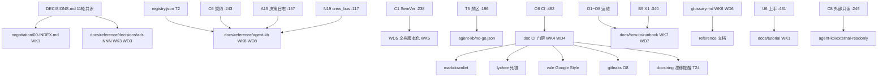
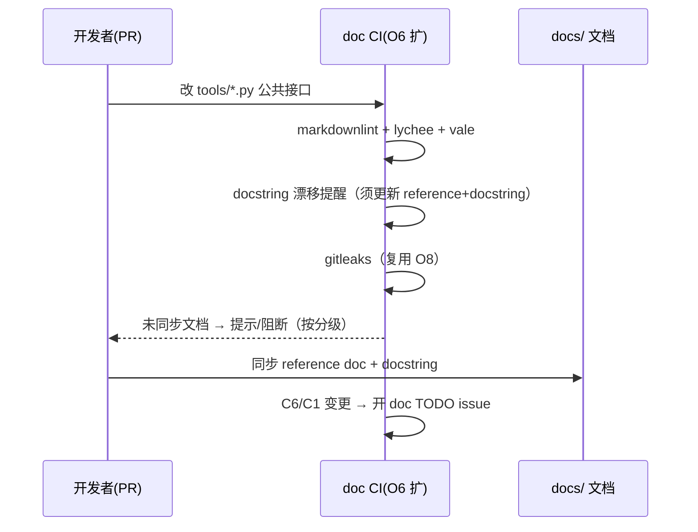

# 第十二轮协商草稿 · 文档与知识管理（Docs & Knowledge Management）

> 起草：架构师 高见远 ｜ 轮次：第十二轮（文档与知识管理）｜ 日期：2026-10-03
> 定位：在前 11 轮把"做什么、怎么协作、怎么部署运维、怎么测试验收"都拍板之后，做"**怎么让这套庞大决策与代码被人类操作员与 AI Agent 都能正确消费、且不随代码漂移而失忆**"——文档四象限（Diátaxis）、目录/命名/风格规范、ADR 架构决策记录机制、代码↔文档同步硬机制（docs-as-code CI 门禁）、文档版本化（对齐 C1 SemVer）、术语表单一事实源、运维 runbook/playbook、AI Agent 可读知识库。
> 纪律：团队收敛采纳，DECISIONS.md 第十二轮表 16/16 登记 ✅；§9 评审纪要已回填收敛；所有决策点候选≥2、推荐有理由、逐条回链已拍板决策（带 ID + DECISIONS.md 行号，行号已 Grep 核准）。前 08/09/10 轮 §1.5 九项"代码↔文档 drift"本轮**承接为硬同步机制**（见 §0.2 承接说明 + WD4 + §5）。

---

## §0 定位与衔接

### §0.1 一句话定位

前 11 轮产出了 DECISIONS.md（11 轮协商共识）+ 11 份协商草稿 + v2 真身一堆散落文档（`docs/_legacy_source/` 11+ 份方案/规划、`agents/_legacy_roles/` 岗位卡、tests 报告），但**没有任何统一的信息架构、没有 ADR 机制、没有 docs-as-code CI、没有术语表、没有可检索索引**——且 `negotiation/` 已有 20+ 份 .md 却无 INDEX，"写了找不到"（见 §1.1 实测）。第十二轮解决"**怎么把这些决策与代码变成 human/AI 都可消费、不漂移、可追溯的知识资产**"——四象限分类、ADR 记录、同步硬门禁、版本化、术语表、runbook、agent 知识库。

### §0.2 与已拍板决策的衔接表（关联决策原则②，逐条回链）

| 已拍板决策 | 出处 | 第十二轮 Docs 接管点 | 关联原则 |
|---|---|---|---|
| C1 SemVer 契约版本演进 | DECISIONS.md:238 | WD5 文档版本化（契约文档随 `$id` MAJOR，破坏性变更留兼容期） | ② 关联决策 |
| C6 契约校验器家族 | DECISIONS.md:243 | WD2/WD8 契约参考文档 + agent-kb 含契约 schema | ② 关联决策 |
| C8 权限矩阵（外部协作方只读分级） | DECISIONS.md:245 | WD8/WK8 agent-kb + 外部协作方只读视图分级（接第五轮外部协作方） | ② 关联决策 ① 不一刀切 |
| A15 岗位决策日志（SQLite） | DECISIONS.md:157 | WD3/WD8 ADR 机器可读 + agent-kb 数据源（决策落库即 KB 燃料） | ② 关联决策 |
| A24 隐式模式（零改动） | DECISIONS.md:166 | §0.4 硬约束：文档不要求改架构 | ② 关联决策 |
| T2 工具注册表与版本化 | DECISIONS.md:193 | WD8 agent-kb 含 `registry.json` 快照 | ② 关联决策 |
| T5 禁第三方 MCP 边界 | DECISIONS.md:196 | WD8 agent-kb 禁区列表 + CI 校验 agent 不越界 | ② 关联决策 |
| T7 工具白名单 | DECISIONS.md:198 | WD8 禁区/白名单文档化 | ② 关联决策 |
| T24 注册表 + CI 防漂移 | DECISIONS.md:215 | WD4 doc CI 门禁（同 A1/N5 先例，防文档漂移） | ② 关联决策 ③ 不重复造轮子 |
| N19 剧场联动 crew_bus / N20 /ws 进度 | DECISIONS.md:117 / :118 | WD8 知识广播（决策/事件进 crew_bus→KB 增量刷新，PR/定时为主、近实时；关键以 DECISIONS 为准） | ② 关联决策 |
| M6 里程碑提及（非决策表行，剧场广播） | DECISIONS.md:379（第八轮四争议收敛提 M6） | WD7 runbook 时机 + WD3 ADR 落点 | ② 关联决策 |
| M17 里程碑提及（非决策表行，WS 进度） | DECISIONS.md:94（第二轮证据基线提 M17/M18）+ :118（N20 接 M17） | WD8 知识广播时机 | ② 关联决策 |
| M18 里程碑提及（非决策表行，开工前清单） | DECISIONS.md:90（第二轮 R0 转入 M18 开工前清单） | WD1/WD7 落地时机 | ② 关联决策 |
| P1 crew_bus + C-1 崩溃契约 | DECISIONS.md:384 / :403 | WD3 ADR 机器可读格式（便于重放/检索，接 P1/C-1 WAL+重放） | ② 关联决策 |
| B5 熔断（X1 否决自动解冻） | DECISIONS.md:340 | WD7 runbook（解锁必须走 approval_service，文档不得提供绕过入口） | ② 关联决策 |
| B1/C4/PK8 追加不改 | DECISIONS.md:336 / :241 / :399 | §0.4 硬约束：ADR 仅 supersede 不删、glossary 追加不改 | ② 关联决策 |
| K8 成本可观测性三出口 | DECISIONS.md:352 | WD7 runbook + WD2 驾驶舱文档 | ② 关联决策 |
| O6 CI 门禁 | DECISIONS.md:482 | WD4 doc CI 门禁（扩 doc-lint/link-check/docstring 提醒） | ② 关联决策 ③ 不重复造轮子 |
| O8 密钥安全 | DECISIONS.md:484 | WD4/WD2 文档不含明文密钥 + 复用 gitleaks | ② 关联决策 |
| O3 健康探针 / O7 备份持久化 | DECISIONS.md:479 / :483 | WD7 runbook（探针判活/备份恢复手册） | ② 关联决策 |
| U6 上手引导 / U7 无障碍 | DECISIONS.md:431 / :432 | WD1 tutorial（人类操作员 5 分钟跑通 C3）+ WD2 文档风格 | ② 关联决策 |
| A11 分批上岗节奏 | DECISIONS.md:153 | WD2 文档所有权（按岗位 A 系列挂 owner） | ② 关联决策 |
| D9 渲染遍数（第 6 行注释待修 = R0 登记项） | DECISIONS.md:26 | WD4 代码↔文档 drift 硬机制（D9 是鲜活反例） | ② 关联决策 |
| G1 路由端到端双向断言 | DECISIONS.md:284 | WD2/WD8 契约参考文档 | ② 关联决策 |
| 前 08/09/10 轮 §1.5 九项 drift | 各轮 §1.5（08-collaboration/09-ux/10-ops） | WD4 硬同步机制承接（见 §0.2 末 + §5） | ② 关联决策 |

**【前 08/09/10 轮 §1.5 九项 drift 承接说明】**
08/09/10 轮在各自 §1.5 列了"代码↔文档冲突"共九项（budget_manager 覆盖写+自动解冻违 B1/C4/B5-X1、producer/.env 明文密钥+宽松网关、/api/health 仅 ok 无 /ws、vram_lock 仅 wan22、无结构化日志/无 /metrics、BudgetDashboard 假数据/阈值硬编码、D9 第 6 行注释待修等）。这些**本是"代码改了文档没跟上"的 drift 实证**，前几轮只列了冲突，未做成"防漂移机制"。本轮将九项 drift **承接为 WD4 的硬同步机制**（doc CI 门禁 + 接口变更触发文档 TODO + docstring 强制），并把它们补入 §5 文档清单矩阵的"待修 drift"列，使 drift 可追踪、可门禁、可回归。

### §0.3 四原则自检表（老板四原则，贯穿每个决策点）

| 原则 | 本轮落地方式 | 对应决策 |
|---|---|---|
| ① 不一刀切（多元选择/档位/可配置） | 文档分受众（人类/AI/外部）多视图、ADR 可选深度、doc 门禁可分级、agent-kb 可插拔生成 | WD1 WD2 WD4 WD8 |
| ② 关联决策（回链已拍板，不孤立） | 全 WD 回链 C1/C6/C8/A15/A24/T2/T5/T7/T24/N19/N20/B5/B1/C4/PK8/K8/O6/O8/O3/O7/U6/U7/A11/D9/G1 + 九项 drift 承接 | 全表 §0.2 |
| ③ 不重复造轮子（调研复用标准） | 复用 Diátaxis 四象限、Nygard ADR、docs-as-code（markdownlint/lychee/Vale）、Google Style、C1 SemVer、O6 CI | WD1 WD3 WD4 WD2 WD5 |
| ④ 全面灵活（不僵化） | 四象限可扩展、frontmatter 可加字段、agent-kb 生成管线可换源、runbook 可分主题增删 | WD1 WD3 WD7 WD8 |

### §0.4 本轮硬约束（继承，不可动摇）

1. **追加不改（B1/C4/PK8）**：ADR 只 `superseded` 不删（继承 Nygard），glossary 只追加不改；文档 ledger 同 jsonl 哲学。WD3/WD6 严格遵守。
2. **X1 不可绕过（B5）**：WD7 runbook 写清"成本解锁必须走 `approval_service` append-only"，文档不得提供绕过入口；doc CI 不提供"跳过文档"例外。
3. **T5/T7 边界**：WD8 agent-kb 必须含禁区列表（禁 `import bpy`/禁区 MCP），且 CI 校验 agent 不越界读禁区文档；WD4 持续扫描。
4. **密钥不出仓库（O8）**：文档不得含明文密钥/宽松网关（`GATEWAY_ALLOW_ALL_USERS=true`/CORS*）；doc CI 复用 O6 gitleaks 规则。
5. **A24 零改动**：文档/知识库建设不要求改总线/架构，只消费既有（`A15` 日志 + `N19/N20` 广播 + `DECISIONS`）。
6. **crew_bus 崩溃可重放（P1/C-1）**：WD3 ADR 用机器可读格式（yaml frontmatter + 结构化字段），便于 agent 检索与重放；不依赖人工记忆。
7. **主文档矩阵为唯一事实源**：§5 文档清单矩阵（现有/缺失/待建/待修 drift）是文档资产的唯一验收事实源，类比第十一轮主测试矩阵。
8. **扩展点吸收策略（WD9~WD10 同类）**：将"外部协作者视图分级 / 文档 i18n / 文档可观测性"作为已识别扩展点，**吸收进 WK 系列与 §2.9 规格**，不单列 WD 主决策，保持结构清晰（待深化可升格，复用第十轮 O9~O12 / 第十一轮 TK9~TK10 策略）。

---

## §1 证据基线

### §1.1 v2 真身文档现状实测（Glob/Grep 结果）

> 路径：`D:\aifilmteam\AI影视团队v2`，使用 Glob + Grep 精确检索（已用 Grep 核准文档/README/docstring 现状）。

| 现象 / 文件 | 路径 | 实测发现（文档相关） | 行号/证据 |
|---|---|---|---|
| **根目录无入口文档** | `AI影视团队v2/` 根 | Glob `*.md`/`AGENTS.md`/`CLAUDE.md` 在根目录**零命中**；仅 `docs/_legacy_source/根配置/` 下有 legacy 的 `README.md`/`AGENTS.md`/`MEMORY.md`/`USER.md`（非项目级入口） | Glob 全量命中均在子目录 |
| **docs 散落 + 重叠竞争** | `docs/_legacy_source/` | 含 `根配置/`(README/AGENTS/MEMORY/USER) + `_archive/`(方案/使用说明书/project_memory) + 11+ 份顶层方案/规划 md（`团队架构重组v2.0`/`团队架构v4.0-18岗位定稿`/`现实剧组对标v3.0总体规划`/`好莱坞大片级对标与全阶段零返工执行手册`/`阶段0体检审计报告与规划修订v6.0`/`复刻OiiOii-技术选型`/`v3.0技术附录-部署与接入手册`/`阶段0-账号注册交接指引`）。**互相重叠竞争、无 Diátaxis 分类、无索引** | Glob 命中 14+ 份 |
| **agent 人设文档存在但非机器 ADR** | `agents/_legacy_roles/*/` | 每个角色有 `01-岗位卡.md`/`02-工作流卡片.md`/`03-流程图.md`/`04-Profile.md`/`05-工具配置.md` + `SOUL.md`（共 9 角色×5 + 9 SOUL）。是人类可读 agent 人设原料，**非机器可消费 ADR**，决策动机/后果未结构化 | Glob 命中 50+ 份 |
| **无 docstring 规范** | `tools/*.py`（~35 文件） | Grep `:param:|:rtype:|Args:|Returns:`（numpy/google 风格）**仅 2 份命中**（`handoff_manager.py:5`、`_skills/k13-version-tree/scripts/k13.py:5`）；`"""` 计数稀疏不一致（多数文件 1~2 处，少数 10+）。**core 概念（shot_spec/delivery_spec/crew_bus）未 in-code 文档化** | Grep 计数结果 |
| **无 docs-as-code CI** | 仓库根 | 无 `.github/workflows`、无 `.markdownlint.json`、无 `lychee.toml`、无 Vale 配置；O6 CI 仅管契约/禁区，**无 doc gate** | Glob 全量（同第十轮结论） |
| **negotiation/ 无索引（"写了找不到"）** | `negotiation/` | Glob `*.md` 命中 20+ 份（`00-emergency-blockout-position`/`00-impact-list`/`01~07`/`03a`/`04...`/`05...`/`P1-five-point-upgrade-report` + 08/09/10/11 + `DECISIONS.md`/`NEGOTIATION_PROGRESS.md`），**无 `00-INDEX.md`/`README.md` 映射**，典型可发现性坍塌 | Glob 命中 20+ 份 |
| **tests 文档 ad-hoc** | `tests/` | 有 `00-测试计划.md` + `case1~3` 的 `director_intent.md`/`测试报告.md` + `evidence/*.md` + `验收与优化报告.md`，纯手工记录 | Glob 命中 |
| **v3 独立目录不存在** | `D:\aifilmteam\AI影视团队v3\**` | Glob **No files found**——"v3" 仅存在于 legacy 文档名（`v3.0技术附录`），无独立仓库 | Glob 结果 |
| **代码↔文档 drift 鲜活反例** | `tools/make_r4_l1_blockout.py` | D9:26 R0 登记项明文："v2 make_r4_l1_blockout.py **第 6 行注释待修**"——代码注释与决策不符，正是 drift 实证 | DECISIONS.md:26 |

**实证结论**：v2 **有丰富的"原料文档"（legacy 方案、agent 岗位卡、tests 报告、negotiation 草稿），但完全没有统一信息架构、无 ADR 机制、无 docs-as-code CI、无术语表、无检索索引、无 docstring 规范、根目录无入口 README**。在"文档与知识管理"意义上与 crew_bus/测试同属 **greenfield 待建**。这正是本轮最重要发现：前 11 轮决策若不被结构化、索引化、门禁化，将随时间失忆（"决策 Martin 式失忆"），AI Agent 也不得不重复推导。

### §1.2 三.md / DECISIONS 相关小节

- DECISIONS.md 已拍板文档相关：C1:238（SemVer 版本演进）、C6:243（契约校验器）、C8:245（权限矩阵/外部协作方只读）、A15:157（决策日志落 SQLite）、T2:193/T24:215（工具注册表+CI 防漂移）、T5:196/T7:198（禁区/白名单）、N19:117/N20:118（剧场联动/ws 广播）、B5:340（X1）、B1:336/C4:241/PK8:399（追加不改）、K8:352（可观测）、O6:482/O8:484（CI/密钥）、O3:479/O7:483（探针/备份）、U6:431/U7:432（上手/a11y）、A11:153（分批上岗）、D9:26（drift 反例）、G1:284（双向断言）。
- 三.md 未系统覆盖文档信息架构/ADR/docs-as-code/术语表/agent-kb——本轮回填。
- 前 08/09/10 轮 §1.5 九项 drift（见 §0.2 承接说明）是"代码↔文档同步"硬机制的直接输入。

### §1.3 上游接口接管面（前 1~11 轮产出 → 本轮文档接管）

| 上游产出 | 文档接管契约 | 第十二轮接管点 |
|---|---|---|
| DECISIONS.md（11 轮共识）+ 11 份协商草稿 | 决策事实源 | WD3 ADR（详卡）+ WD2 索引（negotiation/ 补 INDEX）+ WD8 agent-kb 摘要 |
| C1/C6 契约 + registry.json（T2/T24） | 契约/接口事实源 | WD2/WD8 契约参考文档 + WD5 版本化 + WD4 docstring 强制 |
| A15 决策日志 + N19/N20 crew_bus 广播 | 运行时知识流 | WD8 agent-kb 实时生成管线 |
| O1~O8 运维决策（O6 CI/O8 密钥/O3 探针/O7 备份） | 运维事实源 | WD7 runbook + WD4 doc CI 门禁 + WD2 风格 |
| B5/X1 熔断解锁 + K8 驾驶舱 | 成本/熔断事实源 | WD7 runbook（解锁走 approval_service） |
| U6/U7 上手引导 + a11y | 人类操作员视图 | WD1 tutorial（5 分钟跑通 C3）+ WD2 风格（Google Style） |
| 08/09/10 轮 §1.5 九项 drift | drift 实证 | WD4 硬同步机制 + §5 待修 drift 列 |

### §1.4 外部文档标准调研（≤4 次 WebSearch，已用 4 次）

1. **Diátaxis 文档四象限（diataxis.fr）**：四类文档响应四种需求——**tutorial**（教学，带学员做事）/ **how-to**（目标导向实操指南，面向已胜任用户）/ **reference**（技术事实描述，准确完整中性）/ **explanation**（背景与"为什么"，帮助理解大局）。提供"地图 + 指南针"用于分类与自查；强调**边界模糊是文档万恶之源**。→ 支撑 WD1 四象限映射、WD2 目录结构、WD7 runbook（how-to）。
2. **ADR 架构决策记录（Michael Nygard / Cognitect 2011）**：短文本文档存 `doc/adr/adr-NNN.md`，**顺序单调、不可复用编号**；格式仅 Context/Decision/Status/Consequences 几段；决策**被取代则保留并标 superseded，不删**；一篇一决策；语言价值中立。核心动机："新人不理解旧决策动机→盲目接受或盲目推翻→项目被自身重量压垮"。→ 支撑 WD3 ADR 机制、§0.4-1 追加不改。
3. **Docs-as-Code（dev.to / kindatechnical / scribelet / markdowntools）**：文档与代码同仓、Git PR review、CI lint（**markdownlint** 语法一致）、**link check（lychee，死链 fail）**、**prose lint（Vale + Google/Microsoft 风格，禁用词/术语一致/被动语态）**、构建（MkDocs/Docusaurus，`--strict` 死链即败）、部署（GitHub Pages/Netlify）。金句："**A feature isn't done until its documentation ships**"（Stripe 字面强制）。机械检查占 5/7 阶段，只有 authoring/review 需人。→ 支撑 WD4 代码↔文档同步硬机制（挂 O6）、WD2 风格门禁。
4. **Google Developer Documentation Style Guide（developers.google.com/style）**：对话式/第二人称/主动语态、sentence case 标题、代码用 code font、UI 用粗体、无歧义日期、图片 alt text；**API reference 须为每个 class/method/param 写描述**（AIP-192，文档生成器抽取）。→ 支撑 WD2 风格规范、WD8 reference 文档质量、docstring 标准（WD8/WK 隐含）。

### §1.5 代码↔文档冲突单列（承接 08/09/10 轮九项 drift → 硬机制）

> 本轮**不新增代码↔文档冲突**（文档体系为新建，未改既有实现）。但前 08/09/10 轮 §1.5 已列九项 drift，正是**本轮 WD4 须做成硬机制、§5 须追踪的对象**，特作"承接 drift → 文档机制映射"以免丢失：

| 前序 drift（出处） | 本轮文档机制映射 |
|---|---|
| §1.5（第十轮）：`budget_manager.py:44-49` 覆盖写+`:110-111` 自动解冻，违 B1/C4/B5-X1 | WD4 doc CI：改 `budget_manager.py` 公共接口→必须更新对应 reference doc + docstring；WD7 runbook 写明解锁走 approval_service |
| §1.5（第十轮）：`producer/.env:6-27` 明文密钥+`GATEWAY_ALLOW_ALL_USERS=true` | WD2/WD4：文档禁含明文密钥，复用 O6 gitleaks；vault 引用 |
| §1.5（第十/九轮）：`/api/health` 仅 ok 无 /ws、vram_lock 仅 wan22 | WD2 reference 文档须随接口演进更新；WD8 agent-kb 含最新接口契约 |
| §1.5（第十轮）：无结构化日志/无 /metrics | WD7 runbook（O4 可观测三支柱操作手册）+ WD2 驾驶舱文档 |
| 第九轮 §1.5：BudgetDashboard 假数据/阈值硬编码 | WD6 glossary + WD2 参考文档写明真实阈值语义 |
| D9:26 R0：`make_r4_l1_blockout.py` 第 6 行注释待修 | WD4：docstring/注释变更提醒 + PR 改代码须同步注释（drift 反例入 §5） |

---

## §2 核心决策 WD1~WD8

### WD1 文档体系定位与四象限映射（Diátaxis）

- **候选 A（推荐）**：按 Diátaxis 四象限分 `docs/{tutorial,how-to,reference,explanation}/`，每篇按"地图+指南针"自检归属。
  - tutorial = 人类操作员 5 分钟跑通 C3（接 U6:431），须覆盖 CLI fallback + Python API 双路径（接 T22:193 双轨哲学）；how-to = 运维/成本/熔断 runbook（接 O1~O8/WD7）；reference = 契约/ADR/API/术语表（接 C6/C1/A15/T2）；explanation = 架构/决策动机解释（接 DECISIONS 背景）。
- **候选 B**：仅按受众分（人类/AI/外部），不分四象限。→ 易退化为"按人堆文件"，丢失内容类型维度，文档互相 bleed（Diátaxis 警告的万恶之源）。
- **候选 C**：维持现状（negotiation/ + docs/_legacy_source/ 扁平混合）。→ 不解决重叠竞争与无索引。
- **推荐**：A。理由：直接吸收 Diátaxis 标准（③ 不重复造轮子），四象限可扩展（④ 灵活），且 tutorial/how-to 多写、reference/explanation 准写，不一刀切（①）。
- **决策影响**：确立全项目文档分类地基，后续 WD2~WD8 均落此骨架。**可逆**：纯目录约定，改回低成本。
- **来源**：§1.4-1（Diátaxis）/ U6:431 / O1~O8。

### WD2 文档结构 / 目录约定 + 命名规范 + 风格（Google Style + markdownlint + Vale）

- **候选 A（推荐）**：双区并存——`negotiation/`（团队过程资产，不发布，补 `00-INDEX.md` 映射 11 轮草稿）+ `docs/`（对外发布，四象限子目录）；根目录补 `README.md`/`AGENTS.md`/`CLAUDE.md` 三入口；强制 **frontmatter**（`title`/`description`/`last_updated`/`owner`/`decision_ref`）；风格门禁用 Google Style + markdownlint + Vale（接 §1.4-3/4）。
- **候选 B**：全部并入 `docs/`，删 `negotiation/`。→ 丢失"协商过程可追溯"资产，且 negotiation 含大量内部争议不宜发布。
- **候选 C**：仅加 `README` 入口，不强制 frontmatter/风格。→ 不治本（无风格/无索引元信息）。
- **推荐**：A。理由：`negotiation/` 是过程资产（承接前 11 轮），`docs/` 是产品文档，双区不一刀切（①）；frontmatter 支撑检索与 ownership（接 A11:153 按岗挂 owner）；风格门禁直接吸收 Google Style/markdownlint/Vale（③）。
- **决策影响**：所有新建文档须带 frontmatter + 落四象限目录 + 过风格门禁。**可逆**。
- **来源**：§1.4-3（docs-as-code）/ §1.4-4（Google Style）/ A11:153 / C8:245（外部只读视图）。

### WD3 ADR（架构决策记录）机制

- **候选 A（推荐）**：DECISIONS.md 保持"单行索引表"（决策 ID + 状态 + 回链），**新增 `docs/reference/decisions/adr-NNN.md`** 详卡，格式继承 Nygard 五段（Context/Decision/Consequences/Status/回链 DECISIONS 行号），机器可读（yaml frontmatter：`decision_id`/`date`/`status`/`supersedes`）；agent-kb 直接消费。
- **候选 B**：纯 ADR 文件库替代 DECISIONS.md。→ 丢失"11 轮协商收敛"的单一索引，回链成本升高。
- **候选 C**：仅 DECISIONS 表，不加 ADR 详卡。→ 决策动机/后果不可消费，重蹈 Nygard 警告的"失忆"。
- **推荐**：A。理由：DECISIONS 是索引、ADR 是论证，二者互补；详卡 machine-consumable 接 A15:157 决策日志 + P1/C-1:384/:403 重放检索（② 关联）；ADR 仅 superseded 不删承 B1/C4/PK8 追加不改（§0.4-1）。
- **决策影响**：每个重大决策（含本轮 WD）须落一张 ADR 详卡；历史 11 轮可分批补 ADR。**可逆**。
- **来源**：§1.4-2（Nygard ADR）/ A15:157 / P1:384 / C-1:403 / B1:336。

### WD4 代码↔文档同步硬机制（docs-as-code CI 门禁）

- **候选 A（推荐）**：在 **O6 CI 门禁扩 doc gate**，且 **doc-quality 须登记为 branch protection required status check**（接第十一轮 T3 R-CI 硬化，R-DOC-CI P0）——分级红线：**强制阻断（exit 1）**＝① lychee 死链 ② 明文密钥（复用 O6 gitleaks，不可降级，接 O8 R-SEC1）③ **核心接口**（`tools/*.py` 公共函数 docstring 漂移 / C6·C1 契约 `$id` 变更）④ 契约/接口变更未同步（自动开 doc TODO 并 block）；**warn-only 非阻断**＝⑤ Vale 风格告警 ⑥ 边缘（explanation/tutorial 文案）docstring 漂移；核心接口清单写入配置落实"核心强制"，边缘仅建议（不一刀切①）。
- **候选 B**：纯人工 review。→ 前 11 轮证明人工必漏（九项 drift 实证）。
- **候选 C**：仅 markdownlint。→ 不治 drift 本源（接口改文档没改）。
- **推荐**：A。理由：直接吸收 docs-as-code（③），挂在已拍板 O6（② 关联），分级执行不一刀切（①）；把 08/09/10 九项 drift 变成可门禁项（见 §1.5 + §5）。
- **决策影响**：PR 改**核心**接口未同步文档→CI 阻断（exit 1，R-DOC-CI）；边缘仅提醒；门禁为 required status check 而非仅注释声明；D9 注释 drift 类问题可回归。**可逆**。
- **来源**：§1.4-3（docs-as-code）/ O6:482 / T24:215 / D9:26 / 九项 drift。

### WD5 文档版本化（对齐 C1 SemVer）

- **候选 A（推荐）**：三类各自版本——① **契约文档**随 C1:238 `$id` MAJOR（破坏性变更留兼容期+迁移说明）② **ADR** 单调 `adr-NNN`（只增不重用，superseded 标记）③ **用户手册/runbook** 绑定 C3 发布版本（release tag）。
- **候选 B**：全文档统一单版本号。→ 契约破性与手册修订被迫同频，违背 C1 加性=MINOR 哲学。
- **推荐**：A。理由：直接对齐 C1 SemVer（② 关联），三类性质不同故分版本不一刀切（①）；ADR 单调承 Nygard（③）。
- **决策影响**：契约参考文档须标注 `$id` MAJOR；手册标注 release。**可逆**。
- **来源**：C1:238 / C6:243 / §1.4-2（ADR 单调）。

### WD6 术语表 / glossary（单一事实源）

- **候选 A（推荐）**：`docs/reference/glossary.md` 单一事实源，统一定义 `shot_spec`/`delivery_spec`/`crew_bus`/`R0`/`R2`/`A24`/`X1`/`B5`/`vram_lock`/`envelope` 等核心概念；其他文档**引用不重定义**；glossary 只追加不改（承 B1/C4），条目可标 `deprecated` + `superseded_by`（仍单向追加，不删不涂改原义，给纠错退路）。
- **候选 B**：术语散落各文档。→ 口径分歧（前几轮已现"envelope/信封"混用）。
- **推荐**：A。理由：单一事实源消除口径漂移（② 关联），追加不改承追加哲学（§0.4-1）；参考 Diátaxis reference 单一事实源原则。
- **决策影响**：新增核心概念须入 glossary；旧文档混用术语→ §5 标"待修 drift"；**CI 一致性校验（WD-NEW-4）：引用术语均在 glossary 定义、无重复/冲突定义、历史条目被改→CI 拦（R-DOC-GLOSS）**。**可逆**。
- **来源**：B1:336 / C4:241 / Diátaxis reference。

### WD7 运维 runbook / playbook（把第十轮 O 系列落成可操作手册）

- **候选 A（推荐）**：`docs/how-to/runbook/` 分主题手册——① 部署（O1 Compose/云端开关）② 回滚（O5 兼容期+job 幂等）③ 成本解锁 X1（**必须走 approval_service**，不得绕过，接 B5:340）④ 熔断操作（B5 四级）⑤ 密钥轮换（O8 vault 双路径）⑥ 探针判活（O3 /ready 503 摘流）⑦ 备份恢复（O7 WAL+快照）；runbook 覆盖 CLI fallback + Python API 双路径（接 T22:193 双轨哲学）。接 K8:352 驾驶舱。
- **候选 B**：仅 README 段描述。→ 不可操作，违背"可运行 AI 影棚"交付承诺。
- **推荐**：A。理由：把已拍板 O 系列落成 human 可操作步骤（② 关联），分主题增删灵活（④）；X1 不绕过承 §0.4-2。
- **决策影响**：每个运维动作有可操作手册；新人按册操作；**CI 校验 runbook↔O 决策双向回链存在 + grep 无 `frozen=False` 绕过入口 / 无"跳过文档"字样（R-DOC-RB，WD-NEW-6）**。**可逆**。
- **来源**：O1:477 / O3:479 / O5:481 / O7:483 / O8:484 / B5:340 / K8:352。

### WD8 AI Agent 可读知识库（让 agent 不重复推导）

- **候选 A（推荐）**：`docs/reference/agent-kb/` 机器摘要层——由 CI 从 `DECISIONS.md` + `registry.json`（T2:193）+ `C-1` 崩溃契约 + `A15` 决策日志（N19/N20 广播）**自动生成**（确定性+幂等，WD-NEW-3）：① 决策快照（ID+结论+行号，A15:157 仍 ⏳ 待 R0 复核，引用处标注 pending）② 接口契约 schema（C6/C1）③ **禁区边界列表**（T5:196/T7:198，禁 `import bpy`/禁区 MCP）④ 术语表索引（WD6）⑤ `role_status` 字段（接 A11:153 分批上岗，标记 role active/pending，防 agent 调未上岗岗）。**生成双模式**：PR 触发 + 定时（每日/release）兜底为主，crew_bus 事件增量刷新钩子为辅（近实时，非秒级；关键决策以 DECISIONS 为准）。外部协作方视图按 C8:245 **只读分级 tier**（审计方/渲染外包/投资方 不同切片）+ 多 export 格式（json/markdown），最小必要、no-go 全屏蔽。
- **候选 B**：agent 直接读 `negotiation/` 原始 11 轮草稿。→ 噪声大、含内部争议、不可机器消费。
- **候选 C**：仅依赖 `SOUL.md` 人设。→ 缺失决策/契约/禁区，agent 仍需重复推导。
- **推荐**：A。理由：决策/契约/禁区沉淀为机器摘要，agent 零重复推导（④ 全面灵活 + ② 关联 A15/N19/T5）；生成管线可换源（④）；外部只读分级不一刀切（① 接 C8）。
- **决策影响**：agent 启动时拉 agent-kb 而非重读 negotiation；禁区列表进 CI 校验（WD-NEW-5）；**`external-readonly/<tier>.json` 键集 ⊆ 白名单 CI 断言（WD-NEW-2）：严禁含 A15 日志原文键 / negotiation 内部争议键 / no-go 内部实现键**；tutorial 与 runbook 覆盖 CLI fallback + Python API 双路径（接 T22:193）。**可逆**。
- **来源**：A15:157 / N19:117 / N20:118 / T2:193 / T5:196 / T7:198 / C8:245 / C6:243 / A11:153。

---

### §2.9 可执行规格补强（字段级 / 交互级，直接落地用）

**① `docs/` 四象限目录树（落地 WD1/WD2）**
```
docs/
├── tutorial/         # 人类操作员 5 分钟跑通 C3（接 U6）
├── how-to/           # runbook/playbook（WD7）
│   └── runbook/      # 部署/回滚/解锁X1/熔断/密钥/探针/备份
├── reference/        # 契约/ADR/API/术语表（WD3/WD6/WD8）
│   ├── decisions/    # adr-NNN.md（Nygard 五段）
│   ├── contracts/    # C6/C1 契约 schema
│   ├── agent-kb/     # 机器摘要（自动生成）
│   └── glossary.md   # 单一事实源
└── explanation/      # 架构/决策动机
negotiation/          # 团队过程资产（不发布），补 00-INDEX.md
README.md / AGENTS.md / CLAUDE.md  # 根入口（WD2）
```

**② ADR 模板（Nygard 五段中文，落地 WD3）**
```markdown
---
decision_id: WD3
date: 2026-10-03
status: accepted            # proposed | accepted | superseded
supersedes: adr-000.md      # 仅取代时填
decisions_ref: DECISIONS.md:243
---
# ADR-NNN: <短句标题>
## Context（力量/动机）
## Decision（我们决定…）
## Consequences（正/负/中性后果）
## 回链（DECISIONS 行号）
```

**③ doc CI 门禁 job（扩 O6，落地 WD4）**
```yaml
doc-quality:               # 挂 O6 门禁，branch protection required status check + exit 1（同 T3 R-CI 硬化，R-DOC-CI P0）
  if: github.event_name == 'pull_request'
  steps:
    - markdownlint '**/*.md' --ignore node_modules      # 语法一致
    - lychee 'docs/**/*.md' --no-progress fail          # 死链 fail（接 §1.4-3）
    - vale docs/ --minAlertLevel error --config .vale/styles/tech-wordlist  # Google Style，error+词表 ramp 不误杀（R-DOC-VALE）
    - gitleaks protect                                    # 复用 O6 密钥阻断
    - docstring-drift:                                    # PR 改 tools/*.py 公共接口 / C6·C1 契约 $id
        core_fail: "核心接口须更新 reference doc + docstring（exit1，R-DOC-CI）"  # 接 T24 防漂移
        edge_warn: "边缘脚本仅提醒，不阻断（不一刀切①）"
    - contract-change:                                    # C6/C1 变更
        open_issue: "doc 更新 TODO"                       # 接口变更触发文档 TODO
```

**④ frontmatter schema（落地 WD2）**：`title`(sentence case) / `description` / `last_updated`(ISO 8601) / `owner`(A 系列岗位，接 A11:153) / `decision_ref`(DECISIONS 行号) / `quadrant`(tutorial|how-to|reference|explanation)。

**⑤ glossary 条目示例（落地 WD6）**：`crew_bus` = "成本/事件总线，复用信封+A15 日志，P1:384 定义事件族，C-1:403 崩溃契约(WAL+重放)"；`X1` = "熔断否决自动解冻裁定，B5:340，解锁须 approval_service"；`shot_spec`/`delivery_spec` = "镜头/交付契约（C1/C6），见 contracts/"。

**⑥ runbook 清单（落地 WD7）**：`deploy.md`(O1) / `rollback.md`(O5) / `unfreeze-X1.md`(B5+approval_service) / `circuit-breaker.md`(B5 四级) / `rotate-secrets.md`(O8 vault) / `probe-liveness.md`(O3) / `backup-restore.md`(O7 WAL)。

**⑦ agent-kb 生成管线（落地 WD8）**：CI **PR 触发 + 定时（每日/release）兜底**为主，crew_bus 事件增量刷新为辅（近实时、非秒级，关键以 DECISIONS 为准）；确定性+幂等（同输入字节一致，WD-NEW-3）→ 解析 `DECISIONS.md`(ID+结论+行号，A15 仍 ⏳ 标注 pending) + `registry.json`(T2) + `C-1`(崩溃契约) + `A15` 日志(N19/N20 广播) → 渲染 `agent-kb/index.json` + `agent-kb/no-go.json`(禁区 T5/T7) + `agent-kb/role_status.json`(A11 分批上岗) → agent 启动拉取；外部协作方视图按 C8:245 输出分 tier 的 `agent-kb/external-readonly/<tier>.json`（多格式，键集 ⊆ 白名单，WD-NEW-2）。

### §2.10 新增文档门禁测试项（WD-NEW，对应 QA R-DOC 风险下沉，类比第十一轮 T-NEW）

> 文档体系须像主测试矩阵一样"可门禁、可回归"，下列项纳入 §5 主文档矩阵的 pass 判据：

| # | 测试项 | 验证内容 | 对应风险/硬约束 |
|---|---|---|---|
| WD-NEW-1 | doc CI 阻断真生效 | 构造 golden PR：改 `tools/*.py` 公共接口 / C6·C1 契约 `$id` 未同步 docstring/reference → doc-quality **fail(exit1)**；合规 PR → pass；验证 required status check 非仅注释（R-DOC-CI P0） | R-DOC-CI |
| WD-NEW-2 | agent-kb 外部安全 | 断言 `external-readonly/<tier>.json` 键集 ⊆ 白名单（契约摘要/禁区/术语表），且不含 A15 日志原文键 / negotiation 内部键 / no-go 内部实现键 | R-DOC-KB-LEAK |
| WD-NEW-3 | agent-kb 确定性/幂等 | 同输入（DECISIONS+registry+C-1）两次生成字节一致；source 缺失 → 生成 fail | R-DOC-KB-LEAK |
| WD-NEW-4 | glossary 一致性 | 所有文档引用术语均在 glossary.md 定义、无重复/冲突定义、glossary 历史条目被改 → CI 拦（R-DOC-GLOSS） | R-DOC-GLOSS |
| WD-NEW-5 | no-go 内容 | `no-go.json` 含 T5（import bpy/禁区 MCP）+ T7 白名单；CI 校验 agent 不读禁区文档（接 T24） | T5/T7 |
| WD-NEW-6 | runbook 安全 | `unfreeze-X1.md` 仅含 approval_service 入口；grep 无 `frozen=False` 绕过 / 无"跳过文档"入口；runbook↔O 决策回链存在（R-DOC-RB） | R-DOC-RB / B5-X1 |

**WD-MTX（类比第十一轮 R-M1）**：§5 主文档矩阵每项（现有/缺失/待建/待修 drift）须有**机器可断言的完成判据**，收敛判定不以人工 `status` 字段为唯一来源。

---

## §3 快决策紧凑表 WK1~WK8

| ID | 点 | 推荐 | 理由（回链） | 可逆 |
|---|---|---|---|---|
| WK1 | 四象限目录落地 | `docs/{tutorial,how-to,reference,explanation}` + negotiation 补 INDEX | WD1/§1.4-1（Diátaxis） | ✅ |
| WK2 | 命名 + frontmatter 强制 | `NN-<主题>.md` + 5 字段 frontmatter | WD2/§1.4-4（Google Style）/A11:153 | ✅ |
| WK3 | ADR 模板 | Nygard 五段 + yaml frontmatter + 回链 | WD3/§1.4-2/A15:157/P1:384 | ✅ |
| WK4 | doc CI 门禁 | markdownlint+lychee+vale(error+词表 ramp)+docstring 分级 + gitleaks，branch protection required（核心 fail / 边缘 warn，R-DOC-CI） | WD4/O6:482/§1.4-3/T24:215 | ✅ |
| WK5 | 文档版本策略 | 契约=SemVer / ADR=单调 / 手册=绑 release | WD5/C1:238/§1.4-2 | ✅ |
| WK6 | glossary 单一事实源 | `reference/glossary.md` 引用不重定义 + deprecated 退路 + CI 一致性(WD-NEW-4) | WD6/B1:336/C4:241 | ✅ |
| WK7 | runbook 分主题 | 7 份手册覆盖 O1/O3/O5/O7/O8/B5 | WD7/O1~O8:477-484/B5:340/K8:352 | ✅ |
| WK8 | agent-kb 自动生成 + 外部只读 | CI 生成摘要（PR+定时双轨/确定性）+ C8 只读分级 tier + 多格式 + 键集白名单(WD-NEW-2/3) | WD8/A15:157/N19:117/T5:196/C8:245/A11:153 | ✅ |

---

## §4 决策依赖图（mermaid）



**doc CI 同步流（WD4）**：


---

## §5 文档架构图 / 文档清单矩阵（现有 vs 缺失 vs 待建 vs 待修 drift）

> **主文档矩阵为唯一文档资产事实源**（类比第十一轮主测试矩阵）：四列可追溯——现有文档 / 缺失文档（须建）/ 待建文档（本轮 WD 产出）/ 待修 drift（承接 08/09/10 九项 + D9）。

| 类别 | 现有文档（实测路径） | 缺失/待建（本轮产出） | 待修 drift（承接九项 + D9） |
|---|---|---|---|
| **入口** | 仅 `docs/_legacy_source/根配置/README.md`（legacy，非项目入口） | `README.md`/`AGENTS.md`/`CLAUDE.md`（WD2） | legacy README 与当前架构不符 |
| **过程资产** | `negotiation/` 20+ .md（无 INDEX） | `negotiation/00-INDEX.md`（WK1） | 11 轮草稿无映射，难检索 |
| **tutorial** | 无 | `docs/tutorial/5min-run-C3.md`（WD1/U6） | — |
| **how-to/runbook** | `docs/_legacy_source/*部署与接入手册*`（legacy） | `docs/how-to/runbook/*`（7 份，WD7） | legacy 手册与 O1~O8 不符 |
| **reference/契约** | `tools/_skills/k13-version-tree/README.md`、`05-contract-data-model.md`（negotiation） | `docs/reference/contracts/`（WD2/WD8，接 C6/C1） | 契约变更未触发文档更新（drift①） |
| **reference/ADR** | `DECISIONS.md`（单行索引） | `docs/reference/decisions/adr-NNN.md`（WD3） | 决策动机/后果未结构化（Nygard 失忆风险） |
| **reference/agent-kb** | `agents/_legacy_roles/*/SOUL.md`（人设，非机器） | `docs/reference/agent-kb/`（WD8，自动生成） | agent 重复推导；禁区未机器化（T5/T7） |
| **reference/glossary** | 无统一 | `docs/reference/glossary.md`（WD6） | "envelope/信封"等口径混用 |
| **explanation** | `docs/_legacy_source/*方案/规划/审计*`（11+ 份重叠） | `docs/explanation/`（精选去重，WD1） | 方案文档互相竞争、无分类 |
| **docstring** | `tools/*.py` 仅 2/35 用 numpy 风格 | docstring 规范 + CI 提醒（WD4/WD8） | `make_r4_l1_blockout.py:6` 注释待修（D9:26） |
| **doc CI** | 无（O6 无 doc gate） | `doc-quality` job 挂 O6（WD4/WK4） | budget_manager 覆盖写/自动解冻未文档同步（drift②） |
| **外部视图** | 无分级 | `agent-kb/external-readonly.json`（WK8，接 C8） | 外部协作方无只读分级（C8:245） |

**执行声明**：现有文档归并进四象限（不删 legacy，标记 archived）；缺失/待建由 WD1~WD8 + WK1~WK8 产出；待修 drift 由 WD4 doc CI 门禁 + §5 矩阵追踪，回归断言复用 T5（第十一轮）冲突回归机制。矩阵 `status` 字段追踪每项 pending/done，作为主理人收敛登记 DECISIONS 第十二轮表的唯一事实源（§0.4-7）；新增 **WD-MTX**：每项须有机器可断言 pass 判据（见 §2.10），收敛判定不以人工 status 为唯一来源。

---

## §9 评审纪要（团队收敛 · 2026-10-03）

> **评审流程**：架构师（高见远）起草 → PM（许清楚，灵活性透镜）+ QA（严过关，健壮性/可测/安全透镜）评审投票 → 主理人（齐活林）收敛。新规：团队收敛推荐即直接采纳为 ✅，不再逐条等老板终裁。
> **本轮状态**：已收敛，DECISIONS.md 第十二轮表 16/16 登记 ✅（同意推荐（团队收敛·2026-10-03））；PM 3 处修改 + QA 1 项 P0 + 5 项 P1 硬化 + 6 项 WD-NEW 测试项全部采纳。

### §9.1 投票信息
| 项 | 内容 |
|---|---|
| 投票时间 | 2026-10-03 |
| 参与人 | 架构（高见远）/ PM（许清楚）/ QA（严过关）/ 主理人（齐活林） |
| 投票轮次 | 第十二轮团队评审 + 主理人收敛 |
| 团队结论 | WD1~WD8 + WK1~WK8 全以团队推荐立场采纳（含 PM 修改 3 项、QA P0 1 项 + P1 5 项硬化 + 新增 WD-NEW-1~6） |
| 评审总览 | PM 反向查"过紧"得 3 处修改（WD4/WD6/WD8）+ 4 软缺口；QA 得 1 项 P0（WD4 门禁空心）+ 5 项 P1 + 6 项 WD-NEW；主理人全采纳并下沉硬约束 |

### §9.2 逐项结论（团队采纳）
**核心决策 WD1~WD8**
| 决策 | 团队结论 | 关键修改 |
|---|---|---|
| WD1 四象限 | ✅ 采纳 | tutorial/runbook 补 CLI+Python 双路径（T22:193） |
| WD2 结构/命名/风格 | ✅ 采纳 | — |
| WD3 ADR 机制 | ✅ 采纳 | — |
| WD4 doc CI 门禁 | ✅ 采纳（含 P0 硬化） | 升 branch protection required（R-DOC-CI）；Vale 改 error+词表 ramp（R-DOC-VALE）；核心接口 docstring/契约 `$id` 变更 fail，边缘 warn |
| WD5 文档版本化 | ✅ 采纳 | — |
| WD6 glossary | ✅ 采纳（含 P1） | 补 deprecated/superseded_by 退路 + CI 一致性（R-DOC-GLOSS/WD-NEW-4） |
| WD7 runbook | ✅ 采纳（含 P1） | 补 runbook↔O 回链 + 无绕过入口 CI（R-DOC-RB/WD-NEW-6） |
| WD8 agent-kb | ✅ 采纳（含 P1） | 外部只读改 C8 分级 tier + 多格式；双模式生成（PR+定时/crew_bus 增量）；键集白名单（R-DOC-KB-LEAK/WD-NEW-2/3）；role_status（A11:153） |

**快决策 WK1~WK8**
| 决策 | 团队结论 | 关键修改 |
|---|---|---|
| WK1~WK3 | ✅ 采纳 | — |
| WK4 doc CI | ✅ 采纳（含 P0） | 随 WD4 分级红线 + required |
| WK5 版本策略 | ✅ 采纳 | — |
| WK6 glossary | ✅ 采纳 | 随 WD6 deprecated + CI |
| WK7 runbook | ✅ 采纳 | 随 WD7 回链/无绕过 CI |
| WK8 agent-kb | ✅ 采纳 | 随 WD8 分级 + 多格式 + 白名单 + 确定性 |

### §9.3 争议点（团队收敛）
| 争议 | 团队结论 |
|---|---|
| ① negotiation/ 纯内部不发布？ | 纯内部（含内部争议不宜发布）；统一走 agent-kb/external-readonly（C8）；可另出脱敏 public excerpt 供投资方/外包 |
| ② ADR 详卡是否全量补历史 11 轮？ | 不强制全量（工作量/边际收益）；优先补易失忆核心决策 + 每条新决策（含本轮 WD）强制落 ADR 详卡 |
| ③ agent-kb 生成频率？ | PR 触发 + 定时（每日/release）兜底双开关，crew_bus 增量刷新为辅；非秒级实时，关键以 DECISIONS 为准 |
| ④ doc CI 门禁分级红线？ | 强制 fail＝死链 + 明文密钥(不可降级) + 核心接口(docstring/契约 `$id`) + 契约变更未同步；warn-only＝Vale 风格 + 边缘 docstring；核心/边缘写进配置 |
| ⑤ 外部协作方只读范围（C8）？ | 分级 tier（审计方/渲染外包/投资方 不同切片）+ 禁区全屏蔽 + 多 export 格式 + 键集 ⊆ 白名单 CI 断言 |

### §9.4 主理人收敛（齐活林）
PM/QA 意见全部采纳。本轮将 QA 的 P0（R-DOC-CI：doc-quality 须为 branch protection required status check，核心接口 docstring/契约变更 fail）+ 5 项 P1（R-DOC-KB-LEAK / R-DOC-GLOSS / R-DOC-VALE / R-DOC-RB / WD-MTX）下沉为硬约束，并新增 WD-NEW-1~6 门禁测试项（纳入 §5 主文档矩阵 pass 判据）。继承硬约束（B1/C4/PK8 追加不改、B5-X1 不绕过、T5/T7 禁区、O8 密钥不出仓库、A24 零改动、P1/C-1 crew_bus 重放）在本轮 §0.4 全部未被破坏 ✅。M6/M17/M18 在 §0.2 已规范为"里程碑提及"引用，避免与决策表行混淆。DECISIONS 第十二轮表 16/16 登记 ✅。

### §9.5 本轮结转
- DECISIONS 第十二轮表登记（✅ 团队收敛·2026-10-03，WD1~WD8 + WK1~WK8）。
- 需落代码/文档项移交 R0/R2 落地：§5 文档清单矩阵（现有/缺失/待建/待修 drift）+ WD-NEW-1~6 门禁；doc-quality job 须真登记 branch protection required。
- 诚实标注：A15:157 仍 ⏳ 待 R0 复核，agent-kb 引用处已标 pending；crew_bus 未落地前 agent-kb 用 PR+定时双轨（不依赖 crew_bus 增量钩子）。
- 架构自审：前 08/09/10 轮 §1.5 九项 drift 已作"承接 drift → 文档机制映射"（§1.5），由 WD4 doc CI 门禁守护，并纳入 §5 待修 drift 列。
- 跨轮交接（→ 第十三轮及以后）：WD9~WD10 扩展点（外部协作者视图分级 / 文档 i18n / 文档可观测性）已识别吸收进 WK/§2.9/§2.10；若深化可升格独立轮次 WD 主决策。
