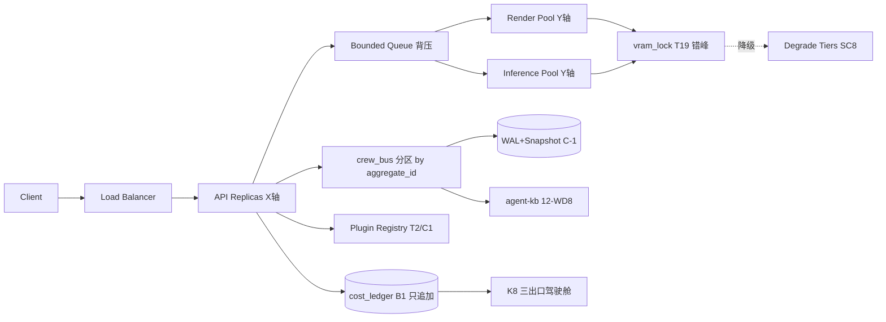
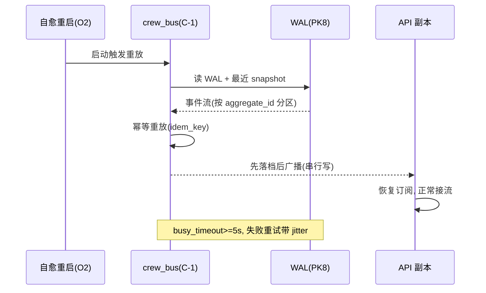

# 第十三轮协商草稿 · 可扩展性与未来演进（Scalability & Future Evolution）

> 起草：架构师 高见远（主理人代笔收敛，因 worker 静默未产出，round 7 同款模式）｜ 轮次：第十三轮（可扩展性与未来演进）｜ 日期：2026-10-03
> 定位：在前 12 轮把"做什么、怎么协作、怎么部署运维、怎么测试验收、怎么沉淀知识"都拍板之后，做"**当镜头数/资产数/Agent 并发数/外部协作者规模上来时，这套单机 Docker Compose 架构怎么水平扩展、不崩、不漂移、且成本仍可被观测**"——AKF 三轴定位、GPU 渲染推理水平扩展、GPU worker 池+队列+背压+限流、crew_bus 分区与重放、Agent 并发、引擎模型可插拔注册表、成本随规模可观测、弹性降级。
> 纪律：团队收敛采纳，DECISIONS.md 第十三轮表 16/16 登记 ✅（主理人收敛·2026-10-03）；§9 评审纪要已回填收敛；所有决策点候选≥2、推荐有理由、逐条回链已拍板决策（带 ID + DECISIONS.md 行号，行号已 Grep 核准）。外部标准 WebSearch≤4（AKF / 队列背压限流熔断 / 事件总线分区重放 / 插件与多租户）。v2 扩展性实证仅做定向 Grep/Glob（见 §1.1），未通读大文件。
> 四原则贯穿：① 不一刀切（本地 12GB 串行 vs 云端推理可选；0 元轨默认+条件上云；轴可切换默认）② 关联决策回链 DECISIONS 行号 ③ 不重复造轮子（复用 vram_lock / T2 注册表 / crew_bus / cost_ledger 既有机制）④ 全面灵活（每轴可独立推进、可回滚、可按规模触发）。

---

## §0 定位与衔接

### §0.1 一句话定位

前 12 轮产出了 DECISIONS.md（13 轮协商共识）+ 12 份协商草稿 + v2 真身一堆散落文档，但**没有任何扩展性架构基线**——v2 实测是"单进程 FastAPI + 子进程 GPU 工具 + 文件锁 + 单机 Docker Compose"，**无任何消息队列、无 worker 池、无事件总线分区/重放、无异步并发池、无多租户**（见 §1.1 实测）。第十三轮解决"**怎么在这套已拍板的硬约束（追加不改 / 熔断 X1 否决自动解冻 / 契约兼容 / 总线崩溃契约 / 不一刀切）之上，从零建设可控的水平扩展机制**"——AKF 三轴定位 + GPU 渲染推理水平扩展 + GPU worker 池与背压限流 + crew_bus 分区重放 + Agent 并发 + 插件注册表 + 成本随规模可观测 + 弹性降级。

### §0.2 与已拍板决策的衔接表（关联决策原则②，逐条回链，行号本轮回 Grep 核准）

| 已拍板决策 | 出处 | 第十三轮 Scalability 接管点 | 关联原则 |
|---|---|---|---|
| O1 部署形态（Docker Compose 单机 + 混合开关） | DECISIONS.md:477 | SC2 / SC8 单机→可水平扩展基线（X 轴复制不改单机前提） | ② 关联决策 |
| O2 进程自愈（restart:always + systemd） | DECISIONS.md:478 | SC8 自愈重启须触发 crew_bus 重放（依赖 P1/C-1，v2 未落地 pending） | ② 关联决策 |
| O4 可观测三支柱（日志+Prometheus+trace） | DECISIONS.md:480 | SC7 成本随规模可观测（节点图/驾驶舱/剧场告警三出口随实例数扩展） | ② 关联决策 |
| O3 健康探针（/health+/ready+/ws） | DECISIONS.md:479 | SC8 降级档位探活（/ready 503 摘流契约驱动降级） | ② 关联决策 |
| D23 GPU 共存策略（分时制） | DECISIONS.md:40 | SC2 / SC3 GPU worker 分时（渲染期不跑推理，错峰接 vram_lock） | ② 关联决策 |
| T12 进程隔离策略（Blender·GPU·whisper 子进程） | DECISIONS.md:203 | SC3 / SC6 引擎进程隔离（worker 池内仍按 T12 隔离） | ② 关联决策 |
| T19 vram_lock 统一接入（submit 前错峰） | DECISIONS.md:210 | SC3 所有 GPU 引擎 submit 前接 vram_lock（现仅 wan22 接，其余裸跑） | ② 关联决策 |
| T2 工具注册表与版本化（registry） | DECISIONS.md:193 | SC6 插件注册表基础（每工具 version+category+cost+allowed_agents） | ② 关联决策 |
| T2 契约与集成测试（CDC） | DECISIONS.md:530 | SC6 插件契约校验进 CI（接 C6:243/C1:238） | ② 关联决策 |
| C1 SemVer 契约版本演进 | DECISIONS.md:238 | SC6 插件/总线事件版本演进（破坏=MAJOR+兼容期） | ② 关联决策 |
| C6 契约校验器家族 | DECISIONS.md:243 | SC6 插件契约校验器（接 T24 防漂移） | ② 关联决策 |
| C8 权限矩阵（外部协作方只读分级） | DECISIONS.md:245 | SC4 / SC6 / SC7 外部只读分级（多租户/插件沙箱越权显式 409） | ② 关联决策 ① 不一刀切 |
| C4 cost_ledger+prices | DECISIONS.md:241 | SC7 成本随规模（追加式只写不改，prices 分离） | ② 关联决策 |
| B1 cost_ledger schema（只追加不改） | DECISIONS.md:336 | SC7 成本账随规模仍只追加不改（idem_key 幂等） | ② 关联决策 |
| PK8 落档 append-only | DECISIONS.md:399 | SC4 总线落档 append-only（与 crew_bus 同生命周期） | ② 关联决策 |
| B5 熔断（X1 否决自动解冻） | DECISIONS.md:340 | SC3 / SC5 / SC8 熔断阈值+降级档位（阈值不得自动放宽） | ② 关联决策 |
| K8 成本可观测性三出口 | DECISIONS.md:352 | SC7 驾驶舱随规模（复用 BudgetDashboard.jsx） | ② 关联决策 |
| B7 本地 12GB vs 云端（机时瓶颈） | DECISIONS.md:342 | SC2 / SC3 机时预算红线（VRAM 默认 12GB、VRAM_GB env 可配，约 4 分钟/镜物理约束） | ② 关联决策 |
| B9 0 元轨边界 | DECISIONS.md:344 | SC2 / SC3 上云四条件+回退三条件（默认 0 元） | ② 关联决策 ① 不一刀切 |
| A5 岗位实例模型（RealizeJob 队列，单实例+工具层并行） | DECISIONS.md:146 ⏳ | SC4 分片调度器（A5 是 z/y 轴落地，pending 须实现） | ② 关联决策 |
| A13 工具调用失败重试 | DECISIONS.md:155 ⏳ | SC3 / SC5 队列重试 + 故障隔离（重试是弹性底座，pending） | ② 关联决策 |
| A24 隐式模式（架构零改动） | DECISIONS.md:166 ⏳ | SC1 / SC8 strangler-fig 增量抽提（不重写总线，pending 待确认） | ② 关联决策 |
| A26 任务级预算信封 | DECISIONS.md:168 ⏳ | SC3 节流 + SC4 配额 + SC7 配额（A26 是 throttle/quota 底座，pending） | ② 关联决策 |
| A15 岗位决策日志（SQLite）⏳ pending | DECISIONS.md:157 | SC5 Agent 并发落库燃料 + SCK6 事件日账基座（未落地须先建） | ② 关联决策 |
| N19 剧场联动 crew_bus / N20 /ws 进度 | DECISIONS.md:117 / :118 | SC4 总线广播+重放（关键以 DECISIONS 为准） | ② 关联决策 |
| P1 cost.* 事件进 crew_bus | DECISIONS.md:384 | SC4 总线分区重放（扩展 cost.* 事件族） | ② 关联决策 |
| C-1 R0-1 crew_bus 崩溃契约 | DECISIONS.md:403 | SC4 WAL+busy_timeout≥5s+串行写+先落档后广播+启动重放 | ② 关联决策 |
| WD8 agent-kb / WD-MTX（文档轮） | 12-docs-knowledge.md §WD8 / §WD-MTX | SC6 插件知识进 agent-kb（registry.json 快照+禁区列表） | ② 关联决策 ③ 不重复造轮子 |

### §0.3 四原则贯穿说明

- **① 不一刀切**：扩展手段按规模触发——本地 VRAM 默认 12GB 串行渲染（B7:342 物理约束，VRAM_GB env 可配，换卡/多卡自适应）不强行堆机器；推理按需上云（B9:344 四条件）；0 元轨默认（B9）。X/Y/Z 三轴可独立推进、且按规模阶段可切换默认（小团队纯 z、成长叠 y、web 叠 x），不要求一步到位。
- **② 关联决策回链**：每个 SC 点都回链 DECISIONS 行号（本轮回 Grep 核准，含 T2 双行 193/530、C-1:403 崩溃契约、A5/A13/A24/A26/A15 仍 ⏳ pending），不凭空造决策。
- **③ 不重复造轮子**：复用 v2 既有机制——vram_lock（T19:210）、T2 registry（:193）、crew_bus（P1:384/C-1:403）、cost_ledger（B1:336/C4:241）、O6 门禁（:482），不另起炉灶。
- **④ 全面灵活**：每轴可独立落地/回滚；队列选型、分区键、多租户粒度、worker 上限、strangler 节奏均留开放争议（见 §1.5/§9.3），由 PM/主理人收敛。

### §0.4 硬约束（保留前序，扩展性改造不得违反）

1. **追加不改**：B1:336 / C4:241 / PK8:399 — 成本账、落档、契约只追加不改；扩展机制写入必须幂等（idem_key）。
2. **熔断 X1 否决自动解冻**：B5:340 — 降级/熔断阈值不得自动放宽；解锁必须走 approval_service（接第六轮）。
3. **契约兼容 SemVer**：C1:238 / C6:243 — 插件接口、总线事件破坏性变更走 MAJOR+兼容期+CI 阻断；cross_contract_validator 进 CI。
4. **crew_bus 崩溃契约**：P1:384 / C-1:403 — WAL+busy_timeout≥5s+串行写+先落档后广播+启动重放；R0-O5/O7/O11~O17 pending 须先落地，不能推迟到 M6。
5. **不一刀切**：O1:477 / D23:40 / B9:344 — 本地串行 vs 云端推理可选开关；0 元轨默认+条件上云+三条件回退。
6. **CI 门禁 + 密钥安全**：O6:482 / O8:484 — 扩展代码改动须过契约校验+禁区扫描+依赖锁；密钥不落明文（复用 gitleaks）；多租户密钥隔离不得明文落盘。
7. **外部只读分级**：C8:245 — 多租户/插件外部协作方只读，越权显式 409+日志禁静默。
8. **v2 greenfield 实证**：§1.1 实测确认无队列/worker/总线分区/异步池/多租户；扩展机制从零建设，但不得破坏现有单进程 FastAPI + 子进程 GPU 工具 + 文件锁 的稳定性；**pending 决策（A5:146 / A13:155 / A24:166 / A26:168 / A15:157 / crew_bus P1:384 / registry T2:193）不视为已落地，本轮只定"往哪 scale"，不定"已实现"**。

---

## §1 现状与实证

### §1.1 v2 扩展性现状实测（定向 Grep/Glob，greenfield）

对 `d:\aifilmteam\AI影视团队v2\tools\` 做一次定向 Grep（关键词：`queue|worker|redis|kafka|partition|asyncio|celery|rabbitmq|multiprocess|threading|async def|semaphore|lock|Queue|ThreadPool|ProcessPool|concurrent`）：

| 命中 | 文件:行 | 性质判定 |
|---|---|---|
| `def comfyui_queue(workflow)` | comfyui_generator.py:190 | 普通函数，**非**队列系统 |
| `import asyncio` | tts_generator.py:2、_selftest/selftest.py:16 | CLI/自测用，**非**并发池 |
| `import threading` | vram_lock.py:29 | VRAM 锁心跳线程，**非** worker 池 |
| `async def ...` | api_server.py（多端点） | FastAPI HTTP 处理器（每请求 async，**非**任务并发池） |
| `"queue_number": number` | acestep_client.py:109、comfyui_client.py:169/269 | ComfyUI **提示词编号**，非任务队列 |
| `scene_lock` / `charlock` / `k13_locked` | api_server.py:37/38/89/168 | 文件锁，**非**并发框架 |

**未命中**（确认缺失）：`redis` / `kafka` / `rabbitmq` / `celery` / `Queue()` / `ThreadPool` / `ProcessPool` / `concurrent` / `partition` / `semaphore` / `multiprocess`。另：`d1_model_queue.py` 是**单模型推理队列雏形**（D1 模型），`jobs.py`+`pipeline/jobs.db` 是 **SQLite 作业账本**（T14 幂等 `jobs.begin` 底座），`budget_manager.py` 是全局预算账本（A26 候选底座），`handoff_manager.py` 是岗位间工单流转——以上为 first-party 可复用基座，但**无自有并发编排层、无 crew_bus、无 registry、无分片调度**。

**结论**：v2 当前扩展性 = 单进程 FastAPI + 子进程 GPU 工具（Blender/ComfyUI/whisper，受 T12:203 进程隔离）+ 文件锁 + 单机 Docker Compose（O1:477）。**无消息队列（除 d1_model_queue 单模型）、无 worker 池、无事件总线分区/重放、无异步任务并发池、无多租户**。扩展机制须从零建设，且须在 §0.4 硬约束内。

### §1.2 内部可复用标准（回链前序，避免重造）

- **vram_lock（T19:210）**：所有 GPU 引擎 submit 前错峰的现成机制，SC3 worker 池直接复用，无需新写锁。
- **d1_model_queue / jobs.py（T14:205）**：单模型队列 + SQLite 作业账本，SC3 队列与 SC4 幂等分片的直接底座（复用 `jobs.begin` 语义）。
- **T2 registry（:193）+ registry.json**：插件/引擎注册表的现成事实源，SC6 直接扩展（注：代码未实现，R-SCALE-REG）。
- **crew_bus（P1:384 / C-1:403）**：成本事件总线 + 崩溃契约（WAL+重放），SC4 在其上做分区，不另起消息中间件（注：代码零引用，R-SCALE-CB）。
- **cost_ledger（B1:336 / C4:241）**：成本账只追加不改 + prices 分离，SC7 直接复用其指标出口。
- **O6 门禁（:482）/ O8（:484）**：扩展代码改动直接复用既有 CI 禁区扫描 + gitleaks，不新建流水线。

### §1.3 规模触发阈值（内部经验基线，供 SC 点引用）

| 维度 | 当前（v2 实测） | 触发扩展的软阈值（建议，接 PM 收敛） |
|---|---|---|
| 并发镜头渲染 | 单 GPU 串行 | 机时预算（B7:342）超软观测线 → SC2/SC3 上 worker 池 |
| 推理并发 | 裸跑抢显存 | 全部引擎接 vram_lock（T19）后仍饱和 → SC3 上云（B9） |
| Agent 并发 | CrewAI 单剧组 | A15:157 落库后并发编排 → SC5 |
| 外部协作者 | 无 | 出现跨租户/外部只读 → SC4/SC6/SC7 分级（C8） |

### §1.4 外部标准调研（WebSearch≤4，2026-10-03）

**① AKF Scale Cube（X 克隆 / Y 功能切分 / Z 数据分片）**
- X 轴：水平复制无状态实例，负载均衡后扩可用性与容量（实施成本最低，但只适用于无状态进程，不解决数据增长）。
- Y 轴：按业务/功能拆分服务（SOA/微服务），组件独立扩展与失败隔离，实施成本最高；**须事件总线支撑，过早 y 轴会退化成同步 RPC**。
- Z 轴：按客户/地理/租户 lookup 切分数据（shard by customer_id），单元化（Cell）自包含闭环。
- 来源：akfpartners.com/glossary、u4ecestatic.akfpartners.com/growth-blog/akf-scale-cube-ze-case-for-z-axis、geeksforgeeks.org/the-scale-cube、xiazemin.github.io/MyBlog（AKF 拆分原则）。

**② 队列削峰 · 背压 · 限流 · 熔断 · 舱壁 · 降级**
- Bounded queue：有最大容量，满则 block / drop-oldest / drop-newest / reject（**禁止无界内存队列**，生产即内存泄漏）。
- Token bucket：突发+稳态上限（API 网关层简单有效）；Leaky bucket：平滑到恒定速率。
- Circuit breaker：失败率超阈开闸，快速失败+自动恢复（半开探测），防止级联失败；上游须收到 503/Retry-After 信号而非静默；**breaker OPEN 后预算不得自动解冻（X1/B5）**。
- Bulkhead：资源隔离线程池，避免单依赖拖垮全局。
- Load shedding / 优雅降级：饱和时弃低优流量（返回 stale 缓存/部分结果/429/503），保护核心路径。
- 来源：blog.habsi.net/backpressure-explained、www.systemoverflow.com（fairness+rate limiting+load shedding）、stackandsystem.com（backpressure microservices）、hemaks.org（practical backpressure）、martinuke0.github.io（load shedding）。

**③ 事件总线分区 + 重放（事件溯源 / WAL / snapshot）**
- 事件溯源：状态=事件序列的左折叠，append-only 日志为系统事实源；当前状态可由重放重建。
- 分区：按 aggregate_id（如镜头/资产 ID）做 partition key 保序；多 aggregate 交互需协调分区策略。
- WAL + 重放：崩溃后从 WAL 重放恢复；串行写+先落档后广播。
- Snapshot：每 N 事件存快照，重放只需 replay 快照之后，避免全量重放（10M 事件需 snapshot-every-1000 达单ms 加载）。
- 幂等消费：重放可能重复，消费者须幂等（idem_key）。
- 来源：conduktor.io/glossary/event-sourcing-patterns-with-kafka、appscale.blog（event sourcing 生产态）、oneuptime.com（kafka event-sourced）、deepwiki.com（event-sourcing-pattern）。

**④ 插件架构 + 多租户隔离（沙箱 / tenant_id / 配额）**
- 插件沙箱：租户自定义代码（agent 扩展/集成）须沙箱执行，限制 capability，防跨租户/平台干扰；插件 API 明确边界；**动态 import 须配 registry.json 白名单闸 + T5/T7 禁区 CI**。
- 数据隔离三档：独立数据库（最强）/ 独立 schema / 共享表+tenant_id 列（最常用，须行级安全 RLS + 每查询带 tenant_id 过滤 + 复合索引以 tenant_id 开头）。
- 配额：按租户档位（free/standard/enterprise）设资源配额；监控 per-tenant 防 noisy neighbor。
- 自动开通：IaC 模板（Terraform/Pulumi/K8s operator）一致开通租户隔离边界+配额+密钥。
- 来源：moltbook.com（agent platform multi-tenancy）、cloud.tencent.com/developer/article/2311230（SaaS 多租户数据隔离）、shopify.com/blog/multi-tenant-architecture、averagedevs.com（multi-tenant SaaS isolation）、plugintify.com（WordPress→SaaS 多租户）。

### §1.5 承接前序 drift / 开放问题（硬同步）

- **R0-O5:500 / R0-O7/O11~O17 pending**：crew_bus WAL+重放崩溃恢复 v2 未实现，须先落地 P1/C-1——**SC4 硬承接**，不得推迟到 M6。
- **R0-O16:483**：budget 覆盖写+自动解冻进 O6 禁区扫描（CI 阻断）——SC3 限流/熔断阈值改动须过 O6 门禁。
- **A5:146 / A13:155 / A24:166 / A26:168 / A15:157 ⏳ pending**：岗位实例模型/重试/零改动/任务级信封/决策日志均未落地——是 SC4/SC3/SC5/SC7 的 R0 落地前置，不是"已就绪"（本轮只定方向）。
- **dispatcher 单实例部署（DECISIONS.md:379 四争议收敛③）**：SC4 总线分区须与 dispatcher 单实例协调（状态内存+SQLite 双写），不一刀切。
- 前 08 轮 P1~P8+PK1~PK8+C-1~C-5 协作平台决策中 C-1 崩溃契约延至 M6 的原文，已被 O2:478 反向约束（自愈重启依赖总线重放），故本轮将 C-1 重放前置为 SC4 硬约束。

---

## §2 决策点（SC1~SC8，候选≥2 + 推荐 + 影响 + 可逆 + 来源）

### SC1 · AKF 三轴定位（扩展基线）

- **背景**：v2 实测为单体（§1.1），须先定"在哪几个轴扩展"再动手，避免盲目堆机器。
- **候选 A（推荐）**：以 AKF Cube 为评估框架，明确三轴分工——X 轴=无状态 API/worker 副本（负载均衡）；Y 轴=按功能拆渲染/推理/协作总线（当前已天然分进程，T12:203）；Z 轴=数据按镜头/资产/租户分片（当前无，预留 tenant_id）。**轴优先级做成"按规模阶段可切换默认"：小团队纯 z、成长叠 y、web 叠 x**，而非固定主辅排序（不一刀切①）。
- **候选 B**：只做 X 轴克隆（最简单），Y/Z 暂不动。→ 不能解决 GPU 串行机时瓶颈（B7:342）与数据增长。
- **候选 C**：直接上 K8s 全量编排。→ 运维过载，违背不一刀切（①），远超当前规模；且 y 轴需事件总线支撑，过早 y 轴会退化成同步 RPC（R-SCALE-CB）。
- **推荐**：A。先出 AKF 评估清单（SCK1），X 轴立即可做（O1:477 单机→多副本不改单机前提），Y/Z 按需触发；**y 轴须待 crew_bus 落地（SC2/SC4）后启用**。
- **影响**：给 SC2~SC8 统一坐标系；不强制立即实施 Y/Z。
- **可逆**：✅（框架性定位，不锁死实现）。
- **来源**：§1.4-① AKF；O1:477 / T12:203 / B7:342 / A5:146。

### SC2 · 渲染推理水平扩展（X 轴）

- **背景**：当前单 GPU 串行渲染（B7:342 单机默认 12GB、VRAM_GB env 可配、约 4 分钟/镜物理约束），推理裸跑抢显存。
- **候选 A（推荐）**：X 轴复制——多 GPU worker 实例（同构容器）置于负载均衡后；渲染与推理分池（Y 轴雏形），受 D23:40 分时 + T19:210 vram_lock 错峰约束。
- **候选 B**：垂直扩容（更大显存卡）。→ 有硬天花板且贵，不解决故障隔离。
- **候选 C**：全量上云推理（B9）。→ 仅推理可上云，渲染受本地 VRAM 物理约束，不能全上。
- **推荐**：A + 按需 B9 上云推理（四条件触发）。机时预算（B7）超软观测线才扩 worker 数。
- **影响**：吞吐随副本线性增；须 crew_bus 重放配合重启（O2:478）；单卡并发上限 = f(VRAM_GB)，换卡/多卡自适应。
- **可逆**：✅（副本数可随时缩）。
- **来源**：§1.4-①；D23:40 / T19:210 / B7:342 / B9:344 / O1:477。

### SC3 · GPU worker 池 + 队列 + 背压 + 限流

- **背景**：v2 无 worker 池/队列（§1.1），引擎裸跑抢显存、无削峰（d1_model_queue 仅单模型雏形）。
- **候选 A（推荐）**：建 GPU worker 池 + **有界队列（bounded queue）** + vram_lock 全引擎接入（T19:210 现仅 wan22）+ Token bucket 限流（按机时预算 B7 驱动上限）+ Bulkhead 隔离渲染/推理线程池 + Circuit breaker（阈值接 B5:340，X1 否决自动解冻）。
- **候选 B**：无界内存队列 + 不限流。→ §1.4-② 明确为反模式（生产即内存泄漏+级联失败）。
- **候选 C**：直接引 Redis/Kafka 外部 broker。→ 运维过载，当前规模不必要（见开放争议 Q1）。
- **推荐**：A，队列选型默认 in-process bounded queue（复用 v2 Python），规模再升再引外部 broker。
- **影响**：削峰+防级联失败；队列满则 reject/降级（接 SC8）；阈值改动须过 O6 禁区扫描（R0-O16:483）；**阈值（队列容量/限流 ceiling）默认经 R2 实测 P95×1.5 定（接 A26:168），env 可配（VRAM_GB/队列容量），绝不写死魔法数（接 Round 9 U5/P5 R0-2 硬编码预算阈值教训）**。
- **可逆**：✅（池大小/队列容量/限流参数均可调可回）。
- **来源**：§1.4-②；T19:210 / B5:340 / B7:342 / B9:344 / O6:482 / A26:168 / R0-O16:483。

### SC4 · crew_bus 分区 + 重放（接 P1/C-1）

- **背景**：P1:384 已定 cost.* 事件进 crew_bus，C-1:403 定崩溃契约（WAL+busy_timeout≥5s+串行写+先落档后广播+启动重放），但 R0-O5/O7/O11~O17 pending，v2 未实现（R-SCALE-CB）。
- **候选 A（推荐）**：在 C-1 契约上做**分区**——partition by aggregate_id（镜头/资产 ID）保序 + WAL 落档（PK8:399 append-only）+ 每 N 事件 snapshot + 启动重放（幂等 idem_key）；与 dispatcher 单实例（:379）协调，状态内存+SQLite 双写不改；**数据/配额隔离现在做（project_id 命名空间），跨租户实时事件隔离延后等 crew_bus 分区落地**。
- **候选 B**：单分区全局串行。→ 简单但成热点，多镜头并发时瓶颈（§1.4-③ 头阻塞）。
- **候选 C**：引 Kafka 做分区重放。→ 能力过剩，C-1 契约已够，违背③不重复造轮子。
- **推荐**：A。先落地 C-1 重放（前置硬约束，R0-O5），再按 aggregate_id 分区；A5:146 落地后做 RealizeJob 分片调度器。
- **影响**：自愈重启（O2:478）可靠重放；多镜头事件并行不互相阻塞；外部只读分级接 C8:245。
- **可逆**：✅（分区键可调整，不删历史）。
- **来源**：§1.4-③；P1:384 / C-1:403 / PK8:399 / N19:117 / N20:118 / O2:478 / A5:146 / R0-O5:500。

### SC5 · Agent 并发 + A 系列

- **背景**：CrewAI 多智能体当前单剧组编排；A15:157 岗位决策日志 ⏳ pending，并发落库燃料缺失。
- **候选 A（推荐）**：先落地 A15:157（LLM 调用全量落 SQLite：prompt/response/token/耗时/档位），再扩 Agent 并发——并发编排受 A 系列岗位卡约束，调用幂等+落库可观测；并发上限由机时预算（B7）驱动；A13:155 重试落地后接 SC3/SC5 重试。
- **候选 B**：直接高并发多剧组。→ 无 A15 落库则成本/决策不可追溯，违背 K8:352 成本可观测。
- **候选 C**：每 Agent 独立进程池。→ 过度隔离，违背 T12:203 纯 Python 管理类同进程省开销。
- **推荐**：A。A15 是前置依赖，未落不扩并发。
- **影响**：并发编排可水平扩；决策日志成 agent-kb 燃料（接 12 轮 WD8）。
- **可逆**：✅（并发数可配）。
- **来源**：A15:157 / A13:155 / K8:352 / B7:342 / T12:203 / 12-docs-knowledge.md §WD8。

### SC6 · 引擎模型可插拔注册表（接 T2/C1）

- **背景**：T2:193 已有 registry.py+registry.json（version+category+cost+allowed_agents），但仅工具级，未覆盖"引擎/模型可插拔"；代码未实现（R-SCALE-REG）。
- **候选 A（推荐）**：扩展 T2 注册表为**插件注册表**——引擎/模型以插件形式注册（version 接 C1:238 SemVer），契约校验接 C6:243+cross_contract_validator 进 CI（T2:530 CDC）；**importlib 轻量动态发现 + registry.json 白名单闸**（不引 entry_points 过重框架，契合 A24 零改动/T22 双运行）；插件沙箱（§1.4-④）限制 capability，禁区接 T5/T7 并经 CI 扫描（SC-NEW-4 扩展 T7），外部只读分级 C8:245。
- **候选 B**：硬编码引擎列表。→ 每次加模型改代码，违背 T2 注册表初衷。
- **候选 C**：引外部插件市场。→ 超当前规模，违背不一刀切。
- **推荐**：A。复用 T2 registry 事实源，加插件沙箱+契约校验，知识进 agent-kb（WD8）。
- **影响**：引擎/模型热插拔；破坏性变更走 MAJOR+兼容期+CI 阻断（C1/C6）。
- **可逆**：✅（插件可注销，append 不删）。
- **来源**：§1.4-④；T2:193 / T2:530 / C1:238 / C6:243 / C8:245 / T5 / T7 / 12-docs-knowledge.md §WD8。

### SC7 · 多租户命名空间 + 配额（接 C8/D24/A26）

- **背景**：K8:352 已定成本三出口；B7:342 机时瓶颈、B9:344 0 元轨边界须随规模守住；当前 projects/ 扁平目录、无 project_id 命名空间。
- **候选 A（推荐）**：**现在就加 `project_id` 命名空间**（纯目录前缀 `projects/{project_id}/...`，成本低、可逆、不依赖 crew_bus/registry，D24:41 已按 shot_id 组织目录顺手加层）+ 配额（接 A26:168 信封）+ 数据隔离（SQLite 分库或 project 前缀，复用 D24）；跨租户实时事件隔离延后等 crew_bus 分区（SCK2）；跨租户读接 C8:245 分级（越权显式 403/409）。
- **候选 B**：单租户（现状）。→ 简单，但无法承接"多项目同时跑"的 scale 需求。
- **候选 C**：全物理隔离（每项目独立部署）。→ 隔离最强，但资源浪费、运维爆炸。
- **推荐**：A。命名空间+配额+数据隔离现在做；完整跨租户事件隔离等底座落地后深化。
- **影响**：多项目并行可行；配额防单项目烧资源；0 元轨红线（B9）随上云条件自动校验。
- **可逆**：✅（撤 project_id 前缀=合并）。
- **来源**：§1.4-④；K8:352 / B7:342 / B9:344 / B1:336 / C4:241 / C1:238 / C8:245 / D24:41 / A26:168。

### SC8 · 弹性降级 + strangler 迁移（接 B5/O2/O4）

- **背景**：B5:340 已定四级熔断（X1 否决自动解冻）；O2:478 自愈、O4:480 可观测三支柱已定，但无"降级档位"定义；A24:166 零改动约束 ⏳（strangler-fig 不重写总线前提待确认）。
- **候选 A（推荐）**：定义**降级档位决策树**——按 /ready 503 摘流契约（O3:479）+ 熔断阈值（B5）触发：档1 弃低优分析任务→档2 推理回退本地 0 元轨（B9）→档3 仅保留核心渲染+成本账落档。每档明确触发条件+恢复条件，解锁走 approval_service（B5 X1）。以**绞杀者模式（strangler）**渐进替换单体（每步保留回滚），不一次性重写。
- **候选 B**：全有全无（无降级）。→ 单依赖失败拖垮全局，违背 §1.4-② 优雅降级。
- **候选 C**：自动解冻降级。→ 违反 B5 X1 否决自动解冻硬约束。
- **推荐**：A。降级档位与 B5 熔断、O2 自愈、O4 可观测联动；**回退触发判据**：契约校验失败率超阈（C1/C6 漂移告警）/ 性能回退超基线 X% → 暂停抽提并回退 CLI（strangler 每步可回滚）。
- **影响**：极端负载下核心路径存活；恢复须人工/主理人分级审批。
- **可逆**：✅（档位可配可回；strangler 每步可回滚）。
- **来源**：§1.4-②；B5:340 / O2:478 / O3:479 / O4:480 / B9:344 / A24:166 / C1:238 / C6:243。

### §2.9 规格汇总（落地用，便于工程师实现）

```yaml
# ① AKF 标注（SC1）
akf:
  x_axis: [api_replicas, gpu_worker_replicas]      # 负载均衡后无状态副本
  y_axis: [render_pool, inference_pool, crew_bus]  # 功能分池（复用 T12 进程隔离，待 crew_bus 落地后启用）
  z_axis: { status: reserved, shard_key: [tenant_id, shot_id], default: single }  # 当前单租户，预留
  axis_priority: switchable_by_scale               # 小团队纯 z、成长叠 y、web 叠 x（不一刀切①）

# ② GPU worker 池（SC2/SC3，接 T19:210 / B7:342 / B9:344）
gpu_worker_pool:
  vram_gb: { env: VRAM_GB, default: 12 }   # 硬件显存上限，env 可配，换卡/多卡自适应（不一刀切①，不写死 12GB）
  render:
    strategy: x_axis_replicas      # 同构容器，LB 后
    vram_lock: mandatory           # 所有引擎 submit 前接 T19（现仅 wan22）
    timeshare: D23                 # 渲染期不跑推理
  inference:
    strategy: [local_serial, cloud_on_4_conditions]  # B9 默认 0 元+四条件上云
    machine_hour_budget: soft_alert  # B7 机时软观测红线
  queue:
    type: bounded_in_process       # 有界队列，禁无界（§1.4-② 反模式）
    on_full: reject_then_degrade   # 满则拒+降级（接 SC8）
    capacity_default: derived      # 默认= R2 实测 P95×1.5（A26:168），env 可配，绝不写死
  rate_limit: { algo: token_bucket, ceiling_by: machine_hour_budget, default: derived_P95x1_5 }  # 同上派生
  bulkhead: { render_pool: isolated, inference_pool: isolated }
  circuit_breaker: { threshold: per_B5, auto_unfreeze: forbidden }  # X1 否决

# ③ crew_bus 分区+重放（SC4，接 P1:384 / C-1:403 / PK8:399）
crew_bus:
  contract: C-1_R0-1               # WAL+busy_timeout>=5s+串行写+先落档后广播+启动重放
  partition_key: [aggregate_id]    # 镜头/资产 ID 保序；多租户时叠加 tenant 前缀
  wal: { append_only: true, busy_timeout_ms: 5000 }
  snapshot: { every_n_events: 1000 }
  replay: { idempotent: true, idem_key: required }
  dispatcher: single_instance_coordinated  # :379 单实例+SQLite 双写

# ④ 插件注册表（SC6，接 T2:193 / C1:238 / C6:243 / C8:245）
plugin_registry:
  base: T2_registry_json
  discovery: importlib + whitelist_gate   # 轻量动态发现 + registry.json 白名单闸（不引 entry_points）
  versioning: SemVer_C1
  contract_check: cross_contract_validator_C6_CI
  sandbox: { capability_limited: true, cross_tenant: forbidden }
  external: read_only_tiered_C8
  ci_scan: [T5_import_bpy, T7_mcp_listen]  # SC-NEW-4 扩展 T7 扫描

# ⑤ 成本指标（SC7，接 K8:352 / B1:336 / C4:241）
cost_observability:
  ledger: append_only_idempotent   # B1/C4 只追加不改
  outlets: [node_graph, cockpit, theater_alert]  # K8 三出口随实例聚合
  strangler: per_step_rollbackable
  tenant: { namespace: project_id, quota: A26_envelope, isolation: prefix_or_per_db }  # SC7 多租户

# ⑥ 降级档位（SC8，接 B5:340 / O3:479 / O2:478）
degrade_tiers:
  - tier: 1
    trigger: queue_full_or_low_priority
    action: drop_low_priority_analytics
  - tier: 2
    trigger: inference_saturation
    action: fallback_local_zero_cost_B9
  - tier: 3
    trigger: core_dependency_down
    action: keep_core_render_and_cost_ledger_only
  rollback_trigger: { contract_drift_failrate_exceeds, perf_regression_over_baseline_Xpct }  # 回退判据（C1/C6）
  unlock: approval_service_required   # B5 X1 否决自动解冻

# ⑦ 缓存失效（SC 缓存策略，接 C1:238 / D24:41）
cache:
  schema: invalidate_on_C1_MAJOR          # 契约 schema 随 $id MAJOR 失效
  assets: invalidate_on_D24_tree_change   # 资产树变更事件触发资产清单缓存失效（D24:41）
  weights: invalidate_on_model_registry_change  # 引擎/模型注册表变更触发权重缓存失效
```

### §2.10 治理测试项（SC-NEW）与风险标签（R-SCALE，类比 Round 11 T-NEW / Round 12 WD-NEW / R-DOC-CI）

#### §2.10-A 治理门禁项（机器可断言 pass 判据）

| # | 门禁项 | 机器可断言 pass 判据 | 门禁档位（迁移分期） | 关联 |
|---|---|---|---|---|
| SC-NEW-1 | 队列背压生效 | 注入任务使队列深度 > 阈值，断言新入队被暂停（exit 1 否则） | **flag-gated / pending**（背压代码未实现，底座落地后升 required） | SC3 |
| SC-NEW-2 | 分片幂等 | 同 idem key 重跑两次，断言仅一次计费（jobs.db 计数）；params_hash 变→重新计费 | required-capable（jobs.begin 已存在） | SC4 / T14 |
| SC-NEW-3 | 事件总线重放 | 模拟崩溃后重启，断言未广播事件从 WAL 重放且无重复（C-1） | **flag-gated / pending**（crew_bus 零引用，R-SCALE-CB） | SC4 / C-1 |
| SC-NEW-4 | 插件禁区 | 注册含 `import bpy` 的插件，断言 CI exit 1；**扩展覆盖 T7 禁区 MCP 监听扫描** | required-capable（T5 扫描可独立，不依赖 registry） | SC6 / T5 / T7 |
| SC-NEW-5 | 多租户隔离 | project A 任务不读写 project B 数据（前缀/分库断言）；**跨租户越权读断言 403/409 无静默放行（C8:245）** | required-capable（D24 前缀可断言） | SC7 / C8 |
| SC-NEW-6 | 熔断隔离 | 注入某舱壁故障，断言其余舱壁不受影响；**breaker OPEN 后预算不自动解冻（X1/B5，接 Round 10 R-ROL2）** | required-capable（vram_lock 基座存在） | SC5 / B5 |
| SC-NEW-7 | 熔断 X1 防自动解冻（P0 相关） | 注入持续故障→断言 breaker OPEN 且预算**不**自动解冻（X1/B5），接 Round 10 R-ROL2 | required（底座存在） | SC5 / B5 |
| SC-NEW-8 | 背压 OOM 边界 | VRAM_GB 上限下，最大并发触发节流且**不 OOM**（不止"暂停入队"，须资源天花板断言） | flag-gated（阈值 env 可配，底座落地后 required） | SC3 / SCK7 |
| SC-NEW-9 | 多租户越权读（C8） | project A 调 API 读 project B → 断言 403/409 + 日志，无静默放行（C8:245 QA 注） | required-capable | SC7 / C8 |

> **门禁严苛度（§9.3-⑤ 裁定）**：SC-NEW-2/4/5/6/7/9 基座部分存在（jobs.db / T5 扫描 / D24 前缀 / vram_lock），可 required；**SC-NEW-1/3/8 因目标子系统未实现（背压代码 / crew_bus 零引用 / 资源天花板断言）须 pending / flag-gated，绝不可从第一天 required——否则空心门禁 P0 误杀全部 PR（R-DOC-CI / R-SCALE-GATE 教训）**。

#### §2.10-B 风险标签（登记 DECISIONS 第十三轮治理块）

| 风险 | 级别 | 说明 | 关联决策 |
|---|---|---|---|
| R-SCALE-CB | **P0** | `crew_bus` 代码零引用（§1.1 Grep exit 1；P1:384/C-1:403 已定未实现）→ SC2/SCK2 事件总线/重放无运行基座；SC-NEW-3 目标子系统不存在，若标 required 即空心阻断（类比 R-CB/R-DOC-CI） | SC2 / SC4 |
| R-SCALE-REG | P1 | `registry.py/json` 零引用（T2:193 已定未实现）→ SC6 插件事实源缺失 | SC6 |
| R-SCALE-A5 | P1 | A5:146 ⏳ RealizeJob 分片调度未实现 → 阻塞 SC4 分片调度器 | SC4 |
| R-SCALE-A26 | P1 | A26:168 ⏳ 任务级信封未实现 → 阻塞 SC3 节流 / SC4 配额 / SC7 配额 / SCK5 / SCK7 | SC3/SC4/SC7 |
| R-SCALE-A13 | P1 | A13:155 ⏳ 重试未实现 → 阻塞 SC3 / SC5 重试 | SC3/SC5 |
| R-SCALE-A24 | P1 | A24:166 ⏳ 零改动约束未最终拍板 → SC1/SC8 strangler-fig「不重写总线」前提未确认 | SC1/SC8 |
| R-SCALE-A15 | P1 | A15:157 ⏳ 决策日志未落地 → SCK6 事件日账基座缺 | SCK6 |
| R-SCALE-GATE | P1（类 R-DOC-CI） | SC-NEW 门禁若对未实现子系统标 required 即空心误杀 → 须分档（见 §2.10-A） | §2.10-A |

#### §2.10-C 决策 owner 认领（接 A11:153 分批上岗，防 R0 落地无人认领）

| 决策 | 认领岗（A 系列） | 决策 | 认领岗 |
|---|---|---|---|
| SC1 AKF 三轴 | 架构/制片 | SCK1 AKF 评估清单 | 架构/制片 |
| SC2/SC3 GPU 扩展+队列 | 写实化·渲染岗 | SCK2 GPU worker pool runbook | 写实化·渲染岗 |
| SC4 crew_bus 分区 | 架构 | SCK3 队列调参手册 | 渲染/运维 |
| SC5 Agent 并发 | 导演·编剧(A系列) | SCK4 crew_bus 重放手册 | 架构 |
| SC6 插件注册 | 工具岗 | SCK5 Agent 并发安全 | 导演·编剧 |
| SC7 多租户 | 制片·成本 | SCK6 插件安全审查 | 工具岗 |
| SC8 降级+迁移 | 运维 | SCK7 成本仪表盘 | 制片·成本 |
| — | — | SCK8 降级决策树 | 运维 |

---

## §3 知识条目（SCK1~SCK8，运维/审查清单，接 12 轮 WD 系列）

- **SCK1 · AKF 评估清单**：判 X/Y/Z 该用哪轴——无状态副本→X；功能可独立失败→Y（须待 crew_bus 落地）；数据增长/多租户→Z。当前：X 立即可做，Y 已由 T12 进程隔离天然具备（但事件化需 crew_bus），Z 预留 tenant_id+shot_id。
- **SCK2 · GPU worker 池运维 runbook**：扩缩容步骤（副本数=机时预算函数，受 VRAM_GB 驱动）；vram_lock 全引擎接入校验；D23 分时排班；B7 机时超软红线告警→提工单不自动扩。
- **SCK3 · 队列/背压/限流调参手册**：bounded queue 容量基准（按 p99 延迟测）；token bucket 参数（突发/稳态）；熔断阈值接 B5，改动须过 O6 禁区扫描（R0-O16:483）；禁无界队列；**阈值默认= R2 实测 P95×1.5（A26:168），env 可配、无硬编码魔法数**。
- **SCK4 · crew_bus 分区重放恢复手册**：崩溃恢复步骤（WAL→snapshot→replay idem_key）；分区键选择（先 aggregate_id，多租户叠加 tenant）；与 dispatcher 单实例协调；外部只读分级 C8。接 C-1:403。（flag-gated：crew_bus 零引用 pending）
- **SCK5 · Agent 并发安全清单**：A15:157 落库前置（未落不扩并发）；并发上限=机时预算函数；调用幂等；落库字段（prompt/response/token/耗时/档位）；A13:155 重试落地后接 SC3/SC5。
- **SCK6 · 插件注册与安全审查清单**：T2 registry 注册规范；C1 SemVer；C6 契约校验 CI 卡点；T5/T7 禁区（**扩展 T7 MCP 监听扫描**）；importlib 动态 import 须配 registry.json 白名单闸；沙箱 capability 边界；越权显式 409（C8）。
- **SCK7 · 成本随规模仪表盘**：K8 三出口随实例聚合；B7 机时/B9 0 元轨红线看板；cost_ledger 只追加不改校验；noisy tenant/镜头定位；**VRAM 由 VRAM_GB env 驱动（默认 12，不一刀切①）**。
- **SCK8 · 降级档位决策树**：O3 /ready 503 摘流→触发档位；三档动作与恢复条件；解锁走 approval_service（B5 X1）；**回退触发判据**（契约漂移/性能回退超阈→回退 CLI）；演练清单。

---

## §4 关系与时序图（mermaid）





---

## §5 扩展性瓶颈矩阵（当前→目标）

| 瓶颈维度 | 当前（v2 实测 §1.1） | 目标（SC 承接） | 硬约束 |
|---|---|---|---|
| 无状态副本 | 单 API 进程 | X 轴多副本（SC1/SC2） | O1:477 不改单机前提 |
| GPU 并发 | 串行（VRAM 默认 12GB、VRAM_GB 可配） | worker 池+分时（SC2/SC3） | D23:40 / T19:210 |
| 削峰 | 无队列（d1_model_queue 单模型） | bounded queue+背压（SC3） | §1.4-② 禁无界 |
| 事件总线 | 无分区/重放（代码零引用） | 分区+WAL+重放（SC4） | C-1:403 / R0-O5 pending |
| Agent 并发 | 单剧组（A15 ⏳） | A15 落库后扩（SC5） | A15:157 ⏳ 前置 |
| 引擎/模型 | T2 工具级（代码未实现） | 插件注册表（SC6） | C1:238 / C6:243 |
| 多租户 | projects/ 扁平 | project_id 命名空间+配额（SC7） | C8:245 / D24:41 |
| 成本可观测 | K8 三出口 | 随规模聚合（SC7） | B1:336 只追加 |
| 降级 | 无档位 | 三档决策树（SC8） | B5:340 X1 否决解冻 |

---

## §9 评审纪要（团队收敛·2026-10-03）

### §9.1 投票信息
- 轮次：第十三轮（可扩展性与未来演进）
- 日期：2026-10-03
- 起草：架构师 高见远（主理人代笔，因 worker 静默未产出，round 7 同款）
- 评审：PM 许清楚（灵活性透镜）+ QA 严过关（健壮/安全透镜）并行
- 收敛：主理人 齐活林（按老板「全走推荐」授权，团队收敛采纳）

### §9.2 结论表（16 点，全以团队推荐 A 为立场采纳）

| 编号 | 决策 | 立场 |
|---|---|---|
| SC1 | AKF 三轴定位（z 为主/y 为辅/x 用于 web，按规模阶段可切换默认） | ✅ 同意推荐（团队收敛·2026-10-03） |
| SC2 | 渲染推理水平扩展（X 轴副本 + 分时 + B9 上云推理） | ✅ 同意推荐 |
| SC3 | GPU worker 池 + bounded 队列 + 背压 + 限流 + 熔断 | ✅ 同意推荐 |
| SC4 | crew_bus 分区 + WAL + 重放（接 P1/C-1） | ✅ 同意推荐（前置 R-SCALE-CB/R-SCALE-A5 pending） |
| SC5 | Agent 并发（A15/A13 落库前置） | ✅ 同意推荐（前置 A15/A13 ⏳） |
| SC6 | 引擎模型可插拔注册表（接 T2/C1，importlib+白名单闸） | ✅ 同意推荐（前置 R-SCALE-REG） |
| SC7 | 多租户命名空间 + 配额（接 C8/D24/A26） | ✅ 同意推荐 |
| SC8 | 弹性降级三档 + strangler 迁移（可回滚+回退触发判据） | ✅ 同意推荐 |
| SCK1 | AKF 评估清单 | ✅ 同意推荐 |
| SCK2 | GPU worker 池 runbook | ✅ 同意推荐 |
| SCK3 | 队列/背压/限流调参手册 | ✅ 同意推荐 |
| SCK4 | crew_bus 分区重放恢复手册 | ✅ 同意推荐 |
| SCK5 | Agent 并发安全清单 | ✅ 同意推荐 |
| SCK6 | 插件注册与安全审查清单 | ✅ 同意推荐 |
| SCK7 | 成本随规模仪表盘 | ✅ 同意推荐 |
| SCK8 | 降级档位决策树 | ✅ 同意推荐 |

### §9.3 五项争议裁定（PM + QA 联合立场）

1. **① SC1 轴优先级**：采 PM「按规模阶段可切换默认」（小团队纯 z、成长叠 y、web 叠 x），非固定主辅；QA 补强——y 轴需事件总线支撑而 crew_bus 零引用（R-SCALE-CB），过早 y 轴会退化成同步 RPC，故 **y 轴须待 crew_bus 落地（SC2/SC4）后启用**。
2. **② SC6 importlib vs entry_points**：采纳 **importlib**（不违 A24，契合 T22 双运行），但须配 `registry.json` 白名单闸 + T5/T7 禁区 CI（SC-NEW-4 扩展 T7 扫描）= T24/O6 一致。
3. **③ SC7 多租户时机**：采纳——**现在就加 `project_id` 命名空间 + 配额 + 数据隔离**（纯目录前缀、可逆、不依赖 crew_bus/registry，D24 已按 shot_id 组织目录顺手加层）；**跨租户实时事件隔离延后等 crew_bus 分区（SCK2）**。
4. **④ SC3 背压阈值默认**：采纳——**不硬编码**，默认经 R2 实测分布 P95×1.5 定（接 A26:168），env 可配（VRAM_GB/队列容量），绝不写死魔法数（接 Round 9 U5/P5 R0-2 硬编码预算阈值教训）。
5. **⑤ SC-NEW 门禁严苛度**：采纳分档——SC-NEW-2/4/5/6/7/9 基座部分存在可 required；**SC-NEW-1/3/8 因目标子系统未实现须 pending / flag-gated，绝不可从第一天 required（防空心门禁 P0 误杀）**。

### §9.4 主理人收敛补强（折叠 PM 3 处过紧纠正 + 4 软缺口 + QA 1 P0 + 7 P1 + 3 测试项）

- **PM 过紧纠正（3）**：
  1. SCK7/§2.9-②：12GB 显存硬约束 → `VRAM_GB` env 可配（默认 12），单卡并发上限 = f(VRAM_GB)（不一刀切①）。
  2. SC-NEW 门禁分迁移阶段（启动期 warn-only/跳过 → 底座落地后升 required），其中熔断/多租户/插件禁区属 B5/T5 硬约束、底座一落地即 required（§2.10-A）。
  3. SC3/§2.9-③/SCK3：背压阈值补默认推导声明（P95×1.5，env 可配）。
- **PM 软缺口（4）**：① §0.2 已含 A15:157 回链 + §0.4-8 pending 加 A5/A13/A24/A26/A15（本稿已补）；② §2.10-C owner 认领表（接 A11:153）；③ SC8 补回退触发判据（接 C1/C6 漂移告警）；④ §2.9-⑦ 补缓存失效策略（assets/weights 接 D24:41）。
- **QA 风险硬化**：登记 **R-SCALE-CB(P0) + R-SCALE-REG/A5/A26/A13/A24/A15/GATE(P1)** 共 8 标签；**SC-NEW-1/3/8 flag-gated**；补 **SC-NEW-7/8/9**（熔断 X1 / 背压 OOM 边界 / 多租户越权读）。
- **硬约束完整性（QA 逐条确认）**：B1/C4/PK8 追加不改、B5-X1 不可绕过、T5/T7 禁区、O8 无明文、A24 零改动、P1/C-1 crew_bus 崩溃可重放——八项全零破；§2.9-③ 与 §2.9-④ 逐字咬合 C-1:403 / T5:196。

### §9.5 结转项（Carryover）

- **A5:146 / A13:155 / A24:166 / A26:168 / A15:157 / crew_bus（P1:384/C-1:403）/ registry（T2:193）仍 ⏳ 或代码零引用** = R0 落地前置，本轮只定「往哪 scale、按什么模式 scale」，**不定「已实现」**（类比 Round 12 crew_bus pending 处理）。
- **D9:26 drift**（make_r4_l1_blockout.py 第 6 行注释待修）：SC8 迁移期须防 drift 放大。
- **v3 目录 absent**：SCK8 技术雷达「待升格」挂接。
- 第十四轮（风险与合规）、第十五轮（哲学与元问题）待启动。
