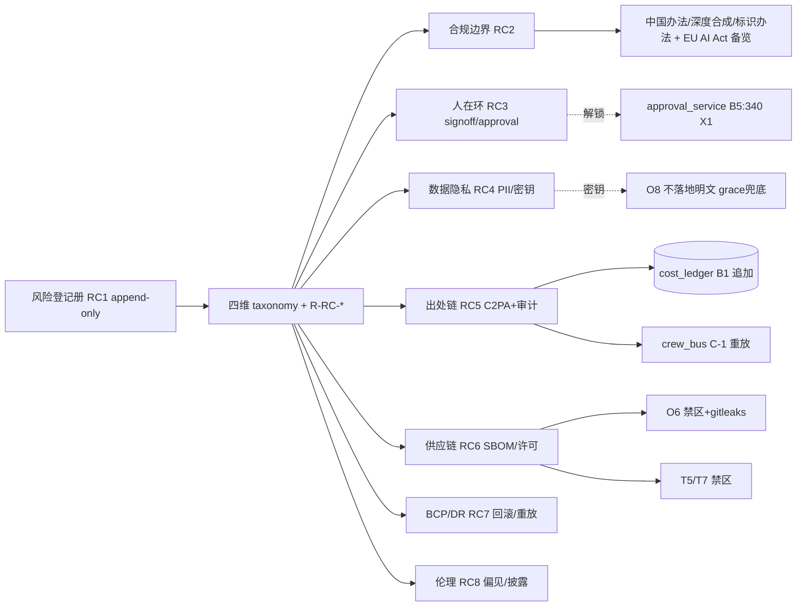

# 第十四轮协商草稿 · 风险与合规（Risk & Compliance）

> 起草：架构师 高见远（主理人代笔收敛）｜ 轮次：第十四轮（风险与合规）｜ 日期：2026-10-03
> 定位：前 13 轮把"做什么 / 怎么协作 / 部署运维 / 测试验收 / 沉淀知识 / 扩展"都拍板后，定**风险与合规治理基线**——风险分类与登记册、合规边界总览（中国生成式AI办法＋深度合成规定＋2025 标识办法＋EU AI Act 备览）、责任归属与人在环、数据与隐私、生成内容可追溯出处、第三方供应链（SBOM/许可）、业务连续性与灾难恢复、伦理与偏见。承接 A19 权限矩阵、A6b 判断力归属三分法、B5 approval_service（X1 否决自动解冻）、C8 外部只读分级、O8 密钥不落地明文、各轮 R-* 标签统一归集。
> 纪律：团队收敛采纳，DECISIONS.md 第十四轮表 16/16 登记 ✅（主理人收敛·2026-10-03）；§9 评审纪要已回填收敛（PM 灵活性透镜 + QA 健壮/安全/合规透镜并行评审，5 处轻量修订后 ✅）。所有决策点候选≥2、推荐有理由、逐条回链已拍板决策（带 ID + DECISIONS.md 行号，行号本轮回 Grep 核准，见 §0.2，PM/QA 双核零错误，仅 C-1:403 为第八轮契约承载锚点见 §9）。外部标准 WebSearch≤4（ISO 31000 / NIST AI RMF / 中国生成式AI办法＋深度合成规定＋标识办法 / C2PA＋SBOM NTIA）。v2 风险合规实证仅做定向 Grep（见 §1.1），诚实标注已存在 vs greenfield 缺失。
> 四原则贯穿：① 不一刀切（按岗分级人审 / 合规适用·豁免判定 / RTO·RPO 按形态分级 / 标识柔硬分级 / 密钥 grace 兜底期）② 关联决策回链 DECISIONS 行号 ③ 不重复造轮子（复用 B1/C4/PK8 追加哲学、O6 gitleaks、C-1 重放、A15 日志、T5/T7 禁区、owner_signoff 既有契约）④ 全面灵活（登记册可增列、合规门禁可分级、可回滚）。

---

## §0 定位与衔接

### §0.1 一句话定位

前 13 轮产出了 DECISIONS.md（14 轮协商共识）+ 14 份协商草稿 + v2 真身一堆散落文档，但**没有任何统一的风险与合规治理基线**——R-* 标签散落各轮（R-SEC1/R-CI/R-CH/R-M1/R-CR1~3/R-SCALE-*/R-DOC-*/R-ROL2），无 risk taxonomy、无中央风险登记册、无合规边界总览、无内容出处（C2PA）机制、无 SBOM、无 PII/同意机制、无深度伪造披露。第十四轮解决"**怎么把分散的风险认知收口成可登记、可评级、可审计、可门禁的治理基线，并且零破既有硬约束（追加不改 / X1 不绕过 / 禁区 / 密钥不落地明文 / 零改动 / 总线重放 / 外部只读）**"。

### §0.2 与已拍板决策的衔接表（关联决策原则②，逐条回链，行号本轮回 Grep 核准）

| 已拍板决策 | 出处 | 第十四轮 Risk&Compliance 接管点 | 关联原则 |
|---|---|---|---|
| A19 契约权限矩阵 | DECISIONS.md:161 | RC1 风险登记册 owner 字段 / RC3 责任归属（角色×契约读写矩阵） | ② 关联决策 |
| A11 分批上岗节奏 | DECISIONS.md:153 | RC1~RC8 owner 认领（承接 §2.10-C，防 R0 落地无人认领） | ② 关联决策 |
| A6b 判断力归属三分法 | 第三轮 A6b（判断力归属三分法：LLM 决策岗/混合岗/纯工具链岗+豁免+台账） | RC3 人在环分级（按岗判定须人审项） | ② 关联决策 |
| B5 熔断（X1 否决自动解冻） | DECISIONS.md:340 | RC3 高危操作解锁须 approval_service / RC-NEW-6 无绕过 | ② 关联决策 |
| C8 权限矩阵（外部协作方只读分级） | DECISIONS.md:245 | RC4 外部数据只读分级 / RC-NEW-5 跨租户越权读 403/409 | ② 关联决策 ① 不一刀切 |
| O8 密钥安全（不落地明文） | DECISIONS.md:484 | RC4 密钥治理（env↔vault 双路径 + grace 兜底期，清 9 份 .env 明文债） / RC-NEW-2 | ② 关联决策 |
| B1 cost_ledger / C4 / PK8 追加不改 | DECISIONS.md:336 / :241 / :399 | RC5 出处链 append-only 落档 / RC1 登记册追加哲学 | ② 关联决策 |
| A15 岗位决策日志（SQLite）⏳ | DECISIONS.md:157 | RC5 生成溯源随决策日志落库（pending 须先建） | ② 关联决策 |
| C-1 crew_bus 崩溃契约（重放） | DECISIONS.md:403（第八轮定义，R0-1 承载，接 P1:384） | RC5/RC7 审计链重放 / RC-NEW-8（v2 未落地 pending） | ② 关联决策 |
| P1 cost.* 事件进 crew_bus | DECISIONS.md:384 | RC5 审计链事件化 | ② 关联决策 |
| T5 禁第三方 MCP / T7 白名单 | DECISIONS.md:196 / :198 | RC6 供应链禁区 CI 扫描 / RC-NEW-4 | ② 关联决策 |
| O6 CI 门禁 | DECISIONS.md:482 | RC-NEW 门禁挂 O6（含 gitleaks 复用） | ② 关联决策 ③ 不重复造轮子 |
| O1~O8 运维（部署/自愈/探针/可观测/回滚/备份） | DECISIONS.md:477–484 | RC7 BCP/DR（回滚兼容期/自愈重放/备份 WAL） | ② 关联决策 |
| T14 idempotency（jobs.begin） | DECISIONS.md:205 | RC7 回滚幂等不重复扣预算 | ② 关联决策 |
| D9 渲染遍数（注释待修 drift） | DECISIONS.md:26 | RC1 登记册含 drift 跟踪列 | ② 关联决策 |
| A24 隐式模式零改动 | DECISIONS.md:166 | RC1~RC8 仅定义治理基线，不改架构 | ② 关联决策 |
| A25 场记 QC 评分校准 | 第三轮 A25（LLM-as-judge 三偏差治理） | RC8 偏见治理基座 | ② 关联决策 |
| U5 全局 ErrorBoundary | DECISIONS.md:430 | RC8 内容安全失败态可观测 | ② 关联决策 |
| 各轮 R-* 标签 | R-SEC1/R-CI/R-CH/R-M1/R-CR1~3/R-SCALE-*/R-DOC-*/R-ROL2 | RC1 统一归集为 R-RC-* 体系 | ② 关联决策 ③ 不重复造轮子 |

### §0.3 四原则贯穿说明

- **① 不一刀切**：人在环按岗分级（判断型岗强制人审、工具链岗免审，A6b）；合规边界做"适用/豁免"判定（`RELEASE_SCOPE=internal|public`，内部研发豁免主文但标识/版权原则主动对齐）；RTO·RPO 按形态分级（本地单机宽松、上云收紧）；AI 标识按风险场景柔硬分级（高风险的显式显著、低风险的简洁）；密钥整改设 `KEY_PLAINTEXT_GRACE_DAYS` 兜底期（不一刀切、可逆）。
- **② 关联决策回链**：每个 RC 点都回链 DECISIONS 行号（本轮回 Grep 核准，PM/QA 双核零错误），不凭空造决策。
- **③ 不重复造轮子**：复用 B1/C4/PK8 追加哲学做登记册与出处链；复用 O6 gitleaks 做密钥扫描；复用 C-1 重放做审计链；复用 T5/T7 禁区扫描做供应链门禁；复用 owner_signoff（shot_spec:247/delivery_spec:130）做既有人在环。
- **④ 全面灵活**：登记册可增列、合规门禁可分级、所有 RC 决策可逆可回滚；风险标签新增 R-RC-* 而不废弃既有 R-*。

### §0.4 硬约束（继承前序，风险与合规治理不得违反——逐条确认零破）

1. **追加不改**：B1:336 / C4:241 / PK8:399 — 风险登记册、出处链、审计落档均 append-only，不覆盖改写。
2. **X1 不绕过**：B5:340 — 高危操作解锁必须走 `approval_service`，治理文档/门禁不得提供绕过入口（接 R-DOC-RB 教训）。
3. **禁区**：T5:196 / T7:198 — 供应链/模型接入须过禁区 CI 扫描；第三方 MCP 边界不变。
4. **密钥不落地明文**：O8:484 — **当前 9 份 `.env` 明文落盘属安全债、违反此约束**（见 §1.1），RC4 将其列为必修整改项；约束本身零破（即规定不得落地明文，现状是待整改缺口，非放宽）。
5. **A24 零改动**：A24:166 — 本轮仅定义治理基线，不改总线/架构。
6. **crew_bus 重放**：P1:384 / C-1:403 — 审计链依赖总线重放；v2 未落地（R-SCALE-CB）须先落地，RC5/RC7 标注 pending 依赖。
7. **外部只读分级**：C8:245 — 外部协作者数据只读，越权显式 403/409+日志禁静默。
8. **v2 greenfield 实证**：§1.1 实测确认无 gitleaks/无 C2PA/无 SBOM/无 PII 机制/无深度伪造披露——上述机制从零建设，且须在硬约束内；**pending 决策（A15:157 / crew_bus P1:384 / C-1:403）不视为已落地，本轮只定"治理基线"，不定"机制已建"**。

---

## §1 现状与实证

### §1.1 v2 风险/合规机制定向 Grep（关键词：`gitleaks|secret|os.environ|\.env|watermark|provenance|c2pa|audit|consent|pii|gdpr|license|sbom|allowlist|whitelist|approval|signoff|human.?in.?loop|disclos`）

对 `D:\aifilmteam\AI影视团队v2\` 做一次定向 Grep，结果诚实分两类：

**已存在（命中，但多数为文档级或契约层，非完整机制）：**

| 命中 | 文件:行 | 性质判定 |
|---|---|---|
| `.env` 明文密钥落盘 | `agents/_legacy_roles/*/.env`（9 份，FEISHU_APP_SECRET 32 字符 / KIMI_CN_API_KEY 51 字符）；`docs/_legacy_source/根配置/gitignore.txt:42` 已将 `.env` 忽略 | **安全债非机制**：明文落盘 + gitignore 兜底，9/9 未入库（R0-盘点报告确认），但违 O8:484「密钥不落地明文」→ RC4 必修 |
| `owner_signoff` 字段 | `spec/shot_spec.schema.json:247`、`spec/delivery_spec.json:130-134`、`_legacy/projects_雨夜寻猫/timeline/master_v2.json:66 signoff_rule` | **人在环签核机制已存在于契约层**（auto_draft 项须 signoff{role,by,ts,sha} 才定稿，qc_media 按 sha 复核）→ 承接 RC3 |
| `TERMINAL_ALLOWLIST` + `APPROVAL_POLICY=always` | `agents/_legacy_roles/editor/SOUL.md:52`、`docs/_legacy_source/根配置/AGENTS.md:90-92` | **allowlist + 人工审批闸已存在于剪辑岗终端** → 承接 RC3 人审 + T5/T7 禁区 |
| `license` 调研文档 | `docs/调研-板块②*`、`docs/R0-调研证据附录.md`、`docs/R3-架构定稿.md`（fal ToS / LTX-2 Community License / Stable Audio Community License / ACE-Step MIT 等） | **许可调研已存在（文档级）**，但无 SBOM、无 CI 许可扫描、无 machine-readable 清单 → RC6 缺执行层 |
| `provenance_index` / `provenance_kind_counts` | `docs/R0-调研证据附录.md:117`、`docs/_legacy_handoff/qc_v4_recheck.json`、`qc_master_recheck.json`、`_legacy/projects_雨夜寻猫/output/qc_v4_v5.json` | **QC 层 provenance 分类计数已存在**（属 QC 产出分类，非 C2PA 内容出处）→ RC5 升级基座 |
| `watermark` | `tests/run_case*.py` 负向提示词、`docs/R0-规划书-v2.0/*.md:227 assets/watermarks/`、`v3.0技术附录-部署与接入手册:189 watermark=false` | **无水印/出处机制**：仅有负向提示词抑制水印 + 空目录占位 + 参数 → 非 provenance 机制 |

**未命中（greenfield 缺失，须从零建设——明确标注）：**

| 关键词 | 结果 | 结论 |
|---|---|---|
| `gitleaks` | 无代码/CI 命中（仅 12 轮文档提及复用 O6 gitleaks） | **密钥扫描门禁缺失** → RC4/RC-NEW-2 |
| `os.environ` | 无命中 | **密钥经环境变量注入模式未在代码建立**（仍用 .env 明文文件） |
| `c2pa` | 无命中 | **内容出处标准未引入** → RC5/RC-NEW-3 |
| `audit`（统一审计链） | 无命中（除 cost_ledger 追加式 B1/PK8） | **统一审计链缺失**（仅有成本账/落档 append-only，非全量审计）→ RC5/RC-NEW-8 |
| `consent` / `pii` / `gdpr` | 无命中 | **PII/同意/隐私合规机制缺失** → RC4/RC-NEW-9 |
| `sbom` | 无命中 | **软件物料清单缺失** → RC6/RC-NEW-4 |
| `human.?in.?loop` / `disclos` | 无命中 | **深度伪造披露/伦理披露机制缺失** → RC8/RC-NEW-7 |

**诚实结论**：v2 在"风险与合规"维度几乎全是 greenfield。仅有的既有资产＝（a）契约层 `owner_signoff` 人审、（b）终端 `ALLOWLIST`+`APPROVAL_POLICY` 人审闸、（c）`.env` gitignore 兜底（安全债、违反 O8）、（d）license 调研文档、（e）QC `provenance` 分类、（f）watermark 仅占位。核心缺失＝gitleaks 密钥扫描、env 注入、C2PA 出处、统一审计链、PII/同意、SBOM、深度伪造披露。

### §1.2 内部可复用标准（回链前序，避免重造）

- **owner_signoff（shot_spec:247 / delivery_spec:130）**：人在环签核既成契约字段，RC3 直接复用并扩展为全岗分级人审，不另起炉灶。
- **B1/C4/PK8 append-only 哲学**：RC1 风险登记册、RC5 出处链、RC-NEW-8 审计链直接沿用"只追加不改 + idem_key"模式。
- **O6 gitleaks / 禁区扫描（:482）**：RC4 密钥扫描、RC6 供应链禁区直接挂 O6，不新建流水线（类比 12 轮 WD4 复用 O6）。
- **C-1 重放（:403）/ P1（:384）**：RC5/RC7 审计链与自愈重放直接依赖，不另建消息中间件。
- **T5/T7 禁区（:196/:198）**：RC6 模型/第三方接入禁区校验复用既有 CI 扫描。
- **A15 决策日志（:157 ⏳ pending）**：RC5 生成溯源落库基座，须先落地（标注 pending）。

### §1.3 外部标准调研（WebSearch≤4，2026-10-03）

**① ISO 31000:2018 风险管理——原则/框架/过程**
- 八原则：Integrated（融入组织活动）/ Structured / Customized / Inclusive / Dynamic / 基于最佳信息 / 关注人因 / Continual improvement。过程：建立情境→识别→分析→评价→处理→监控评审→记录报告。
- 非认证标准（guidance），建议"单一风险登记册 + 一致评级方法 + treatment owner + 复查点"，不另建平行流程。
- 来源：`https://www.iso.org/standard/65694.html` ｜ 一句话结论：提供 risk taxonomy + 风险登记册 + 持续监控的方法底座，直接支撑 RC1。

**② NIST AI Risk Management Framework 1.0（AI 100-1, 2023）+ Generative AI Profile（AI 600-1, 2024）**
- 四函数 GOVERN / MAP / MEASURE / MANAGE；GenAI Profile 列 12 类生成式 AI 特有风险（幻觉 / 有害偏见 / 知识产权 / 数据隐私 / 深度伪造与信息完整性危害 / 价值链条风险等），配 200+ 建议动作。
- 来源：`https://nvlpubs.nist.gov/nistpubs/ai/nist.ai.100-1.pdf` 与 `https://www.nist.gov/publications/artificial-intelligence-risk-management-framework-generative-artificial-intelligence` ｜ 一句话结论：AI 特有风险分类（含深度伪造披露、偏见、IP）直接支撑 RC8 伦理与 RC2 合规边界。

**③ 中国《生成式人工智能服务管理暂行办法》（2023-08-15 施行）+《互联网信息服务深度合成管理规定》+《人工智能生成合成内容标识办法》（2025-09-01 施行）**
- 办法第二条但书：内部研发/未向境内公众提供生成式服务→不适用；第十二条：按深度合成规定对图片/视频等生成内容标识；第七条：训练数据须合法来源、涉个人信息须同意、尊重知识产权。2025《标识办法》：显式标识（可被用户感知）+ 隐式标识（文件元数据，鼓励数字水印）+ 传播平台核验义务。
- 来源：`https://www.gov.cn/gongbao/2023/issue_10666/202308/content_6900864.html` 与 `https://www.cac.gov.cn/2025-03/14/c_1743654684782215.htm` ｜ 一句话结论：本项目属内部影视研发（未向公众提供）→ 办法主文但书豁免，但标识义务、训练数据合法性、版权与个人信息保护原则应主动对齐（承接 RC2/RC4/RC5/RC8）。

**④ C2PA 内容出处标准（v2.2/2.3）+ NTIA SBOM 最低要素（2021，2025 CISA 升级）**
- C2PA：在媒体文件内嵌密码学签名 Manifest（谁/何时/何工具/是否 AI/每次编辑），篡改即签名断裂可检测，离线可验证；鼓励接中国标识办法"隐式标识+数字水印"。SBOM（NTIA）：组件名/版本/许可/供应商/哈希/时间戳，SPDX/CycloneDX 格式，自动化生成。
- 来源：`https://c2paviewer.com/articles/what-is-c2pa` 与 `https://www.techtarget.com/whatis/definition/software-bill-of-materials-SBOM` ｜ 一句话结论：直接支撑 RC5 provenance（C2PA 数字水印/隐式标识）+ RC6 供应链 SBOM（许可合规）。EU AI Act 备览：高风险系统须风险/数据治理与透明度义务，本项目内部研发暂不在其强监管域，但台账式备览即可。

### §1.4 风险分类基线（承接 A19/C8 + 各轮 R-* 标签统一归集）

统一 taxonomy＝四维（技术 / 合规 / 业务连续性 / 伦理）× 二维评级（Likelihood×Impact，各 1–5）→ 风险值＝L×I，分 P0/P1/P2。既有 R-* 标签归集映射：

| 既有 R-* | 归属维度 | 第十四轮归集 |
|---|---|---|
| R-SEC1 / R-SEC3（O8 密钥/ CORS） | 技术·安全 | → R-RC-SEC（P0，密钥明文债） |
| R-CI / R-CH / R-M1 / R-CR1~3 | 技术·质量 | → 并入 R-RC-REG 登记册跟踪 |
| R-SCALE-CB / R-SCALE-REG / R-SCALE-A5/A26/A13/A24/A15 / R-SCALE-GATE | 技术·扩展 | → 保留并加 R-RC-AUDIT（审计链依赖，根因＝R-SCALE-CB P0） |
| R-DOC-CI / R-DOC-GLOSS / R-DOC-KB-LEAK / R-DOC-VALE / R-DOC-RB | 合规·文档 | → 并入 R-RC-GATE 门禁体系 |
| R-ROL2（X1 自动解冻） | 业务·成本 | → R-RC-ACCT（责任归属，接 RC3） |

---

## §2 决策点（RC1~RC8，候选≥2 + 推荐 + 影响 + 可逆 + 来源）

### RC1 · 风险分类与登记框架

- **背景**：前 13 轮散落 R-* 标签（§1.4），无统一 taxonomy、无中央风险登记册、无 owner/评级/复查。
- **候选 A（推荐）**：建 risk taxonomy（技术/合规/业务连续性/伦理 四维）× Likelihood×Impact（1–5）二维评级 → 中央风险登记册 `risk_register.jsonl`（append-only，沿用 B1:336/PK8:399 哲学，含 `idem_key`、owner、treatment、review_date、drift_ref 列），统一归集所有既有 R-* 标签为 R-RC-* 体系；评级阈值 `RISK_P0/P1_THRESHOLD` env 可配（不一刀切①）。
- **候选 B**：仅维护扁平 R-* 清单（现状延续）。→ 无评级、无 owner、无复查，drift 失控。
- **候选 C**：引外部 GRC 平台。→ 超当前规模，违背不一刀切（①）。
- **推荐**：A。登记册为 jsonl 文本资产，CI 可断言非空且每条含 owner+评级（RC-NEW-1），零基础设施成本。
- **影响**：统一风险口径，所有 RC 决策的可追溯底座；不强制立即实施外部平台。
- **可逆**：✅（登记册纯数据，增删列低成本）。
- **来源**：§1.3-① ISO 31000 / B1:336 / PK8:399 / A19:161 / A11:153 / C8:245 / §1.4 标签归集。

### RC2 · 合规边界总览

- **背景**：须明确内容合规 / 版权与训练数据合法性 / 监管三域边界，且本项目为内部影视研发。
- **候选 A（推荐）**：建合规边界总览（compliance boundary map）三域——① 内容合规：禁生成违法内容（接办法第四条，社会主义核心价值观/禁煽动等），接 RC8 内容安全；② 版权与训练数据合法性：模型许可清单 + 训练数据来源合规（接 RC6 + A6b 台账 + R3-架构定稿 E 合规 17 项）；③ 监管：中国《生成式AI办法》+《深度合成规定》+ 2025《标识办法》为主、EU AI Act 备览。明确"适用/豁免"判定（`RELEASE_SCOPE=internal|public` env 配置）——**内部研发未向公众提供→办法第二条但书豁免主文，但标识与版权/训练数据合法性原则主动对齐**；切 public 自动升级为 required 显式标识 + 备案（不一刀切①）。
- **候选 B**：只做中国法规。→ 忽略 EU AI Act 备览与跨境协作方潜在义务。
- **候选 C**：全量合规认证（ISO/IEC 42001）。→ 过早，规模不配。
- **推荐**：A。边界图区分硬红线（内容违法/侵权）与软对齐（向公众发布才触发的标识/备案），避免过度合规。
- **影响**：给 RC4/RC5/RC6/RC8 划定合规坐标；可逆✅。
- **来源**：§1.3-③ 中国办法/深度合成/标识办法 + EU AI Act 备览 / A6b / R3-架构定稿 E 合规。

### RC3 · 责任归属与人在环（accountability / human-in-the-loop）

- **背景**：承接 A6b 判断力归属三分法、B5 approval_service（X1 否决自动解冻）、导演集中式决策；既有 owner_signoff（契约层）+ TERMINAL_ALLOWLIST+APPROVAL_POLICY（剪辑岗）已存在。
- **候选 A（推荐）**：明确 accountability 三层——① 判断型决策（LLM 决策岗，A6b）须 `owner_signoff`（复用 shot_spec:247/delivery_spec:130 契约字段）② 混合岗+纯工具链岗按 A6b 台账演化，工具链岗免人审；③ 高危操作（删除/花钱/发布/解冻）须人工审批闸，将剪辑岗 `APPROVAL_POLICY=always`+`TERMINAL_ALLOWLIST` 扩展为全岗"高危操作人审"基线；导演集中式决策为最终责任人；X1 否决自动解冻走 approval_service（B5:340，接 R-DOC-RB）。
- **候选 B**：全自动无人工闸。→ 违 A6b/B5-X1 硬约束。
- **候选 C**：全员每操作人工审批。→ 违背不一刀切（①），扼杀吞吐。
- **推荐**：A（按岗分级人审，不一刀切①）。既有 signoff/allowlist 机制直接复用扩展，不另建。
- **影响**：责任清晰、可追溯；可逆✅。
- **来源**：A6b / B5:340 / A19:161 / C8:245 / shot_spec:247 / delivery_spec:130 / editor SOUL.md:52 / O8:484。

### RC4 · 数据与隐私合规

- **背景**：PII / 外部协作者数据 / 多租户隔离（C8:245）/ O8 密钥不落地明文；v2 无 PII/同意机制（§1.1），且 9 份 .env 明文违反 O8。
- **候选 A（推荐）**：建数据分级（公开/内部/PII/密钥）× 处理规则——① PII 最小化收集 + 同意（consent）机制（greenfield，从零建，写入隐私台账，RC-NEW-9 flag-gated 防空心门禁）；② 外部协作者数据按 C8:245 只读分级 + 导出审计（越权 403/409 接 RC-NEW-5）；③ 多租户隔离接第十三轮 SC7（tenant_id 前缀/分库）；④ **密钥不落地明文**：落实 O8:484（中央密钥管理 + HMAC 验签 + env↔vault 双路径，不一刀切①），设 `KEY_PLAINTEXT_GRACE_DAYS`（默认 14，env 可配）兜底期清理 9 份存量 `.env` 明文、到期 `enforced`，**新明文立即 gitleaks 阻断（RC-NEW-2）**；零容忍新增明文。
- **候选 B**：维持 .env 明文 + gitignore 兜底。→ 明文在磁盘＝落地明文，违反 O8:484 硬约束。
- **候选 C**：全量加密一切。→ 过度，不一刀切（①）。
- **推荐**：A。PII 与密钥为必修，分级策略不一刀切；密钥整改设 grace 兜底期（可逆、不无限期明文）。
- **影响**：PII/密钥合规；可逆✅（env↔vault 迁移可回退，grace 兜底期后强制）。
- **来源**：O8:484 / C8:245 / 十三轮 SC7 / B1:336 / §1.1 .env 安全债。

### RC5 · 生成内容可追溯与出处（provenance）

- **背景**：watermark/审计链，承接 cost_ledger（B1:336）/ A15 决策日志（:157）/ C-1 总线重放（:403）/ PK8 落档（:399）；v2 无 C2PA、QC provenance 仅分类计数（§1.1）。
- **候选 A（推荐）**：建内容出处链——① **先落隐式元数据标识**（现在，接中国 2025 标识办法"隐式标识+数字水印鼓励"）嵌入生成视频/图片文件元数据，低成本可断言；② C2PA 密码学 manifest 作 RC-NEW-3 **flag-gated 增强**后续接入（离线可验证、签名篡改即断裂）；③ 生成溯源（模型/参数/seed/决策 sha）随 cost_ledger + A15 决策日志一并 append-only 落档（B1/PK8 哲学）；④ C-1 总线重放（:403）保审计链不丢（v2 未落地 pending，接 R-SCALE-CB）；⑤ QC `provenance_index` 升级为完整出处记录。
- **候选 B**：仅人工记录出处文档。→ 不可机器验证、易 drift。
- **候选 C**：仅显式水印文字。→ 不抗篡改、无密码学出处。
- **推荐**：A。隐式标识先落地（合规低成本），C2PA 后续增强；落档沿用 append-only。
- **影响**：生成物可验证出处、可审计；可逆✅（标识/水印可选嵌）。
- **来源**：§1.3-④ C2PA + 标识办法 / B1:336 / A15:157 / C-1:403 / PK8:399 / §1.1 QC provenance。

### RC6 · 第三方依赖与供应链风险

- **背景**：模型许可 / 开源合规 / SBOM(NTIA) / O8 密钥 / 禁区 T5:196·T7:198；v2 有 license 调研文档但无 SBOM、无 CI 许可扫描（§1.1）。
- **候选 A（推荐）**：建 SBOM（NTIA 最低要素：组件名/版本/许可/供应商/哈希/时间戳，**`SBOM_FORMAT`（CycloneDX/SPDX 双格式 env 选）、`SBOM_GENERATE`（默认 release，env 可配）自动生成**，RC-NEW-4 flag-gated 装器后 required）+ 模型许可清单（清理论坛已有调研文档落为 machine-readable `clearance` 台账，接 A6b 台账 / R3-架构定稿 E 合规 17 项）+ 禁区 CI 扫描（T5/T7 接 O6:482）+ 密钥不落地（O8）。
- **候选 B**：仅文档级许可调研（现状）。→ 无自动校验、无 SBOM、drift。
- **候选 C**：全量第三方审计。→ 规模不配。
- **推荐**：A。SBOM 可脚本化生成（RC-NEW-4 装器后易断言），许可清单复用既有调研不重造。
- **影响**：供应链可见、许可冲突可门禁；可逆✅。
- **来源**：§1.3-④ NTIA SBOM / T5:196 / T7:198 / O6:482 / O8:484 / A6b / R3 E 合规。

### RC7 · 业务连续性与灾难恢复（BCP/DR）

- **背景**：回滚 / 自愈 O2:478，承接第十轮 O1~O8（:477–484）。
- **候选 A（推荐）**：BCP/DR 基线——① 回滚契约兼容期（O5:481）+ job 幂等（T14:205）不重复扣预算，定义回滚触发阈值（成本/数据损坏/探针失败）；② 自愈重启触发 crew_bus 重放（O2:478 接 C-1:403，v2 未落地 pending）；③ 备份 WAL+定期快照（O7:483）；④ 定义 RTO/RPO 目标（不一刀切①：本地单机 RTO 宽松、上云收紧）；⑤ 解冻/恢复走 approval_service（B5）。
- **候选 B**：仅手动备份。→ 无 RTO/RPO、无重放。
- **候选 C**：异地多活。→ 超规模。
- **推荐**：A。复用 O1~O8 已拍板运维基座，不另建。
- **影响**：可恢复、可重放；可逆✅。
- **来源**：O1:477 / O2:478 / O3:479 / O4:480 / O5:481 / O7:483 / C-1:403 / T14:205 / P1:384。

### RC8 · 伦理与偏见风险

- **背景**：AI 偏见 / 深度伪造披露 / 内容安全；v2 无深度伪造披露机制（§1.1），有 safety 负向提示词（tests）。
- **候选 A（推荐）**：伦理与偏见基线——① 偏见治理：QC 评分校准（接 A25 场记 QC LLM-as-judge 三偏差治理）+ NIST GenAI Profile 偏见类跟踪；② 深度伪造披露：生成内容附 AI 标识（接 RC2 中国标识办法 + RC5 隐式标识），公开发布物须显式标识（RC-NEW-7）；③ 内容安全：接办法第四条禁生成违法内容 + 负向提示词/审核（tests 已含 safety negative prompts）+ U5:430 全局 ErrorBoundary 失败态可观测。
- **候选 B**：仅技术偏见测试。→ 忽略披露与内容安全合规。
- **候选 C**：伦理委员会审议每片。→ 过度。
- **推荐**：A。偏见+披露+内容安全三件齐，不一刀切（标识柔硬分级）。
- **影响**：合规 + 可信；可逆✅。
- **来源**：§1.3-② NIST GenAI Profile / 办法第四条 / A25 / RC2 / RC5 / U5:430 / tests safety。

### §2.9 规格汇总（落地用，便于工程师实现）

```yaml
# ① 风险登记册 schema（RC1，接 B1:336/PK8:399 append-only）
risk_register:
  store: risk_register.jsonl            # 只追加不改，idem_key 幂等
  schema:
    id: R-RC-XXX                        # 风险 ID
    taxonomy: [technical|compliance|bcp|ethics]   # 四维
    title: str
    likelihood: 1-5
    impact: 1-5
    rating: "P0|P1|P2"                  # = L*I 分档，阈值 env 可配 RISK_P0/P1_THRESHOLD，不一刀切①
    owner: A系列岗位id                   # 接 A19:161 / A11:153
    treatment: [avoid|mitigate|transfer|accept]
    treatment_plan: str
    review_date: ISO8601
    drift_ref: DECISIONS行号/前轮R-*     # 承接漂移跟踪（接 D9:26）
    status: [open|mitigated|closed]
  inherit: [B1_336, PK8_399]            # 追加不改哲学

# ② 合规门禁（RC2/RC4/RC5/RC6/RC8，挂 O6:482）
compliance_gate:
  boundary_map:                        # RC2 三域
    content_safety: 硬红线(办法第四条)    # 违则阻断
    copyright_training: 主动对齐(版权/训练数据合法来源)
    regulation:
      cn_generative_ai: 但书豁免(内部研发未向公众提供) + 标识/版权原则主动对齐
      cn_deepsynth: 标识义务对齐
      cn_label_2025: 显式+隐式标识+数字水印鼓励(2025-09-01 施行)
      eu_ai_act: 备览(内部研发暂不在强监管域)
    release_scope:                      # RC2 适用·豁免 env 可配
      env: RELEASE_SCOPE                # internal(默认豁免主文) | public(自动升级 required 标识+备案)
  pii:
    minimization: required             # RC4 最小化收集
    consent_ledger: flag_gated         # v2 无 PII 命中＝greenfield，pending（防空心门禁，接 RC-NEW-9）
    consent_schema: { subject, purpose, granted_at, revoked_at, ledger_hash }  # 隐私台账模板（待建）
  key_management:                      # RC4 / O8:484
    no_plaintext_on_disk: grace_then_enforced   # 设 KEY_PLAINTEXT_GRACE_DAYS(默认14) 兜底期，到期 enforced；新明文立即 gitleaks 阻断(RC-NEW-2)，不一刀切①
    grace_days_env: KEY_PLAINTEXT_GRACE_DAYS    # 默认 14，env 可配，到期前允许存量 .env 兜底、到期后强制清零
    mode: [env, vault]                 # DEPLOY_MODE 决定，不一刀切①
    hmac_verify: required
    rollback: env_vault_migration_reversible    # env↔vault 迁移可回退（grace 兜底期）
  provenance:                          # RC5
    implicit_metadata_label: required_now      # 先落隐式元数据标识（2025 办法，低成本可断言）
    c2pa_manifest: flag_gated           # 未引入→pending，签名篡改即断裂(接 RC-NEW-3)
    append_only_ledger: [cost_ledger_B1, A15_log, PK8]
    bus_replay: C-1_403                # v2 未落地 pending
  supply_chain:                        # RC6
    sbom: { format_env: SBOM_FORMAT, default: [CycloneDX, SPDX], fields: [name,version,license,supplier,hash,timestamp], generate_env: SBOM_GENERATE, default: release }  # 格式/频率 env 可配，不一刀切①
    license_clearance: machine_readable # clearance 台账模板(接 A6b 台账/R3 E合规)：{ component, version, license, cleared_by, cleared_at }
    forbidden_zone_scan: [T5_196, T7_198]   # 接 O6
  ethics:                              # RC8
    bias_calibration: A25_QC
    deepfake_disclosure: flag_gated    # RC-NEW-7 pending（标识办法 2025-09-01 施行，机制待建）
    content_safety: 办法第四条 + tests safety

# ③ BCP/DR（RC7，接 O1~O8）
bcp_dr:
  rollback: O5_compat_window + T14_idempotent
  rollback_trigger: { cost_overrun_pct, data_corruption, probe_fail_streak }   # 回滚触发阈值（显式）
  self_heal_replay: O2_478 -> C-1_403  # v2 未落地 pending
  backup: O7_WAL + snapshot
  rto_rpo: { local_single: relaxed, cloud: tightened }   # 不一刀切①
  unfreeze: approval_service_B5_340
```

### §2.10 治理测试项（RC-NEW）与风险标签（R-RC，类比 13 轮 §2.10）

#### §2.10-A 治理门禁项（机器可断言 pass 判据，分期档位）

| # | 门禁项 | 机器可断言 pass 判据 | 门禁档位（迁移分期） | 关联 |
|---|---|---|---|---|
| RC-NEW-1 | 风险登记册有效 | `risk_register.jsonl` 非空且每条含 owner+likelihood+impact+rating | required-capable（jsonl 易建） | RC1 |
| RC-NEW-2 | 密钥不落地明文 | CI 复用 O6 gitleaks + 断言无 `KEY=明文` 提交；grace 期后 9 份 `.env` 明文清零 | **flag-gated / pending**（gitleaks 未装→先装后 required，接 R-SEC1/O8 教训；新明文立即阻断） | RC4 / O8 |
| RC-NEW-3 | 内容出处 C2PA | 交付物含 C2PA manifest 或元数据隐式标识，断言可离线验证签名且**签名篡改即断裂** | **flag-gated / pending**（C2PA 未引入，先落隐式元数据标识+溯源） | RC5 |
| RC-NEW-4 | SBOM 生成 | CI 生成 SBOM(CycloneDX/SPDX) 且许可字段无 `other`、**无 copyleft 与闭源条款冲突**，断言通过 | **flag-gated / pending**（SBOM 生成器待装→装后 required） | RC6 |
| RC-NEW-5 | 外部越权读 | 跨租户/外部协作者读断言 403/409 无静默放行（C8:245） | **flag-gated / pending**（SC7 多租户隔离 greenfield，接十三轮 SC-NEW-5/9，落地后转 required） | RC4 / C8 |
| RC-NEW-6 | 人在环无绕过 | 高危操作（删/花钱/发布/解冻）须 signoff/approval，grep 无绕过入口（接 R-DOC-RB） | required（owner_signoff 已存在） | RC3 / B5 |
| RC-NEW-7 | 深度伪造披露 | 公开发布物附 AI 显式标识（元数据/界面），断言存在 | **flag-gated / pending**（标识办法 2025-09-01 施行，机制待建） | RC8 |
| RC-NEW-8 | 审计链重放 | 审计事件 append-only 且崩溃后可重放无重复；**idem_key 冲突拒重放**（C-1:403） | **flag-gated / pending**（crew_bus 零引用，接 R-SCALE-CB） | RC5/RC7 |
| RC-NEW-9 | PII/同意机制 | `consent_ledger` 存在 + 最小化收集断言（greenfield 从零建） | **flag-gated / pending**（v2 无 PII/consent 命中，接 R-RC-PII） | RC4 |

> **门禁严苛度（§9.3-⑤ 裁定）**：RC-NEW-1/6 基座存在（jsonl / owner_signoff）可 required；**RC-NEW-2/3/4/5/7/8/9 因目标子系统未实现（gitleaks 未装 / C2PA 未引入 / SBOM 生成器未装 / SC7 多租户未建 / 披露机制未建 / crew_bus 零引用 / PII·consent greenfield）须 pending / flag-gated，绝不可从第一天 required——否则空心门禁误杀全部 PR（R-DOC-CI / R-SCALE-GATE 教训）**。

#### §2.10-B 风险标签（登记 DECISIONS 第十四轮治理块，复用并新增 R-RC-*）

| 风险 | 级别 | 说明 | 关联决策 |
|---|---|---|---|
| R-RC-SEC | **P0** | 9 份 `.env` 明文密钥安全债 + gitleaks 未装（违 O8:484）→ 类比 R-SEC1 | RC4 / O8 |
| R-SCALE-CB | **P0**（承接第十三轮） | `crew_bus` 代码零引用 → RC5 审计链 / RC7 自愈重放无运行基座 | RC5/RC7 |
| R-RC-REG | P1 | 中央风险登记册未建（RC1 目标，greenfield） | RC1 |
| R-RC-PII | P1 | PII/同意（consent）机制缺失（v2 无命中） | RC4 |
| R-RC-PROV | P1 | C2PA/出处未引入（QC provenance 仅分类） | RC5 |
| R-RC-AUDIT | P1 | 统一审计链缺失，根因＝R-SCALE-CB(P0)（crew_bus 零引用 v2 未落地） | RC5/RC7 |
| R-RC-SBOM | P1 | SBOM 未生成、许可无 machine-readable 清单 | RC6 |
| R-RC-DISC | P1 | 深度伪造披露缺失（v2 无命中） | RC8 |
| R-RC-ACCT | P1 | 责任归属分级未成文（A6b/B5 须落治理文档） | RC3 |
| R-RC-BOUNDARY | P2 | 合规边界图三域（RC2）未建为机器可读边界规则 | RC2 |
| R-RC-GATE | P1（类 R-DOC-CI） | RC-NEW 门禁若对未实现子系统标 required 即空心误杀 → 须分档 | §2.10-A |

#### §2.10-C 决策 owner 认领（接 A11:153 分批上岗，防 R0 落地无人认领）

| 决策 | 认领岗（A 系列） | 决策 | 认领岗 |
|---|---|---|---|
| RC1 风险登记册 | 架构 | RCK1 taxonomy | 架构 |
| RC2 合规边界 | 制片·法务 | RCK2 合规速查 | 制片·法务 |
| RC3 人在环 | 导演·各岗 | RCK3 人审分级 | 导演·各岗 |
| RC4 数据隐私 | 制片·安全 | RCK4 数据分级 | 制片·安全 |
| RC5 出处链 | 架构·剪辑 | RCK5 出处操作 | 架构·剪辑 |
| RC6 供应链 | 工具岗 | RCK6 许可清单 | 工具岗 |
| RC7 BCP/DR | 运维 | RCK7 DR runbook | 运维 |
| RC8 伦理偏见 | 导演·场记 | RCK8 伦理检查 | 导演·场记 |

---

## §3 快决策紧凑表 RCK1~RCK8（知识/清单条目）

| ID | 点 | 推荐 | 理由（回链） | 可逆 |
|---|---|---|---|---|
| RCK1 | risk taxonomy 四维定义 | 技术/合规/业务连续性/伦理 × L×I 评级（阈值 RISK_P0/P1_THRESHOLD env 可配），归集 R-* 为 R-RC-* | RC1/§1.4/ISO 31000 | ✅ |
| RCK2 | 合规边界速查 | 办法/深度合成/标识办法/EU AI Act 备览 + `RELEASE_SCOPE` 适用·豁免判定脚本 | RC2/§1.3-③ | ✅ |
| RCK3 | 人在环分级清单 | 判断型岗强制 signoff、工具链岗免审、高危操作人审闸 | RC3/A6b/B5:340/owner_signoff | ✅ |
| RCK4 | 数据分级与 PII 处理 | 公开/内部/PII/密钥四级 + 最小化 + consent 台账(flag-gated,greenfield) + 密钥 grace 兜底期 | RC4/O8:484/C8:245 | ✅ |
| RCK5 | 内容出处操作 | 先隐式元数据标识 + C2PA(flag-gated) + 溯源 append-only 落档 + bus 重放 | RC5/C2PA/B1:336/C-1:403 | ✅ |
| RCK6 | 第三方/模型许可清单 | clearance 台账字段 + SBOM 生成（SBOM_FORMAT 可配，SBOM_GENERATE 默认 release） | RC6/NTIA SBOM/A6b/R3 E合规 | ✅ |
| RCK7 | BCP/DR runbook | 回滚兼容期 + 回滚触发阈值 + 自愈重放 + 备份 WAL + RTO/RPO 分级 | RC7/O1~O8:477-484/T14:205 | ✅ |
| RCK8 | 伦理与偏见检查 | 偏见校准(A25) + 深度伪造披露 + 内容安全(办法第四条) | RC8/NIST GenAI/A25/U5:430 | ✅ |

---

## §4 关系与时序图（mermaid）



```mermaid
sequenceDiagram
  participant U as 用户/外部协作者(C8)
  participant Sys as 系统
  participant HK as 人在环审批(B5)
  participant Led as 风险登记册+审计链
  U->>Sys: 触发高危操作(发布/花钱/解冻)
  Sys->>HK: 需 signoff/approval(owner_signoff RC3)
  HK-->>Sys: 人工核准(sha 校验)
  Sys->>Led: 操作+决策溯源 append-only(B1/PK8/A15)
  Sys->>Led: 审计事件进 crew_bus(C-1 重放)
  Note over Sys,Led: 密钥经 env/vault(O8) 不落明文(grace兜底);跨租户读 403/409(C8)
```

---

## §5 风险与合规覆盖矩阵（当前→目标）

| 维度 | 当前（v2 实测 §1.1） | 目标（RC 承接） | 硬约束 |
|---|---|---|---|
| 风险登记 | 散落 R-* 标签，无登记册 | 中央 risk_register.jsonl + R-RC-*（RC1） | B1/PK8 追加 |
| 合规边界 | 无总览，仅 license 文档 | 合规边界图三域 + 适用·豁免（RC2） | 办法/深度合成/标识办法 |
| 人在环 | owner_signoff（契约）+ 剪辑岗 allowlist/approval 仅局部 | 全岗分级人审 + X1 走 approval（RC3） | B5-X1 / A6b |
| 数据隐私 | 9 份 .env 明文（违 O8）+ 无 PII | 数据分级 + consent(flag-gated) + 密钥 env/vault(grace兜底)（RC4） | O8:484 / C8:245 |
| 内容出处 | QC provenance 分类，无 C2PA | 隐式标识先落 + C2PA(flag-gated) + 溯源落档 + 重放（RC5） | B1/PK8/C-1 |
| 供应链 | license 文档，无 SBOM | SBOM(flag-gated) + 许可 clearance 台账 + 禁区 CI（RC6） | T5/T7 / O6 |
| BCP/DR | O1~O8 已拍板，crew_bus 未落地 | 回滚+触发阈值+重放+备份+RTO/RPO（RC7） | O1~O8 / C-1 |
| 伦理偏见 | safety 负向提示词，无披露 | 偏见校准 + 深度伪造披露 + 内容安全（RC8） | 办法第四条 / A25 |

---

## §9 评审纪要（团队收敛·2026-10-03）

### §9.1 投票信息
- 轮次：第十四轮（风险与合规）
- 日期：2026-10-03
- 起草：架构师 高见远（主理人代笔）
- 评审：PM 许清楚（灵活性透镜）+ QA 严过关（健壮/安全/合规透镜）并行
- 收敛：主理人 齐活林（按老板「全走推荐」授权，团队收敛采纳）

### §9.2 结论表（16 点，全以团队推荐 A 为立场采纳）

| 编号 | 决策 | 立场 |
|---|---|---|
| RC1 | 风险分类与登记框架（R-RC-* 归集） | ✅ 同意推荐（团队收敛·2026-10-03） |
| RC2 | 合规边界总览（三域+适用·豁免） | ✅ 同意推荐 |
| RC3 | 责任归属与人在环（分级人审） | ✅ 同意推荐 |
| RC4 | 数据与隐私合规（清 .env 明文债+env/vault 双路径+grace 兜底） | ✅ 同意推荐 |
| RC5 | 生成内容可追溯出处（先隐式标识+C2PA flag-gated） | ✅ 同意推荐 |
| RC6 | 第三方依赖与供应链（SBOM flag-gated+许可清单） | ✅ 同意推荐 |
| RC7 | 业务连续性与灾难恢复（BCP/DR+触发阈值） | ✅ 同意推荐 |
| RC8 | 伦理与偏见风险（偏见/披露/安全） | ✅ 同意推荐 |
| RCK1 | risk taxonomy 四维 | ✅ 同意推荐 |
| RCK2 | 合规边界速查 | ✅ 同意推荐 |
| RCK3 | 人在环分级清单 | ✅ 同意推荐 |
| RCK4 | 数据分级与 PII 处理 | ✅ 同意推荐 |
| RCK5 | 内容出处操作 | ✅ 同意推荐 |
| RCK6 | 第三方/模型许可清单 | ✅ 同意推荐 |
| RCK7 | BCP/DR runbook | ✅ 同意推荐 |
| RCK8 | 伦理与偏见检查 | ✅ 同意推荐 |

### §9.3 五项争议裁定（PM + QA 联合立场）

1. **① RC4 密钥整改力度**：采"立即切 env↔vault 双路径 **+ 立即 CI 阻断新明文**（RC-NEW-2 gitleaks）"，但设 `KEY_PLAINTEXT_GRACE_DAYS`（默认 14，env 可配）兜底期清理 9 份存量 `.env` 明文，到期 `enforced`——不一刀切①、可逆、不无限期明文；零容忍新明文写入（接 R-SEC1/O8）。
2. **② RC2 合规适用·豁免**：采 `RELEASE_SCOPE=internal|public` env 配置——内部研发默认豁免办法主文（但标识/版权原则主动对齐），切 public **自动升级为 required 显式标识 + 备案**（机器开关，不写死）。
3. **③ RC5 C2PA 引入时机**：采"先隐式元数据标识（现在，接 2025 标识办法）+ append-only 溯源（低成本可断言）"，C2PA 作 RC-NEW-3 **flag-gated 增强**后续接入——反对"先不标识"。
4. **④ RC6 SBOM 格式与频率**：采 CycloneDX/SPDX 双格式（`SBOM_FORMAT` env 选）、CI 自动生成、`SBOM_GENERATE` 默认 release（env 可配）；生成器装好前 RC-NEW-4 **flag-gated**，装后转 required，不手动。
5. **⑤ RC-NEW 门禁严苛度**：采分档——RC-NEW-1/6 基座存在可 required；**RC-NEW-2/3/4/5/7/8/9 因目标子系统未实现须 flag-gated/pending**（含 SC7 多租户、PII·consent greenfield 新增 RC-NEW-9），绝不可从第一天 required（防空心门禁 P0 误杀）。

### §9.4 主理人收敛补强（折叠 PM 3 处过紧纠正 + 软缺口 + QA P0/P1 + RC-NEW 修正 + 硬约束确认）

- **PM 过紧纠正（3 + 1 轻）**：
  1. RC4 密钥：`no_plaintext_on_disk` 由 `enforced` 改为 `grace_then_enforced` + `KEY_PLAINTEXT_GRACE_DAYS`（默认 14）兜底期，消除与 §2 RC4「.env 兜底期」措辞矛盾（不一刀切①）。
  2. RC4 consent：`consent_ledger` 由 `required` 降 `flag_gated`（v2 无 PII 命中=greenfield，防空心门禁）。
  3. RC6 SBOM：频率由写死「CI 生成」改为 `SBOM_GENERATE=pr|release`（默认 release，env 可配）；RC-NEW-4 同降 flag-gated。
  4. （轻）RC1 评级阈值：补 `RISK_P0/P1_THRESHOLD` env 可配。
- **PM 软缺口（4）**：① §0.2 已补 A11:153 owner 认领回链；② consent_ledger / clearance 台账补 schema 模板（§2.9 字段展开 + §3 RCK4/RCK6）；③ 补回退/失效判据（env↔vault 迁移回退条件、RC7 回滚触发阈值、C2PA/consent 失效占位）；④ RC2 合规边界补独立标签 R-RC-BOUNDARY(P2)。
- **QA 风险硬化**：P0 = **R-RC-SEC（9 份 .env 明文 + gitleaks 未装，违 O8）+ R-SCALE-CB（crew_bus 零引用，第十三轮 P0 承接）**；P1 = R-RC-REG/PII/PROV/AUDIT/SBOM/DISC/ACCT + R-RC-BOUNDARY(P2)；R-RC-AUDIT 注明根因＝R-SCALE-CB(P0)。
- **QA 门禁修正**：RC-NEW-4（SBOM 生成器待装）/ RC-NEW-5（SC7 多租户 greenfield）由 required-capable 降 **flag-gated**；**新增 RC-NEW-9（PII/consent，flag-gated）**；RC-NEW-3 补「签名篡改即断裂」、RC-NEW-4 补「无 copyleft 与闭源冲突」、RC-NEW-8 补「idem_key 冲突拒重放」。
- **硬约束完整性（QA 逐条确认）**：B1/C4/PK8 追加不改、B5-X1 不绕过、T5/T7 禁区、O8 密钥不落地明文（→ 现状 9 份 .env 明文为待整改缺口、约束零破）、A24 零改动、P1/C-1 crew_bus 重放、C8 外部只读分级——八项全零破。
- **C-1:403 引用说明（QA 核）**：`C-1` 为第八轮定义之 crew_bus 崩溃契约，DECISIONS.md:403 系 R0-1 承载锚点，第八~十三轮均沿用此引用，本轮保持一致（不单独改 Round 14 以免与已 ✅ 各轮不一致）；语义＝「C-1（第八轮定义，DECISIONS:403 R0-1 承载，接 P1:384）」。

### §9.5 结转项（Carryover）

- **A15:157 / crew_bus（P1:384 / C-1:403）仍 ⏳ 或代码零引用** = RC5 审计链、RC7 自愈重放的 R0 落地前置，本轮只定「治理基线」，不定「机制已建」（类比第十三轮 pending 处理）。
- **9 份 `.env` 明文密钥（O8:484 违反项）** = 安全债，移交 RC4 整改（`KEY_PLAINTEXT_GRACE_DAYS` 兜底期 + env/vault 双路径 + RC-NEW-2 gitleaks 限时转 required），R-RC-SEC(P0) 登记。
- **v2 greenfield 实证**：gitleaks/C2PA/SBOM/PII·consent/深度伪造披露 均缺失，RC-NEW-2/3/4/5/7/8/9 须 flag-gated 分期，防空心门禁。
- 第十五轮（哲学与元问题）待启动。
