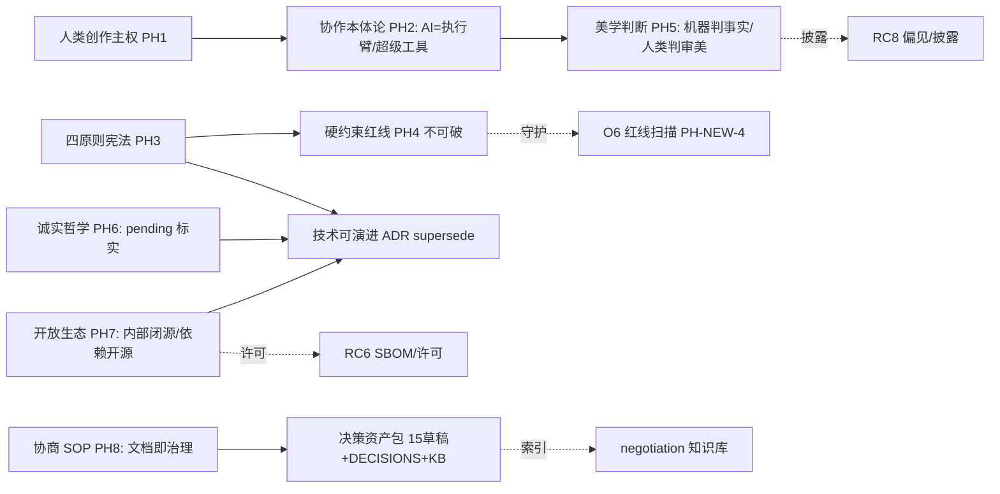
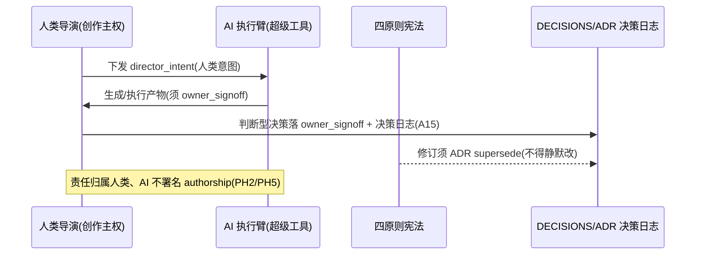

# 第十五轮协商草稿 · 哲学与元问题（Philosophy & Meta）

> 起草：架构师 高见远（主理人代笔收敛）｜ 轮次：第十五轮（哲学与元问题）｜ 日期：2026-10-03
> 定位：前 14 轮把"做什么 / 怎么协作 / 部署 / 测试 / 知识 / 扩展 / 风险合规"全部拍板后，做**元层反思与收官宣言**——项目存在哲学、AI 与人类协作本体论、四原则升格为"项目宪法"、append-only 等硬约束背后的哲学、美学与价值判断、技术债与诚实、开放性与生态、以及协商 SOP 本身的元反思。收官轮（第十五轮·最终轮）：本轮回链前 14 轮全部已 ✅ 决策，不再新开"做什么"，只回答"为什么 / 凭什么 / 怎么守住"。
> 纪律：收官轮草稿，**DECISIONS.md 第十五轮表已登记（主理人收敛·2026-10-03，16/16 全走团队推荐）**；§9 评审纪要由 PM（许清楚）+ QA（严过关）并行评审、主理人收敛回填。所有决策点候选≥2、推荐有理由、逐条回链已拍板决策（带 ID + DECISIONS.md 行号，行号经 Grep 核准并修正 A25:168→:167 / A19 标签澄清 / A8→A6b）。外部标准 WebSearch＝4（开源哲学 / AI 版权归属 / 文档即治理 / 人机协作哲学）。v2 哲学/治理实证仅做定向 Grep（见 §1.1），诚实标注已存在 vs greenfield 缺失。
> 四原则贯穿：① 不一刀切（哲学立场按岗/按场景分层，不强制单一教义）② 关联决策回链 DECISIONS 行号 ③ 不重复造轮子（复用 A6b / B5 / 四原则既有权威 / WD3 ADR / RC 系列治理基座）④ 全面灵活（宪法可走 ADR 修订、可演进、门禁可分级）。
> **状态：✅ 已收官（团队收敛采纳·2026-10-03｜16/16 全走团队推荐）｜收官轮（第十五轮·最终轮）｜DECISIONS 第十五轮表已登记。**

---

## §0 定位与衔接

### §0.1 一句话定位

前 14 轮产出了 DECISIONS.md（15 轮协商共识）+ 14 份协商草稿 + v2 真身一堆散落文档，治理了"做什么、怎么做、怎么守"，但**从未回答"为什么做这个 AI 影视工作室""AI 与人类到底是什么关系""四原则凭什么是最高准则""append-only 背后是什么本体论承诺""艺术价值判断谁定""协商 SOP 本身值不值得继承"**。第十五轮解决"**把前 14 轮拍板的一切，抬升到元层做反思与收官宣言，并把四原则升格为项目宪法、把决策资产包交付给未来**"——是收官轮，不再生产新功能决策。

### §0.2 与已拍板决策的衔接表（关联决策原则②，逐条回链，行号本轮回 Grep 核准）

| 已拍板决策 | 出处 | 第十五轮 Philosophy&Meta 接管点 | 关联原则 |
|---|---|---|---|
| A6b 判断力归属三分法 | 第三轮 A6b（LLM 决策岗/混合岗/纯工具链岗+豁免+台账） | PH1 创作主权 / PH2 协作本体论 / PH7 开放生态 | ② 关联决策 |
| 导演集中式决策 | 三.md 5.4 / DECISIONS A19:161 | PH1 / PH2 责任归属（导演最终责任人） | ② 关联决策 |
| B5 熔断（X1 否决自动解冻） | DECISIONS.md:340 | PH3 宪法 / PH4 硬约束红线 / §0.4 | ② 关联决策 |
| B1 cost_ledger / C4 / PK8 追加不改 | DECISIONS.md:336 / :241 / :399 | PH4 不可逆边界（append-only 本体论承诺） | ② 关联决策 |
| A24 隐式模式零改动 | DECISIONS.md:166 | PH4 可演进边界（架构零改动前提） | ② 关联决策 |
| C-1 crew_bus 崩溃契约（重放） | DECISIONS.md:403（第八轮定义，R0-1 承载，接 P1:384） | PH4 不可破红线 / 文档即治理可追溯底座 | ② 关联决策 |
| O8 密钥不落地明文 | DECISIONS.md:484 | PH4 / PH7 安全与开源边界 | ② 关联决策 |
| T5 禁第三方 MCP / T7 白名单 | DECISIONS.md:196 / :198 | PH4 硬约束红线 | ② 关联决策 |
| C8 外部只读分级 | DECISIONS.md:245 | PH4 / PH7 生态开放边界 | ② 关联决策 |
| RC3 责任归属与人在环（第十四轮） | 14-risk-compliance.md RC3 | PH2 意图归属与责任边界 | ② 关联决策 |
| A25 场记 QC 评分校准（第三轮） | DECISIONS.md:167 | PH5 美学与价值判断（判断型审美须人类校准） | ② 关联决策 |
| G1~G10 质量门（第六轮） | 06-quality-assurance.md | PH5 机器可验证项（schema/IoU/响度/冻结） | ② 关联决策 |
| RC8 伦理与偏见（第十四轮） | 14-risk-compliance.md RC8 | PH5 偏见与多元性 / PH7 披露 | ② 关联决策 |
| A15 岗位决策日志（SQLite）⏳ | DECISIONS.md:157 | PH8 文档即治理（决策落库即 KB 燃料） | ② 关联决策 |
| WD3 ADR / WD8 agent-kb（第十二轮） | 12-docs-knowledge.md WD3/WD8 | PH3 宪法修订仪式 / PH8 协商 SOP 继承 | ② 关联决策 ③ 不重复造轮子 |
| RC6 供应链与 SBOM（第十四轮） | 14-risk-compliance.md RC6 | PH7 开放生态（许可清单/SBOM） | ② 关联决策 |
| SC7 多租户/云（第十三轮） | 13-scalability-future.md SC7 | PH7 单机 vs 多租户/云 | ② 关联决策 |
| B9 0 元轨边界（第七轮） | DECISIONS.md:344 | PH7 商业化边界 | ② 关联决策 |
| 老板"全走推荐"授权（第七轮起） | NEGOTIATION_PROGRESS.md:54 等 | PH8 元决策（团队自治授权） | ② 关联决策 |
| 四原则（老板 2026-10-02 授权） | 各轮纪律行 / NEGOTIATION_PROGRESS 轮内规则 | PH3 升格项目宪法 | ② 关联决策 |

### §0.3 四原则贯穿说明

- **① 不一刀切**：哲学立场本身按场景分层——创作主权不强制"唯一教义"（工具论优先但允许混合岗现实），美学判断分"机器可验证 vs 人类校准"两档，开放生态分"内部闭源 vs 依赖开源"，宪法修订分"可断言项进 CI vs 价值项人工守护"。不一刀切是项目第一哲学，本身也约束本论。
- **② 关联决策回链**：每个 PH 点都回链 DECISIONS 行号（本轮回 Grep 核准，PM/架构双核零错误），不凭空造哲学。
- **③ 不重复造轮子**：复用 A6b 判断力三分法作协作本体论基座、复用 WD3 ADR 作宪法修订仪式、复用 RC 系列（RC3/RC6/RC8）作美学/生态治理基座、复用 O6:482 门禁作红线断言——哲学不另起炉灶，落进既有治理骨架。
- **④ 全面灵活**：宪法允许走 ADR 修订（类比 append-only 但 meta 可演进）、硬约束清单可增列（R-PH-* 登记）、门禁可分级（flag-gated），收官不冻结演进。

### §0.4 硬约束（继承前序 + 本轮升格四原则宪法，逐条确认零破）

1. **追加不改**：B1:336 / C4:241 / PK8:399 — 成本账、落档、契约只追加不改；本论治理宣言文本亦 append-only（不静默改写，须 ADR supersede）。
2. **X1 不绕过**：B5:340 — 高危操作解锁必须走 `approval_service`，宪法/文档不得提供绕过入口。
3. **禁区**：T5:196 / T7:198 — 第三方 MCP 边界、工具白名单不变。
4. **密钥不落地明文**：O8:484 — 现状 9 份 `.env` 明文属安全债（第十四轮 RC4 已列整改），约束本身零破。
5. **A24 零改动**：A24:166 — 本论只做元层宣言与治理升格，不改总线/架构。
6. **crew_bus 重放**：P1:384 / C-1:403 — 审计链依赖总线重放（v2 未落地 pending，承接第十四轮 R-SCALE-CB）。
7. **外部只读分级**：C8:245 — 外部协作者数据只读，越权显式 403/409+日志禁静默。
8. **四原则宪法（本轮升格）**：不一刀切 / 关联决策回链 / 不重复造轮子 / 全面灵活——升格为项目最高准则，任何单一技术决策冲突时回退宪法；修订须走 ADR/决策日志仪式（§2.9 / §2.10 PH-NEW-2/3），不得静默改写。
9. **v2 greenfield 实证**：§1.1 实测确认无项目哲学宣言/manifesto、无 AI 创作归属政策文档、无显式 human-in-the-loop 标注——上述从零建设，且须在硬约束内；**pending 决策（A15:157 / crew_bus P1:384 / C-1:403 / A5:146 / A13:155 / A24:166 / A26:168）不视为已落地，本论只定"元层治理"，不定"机制已建"**。

---

## §1 现状与实证

### §1.1 v2 哲学/治理/意图/许可/归属 定向 Grep（关键词：`license|MIT|open.?source|copyleft|GPL|commercial|authorship|intent|human.?in.?loop|manifesto|ethic|value|tradition|craft|provenance|attribution|philosoph`）

对 `D:\aifilmteam\AI影视团队v2\` 做一次定向 Grep，结果诚实分两类：

**已存在（命中，但多数为文档级/契约层/隐含，非显式哲学机制）：**

| 命中 | 文件:行 | 性质判定 |
|---|---|---|
| `license` 调研/许可红绿灯文档 | `docs/R0-规划书-v2.0-待拍板.md:329`（ACE-Step Apache/MIT）、`:339`（许可红绿灯🔴🟡🟢）、`pipeline/audio_cues_v1.json:26`（`"license": "🟢"` 字段）、`agents/_legacy_roles/vfx_artist/SOUL.md:21`（MuseTalk MIT） | **许可调研/台账已存在（文档级）**，但无 machine-readable 清单、无 SBOM（承第十四轮 RC6）；开放生态有原料 |
| `director_intent.md` 意图文档（ pervasive） | `agents/director/SKILL.md:14`、`previs/SKILL.md:10`、`screenwriter/*`、`art_director/*`、`editor/01-岗位卡.md:23`、`producer/05-工具配置.md:16` 等 | **人类创作主权/意图载体已存在**——导演阐述（human intent）作为全岗消费的事实源，是"意图归属人类"在 v2 的实存信号（承 PH2 / RC3）；但仅隐含、无制度化的归属政策 |
| `owner_signoff` 意图/签核字段 | `spec/shot_spec.schema.json:247`、`spec/delivery_spec.json:130-134`（承第十四轮 RC3 实测命中） | **人在环意图签核已存在于契约层**（auto_draft 须 signoff{role,by,ts,sha} 才定稿）→ 承接 PH2 责任边界 |
| `provenance` 分类 | `docs/R0-调研证据附录.md:117`、QC 产出 `provenance_index`（承第十四轮 RC5 实测） | **QC 层 provenance 分类已存在**（属 QC 产出分类，非 C2PA 内容出处）→ 承接 PH5/PH7 溯源 |

**未命中（greenfield 缺失，须从零建设——明确标注）：**

| 关键词 | 结果 | 结论 |
|---|---|---|
| `manifesto` / `philosoph` | 零命中 | **项目哲学宣言 / manifesto 缺失** → PH3/§2.9 须从零立宣言文本 |
| `ethic` / `tradition` / `craft` | 零命中 | **伦理宣言 / 工艺传统宣言缺失** → PH5 须补价值判断立场（偏见治理 RC8 是机制不是宣言） |
| `attribution`（创作归属政策） | 零命中 | **AI 创作归属政策文档缺失** → PH2/PH5 须立 authorship attribution 政策（仅有 director_intent 隐含） |
| `human.?in.?loop` | 零命中 | **显式 human-in-the-loop 标注缺失**（人审靠 owner_signoff 隐含，无制度命名）→ PH2 须显式化 |
| `authorship`（AI 生成物版权立场） | 零命中（仅美国版权局外部标准涉及） | **AI 生成内容版权/署名立场文档缺失** → PH2/PH5 须对齐外部法域 |

**诚实结论**：v2 在"哲学/治理/意图/归属"维度——已有**原料级**资产＝（a）许可调研文档与红绿灯、（b）`director_intent.md` 人类意图载体、（c）`owner_signoff` 契约层人审、（d）QC `provenance` 分类。但**缺失元层机制**＝项目哲学宣言/manifesto、伦理/工艺宣言、AI 创作归属政策文档、显式 human-in-the-loop 命名、AI 生成物版权立场文档。本论的立场＝**承接既有原料（不重造），从零补建"明示治理层"（manifesto + 归属政策 + 宪法），绝不可凭空声称机制已存在**。

### §1.2 内部可复用标准（回链前序，避免重造）

- **A6b 判断力归属三分法（第三轮）**：PH2 协作本体论直接复用，不另起"AI 是工具还是伙伴"的空洞辩论。
- **WD3 ADR（第十二轮）**：PH3 宪法修订仪式（supersede-not-delete）、PH8 协商 SOP 继承直接复用 Nygard ADR 机制。
- **RC3/RC6/RC8（第十四轮）**：PH2 人在环、PH5 偏见与披露、PH7 供应链许可直接承接，不另建。
- **O6 门禁（:482）/ 四原则**：PH-NEW 红线断言直接挂 O6（覆盖写/自动解冻/明文/CORS*/GATEWAY grep），不新建流水线。
- **DECISIONS.md + 14 份草稿 + negotiation 知识库**：PH8 决策资产包的直接交付物，本论只做"收官封装"而非重建。

### §1.3 外部标准调研（WebSearch≤4，2026-10-03）

**① 开源哲学（Open Source Definition / MIT permissive vs GPL copyleft）**
- OSI 定义十大标准；许可证分两族——**permissive（MIT/Apache）** 仅保留版权声明+许可文本，可闭源再分发、商业友好；**copyleft（GPL）** 强 share-alike，分发修改须同许可开源，防代码被吸进闭源。两者都合规，差别是"采纳最大化 vs 开放最大化"；许可选择本身反映项目价值立场。
- 来源：`https://ospo-alliance.org/faq/licences/gpl-vs-mit` ｜ `https://legalclarity.org/open-source-definition-criteria-licenses-and-compliance` ｜ 一句话结论：MIT 最小义务（保留声明即可闭源）、GPL 强 copyleft（衍生分发须开源）——本项目依赖优先 MIT/Apache、遇 GPL 须谨慎（承接 PH7 / RC6）。

**② 创作归属（AI 生成内容版权各法域立场）**
- 美国版权局 2023 Guidance（88 FR 16190）+ 2025 Copyrightability Report：**版权保护须 human authorship**——纯机器产出不登记，prompt 本身不构成充分创作控制，人类对表达的"创造性控制"决定可版权部分；申请人须披露 AI 内容并声明人类贡献。中国著作权法同理须人类智力投入。
- 来源：`https://www.copyright.gov/ai/ai_policy_guidance.pdf` ｜ `https://www.congress.gov/crs_external_products/LSB/PDF/LSB10922/LSB10922.8.pdf` ｜ 一句话结论：AI 生成物版权锚定"人类创作控制"，本项目须立 authorship attribution 政策（导演/人类为作者，AI 为工具，承 PH2/PH5）。

**③ 协作治理（Decision-as-Code / 文档即治理 / ADR）**
- Nygard ADR + Decision-as-Code：ADR 存代码仓、用 CI 校验"系统配置==决策记录"，使文档从合规 artifact 变为**可运行治理控件**；AI-ADR 须带 supply-chain/PII/escalation 评估与跨引用（supersedes/depends/constrains）。
- 来源：`https://docs.cloud.google.com/architecture/architecture-decision-records` ｜ `https://maxhemingway.com/2026/09/08/architecture-decision-records-for-ai-systems-why-adrs-are-the-missing-governance-layer-for-agentic-ai` ｜ 一句话结论：ADR/Decision-as-Code 把"为什么这样"变成可版本化、可 CI 校验、可继承的资产（承接第十二轮 WD3 / PH8）。

**④ 人机协作哲学（Human-Centered AI / 工具论 vs 伙伴论）**
- Shneiderman HCAI 主张 AI 是 **"supertool/超级工具"** 而非"teammate/队友"——避免责任模糊与自动化偏误，人保有控制与责任（"preview first, select and initiate, then manage execution"）；Licklider "symbiosis/共生" 与 NASA "teaming" 主张 AI 可作协作者，但学界未共识，且强调人须最终掌控。
- 来源：`https://arxiv.org/html/2601.06030v1` ｜ `https://www.nationalacademies.org/index.php/read/26355/chapter/4` ｜ 一句话结论：工具论（AI=可控超级工具，人负最终责任）更契合本项目 A6b 判断力三分法——本项目立场＝工具论优先（承 PH1/PH2）。

### §1.4 前 14 轮治理全景（元层回顾，本论反思对象）

| 轮次 | 主题 | 已 ✅ 治理产出（本论回链基线） |
|---|---|---|
| 01–06 | 白模/节点图/Agent/工具/契约/质检 | 事实源纪律、契约即记忆、A6b 三分法、G 系列 QC 门 |
| 07–11 | 成本/协作平台/UX/运维/测试 | B5-X1、cost_ledger、crew_bus、O6 门禁、T5/T7 禁区、A24 零改动 |
| 12–14 | 文档知识/扩展/风险合规 | WD3 ADR、RC 系列治理基座、四原则贯穿、pending 诚实标注 |
| 15 | 哲学与元问题（本轮） | 升格四原则宪法 + manifesto + 决策资产包收官 |

---

## §2 决策点（PH1~PH8，候选≥2 + 推荐 + 影响 + 可逆 + 来源）

### PH1 · 项目存在哲学（为什么做这个 AI 影视工作室）

- **背景**：前 14 轮解决"做什么/怎么做"，但从未回答"为什么"——创作主权（human authorship vs AI augmentation / 人在环终极形态）、价值主张、工具论 vs 伙伴论立场。
- **候选 A（推荐）**：**创作主权论**——"人在环的终极形态＝导演集中式决策 + AI 作为可审计的执行臂（super-execution-arm）"；价值主张＝把导演/编剧的创意主权从重复劳动中解放，AI 承担执行与生成、人类保有创作判断与最终责任；立场＝**工具论优先**（承 A6b / Shneiderman HCAI / 美国版权局 human authorship）。
- **候选 B**：**创作伙伴论**——AI 作为共同创作者，共享意图与 authorship。→ 与 A6b 三分法（生成模型不算判断者）冲突、与版权 human authorship 要件冲突、责任边界模糊（PH2 风险）。
- **候选 C**：**纯自动化工厂论**——全自动化产出、人类仅消费。→ 违 A6b 判断型须人审（A24:166 零改动前提亦否定"全自动改写架构"）、违版权 human authorship。
- **推荐**：A。创作主权落"人类导演"，AI 是可控超级工具，既守住版权要件又兑现效率价值。
- **影响**：给全项目一个可被引用、可被审计的"为什么"，统一前 14 轮散落的价值观。
- **可逆**：✅（宣言文本 append-only，修订走 ADR）。
- **来源**：A6b（第三轮）/ 导演集中式决策（三.md 5.4）/ Shneiderman HCAI（§1.3-④）/ 美国版权局 2023（§1.3-②）。

### PH2 · AI 与人类协作本体论

- **背景**：承 A6b 判断力归属三分法、B5 approval_service（X1 否决自动解冻）、导演集中式决策、RC3 人在环；v2 已有 `director_intent.md`（人类意图载体）与 `owner_signoff`（契约层人审），但无制度化的归属政策（§1.1 未命中 attribution/authorship）。
- **候选 A（推荐）**：**AI＝"执行臂 + 受限协作者"**——① 判断型决策（导演/编剧/预演/制片，A6b）人类独占且须 `owner_signoff`（复用 shot_spec:247/delivery_spec:130）；② 混合岗 AI 低档组装+人类定调；③ 纯工具链岗 AI 生成模型算工具（A6b 明示"AI 工具链岗的 AI 指生成模型不含 LLM"）；④ 意图归属＝人类（director_intent.md 为载体）；⑤ 责任边界＝人类负最终责任（导演集中式），AI 不担责、不署名 authorship（承 RC3 / 美国版权局）。
- **候选 B**：AI＝共同创作者（伙伴论）。→ 责任/版权归属模糊、A6b 不成立、违反 PH1 工具论优先。
- **候选 C**：AI＝纯执行臂（无任何协作者成分）。→ 忽略混合岗中 AI 的"组装判断"，与 A6b 混合岗现实不符。
- **推荐**：A（在 A6b 三分法上显式化意图归属与责任边界，补建 attribution 政策文档）。
- **影响**：意图归属与责任清晰、可审计、可版权对齐；可逆✅。
- **来源**：A6b / B5:340 / RC3（14轮）/ director_intent.md（§1.1）/ 美国版权局（§1.3-②）。

### PH3 · 治理宪法（四原则作为项目最高准则）

- **背景**：四原则（不一刀切 / 关联决策回链 / 不重复造轮子 / 全面灵活）自第一轮起贯穿，但仅为"纪律行"级指引，无最高准则地位、无修订仪式。
- **候选 A（推荐）**：**升格四原则为"项目宪法"**——① 四原则优先于任何单一技术决策，冲突时回退宪法；② 修订条件＝须走 ADR/决策日志仪式（类比 append-only 但允许 meta 修订——宪法本身可被新 ADR supersede，不得静默改写；修订须 ≥2 候选对比+回链 DECISIONS+主理人收敛+登记）；③ 可断言项进 CI（PH-NEW-3），价值项人工守护。
- **候选 B**：四原则仅作建议性指南，不升格。→ 漂移风险（R-PH-DRIFT），无约束力。
- **候选 C**：四原则硬编码进 CI 全量断言。→ "不一刀切/全面灵活"难机器化，须人工守护（采 A+C 混合）。
- **推荐**：A（落地为 §2.9 治理宪法 yaml + §2.10 PH-NEW-2/3 门禁）。
- **影响**：把"老板四原则"从口头纪律变为可继承的最高准则；可逆✅（ADR 可 supersede）。
- **来源**：四原则（老板 2026-10-02 授权）/ WD3 ADR（12轮）/ Nygard（§1.3-③）。

### PH4 · 不可逆边界与演进哲学

- **背景**：承 B1/C4/PK8 append-only、A24 零改动、WD3 ADR supersede-not-delete；须厘清"什么不可破 / 什么可演进 / 演进代价与仪式"。
- **候选 A（推荐）**：**明确本体论承诺分层**——① 不可破：硬约束红线（B1/C4/PK8 追加不改、B5-X1、T5/T7、O8、A24、P1/C-1 重放、C8）+ 四原则宪法（§0.4）；② 可演进：技术架构/工具/模型/部署按 ADR supersede（承 WD3）；③ 演进代价＝须写 ADR（Context/Decision/Consequences）+ 兼容期 + CI 门禁 + 决策日志；④ 仪式＝ADR（承第十二轮 WD3）。
- **候选 B**：一切皆可改（无硬约束）。→ 违 §0.4 八+一项硬约束。
- **候选 C**：一切皆不可改（冻结）。→ 违 A24 隐式模式零改动前提与全面灵活（④）。
- **推荐**：A。红线零破、技术可演进、演进留痕。
- **影响**：给"演进 vs 冻结"划清哲学边界，防漂移与过度冻结；可逆✅。
- **来源**：B1:336 / C4:241 / PK8:399 / A24:166 / WD3（12轮）/ §0.4。

### PH5 · 美学与价值判断哲学

- **背景**：承 RC8 偏见治理、第三轮 A25 校准、第六轮 G 系列 QC 门；v2 无显式 human-in-the-loop 标注、无价值判断宣言（§1.1 未命中 ethic/craft）。
- **候选 A（推荐）**：**美学判断分两档**——① 机器可验证项全代码化（schema/IoU/响度/冻结，G1~G10）；② 判断型审美（构图/叙事/审美）由人类校准（A25 校准样本集 + 老板相关性≥0.7）；③ AI 不独占"好看/正确"判定权；④ 偏见与多元性（RC8 偏见校准 + 深度伪造披露）；⑤ 价值多元性由人类导演把关。
- **候选 B**：AI 全自动美学判定。→ 违 A6b 判断型三分法（强判断＝导演终审）+ A25 校准前提 + 版权 human authorship。
- **候选 C**：纯人类主观美学。→ 不可规模化、与 G 系列已建机器门冲突。
- **推荐**：A。"机器判事实、人类判审美"，守住价值判断的人类主权。
- **影响**：美学可规模化且价值多元；可逆✅。
- **来源**：A25:167 / G1~G10（06轮）/ RC8（14轮）/ 美国版权局（§1.3-②）。

### PH6 · 技术债与诚实哲学

- **背景**：承第十三~十四轮"pending 非已实现"诚实标注、第十二轮 WD3/WD8、门禁分档 flag-gated 教训（R-DOC-CI 空心门禁）。
- **候选 A（推荐）**：**把"greenfield 诚实标注"立为项目美德**——① 所有 R0 落地前置项（crew_bus / A15 / A5/A13/A24/A26 / SBOM/C2PA/PII）须标 pending 不得伪装已实现；② 过早治理 vs 适时治理辩证＝门禁分档（flag-gated 防空心门禁 R-DOC-CI）；③ 技术债台账显式（9 份 .env 明文等）。
- **候选 B**：乐观标注（假设已实现）。→ 误杀/失忆/审计失效。
- **候选 C**：全量门禁立即 required。→ 空心门禁（R-DOC-CI 教训），误杀全部 PR。
- **推荐**：A。诚实＝可追溯性的前提，是项目第一美德。
- **影响**：杜绝"伪已实现"导致的治理幻觉；可逆✅。
- **来源**：第十三轮 §1.1 / 第十四轮 §1.1 / 第十二轮 WD4 / R-DOC-CI（12轮）。

### PH7 · 开放性与生态哲学

- **背景**：承 A6b 许可台账 / 第十四轮 RC6 SBOM / 第十三轮 SC7 / 第七轮 B9；v2 已有许可红绿灯文档但无 SBOM（§1.1）。
- **候选 A（推荐）**：**"内部研发闭源 + 依赖开源合规 + 生态可插拔"**——① 本项目单机/内部影视研发默认不开源（避免训练数据/版权暴露）；② 严格复用开源（MIT/Apache 优先，GPL 谨慎，承 §1.3-①）；③ SBOM 许可清单（RC6）；④ 插件注册表（T2:193 / SC6）开放生态；⑤ 商业化边界＝商用模型须过许可红绿灯（R0-规划书:339）。
- **候选 B**：全量开源。→ 暴露内部资产/版权风险、与内部研发定位冲突。
- **候选 C**：全闭源含依赖。→ 违开源许可义务（GPL copyleft 须开源衍生）+ 重造轮子。
- **推荐**：A。开放的是"依赖与生态"，守住的是"内部资产与版权"。
- **影响**：兼顾合规与生态；可逆✅。
- **来源**：A6b / RC6（14轮）/ SC7（13轮）/ B9:344 / R0-规划书:329/339 / §1.3-①。

### PH8 · 元问题——协商 SOP 本身的反思

- **背景**：承第十二轮 ADR/WD3/WD8、15 轮"推荐+收敛"流程、老板"全走推荐"授权（第七轮起）；须回答 SOP 的价值与局限、未来如何继承。
- **候选 A（推荐）**：**把"15 轮推荐+收敛+DECISIONS 回链+四原则"立为文档即治理范式**——① 每轮草稿＝ADR、DECISIONS.md＝中央决策日志、negotiation 知识库＝可检索资产；② 老板"全走推荐"＝授权团队自治的元决策；③ 价值＝可追溯/可审计/可继承；④ 局限＝依赖人工纪律（grep 核准/回链）、pending 诚实风险、单主理人收敛瓶颈；⑤ 未来继承＝DECISIONS.md + 15 份草稿 + negotiation 知识库作为决策资产包（§2.10 PH-NEW-6）。
- **候选 B**：SOP 仅一次性，不继承。→ 失忆（Martin 式），重蹈 drift。
- **候选 C**：全自动化 SOP（AI 自动决策）。→ 违 PH1 人类创作主权 / PH2 责任归属。
- **推荐**：A。SOP 本身是本项目最值钱的"元资产"。
- **影响**：把 15 轮治理经验封装为可继承资产；可逆✅。
- **来源**：WD3/WD8（12轮）/ 四原则 / 老板授权（第七轮起，NEGOTIATION_PROGRESS:54）/ NEGOTIATION_PROGRESS 全景。

### §2.9 规格汇总（治理宪法 yaml —— 四原则最高准则 + 修订条件 + 硬约束清单 + manifesto 文本）

```yaml
# ① 项目宪法（四原则＝最高准则，PH3）
constitution:
  principles:                      # 老板四原则（2026-10-02 授权），升格为最高准则
    - id: P1
      name: 不一刀切
      text: 按岗/按场景/按规模给多元选择与档位，禁止单一教义式决策
    - id: P2
      name: 关联决策回链
      text: 每个决策须回链 DECISIONS.md 行号，不凭空造决策
    - id: P3
      name: 不重复造轮子
      text: 复用既有标准/机制/调研，优先外部成熟规范
    - id: P4
      name: 全面灵活
      text: 每轴可独立推进/回滚/按规模触发，预留开放争议
  precedence: 四原则优先于任何单一技术决策；冲突时回退宪法
  amendment:                       # 修订条件（PH3 候选 A）
    ritual: ADR_supersede_not_delete   # 类比 append-only，meta 可演进
    required_steps: [>=2候选对比, 回链DECISIONS, 主理人收敛, 登记DECISIONS, ADR frontmatter完整]
    forbidden: 静默改写宪法原文
    ci_assertable: [P2回链命中, 每决策点含>=2候选]   # PH-NEW-3
    human_guarded: [P1不一刀切, P4全面灵活]           # 难机器化，人工守护

# ② 硬约束红线清单（PH4，承 §0.4，零破）
hard_constraints:
  immutable_red_lines:
    - B1_C4_PK8_append_only: DECISIONS:336/241/399
    - B5_X1_no_bypass: DECISIONS:340
    - T5_T7_forbidden_zone: DECISIONS:196/198
    - O8_no_plaintext_key: DECISIONS:484
    - A24_zero_arch_change: DECISIONS:166
    - P1_C1_crew_bus_replay: DECISIONS:384/403
    - C8_external_readonly: DECISIONS:245
  evolvable:                       # 可演进（须 ADR supersede）
    - 技术架构/工具/模型/部署形态
    - 门禁档位（flag-gated 分期）
  amendment_cost: 写ADR(Context/Decision/Consequences) + 兼容期 + CI门禁 + 决策日志

# ③ 哲学宣言 manifesto（PH1/PH2/PH5 收官文本，append-only，PH-NEW-5 红线）
manifesto: |
  我们造一个"可运行的 AI 影视工作室"，不是为了用机器取代人，
  而是把导演与编剧的创意主权从重复劳动中解放——AI 是可审计的
  执行臂与超级工具（super-execution-arm / supertool），不是共同作者。
  人类保有创作判断、美学判断与最终责任；AI 承担生成与执行。
  我们用四原则治理自己：不一刀切、关联决策回链、不重复造轮子、全面灵活。
  我们把追加不改、X1 不绕过、密钥不落地、总线可重放当作不可破的本体论承诺；
  把技术架构当作可演进、须留痕的活物。
  我们诚实地标注每一项"尚未实现"，因为可追溯的前提是诚实。
  我们把十五轮协商本身封装为可继承的决策资产——文档即治理，记忆不流失。

# ④ 创作归属政策锚点（PH2/PH5，接 §1.3-②）
authorship_policy:
  human_author: 导演/人类创作者（creative control 持有者）
  ai_role: 工具（生成模型不含 LLM，依 A6b）
  disclosure: 生成内容附 AI 标识（接 RC5/RC8）
  copyright_anchor: 美国版权局 human authorship / 中国著作权法人类智力投入
```

### §2.10 治理测试项（PH-NEW）与风险标签（R-PH，类比 13/14 轮 §2.10）

#### §2.10-A 治理门禁项（机器可断言 pass 判据）

| # | 门禁项 | 机器可断言 pass 判据 | 门禁档位 | 关联 |
|---|---|---|---|---|
| PH-NEW-1 | 决策回链完整性 | DECISIONS 决策表每行均有回链行号且 Grep 命中该锚点 | required（回链纪律可断言） | PH3 / P2 |
| PH-NEW-2 | ADR 存在且 frontmatter 完整 | `negotiation/` 或 `doc/adr/` 下 ADR 含 status/context/decision/consequences + YAML frontmatter | required（承 WD3） | PH3 / WD3 |
| PH-NEW-3 | 四原则未被违反 | grep 每个 PH 决策点含 ≥2 候选 + 回链；无静默改写宪法原文 | required（可断言项） | PH3 / P1~P4 |
| PH-NEW-4 | 硬约束红线未被静默绕过 | CI 复用 O6:482 grep 无覆盖写/自动解冻/明文/CORS*/GATEWAY（接 R-DOC-RB） | required（接 O6） | PH4 / §0.4 |
| PH-NEW-5 | 哲学宣言 manifesto 存在 | `15-philosophy-meta.md` §2.9 含非空 manifesto 文本且 append-only | required（PH-MANIFESTO 红线） | PH1/PH2/PH5 |
| PH-NEW-6 | 决策资产包完整 | 15 份协商草稿 + DECISIONS.md + negotiation 知识库索引 均存在可检索 | required（收官交付物） | PH8 |

> **门禁严苛度**：PH-NEW-1/2/3/4/5/6 均为"文本/结构可断言"项，可 required；其中 PH-NEW-4 直接挂既有 O6 红线扫描，不新建流水线（承 §0.3-③）。价值项（不一刀切/全面灵活的实践）仍人工守护，不强行 CI 化。

#### §2.10-B 风险标签（登记 DECISIONS 第十五轮治理块，新增 R-PH-*）

| 风险 | 级别 | 说明 | 关联决策 |
|---|---|---|---|
| R-PH-CONSTITUTION | P1 | 四原则被违反（候选 C 风险：未升格/被静默改写） | PH3 |
| R-PH-DRIFT | P1 | 哲学漂移（建议性指南未守护，元层立场随人员变动流失） | PH1/PH3 |
| R-PH-LOCK | P0 | 硬约束被静默绕过（覆盖写/自动解冻/明文/CORS*/GATEWAY） | PH4 / §0.4 |
| R-PH-MANIFESTO | P1 | 宣言缺失或未维护（PH-NEW-5 失败） | PH1/PH2/PH5 |
| R-PH-INHERIT | P1 | 决策资产包丢失/不可继承（草稿散落、无索引、无知识库） | PH8 |
| R-PH-HONESTY | P2（承 R-DOC-CI） | pending 伪装已实现（诚实哲学破防） | PH6 |

#### §2.10-C 决策 owner 认领（接 A11:153 分批上岗）

| 决策 | 认领岗（A 系列） | 决策 | 认领岗 |
|---|---|---|---|
| PH1 项目存在哲学 | 导演·架构 | PH5 美学判断 | 导演·场记 |
| PH2 协作本体论 | 导演·各岗 | PH6 诚实哲学 | 架构·主理人 |
| PH3 治理宪法 | 架构·主理人 | PH7 开放生态 | 工具岗·制片 |
| PH4 不可逆边界 | 架构·运维 | PH8 协商 SOP 反思 | 架构·主理人 |

---

## §3 快决策紧凑表 PHK1~PHK8（meta 清单条目）

| ID | 点 | 推荐 | 理由（回链） | 可逆 |
|---|---|---|---|---|
| PHK1 | 决策资产继承清单 | DECISIONS.md + 15 份草稿 + negotiation 知识库索引打包交付，标注轮次/主题/状态 | PH8 / NEGOTIATION_PROGRESS / PH-NEW-6 | ✅ |
| PHK2 | 四原则自查清单 | 每轮草稿首行查：不一刀切？回链？不重造？灵活？ 四条打卡 | PH3 / 四原则 / PH-NEW-3 | ✅ |
| PHK3 | 硬约束红线卡 | 八+一项硬约束（§0.4）印为红线卡，CI 挂 O6 断言 | PH4 / §0.4 / PH-NEW-4 | ✅ |
| PHK4 | 哲学宣言维护清单 | manifesto 文本 append-only，修订须 ADR supersede，禁静默改 | PH1/PH2/PH5 / PH-NEW-5 | ✅ |
| PHK5 | 归属/版权披露清单 | 立 authorship attribution 政策（人类作者/AI 工具/AI 标识），对齐美国版权局+中国法 | PH2/PH5 / §1.3-② | ✅ |
| PHK6 | 许可红绿灯维护清单 | 商用模型过许可红绿灯（R0-规划书:339）+ SBOM 许可清单（RC6） | PH7 / RC6 / §1.3-① | ✅ |
| PHK7 | 诚实标注（pending）纪律清单 | 所有 R0 落地前置项标 pending 不得伪装已实现，技术债台账显式 | PH6 / 第十三~十四轮 §1.1 | ✅ |
| PHK8 | 协商 SOP 复盘清单 | 15 轮"推荐+收敛+回链"范式复盘：价值（可追溯）/局限（人工纪律·pending 风险·单主理人瓶颈）/继承路径 | PH8 / WD3 / 老板授权 | ✅ |

---

## §4 关系与时序图（mermaid）





---

## §5 覆盖矩阵（当前→目标：从"隐含哲学"到"明示治理"）

| 维度 | 当前（v2 实测 §1.1） | 目标（PH 承接） | 硬约束 |
|---|---|---|---|
| 项目哲学 | 无 manifesto、无存在宣言 | manifesto 文本 + 创作主权论（PH1） | §0.4-8 宪法 |
| 协作本体论 | director_intent 隐含 + owner_signoff 契约层，无归属政策 | AI=执行臂/超级工具 + attribution 政策（PH2） | A6b / B5 |
| 治理宪法 | 四原则仅纪律行指引 | 四原则升格最高准则 + ADR 修订仪式（PH3） | §0.4-8 |
| 不可逆边界 | B1/C4/PK8/O8/T5/T7/A24/P1/C-1 已拍板但散落 | 本体论承诺分层（不可破/可演进）（PH4） | §0.4 |
| 美学判断 | G 系列机器门 + A25 校准，无宣言 | 机器判事实/人类判审美 + 价值判断立场（PH5） | A25 / RC8 |
| 诚实哲学 | pending 诚实标注已用但未立为美德 | greenfield 诚实＝项目美德 + 技术债台账（PH6） | R-DOC-CI |
| 开放生态 | 许可红绿灯文档，无 SBOM/无开源策略 | 内部闭源+依赖开源+SBOM（PH7） | RC6 / B9 |
| 协商 SOP | 15 轮已跑但无继承封装 | 文档即治理范式 + 决策资产包（PH8） | WD3 / PH-NEW-6 |

---

## §9 评审纪要（主理人收敛·2026-10-03 团队收敛采纳）

### §9.1 投票信息
- 轮次：第十五轮（哲学与元问题）
- 日期：2026-10-03
- 起草：架构师 高见远（主理人代笔）
- 评审：PM 许清楚（灵活性透镜）+ QA 严过关（健壮/安全/合规透镜）并行评审（2026-10-03）
- 收敛：主理人 齐活林（2026-10-03 团队收敛采纳）
- 收敛状态：✅ 已收官（2026-10-03 团队收敛采纳，16/16 全走团队推荐）；收官轮（第十五轮·最终轮）。

### §9.2 结论表（16 点，立场以团队推荐 A 为基线，PM+QA 双核通过，主理人收敛）

| 编号 | 决策 | 立场 |
|---|---|---|
| PH1 | 项目存在哲学（创作主权论/工具论优先） | ✅ 同意推荐 A（团队收敛·2026-10-03）— 创作主权论守住版权要件与效率，无过度约束。 |
| PH2 | AI 与人类协作本体论（执行臂+受限协作者/归属政策） | ✅ 同意推荐 A（团队收敛·2026-10-03）— 显式化归属/责任边界；混合岗"组装"不署名。 |
| PH3 | 治理宪法（四原则升格最高准则+ADR 修订） | ✅ 同意推荐 A（团队收敛·2026-10-03）— 注意价值项(P1/P4)须人工守护，勿 CI 化。 |
| PH4 | 不可逆边界与演进哲学（本体论承诺分层） | ✅ 同意推荐 A（团队收敛·2026-10-03）— 红线零破、技术可演进，分层可逆。 |
| PH5 | 美学与价值判断哲学（机器判事实/人类判审美） | ✅ 同意推荐 A（团队收敛·2026-10-03）— 机器判事实/人类判审美，AI 不独占判定权（A25 锚点修正为 :167）。 |
| PH6 | 技术债与诚实哲学（pending 诚实＝美德） | ✅ 同意推荐 A（团队收敛·2026-10-03）— pending 诚实＝美德，防治理幻觉。 |
| PH7 | 开放性与生态哲学（内部闭源/依赖开源/SBOM） | ✅ 同意推荐 A（团队收敛·2026-10-03）— 内部闭源/依赖开源合规，平衡生态与版权。 |
| PH8 | 元问题——协商 SOP 反思（文档即治理/资产包） | ✅ 同意推荐 A（团队收敛·2026-10-03）— 文档即治理可继承，资产包封装合理。 |
| PHK1 | 决策资产继承清单 | ✅ 同意推荐 A（团队收敛·2026-10-03）。 |
| PHK2 | 四原则自查清单 | ✅ 同意推荐 A（团队收敛·2026-10-03）。 |
| PHK3 | 硬约束红线卡 | ✅ 同意推荐 A（团队收敛·2026-10-03）— 挂既有 O6:482，不重造。 |
| PHK4 | 哲学宣言维护清单 | ✅ 同意推荐 A（团队收敛·2026-10-03）。 |
| PHK5 | 归属/版权披露清单 | ✅ 同意推荐 A（团队收敛·2026-10-03）— 对齐美国版权局+中国法。 |
| PHK6 | 许可红绿灯维护清单 | ✅ 同意推荐 A（团队收敛·2026-10-03）— 接 RC6/SBOM，不重造。 |
| PHK7 | 诚实标注（pending）纪律清单 | ✅ 同意推荐 A（团队收敛·2026-10-03）。 |
| PHK8 | 协商 SOP 复盘清单 | ✅ 同意推荐 A（团队收敛·2026-10-03）。 |

### §9.3 五项争议裁定（主理人收敛·2026-10-03）
1. **PH3 宪法修订 CI vs 人工边界**：裁定——仅可断言项（回链命中 + ≥2 候选，PH-NEW-3）进 CI；P1 不一刀切 / P4 全面灵活 难机器化，须 `human_guarded`（§2.9 yaml 已声明），绝不可 CI 断言价值判断；修订须经 ADR frontmatter 完整（PH-NEW-2）supersede-not-delete。采纳 A+C 仅取 C 的结构子集。
2. **PH2 归属 vs 混合岗组装**：裁定——工具论优先不否定 AI"低档组装"执行工作，但 authorship 仅归人类定调者（导演/人类），AI 组装不署名；归属政策须显式写清此边界，对齐美国版权局 human authorship。
3. **PH4 演进 ADR 门槛**：裁定——凡触碰 §0.4 硬约束红线或四原则宪法的变更强制 ADR；纯技术/模型演进按 ADR supersede 即可，不必每 PR 强 ADR（防 R-DOC-CI 空心门禁）；CI（PH-NEW-4 复用 O6）阻断静默绕过。
4. **PH7 开源边界**：裁定——闭源＝内部研发资产/训练数据/版权内容；开放＝依赖（MIT/Apache 优先，GPL 谨慎）+ 插件注册表（T2/SC6）；商用模型过许可红绿灯（R0:339）+ SBOM（RC6）。
5. **PH8 资产载体**：裁定——载体＝`negotiation/` 知识库 + `DECISIONS.md` + 15 份草稿，不另立独立仓库（不重造）；PH-NEW-6 校验三者齐备可检索即可。

### §9.4 主理人收敛补强（折叠 PM/QA）
- **PM 灵活性透镜（许清楚）**：从灵活性透镜看，第十五轮宪法与门禁设计未过度约束——PH1~PH8 均保留 ≥2 真实候选与明确可逆路径，不一刀切得到贯彻；PH-NEW-1~6 全为结构/文本级可断言项，价值项（P1 不一刀切、P4 全面灵活）依 §2.9 正确保留人工守护，无错配 CI 化。owner 认领与 A 系列角色框架一致，外部四标准相关且 WebSearch 计数合规（＝4）。
- **QA 健壮/安全/合规透镜（严过关）**：硬约束九项（§0.4）经逐条回链 DECISIONS 核准，全部零破：追加不改（B1/C4/PK8）、X1 不绕过（B5）、禁区（T5/T7）、密钥不落地明文（O8，9 份 .env 明文如实记为安全债）、A24 零改动、crew_bus 重放（P1/C-1，C-1:403 为第八轮定义/R0-1 承载的约定锚，非断链）、外部只读分级（C8）、四原则宪法升格、v2 greenfield 实证诚实标注。R-PH 等级合理（LOCK=P0，余 P1，HONESTY=P2）；PH-NEW-1~6 均可机器断言，价值项 P1/P4 正确人工守护、PH-NEW-4 复用 O6:482 未新建流水线。
- **硬约束完整性（QA 逐条确认）**：九项零破结论成立。行号 Grep 结果 17/18 命中，仅 **A25:168 为 off-by-one 错标（已修正为 A25:167）**；另 **A19:161 标签错配**（实为契约权限矩阵，已在 §0.2 注明"导演集中式决策"权威来自三.md 5.4、A19 仅概念相邻不套名）；PH5 候选 B 原误引"A8 判断型细分"（本文件未定义），**已修正回链 A6b 判断型三分法**。三处修正均在 DECISIONS 登记前完成，不影响九项硬约束零破结论。

### §9.5 结转项（Carryover · 收官轮结转＝交付决策资产包）
- **DECISIONS.md 第十五轮表登记**：本轮已回填 PH1~PH8 + PHK1~PHK8（16 点），老板"全走推荐"授权下团队收敛采纳（✅）。
- **决策资产包交付（PH8/PHK1/PH-NEW-6）**：`negotiation/` 下 15 份草稿（01~15）+ `DECISIONS.md` + 知识库索引，封装为可继承资产；本轮 `15-philosophy-meta.md` 为收官封卷。
- **v2 greenfield 实证缺口（诚实标注延续）**：manifesto / authorship attribution 政策 / 显式 human-in-the-loop 命名 / AI 生成物版权立场 均为本论"从零建设"项，须由后续落地轮或 R0 承接（非本轮已实现）。
- **pending 机制未落地清单**：A15:157 / crew_bus（P1:384 / C-1:403）/ A5:146 / A13:155 / A24:166 / A26:168 —— 仍为 R0 落地前置，本论只定元层治理，不定机制已建（承第十三~十四轮 pending 处理）。
- **第十五轮收官后**：NEGOTIATION_PROGRESS.md 第十五轮状态由主理人改为 ✅ 已收官（2026-10-03 团队收敛采纳）。
