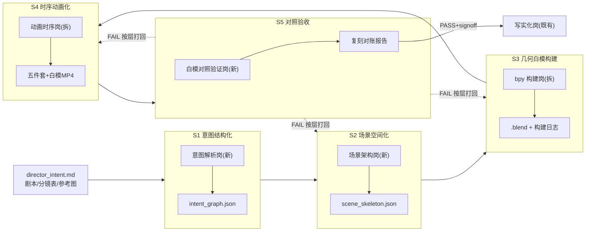

# 第十七轮草稿一 · 意图→Blender 白模 1:1 复刻管线与岗位扩编方案

> 日期：2026-10-03 ｜ 起草：架构师高见远（baimo-pipeline-architect）｜ 状态：🟡 草稿（候选+推荐，**不拍板**）
> 响应：R17-1（白模双环节=项目最大特色）、R17-3（白模岗位扩编）、R17-6（本地扩编）、R17-4（额度耗尽联动）
> 证据基线：三.md 3.4/3.9/M7/5.2-5.4、03-agent-team.md A4/A5/A6b/A12/A19/A21、01-blender-blockout.md D1~D25、04-tools-mcp.md T1/T4/T5/T7、16-local-first-key-manifest.md §5.1-5.7、master_v2.json 实读（19 轨/signoff/camera 轨 pos=null 实测）、director_intent.md（中间代存档）与分镜表 v1 实读

---

## 0. 命题转换：现有管线的起点错了半步

现状管线：`剧本→预演岗填 shot_spec→白模岗组装 bpy 参数→渲染`。这套链路隐含一个假设：**shot_spec 已经完整携带了作者意图**。R17-1 把白模环节升格为项目核心定位后，这个假设不成立了——

**「意图→白模 1:1 复刻」要求白模的每一层都能回溯到意图原文**：

| 复刻层 | 意图来源（现状载体） | 现状断点 |
|---|---|---|
| 几何 | director_intent.md §五场景设定 / 分镜表 description | **自由文本，无空间结构**；shot_spec 无几何字段，白模岗只能按文字猜房间布局 |
| 机位 | master_v2.json camera 轨 | **pos/aim/motivation 全 null**（实测 manual_review："02_blockout 为空、无机位数值 lock，禁止 rubber-stamp"）——机位数值源头空转 |
| 灯光 | light 轨（key_temp_k/key_dir_az_deg 等已由 R0-T4 提案签收） | 数值有但**无几何体可打**——灯先于房间存在，因果倒置 |
| 动画 | edit 轨 in_f/out_f + camera 轨 move_type | 走位/插值/节奏无契约，全在白模岗脑子里 |

老板判断（R17-3"单一白模岗不够"）的实质：**现在是让一个低档混合岗（A6b 定性）独自完成"自由文本→四层结构"的全部翻译**。这不是加人能解决的，缺的是中间结构层。本方案的核心动作：**在意图与 bpy 之间补两个结构化契约（intent_graph / scene_skeleton），把翻译拆成五段流水线，每段独立验收**。

---

## 1. 分阶段管线设计（五阶段）

### S1 意图结构化（意图解析岗）

- **输入**：director_intent.md（整体方向/风格基调/必须有/不能有/角色/场景六节）+ 剧本 JSON + 分镜表 v1 + K13 已锁资产清单
- **处理**：LLM 决策岗抽取结构化意图图——①元素清单（每个具名对象编号 `E-001 林小雨`，挂 TYPE 枚举与出现镜号）；②情绪弧线逐镜标注（分镜表已有 emotion 字段，补情绪→光影/机位语言映射）；③禁用项清单（不能有→机器可查负例）；④镜头语言意图（"冷暖对比构图"→主光/补光方向意图值）
- **输出**：`00_brief/intent/intent_graph.json`——**新增契约**，schema 由 Pydantic 定义走 T4 派生
- **验收门 G0（意图完整性）**：分镜表每镜的 description 中具名实体 100% 进入元素清单（正则+LLM 双通道抽取对照）；禁用项与 director_intent §三逐条一致；owner_signoff=导演（人类意图归属，承 15-philosophy PH2）

### S2 场景空间化（场景架构岗）

- **输入**：intent_graph.json + scene_lock 资产 + 分镜参考图（assets/storyboards/*.png）
- **处理**：把"出租屋内：台灯、空猫窝、飘动的窗帘、开着的窗"翻译成**可构建的空间骨架**——①每场景一个 SET 底板+对象布局表（位置/朝向/粗略尺寸，米制）；②对象命名按 TYPE_name 规范预分配（CHAR_linxiaoyu / PROP_catbed / SET_apartment）；③从分镜参考图用 VL 模型反推布局（"三分法构图、机位右侧"→空间约束）；④输出对象上限按 01-blender D16 三档（≤4/≤8/≤16）校验
- **输出**：`00_brief/intent/scene_skeleton.json`——每场景 {set_id, objects[{obj_id, type, name, pos_m, size_m, appears_in[]}], spatial_constraints}；**回填 master_v2.json spatial 轨**（owner=agent_script_super 签收不变）
- **验收门 G1（空间自洽）**：对象清单 ⊆ intent_graph 元素清单（外键校验，同 shot_spec object_mapping 既有语义）；同名对象跨场景复用同一 obj_id；尺寸比例通过人形参照校验（对象间无穿模级矛盾——数值规则可查）

### S3 几何白模构建（bpy 构建岗——原白模岗拆分）

- **输入**：scene_skeleton.json
- **处理**：消费 M7 模块包（D17：build/light/render/export+CLI）的 build 子命令；转译层 blockout_manifest 承接（D18 不变）；**Blender 仍为 subprocess 被调用**（T5 禁区不变：bpy 绝不进 Agent 进程）；几何=基本体拼装（cube/cylinder 组合，灰 0.55 材质，D4 Standard 色彩管理）
- **输出**：`shots/{shot_id}/` 骨架 .blend + blockout_manifest（对象树+命名+Object Index 分配记录）
- **验收门 G2（构建忠实）**：场景对象树 vs scene_skeleton 逐对象对账（obj_id/命名/数量 100% 命中，探针回显 bpy 场景清单）；D14 TYPE 枚举校验；构建日志进 jobs 台账

### S4 时序动画化（动画时序岗——原白模岗拆分）

- **输入**：scene_skeleton + master_v2.json camera/gauge/light 轨数值 + shot_spec（时长/8k+1 派生）
- **处理**：①camera 轨数值→相机关键帧（pos/aim/move_type/focal_mm 逐镜落值，插值按 D20 逐关键帧显式）；②light 轨数值→灯光关键帧（D5 分层模板：夜=低强度冷色底+key_temp_k 暖点光，fill_ratio→补光比）；③角色走位→空物体路径关键帧（performance 轨语义）；④渲染五件套（PNG+EXR Z/Normal/IndexOB 一遍渲+提取，D9）+ FFmpeg 白模 MP4（D6b）
- **输出**：白模五件套落 `shots/{shot_id}/{frames,masks,exr,cam,video}/`（D24）
- **验收门 G3（数值一致）**：camera_sidecar.json 逐帧值 vs master_v2 camera 轨声明值对账（位置容差 ±5%、焦距精确相等）；白模 MP4 时长/fps/帧数 vs edit 轨 in_f/out_f 与 8k+1 规则对账；**camera/light 轨 signoff 流向不变——数值由本岗产出、agent_virtualdp 逐镜签收**（pos/aim 从此有值可签，master_v2 的 18 个"未签"项有了消灭路径）

### S5 对照验收（白模对照验证岗）

- **输入**：白模五件套 + intent_graph + 分镜表 description 文本
- **处理**：见 §3 四门验收定义——数值门自动跑，语义门用 VL 模型（qwen3-vl-flash，16 文档 §5.6 实测具备专业级分镜分析能力）
- **输出**：`04_qc/blockout_fidelity_report.json`（逐镜逐元素 PASS/FAIL+证据）
- **验收门 G4（复刻保真）**：见 §3。PASS→P5 owner_signoff 写入 blockout_manifest→放行写实化岗（对齐三.md ②白模关既有位置）；FAIL→按元素层打回 S2/S3/S4（扩 A21 打回路由表）

**与 19 轨时间线的关系**：不另起炉灶。intent_graph/scene_skeleton 是**上游新契约**；master_v2.json 19 轨仍是**数值事实源**（S2/S4 是生产者、virtualdp/script_super 是签收者）；shot_spec 继续由预演岗填写，但新增消费 intent_graph 作为上游输入——预演岗从"从剧本猜镜头"升级为"对齐已结构化的意图"。

---

## 2. 岗位扩编方案

### 2.1 现状与缺口

A 系列现状：白模岗=1 个混合岗（低档 LLM 组装 bpy 参数），上游预演岗 1 个填 15 字段。四层翻译工作（几何/机位/灯光/动画）全部压在"参数组装"一个动作上——这就是"1:1 复刻"目前不可达的结构原因。

### 2.2 候选方案

| 方案 | 结构 | 优点 | 缺点 |
|---|---|---|---|
| A. 3 岗 | 意图空间岗（S1+S2）/ 白模构建岗（S3+S4）/ 对照验证岗（S5） | 改动最小，原白模岗一拆二 | 意图解析与空间化是两种判断（文本理解 vs 空间推理），合并易回退成"一人包办" |
| B. 4 岗 | A 方案但 S3/S4 分离（构建/动画分岗） | 几何与动画解耦，断点续跑粒度好 | 意图层仍合并 |
| **C. 5 岗（推荐）** | P1 意图解析 / P2 场景架构 / P3 bpy 构建 / P4 动画时序 / P5 对照验证 | 每岗一个验收门，判断/执行/验证三权分立；P5 独立成岗是"1:1"承诺的制度保证 | Agent 实例多 3 个（成本见 2.4） |

**推荐 C**：R17-1 把复刻质量定为项目核心卖点，验收岗独立（不既当运动员又当裁判）是底线；且 P5 是 VL 模型重载岗，与 P1-P4 的 LLM 岗模型栈完全不同，合并反而混乱路由。

### 2.3 五岗定义卡（复用 owner_signoff 语义）

| # | 岗位（Agent 名） | 定性（A6b 三分法） | 职责 | 输入→输出契约 | 承载模型（K-REV-1 五档） |
|---|---|---|---|---|---|
| P1 | agent_intent_parser | LLM 决策岗（新） | 意图→intent_graph；元素编号；禁用项清单化 | intent 文档集→intent_graph.json；**signoff=导演（人类意图归属）** | mid_reasoning：本地 qwen3:8b 优先（结构化实测全绿），云 qwen3.8-flash 滑档；高档歧义仲裁走 high_deep（qwen3.8-max，注意 11/01 到期优先耗） |
| P2 | agent_scene_architect | LLM 决策岗（新） | intent_graph→scene_skeleton 空间骨架；TYPE_name 预分配；VL 读参考图反推布局 | intent_graph+参考图→scene_skeleton.json；signoff=agent_script_super（spatial 轨 owner 不变） | mid_reasoning + **vision**（qwen3-vl-flash）双模：文本定布局、VL 校构图 |
| P3 | agent_blockout_builder | 混合岗（原白模岗拆出） | scene_skeleton→bpy 几何构建；转译层 manifest | scene_skeleton→.blend+blockout_manifest；signoff=P5 | low_structured：本地 qwen3:8b+Instructor（纯参数组装，A4 原判不变） |
| P4 | agent_blockout_animator | 混合岗（原白模岗拆出） | camera/light/performance 轨数值→关键帧+渲染五件套+MP4 | 轨数值+scene_skeleton→五件套；signoff=agent_virtualdp（camera/light 轨 owner 不变） | low_structured：本地 qwen3:8b+Instructor |
| P5 | agent_blockout_qa | LLM 决策岗（新，VL 重载） | 四门验收；复刻对账报告；FAIL 分层打回 | 五件套+intent_graph→blockout_fidelity_report；**signoff 自持，报告进 04_qc** | **vision 主档**：qwen3-vl-flash（云）；到期后候选 qwen-vl-max 或本地小 VL（见 §5 R17-6） |

### 2.4 与既有岗的边界

- **agent_virtualdp（虚拟 DP）**：camera/gauge/light 轨 owner_signoff **保留不动**。变化只是：数值从"待 DP 手填"变为"P4 产出→DP 签收"——这恰好是 master_v2 camera 轨 manual_review 等待的状态（"待 DP 逐镜定值后修后签"，现在有修可审）。DP 的专业判断转向**否决权与 motivation 审定**，不退化成 rubber-stamp（每镜 motivation 仍须 DP 复核或改写）。
- **预演岗**：shot_spec 15 字段职责不变；新增消费 intent_graph（上游对齐）， disputes 路由不变（编剧 vs 预演 2 轮+导演仲裁）。
- **场记岗**：只验写实化输出（既有职责）；白模层验收移交 P5。A21 打回路由表新增两行：G2 FAIL→P3、G3 FAIL→P4、G4 语义 FAIL 按元素层路由 P2（几何/布局错）或 P4（运动/光向错）。
- **agent_script_super**：spatial 轨 owner 不变，新增 P2 产出物签收动作。
- **A5 岗位实例模型不变**：5 岗=5 个决策 Agent 实例，渲染执行仍走 RealizeJob 工具层并行（"岗位是视图，管线是本体"）。
- **成本核算（回应"多 3 个 Agent 值不值"）**：P1/P2 每次 mid 档调用本地 0 元或云端厘级；P5 VL 每镜一次（1345 tokens 实测，厘级）；增量成本每镜 <0.01 元，相对写实化 2 元/镜可忽略——**扩编买的是结构质量，不是算力**。

---

## 3. 「1:1 复刻」的验收定义（四门，P5 执行）

> 定义：**白模与作者意图 1:1 = 意图原文中的每一层可检验承诺，在白模产物中都有对应的、数值或语义可对账的落位**。分四门，全过才算 PASS。

| 门 | 名称 | 检验内容 | 工具/方法 | 判据（初值） |
|---|---|---|---|---|
| G2 | 元素覆盖门 | intent_graph 元素清单 × 白模场景对象树：必须有元素零缺失、禁用元素零出现 | bpy 场景清单探针回显 vs intent_graph 外键对账（机器） | 覆盖率=100%，硬门 |
| G3 | 机位数值门 | camera 轨声明值（pos/aim/focal_mm/move_type）vs 白模相机实值 | camera_sidecar.json 逐帧对账脚本（D13 修复后的旋转数据可用） | 位置/朝向偏差 ≤5%，焦距精确相等，硬门 |
| G3b | 时长轴对齐门 | edit 轨 in_f/out_f vs 白模 MP4/帧序列 | ffprobe+帧计数 vs 8k+1 派生式 | 帧数误差=0，硬门 |
| G4 | 语义对照门 | 构图/对象关系/灯光方向/走位语义 vs 分镜 description 与 intent_graph 情绪标注 | **qwen3-vl-flash 对照评分**：输入=白模渲染关键帧+分镜文本+对象清单，输出=三维度分项评分（构图还原/对象空间关系/光影语义），结构化 JSON | 三项加权 ≥0.70（初值，试点镜人工标定后修订）；软门——FAIL 须人工复核区分"模型评分漂移"与"真失真" |

- **评分不可作唯一裁判**：G4 是 VL 模型评 VL 模型时代的固有循环风险（见 §5 风险），故 G4 判 FAIL 必须附 VL 原始输出供人复核；连续 3 镜同项 FAIL 触发阈值标定复核而非直接打回。
- **验收产物归档**：blockout_fidelity_report.json 进 `04_qc/`，signoff 链写入 blockout_manifest——继承"探针回显"纪律（三.md 872 行）：报告必须附每项检验的原始输出，无回显按未验处理。
- **四门与既有质检链的位置关系**：G2-G4 全部位于三.md 6.3 质检关卡的 **②白模关**位（现该关只查"帧序列完整/EXR/旁车"产物完整性，本方案将其升级为保真性验收）——是加强不是新增关卡。

---

## 4. 与既有决策的融合点（逐条）

| 既有决策 | 融合方式 | 冲突? |
|---|---|---|
| A4 推理分级路由表 | 新增 5 行：P1/P2=mid_reasoning、P3/P4=low_structured（原白模岗行拆分）、P5=vision | 无冲突，扩表 |
| A6b 判断力三分法 | P1/P2/P5=LLM 决策岗（P5 的"判断"=验收裁决，确属开放式判断）；P3/P4=混合岗（原白模岗定性不变，只是拆成两段） | 无冲突，正是三分法的应用 |
| A5 岗位实例模型 | 5 岗=5 决策 Agent；执行并行仍在工具层 RealizeJob | 无冲突 |
| A12 工具白名单 | registry.json 中 allowed_agents 扩：blender 工具→P3/P4；新增 vl_scorer 工具→P5；intent/schema 校验工具→P1/P2 | 无冲突 |
| A19 契约读写权限矩阵 | 新增：intent_graph=P1 写+全组读+导演签收；scene_skeleton=P2 写+P3/P4 读+script_super 签收；fidelity_report=P5 写+全组读 | 无冲突，照权限矩阵模式扩 |
| A21 打回路由表 | 新增：G2 FAIL→P3、G3 FAIL→P4、G4 语义 FAIL→P2 或 P4（按元素层） | 无冲突 |
| V27/T5 Blender 禁区 | 完全不变：P3/P4 仍 subprocess 调 blender，bpy 不进任何 Agent 进程；CI 禁 import bpy 照旧 | 无冲突 |
| T1/T4 工具注册表与 schema 派生 | intent_graph/scene_skeleton/fidelity_report 三个新契约的 Pydantic 模型进注册表，function calling schema 自动派生 | 无冲突 |
| T6/T23 工具契约 | 新工具走统一 JSON 信封+异步作业模型 | 无冲突 |
| D17/D18/D20（白模脚本架构/转译层/插值） | 直接继承：P3/P4 消费 M7 模块包+blockout_manifest | 无冲突 |
| D5 灯光分层模板 | P4 落地执行者：按 time_of_day 自动套模板+light 轨数值微调 | 无冲突，D5 有了执行岗位 |
| K-REV-1/llm_gateway 五档 | 五岗模型栈全部落在既有五档内（low_structured×2/mid_reasoning×2/vision×1），**不需新档位**；P5 vision 档首用即百炼 qwen3-vl-flash | 无冲突，验证了五档设计余量 |
| R17-4 额度耗尽 | 管线测试即消耗计划素材：P1/P2 mid 档批量跑 intent 解析（qwen3.8-flash 1M）、P5 VL 逐镜对照（qwen3-vl-flash 1M）、P1 高档歧义仲裁（qwen3.8-max 11/01 最先到期优先耗）——列入 burn-down 台账 | 正向联动 |
| R17-6 本地扩编 | P1-P4 全部可本地零成本（qwen3:8b 已实测结构化+工具调用全绿）；唯一缺口=本地 VL——12GB 内加装候选：Qwen3-VL 4B/8B 量化档（与 5070 12GB 兼容性待 v2v-engine-matrix 一并实测）；测评结论回填本方案 | 待实测项 |
| R17-2 v2v 引擎矩阵（兄弟任务） | 本管线的 P5 VL 需求与 v2v 引擎的 VL 评审需求**共用同一本地 VL 候选池**，避免重复装模型挤 12GB——已协同事项 | 协同 |

---

## 5. 识别的最大风险与对策

**最大风险：意图结构化的语义损耗（"精确地错"问题）。** intent_graph 是整条管线的一切下游（几何/机位/灯光/动画/验收全部引用它）的单点事实源；而它由 LLM 从自由文本抽取——如果 P1 把"路灯再暗，也照得亮回家的路"错误结构化成了"路灯=道具、暗=亮度值 0.3"，后面 S2-S5 的每次翻译都**精确地复现这个错误**，四门验收全绿但全错（G4 语义门输入的也是同一个 intent_graph，裁判和选手共享同一个错误源）。

**对策（三层防线）**：
1. **意图签收归人**：intent_graph 的 owner_signoff=导演本人（唯一强制人类签收的新契约）——30 镜项目的 intent_graph 人工通读约 15 分钟，这是"1:1 复刻"承诺下人类不可让渡的一环（承 15-philosophy PH2 意图归属人类）；
2. **可回溯抽取**：intent_graph 每个字段带 `source_span`（源自 intent 文档原文哪一句/分镜表哪个字段），P5 验收与导演抽检都可一键回看原文——无出处的结构化字段视为无效；
3. **G4 阈值标定用独立基准**：语义门评分阈值不用 intent_graph 标定，用分镜表 description 原文+人工标注的小基准集（试点 3-5 镜）标定，保持裁判与选手的信息源部分隔离。

**次要风险（登记不展开）**：① VL 评分漂移（同帧不同次评分不一致）——固定 seed+温度 0+双次一致才采信；② 文本估算几何的尺寸失真——S2 强制人形参照物+P2 产出物带置信度字段，低置信对象标 `needs_human_check`；③ qwen3-vl-flash 10/27 到期——到期前完成本地 VL 候选实测（联动 R17-6），云端滑链 qwen-vl-max 兜底。

---

## 6. 待拍板清单（老板选 A/B/C 或"同意推荐"）

| # | 决策点 | 推荐 | 可逆性 |
|---|---|---|---|
| B1 | 扩编方案 | C. 5 岗（P1 意图解析/P2 场景架构/P3 bpy 构建/P4 动画时序/P5 对照验证） | 可逆（岗可合并回 3 岗形态） |
| B2 | 新契约 | intent_graph.json + scene_skeleton.json + fidelity_report.json 三契约进注册表（T4 派生） | 可逆 |
| B3 | 意图签收 | intent_graph owner_signoff=导演（人类强制签收） | 半可逆 |
| B4 | 四门验收 | G2/G3/G3b 硬门+G4 软门（阈值 0.70 初值，试点标定） | 可逆 |
| B5 | P5 裁判模型 | 云 qwen3-vl-flash（额度期）→ 本地 VL 量化档（R17-6 实测后切换） | 可逆 |
| B6 | 打回路由 | A21 表新增 G2→P3/G3→P4/G4→P2 或 P4 | 可逆 |

---
*本文件为第十七轮草稿一，仅管线①（意图→白模复刻）。管线②（白模动画→成片）由 v2v-engine-matrix 兄弟任务起草（R17-2），两者在"白模五件套"产物处对接。*
