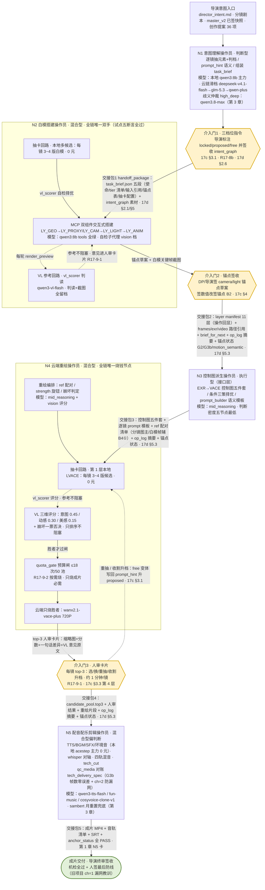
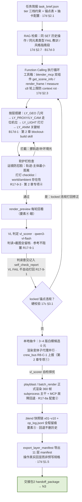
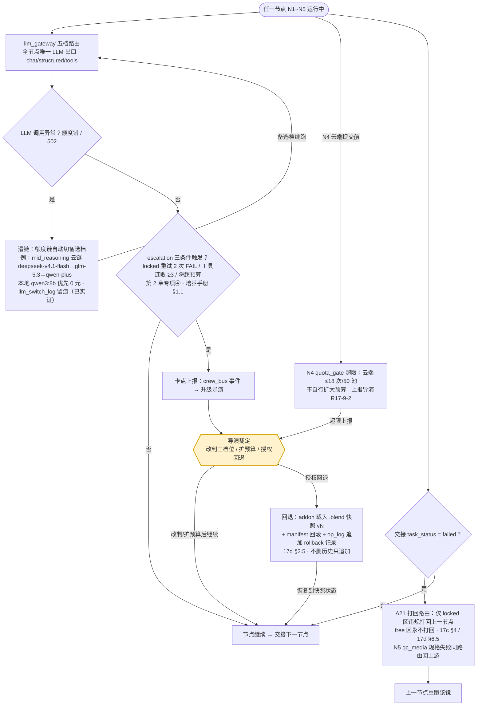

# LLM 团队构建 · 系统调研报告

> **报告日期**：2026-10-04
> **整合**：终稿整合员（team-integrator）｜基于四路并行分节稿 + 交叉复核报告装配，唯一交付文档
> **方法论**：领导预置派工四路并行（岗位装备 / 模型映射 / 先例与去国外化 / 原因验证，另加流程图分件）→ 分节稿落 staging 目录 → 交叉复核员独立实盘抽查 **37 项论断、属实 33、细节级存疑 4、编造 0** → 三项争议（N3 人工闸门 / LLM-as-Judge / 向量层）协商裁定 → 整合装配本终稿。修正与裁定以复核报告为准，分节稿原文出处标注（路径/行号/URL）全部保留。

## 分节稿索引表

| 终稿章节 | staging 分节稿路径 |
|---|---|
| 第 1 章 岗位定位卡 | `docs/03-规划与调研/_staging_llm_team/sections/T1_T2_定位与装备.md`（任务一部分） |
| 第 2 章 名词装备矩阵 | `docs/03-规划与调研/_staging_llm_team/sections/T1_T2_定位与装备.md`（任务二部分） |
| 第 3 章 模型映射 | `docs/03-规划与调研/_staging_llm_team/sections/T3_模型映射.md` |
| 第 4 章 协作流程图 | `docs/03-规划与调研/_staging_llm_team/sections/T4_流程图.md` |
| 第 5 章 先例调研 | `docs/03-规划与调研/_staging_llm_team/sections/T5_T6_先例与去国外化.md`（任务五） |
| 第 6 章 去国外化清单 | `docs/03-规划与调研/_staging_llm_team/sections/T5_T6_先例与去国外化.md`（任务六） |
| 第 7 章 原因验证 | `docs/03-规划与调研/_staging_llm_team/sections/T7_原因验证.md` |
| 第 8 章 争议裁定 | `docs/03-规划与调研/_staging_llm_team/sections/REVIEW_复核与定论.md`（§3/§4） |

---

# 第 1 章 · 五操作员岗位定位卡

> 本章讲什么：全链五节点（N1~N5）每岗的负责环节、核心职责、输入输出、类型判定与已实证状态。
> 关键结论：N2 是全链唯一"双手"且已试点实证（五断言全过）；N4 判断错误的代价率最高；每卡均注明对应旧岗位与 master_v2 轨。

> 编号对齐 17d §3 五节点；每卡给"负责环节/核心职责（含论证）/输入清单/输出清单/类型判定/对应旧岗位与 master_v2 轨/已实证状态"七项。master_v2 19 轨名以 `AI影视团队v2/pipeline/timeline_build.py:20-27` OWNER 表实读为准（camera/gauge/light｜weather/performance/wardrobe/props/spatial｜ambience/sfx/dialogue/music/mix｜vfx/grade｜overlay/subtitle/edit/clock）。

## 1.1 卡一 · N1 意图理解操作员

- **负责环节**：全链第 1 节点。把导演的意图文档、剧本、分镜转成带三档位约束的任务简报——是"锚什么、放什么"的裁定起点，不产生任何画面。
- **核心职责**：①从 director_intent.md 与分镜剧本中逐镜抽取元素清单并**判档**（locked/proposed/free，17c §3.1）；②为 free 区写 prompt_hint 语义（"窗边一个空的藤编猫窝"而非数值），为 proposed 区给镜头语言提案；③组装 task_brief.json 供 N2-N5 流转。**论证**：R17-8a 已裁定 intent_graph 从"对账规格"降级为"简报素材库"，所以 N1 的价值不在"字段抽得准"，而在"档位判得对"——判错档位，下游要么锁死创意、要么放走叙事承诺；这是五节点中唯一的纯上游裁定岗。
- **输入清单**：`projects/<片>/00_brief/director_intent.md`（六节，经 read_intent 工具）；分镜剧本与 storyboard（00_brief/）；创作提案 36 项（R0-T4 批次1 文档）；`pipeline/master_v2.json` 已签 36 项快照（tier 判定依据）；RAG 检索（同 SET 历史镜头/风格指南段，17d §2.7）。
- **输出清单**：intent_graph.json（含 tier/anchor/prompt_hint/source_span 四字段，**导演签收**）；task_brief.json（五段：使命/tier 清单/输入引用/锚点表/抽卡配置，17d §2.1）；歧义仲裁申请单（high_deep 档升级时）。
- **类型判定**：**判断型**。工具只有"读与校验"三件（read_intent/validate_intent/rag_kb，17d §4 表），无执行类工具；价值全在判档与措辞两个判断动作上，连抽卡 N 值都属它的提案权。
- **对应旧岗位与 master_v2 轨**：旧 P1 agent_intent_parser 直改（17d §6.3）；**无专属 owner 轨**——19 轨的 tier 分级源头经它流转，签收权仍归导演（R17-8b 介入门①）。
- **已实证状态**：底座已实证——llm_gateway tools/structured 三连测全绿（qwen3:8b，runtime/llm_router.json verified）；director_intent.py 在产。**节点级未独立试点**：mcp_pilot 试点用的简报素材（master_v2 已签数据+36 项提案）即 N1 输出物的人工版先例，自动化闭环待 P1。

## 1.2 卡二 · N2 白模搭建操作员

- **负责环节**：第 2 节点。在 Blender 里把简报变成 3D 白模与渲染产物——全链唯一"直接操控 3D 世界"的操作员（R17-8a）。
- **核心职责**：①经自研 MCP 双组件（addon socket + stdio server）交互式搭建：先 LY_GEO 几何、再 LY_PROXY 走位/LY_CAM 机位、后 LY_LIGHT 打灯、LY_ANIM 关键帧（11 元素类型层契约，B17d-1）；②本地抽卡：每镜 3~4 版白模候选（0 元），vl_scorer 自检择优进简报；③导出 layer manifest（**操作回显，非预写规格**——manifest 是执行后的真实回显，这是与旧 scene_skeleton 的本质区别，17d §1.5）+ 360 帧正式渲染走 batch_render 主干 + 全程快照可回退。**论证**：试点证明"搭"与"动"是同一双手的两个动作（P3+P4 合并的实证依据）；而试点 4 轮 VL 全否决的根因是场景工艺（dolly 怼猫窝+室内无环境光）而非链路（DECISIONS.md:851）——说明 N2 的核心难度不在"会调工具"而在"工艺判断"，这正是 skill 与护栏装备的主战场。
- **输入清单**：task_brief.json（N1 交接包#1，tier 三档约束）；`spec/shot_spec.schema.json`（镜头规格契约）；master_v2.json camera/spatial/performance 等轨锚点语义（**数值降为参考档**，17c §4）；分镜参考图（assets/storyboards/*.png，VL 判读对照）；RAG（同 SET 历史操作与 FAIL 教训）。
- **输出清单**：layer manifest（11 层 JSON）；shots/{id}/frames|exr（含 Z 深度）|video；self_check_report.json（逐锚点 PASS/FAIL+VL 原文留痕）；op_log.jsonl + .blend 快照链（v01~v10 滚动+里程碑）；handoff_package#2。
- **类型判定**：**混合型（判断与执行同手）**。locked 锚点是执行（硬校验、违规打回），free 区构图/材质/微动态/景别是创造判断（17c §2.2 F1-F6）；MCP 交互式闭环让两者不可拆——试点中"发现窗帘挡轨迹→挪动"就是判断与执行在同一轮工具循环内完成。
- **对应旧岗位与 master_v2 轨**：旧 P2 场景架构（并入为"脑"）+ P3 构建 + P4 动画（合并，B17d-5）；agents/blockout 卡（在用，#40 引用）；**七轨白模承载面**：camera/spatial/performance/weather/props/wardrobe/light——落点为 LY_GEO/LY_PROXY/LY_CAM/LY_LIGHT/LY_ANIM 五层，锚点草案出→DP/导演签锚点（数值签收改锚点签收，17c §4）。
- **已实证状态**：**试点已实证（R17-8a 五断言全过，DECISIONS.md:851）**：MCP 链路真跑通、1-2 镜 LLM 自主搭景+运镜出片 72 帧、动感 77.15% vs 脚本版 47.87%、op_log 全程留痕可复现、VL 自检闭环真实运转（4 轮判读留档）。未竟项：VL 判读全否决的工艺修复（R17-9-3：addon 补环境光/世界背景工具+运镜防怼脸软护栏，任务 #43 进行中）；export_layer_manifest 未随试点交付（17d 未验证项⑤）。

## 1.3 卡三 · N3 控制图派生操作员

- **负责环节**：第 3 节点。把白模渲染产物转成生成模型可吃的控制信号与逐镜 prompt 模板——"白模为骨、AI 为肉"的**接口层**。
- **核心职责**：①EXR→VACE 控制图五件套派生（exr_to_control.py 为全管线唯一不可替代件，纯标准库实现）；②条件组合策略择优：depth-only 主力 / depth+ref / scribble 仅本地 fallback（17c §3.4 策略③）；③prompt_builder：从 layer manifest 的 prompt_hint 派生逐镜语义模板 + ref 配对方案（B4①双 ref：分镜参考图为主、白模帧为辅）。**论证**：本节点几乎全是确定性管线（资源版图 §3 估算 LLM 仅 ~15 万 token/月，五节点最低），判断密度集中在"哪一镜用哪种条件组合"与"prompt 写什么语义词"——17c §0 的判断"台灯变发光方块不是事故而是接口设计的函数"，意味着接口层的语义标注质量直接决定 N4 的创意流向。
- **输入清单**：handoff_package#2（layer manifest + frames/EXR 路径引用，20 字纪律：路径引用不内嵌二进制）；`spec/shot_spec.schema.json`（帧数 8k+1 契约）；分镜参考图（ref 配对素材）；qc_media 客观测量（G3b 帧数对账）。
- **输出清单**：控制图序列（深度 PNG 近白远黑等五件套）；preview MP4（pngseq_to_mp4）；逐镜 prompt 模板 + ref 配对清单（handoff_package#3）；EXR/旁车产物校验报告。
- **类型判定**：**执行型（附一小块判断）**。派生与转换是确定性工具链；仅条件策略与语义标注两个动作需判断，且都有默认值兜底（depth-only）——与 N2"每轮循环都要判断"有质的区别。
- **对应旧岗位与 master_v2 轨**：旧 P4 渲染段+写实化前置；agents/previs 卡的 visual_prompt_5block 职能（移入 prompt_builder）；轨：gauge（sensor/frame_rate 渲染规格）与 edit 轨 in_f/out_f 的帧数对账。
- **已实证状态**：工具已投产未包装——exr_to_control.py（#37）、pngseq_to_mp4.py 在产；**入 MCP 包装按 R17-9-3 暂缓**（derive_control/vace_repaint/cut_concat 三件等 N2 的 VL 工艺验收后再开）；节点级闭环未跑。

## 1.4 卡四 · N4 云端重绘操作员

- **负责环节**：第 4 节点。白模控制图+prompt→写实画面。全链唯一烧钱节点、B3 分层抽卡主战场。
- **核心职责**：①本地抽卡层：comfyui_client 驱动本地 LVACE 产 3~4 版 0 元候选；②VL 三维评分（意图 0.45/动感 0.30/美感 0.15+崩坏一票否决）排序，**胜者才烧云端 wanx2.1-vace-plus**（quota_gate 闸门 ≤18 次/50 池）；③组装 top-3 人审卡片（缩略图+分数+一句话差异+VL 意见原文——R17-9-1：**VL 只参考不阻塞，导演裁决**）；变体收割升档（导演喜欢的 free 变体写回 prompt_hint 升 proposed）。**论证**：本节点把"抽卡不确定性"从风险变成选题库（17c §0）；其核心装备是省钱三层漏斗——本地无限迭代、评分厘级、云端只烧胜者；R17-9-2"额度按需烧"裁定后，quota_gate 的角色从"额度耗尽执行器"变成"成片必需性守门人"，这是本轮决策对岗位内涵的实质修改。
- **输入清单**：handoff_package#3（控制图+prompt 模板+ref 配对清单）；K13 资产库（角色三视图/场景锚点图，three_view_client 产物）；runtime/refimg_batch.py 等 VACE 首烧实测参数模板（#38，云端接口行为唯一本地实证，回归基线）；预算台账（bailian 台账+jobs 现金账）。
- **输出清单**：重绘片段（云端 720P 成片段+本地候选池）；抽卡评分记录（LLM-as-Judge 留痕）；top-3 人审卡片（含 VL 意见连附）；收割变体回写记录；handoff_package#4（candidate_pool.top3+人审结果）。
- **类型判定**：**混合型（判断权重五节点最高）**。提交/轮询/下载是执行，但 ref 怎么配、strength 给几档（locked 多的镜 0.8~1.0 / free 多的镜 0.5~0.7，**未验证值试点标定**，17c §4）、崩坏怎么判、收割哪些变体全是判断——预算闸门之下每个判断都直接对应真金白银，判断错误的代价率五节点最高。
- **对应旧岗位与 master_v2 轨**：旧写实化岗（realizer）操作员化；轨：vfx、grade 的生成承载面（重绘外观落点）。
- **已实证状态**：云端接口行为已实证（#38 VACE 首烧：请求样本+响应实测在档）；本地 ComfyUI 客户端三件在产；vlm_check 本地 Qwen3-VL-4B 先例在。未实证：B3 四层抽卡端到端、云端 vace-plus 重绘闭环（R17-9-3 后排在 N2 工艺修复之后）、strength 分档值。

## 1.5 卡五 · N5 配音配乐剪辑操作员

- **负责环节**：第 5 节点。对白/BGM/音效/环境音生产、音画对轴、技术剪辑与交付校验——成片最后一手。
- **核心职责**：①音频生产：TTS 对白（音色候选对比）、BGM、SFX、环境音（本地 acestep+程序合成 0 元主力；云端 sambert 月重置 30K 长期免费兜底——资源版图 §5 到期表）；②对轴与混剪：whisper 词级时间戳音画对轴、四轨混音、tech_cut 技术剪辑；③交付自检：qc_media 对账 tech_delivery_spec（G3b 帧数零误差+响度/声道规格），失败按 A21 路由回上游。**论证**：本地音频件齐全（whisper/acestep/程序合成全 0 元）使 N5 成本结构五节点最好；其风险不在生成而在"规格漏网"——旧项目成片实测 ch=1 单声道漏网（script_supervisor 卡实录）证明最后防线必须是机器规格门+人签收双保险。
- **输入清单**：handoff_package#4（选定重绘片段+成片候选）；edit 轨 in_f/out_f（节拍骨架）；`pipeline/audio_cues_v1.json`（cue 表=操作员可读简报范例）；`spec/tech_delivery_spec.json`（交付规格 locked）；角色对白清单（镜号/台词/情绪/时长上限）。
- **输出清单**：音频五 stem（ambience/dialogue/sfx/music/mix）；SRT 字幕+词级时间戳 JSON；成片 MP4（过 qc_media 全项）；音轨清单（gen_audio_manifest）；handoff_package#5（anchor_status 全 PASS）→导演签收。
- **类型判定**：**混合型偏判断**。mix/cut/校验是执行；BGM 风格候选、音色选择、cue 点微调、剪辑节奏变体是判断（音频抽卡 N=2 轻量评分，**收益未验证**，17d §3 N5 行）。执行工具链最全（九件待包装）但判断密度低于 N4、高于 N3。
- **对应旧岗位与 master_v2 轨**：旧音效/剪辑岗操作员化 + agents/script_supervisor 卡的交付质检段（qc_media 归档纪律保留）；**九轨**：ambience/sfx/dialogue/music/mix（agent_sound 五轨）+ overlay/subtitle/edit（agent_editor 三轨）+ clock（时长对账，owner 为 agent_coordinator）——五节点中管辖轨最多。
- **已实证状态**：音频工具链已投产并交付过（雨夜寻猫 sfx 9/dialogue 8 已签核，t4_batch3；四轨混音粗剪 v3 已出，build_mix.py）；whisper/acestep/edge_tts 实测在。未实证：节点化 LLM 编排（现全为手写脚本）、音频抽卡收益。

## 1.6 五卡一句话画像（汇报用）

| 节点 | 一句话画像 |
|---|---|
| N1 | 判断型的"裁定起点"——不产画面，只决定"锚什么放什么" |
| N2 | 混合型的"唯一双手"——试点已实证 MCP 操控链路五断言全过，当前战场是工艺修复 |
| N3 | 执行型的"接口层"——五节点判断密度最低，但语义标注质量决定 N4 创意流向 |
| N4 | 混合型的"烧钱守门人"——判断错误代价率最高，按需烧取代硬烧 |
| N5 | 混合型的"规格最后防线"——成本结构最好，风险在规格漏网不在生成 |

---

# 第 2 章 · 名词装备矩阵

> 本章讲什么：64 条 Agent 技术名词逐一映射到五节点，给出"必配 / P1 试点 / 观察 / 不需要"四档判定与"配了能多做什么"；附四个专项（Sub-agent / Skills / HITL / Guardrails）。
> 关键结论：矩阵覆盖 64/64=100%；判定格分布（三项争议裁定后口径）= 必配 119 格 / P1 试点 45 格 / 观察 105 格 / 不需要 51 格；争议裁定详细论证见第 8 章。

## 2.0 矩阵口径

- **判定值**：`必配`（缺了节点不成立）/ `P1 试点`（杠杆明确但需验证，不一刀切铺开）/ `观察`（暂缓，写明触发条件）/ `不需要`（写明理由）。
- **★=试点已实证**（有真实运行证据，非纸面规划）。已实证清单：Function Calling（qwen3:8b tools 三连测全绿）、Structured Output（json_mode 实测）、MCP（R17-8a 双组件试点五断言全过）、LLM-as-Judge 前身（vlm_check 本地 4B + 试点 VL 闭环 4 轮真实判读）、Tracing（llm_switch_log 实盘运行+op_log 规格落定）、Sandbox 进程隔离思想（V27/T5 bpy 禁区 + addon 127.0.0.1+token+命令白名单）、Ollama（qwen3:8b 主力 28 tok/s）、小模型路由（五档路由+额度链滑档实测）、text-embedding-v4（百炼实测）。
- **去国外化标注**：标 `[不作装备]` 的条目=国外栈，仅作模式借鉴或调研资料，不进装备清单。
- **名词清点**：名词表按表格行逐行清点为 **64 条目**（协议类 11 / 调用类 5 / 检索与记忆 7 / 多智能体 13 / 执行类 5 / 质量与治理 7 / 服务与部署 7 / 新名词补遗 9；协议族捆绑行如"UCP/x402/MPP/TAP"计 1 条）。注：DECISIONS.md:847 记"43 条"、名词表自述"40+"，均为旧口径——**全文以本清点 64 为准**（详见文档尾勘误表）。

## 2.1 一、协议类（11 条）

| # | 名词 | N1 | N2 | N3 | N4 | N5 | 判定理由与"配了能多做什么" |
|---|---|---|---|---|---|---|---|
| 1 | **MCP** ★ | 不需要 | **必配** | P1 | P1 | P1 | N2：已实证的唯一 3D 交互通道（五断言全过）——配了=搭景/机位/打灯/动画全交互化，这就是 N2 的存在方式本身（17d §3 N2 行）。N3/N4/N5：工具包装以直接 FC 为主（17d §4），MCP 化按 R17-9-3 等 N2 验收后逐个开；配了=工具统一底座，registry/审计一份管全队。N1：纯文本读校验，FC 已够，MCP 属过度包装 |
| 2 | MCP Apps / Tasks 扩展 | 观察 | 观察 | 观察 | 观察 | 观察 | 长渲染任务生命周期已由 jobs.py 的 handle+幂等键管（jobs.py docstring：对齐 MCP 2026-07-28 副作用第一要求）；等 spec 生态成熟再评估。多做什么：暂无 |
| 3 | **A2A** | P1 | P1 | P1 | P1 | P1 | B17d-4 已拍板轻量落地：operator_card + crew_bus task 状态机 + handoff_package，五节点**每一跳交接都用**；配了=交接可复现（同事件链可重放）、未来对外协作加一层 HTTP 绑定即暴露，无需重构（17d §5.3） |
| 4 | ACP（IBM/BeeAI） | 不需要 | 不需要 | 不需要 | 不需要 | 不需要 | 2025-08 并入 A2A 后归档（名词表 §一），仅历史脉络，装备直接对齐 A2A |
| 5 | ANP | 不需要 | 不需要 | 不需要 | 不需要 | 不需要 | 单团队内部管线，无跨组织去中心化协作需求（名词表 §一） |
| 6 | **AG-UI** | P1 | P1 | P1 | P1 | P1 | 简版 SSE 状态推送进监控面板（培养手册 §4.2 API-1/2 已预留挂点）；N4 受益最大——导演看得见抽卡过程才敢放权（R17-9-1 人审兜底需要可视的候选池） |
| 7 | WebMCP | 不需要 | 不需要 | 不需要 | 不需要 | 不需要 | 影视制作无"Agent 访问网页"场景（名词表 §一） |
| 8 | AP2 | 不需要 | 不需要 | 不需要 | 不需要 | 不需要 | 无 Agent 支付环节；预算控制走 budget_manager 内部记账 |
| 9 | UCP / x402 / MPP / TAP | 不需要 | 不需要 | 不需要 | 不需要 | 不需要 | 代理商务协议族，与制作管线无关（名词表 §一） |
| 10 | AAIF | 观察 | 观察 | 观察 | 观察 | 观察 | 不落装备；作为"选 MCP/A2A 不怕厂商弃坑"的治理依据进采购/评审话术（名词表 §一） |
| 11 | Agent Client Protocol（Zed ACP） | 不需要 | 不需要 | 不需要 | 不需要 | 不需要 | 编辑器↔编码 Agent 协议，开发期工具链话题，与运行时装备无关 |

## 2.2 二、调用类（5 条）

| # | 名词 | N1 | N2 | N3 | N4 | N5 | 判定理由与"配了能多做什么" |
|---|---|---|---|---|---|---|---|
| 12 | **Function Calling** ★ | **必配** | **必配** | **必配** | **必配** | **必配** | 已实证（qwen3:8b tools 三连测全绿）。操作员六要素③执行循环的动作基础；配了=五节点一切工具调用的统一形态，"有手有脚"由它兑现（17d §2.3） |
| 13 | **Structured Output** ★ | **必配** | **必配** | **必配** | **必配** | **必配** | 已实证（json_mode）。简报/交接包/评分卡/self_check_report 强制 schema 校验；配了=下游永远拿得到可解析产物，A21 打回路由有据可依 |
| 14 | **Agent Skills（SKILL.md）** | **必配** | **必配** | **必配** | **必配** | **必配** | MCP 给手、Skills 给判断（名词表 §二）；目录级方案见 2.11 专项②；已有 `_skills/k13-version-tree/` 与 agents/blockout 先例；配了=把试点踩坑（怼脸/无环境光）固化为可复用的判断，而非散落在个人记忆里 |
| 15 | **AGENTS.md / CLAUDE.md** | **必配** | **必配** | **必配** | **必配** | **必配** | 仓库根一份（半天工作量），五节点系统提示自动对齐项目规范；配了=新操作员冷启动即有规范上下文（名词表 P0 清单） |
| 16 | **Tool Registry / MCP Registry** | **必配** | **必配** | **必配** | **必配** | **必配** | 17d §4 注册表即 registry（"配置文件即注册中心"，本项目规模不上正式 registry）；认领即授权（A12 白名单机制改写注册对象）；配了=工具白名单+权限矩阵统一收口，防 Agent Sprawl |

## 2.3 三、检索与记忆类（7 条）

| # | 名词 | N1 | N2 | N3 | N4 | N5 | 判定理由与"配了能多做什么" |
|---|---|---|---|---|---|---|---|
| 17 | **RAG** | **必配** | **必配** | **必配** | **必配** | **必配** | B17d-3 已拍板双层实现：rag_kb 纯标准库关键词索引先行；简报组装/自检/交接三时机（17d §2.7）；配了=同 SET 历史教训自动进简报（彩排复盘"喂养"闭环，培养手册 §3.2） |
| 18 | **Embedding / 向量库** ★ | P1 | P1 | 观察 | 观察 | 观察 | text-embedding-v4 已实测（llm_router embedding 档；**★=连通性实测，非检索收益**）。裁定口径（争议三，见第 8 章）：以 B17d-3"关键词先行、向量可选"为准，**P1 试点（N1/N2 先行），N3-N5 观察**——rag_kb 关键词层落地前向量层不铺开；作为 RAG 第二层可选启用；async-v1/v2 各 20M=全场最大向量额度但 **10/27 到期（非长期款）**，10/27 前若成片冲刺需建经验库，按需烧 async 与 R17-9-2"按需烧"完全兼容；混合权重 0.5/0.5 未验证试点标定；配了=语义近似案例召回（关键词索引抓不到的措辞变体，如"暖光"vs"低色温"） |
| 19 | Agentic RAG | P1 | 观察 | 观察 | 观察 | 观察 | 仅 N1 歧义仲裁可能需要"多轮检索-验证"（名词表 §三建议"仅高检索需求节点"）；其余固定 top-k 够，防过度工程 |
| 20 | GraphRAG / 知识图谱记忆 | 观察 | 观察 | 观察 | 观察 | 观察 | 影视知识以流程/经验为主，实体多跳推理需求弱（名词表 §三）；触发条件：角色关系类检索成为真实痛点 |
| 21 | 长期记忆系统（Mem0/Letta/Zep/LangMem） | 观察 | 观察 | 观察 | 观察 | 观察 | op_log+快照+RAG 四层已构成文件型项目记忆；操作员多为单会话任务，对话记忆用不上（名词表 §三"先用文件型"） |
| 22 | **Context Engineering** | **必配** | **必配** | **必配** | **必配** | **必配** | context_budget 已写进岗位卡模板（brief_max_tokens 2000 / rag_topk 5，培养手册 §1.1）；配了=12GB 卡 4K~8K 上下文硬约束下仍装得下必要信息；60-80% Agent 失败源于上下文（名词表 §三），这是零成本高杠杆装备 |
| 23 | **Context Rot** | **必配** | **必配** | **必配** | **必配** | **必配** | 作为设计原则全员执行；N2 多轮 MCP 循环是重灾区（试点 ≤8 轮上限即此意识，mcp_pilot_agent.py docstring）；配了=长任务检索准确率不掉（Chroma 实证：同文档不同组织方式 98%→64%） |

## 2.4 四、多智能体类（13 条）

| # | 名词 | N1 | N2 | N3 | N4 | N5 | 判定理由与"配了能多做什么" |
|---|---|---|---|---|---|---|---|
| 24 | **Agent Orchestration** | **必配** | **必配** | **必配** | **必配** | **必配** | crew_bus+jobs 已是编排实现（理念已落地非规划）；配了=五节点接力全自动、可观测、可重放 |
| 25 | LangGraph | 观察 | 观察 | 观察 | 观察 | 观察 | 触发条件明确（名词表 §四）：自研编排复杂度失控出 bug 时优先评估；Durable 检查点需求先自研简版顶住 |
| 26 | OpenAI Agents SDK `[不作装备]` | 观察 | 观察 | 观察 | 观察 | 观察 | 仅借鉴 Handoff/Guardrail 原语设计本项目交接包与护栏；国外栈不进装备（去国外化约束），不绑定 OpenAI 模型体系 |
| 27 | Claude Agent SDK `[不作装备]` | 观察 | 观察 | 观察 | 观察 | 观察 | 仅借鉴 subagent 定义模式（.claude/agents/*.md）到 N2 自检子代理设计；同上不进装备 |
| 28 | Microsoft Agent Framework | 不需要 | 不需要 | 不需要 | 不需要 | 不需要 | 无 .NET 栈需求（名词表 §四） |
| 29 | CrewAI | 观察 | 观察 | 观察 | 观察 | 观察 | 自研管线已成型不迁移；角色模型（Agent/Task/Crew）仅作 15 岗分层的表述参照 |
| 30 | Google ADK `[不作装备]` | 不需要 | 不需要 | 不需要 | 不需要 | 不需要 | 无 GCP 绑定；A2A 语义已用轻量自研落地（B17d-4），不需要其开发套件 |
| 31 | CAMEL | 观察 | 观察 | 观察 | 观察 | 观察 | 生产采用度已被超越（名词表 §四标注未验证），仅学术参照 |
| 32 | **Planner / Executor 模式** | **必配** | **必配** | **必配** | **必配** | **必配** | 已体现：E2E 调度=Planner、N1-N5=Executor（名词表 §四"本项目天然就是它"）；配了=分工拓扑稳定、A21 打回路由清晰（只打回不越级） |
| 33 | **Supervisor / Handoff / Sub-agent** | **必配** | **必配** | **必配** | **必配** | **必配** | 专项①详述；N2 自检子代理（vision 档）与 N4 并行候选派发已进岗位卡 subagent_policy（培养手册 §1.1）；配了=长等待与并行任务隔离上下文防 rot，主操作员专注判断 |
| 34 | **Durable Execution** | P1 | P1 | P1 | P1 | P1 | 自研简版=op_log+快照回退（N2 快照机制规格已定并随试点落盘）；配了=全帧渲染小时级任务断点续跑不做重复功（名词表 §四 P1 项） |
| 35 | **HITL** | **必配** | **必配** | 观察 | **必配** | **必配** | 专项③详述；R17-9-1 为最新口径（VL 参考+人审兜底）。N3 **无例行人工闸门（escalation 通道保留**，交接包校验失败自动打回，不需人）——五节点唯一 HITL 判定为观察的节点，理由：其派生与对账类产物全部可机器校验（帧数/文件存在性/schema），例行人工介入无增量价值；升级触发条件见第 8 章（首次节点级试点若机检全过但语义标注错导致 N4 单镜重抽 ≥2 次，即升 P1） |
| 36 | Agent Sprawl | 观察 | 观察 | 观察 | 观察 | 观察 | 知情即可；纪律=五节点统一 gateway+统一工具层（名词表 §四），"五操作员不是五套框架" |

## 2.5 五、执行类（5 条）

| # | 名词 | N1 | N2 | N3 | N4 | N5 | 判定理由与"配了能多做什么" |
|---|---|---|---|---|---|---|---|
| 37 | Computer Use | 观察 | 观察 | 观察 | 观察 | 观察 | 工具链全程 API/MCP；仅作"无 API 国产软件"兜底备案（名词表 §五） |
| 38 | Browser Use | 观察 | 观察 | 观察 | 观察 | 观察 | 素材搜集/平台上传的兜底；官方 API 优先 |
| 39 | Code Interpreter | 观察 | 观察 | P1 | 观察 | P1 | N5 处理 EDL/镜头表/渲染报表、N3 做 EXR 产物对账时引入，配目录级沙箱（名词表 §五 P1 项）；N1/N2/N4 无数据批处理需求 |
| 40 | **Sandbox** ★ | P1 | **必配** | P1 | P1 | P1 | N2 已实证进程隔离思想（V27/T5 bpy 不进 Agent 进程禁区 + addon 仅监听 127.0.0.1+token+命令白名单，17d §2.3/§6.5）；其余节点工具执行做目录级隔离+白名单命令（P1）；配了=渲染/批处理命令越界不伤工程文件 |
| 41 | Agent Harness | 观察 | 观察 | 观察 | 观察 | 观察 | 术语统一（知情即可）：llm_gateway+工具层+白名单整体就是自研 harness；对外资料对齐用 |

## 2.6 六、质量与治理类（7 条）

| # | 名词 | N1 | N2 | N3 | N4 | N5 | 判定理由与"配了能多做什么" |
|---|---|---|---|---|---|---|---|
| 42 | **Guardrails** | **必配** | **必配** | **必配** | **必配** | **必配** | 专项④详述；N2 运镜防怼脸软护栏（R17-9-3）+ N4 quota_gate 预算闸 + 全员 schema 拦截与 escalation 三条件；配了=试点踩坑不再靠人肉提醒，装备化固守 |
| 43 | **LLM-as-Judge** ★ | 观察 | **必配（辅助定位）** | P1 | **必配（辅助定位）** | 观察 | N2/N4 已实证前半：vlm_check 本地 Qwen3-VL-4B 在产 + 试点 VL 闭环 4 轮真实判读（DECISIONS.md:851）。裁定口径（争议二，见第 8 章）：**必配=辅助定位必配，校准前不赋任何门职能**（judge 输出只排序、不拦截、不进 G 门）；前置条件=T7 缺口第 8 项（定量亮度反馈）与第 9 项（VL 检查前强制重渲/帧哈希校验）先修输入端（见第 7 章）。R17-9-1 后职能=参考+排序（不阻塞出片、不自动打回）；N3 的 preview 质检 P1；N1/N5 无图像评分需求（N5 音频评分收益未验证）。先小样本校准 judge 与导演偏好一致率（名词表 §六 P1 建议） |
| 44 | **Agent Evaluation / Tracing** ★ | **必配** | **必配** | **必配** | **必配** | **必配** | op_log.jsonl（规格已定随 P0 落盘）+ llm_switch_log（实盘运行中）；字段对齐 OTel GenAI；配了=每动作可复现可复盘——试点动感对照 77.15% vs 47.87% 这个关键数字靠的就是留痕（DECISIONS.md:851） |
| 45 | **LLM Observability** | P1 | P1 | P1 | P1 | P1 | per-task 成本已进 jobs 台账（已实现部分：现金/工时账）；监控面板 MVP P1（培养手册 §4.2 五区块）；平台化（Langfuse 类）等量起来再说 |
| 46 | **OpenTelemetry GenAI / OpenInference** | **必配** | **必配** | **必配** | **必配** | **必配** | 零成本装备：trace 字段规范第一天对齐（session/trace/span 层次），不装 OTel 本体；配了=未来接任意观测平台零改造（名词表 §六"字段规范对齐即可"） |
| 47 | **OWASP LLM/Agentic Top 10** | **必配** | **必配** | **必配** | **必配** | **必配** | 作为 checklist 全员执行：MCP addon 命令白名单（在建）、外部 skills 引入先审（历史样本 43% 命令注入，名词表 §六）、分镜参考图等外部素材入库前清洗；配了=第三方引入不踩坑、外部素材不带毒进创作层 RAG |
| 48 | **Agent Control Plane** | P1 | P1 | P1 | P1 | P1 | budget_manager+llm_router 即雏形（已实证滑链留痕）；策略统一收口 gateway 层 P1；配了=预算/权限策略一处改全局生效 |

## 2.7 七、服务与部署类（7 条）

| # | 名词 | N1 | N2 | N3 | N4 | N5 | 判定理由与"配了能多做什么" |
|---|---|---|---|---|---|---|---|
| 49 | **LLMOps** | **必配** | **必配** | **必配** | **必配** | **必配** | 理念已实践：额度台账（bailian_models_408）+提示词版本留档+trace；配了=成本与质量可月度复盘、路由可调优（培养手册 §1.5 周度滑链聚合） |
| 50 | **模型网关 / LiteLLM** ★ | **必配** | **必配** | **必配** | **必配** | **必配** | 已实证：llm_gateway 五档路由+额度链滑档（纯标准库）；LiteLLM 仅对标思想**不引入**（零依赖纪律，培养手册 §5）；配了=全部节点一个 LLM 出口，滑档兜底与留痕单一收口 |
| 51 | vLLM | 观察 | 观察 | 观察 | 观察 | 观察 | 12GB 卡当前 Ollama 够用；本地 GPU 并发需求出现（如白模辅助任务批量部署）时启用 |
| 52 | **Ollama / llama.cpp** ★ | **必配** | **必配** | **必配** | **必配** | **必配** | 已实证：qwen3:8b 主力三连测全绿（chat/structured/tools/thinking 全通）；0 元基本盘（K-REV-1）；配了=N1-N5 全节点主力模型免费跑，是"国内资源+本地化"装备的地基 |
| 53 | **小模型路由（Model Routing）** ★ | **必配** | **必配** | **必配** | **必配** | **必配** | 已实证：五档路由+额度链滑档机制实盘运行（llm_switch_log 多条 502 滑档实录）；省钱档 qwen3:4b 分配机械子任务（资源版图 §3 各节点"省钱档"行）；配了=80% 简单任务不烧云端、路由判断收口 gateway |
| 54 | **量化（GGUF/FP8/AWQ）** | 观察 | P1 | 观察 | P1 | 观察 | N2/N4 的**本地 VL 切换依赖项**：gemma3:12b / qwen2.5-vl:7b Q4 款在 12GB 卡待实测（资源版图 §6.5——**云端 VL 额度 10/27 到期前必须完成**，否则 VL 自检断粮；10/27 为台账实盘口径，原稿"11 月"系误沿旧口径，见文档尾勘误表）；配了=12GB 卡装下多模态档，VL 闭环永久本地化 |
| 55 | SGLang / TGI / TensorRT-LLM | 观察 | 观察 | 观察 | 观察 | 观察 | 备选知识暂不引入（名词表 §七） |

## 2.8 八、2025-2026 新名词补遗（9 条）

| # | 名词 | N1 | N2 | N3 | N4 | N5 | 判定理由与"配了能多做什么" |
|---|---|---|---|---|---|---|---|
| 56 | **Agent Card** | **必配** | **必配** | **必配** | **必配** | **必配** | operator_card.json 五节点全量登记（培养手册身份层必件、培养 checklist 第 1 步）；P0 先落 N2 卡（模板已写好）、P1 全量；配了=输入/输出契约机器可读，交接时下一节点读卡自动校验匹配（17d §5.2） |
| 57 | Agentic Workflow | 观察 | 观察 | 观察 | 观察 | 观察 | 对外表述术语（知情即可）；本管线对外陈述可直接用该词对齐行业话语 |
| 58 | **Agentic UI / 生成式 UI** | P1 | P1 | P1 | P1 | P1 | 简版=监控面板状态页+人审卡片（web/ 展示层挂点已留，17d §7.6）；控件生成后置；配了=导演 1 分钟内完成每镜挑选动作（P1 验收断言，17d §8） |
| 59 | **Progressive Disclosure** | **必配** | **必配** | **必配** | **必配** | **必配** | skills 索引薄、内容按需载入；五节点 skills 超 20 个后的生存纪律，现在就写进 skill 目录设计（专项②）；配了=大技能库零上下文成本 |
| 60 | **Tool Poisoning / 提示注入** | **必配** | **必配** | **必配** | **必配** | **必配** | 安全基线：自研 skills 为主、外部 MCP 先审后用、外部素材入库清洗（同 #47 OWASP）；配了=防恶意工具描述/外部内容带毒进创作层 |
| 61 | Agentic Commerce | 不需要 | 不需要 | 不需要 | 不需要 | 不需要 | 与本项目无关（名词表 §八） |
| 62 | Agent Swarm | 观察 | 观察 | 观察 | 观察 | 观察 | 影视管线是确定性流程不需要涌现；并行抽卡用普通并发调度足够（名词表 §八） |
| 63 | Agentic Context Engineering（ACE） | 观察 | 观察 | 观察 | 观察 | 观察 | 每日教训行回灌（培养手册 §1.5）=Generator-Reflector 简版已设计；仅借鉴三角色分工思想，不引入框架 |
| 64 | 长尾协议（AIP/ERC-8004/ENSIP-26/LMOS/Agora） | 不需要 | 不需要 | 不需要 | 不需要 | 不需要 | 均未过生态验证；仅跟踪 ANP 一条线（名词表 §八） |

## 2.9 覆盖率断言

- **名词总数 = 64 条目**（名词表 8 分类逐行实数：11+5+7+13+5+7+7+9=64；DECISIONS.md"43 条"与名词表自述"40+"为旧口径，详见文档尾勘误表）；
- **矩阵覆盖 = 64/64 = 100%**，无一遗漏；判定格合计 64×5 = 320 格；
- **格分布**（三项争议裁定后口径，见第 8 章）：必配 119 格 / P1 试点 45 格 / 观察 105 格 / 不需要 51 格（争议三裁定将 #18 向量库 5 格由"必配×5"改为"P1×2+观察×3"）；
- **条目分布**（按条目最强判定计）：含必配格条目 **26 条**、含 P1 格条目（无必配格）**10 条**（A2A、AG-UI、Agentic RAG、Durable Execution、Code Interpreter、LLM Observability、Agent Control Plane、量化、Agentic UI、Embedding/向量库）、纯观察条目 **18 条**、不需要条目 **10 条**；
- **已实证标注 ★ 计 9 条**：Function Calling、Structured Output、MCP、LLM-as-Judge（前半）、Tracing、Sandbox（N2 进程隔离面）、Ollama、小模型路由、Embedding（text-embedding-v4）。

## 2.10 专项① · Sub-agent：谁派子代理、派什么

判定原则（名词表 §四 Supervisor/Handoff/Sub-agent 条）：只在**长等待、并行化、上下文隔离**三种收益至少占其一时派子代理，否则徒增总线噪声。

| 操作员 | 派不派 | 派什么 | 依据 |
|---|---|---|---|
| N1 | 不派 | 单会话结构化任务，检索已由 rag_kb 承担 | 17d §3 N1 行无并行需求 |
| **N2** | **派（已实证雏形）** | ①**自检子代理**（vision 档跑 vl_scorer 判读，与主搭建会话上下文隔离——防 rot 且省主会话 token）；②**渲染变体子代理**（3~4 版白模候选并行渲染，经 crew_bus R8-C-1 事件上报进度） | 岗位卡 subagent_policy 已写明（培养手册 §1.1 模板）；17d §2.3"渲染 4 个候选变体并行化"原文 |
| N3 | 不派 | 确定性工具链串行即可，EXR 派生无并行价值 | 17d §3 N3 行 |
| **N4** | **派（P1）** | ①**本地抽卡子代理**（N=3~4 候选并行提交 ComfyUI）；②**云端轮询子代理**（提交→轮询→下载长等待隔离，主会话不被阻塞，jobs.py handle+幂等键兜底断网恢复） | 17d §3 N4 行抽卡配置；realizer 旧卡"提交/轮询/下载异步+幂等"职能的子代理化 |
| N5 | 不派 | 音频任务轻、流水线串行够；音频抽卡 N=2 并行收益未验证 | 17d §3 N5 行"未验证"标注 |

## 2.11 专项② · Skills：每个操作员的 SKILL.md 应写什么（目录级）

格式纪律沿培养手册 §1.2 四条（目录 `tools/_skills/{name}/SKILL.md`；头部 name+description；正文只写判断与步骤不复述 schema；自研为主防注入）。标注▲=手册已给草案，其余为本卡新增建议。

| 操作员 | skill 目录 | 装什么判断 |
|---|---|---|
| N1 | `intent-parse/` | 三档位判档标准（什么进 locked：改了就不是这部片的；什么进 free）；prompt_hint 措辞法（语义句非数值）；歧义仲裁触发条件（何时升 high_deep 档） |
| N1 | `brief-assembly/` | 简报五段组装配方与 context budget 纪律（17d §2.1+培养手册 §1.1） |
| N2 | ▲`blockout-build/` | 空场起手顺序心法：LY_GEO→LY_PROXY→LY_CAM→LY_LIGHT→LY_ANIM；命名规范 CHAR_/PROP_/SET_（D16）；对象上限三档 |
| N2 | ▲`vl-selfcheck/` | 渲染→判读→修正→复验闭环步骤；R17-9-1 后口径改为"判读意见进卡片、不阻塞"；崩坏识别口径 |
| N2 | ▲`snapshot-rollback/` | 何时主动存快照（每完成一层/每版白模）；回退操作与 op_log rollback 记录纪律 |
| N2 | ▲`manifest-export/` | 导出 layer manifest 并自检 11 层归属（bpy 类型→layer_id 映射口诀，17d §1.4 表） |
| N2 | ▲`rag-lookup/` | 简报组装前查 rag_kb 的时机与关键词构造法 |
| N2 | `camera-safety/`（新增建议） | **运镜防怼脸护栏判断**：轨迹与主体最小距离意识——试点 dolly 末段怼进猫窝的直接教训（R17-9-3 修复项），护栏工具之外的操作员侧判断 |
| N3 | `control-derive/` | 五件套派生顺序与参数；条件三策择优（depth-only 主力/depth+ref/scribble 本地 fallback）；深度图近白远黑口径防 --invert 误用 |
| N3 | `prompt-derive/` | manifest prompt_hint→逐镜模板拼装；ref 配对判断（分镜参考图为主白模帧为辅，B4①）；参考图编号局部性纪律（旧 previs 卡教训） |
| N4 | `gacha-rerank/` | 三维评分权重口径（0.45/0.30/0.15+崩坏否决）；收割升档流程（导演选中 free 变体→写回 prompt_hint 升 proposed，17c §3.1）；**strength 旋钮分档判断（未验证值，试点标定后回填本 skill）** |
| N4 | `cloud-repaint/` | 提交→轮询→取回步骤；ref_images 配对；失败重试前先判"引擎问题还是控制图问题"（旧 realizer 卡铁律：白模问题不许靠重试解决） |
| N5 | `audio-cue/` | BGM 风格候选与音色选择判断；cue 表读法（audio_cues_v1.json=可读简报）；对白字数×时长匹配（中文 4-5 字/秒，旧 screenwriter 卡标准） |
| N5 | `mix-cut/` | whisper 对轴校验步骤；四轨混音纪律（amix normalize=0 保相对音量，build_mix.py 实测）；tech_delivery_spec 自检清单（含 ch=2 声道防漏网——旧项目实测教训） |

## 2.12 专项③ · HITL：哪里要人工闸门（结合 R17-9-1）

R17-9-1 口径：**VL 判定不阻塞出片，白模动画连 VL 意见一起进人审卡片由导演裁决**——这把 17d 原设计的"运镜语义软门 FAIL 转人审"升级为"一切 VL 类判定统一进人审"。据此五节点人工闸门如下：

| 节点 | 闸门 | 人工动作 | 依据 |
|---|---|---|---|
| N1 | **导演签收 intent_graph + 三档位** | 确认/改判 tier（locked 不可自动变更） | R17-8b 介入门①；17c §3.1"自由区越大，导演签收越重要" |
| N2 | **locked 违规打回复核 + 快照回退授权** | 导演/操作员指定"回退到 v3"等动作 | 17d §2.5 回退操作；A21 改写（只打回 locked 违规）；VL 类 FAIL 不再打回（R17-9-1），G2/G3b 硬门为机器门非人工 |
| N3 | **无例行人工闸门（escalation 通道保留）** | —（交接包校验失败自动打回；升级触发条件见第 8 章争议一：首次节点级试点若机检全过但语义标注错导致 N4 单镜重抽 ≥2 次，HITL 即升 P1） | 产物派生/对账类全可机器校验（帧数 8k+1/文件存在/schema）；五节点唯一 HITL=观察的节点 |
| N4 | **top-3 人审卡片（主闸门）+ 预算超限确认** | 每镜选/换/重抽/收割升档（≤1 分钟）；quota_gate 超限上报后由导演决定是否扩预算 | R17-9-1+R17-9-2；17c §3.3 第 4 层；岗位卡 escalation 第 3 条"不自行扩大预算" |
| N5 | **成片交付导演签收（一次性）** | 终审签收 | 17d §3 N5 行；tech_delivery_spec 过机检后仍需人签（旧项目 ch=1 漏网教训：机检之外保留人审最后防线） |

## 2.13 专项④ · Guardrails：每个操作员防什么（结合试点踩坑）

全员通用护栏：Structured Output schema 校验拦截（格式越界进不来）、岗位卡 escalation 三条件（locked 重试 2 次 FAIL/工具连败 ≥3/将超预算——培养手册 §1.1）、OWASP checklist（外部输入先审，#47）。

| 操作员 | 防什么 | 依据（踩坑实证标 ◆） |
|---|---|---|
| N1 | ①防档位越权：不许自作主张把 proposed 升 locked（tier_reading 纪律）；②防幻觉元素：无 source_span 出处的不进 intent_graph | 17c §3.1；17 号草案 §5 source_span 可回溯对策 |
| N2 | ◆①**运镜防怼脸软护栏**：轨迹与主体距离检查（试点 dolly 末段怼进猫窝，DECISIONS.md:851/857）；◆②**打灯 checklist 护栏**：渲前强制 world/ambient 存在性检查（试点室内无环境光→4 轮全否决）；③防同类镜头机位/运镜同质重复（跨镜 A5 一致 + 抽卡变体避免同质——抽卡的意义在差异不在复读）；④locked 区越权修改拦截（改了就打回）；⑤bpy 进程禁区（Agent 进程不 import bpy） | R17-9-3 明文修护栏；17d §6.5 V27/T5 改写保留 |
| N3 | ①帧数对账（8k+1 违规拦截）；②控制图口径守恒（近白远黑，--invert 误用拦截） | shot_spec schema duration enum（test_schema_patch A1）；exr_to_control docstring |
| N4 | ①崩坏一票否决（结构完整性）；②云端预算硬闸 ≤18 次/50 池（quota_gate）；③strength 越档拦截（locked 多的镜禁低于 0.8——**未验证值，试点标定**）；④失败重试前归因（引擎问题才重试） | 17c §3.3/§4；R17-9-2 按需烧；realizer 旧卡职能 7 |
| N5 | ①响度/声道规格门（-14 LUFS±0.5、**ch=2 防 ch=1 漏网**◆）；②音画漂移（whisper 对轴超阈值告警）；③交付规格 locked 不可协商 | tech_delivery_spec；script_supervisor 旧卡"旧项目成片实测 ch=1 漏网"实录◆ |

## 2.14 未验证项与诚实显影

1. N1/N3/N5 均无节点级试点，定位卡中"类型判定"为设计推断，待各节点首跑校准；
2. N4 strength 分档值、N5 音频抽卡收益沿 17d/17c 未验证标注；
3. 本地 VL（gemma3:12b/qwen2.5-vl:7b）12GB 卡实测未做（量化条目 P1 的截止压力：**云端 VL 额度 10/27 到期前**，台账实盘口径）；
4. 名词表条目计数口径（64 vs 43 vs 40+）待勘误轮统一（本报告全文以 64 为准，见文档尾勘误表）；
5. N2 `camera-safety` skill 为本卡新增建议（手册草案之外），依赖 R17-9-3 护栏工具落地后回填具体口径。

*实盘依据汇总：17d/17c/名词表/培养手册/资源版图/DECISIONS.md R17-9 逐条引用见行内标注；tools 46 件（顶层 .py 实数）docstring、agents 七卡、AI影视团队v2/pipeline/timeline_build.py 19 轨 owner 表（第 20-27 行）实读；试点数字（77.15%/47.87%/72 帧/4 轮否决/五断言）引自 DECISIONS.md 第 851 行。*

---

# 第 3 章 · 百炼 408 模型映射

> 本章讲什么：百炼额度台账 408 款模型逐类映射到五节点，给出烧/不烧结论与台账外国内可获取补充。
> 关键结论：台账实盘五类计数 139/98/25/127/19=408（以台账为准，资源版图旧口径 141/94/18 不采）；LLM/视觉按需烧、语音必烧且长期盘清晰、向量建库一次性。

> **权威事实源**：`runtime/bailian_models_408.md`（408 模型额度台账，2026-10-04 逐行实读）。根目录未见"模型 Code 模型类型 剩余额度 到期时间.txt"交叉核对件，**未能交叉核对**（如实标注）。
> 模型→模块映射先例：`docs/03-规划与调研/百炼模型调研-2026-10-03.md` §三；平台/价格：`docs/03-规划与调研/LLM资源版图与数字员工配给-2026-10-04.md` §2/§3；五节点定义：`docs/02-决策/17d-全链路操作员架构-重构版.md` §3。
> 烧额度总原则：`docs/02-决策/DECISIONS.md` R17-9-2（**额度按需烧、不硬烧**：只烧成片必需的量，到期作废部分接受，不为烧量做脱离成片目标的任务）。

## 3.0 分类计数核验（台账实盘，脚本统计）

| 模型类型 | 台账实盘款数 | 台账出处（行号区间） | 备注 |
|---|---|---|---|
| 大语言模型（LLM） | **139** | 第 3–141 行 | LLM资源版图文档记 141，**以台账实盘 139 为准**（差 2） |
| 视觉模型（图像/视频生成） | **98** | 第 142–239 行 | 与 LLM资源版图一致 |
| 多模态模型 | **25** | 第 240–264 行 | 与 LLM资源版图一致 |
| 语音模型（ASR/TTS/音乐） | **127** | 第 265–391 行 | LLM资源版图记 94，**以台账实盘 127 为准**（差 33，sambert 等音色款计数口径差异） |
| 向量模型 | **19** | 第 392–410 行 | LLM资源版图记 18，**以台账实盘 19 为准**（text-embedding-async 系 2 款易漏计） |
| **合计** | **408** | 第 3–410 行（表头 2 行除外） | 与文件名/各方口径一致 |

到期分布（脚本统计）：10/26 到期 3 款、**10/27 到期 323 款**、11 月以后到期 28 款、**每月 1 日额度重置·长期有效 54 款**。台账内**无已过期条目（❌=0 款）**。

**可用性判定口径**（报告日期 2026-10-04）：
- ⏰**到期前必烧（按需）**= 10/26~10/27 到期（326 款，约 3 周，按 2026-10-04 发布日口径）；
- ✅**可用**= 2026/11 及以后到期（28 款）；✅**长期**= 月重置长期有效（54 款）；
- ❌**已过期** = 0 款。

> ⚠️ R17-9-2 修订说明：本表"⏰到期前必烧"含义为"**若成片需要则必须在 10/27 前消耗**"，不是"必须烧完"——按需烧、不硬烧，非核心款到期作废可接受。

## 3.1 大语言模型 LLM（139 款，台账第 3–141 行）→ N1/N2/N3/N5 通用底座

> LLM 是五节点共用底座（17d §3：全部节点落 runtime/llm_router.json 五档内）。映射口径：mid_reasoning 滑链=deepseek-v4.1-flash→glm-5.3→qwen-plus（LLM资源版图 §3 N1）；high_deep 仲裁=qwen3.8-max→kimi-k3。

| 模型系列（组内全量 code） | 操作员 | 提供能力 | 剩余额度/到期 | 可用性 | 烧/不烧（R17-9-2） |
|---|---|---|---|---|---|
| **qwen-max / qwen3.x-max 高档系**（13）：qwen-max、qwen3-max、qwen3-max-preview、qwen3-max-2025-09-23、qwen3-max-2026-01-23、qwen3.7-max、qwen3.7-max-preview、qwen3.7-max-2026-06-08、qwen3.7-max-2026-05-20、qwen3.7-max-2026-05-17、qwen3.6-max-preview、**qwen3.8-max**、qwen3.8-max-0902 | N1 高档歧义仲裁（high_deep 档首位）；全节点复杂规划升级档 | 导演意图歧义仲裁、复杂剧本结构化、locked 区争议裁定 | 各 1M；**qwen3.8-max 2026/11/01（高档链首位）**、qwen3.8-max-0902 12/01、qwen3.8-max 主名 11/01（台账第 139 行），其余 10/27 | ⏰（主力）/ ✅（0902 到 12/01） | **必烧**：qwen3.8-max 11/01 最先作废，N1 仲裁任务 10 月内优先指到它；其余 max 系作滑链高档自然消耗，不硬烧 |
| **qwen3.5/3.6/3.7-plus 新代通用系**（5）：qwen3.5-plus、qwen3.5-plus-2026-02-15、qwen3.5-plus-2026-04-20、qwen3.6-plus-2026-04-02、qwen3.7-plus-2026-05-26 | N1/N3 mid 备选 | 通用推理+结构化输出，mid 档升级备选 | 各 1M，10/27 | ⏰ | 滑链自然消耗，不硬烧 |
| **qwen-plus 稳定版/快照系**（10）：qwen-plus、qwen-plus-latest、qwen-plus-0112、qwen-plus-1220、qwen-plus-2025-01-25、qwen-plus-2025-04-28、qwen-plus-2025-07-14、qwen-plus-2025-07-28、qwen-plus-2025-09-11、qwen-plus-2025-12-01 | N1 mid 滑链末位；N3 条件组合策略；全节点通用备胎 | 通用 chat/structured/tools；mid_reasoning 云链兜底 | 各 1M，10/27 | ⏰ | 滑链自然消耗；快照版本与 latest 各享独立额度（平台规则），够用即可不作废焦虑 |
| **qwen-flash / turbo 低档系**（9）：qwen-flash、qwen-flash-2025-07-28、qwen3.5-flash、qwen3.6-flash、qwen3.6-flash-2026-04-16、qwen3.7-flash、qwen3.7-flash-2026-07-15、**qwen3.8-flash**、qwen-turbo | N1/N2/N3/N5 低档（low_structured） | 机械子任务：字段校验、摘要、格式化、cue 对账 | 各 1M；qwen3.8-flash 11/25（低档链首位），余 10/27 | ⏰（主力）/ ✅（3.8-flash） | 滑链自动消耗；qwen3.8-flash 撑到 11/25 |
| **qwen3 开源密集/MoE 系**（11）：qwen3-8b、qwen3-14b、qwen3-32b、qwen3-30b-a3b、qwen3-30b-a3b-instruct-2507、qwen3-30b-a3b-thinking-2507、qwen3-235b-a22b、qwen3-235b-a22b-instruct-2507、qwen3-235b-a22b-thinking-2507、qwen3-next-80b-a3b-instruct、qwen3-next-80b-a3b-thinking | N2/N4 编排备选；云端同源对照组 | 与本地 qwen3:8b 同源——云上大尺寸版做"本地 8B 够不够"的质量对照基准 | 各 1M，10/27 | ⏰ | **按需烧**：只跑对照实验（同 prompt 双跑比对），验证本地档质量上限；非必需不烧 |
| **qwen3.5/3.6/3.8 新代开源系**（8）：qwen3.5-27b、qwen3.5-35b-a3b、qwen3.5-122b-a10b、qwen3.5-397b-a17b、qwen3.6-27b、qwen3.6-35b-a3b、qwen3.8-27b、qwen3.8-2.4t-a95b | 同上（对照组/备选） | 新一代开源底座云端对照 | 各 1M；qwen3.8-27b 11/18、qwen3.8-2.4t-a95b 11/12，余 10/27 | ⏰/✅ | 同上；qwen3.8-2.4t（11/12）可作 11 月 LLM 对照备胎 |
| **DeepSeek 系**（13）：deepseek-r1、deepseek-r1-0528、deepseek-r1-distill-qwen-7b、deepseek-r1-distill-qwen-14b、deepseek-r1-distill-qwen-32b、deepseek-v3、deepseek-v3.1、deepseek-v3.2、deepseek-v3.2-exp、deepseek-v4-pro、deepseek-v4-pro-0813、deepseek-v4-flash、**deepseek-v4.1-flash** | N1 mid 滑链首位；N3 备选 | mid_reasoning 主力（v4.1-flash 实测 3/3 全绿最快）；r1 系深推理备选；distill 系=本地蒸馏版同源对照 | 各 1M（v4-pro 剩 371.98K）；**v4.1-flash 12/13（LLM 效期最长）**、v4-pro-0813 11/13、余 10/27 | ⏰（v3/r1/v4-flash）/✅（v4.1-flash、v4-pro-0813） | **必烧顺位最高**：v4.1-flash 是 mid 链首位且效期最长，10/27 大部队过期后它顶到 12/13，路由链自然消耗；v4-pro 剩 37 万 token 用于 N1 最难歧义件 |
| **GLM 系**（7）：glm-4.5、glm-4.5-air、glm-4.6、glm-4.7、glm-5.1、glm-5.2、glm-5.3 | N1/N3 mid 备选 | GLM 路线备胎（glm-5.3 需围栏剥离适配，已实测） | 各 1M（4.5-air 剩 999.37K）；**glm-5.3 11/23**，余 10/27 | ⏰（4.x 系）/✅（5.3） | 滑链自然消耗；glm-5.3 撑到 11/23 |
| **Kimi 系**（6）：kimi-k2.5、kimi-k2.6、kimi-k2-thinking、kimi-k2.7-code、**kimi-k3**、Moonshot-Kimi-K2-Instruct | N1 高档仲裁第二顺位（k3） | kimi-k3=免费 K3 通道（直连价 ¥20-100/M，白嫖窗口）；k2.7-code 代码代理备选 | 各 1M；**kimi-k3 11/18**，余 10/27 | ⏰（k2 系）/✅（k3） | **必烧**：kimi-k3 11/18 前烧掉（R17-9-3 已要求其 max_tokens≥6144）；k2 系作通用备选 |
| **MiniMax 系**（2）：MiniMax-M2.1、MiniMax-M2.5 | 暂无强节点需求 | 通用备选池 | 各 1M，10/27 | ⏰ | 不烧（无成片必需场景），作废可接受 |
| **qwen-math 数学系**（5）：qwen-math-turbo、qwen-math-plus、qwen-math-plus-0816、qwen-math-plus-0919、qwen-math-plus-latest | 无直接节点 | 数学/账本核算（预算表、帧数换算可偶用） | 各 1M，10/27 | ⏰ | 不烧（LLM 本身可算，垂类数学模型属脱离成片目标） |
| **qwen-mt 翻译系**（4）：qwen-mt-flash、qwen-mt-lite、qwen-mt-plus、qwen-mt-turbo | N5 远期（外销字幕） | 多语字幕翻译备选 | 各 1M，10/27 | ⏰ | 不烧（当前无外销需求）；若出双语字幕再按需 |
| **qwen-coder 代码系**（9）：qwen-coder-plus、qwen-coder-turbo、qwen3-coder-plus-2025-07-22、qwen3-coder-plus-2025-09-23、qwen3-coder-flash、qwen3-coder-flash-2025-07-28、qwen3-coder-480b-a35b-instruct、qwen3-coder-30b-a3b-instruct、qwen3-coder-next | 管线研发期（非运行时节点） | MCP 工具/包装层开发用代码助手 | 各 1M，10/27 | ⏰ | 按需烧：工具包装冲刺期给研发当免费代码助手，不算脱离成片目标（工具=成片必要件） |
| **qwen3-vl 视觉语言系**（14）：qwen3-vl-flash、qwen3-vl-flash-2025-10-15、qwen3-vl-flash-2026-01-22、qwen3-vl-plus、qwen3-vl-plus-2025-09-23、qwen3-vl-plus-2025-12-19、qwen3-vl-8b-instruct、qwen3-vl-8b-thinking、qwen3-vl-32b-instruct、qwen3-vl-32b-thinking、qwen3-vl-30b-a3b-instruct、qwen3-vl-30b-a3b-thinking、qwen3-vl-235b-a22b-instruct、qwen3-vl-235b-a22b-thinking | **N2/N4 视觉自检主档**（flash 系）+ 疑难帧高档（plus/max） | VL 闭环"渲染→判读→修正"、抽卡三维评分、崩坏否决（R17-9-1 降级为参考+人审兜底）；vl-8b 尺寸=本地 8B VL 同源对照 | 各 1M，10/27 | ⏰ | **最优先必烧**：VL 自检是当前主线（R17-9-3 先修 VL），qwen3-vl-flash 1M 额度是 N2/N4 眼睛，10/27 前按成片需要放开用；vl-8b 留作本地 VL 切换前对照 |
| **qwen-vl 经典系**（2）：qwen-vl-plus、qwen-vl-max | N2/N4 VL 备选 | 上一代 VL，qwen3-vl 故障时切换 | 各 1M，10/27 | ⏰ | 备选，报错切换时用（老板指令：报错切下一个） |
| **qwen-vl-ocr 系**（6）：qwen-vl-ocr、qwen-vl-ocr-latest、qwen-vl-ocr-1028、qwen-vl-ocr-2025-04-13、qwen-vl-ocr-2025-08-28、qwen-vl-ocr-2025-11-20 | N1（素材摄取）/RAG | 分镜表/剧本截图/参考图文字 OCR，喂 RAG 入库 | 各 1M，10/27 | ⏰ | 按需烧：RAG 建库时批量 OCR 素材 |
| **qwen3.5-ocr**（1）：qwen3.5-ocr | 同上（备选） | 新一代 OCR | 1M，10/27 | ⏰ | 同上 |
| **qvq/qwq 视觉/推理系**（3）：qvq-max、qvq-plus、qwq-plus | N2/N4 疑难帧推演仲裁（低频） | 视觉推理推演型，vl 判读争议时仲裁 | 各 1M，10/27 | ⏰ | 少量烧：疑难帧仲裁低频使用 |
| **qwen-long 长文本系**（3）：qwen-long、qwen-long-latest、qwen-long-2025-01-25 | N1/RAG 摘要 | 超长文档（全片 op_log、整本剧本）摘要 | 各 1M，10/27 | ⏰ | 按需烧：RAG 经验层入库摘要时用 |
| **character 角色扮演系**（3）：qwen-plus-character、qwen-flash-character、qwen-flash-character-2026-02-26 | N1 提案/N5 台词润色（低频） | 角色对白风格化 | 各 1M，10/27 | ⏰ | 少量烧：台词润色按需 |
| **gui-plus GUI 操作系**（2）：gui-plus、gui-plus-2026-02-26 | 无（本项目无 GUI 自动化场景） | 屏幕理解/GUI agent | 各 1M，10/27 | ⏰ | **不烧**（脱离成片目标，作废接受） |
| **tongyi 垂直系**（3）：tongyi-xiaomi-analysis-flash、tongyi-xiaomi-analysis-pro、tongyi-intent-detect-v3 | 无（非影视管线） | 电商分析/意图检测垂类 | 各 1M，10/27 | ⏰ | **不烧**（作废接受） |

LLM 小计核对：13+5+10+9+11+8+13+7+6+2+5+4+9+14+2+6+3+3+3+2+3+1 = **139** ✓

## 3.2 视觉模型（98 款，台账第 142–239 行）→ N4 重绘主战场 + N1-N3 概念图

| 模型系列（组内全量 code） | 操作员 | 提供能力 | 剩余额度/到期 | 可用性 | 烧/不烧（R17-9-2） |
|---|---|---|---|---|---|
| **wan 视频生成系**（33）：t2v——wan2.2-t2v-plus、wan2.5-t2v-preview、wan2.6-t2v、wan2.7-t2v、wan2.7-t2v-2026-04-25、wan2.7-t2v-2026-06-12、wanx2.1-t2v-plus、wanx2.1-t2v-turbo；i2v——wan2.2-i2v-flash、wan2.2-i2v-plus、wan2.5-i2v-preview、wan2.6-i2v、wan2.6-i2v-flash、wan2.7-i2v、wan2.7-i2v-2026-04-25、wanx2.1-i2v-turbo、wanx2.1-i2v-plus；r2v——wan2.6-r2v、wan2.6-r2v-flash、wan2.7-r2v、wan2.7-r2v-2026-06-12；kf2v——wan2.2-kf2v-flash、wanx2.1-kf2v-plus；s2v——wan2.2-s2v、wan2.2-s2v-detect；animate——wan2.2-animate-move、wan2.2-animate-mix；i2i——wan2.5-i2i-preview；编辑/风格——wan2.7-videoedit、video-style-transform；**wan3.0-video、wan3.0-video-prime**；VACE——**wanx2.1-vace-plus** | **N4 云端重绘**（主力消耗位）；N3 preview_video 对照 | i2v=白模首帧→写实（M8 对照件）；kf2v=首尾帧控制；r2v=参考一致性；wan2.7-i2v 支持 driving_audio 口型对齐；**wanx2.1-vace-plus=云端同源 VACE（M9 对照基线）**；wan3.0-video=30s 原生音画 All-in-One | vace-plus 50 次、t2v/i2v/r2v/kf2v 各 50~200 次、wan3.0 系各 30 次；vace/t2v/i2v 等 10/27，**wan3.0-video 11/05、wan3.0-video-prime 11/21** | ⏰（主力）/✅（wan3.0 两款） | **按需烧（N4 唯一云端大户）**：①vace-plus 50 次=本地 VACE 对照基线，同镜双跑比对值得烧；②wanx2.1-i2v-turbo 200 次=首帧写实对照，放开测；③wan3.0-video 11/05 前做一次 10s 顶配验证（效期逼定，与 R17-9-2 兼容——这是"成片必需能力验证"非硬烧）；④animate/s2v 类非必需不烧 |
| **wanx/z 图像生成系 t2i**（10）：wanx-v1、wanx2.0-t2i-turbo、wanx2.1-t2i-turbo、wanx2.1-t2i-plus、wan2.2-t2i-flash、wan2.2-t2i-plus、wan2.5-t2i-preview、wan2.6-t2i、z-image-turbo、wanx-sketch-to-image-lite | **N1-N4 概念图/分镜参考图**（M20 资产） | 文生图量产：**wanx2.1-t2i-turbo 500 张=全场最大视觉额度**，prompt 矩阵放开跑；z-image-turbo 秒级草图+图内文字 | t2i-turbo/plus 各 500、z-image 100、2.2 系 100、2.5/2.6 各 50、wanx-v1 500；除 wanx-poster 等 3 款 10/26 外均 10/27 | ⏰ | **必烧**：t2i-turbo 500 张用于概念图/三视图草稿量产（成片必需的前期资产）；wanx-v1（官方已推荐 V2）与 2.5/2.6 小额度重叠款不主动测 |
| **qwen-image 生成/编辑系**（20）：生成——qwen-image、qwen-image-2.0、qwen-image-2.0-2026-03-03、qwen-image-2.0-pro、qwen-image-2.0-pro-2026-03-03、qwen-image-2.0-pro-2026-04-22、qwen-image-2.0-pro-2026-06-22、qwen-image-2.1-pro、qwen-image-3.0、qwen-image-3.0-pro、qwen-image-max、qwen-image-max-2025-12-30、qwen-image-plus、qwen-image-plus-2026-01-09；编辑——qwen-image-edit、qwen-image-edit-plus、qwen-image-edit-plus-2025-10-30、qwen-image-edit-plus-2025-12-15、qwen-image-edit-max、qwen-image-edit-max-2026-01-16 | N4 概念图精修/N2 贴图参考 | 图像生成+指令编辑（改局部不重画） | 各 100；**qwen-image-3.0(-pro) 各 10 次且 11/03（全场最早）**、2.1-pro 10 次 2027/01/01（视觉款效期最长），余 10/27 | ⏰/✅（2.1-pro） | 按需烧：edit-plus 用于概念图局部修改（比重画省）；qwen-image-3.0 只做一次冒烟（10 张额度小、先到期，百炼调研 §四 C 同口径）；2.1-pro 效期到 2027/01 不急 |
| **wanx 图像编辑/辅助系**（7）：wanx2.1-imageedit、wanx-style-repaint-v1、image-out-painting、wanx-background-generation-v2、wanx-poster-generation-v1、wanx-virtualmodel、wanx-x-painting | N4 概念图后处理工具箱 | 编辑/风格化/外扩/背景生成 | 各 500；poster/virtualmodel/x-painting 三款 **10/26（最先到期）**，余 10/27 | ⏰ | 按需烧：imageedit/背景生成对概念图有用；poster/virtualmodel/x-painting（电商向）**不烧，10/26 作废接受** |
| **qwen-mt-image 图像翻译系**（2）：qwen-mt-image、qwen-mt-image-2.0 | 无直接节点（远期外销） | 图内文字翻译 | 各 100；mt-image-2.0 11/27 | ⏰/✅ | 不烧（无需求） |
| **数字人/表情驱动系**（8）：liveportrait、liveportrait-detect、emo-v1、emo-detect-v1、videoretalk、animate-anyone-gen2、animate-anyone-template-gen2、animate-anyone-detect-gen2 | N4 远期（对白口型/表演驱动） | 照片说话/表情迁移/口型替换/动作模板，detect 款=驱动前置校验 | liveportrait/emo/videoretalk/animate-anyone 各 1.8K（视觉类最大次数）、detect 各 200，10/27 | ⏰ | 按需烧：1.8K 额度大且对口型/表演是真需求方向——若 N4 试 driving_audio 口型不顺，liveportrait/videoretalk 是本地不可得的替代路径，值得各测一次；非必需不硬烧 |
| **aitryon 电商试穿系**（4）：aitryon、aitryon-plus、aitryon-parsing-v1、aitryon-refiner | 无（电商垂类，与影视管线无关） | 服装试穿 | 400~800 不等，10/27 | ⏰ | **不烧**（作废接受，百炼调研 §四 C 同口径） |
| **happyhorse 视频系**（7）：happyhorse-1.0-t2v、happyhorse-1.0-i2v、happyhorse-1.0-r2v、happyhorse-1.0-video-edit、happyhorse-1.1-t2v、happyhorse-1.1-i2v、happyhorse-1.1-r2v | 无强需求（与 wan 系功能重叠） | 快手系文/图生视频 | 各 10 次，10/27 | ⏰ | **不烧**（额度小+功能与 wan 系重叠） |
| **wordart 艺术字系**（2）：wordart-semantic、wordart-texture | 无（片头字幕可用设计工具替代） | 艺术字生成 | 各 500，10/27 | ⏰ | 不烧（作废接受） |
| **emoji 表情包系**（2）：emoji-v1、emoji-detect-v1 | 无 | 表情包生成/检测 | 500/200，10/27 | ⏰ | 不烧 |
| **wan 图像系**（3）：wan2.6-image、wan2.7-image、wan2.7-image-pro | N1/N4（备选） | wan 系图像生成（与 t2i 系重叠） | 各 50，10/27 | ⏰ | 不烧（重叠款，额度小） |

视觉小计核对：33+10+20+7+2+8+4+7+2+2+3 = **98** ✓

## 3.3 多模态模型（25 款，台账第 240–264 行）→ N5 音频理解/预演 + 远期交互

| 模型系列（组内全量 code） | 操作员 | 提供能力 | 剩余额度/到期 | 可用性 | 烧/不烧（R17-9-2） |
|---|---|---|---|---|---|
| **qwen-mt-uni 统一翻译**（1）：qwen-mt-uni | N5 远期（外销） | 全模态翻译 | 1M，12/15 | ✅ | 不烧（按需） |
| **qwen3.8-omni 系**（2）：qwen3.8-omni-flash、qwen3.8-omni-flash-realtime | N5 对白预演语音输出；N4 音画质检备选 | 文/图/音/视频输入→文本+语音输出（omni 系效期最长 75 天） | 各 1M，**12/17**（flash-realtime 12/21） | ✅ | 按需烧：对白预演语音输出是真场景（百炼调研 §三同口径）；realtime 无实时场景不烧 |
| **qwen3.5-omni 系**（8）：qwen3.5-omni-flash、qwen3.5-omni-flash-2026-03-15、qwen3.5-omni-flash-realtime、qwen3.5-omni-flash-realtime-2026-03-15、qwen3.5-omni-plus、qwen3.5-omni-plus-2026-03-15、qwen3.5-omni-plus-realtime、qwen3.5-omni-plus-realtime-2026-03-15 | N5 备选 | 音频理解 10h+、720P/400s 音视频理解；北京地域仅文本输出 | 各 1M，10/27 | ⏰ | 按需烧：长音频（粗剪样片）理解备选；realtime 系不烧 |
| **qwen3-omni 系**（6）：qwen3-omni-flash、qwen3-omni-flash-2025-09-15、qwen3-omni-flash-2025-12-01、qwen3-omni-flash-realtime、qwen3-omni-flash-realtime-2025-09-15、qwen3-omni-flash-realtime-2025-12-01 | 同上（上一代） | 同上 | 各 1M，10/27 | ⏰ | 不主动烧（被 3.5/3.8 覆盖） |
| **qwen-omni-turbo 系**（7）：qwen-omni-turbo、qwen-omni-turbo-latest、qwen-omni-turbo-2025-01-19、qwen-omni-turbo-2025-03-26、qwen-omni-turbo-realtime、qwen-omni-turbo-realtime-latest、qwen-omni-turbo-realtime-2025-05-08 | 同上（最老代） | 同上 | 各 1M，10/27 | ⏰ | 不烧 |
| **qwen2.5-omni-7b**（1）：qwen2.5-omni-7b | 本地 omni 对照 | 与本地可部署 7B 同源（12GB 卡可跑量级） | 1M，10/27 | ⏰ | 少量烧：做本地 omni 部署前的云端质量对照 |

多模态小计核对：1+2+8+6+7+1 = **25** ✓

## 3.4 语音模型（127 款，台账第 265–391 行）→ N5 配音配乐剪辑主力

| 模型系列（组内全量 code） | 操作员 | 提供能力 | 剩余额度/到期 | 可用性 | 烧/不烧（R17-9-2） |
|---|---|---|---|---|---|
| **qwen3-tts 系**（16）：qwen3-tts-flash、qwen3-tts-flash-2025-09-18、qwen3-tts-flash-2025-11-27、qwen3-tts-flash-realtime、qwen3-tts-flash-realtime-2025-09-18、qwen3-tts-flash-realtime-2025-11-27、qwen3-tts-instruct-flash、qwen3-tts-instruct-flash-2026-01-26、qwen3-tts-instruct-flash-realtime、qwen3-tts-instruct-flash-realtime-2026-01-22、qwen3-tts-vd-2026-01-26、qwen3-tts-vd-realtime-2026-01-15、qwen3-tts-vd-realtime-2025-12-16、qwen3-tts-vc-2026-01-22、qwen3-tts-vc-realtime-2025-11-27、qwen3-tts-vc-realtime-2026-01-15 | **N5 配音主档** | flash=17 拟人音色+9 方言配音；instruct=自然语言情绪指令（广播剧向）；vd=音色设计；vc=音色转换 | 各 10K 字，10/27 | ⏰ | **必烧（成片必需）**：配音对照本地 CosyVoice，10K 字够一集样片；instruct/vd 用于主要角色音色定型实验 |
| **qwen-tts 系**（7）：qwen-tts、qwen-tts-latest、qwen-tts-2025-04-10、qwen-tts-2025-05-22、qwen-tts-realtime、qwen-tts-realtime-latest、qwen-tts-realtime-2025-07-15 | N5 备选 | 上一代 TTS，1M 额度更大 | 各 1M 字，10/27 | ⏰ | 报错切换备胎（额度比 3.5 系大 100 倍） |
| **qwen-audio-3.x TTS/ASR 系**（11）：qwen-audio-3.0-tts-plus、qwen-audio-3.0-tts-flash、qwen-audio-3.1-tts-flash、qwen-audio-3.1-tts-next、qwen-audio-3.0-asr-flash、qwen-audio-3.0-asr-flash-streaming、qwen-audio-3.0-asr-flash-filetrans、qwen-audio-3.1-asr-flash、qwen-audio-3.1-asr-flash-streaming、qwen-audio-3.1-asr-flash-message、qwen-audio-3.1-asr-flash-filetrans | N5 配音（情感标签）/转录备选 | 3.1-tts 文本内嵌 `[excited]`/`[laughing]` 情感标签=**对白情绪控制最细一档**；3.1-asr 转录 | tts-flash/next、asr 系 1M **12/21**；3.0 系 10K/36K，10/27 | ✅（3.1 系）/⏰（3.0 系） | 按需烧：3.1-tts-flash 1M 额度+12/21 效期，情感标签对白值得主测 |
| **cosyvoice 系**（7）：cosyvoice-v1、cosyvoice-v2、cosyvoice-v3-flash、cosyvoice-v3-plus、cosyvoice-v3.5-flash、cosyvoice-v3.5-plus、**cosyvoice-clone-v1** | N5 配音对照+**角色音色克隆** | v1/v2=与本地 CosyVoice 同源（对照基线）；**clone-v1=10~20s 录音零训练复刻角色音色** | v1/clone-v1 10K **每月重置·长期**；v2/v3/v3.5 各 10K，10/27 | ✅长期（v1/clone）/⏰（其余） | **必烧**：clone-v1 长期免费，先白嫖复刻主角音色并登记 voice_id；v3.5-flash 对照本地 |
| **sambert 音色库**（43）：sambert-zhida-v1、sambert-zhishu-v1、sambert-eva-v1、sambert-zhiye-v1、sambert-indah-v1、sambert-cindy-v1、sambert-zhiying-v1、sambert-perla-v1、sambert-zhilun-v1、sambert-zhimao-v1、sambert-zhimo-v1、sambert-zhixiao-v1、sambert-betty-v1、sambert-zhiru-v1、sambert-zhiqi-v1、sambert-zhifei-v1、sambert-camila-v1、sambert-zhijing-v1、sambert-cally-v1、sambert-zhide-v1、sambert-zhiyue-v1、sambert-beth-v1、sambert-zhiya-v1、sambert-zhistella-v1、sambert-zhihao-v1、sambert-zhichu-v1、sambert-zhigui-v1、sambert-zhinan-v1、sambert-zhiming-v1、sambert-brian-v1、sambert-donna-v1、sambert-hanna-v1、sambert-zhiting-v1、sambert-zhiyuan-v1、sambert-zhixiang-v1、sambert-zhijia-v1、sambert-clara-v1、sambert-waan-v1、sambert-zhiwei-v1、sambert-zhiqian-v1、sambert-zhina-v1、sambert-zhimiao-emo-v1、sambert-zhishuo-v1 | **N5 长期免费音色兜底** | 43 种预置音色（含男女声/多语种/情感款 zhimiao-emo），30K 字/月永久 | 各 30K，**每月 1 日重置·长期有效** | ✅长期 | 不急着烧（月月有）；按角色挑 3~5 个音色进 N5 音色库常备 |
| **paraformer 系**（9）：paraformer-v1、paraformer-v2、paraformer-realtime-v1、paraformer-realtime-v2、paraformer-realtime-8k-v1、paraformer-realtime-8k-v2、paraformer-8k-v1、paraformer-8k-v2、paraformer-mtl-v1 | **N5 转录长期兜底** | 经典文件转写/实时转写/8k 电话音/多语（mtl） | 各 36K 小时口径，**每月重置·长期** | ✅长期 | 不急着烧；whisper 故障/质量对照时用 |
| **fun-asr 系**（12）：fun-asr、fun-asr-2025-08-25、fun-asr-2025-11-07、fun-asr-realtime、fun-asr-realtime-2025-09-15、fun-asr-realtime-2025-11-07、fun-asr-realtime-2026-02-28、fun-asr-flash-8k-realtime、fun-asr-flash-8k-realtime-2026-01-28、fun-asr-flash-2026-06-15、fun-asr-mtl、fun-asr-mtl-2025-08-25 | N5 转录备选 | 备选 ASR/实时版 | 各 36K，10/27 | ⏰ | 不主动烧（paraformer 长期款已兜底） |
| **qwen3-asr 系**（8）：qwen3-asr-flash、qwen3-asr-flash-2025-09-08、qwen3-asr-flash-2026-02-10、qwen3-asr-flash-realtime、qwen3-asr-flash-realtime-2025-10-27、qwen3-asr-flash-realtime-2026-02-10、qwen3-asr-flash-filetrans、qwen3-asr-flash-filetrans-2025-11-17 | **N5 转录主档** | 热词上下文注入（角色名/专有名词）——古装/专名转录刚需；filetrans=文件转写 | **qwen3-asr-flash 36K，2027/01/25（全场效期最长）**，快照款 10/27 | ✅（主名）/⏰（快照） | 必烧（不急）：效期到 2027/01，从容做热词方案实测 |
| **livetranslate 实时翻译系**（7）：qwen3-livetranslate-flash、qwen3-livetranslate-flash-2025-12-01、qwen3-livetranslate-flash-realtime、qwen3-livetranslate-flash-realtime-2025-09-22、qwen3.5-livetranslate-flash-realtime、qwen3.5-livetranslate-flash-realtime-2026-05-19、qwen3.8-livetranslate-flash-realtime | 无（无实时翻译场景） | 实时语音翻译 | 各 1M；3.8 款 12/16，余 10/27 | ⏰/✅ | **不烧**（脱离成片目标） |
| **gummy 系**（2）：gummy-realtime-v1、gummy-chat-v1 | 无（同上） | 实时识别翻译 | 各 36K，10/27 | ⏰ | 不烧 |
| **fun-music 音乐生成系**（2）：fun-music-v1、fun-music-preview | **N5 BGM/主题曲主档** | is_instrumental=true 出纯器乐 BGM，带词出主题曲；48kHz 立体声 | 各 10K 秒，10/27 | ⏰ | **必烧**：BGM 是成片必需轨；10K 秒≈2.8 小时音乐量，对照本地 acestep |
| **qwen-voice-design / enrollment**（2）：qwen-voice-design、qwen-voice-enrollment | N5 音色克隆配套 | voice-design=文字描述设计音色；enrollment=克隆登记（10 次/1K 次） | 10 次/1K 次，10/27 | ⏰ | 必烧（配合 cosyvoice-clone-v1 定角色音色） |
| **qwen3-omni-30b-a3b-captioner**（1）：qwen3-omni-30b-a3b-captioner | N5 音效检测（宝藏位） | 音频打标（音效/场景音描述）→ 自动化音效清单 cue 表 | 1M，10/27 | ⏰ | 按需烧：自动生成"哪一秒有什么声音"标注，喂 mix/cut 工具做音画对账 |

语音小计核对：16+7+11+7+43+9+12+8+7+2+2+2+1 = **127** ✓

## 3.5 向量模型（19 款，台账第 392–410 行）→ RAG 知识库（17d §2.7）

| 模型系列（组内全量 code） | 操作员 | 提供能力 | 剩余额度/到期 | 可用性 | 烧/不烧（R17-9-2） |
|---|---|---|---|---|---|
| **text-embedding 文本向量系**（8）：text-embedding-v1、text-embedding-v2、text-embedding-v3、**text-embedding-v4**、text-embedding-async-v1、text-embedding-async-v2、qwen3.7-text-embedding、qwen3.7-text-embedding-flash | 全节点 RAG（rag_kb 工具） | **text-embedding-v4=主档**（1024 维已实测，dense&sparse 混合，17d §2.7 B17d-3 指定）；**async-v1/v2 各 20M token=全场最大向量额度**（注：两条均 2026/10/27 到期，非长期款），契约层+创作层+经验层全量入库不心疼；qwen3.7 系 2560 维/128K 单条=长文档向量备选 | v1/v2/v3 各 500K、v4 1M、async 各 20M、qwen3.7 1M；v4/qwen3.7-text-embedding 10/27，**flash 款 11/30** | ⏰（v4 主档） | **必烧（按需即够）**：RAG 是 P1 路线图件，v4 主档+async 批量入库一次建库；向量层启用节奏见第 2 章 #18 裁定（P1 试点 N1/N2 先行）；v1/v2/v3 老款不烧 |
| **rerank 重排系**（4）：gte-rerank-v2、qwen3-rerank、qwen3.7-text-rerank、qwen3-vl-rerank | RAG 检索重排层 | top-k 命中后精排；qwen3-vl-rerank 可对图文混合重排 | 各 1M；qwen3.7-text-rerank 11/30，余 10/27 | ⏰/✅ | 按需烧：关键词索引先行（B17d-3），向量层启用时同步开 rerank |
| **多模态向量系**（7）：multimodal-embedding-v1、tongyi-embedding-vision-flash、tongyi-embedding-vision-flash-2026-03-06、tongyi-embedding-vision-plus、tongyi-embedding-vision-plus-2026-03-06、qwen3-vl-embedding、qwen2.5-vl-embedding | RAG 资产层（K13 资产库） | 分镜参考图/白模截图/概念图"以图搜图"，图文混合检索 | 各 1M，10/27 | ⏰ | 按需烧：资产库图文检索建库时用 |

向量小计核对：8+4+7 = **19** ✓

## 3.6 覆盖断言

**本表覆盖模型总数 = 408（应 = 408，逐行实读台账第 3–410 行，无一遗漏）**。

| 类 | 本表款数 | 台账实盘 | 核对 |
|---|---|---|---|
| 大语言模型 | 139 | 139 | ✓ |
| 视觉模型 | 98 | 98 | ✓ |
| 多模态模型 | 25 | 25 | ✓ |
| 语音模型 | 127 | 127 | ✓ |
| 向量模型 | 19 | 19 | ✓ |
| **合计** | **408** | **408** | ✓ |

其他核对：❌已过期 = **0 款**（台账无过期条目）；长期月重置 54 款（sambert 43 + paraformer 9 + cosyvoice-v1/clone-v1 2）；每系列行的 code 全量列出，同系列合并行但 code 逐一在列。

## 3.7 广义模型补充节（台账外、国内可获取的开源/免费模型）

> 台账外但对五操作员有价值的类型清单。获取渠道只列国内（魔搭 ModelScope / 硅基流动 / Ollama 官方库）；HuggingFace 仅作调研资料参考，不作获取渠道。标注"未验证"处表示本项目未实测。

### 3.7.1 本地 VL 模型（补 qwen3-vl-flash 10/27 到期缺口——最高优先级）

| 模型 | 获取渠道 | 价值 | 12GB 适配 |
|---|---|---|---|
| Qwen3-VL-8B-Instruct（GGUF 量化） | 魔搭 ModelScope，站内搜"Qwen3-VL-8B-Instruct-GGUF"：https://modelscope.cn/models/Qwen/Qwen3-VL-8B-Instruct-GGUF | **与云端 qwen3-vl-flash 同系同源**，到期后本地 VL 首选；8B 量级 | ✅ 量级合适（**未验证**，LLM资源版图 §6-5 同款待实测项） |
| Qwen3-VL-4B（GGUF） | 魔搭，https://modelscope.cn 组织页搜 Qwen；vlm_check.py 本地 4B 已有先例（17d §7.4） | 现有 vl_scorer 本地档的正主，续用零迁移 | ✅ 从容 |
| gemma3:12b（vision） | Ollama 官方库：https://ollama.com/library/gemma3 | 本地 VL 备选（LLM资源版图 §2.5 已列） | ✅ 从容（**未验证**） |
| qwen2.5-vl:7b | Ollama：https://ollama.com/library/qwen2.5-vl | 上一代 VL 本地备选 | ✅（**未验证**） |

### 3.7.2 本地 LLM/推理补充（N1 高档离线档）

| 模型 | 获取渠道 | 价值 |
|---|---|---|
| qwen3:14b | Ollama：https://ollama.com/library/qwen3 | N1 高档候选（限 ctx 4K~8K，LLM资源版图实测 54 tok/s 口径） |
| deepseek-r1:14b（蒸馏） | Ollama：https://ollama.com/library/deepseek-r1 | 深推理离线备选 |
| qwen3:4b / gemma3:4b | Ollama：https://ollama.com/library/qwen3 、https://ollama.com/library/gemma3 | 省钱档：机械子任务 |

### 3.7.3 本地音频件（N5 补强，魔搭为主）

| 模型 | 获取渠道 | 价值 |
|---|---|---|
| CosyVoice2-0.5B | 魔搭：https://modelscope.cn/models/FunAudioLLM/CosyVoice2-0.5B | 本地配音（与云端 cosyvoice 同源，对照闭环） |
| SenseVoice-Small | 魔搭：https://modelscope.cn/models/FunAudioLLM/SenseVoiceSmall | 本地 ASR（多语+情感），whisper 之外的转录备选 |
| ACE-Step v1（3.5B） | 魔搭搜"ACE-Step"：https://modelscope.cn/models/ACE-Step/ACE-Step-v1-3.5B | 本地 BGM 生成（tools/acestep_client.py 既有对接件） |
| FunASR / Paraformer 本地包 | 魔搭：https://modelscope.cn/models/orgs/iic | 本地转录兜底（fun-asr 开源版） |

### 3.7.4 本地向量/RAG 补充

| 模型 | 获取渠道 | 价值 |
|---|---|---|
| bge-m3（BAAI） | 魔搭：https://modelscope.cn/models/BAAI/bge-m3 ；硅基流动免费档同款 | 免费/本地 embedding，text-embedding-v4 的本地对照与到期后替补 |
| Qwen3-Embedding-0.6B | 魔搭：https://modelscope.cn/models/Qwen/Qwen3-Embedding-0.6B | 与 text-embedding-v4 同系（Qwen3-Embedding 开源版），尺寸小可本地跑 |

### 3.7.5 云免费档补充（非百炼、国内直连）

| 模型 | 获取渠道 | 价值 |
|---|---|---|
| GLM-4.7-Flash / GLM-4.6V-Flash | 智谱 BigModel：https://open.bigmodel.cn/pricing | **永久免费文本+视觉**——qwen3-vl-flash 到期后云端 VL 零成本备胎（LLM资源版图 §4 已建议开户） |
| Qwen2.5-VL-7B-Instruct（免费档） | 硅基流动：https://cloud.siliconflow.cn/models | 免费 VL 云备胎（免费模型清单以站内当日为准，**未验证**留存情况） |
| deepseek-v4-flash 直连 | DeepSeek：https://api-docs.deepseek.com/quick_start/pricing | 付费兜底（¥1~2/M），mid 链额度耗尽后主力 |

## 3.8 映射结论（联系 R17-9-2：每类烧/不烧/烧多少）

| 类 | 烧/不烧结论 | 量级建议 |
|---|---|---|
| LLM | **按需烧**：路由链自然消耗为主，点名 3 个"效期逼定"款——qwen3.8-max（11/01）高档仲裁、kimi-k3（11/18）仲裁第二顺位、deepseek-v4.1-flash（12/13，撑最久）。gui/tongyi/mt/math 三系明确不烧 | 高档仲裁任务显式路由到 11/01 前的 qwen3.8-max；不硬烧其余 |
| 视觉 | **N4 主战场按需烧**：vace-plus 50 次（M9 对照基线）+ i2v-turbo 200 次（首帧写实对照）+ t2i-turbo 500 张（概念图量产）三项是成片必需能力；wan3.0-video 11/05 前一次顶配验证；aitryon/wordart/emoji/happyhorse/poster/virtualmodel/x-painting **不烧、作废接受**（R17-9-2 明文允许） | 云端视频消耗全程过 quota_gate（≤18 次/50 池纪律不变） |
| 多模态 | 按需烧：qwen3.8-omni-flash（12/17）做对白预演语音输出；realtime 全系不烧 | 低频 |
| 语音 | **必烧且长期盘清晰**：qwen3-tts-flash 10K 字（配音对照）+ fun-music 10K 秒（BGM）10/27 前按样片需要用；cosyvoice-clone-v1 + voice-enrollment 长期免费，先克隆登记主角音色；sambert/paraformer 月重置=永久兜底不着急；livetranslate/gummy 不烧 | TTS/BGM 各留一半额度给 10 月中下旬成片冲刺 |
| 向量 | **必烧（建库一次性）**：text-embedding-v4 主档 + async-v1/v2（20M×2 全场最大额度）做全量入库；rerank 与多模态 embedding 随向量层启用同步开（启用节奏受第 2 章 #18 裁定约束：P1 试点 N1/N2 先行） | 建库预算可完全忽略（免费额度内） |

**映射亮点（本表新发现）**：
1. **text-embedding-async-v1/v2 各 20M token**——全场最大单项额度（其他向量款 0.5M~1M），此前调研件未点名；RAG 全量入库（含 op_log 摘要层）额度完全够；但两条均 10/27 到期，向量层启用节奏见第 2 章 #18 裁定（P1 试点）。
2. **qwen3-omni-30b-a3b-captioner**（台账归语音类）——音频打标能力可自动生成"音效/环境音时间线"，直接喂 N5 的 mix/cut 工具做音画对账 cue 表，是 mix 工具（pipeline/audio_mix.py）缺少的"自动听音"环节。
3. **数字人系 1.8K 次额度被低估**——liveportrait/emo-v1/videoretalk 各 1.8K 是视觉类最大次数额度，且"口型对齐+表情驱动"正是 wan2.7 driving_audio 之外的第二条对白口型路径，本地完全不可得，值得各留一次真镜头实测。
4. **qwen3-vl-8b(-instruct/thinking) 是本地 VL 切换的"同源桥"**——与云端 qwen3-vl-flash 同系，10/27 前用云端 8B 版对照本地 Qwen3-VL-8B GGUF 的判读一致性，可低成本完成 VL 档位本地化验证。

**未验证项**：①§3.7 各本地模型在 12GB 卡的实际表现（沿 LLM资源版图 §6-5）；②硅基流动免费模型清单留存情况（站点清单动态）；③根目录交叉核对 txt 不存在，台账为唯一事实源；④qwen-mt-image-2.0 的 11/27 到期款与主名款额度独立关系（平台规则推定，未实测）。

---

# 第 4 章 · 团队协作流程图

> 本章讲什么：三张 Mermaid 图——五节点接力主流程、N2 节点内部微流程、异常流（滑链/上报/回退/打回）。
> 关键结论：导演只在三介入门出现（三档位指令/锚点签收/人审卡片）；VL 参考回路按 R17-9-1 降级为"参考不阻塞"；异常处理全部留痕可复盘。

> 输入实读：第 1/2 章分节稿（五卡+装备矩阵+专项①~④）、17d-全链路操作员架构-重构版.md §2/§3/§5、17c-控制分层与创意平衡设计.md §3/§4、DECISIONS.md 第十八轮 R17-9-1/2/3、第 3 章（各节点主模型标注）。
> 硬约束：图中每个元素均有出处（见 4.4 出处对照表），无发明环节；模型标注全部来自第 3 章（百炼 408 台账 + Ollama 本地），无国外件，去国外化口径与第 2 章一致；共 3 张图，Mermaid 节点 id 英文、标签中文，已自查括号与箭头闭合。

## 4.1 图 1 · 主流程图：五节点接力全景（含三介入门 / VL 参考回路 / 抽卡回路）

**说明**（阅读顺序与关键设计点）：

1. 阅读顺序：导演意图入口 → N1 判档（介入门1 导演签收三档位与 intent_graph）→ N2 白模搭建（介入门2 DP/导演签锚点）→ N3 控制图派生 → N4 抽卡重绘（介入门3 top-3 人审卡片）→ N5 音配剪 → 成片终审签收；五跳交接全部走 handoff_package 标准封装（17d §5.2/§5.3），失败交接按 A21 路由打回（见图 3）。
2. 三个六边形=导演三介入门（R17-8b / 17d §2.6）：三档位指令、锚点签收、人审卡片——其余环节导演不介入，"老板只在三处出现"；N5 之后的终审签收是交付动作（机检+人签双保险，第 1 章 N5 卡）。
3. 两类虚线内循环：N2/N4 的 VL 参考回路按 R17-9-1 降级为"参考+人审兜底"，判读与截图全留档但**不阻塞出片、不自动打回**；抽卡回路 N2 本地多候选（每镜 3~4 版 0 元）→ 自检择优，N4 本地评分后**云端只烧胜者**（quota_gate ≤18 次/50 池，R17-9-2 按需烧）。
4. 人审卡片的三条出口均有出处：选（进交接包4）、重抽（回 N4 本地候选池）、收割升档（free 变体写回 prompt_hint 升 proposed，17c §3.1 档位流转）。
5. 各节点模型标注取自第 3 章映射（百炼台账 + Ollama 本地），mid 链滑档顺序与 high_deep 仲裁档均为台账实读口径，无国外件。

## 4.2 图 2 · 节点内部微流程：N2 白模搭建操作员（试点已实证节点）

**说明**：

1. 阅读顺序：简报 + RAG 组装上下文（17d §2.7 三检索时机之一）→ Function Calling 循环内"搭一层 → 软护栏 → render_preview 回看 → VL 判定"→ locked 违规硬打回、VL 意见只留档 → 本地抽卡择优 → playblast 正式渲染 → 快照留痕 → manifest 导出交接。
2. 护栏在 VL 判定之前——防怼脸软护栏与打灯 checklist 是 R17-9-3 修复项，把试点踩坑（dolly 末段怼进猫窝 / 室内无环境光致 4 轮全否决）装备化为"渲前强制检查"，属软护栏（提示修正），与 locked 硬校验分属两条线（第 2 章专项④）。
3. 两条出路对应 17c §3.1 分级验收：只有 locked 锚点违规才打回修正（A21 改写后"只在 locked 区违规打回，free 区永不打回"）；VL 类 FAIL 一律不自动打回，判读原文进 self_check_report.json 并随交接包进人审卡片（R17-9-1）。
4. export_layer_manifest 排在渲染与快照之后：manifest 是"操作的真实回显"而非预写规格（17d §1.5，与旧 scene_skeleton 的本质区别），此顺序保证 manifest 与 .blend 快照状态一致。
5. 正式渲染走 bpy subprocess 主干 + MCP 故障回退（R17-8a 配套②）；候选渲染由渲染变体子代理并行执行（第 2 章专项①：subagent_policy 长等待/并行化收益）。

## 4.3 图 3 · 异常流：滑链 / 卡点上报 / 回退 / A21 打回

**说明**：

1. 三条主异常线：①滑链——gateway 额度错/502 时额度链自动切备选档（mid 链示例取自第 3 章），本地 qwen3:8b 为 0 元基本盘优先，llm_switch_log 留痕（已实证，多条 502 滑档实录）；②卡点上报——escalation 三条件（locked 重试 2 次 FAIL / 工具连败 ≥3 / 将超预算）触发 crew_bus 事件升级导演；③回退——导演授权后 addon 载入指定 .blend 快照 + manifest 回滚 + op_log 追加 rollback 记录（不删历史，17d §2.5）。
2. 第四条：交接失败（task_status=failed）按 A21 打回路由回上一节点——**只打回 locked 区违规，free 区永不打回**（17c §4）；N5 的 qc_media 规格失败（帧数/响度/声道）同样按此路由回上游，不越级。
3. quota_gate 超限不走自动重试：按 R17-9-2"按需烧、不硬烧"与岗位卡"不自行扩大预算"，超限即上报，由导演裁定是否扩预算。
4. 滑链与回退都是"留痕型"异常处理：动作本身写进 llm_switch_log / op_log，与要素⑤全程留痕一致，事后可复盘可重放。

## 4.4 出处对照表（图内元素 ↔ 依据）

| 图中元素 | 出处 |
|---|---|
| 导演三介入门（六边形，图 1 G1/G2/G3、图 3 DIRDEC） | R17-8b · 17d §2.6 · 第 2 章专项③ |
| VL 参考回路虚线"参考不阻塞"（N2/N4 内循环） | DECISIONS.md R17-9-1 · 17d §2.4 |
| 抽卡回路：N2 本地多候选 / N4 云端只烧胜者 | 17c §3.3 · 17d §3 N2/N4 行 · R17-9-2 |
| 交接包 2/3 字段（manifest/路径引用/op_log 摘要/锚点状态/candidate_pool） | 17d §5.3 示例同构 |
| 交接包 1（task_brief 五段） | 17d §2.1 |
| 交接包 4/5（top3+人审结果 / 成片+anchor_status 全 PASS） | 第 1 章 N4 卡/N5 卡输出清单 |
| 防怼脸软护栏 + 打灯 checklist | R17-9-3 · 第 2 章专项④ |
| 快照链/回退/op_log 留痕 | 17d §2.5 |
| A21 打回路由（仅 locked 区违规） | 17c §4 · 17d §6.5 |
| escalation 三条件 | 第 2 章专项④（培养手册 §1.1） |
| 滑链额度链与留痕 | 17d §2.3 · 第 3 章（llm_switch_log 已实证） |
| quota_gate ≤18 次/50 池 | 17d §3 N4 行 · R17-9-2 |
| VL 三维评分权重 0.45/0.30/0.15 + 崩坏否决 | 17c §3.3 · 17d §2.4 |
| 收割升档（free 变体写回 prompt_hint 升 proposed） | 17c §3.1 |
| 11 层搭建顺序 / manifest 操作回显 | B17d-1 · 17d §1.4/§1.5 |
| 各节点模型标注 | 第 3 章模型映射（百炼台账 + Ollama 本地，无国外件） |

## 4.5 与 17d §5 的差异点（如实标注）

1. **交接包 1 与 5 为同构推导**：17d §5.3 示例只覆盖 N2→N3 一跳；#1 按 §2.1 task_brief 五段组织、#5 按第 1 章 N5 卡输出清单组织，字段结构与 §5.3 三段式（artifacts / op_log_digest / anchor_status）完全同构，非新增规格。
2. **介入门 2 显式画在 N2 与交接包 2 之间**：§5.3 交接动作本身未含签收步骤，本图按 R17-8b 介入门② / 第 2 章专项③ 把"锚点签收"标为 N2 产物出门前的人工闸门——属编排标注，不改交接包字段。
3. **R17-9-1 语义叠加**：anchor_status 中 motion_semantic 类软门在 R17-9-1 后恒为"SOFT_PASS + vl_raw 进人审卡片"，图中以"参考不阻塞"虚线标注，与 §5.3 示例字段一致，无冲突。
4. **无发明环节**：图内全部节点与边均可在上表出处中找到依据；未画入的细节（如 RAG 三时机、工具包装状态）不属于交接协议范畴，留第 1/2 章与 17d 正文承载。

---

# 第 5 章 · 先例调研

> 本章讲什么：逐条回答"有没有人做成过多 LLM 剧组 / 怎么做的 / 可借鉴什么"，覆盖 Kubrick、FilmAgent、VideoCoCo、blender-mcp、帧赞、CineCrew、MovieAgent 与国内模型 Agent 能力实测。
> 关键结论：多 LLM 剧组已被做出且 FilmAgent 已用国产模型（DeepSeek-v3/r1）背书；但"白模→写实化双引擎+制片成本台账"的完整形态在公开先例中仍属差异化。

先例中的国外研究项目仅作**调研资料**引用；一切资源采纳建议仍只允许国内平台（见第 6 章）。所有 URL 均于 2026-10-04 当日检索核到真实来源；搜不到的项目如实标"未找到"。

## 5.1 Kubrick（普渡大学 + 百度美研 + 罗切斯特大学，arXiv:2408.10453）

- **来源**（查询日期 2026-10-04）：
  - 论文 https://arxiv.org/abs/2408.10453 （PDF：https://www.arxiv.org/pdf/2408.10453.pdf）
  - HTML 版 https://arxiv.org/html/2408.10453v1
- **做成过吗**：做成了。三智能体协作在 Blender 中自动生成合成视频，在 Prompt/Motion/Camera/Overall 等 5 项人工评测指标上（arXiv 摘要口径 five metrics）超过当时商用视频模型（如 Ours 4.18 vs Pika 2.97 / Luma 3.47——分数未能于摘要层核验，待回查原文）。
- **团队构成 / 技术路线**：
  1. **LLM-Director**：把自然语言视频描述分解为场景/角色/运动/光照/摄影 5 个子流程；
  2. **LLM-Programmer**：按函数库组合 API 调用，生成 Blender Python 脚本渲染；
  3. **VLM-Reviewer**：看中间截图 + 运动坐标做视觉质量与指令遵循评审，反馈给 Programmer 迭代改脚本；
  4. 三个 Agent 均用 **RAG** 增强（公开 Blender 教程 + 官方文档）；另有 **Library Updating** 阶段：函数不够用时自动扩库。
- **与我们五操作员/17d 操作员架构的异同**：
  - 同：Blender 确定性管线同源；VLM-Reviewer ≈ 我们 R17-9-3 的 VL 修复轮（VLM 看渲染结果→定位问题→回改）；Director 分解 ≈ 导演岗意图分解。
  - 异：只有 3 岗、闭环止于 Blender 渲染，**没有"白模→写实化"第二阶段**，无制片/场记/音效等岗位；迭代闭环无预算控制（我们的 Retake 预算制 A21 是增量）。
- **可借鉴点（具体）**：
  - **VLM-Reviewer 的评审输入结构**：截图 + 角色运动坐标数值一起喂 VLM，而非只看图——我们的 vlm_check.py 可加"坐标/参数回显"字段提高定位精度。
  - **函数库沉淀机制**（Library Updating）：Programmer 发现 API 不够用就扩库并入库复用——对应我们 `blockout_batch_render.py` 等脚本资产化，操作员装配器可复用此模式。

## 5.2 FilmAgent（哈工大深圳（HITsz-TMG）+ 清华（署名待核），arXiv:2501.12909）

- **来源**（查询日期 2026-10-04）：
  - 论文 https://arxiv.org/abs/2501.12909 / https://arxiv.org/html/2501.12909v1
  - 项目页 https://filmagent.github.io/
  - 开源仓库 https://github.com/HITsz-TMG/FilmAgent （News：2025/2/24 已集成 **DeepSeek-v3 与 r1** 做模型选型）
- **做成过吗**：做成了并开源。模拟导演/编剧/演员/摄影 4 岗，覆盖创意开发→剧本写作→摄影设计三阶段，人工评测 15 个创意、平均 3.98/5 分，全面超基线；**GPT-4o 多智能体胜过单 Agent o1**（协作结构本身有增益）。
- **技术路线**：Unity 3D 沙盒（15 场景/65 演员位/272 机位/21 动作）；两种协作算法——剧本阶段的 **Critique-Correct-Verify**、摄影阶段的 **Debate-Judge**；迭代反馈修订中间产物以降幻觉。
- **与我们架构的异同**：
  - 同：剧组岗位隐喻、迭代反馈、结构化产物（每行剧本标注演员位置/动作/台词/机位 ≈ 我们的 shot_spec + 开拍单）。
  - 异：4 岗比我们五操作员架构粗；场景限于 Unity 沙盒静态空间，无 Blender 白模、无写实化引擎路由、无成本台账。
- **可借鉴点（具体）**：
  - **Critique-Correct-Verify 三段协作算法**：批评→修正→独立核验，可直接映射到我们"写实化岗产出 → 场记 QC → 导演终审"链路，比单纯"生成→打回"多一道独立核验。
  - **Debate-Judge 用于机位选择**：两个 Agent 各提机位方案、第三方裁判定——可用于摄影操作员与导演分歧时的仲裁。
  - **国产模型背书**：该项目已把决策模型换成 DeepSeek-v3/r1——证明**国产模型完全可以驱动多 Agent 剧组**，与我们百炼路线互证。

## 5.3 VideoCoCo（arXiv:2607.27380，2026，28 位作者）

- **来源**（查询日期 2026-10-04）：
  - 论文 https://arxiv.org/abs/2607.27380 （HTML：https://fr.arxiv.org/abs/2607.27380v1）
  - 解读 https://theneuralfeed.com/article/videococo-code-as-cot-for-physically-consistent-video-generation-via-an-agentic-/WXIT9Kje 、https://cctest.ai/en/articles/videococo-turns-blender-code-into-process-level-reasoning-for-video-generation
- **做成过吗**：做成了（论文级验证）。双引擎框架：**编码 Agent 写 Blender 程序**（显式定义场景与时间演化）→ **可执行仿真引擎**跑出确定性时空草稿 → **生成式视频引擎**按草稿条件化编辑出写实视频。PhyGenBench 0.475→0.558，VBench-2.0 52.18→77.88，双榜最佳平均分。
- **与我们架构的异同**：
  - 同：**"Blender 草稿管物理/运动，生成模型管外观"与我们"白模→写实化"双引擎完全同构**；其 VideoCoCo-3K 草稿-指令-目标三元组数据集 ≈ 我们的 shot_spec 契约产物。
  - 异：其定位是"代码即思维链"的单框架，非多岗位剧组；无制片管理与成本台账。
- **可借鉴点（具体）**：
  - **"中间表示必须可检查可复跑"**这一设计公理：白模程序是可运行、可调试、可复用的资产——支持我们 17d 决策"白模脚本入库沉淀"。
  - **草稿条件化编辑**（draft-conditioned editing）= VACE 式控制图的学术对应物，证明我们 local_wan22_fallback 路线在 benchmark 层有效。

## 5.4 blender-mcp（ahujasid/BlenderMCP）实际使用体验

- **来源**（查询日期 2026-10-04）：
  - https://glama.ai/mcp/servers/ahujasid/mcp-for-blender （官方功能/限制清单）
  - https://university.tenten.co/t/blender-mcp-mcp/2576/1 （选型与 headless 方案对比）
  - https://blog.csdn.net/gitblog_00217/article/details/156474226 （中文实操体验）
  - https://lobehub.com/pl/mcp/lionence-blender-claude （headless 渲染踩坑实录）
- **实际体验与局限**：
  1. **必须 GUI 起 Blender + 装 addon，走 TCP 9876**——架构是 `Claude → uvx blender-mcp → TCP 9876 → Blender GUI 内 addon.py`。**9876 一次只允许一个客户端**（Cursor 与 Claude 不能同时连）。
  2. **headless 是已知硬伤**：社区实录"EEVEE headless 渲染=黑帧，必须换 Cycles CPU"；"管道接 grep 会 broken pipe 直接杀掉 Blender"；"相机不挂 Track To 约束时 headless 出黑帧"。**我们实测其 `-b` 模式拒启与社区经验一致，是 ahujasid 版的架构性限制，不是我们配置错误**。
  3. 工具集：get_scene_info / execute_blender_code（任意 bpy 代码，有安全警告）/ 截图 / PolyHaven-Sketchfab-Hyper3D-Rodin-Hunyuan3D 资产。
  4. 社区有 headless 导向分支 **sandraschi/blender-mcp**（41 工具、自动 spawn headless Blender、bridge 可选实时预览）。
- **与我们架构的关系**：我们 R17-8a 已自研 MCP 双组件（`mcp_blender/baimo_mcp_server.py` + addon），正是为绕开 ahujasid 版 GUI 依赖与遥测问题——**此决策被社区经验反向验证**。
- **可借鉴点（具体）**：
  - 指令写具体数字、复杂场景拆步骤、`blender --background ... > log 2>&1`（不接管道）——三条实操纪律可直接写进 blockout 操作员 SKILL。
  - headless 渲染强制 `Cycles CPU + Track To 约束`——我们批量渲染包装器已按此踩坑经验规避。

## 5.5 智象未来"帧赞"（国内，30 天 60 集 AI 短剧）

- **来源**（查询日期 2026-10-04）：
  - https://jhwcw.zjol.com.cn/wcnews/system/2026/05/15/035210783.shtml （婺城新闻网：30 天完成 60 集/120 分钟）
  - https://www.jhnews.com.cn/xw/1898983 （金华新闻网：12 小时登顶腾讯视频竖屏热播榜）
  - https://new.qq.com/rain/a/20260911A0AJ1J00 （智象未来王科演讲：帧赞产品全貌）
- **做成过吗**：**国内最强商业实证**。60 集电影级短剧《秦岭青铜诡事录》（腾讯视频播出）全流程 30 天交付（传统需 3-6 个月），上线 12 小时登顶热播榜；帧赞服务专业团队超几千家。
- **技术路线**：全球首个专业级 AI 影视创作与协作智能体；剧本导入→一键解析生成场景/角色/镜头全套可执行方案；**行业标准级分镜表系统**（导演精细编排景别/运镜/画面）；**无限画布**；多角色（导演/制片/美术/剪辑）实时云端协同；**制片管理按预算跟踪每人的消耗与效率**；资产沉淀与 IP 运营。底座为自研超百亿级多模态大模型（扩散自回归架构）。
- **与我们架构的异同**：同——多角色云端协同、分镜表≈我们的 shot_spec/开拍单、预算跟踪≈budget_manager.py；异——它是闭源商业平台（模型+平台一体），我们是开源可自管管线，无"概率输出→确定性生产"的契约层是它已实现而我们正在做的。
- **可借鉴点（具体）**：
  - **"按预算跟踪每个人的消耗与效率"**的制片台账粒度——我们额度台账（idem_key/fx_rate）可加"按操作员维度"聚合视图。
  - **分镜表作为导演与生成引擎之间的确定性中间层**——与我们 shot_spec 契约一致，证明该层是工业化刚需而非过度设计。

## 5.6 补充先例：CineCrew、MovieAgent

### CineCrew（UMass Amherst + MIT，arXiv:2609.07720，2026-09）
- **来源**（查询日期 2026-10-04）：https://arxiv.org/abs/2609.07720 （HTML：https://arxiv.org/html/2609.07720v1）、项目页 https://jiabenchen.github.io/cinecrew/
- **做法**：**FilmDSL**（电影 DSL）三层结构——Layer1 叙事动作 / Layer2 镜头调度（景别/运镜/光/连续性钩子）/ Layer3 渲染规格（关键帧 prompt、视频 prompt、负向 prompt、seed/比例/时长）；剧组式多 Agent：Showrunner 定基调、Art Department 建多视角角色资产库、Story Editor+Cinematographer+Technical Director 编译 FilmDSL、Acting Coach 把人设映射为行为签名、**Production Operator 关键帧先行**、**Dailies Reviewer（VLM）验片**——发现身份漂移/道具复制即写入中央 **Production Rulebook** 并定点重生成，不重训基模。
- **可借鉴点（具体）**：
  - **FilmDSL 三层 = 我们 shot_spec 的升级蓝本**：我们的契约偏 Layer2/Layer3，可补"连续性钩子（角色-道具-场景绑定）"与"人设→行为签名（Persona Schema）"两个字段。
  - **Dailies Reviewer + Production Rulebook 中央错误登记** ≈ 我们 crew_bus 的 pending/打回路由——证明"验片错误入共享规则簿、只定点重生成不整镜重来"是省钱正解，与我们 Retake 预算制互补。

### MovieAgent（showlab，NUS+SJTU）
- **来源**（查询日期 2026-10-04）：https://deepwiki.com/showlab/MovieAgent/2-multi-agent-design （架构拆解；原始仓库 showlab/MovieAgent）
- **做法**：导演（总规划）/编剧（台词叙事）/分镜师（视觉规划）/场务（场景环境）4 岗，导演中心化协调，全岗位 GPT-4o + 结构化 JSON 通信 + CoT 规划，ROICtrl 做角色一致性生成。
- **可借鉴点**：以**脚本为输入**（非从零创意）的定位与我们"编剧岗可人工混合"一致；JSON 结构化岗位通信 = 我们 crew_bus 消息总线的先例。

### 未找到的项目
- 专项搜索中未发现名为"五操作员（五岗导演/编剧/白模/写实化/质检）"完全同构的开源系统；FilmAgent(4 岗)、MovieAgent(4 岗)、CineCrew(≈8 角色 Agent) 为最接近者。**我们的岗位细分（含场记/制片）在公开先例中仍属差异化**（与 docs/02-决策/03a-agent-team-research.md 结论一致，本轮网搜进一步确认）。

## 5.7 国内模型 Agent 能力实测数据核实

| 模型 | 核实结论 | 出处（查询日期 2026-10-04） |
|---|---|---|
| **GLM-5.3**（智谱旗舰） | Toolathlon **Verified 73.0**、AutomationBench 48.2、Terminal Bench 2.1=88.2（官方口径，供应商自报）；复杂软件工程/终端操作/Agent 任务显著进步 | https://z.ai/blog/glm-5.3 ；https://open.bigmodel.cn/ |
| **GLM-5.3-Flash** | **原生多模态基座**（图像/视频理解），官方宣称"部分能力对齐 Claude Opus 4.8，价格仅 1/40"——**适用于我们的多模态观察/渲染审阅环节** | https://open.bigmodel.cn/ （首页官方文案） |
| **GLM-5-Turbo**（"Agent 优化"说法） | **未验证**——本轮检索未获得该型号 Agent 优化能力的可靠公开出处（搜索通道受限），保持存疑，不写入采纳依据 | 无 |
| **DeepSeek-V4-Flash（-0731）** | Toolathlon **Verified 70.3** 属实（NVIDIA 文档、百度百科、大洋网多源一致）；Terminal Bench 2.1=82.7、Cybergym=76.7；2026-08-31 信通院 **MCP 专项测试 38.24% 位列第三**；权重 MIT 开源；峰谷分时计价 | https://docs.api.nvidia.com/nim/re/reference/deepseek-ai-deepseek-v4-flash-0731 ；https://baike.baidu.com/item/DeepSeek-V4-Flash-0731/68808878 ；https://news.dayoo.com/finance/202607/31/171077_54986000.htm |
| **DeepSeek-V4-Flash-Vision**（vision-exp） | 属实：多模态 Agent 能力官方宣称**"接近 Claude Opus 4.8"**——11 项基准赢 3 项（Agents' Last Exam 27.3 vs 25.7；ZeroBench 35.0 vs 34.0），其余落后 1-12 点（NL2Repo 差 12 点）；**单图 ≤384 token 计费**，视觉观察成本极低；开源状态两说（xix.ai 称已上 HF 开源 MIT；edenai.co 称 API-only 未放权重）——**开源状态未定论，采纳前需回查 HF** | https://www.singularity.kiwi/deepseek-v4-flash-vision-exp-multimodal-agents-2026 ；https://edenai.co/post/deepseek-v4-flash-vision-vs-opus-4-8-cost-benchmarks ；https://xix.ai/ainews/deepseek-unveils-first-opensource-multimodal-model-engineered-for-ai-agents.html |
| **Qwen3.7-Max**（阿里） | MCP 能力属实且领先国产：**MCP-Mark 60.8**（超 GLM-5.1 的 57.5）、**MCP-Atlas 76.4**（超 Opus-4.6 的 75.8）、BFCL-V4=75.0、Terminal-Bench 2.0-Terminus=69.7；原生 Function Calling + MCP 协议；实测 35 小时/1158 次工具调用自主任务；**但纯文本，不支持图像输入**（多模态需切 Qwen-VL 系） | https://www.alibabacloud.com/blog/qwen3-7-the-agent-frontier_603154 ；https://cn.chinadaily.com.cn/a/202605/20/WS6a0d97a2a310942cc49ad59b.html ；https://developer.aliyun.com/article/1756320?ex=tongyi |

**对本项目的模型结论**：
1. 工具调用/MCP 档（操作员执行档）：DeepSeek-V4-Flash 与 GLM-5.3 均达标（Toolathlon 70.3/73.0），与我们百炼实测 deepseek-v4.1-flash 3/3 全绿一致。
2. 多模态观察档（vlm_check/分镜审阅）：GLM-5.3-Flash 与 DeepSeek-V4-Flash-Vision（384 token/图，成本极低）都够用；qwen3-vl-flash 已实测可用（16 号决策 §5.6）。
3. 注意：以上均为**供应商自报**基准，Toolathlon 分数对 harness 敏感（NVIDIA 文档原注），采纳以我们百炼端实测为准——这一纪律与 16 号决策"实测数据代替猜"一致。

---

# 第 6 章 · 去国外化清单

> 本章讲什么：全项目国外资源使用痕迹逐处审计（代码/契约/主设计/决策文档四层）+ 国内替代映射表。
> 关键结论：活跃执行层 0 个国外付费端点；残留为"已封印的 reserved 三件套"（激活须过 B9 四条件门+老板拍板）；文档层残留属方法论引用非资源依赖。

## 6.1 本地审计：国外资源使用痕迹逐处清单

审计方法：grep 全项目 `fal/OpenAI/Anthropic/Claude/Gemini/ElevenLabs/Runway/Sora/Veo/Higgsfield/replicate/huggingface.co` 等。分四类结论：**已替换 / 待换（reserved） / 无需换（协议或调研引用） / 干净**。

### A. 代码与管线（tools/ + pipeline/）——活跃层基本干净，0 个国外付费端点

| # | 位置 | 原国外资源 | 国内替代 | 状态 |
|---|---|---|---|---|
| A1 | `AI影视团队v2/tools/llm_gateway.py:22,46` | （原设计无） | 已直连**百炼 DashScope**（`runtime/secrets/dashscope.env`），本地 Ollama qwen3:8b 优先 | ✅ 无需换（已是国内） |
| A2 | `tools/d1_model_queue.py:9,46` | `huggingface_hub` 下载 `openai/whisper-tiny` | 通道已走 **hf-mirror.com**（国内镜像，:6 强制 HF_ENDPOINT）；openai/whisper-tiny 是开源权重非付费 API | ✅ 已换（通道）；权重本身无需换（可选魔搭 FunASR/SenseVoice 替代） |
| A3 | `tools/whisper_transcribe.py:14`、`tools/vlm_check.py:36` | huggingface.co 直连 | `HF_ENDPOINT=https://hf-mirror.com` | ✅ 已换 |
| A4 | `tools/mcp_pilot_agent.py:210-211` | "OpenAI function spec" | **仅为协议格式**（OpenAI function-calling JSON Schema），实际端点是 DashScope | ✅ 无需换（协议≠服务） |
| A5 | `tools/_probes/add_soul_frontmatter.py:2` | "Anthropic Agent Skills 规范" | 仅格式规范引用，无调用 | ✅ 无需换 |
| A6 | `tools/p0_setup.py:25` | Blender 官方下载 | **南京大学镜像** `mirrors.nju.edu.cn/blender` | ✅ 已换 |
| A7 | `tools/comfyui_*.py`、`pipeline/*`（audio_mix/tech_cut/timeline_build） | — | 全本地 ComfyUI/ffmpeg，无任何国外端点 | ✅ 干净 |

### B. 契约与架构文档（spec/ + 17d 决策）

| # | 位置 | 原国外资源 | 国内替代 | 状态 |
|---|---|---|---|---|
| B1 | `spec/shot_spec.schema.json:225` | engine 枚举含 `fal_ltx23_render_to_real`、`higgsfield_blender` | 枚举保留（契约向后兼容），使用优先级已改为 `local_wan22_fallback` 首选（16 号决策 K-REV-3 §2.3）；云端视频能力由百炼 wan 系额度承接 | 🟡 已换优先级；**枚举值保留**，若未来激活须过 B9 四条件门 |
| B2 | `spec/shot_spec.schema.json:5,83,194,236` | "fal.ai 白模五条铁律""Higgsfield 五段式 prompt 模板" | **调研方法论引用**（实证有效的 prompt 纪律），非资源依赖 | ✅ 无需换 |
| B3 | `agents/previs/SKILL.md:18`、`agents/blockout/SKILL.md:69` | "Higgsfield 实证" | 方法论引用（锁光/拉远相机纪律） | ✅ 无需换 |
| B4 | `agents/realizer/SKILL.md:18,64` | Higgsfield for Blender 插件 + `bridge.higgsfield.ai/mcp` | 走 local_wan22_fallback / 百炼 wan；adapter 层可插拔架构已强制 | 🟡 **待换（reserved）**：条款中仍列 R3 路线，激活前须老板拍板 |

### C. 主设计（docs/01-主设计/三.md）——原设计国外依赖密集，已全部被第 16 号决策覆盖

| # | 位置（行号） | 原国外资源 | 国内替代 | 状态 |
|---|---|---|---|---|
| C1 | 三.md:204,250,268,1032 | **Kimi（Moonshot）三档主力 + openai 兼容 SDK** | Ollama qwen3:8b 本地优先 + 百炼云端链（deepseek-v4.1-flash/glm-5.3/qwen3.8-flash/qwen3.8-max），llm_gateway.py 已落地转正 | ✅ 已换（K-REV-1） |
| C2 | 三.md:37,254,267,424,530,569,726,908,929,1116 等 20+ 处 | **fal 3DREAL/LTX-2.3**（写实化主力，USD 计价） | 本地 ComfyUI wan2.2 链路 + 百炼 wanx2.1-t2v/i2v-turbo、wan2.7（首尾帧+口型）；fal Key 降级 reserved | 🟡 已换默认链路；fal 保留项（K-REV-3），M8 前重估 |
| C3 | 三.md:218,254 | Seedance 2.5、可灵 | 即梦/可灵为**国内**服务（字节/快手），非去国外化对象；已降 reserved | ✅ 国内资源，reserved 不阻塞 |
| C4 | 三.md:249,250 | **CrewAI** 默认 embedder=OpenAI text-embedding-3-large | A3 决策：记忆全关、契约即记忆；若开记忆用**本地 embedder**（Ollama）或百炼 text-embedding-v4（已实测 1024 维通） | ✅ 已换（A3 + K-REV-1 修订） |
| C5 | 三.md:254,922,1002 | Veo 3.1 / Sora 2 / Runway（对照组） | Sora 2 API 已关停、Veo 无音频档贵——均已排除；列外仅作竞品对照 | ✅ 无需换（已排除） |
| C6 | 三.md:212 | whisper / CosyVoice / AceStep（生成类工具栈） | whisper 开源权重（hf-mirror 下载）+ CosyVoice 本地 + acestep 本地，均无付费国外 API | ✅ 干净 |

### D. 决策与遗留文档（docs/02-决策/ + _legacy_source/）

| # | 位置 | 原国外资源 | 国内替代 | 状态 |
|---|---|---|---|---|
| D1 | `02-决策/16-local-first-key-manifest.md:53` | **fal.ai API Key**（reserved 表） | K-REV-3：本地链验收绿前不注册不消费 | 🟡 reserved（纪律明确） |
| D2 | `02-决策/16-…md:52` | **Higgsfield API Key**（reserved 表） | 同上 | 🟡 reserved |
| D3 | `02-决策/04-tools-mcp.md:132-142`、`03-agent-team.md:27,36,388` | "OpenAI function-calling 规范""Kimi openai 兼容端点" | 协议格式保留；实测对象已改 Ollama/DeepSeek/GLM（16 号决策 §2.1），且本地 qwen3:8b 工具调用已 PASS | ✅ 已换（协议格式无需换） |
| D4 | `02-决策/03a-agent-team-research.md:79,433` | Claude Fable 5 / GPT-5.6 成本案例（博客口径） | 调研资料引用 | ✅ 无需换 |
| D5 | `02-决策/07-cost-budget.md:80` | prices.json 中 `veo31` 条目 | 无音频档"不计入"，死条目 | 🟡 待清理（低优先） |
| D6 | `AI影视团队v2/docs/_legacy_source/_archive/*`（工作平台方案等） | ElevenLabs、Runway、Pika、Sora 2、Veo 3.1、Grok Video、Midjourney | 已被阶段0体检 v6.0 决策替换：CosyVoice 3 替 edge-tts/ElevenLabs、万相系替 Runway/Sora；_archive 目录仅为历史存档 | ✅ 已换（存档不活跃） |
| D7 | `AI影视团队v2/docs/R0-规划书-v2.0/R0-待老板拍板清单.md`（fal/Higgsfield 三路打样） | 同 B1/B4 | 16 号决策 K-REV-3 已裁定本地优先 | 🟡 已被新决策覆盖（原文按 supersede-not-delete 纪律保留） |

**残留计数汇总**：
- **活跃代码/管线中国外付费端点：0 处**（全部走百炼/Ollama/本地/国内镜像）。
- **契约枚举与 SKILL 条款中 reserved 待激活的国外引擎：3 处**（B1 spec 枚举、B4 realizer SKILL、D1/D2 Key 保留项）——均已被 K-REV-3 纪律封印，激活需过 B9 门+老板拍板。
- **文档中"调研引用/协议格式/历史存档"类非依赖提及：约 30 处**——按 ADR supersede-not-delete 纪律保留原文，不构成资源依赖。

## 6.2 国内模型数据核实

见 5.7 表格（合并不重复）。要点：
- **GLM-5.3-Flash 多模态**：官方确认原生多模态、部分对齐 Opus 4.8、价 1/40——**"多模态观察渲染"用途成立**。
- **GLM-5-Turbo（Agent 优化）**：**未验证**（本轮搜索通道受限，未获可靠出处），文档与决策引用该型号前须补查。
- **DeepSeek-V4-Flash Toolathlon 70.3**：**属实**（NVIDIA 官方文档/百度百科/大洋网三源一致，2026-07-31 官方发布口径）。
- **DeepSeek-V4-Flash-Vision 接近 Opus**：**属实但有边界**——官方原话"接近 Opus-4.8"（11 项赢 3 项，NL2Repo 差 12 点），且对象是 Opus-4.8 而非最新 Opus 5；单图 384 token 计费是本项目 VL 观察环节的高性价比卖点；开源状态两说未定论。

## 6.3 替代映射表（环节 → 原国外 → 国内替代 → 切换成本）

| 环节 | 原国外资源 | 国内替代 | 切换成本 | 状态 |
|---|---|---|---|---|
| LLM 编排（五操作员大脑） | Kimi 三档（贵）/ 原设计 OpenAI 系 | **Ollama qwen3:8b 本地**（low/mid）+ **百炼** deepseek-v4.1-flash / glm-5.3 / qwen3.8-flash / qwen3.8-max（high/deep） | 已换：llm_gateway.py 五档路由转正，4/4 PASS | ✅ 已换 |
| Embedding（若 A3 重开记忆） | OpenAI text-embedding-3-large | 本地 Ollama embedder / 百炼 text-embedding-v4（1024 维实测通） | 低：改路由一行 | ✅ 已换 |
| 白模/Blender 管线 | （无国外依赖） | Blender 本地（NJU 镜像下载）+ 自研 MCP 双组件 | — | ✅ 无需换 |
| 写实化·本地档 | — | ComfyUI wan2.2 本地链（0 元） | — | ✅ 现行 |
| 写实化·云端档 | fal 3DREAL（USD）/Higgsfield（credits） | 百炼 wanx2.1-t2v/i2v-turbo、wan2.7-t2v/i2v（首尾帧+口型，额度内 0 元） | 低：engine_routing 一行；wan2.7 能力 fal 不具备 | ✅ 已换（fal/Higgsfield 降 reserved） |
| 文生图/概念图 | Midjourney/Nano Banana（legacy） | wanx2.1-t2i-turbo（500 张额度）、qwen-image-2.0、z-image-turbo | 已实测出图 | ✅ 已换 |
| VL 观察审阅（场记/修复轮） | Claude 视觉（概念） | qwen3-vl-flash（实测 PASS）+ 候选 GLM-5.3-Flash（1/40 价）、DeepSeek-V4-Flash-Vision（384 token/图） | 低：vision 档换模型名 | ✅ 已换（可再优化） |
| TTS 配音 | ElevenLabs（legacy） | CosyVoice 本地 / 百炼 qwen3-tts-flash、cosyvoice-v2（各 10K 额度） | 低 | ✅ 已换 |
| ASR 转录 | OpenAI Whisper API（概念） | whisper 本地权重（hf-mirror）/ 百炼 qwen3-asr-flash（热词注入角色名） | 低 | ✅ 已换 |
| 视频生成（legacy 时代） | Runway/Pika/Sora 2/Veo | 万相系 + 即梦 Seedance（国内） | — | ✅ 已换 |
| 音乐 | — | 本地 acestep（现行）；百炼 fun-music-v1 0.002 元/秒为**邀测制**（403 已实测） | 中：需老板控制台申请开通 | 🟡 缺口已登记 |
| MCP Blender 生态 | ahujasid/blender-mcp（Claude Desktop 生态、GUI 依赖、遥测默认开） | **自研 baimo_mcp_server.py + addon**（headless 友好、无遥测、契约化） | 已完成（R17-8a） | ✅ 已换 |
| HuggingFace 下载通道 | huggingface.co 直连 | hf-mirror.com（代码层已强制） | 已换 | ✅ 已换 |
| 软件下载 | 官方源 | 南京大学镜像（Blender） | 已换 | ✅ 已换 |
| Agent 剧组参考实现 | Kubrick/CineCrew/CrewAI 等（开源研究） | **仅作调研资料**，不采纳其国外模型依赖；FilmAgent 的 DeepSeek 路线证明国产模型可行 | — | ✅ 无需换 |

## 6.4 审计结论

1. **去国外化在活跃执行层已基本完成**：`tools/`+`pipeline/` 0 个国外付费端点；LLM/VL/TTS/ASR/图像/视频全链已落百炼+本地双轨。
2. **残留风险集中在"reserved 三件套"**（fal/Higgsfield/即梦 Key 与 spec 枚举、realizer SKILL 条款）——不是泄漏而是**已封印的备选项**，须维持"激活必过 B9 四条件门+老板拍板"纪律；若老板坚持彻底去国外化，可在下一轮决策中把 spec 枚举里的 `fal_ltx23_render_to_real`/`higgsfield_blender` 标记 deprecated（改契约成本约半天，向后兼容方案=新增枚举值而非删除）。
3. **文档层残留属调研引用**（fal 铁律/Higgsfield prompt 模板等），它们是**方法论资产**而非资源依赖，按 supersede-not-delete 保留。
4. **国内模型弹药充足**：工具调用档（DeepSeek-V4-Flash/GLM-5.3）、多模态观察档（GLM-5.3-Flash/qwen3-vl-flash/V4-Flash-Vision）、MCP 档（Qwen3.7-Max）三档均有公开基准背书，且与本项目百炼实测互证；唯一未验证项为 GLM-5-Turbo。

---

# 第 7 章 · "画面黑 / 运镜过头"原因验证

> 本章讲什么：用 v1 试点日志（agent_log/op_log/pilot_summary/motion_compare）还原"画面黑"与"运镜过头"两条因果链，并验证老板命题"不是模型能力差，是装备没配齐就渲染"。
> 关键结论：命题成立（机理判定+日志实证，待 v2 正面收口）；13 项装备需求缺 10 项，净待新建 5 件。

> 结论性质：**机理判定 + 待实证**（v2 修复轮重跑数据回来后升级为实证；本章不等待 v2，先交付分析）。

## 7.0 证据基础

| 证据 | 出处 |
|---|---|
| v1 试点 LLM 决策全文（8 轮，kimi-k3 与 qwen3.8-max 双模型交替） | `outputs/mcp_pilot/agent_log.jsonl`（下称 agent_log L行号） |
| v1 试点全部 57 次工具调用参数与结果 | `outputs/mcp_pilot/op_log.jsonl`（下称 op_log L行号） |
| VL 自检 4 轮全否决原始判定 | `outputs/mcp_pilot/pilot_summary.json` vl_history |
| 运镜激进程度量化对照（MCP 版 vs 脚本版） | `outputs/mcp_pilot/motion_compare.json` |
| v1 开放给 LLM 的工具清单（13 项） | agent_log L1 `mcp_ready` |
| 修复轮决策（VL 参考+人审兜底 / 按需烧 / 先修 VL） | `docs/02-决策/DECISIONS.md` L855-857（R17-9-1/2/3） |
| 白模可读性三策 | `docs/02-决策/17c-控制分层与创意平衡设计.md` §3.4 |
| 全链路工具注册表（~30 项，多项"待包装/规划中"） | `docs/02-决策/17d-全链路操作员架构-重构版.md` §4 |
| 修复轮已加 set_world 工具 | `AI影视团队v2/mcp_blender/baimo_mcp_addon/server.py:461` |
| 国庆冲刺现场约束（9 镜白模全需新渲、VL 抽检口径） | `docs/03-规划与调研/国庆E2E成片冲刺计划-2026-10-03.md` §2/§6 |

**v1 实际开放给 LLM 的工具 = 13 项**（agent_log L1）：ping, scene_state, create_primitive, place_object, set_gray_material, add_camera, keyframe_camera, add_light, set_frame_range, render_preview, render_playblast, save_blend, shutdown_server。

**关键背景**：17d §4 注册表登记了约 30 项全链路工具，但 #40 试点只把 13 项 MCP 工具接给了 LLM。measure4（测量）、qc_media、batch_render、vl_scorer 等状态均为"待包装"——**装备在库≠装备在手**。

## 7.1 因果链还原 A：画面黑

### 逐步因果链（每步注证据）

| # | 发生了什么 | 证据 |
|---|---|---|
| A1 | 意图要求"冷蓝窗光打在窗台空猫窝"（8500K），LLM 正确理解并给出正确冷蓝 RGB `[0.6,0.75,1.0]` / `[0.62,0.77,1.0]` | op_log L17/L18（add_light 参数） |
| A2 | LLM 想要的是"窗光"，但工具集**没有 set_world（世界环境/环境光）**——v1 十三项工具里不存在任何环境光算子 | agent_log L1 工具清单 |
| A3 | Blender 默认 World 环境光强≈0，室内场景在无环境光时唯一进光口就是那扇"窗"；光照方程 = 窗口直接光 + 环境光(≈0) + EEVEE 无 GI 漏光 → **方程无解，画面必然黑** | 机理层（EEVEE 5.2.2 默认设置，op_log L1 engine 字段） |
| A4 | LLM 用仅有的 add_light 搭了三灯：SUN 3W + AREA 350W + POINT 25W。但 AREA 放在 `[0,1.25,0.12]`、rotation 195°——**贴在窗台下沿、朝向存疑** | op_log L18 |
| A5 | 第 4 轮 LLM 自己把三面墙拉大（wallL/wallR/wallTop scale 到 1.5 高），**几何把光路挡死**——AREA 灯被墙自遮挡 | op_log L21-23（place_object scale）；agent_log L38 LLM 自述"SUN 被墙挡、AREA 角度可能朝上照不进" |
| A6 | 第 6 轮 LLM **诊断完全正确**（遮挡+角度），但修正时只能用 place_object 挪灯位置——**因为没有"修改现有灯光能量"的工具**，AREA 能量 350 原地不动 | op_log L34（只改 location/rotation/scale，无 energy 字段） |
| A7 | 第 8 轮 LLM 终于意识到"AREA 灯能量仍是 350"，被迫**新建一盏 1500W 灯**（window_key_big）绕过"无法修改"的限制；旧 AREA 只能靠挪到 `[-30,-30,25]` 荒野来"删除"（**没有 delete_object 工具**） | agent_log L57（LLM 原话）；op_log L46/L47 |
| A8 | 渲染反馈只有文件路径和字节数（`{"saved":..., "bytes":189035}`），**没有任何亮度/曝光量化数据**；LLM 在光照维度全程盲调 | op_log L29 render_preview 返回体 |
| A9 | 终局：VL 四轮判定一致——"无冷蓝色调主光表现，整体为均匀灰褐色，无光影方向与色温信息" | pilot_summary.json vl_history rounds 5-8 |

### 一句话版

**黑 = 光照方程无解 + LLM 手里没有写出解的算子**：想开环境光没有 set_world（修复轮已补，server.py:461），想调灯能量没有 update_light（至今缺失），想删废灯没有 delete_object（至今缺失，只能挪到 [-30,-30,25]），渲完只有文件名没有亮度数据——模型推理全程正确（A5/A6 诊断），行动被工具封顶。

## 7.2 因果链还原 B：运镜过头（dolly 末段怼进猫窝）

### 逐步因果链（每步注证据）

| # | 发生了什么 | 证据 |
|---|---|---|
| B1 | 第 4 轮 LLM 给 85mm dolly 打首尾关键帧：f1 `[0.2,0.3,0.9]` → f72 `[0.2,0.45,0.85]`，aim 恒指猫窝 `[0,0.6,0.55]` | op_log L27/L28 |
| B2 | **几何计算**：末帧相机距猫窝中心 ≈ √(0.04+0.029+0.068) ≈ **0.37m**；85mm 镜头水平 FOV≈24°，0.37m 处画面宽度仅 ≈0.16m；而猫窝球体直径 0.42m（op_log L12 size 0.42）→ **主体比画幅宽 2.7 倍，怼进猫窝是几何必然，不是模型"手滑"** | op_log L12/L28 参数 + 本文 FOV 推算 |
| B3 | LLM 手里**没有任何构图/取景预检工具**（无 frame_objects、无 frustum 覆盖计算、无相机-主体距离量测）——0.37m 这个致命距离在打关键帧时不可见 | agent_log L1 工具清单 |
| B4 | render_preview 只渲了**中点帧 36 一次**（op_log L29，02:38:28），**dolly 末帧 72 从未被预览过**——尽管 render_preview 本身支持 frame 参数（能力存在，缺"末帧必渲"的流程护栏） | op_log L29（全日志唯一一次 render_preview） |
| B5 | **更严重的发现：VL 检查喂的是过期图**。preview.png 只在 02:38:28 渲过一次，而 VL 四轮检查（02:38:30 / 02:40:43 / 02:42:56 / 02:45:09）引用的全是同一个未更新的 preview.png；op_log 显示第 6/7/8 轮 LLM 改完后**没有再调 render_preview**，VL 每轮评的是第 5 轮的旧图 | op_log L29 vs pilot_summary vl_history 四条 image 路径相同（时间戳出处：agent_log，vl_history 字段无 ts） |
| B6 | LLM 凭推理连撤三轮相机：0.37m → round6 f72 `[0.2,0.0,0.88]` → round7 `[0.28,-0.4,0.95]` → round8 f1 `[0.45,-1.7,1.15]`→f72 `[0.35,-0.7,1.0]`（末帧距猫窝 ≈1.39m，回到合理距离）——**但每一步都是盲撤，没有任何工具能告诉它"现在主体占画面多少"** | op_log L31/32、L40/41、L49/50、L52/53 |
| B7 | 终局渲染的 playblast（02:45:19）用的是 round8 相机，**VL 从未看过这段视频**（vl_passed=false 即中止，视频直出） | op_log L55；pilot_summary vl_passed=false |
| B8 | 量化对照：MCP 版末段帧间变化率 **60.86%** vs 脚本版 **14.36%**（4.2 倍），整体 changed 59.96% vs 35.31%——末段运镜激进属实 | motion_compare.json mid_last / avg 字段 |

### 一句话版

**过头 = 开环控制无反馈回路**：初版 dolly 末帧 0.37m、主体 2.7 倍超画幅（几何必然怼脸），而工具集里没有任何"打帧前算一下 FOV 覆盖/最近距离"的预检；反馈回路也断了——VL 评的是没重渲的旧图（B5），LLM 只能凭文字 QC 盲撤三轮。防怼脸软护栏（R17-9-3 在途）+ VL 闭环修复 = 把"事后 4 轮盲迭代"压成"事前 1 次预检"。

## 7.3 装备缺口清单：顶级国内模型操控 Blender 的装备需求表

网搜归纳（来源见 7.3.2）：顶级实践（blender-orchestrator 81 工具、blender-mcp set_world、GLM-5.3-Flash 官方 3D 场景合成范式、Thinking in Blender 分阶段 generator-verifier）在"LLM 操控 3D 场景"上的装备需求收敛为 13 项。对照 v1 实开 13 工具逐项标注：

### 7.3.1 逐项对照

| # | 装备需求项 | v1 状态 | 证据 | 补救状态 |
|---|---|---|---|---|
| 1 | 几何创建与变换（primitive/变换/材质） | **已有** | create_primitive ×9、place_object、set_gray_material（op_log L6-14） | — |
| 2 | 灯光创建（4 类型+颜色+能量） | **已有** | add_light SUN/AREA/POINT（op_log L17-19） | — |
| 3 | 场景状态查询（含灯光 energy/color 回读） | **已有** | scene_state 返回含 light_kind/energy/color（op_log L2） | — |
| 4 | **世界/环境光 set_world**（flat/studio/sky/HDRI） | **缺失** | v1 十三工具无此项（agent_log L1）；画面黑直接根因之一（§7.1 A2） | **修复轮已加**：server.py:461 `set_world`（R17-9-3"补环境光/世界背景工具"） |
| 5 | **灯光参数修改 update_light**（改既有灯能量/颜色） | **缺失** | LLM 被迫新建 1500W 新灯绕过（op_log L46）；挪灯改不了能量（op_log L34） | **未列入修复轮，净待建** |
| 6 | **对象删除 delete_object** | **缺失** | LLM 用 place_object 把废灯挪到 `[-30,-30,25]` 荒野代替删除（op_log L33/L47/L59） | **净待建** |
| 7 | **相机构图/取景预检**（frame_objects / frustum 内含主体校验） | **缺失** | 0.37m 怼脸距离不可见（§7.2 B2/B3） | **修复轮在途**：R17-9-3"运镜防怼脸软护栏" |
| 8 | **定量亮度/曝光反馈**（渲图返回 mean luminance/直方图，而非仅路径+bytes） | **缺失** | render_preview 返回体只有 saved/bytes（op_log L29）；LLM 光照全程盲调（§7.1 A8） | **净待建**（低成本：preview 返回体加均值字段） |
| 9 | **VL 检查前渲染一致性保障**（强制重渲 / 帧哈希校验，防评旧图） | **缺失** | VL 四轮评同一张 02:38:28 的旧图（§7.2 B5） | **净待建**（流程级：vl_check 前置 render 钩子） |
| 10 | **末帧/关键帧强制预检流程**（dolly 首中尾帧必渲必看） | **缺失** | 全程只渲过 f36 一帧（op_log L29）；playblast 末帧状态 VL 从未见过（§7.2 B7） | **净待建**（render_preview 已支持 frame 参数，属流程护栏非新工具） |
| 11 | 碰撞/安全移动预检（validate_transform / 安全移动范围） | **缺失** | agent_log L1 无此项 | **半在库**：17d §4 measure4.py"待包装"（17d-全链路 §4 表） |
| 12 | 快照回滚（改坏了能退回） | **缺失** | agent_log L1 无此项 | **规划中**：17d §4 snapshot_rollback"规划中" |
| 13 | 场景构建知识（构建指南/RAG 检索先例） | **缺失** | LLM 靠先验裸猜灯光能量（350→1200→1500 三轮试错，agent_log L38/L47/L57） | **规划中**：17d §4 rag_kb"规划中" |

### 7.3.2 需求表网搜出处

1. **blender-orchestrator（81 工具 MCP）**：完整灯光系统（4 类型+set_light_properties 修改既有灯）、set_world_hdri、frame_objects 自动取景、validate_transform/get_safe_movement_range 碰撞预检、多视角 ASCII 平面图、场景构建指南——https://sai.baidu.com/zh/detail/ff9c772187cd7796a1ce209ebf55877e ；https://himcp.ai/server/blender-orchestrator
2. **blender-mcp 的 set_world 工具**：明确"世界=背景+环境光来源"，支持 flat color/studio gray/physical sky/HDRI/渐变五模式——https://glama.ai/mcp/servers/Mishaadevv/blender-mcp/tools/blender_set_world
3. **GLM-5.3-Flash 官方 agentic 范式**："Observe→Implement→Use→Refine"视觉反馈闭环；Blender 场景合成官方描述为"迭代构建+配置灯光+架相机+**多轮固定机位试渲验证**后才交付 .blend"——顶级模型的设计预期就是配套反馈装备的，不是盲出——https://aiarabai.com/en/z-ai-glm-5-3-flash-ox-alpha-release
4. **Thinking in Blender（arXiv 2606.02580）**：照明被独立成 stage，agent 对照参考图推断光方向/色温/曝光后调 light energy/color/ambient/exposure，并"回退让画面过暗或过曝的修改"——灯光需要**带量化反馈的迭代回路**，一次性盲写参数在顶级论文里也不成立——https://ar5iv.arxiv.org/html/2606.02580
5. **Scene-Level Generation 综述**：原子操作词汇表（Create/Delete/6-DoF/Camera/空间关系计算/环境光原语）+ "每次动作批后渲染引擎回标注图像"反馈惯例；**消融实验证实去掉视觉/物理反馈会大幅降低空间一致性**——https://www.emergentmind.com/topics/scene-level-generation
6. **NVIDIA Scenethesis**：LLM 草案 + 视觉模块细化 + 物理优化 + judge 校验四段式，"LLM 有文本知识但缺空间真实感，视觉感知补位"——https://research.nvidia.com/labs/cosmos-lab/scenethesis/

### 7.3.3 缺口计数

- 13 项需求：**已有 3 项**（几何/灯光创建/场景查询）
- **缺失 10 项**，其中：
  - **修复轮已补/在途 2 项**：set_world（已加，server.py:461）、防怼脸护栏（R17-9-3 在途）
  - **在库待包装 1 项**：measure4（17d §4）
  - **规划中 2 项**：snapshot_rollback、rag_kb（17d §4）
  - **净待新建 5 项**：update_light、delete_object、定量亮度反馈、VL 重渲一致性护栏、末帧强制预检流程
- 另一层缺口：**"装备在库≠装备在手"**——注册表 30 项里 measure4/qc_media/vl_scorer/batch_render 均为"待包装"，v1 只接通 13 项。

## 7.4 验证结论：配齐装备后，这两个问题是否自然消失

### 机理层论证

**画面黑——是的，机理上消失。** 黑的物理本质是曝光方程无解（§7.1 A3）：室内+窗口单进光口+环境光≈0+EEVEE 无 GI。解该方程需要的算子是明确的：set_world 给环境光底座（哪怕 studio_gray 0.3 就能整体抬亮）、update_light 把 350W 改到 1500W 而不必弃灯新建、delete_object 清理废灯避免光路混乱、定量亮度反馈把"盲猜 350→1200→1500"的三轮试错压成一轮测光修正。LLM 第 6/8 轮的诊断（遮挡+能量 350）证明它**知道解是什么**，只是没有算子可执行。装备补齐后，"解存在且可执行"，问题在机理上不再出现。

**运镜过头——是，但需要一个前提。** 过头的本质是开环控制（§7.2）：初版 0.37m/2.7 倍超画幅是几何必然；修好不是靠模型更聪明，是靠**闭合反馈回路**——防怼脸护栏（最小距离 = f(焦段, 主体尺寸) 事前算出）把致命距离拦在打帧之前，VL 强制重渲+末帧必渲把"评旧图/看不见末段"两个断点焊死。Scene-Level Generation 综述的消融实验（去掉反馈→空间一致性大幅下降）与 Thinking in Blender 的照明迭代回路分别从正反两面证实：**反馈回路在场，同级模型表现合格；反馈缺场，同级模型必然翻车**。前提：护栏阈值需试点标定（17c §3.2 同款"未验证，试点标定"原则）。

### 置信度与待实证标注

- **本结论 = 机理判定 + 日志实证（v1 反面证据充分）+ 待 v2 正面确认。**
- R17-9-3 修复轮正在重跑 1-2 镜（set_world 已入 addon、护栏在途、VL 降级"参考+人审兜底"R17-9-1、max_tokens≥6144）。**v1/v2 对比数据（VL 通过轮数、preview 重渲次数、末帧距离、亮度均值）回来后，本章 §7.4 结论自动升级为实证**——建议对比指标就按前述四项采集，与 pilot_summary.json 字段对齐。
- 修复轮未覆盖的两项（update_light、delete_object）建议在 v2 出数据后优先补入下一轮，属低成本高杠杆（各≈20 行 handler）。

## 7.5 反证检查：有没有证据指向"模型能力差"？

从 agent_log 找到的正面证据（工具充分或诊断环节上，模型做出了正确决策）：

| # | 正面证据 | 出处 |
|---|---|---|
| F1 | **灯光诊断全对**：第 6 轮准确指出"SUN 被墙挡、AREA 角度朝上照不进"；第 8 轮准确指出"AREA 灯能量仍是 350"——与 op_log 客观数据完全吻合 | agent_log L38、L57 |
| F2 | **色温知识正确**：8500K 冷蓝窗光 → RGB [0.6,0.75,1.0] 一步给对，无试错 | op_log L17/L18 |
| F3 | **几何搭建一次成形**：9 个 primitive（floor/sill/wallL/wallR/wallTop/mullion/catbed/bed_mouth/cushion）命名语义清晰、布局合理，第 4 轮仅做尺寸微调 | op_log L6-14、L20-26 |
| F4 | **双模型同一瓶颈**：kimi-k3 与 qwen3.8-max 交替执行（rounds 2-8），表现出**同构的失败模式**（都能诊断、都被工具封顶）——若是单一模型能力问题，失败模式应呈模型特异性 | agent_log L2/5/18/24/34/38/47/57 model 字段 |
| F5 | **纠错方向正确**：相机从 0.37m 连撤三轮回到 1.39m，方向单调收敛——说明模型在"盲撤"的恶劣条件下仍在做正确的梯度下降，只是没有量测仪器 | op_log L31→L53 keyframe 序列 |
| F6 | **工具瓶颈的反常行为**：把灯挪到 [-30,-30,25] 荒野"假装删除"（op_log L33/L47）——这是典型的"聪明模型绕工具缺陷"的痕迹，能力差的模型想不到绕法 | op_log L33/L47/L59 |

**反证结论：未找到任何"模型能力差"的证据；找到六条"模型推理正确、行动被工具封顶"的证据。** 反过来说，模型侧确实有一个次级问题：max_tokens 偏小导致长轮次输出截断风险（R17-9-3 已列入修复：kimi-k3 max_tokens≥6144，DECISIONS.md L857），但这是配置项而非能力项。

## 7.6 给终稿的三条压缩论点

1. **两条因果链一句话**：黑 = 光照方程无解且 LLM 无算子可写解（缺 set_world/update_light/delete_object/测光反馈）；过头 = dolly 末帧 0.37m 几何必然怼脸且全程开环（无取景预检、VL 评的是旧图）。
2. **装备缺口计数**：13 项需求缺 10 项——修复轮已补/在途 2、在库待包装 1、规划中 2、**净待新建 5 件**（update_light、delete_object、亮度反馈、VL 重渲护栏、末帧预检流程）。
3. **结论**：配齐装备后两问题机理上消失；v1 日志六条正面证据表明模型推理正确、行动被工具封顶——**"不是模型能力差，是装备没配齐就渲染"成立，待 v2 试点实证收口。**

---

# 第 8 章 · 争议裁定与少数派意见

> 本章讲什么：交叉复核阶段暴露的三项争议（N3 人工闸门定位 / LLM-as-Judge 判定 / Embedding 向量层判定）的协商裁定书与少数派意见。
> 关键结论：三项均已成裁定论——N3=无例行人工闸门（escalation 通道保留）、LLM-as-Judge=必配（辅助定位，校准前不赋门职能）、向量层=P1 试点（N1/N2 先行）；裁定结果已回写第 2 章矩阵。

## 8.1 争议一：N3 的 HITL=观察（五节点唯一无人闸门）是否成立？

**正方论点**：N3 产物全部可机器校验——帧数 8k+1（G3b 契约）、文件存在性、schema 校验、深度图近白远黑口径，每项都有确定性判据；人工看一遍 EXR 派生件没有增量信息。17d §4 工具表对 N3 段的 qc/对账工具覆盖完整；交接包校验失败走 A21 自动打回上游即可。R17-9-3 本就暂缓 N3 三件 MCP 包装，"观察"与当前节奏天然一致。

**反方论点**：①"唯一无人闸门"表述有歧义——escalation 三条件（locked 重试 2 次 FAIL / 工具连败 ≥3 / 将超预算）最终仍会升级到人，N3 不是"无人"，是"无例行人工闸门"；②N3 的判断块（条件组合策略、prompt_hint→逐镜语义模板、ref 配对）是纯判断，机器校验不了"语义词选得好不好"，而它直接决定 N4 的创意流向与烧钱效率（第 1 章卡三自己的论证）；③N3 节点级试点为零，"全可机器校验"是设计推断非实证。

**裁定：成立，但表述降一档**。理由：机器可校验性有实盘支撑（op_log 里 render/playblast 返回体、schema 校验均已在跑；帧数契约在 shot_spec 与国庆计划 G3b 双处落实），"人工介入无增量价值"对**派生与对账类动作**成立；但采纳反方第①点——全文统一改写为"**五节点唯一无例行人工闸门的节点（escalation 例外通道保留）**"，消除"无人"误读（已落实于第 2 章 #35 条目与 2.12 专项③）；同时把反方第②③点写成升级触发条件：**N3 首次节点级试点若出现"机检全过但语义标注错导致 N4 单镜重抽 ≥2 次"，HITL 即从观察升 P1**。

**少数派意见保留**：国庆冲刺期 vace-plus 仅 50 次，若 N4 重抽压力大，可在 N3 preview MP4 交付前加"导演 1 分钟目检"作临时闸门，成本极低、随时可撤。

## 8.2 争议二：LLM-as-Judge 在 N2/N4 判"必配"（名词表建议 P1 试点）是否过于乐观？

**正方论点**：试点 VL 闭环真实运转过 4 轮（pilot_summary vl_history 实盘在档，复核逐条核实）；没有 judge 排序，N4 抽卡池的 top-3 人审卡片无从谈起——让导演从 12 版候选里全量看片不现实；vlm_check 本地 Qwen3-VL-4B 先例在产，装备成本低。

**反方论点**：R17-9-1 刚把 VL 降级为"参考+人审兜底"（不阻塞出片、不自动打回），决策方向与"必配"相逆；judge 与导演偏好一致率一次未校准；更严重的是第 7 章 B5 实证了 VL 闭环的**输入端曾整体失效**（四轮评同一张旧图）——judge 的输出质量依赖输入可靠性，这条腿刚被打断；试点 4 轮全否决的工艺根因未修复前，judge 判的是什么都不准。

**裁定："必配"成立，但内涵必须改写为"必配（辅助定位）——校准前不赋任何门职能"**。理由：R17-9-1 降级的是 VL 的**门**职能，不是**用**职能；第 2 章 #43 的判定理由实际已写明"职能=参考+排序（不阻塞出片、不自动打回）"，与 R17-9-1 无真矛盾——表面张力源于"必配"一词自带"守门"联想。N4 抽卡排序属纯内部选择辅助（最终决策权在人审卡片），恰是 R17-9-1 允许的"参考"用法；试点恰证明没有 judge 输入时是三轮盲撤（第 7 章 B6），反面支持保留。前置条件写死：①P1 校准 judge 与导演偏好一致率（名词表 §六建议），校准报告出来前 judge 输出只排序、不拦截、不进 G 门；②第 7 章缺口清单第 9 项（VL 检查前强制重渲/帧哈希校验）与第 8 项（定量亮度反馈）须先落——不修输入端，judge 就是在评旧图（已落实于第 2 章 #43 条目）。

**少数派意见保留**：若校准一致率 <60%，则三维评分权重（0.45/0.30/0.15）应整体视为未验证参数回炉重标，而不是只调阈值。

## 8.3 争议三：Embedding/向量库五节点"必配" vs B17d-3"向量层可选启用"的张力如何解决？

**正方论点**：第 3 章新发现 async-v1/v2 各 20M = 全场最大向量额度，建库成本为零，语义召回能抓关键词索引抓不到的措辞变体（"暖光"vs"低色温"）；text-embedding-v4 已实测连通（第 2 章 ★ 标注有据）；不用则 10/27 到期作废，可惜。

**反方论点**：B17d-3 已拍板"关键词先行、向量可选"——决策层口径在先；关键词层 rag_kb 本身还停留在"规划中"（17d §4，第 7 章缺口表第 13 项同证），向量层"必配"是空中楼阁；五节点全"必配"把"额度大"偷换成"价值大"，检索收益一次未实证；20M 额度**10/27 到期**（本轮台账核实），所谓"白嫖"是三周窗口不是长期资产。

**裁定：以 B17d-3 为准，矩阵判定降为"P1 试点（N1/N2 先行），N3-N5 观察"**。理由：这是采信层级问题——已拍板的决策文档（DECISIONS B17d-3）优先于调研矩阵建议；当前连关键词层都未落地，向量层"必配"超前于项目事实（第 7 章实盘缺口表佐证）；至于额度诱惑，R17-9-2 明文"不为烧量做脱离成片目标的任务"——10/27 前若成片冲刺需要建经验库，按需烧 async 即可（与 R17-9-2 完全兼容），额度作废风险**不构成**改变架构判定的理由。保留项：第 2 章 #18 的 ★（v4 连通性已实测）属实可留，但已注明"已实测=连通性，非检索收益"；async 20M 到期 10/27 的事实已写进条目（第 2 章 #18 与第 3 章 3.5 同步修订）。

**少数派意见保留**：若 10/27 前确有富余人力批量入库，"先建库备用、后按需启用"并无实害——判"必配"的唯一现实论据就是怕额度作废。

## 8.4 少数派意见汇总

1. **争议一**：冲刺期可在 N3 preview 前加临时人工目检（成本 ~1 分钟/镜），防 N4 额度被语义标注错误浪费。
2. **争议二**：judge 一致率若校准不合格，三维评分权重应整体回炉，而非仅调阈值；VL 输入端护栏（强制重渲/亮度反馈）未落前，judge 输出建议完全不进任何评分卡。
3. **争议三**：20M 额度 10/27 作废是唯一现实痛点；若人力允许，"先建库后启用"策略不违背任何决策，可作为 N1/N2 的低成本预埋。
4. **整体**：四稿质量高于抽查预期（0 编造），主要风险集中在**转述时点的过期口径**（"11 月"VL 到期、台账剩余天数、51 件计数），终稿整合时已按复核清单统一，无需退回重写。

---

# 文档尾 · 勘误与口径说明表

| # | 事项 | 各方口径 | 本报告口径与处理 |
|---|---|---|---|
| 1 | 名词条数 | T1_T2 分节稿清点 **64**；DECISIONS.md:847 记"43 条"；名词表自述"40+" | **全文以 64 为准**（复核脚本逐行实数成立）。"43 条"/"40+"为旧口径；DECISIONS.md 勘误由领导另批，本报告不回改决策文档 |
| 2 | 云端 VL 额度到期时间 | 台账 + 资源版图 L168：**10/27**；资源版图 §6.5 与 T1_T2 分节稿 #54/未验证项3："11 月" | **采 10/27**（台账实盘）。T1_T2 分节稿误沿资源版图 §6.5 内部旧口径，本报告全文已校正（第 2 章 #54、2.14 未验证项 3）；本地 VL 实测 deadline 紧迫度相应上调 |
| 3 | tools/ .py 件数 | T1_T2 分节稿称 51 件；实测顶层 46、递归 65 | **采"顶层 46 件"**（可复现实数）；51 对不上任一口径，已弃用（第 2 章实盘依据汇总处已改） |
| 4 | 台账分类款数 | 台账实盘 139/98/25/127/19；资源版图记 141/94/18 | **采台账实盘**（第 3 章已正确采信；资源版图差值系音色款/async 系计数口径，不回改资源版图） |
| 5 | 台账"剩余 X 天" | 台账注"剩余 24 天"（10/03 快照）；报告发布日 10/04 实为 22~23 天 | 不照抄快照天数，第 3 章写"约 3 周（按 2026-10-04 发布日口径）" |
| 6 | Kubrick 人工评测维度 | 分节稿称 4 项；arXiv 摘要称 five metrics | 采摘要"5 项指标"口径（第 5 章 5.1 已改）；具体分数 4.18/2.97/3.47 未能于摘要层核验，已在文中标注待回查原文 |
| 7 | T7 VL 四轮时间戳出处 | vl_history 无 ts 字段；时间戳应引自 agent_log | 第 7 章 B5 证据出处已细化标注"时间戳出处：agent_log" |
| 8 | FilmAgent "清华"署名 | 摘要页不显示机构，低风险待核 | 第 5 章 5.2 标注"（署名待核）"，保留哈工大深圳（HITsz-TMG）确认项 |
| 9 | 19 轨 owner 表路径 | 分节稿省略 `AI影视团队v2/` 前缀 | 第 1 章已补全为 `AI影视团队v2/pipeline/timeline_build.py:20-27`；clock 轨 owner=agent_coordinator 已在第 1 章卡五注明 |

## 遗留事项

1. **T5_T6 §5.2"4 岗比我们 7+2 粗"的"7+2"口径**：与本报告五操作员（N1~N5）架构不一致，疑沿旧稿岗位体系，REVIEW 未覆盖，待领导核定向旧稿回溯口径（本报告该处已改写为"4 岗比我们五操作员架构粗"以消除硬矛盾）。
2. **DECISIONS.md"43 条"名词条数勘误**：由领导另批回改（本报告口径 64 已定，见勘误表 #1）。
3. **T7 缺口第 5/6 项（update_light/delete_object）净待建未列入 R17-9-3 修复轮**：T7 建议 v2 出数据后优先补入下一轮，属低成本高杠杆——待领导排期。
4. **Kubrick 具体评测分数（4.18/2.97/3.47）与 VideoCoCo/CineCrew arXiv 号（2026 新编号）**：复核轮远程抽验仅 2 条 URL，上述引用建议终稿引用前顺手点开原文核一次。
5. **GLM-5-Turbo"Agent 优化"说法**：检索通道受限未获可靠出处，保持存疑；文档与决策引用该型号前须补查。

## 附：分节稿存档路径

- `docs/03-规划与调研/_staging_llm_team/sections/T1_T2_定位与装备.md`（第 1/2 章素材）
- `docs/03-规划与调研/_staging_llm_team/sections/T3_模型映射.md`（第 3 章素材）
- `docs/03-规划与调研/_staging_llm_team/sections/T4_流程图.md`（第 4 章素材）
- `docs/03-规划与调研/_staging_llm_team/sections/T5_T6_先例与去国外化.md`（第 5/6 章素材）
- `docs/03-规划与调研/_staging_llm_team/sections/T7_原因验证.md`（第 7 章素材）
- `docs/03-规划与调研/_staging_llm_team/sections/REVIEW_复核与定论.md`（第 8 章素材与全文修正依据）

*（全文完）*

