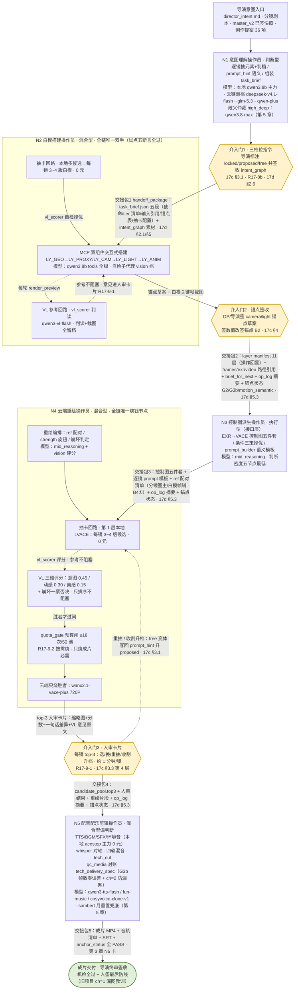
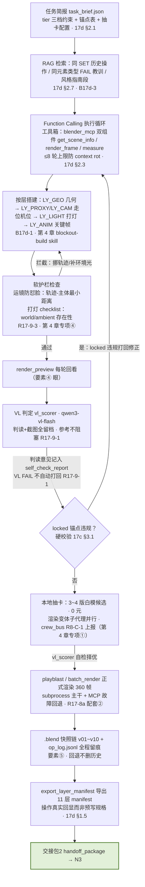
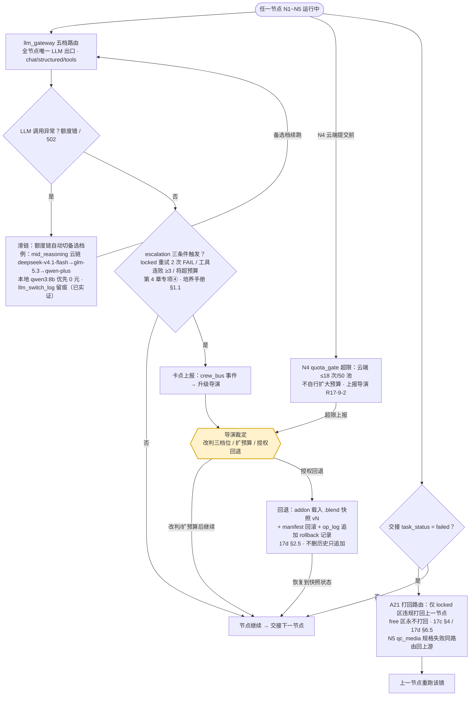

# LLM 团队构建 · 系统调研报告（四维深度版）

> **报告日期**：2026-10-04｜**版本**：四维深度版（12 章单文档，升级自同日旧版 8 章终稿；旧版保持原样存档）
> **整合**：终稿整合员（team-integrator）｜基于旧轮 6 份分节稿 + 新轮 7 份分节稿 + 两轮交叉复核报告装配，唯一交付文档
> **方法论**：第一轮（旧版基础）——领导预置派工四路并行（岗位装备 / 模型映射 / 先例与去国外化 / 原因验证，另加流程图分件）→ 分节稿落 staging → 交叉复核员独立实盘抽查 **37 项论断、编造 0** → 三项争议（N3 人工闸门 / LLM-as-Judge / 向量层）协商裁定 → 旧版终稿。第二轮（本版扩展）——老板下达"四维深度版"指令后七路并行（先例深调研 / HF 全类型映射 / 百炼全类型扩展 / 团队拓扑与冲突处理 / 清单对照×2 / 装备矩阵 A~J 扩展）→ 分节稿落 `_staging_llm_team_v2` → 交叉复核员抽查 **52 项论断、编造 0** → 两项争议裁定 + M1~M13 修正清单 → 整合装配本终稿。装备矩阵总账唯一基准 = **旧 320 格（争议裁定后实盘 118/45/106/51）+ S6 新增 40 格（21/4/14/1）= 360 格 139/49/120/52**（详见第 4 章 4.9）。所有修正与裁定以两轮复核报告为准，分节稿原文出处标注（路径/行号/URL）全部保留。

## 分节稿索引表

| 终稿章节 | staging 分节稿路径 |
|---|---|
| 第 1 章 先例深调研 | `_staging_llm_team_v2/S1_先例深调研.md`（主体）+ `_staging_llm_team/sections/T5_T6_先例与去国外化.md`（任务五，复用） |
| 第 2 章 团队拓扑 | `_staging_llm_team_v2/S4_团队拓扑与冲突处理.md`（任务一） |
| 第 3 章 岗位定位卡 | `_staging_llm_team/sections/T1_T2_定位与装备.md`（任务一部分，复用旧版第 1 章） |
| 第 4 章 名词装备矩阵 | `_staging_llm_team_v2/S6_装备矩阵扩展A-J.md`（新增）+ T1_T2（任务二部分，复用旧版第 2 章） |
| 第 5 章 模型映射 | `_staging_llm_team_v2/S3_百炼全类型扩展.md`（增量）+ `_staging_llm_team/sections/T3_模型映射.md`（复用旧版第 3 章） |
| 第 6 章 HF 全类型映射 | `_staging_llm_team_v2/S2_HF全类型映射.md`（全量） |
| 第 7 章 去国外化清单 | `_staging_llm_team/sections/T5_T6_先例与去国外化.md`（任务六，复用旧版第 6 章）+ S2/S3 增量 |
| 第 8 章 协作流程图 | `_staging_llm_team/sections/T4_流程图.md`（复用旧版第 4 章）+ S6 子代理机制 |
| 第 9 章 冲突处理 | `_staging_llm_team_v2/S4_团队拓扑与冲突处理.md`（任务二/三） |
| 第 10 章 原因验证 | `_staging_llm_team/sections/T7_原因验证.md`（复用旧版第 7 章） |
| 第 11 章 清单对照 | `_staging_llm_team_v2/S5a_清单对照-全流程极细版732条.md` + `S5b_清单对照-项目语境16类与通用18类.md` |
| 第 12 章 争议裁定 | `_staging_llm_team_v2/REVIEW2_复核与定论.md`（两项争议）+ 旧版第 8 章（三项争议，存档）+ S5a 少数派 |

---


# 第 1 章 · 先例深调研（四维深度扩展）

> 本章讲什么：逐条回答"有没有人做成过多 LLM 剧组 / 怎么做的 / 可借鉴什么"。1.0 为四维深度版新增核心先例（ai-film-pipeline 拆解 / Cully Hill Boys / melies.co / 次要先例 / 可借鉴 15 条），1.1~1.7 为旧版基础（Kubrick、FilmAgent、VideoCoCo、blender-mcp、帧赞、CineCrew、MovieAgent 与国内模型 Agent 能力实测），1.8 为旧稿结论复核标注。
> 关键结论：多 LLM 剧组已被做出且 FilmAgent 已用国产模型（DeepSeek-v3/r1）背书；"白模→写实化双引擎+制片成本台账"的完整形态在公开先例中仍属差异化。任务描述中的"ai-film-pipeline 9-Agent 工业系统"经实测**系三个真实来源的混合夸大**（详见 1.0.1 裁定）。

先例中的国外研究项目仅作**调研资料**引用；一切资源采纳建议仍只允许国内平台（见第 7 章）。所有 URL 均于 2026-10-04 当日检索核到真实来源；搜不到的项目如实标"未找到"。

## 1.0 四维深度版新增核心先例（2026-10-04 深调研）

### 1.0.1 ai-film-pipeline 核查：仓库真实存在，但与调研描述严重不符

| 核查项 | 任务描述的说法 | 实测结果（查询日期 2026-10-04） |
|---|---|---|
| 仓库存在性 | GitHub 上的 ai-film-pipeline | ✅ 存在：**Gregory-Esman/ai-film-pipeline**（另有同名 fork A0339x/ai-film-pipeline） |
| 规模 | 工业级 9 大专业 Agent | ❌ **实为 4 个 Claude skill**（2 专家 + 1 编排器 + 1 QC），README 明言 "Four skills work together"，全文无任何 "9 agents" 表述 |
| Méliès 技法库 | 380 种机器可读电影技法知识库 | ❌ 该仓库中 **0 次出现 Méliès**。真实存在的是 **melies.co 商业产品的 Cinematic Techniques 库，实测 424 种**（非 380），13 个类目，网页卡片形态，非仓库内 JSON/YAML |
| LIRA 资产三视图规范 | 内置于 ai-film-pipeline | ❌ 该仓库中 **0 次出现 LIRA**。LIRA 真实出处是 **Higgsfield《The Cully Hill Boys》110 分钟 AI 长片**官方公开的 3 个 SKILL.md 之一（2026-08 纽约首映），且其规范是"文本描述+参考图成对资产"，不是"三视图" |
| CINEDANCE 六重时空物理锁定 | 内置于 ai-film-pipeline | ❌ 该仓库中的视频模型是 Seedance 2.0，**无 CINEDANCE 模块**。CINEDANCE 同样出自 Cully Hill Boys，其真实机制是 **writer/reviewer/workbench 三层提示词管线**，官方材料中无"六重时空物理锁定"提法 |
| star/维护 | 工业级 | 12 star，最近更新 2026-06-13，小型个人项目；License **MIT** |

**裁定**：任务描述把三个不同来源的事实（Gregory-Esman 4-skill 仓库、Cully Hill Boys 3 个 SKILL.md、melies.co 424 技法库）**混合夸大成了一个不存在的"9-Agent 工业系统"**。按"如实报告、禁止编造"纪律，该 9-Agent 系统本体**未能验证**；后续文档引用"9 Agent / Méliès 380"前必须先按本表修正。
- 来源：https://github.com/Gregory-Esman/ai-film-pipeline （README 全文核读，2026-10-04）；fork 佐证 https://github.com/A0339x/ai-film-pipeline

**Gregory-Esman/ai-film-pipeline 实测结构（4 skill）**：

| Skill | 角色 | 关键机制 |
|---|---|---|
| `banana-pro-director` | 图像提示词专家 | 新角色 Mode 0 面部锁定；6 面板角色参考表；场景底板；服装替换 |
| `cinema-worldbuilder` | Seedance 视频提示词专家 | 5 种锁定电影模式；十块标签式输出结构（含 `@imageN` 参考标签） |
| `ai-film-director` | 流水线编排器 | 一句话意图→七阶段引导；**暂停等待平台生成、防止浪费积分** |
| `video-qa` | QC 质检主管 | 对照锁定角色/环境/道具 "bible" 审计；**ffmpeg 1fps 抽帧做多帧漂移检测**；八类评分出 Ship/Hold/Block 判定 |

- 依托平台：Claude 三入口 + Seedance 2.0 宿主 + Suno + Topaz；BMW 广告案例全程约一个周末、生成费约 $10。**对本项目初判**：架构同构度高（专家/编排/QC 三分），但体量小、依赖国外平台（Claude+Seedance 宿主），只作方法论参考，不作依赖。

### 1.0.2 《The Cully Hill Boys》（Higgsfield）：公开材料中工业级最强的"提示词纪律"实证

- **规模**（官方口径，自报无第三方审计）：1:54:53（对外称 110 分钟）；137 场；600 个已锁定资产；~150 个命名锁；总成本 $2M（约一半 $1M 为算力）；4 周工期；28 人（其中 9 名导演）；100% 纯生成。
- **版本纪律**：版本日志 137 条，最难镜头打到 v15/v10/v9；**镜头卡编号（如 50B/50C）从卡片→版本日志→prompt 文件全程同 ID 贯穿**。
- **三个公开 SKILL.md**：①**LIRA**（图像提示词，内置各图像模型弱点自检清单，发送前自检）；②**CINEDANCE**（视频提示词三层：**writer** 拆解走位/光学/物理/时序 → **reviewer** 发送前复检 → **workbench** prompt 落文件，**失败只补丁该段、永不整篇重写**）；③**ACTING**（表演系统提示词：行为优于情绪，逐拍增量书写，拒绝形容词）。
- **四条铁律**（从上部片 HELL GRIND 带来）：①每镜头开头声明剧情语境+在场者+时长；②首帧空间锁（第一帧全员就位，无空镜起手）；③**每句台词后留 1 秒静音尾巴**（给剪辑留缝、让模型没空间编造声音）；④表演逐拍书写。
- **方法论内核**："模型没有记忆，一致性就是全部工作"；**每个镜头 = reference + text 双输入**（资产管外观，文本管其余一切**包括几何**）；**资产锁死才开工**（先 10+ 种动作/环境压测角色资产）；**状态即资产**（干净夹克 Cal / 落水湿身 Cal / 三幕带伤 Cal 是三个资产而非一个资产加备注）；**10–15 次仍失败→拆解/简化场景本身，而不是继续改措辞**。
- **路线差异（重要，勿盲从）**：该片全程**纯 text-to-video、不用首帧图/不用图生视频**——理由是纯 t2v 的镜头之间反而更好剪。这与我们"白模→控制图→VACE 重绘"路线**取向相反**（我们要可控性，他们要剪辑连贯性），两者各有成立边界，不构成对我们路线的否证；其唯一失控案例（车内近身夺枪）恰是**近身持续接触**场景——这类场景我们走 Blender 白模摆位+控制图反而更稳。
- 来源（2026-10-04）：https://best.xiaohu.ai/en/article/cully-hill-boys/ （含 3 个 SKILL.md 直链）；https://metallab.ai/en/2026/8/we-made-the-first-110-minute-ai-feature-film-with-a-real-cast-the-cully ；官方发布帖 https://x.com/higgsfield_ai/status/2086868392510963820

### 1.0.3 "Méliès 技法库"真实形态：melies.co 商业产品，424 种（非 380）

- **是什么**：melies.co（一体化 AI 影视制作 SaaS，与 ai-film-pipeline 仓库无关）公开的 **Cinematic Techniques 在线技法库：424 种技法、13 类目**——运镜 86 / 实拍光学特效 57 / 病毒风 44 / 灯光 41 / 构图 32 / 类型风 27 / 景别 25 / 剪辑转场 23 / 时间运动 21 / 机位 19 / 色彩胶片感 19 / 镜头光学 17 / 氛围天气 13。
- **计数口径注（勘误 M7）**：**424 为截至查询日 2026-10-04 的第三方转引口径**（artrealmai 类目计数表）；官方页未逐一清点，本轮未远程复核总数——引用时保留"截至查询日/第三方转引"标注。
- **卡片结构**（每条技法统一五段）：定义 → 何时用（叙事功能）→ **易混淆"近亲"辨析**（如 dolly vs dolly zoom）→ 片例 → 可直接粘贴的 prompt 骨架 + 失败模式提示。
- **机器可读程度**：产品内置 CLI（`npm install -g melies`）可拿 `--json` 结构化输出——但**技法库本体是网页/产品资产，不是开源 JSON/YAML 仓库**；"380 种机器可读知识库"原始说法**未能验证**。
- **对本项目**：闭源商业产品，文本不可搬运，但其"卡片五段式结构"是免费的公共方法论——正是给 N3 控制图派生建自研技法库（`spec/technique_kb.json`）的现成蓝本。
- 来源（2026-10-04）：https://artrealmai.com/article/melies-cinematic-techniques-ai-video ；https://github.com/melies-co/cli/blob/HEAD/./SKILL.md ；https://turbo0.com/item/melies

### 1.0.4 岗位对照表：描述中的"9 Agent" ↔ 五操作员（N1–N5）

> 左列岗位在 ai-film-pipeline 仓库中**不存在**（见 1.0.1 裁定）；"真实可考对应物"列标注该职能在公开世界中真正有出处的落点。

| 描述岗位 | 职能 | 我们对应 | 真实可考对应物 | 差距判定 |
|---|---|---|---|---|
| Producer 制片总控 | 全流程编排/预算 | 制片（budget_manager、额度台账） | Gregory-Esman 编排器 skill（防浪费积分）；Cully Hill Boys 137 条版本日志 | 已有预算台账；**缺"镜头卡号贯穿全链"的版本日志纪律** |
| Story 故事正典 | 叙事一致性源头 | N1 意图理解 + 编剧 | Cully Hill Boys 镜头卡（四组） | shot_spec 覆盖度接近；缺"导演意图一句话+角色任务动词化"字段 |
| LIRA-Image 美术资产 | 资产生成与锁定 | N2 白模 + N3 首帧/资产 | LIRA skill + "状态即资产" | 资产沉淀偏脚本，**缺角色"状态变体"资产化** |
| Acting 表演总监 | 行为化表演 | ⚠️ 无专岗 | ACTING skill（行为优于情绪）；OSideMedia `higgsfield-acting`（15 种烂表演症状图谱、0–5 表演量表） | **我们最大缺口之一**：shot_spec 无"行为签名/表演节拍"字段 |
| Cinematic-Technique 视听技法 | 技法知识库 | N3 控制图派生（隐含） | melies.co 424 技法卡（结构可借鉴） | **无机器可读技法库**，技法散落在各 SKILL.md 文案里 |
| CineDance 编译总监 | 视频提示词编译 | N4 重绘提示词编译 | CINEDANCE 三层（writer/reviewer/workbench） | 单层直出，**缺独立 reviewer 复检与"只补丁不重写"纪律** |
| Continuity 连续性总监 | 跨镜一致性 | 场记 QC（部分） | "资产+verbatim 复述"体系；video-qa 的 bible 审计+1fps 抽帧 | vlm_check 已有但**无逐帧抽检与"资产 bible 对照"审计** |
| Sound 声学工程 | 音频 | N5 配音配乐 | "每台词 1 秒静音尾巴"规格；12 秒音频块预录 | 链路已有；**1 秒尾巴规格可直接抄** |
| Edit-Review 剪辑终审 | 终审 | QC/N5 tech_cut | video-qa 的 Ship/Hold/Block 三级判定 | QC 有通过/打回，**缺三级分级（可发/可留/必停）** |

**逐项结论**：缺的岗/物=表演总监（行为签名）、机器可读技法库、连续性专岗审计、三级终审判定；可直接照搬=CINEDANCE 三层管线、LIRA 弱点自检、1 秒静音尾巴、镜头卡 ID 贯穿、10–15 次失败即拆场景；不适用=纯 t2v 路线、$2M/28 人组织方式、melies.co 闭源文本。**最接近"9-Agent 工业系统"描述的真实开源物**：OSideMedia/higgsfield-ai-prompt-skill——32 子技能、683 star、MIT、110 测试通过、CI 每周模型目录漂移检测、自带生成台账与 preflight 校验，其工程化配套是四个相关项目中最值得抄的（https://github.com/OSideMedia/higgsfield-ai-prompt-skill ，2026-10-04）。

### 1.0.5 License 汇总

| 项目 | License | 可用性判定 |
|---|---|---|
| Gregory-Esman/ai-film-pipeline | MIT（原作者声明"take them, use them, modify them"） | 方法论可自由借鉴 |
| OSideMedia/higgsfield-ai-prompt-skill | MIT | 可直接移植结构 |
| Cully Hill Boys 3 个 SKILL.md | Higgsfield 官方公开发布（版权属 Higgsfield） | 方法论参考 OK，文本勿整包搬运 |
| melies.co 技法库 | 闭源商业产品 | 只借鉴卡片结构，不可搬运内容 |

### 1.0.6 次要先例（三项，均 2026-10-04 当日核实）

**① 智象未来 HD-AgentOS + vivago R1（国内，WAIC 2026 发布）**：自研 **HD-AgentOS 三层耦合**——资源层（模型/工具/数据底层调用）、系统层（智能体调度、多单元协同、全流程安全治理）、能力层（模型能力封装为标准化技能）；vivago R1 为首个产品（官方称全球首款支持无限时长视频生成的多模态创作智能体，"长、长、稳"）。"85% 商用可用成功率"为**多源一致转述的厂商自报**（新华网/环球网/中国经济网/凤凰网四家均报），无第三方验证；"无限时长"未验证。梅涛"多智能体集群协同+配套操作系统"言论出处已锁定：新华网 2026-07-19 WAIC 论坛报道。**可借鉴**：三层架构与我们 llm_gateway（资源）+crew_bus（系统）+SKILL.md 装配（能力）同构，**互证我们的分层是行业收敛方向**。URL：https://www.news.cn/tech/20260719/5e9da195bf374535800f50c8d766699d/c.html 等。

**② CrewAI Hierarchical Process**：`process=hierarchical` 下自动创建 **manager agent**（规划、按成员角色动态委派、验证产出质量），必须提供 `manager_llm` 否则 `kickoff()` 报错；经验法则 "**stay sequential until you can name the specific decision you want made at runtime**"。**可借鉴**：①manager 只委派/验证不执行的角色分离，仅适合我们的**重生成仲裁**（写实化岗与场记 QC 分歧时路由），确定性 N1→N5 主链必须保持 sequential；②其层级制无预算/台账概念、验证靠 LLM 主观判断——我们的 Retake 预算制+契约校验更硬。URL：https://docs.crewai.com/edge/en/enterprise/resources/frequently-asked-questions 等。

**③ Microsoft Agent Framework 1.0 GA**：**2026-04-03 GA 属实**（官方 devblogs：stable APIs + 长期支持；Semantic Kernel + AutoGen 合并为单一开源 SDK，MIT，.NET+Python）；原生 MCP+A2A；官方术语是**编排模式（orchestrations）**五种——sequential / concurrent / handoff / group chat / Magentic-One，外加 **Workflows 图引擎**（条件分支、并行扇出汇聚、断点续跑）；"Orchestrator/Sub-agent 分离"的说法需修正为"编排模式库"。**可借鉴**：①Workflows 的 **checkpointing + hydration（中断后恢复长任务）**；②YAML 声明式 agent/工作流版本化；③五种编排模式可作 crew_bus 扩展选型菜单。**仅借鉴模式，不引入框架**（0 国外付费端点纪律不变，CrewAI 已在栈内）。URL：https://devblogs.microsoft.com/agent-framework/microsoft-agent-framework-version-1.0/ 等。

### 1.0.7 可借鉴机制清单（15 条，每条注明借鉴到哪个操作员）

| # | 机制 | 出处 | 借鉴到 |
|---|---|---|---|
| 1 | **提示词双聊天室隔离**（图像规则与视频规则分室，防串扰） | Cully Hill Boys | 导演：SKILL 规定资产图/重绘视频 prompt 会话分离 |
| 2 | **CINEDANCE 三层提示词管线**（writer→reviewer→workbench，失败只补丁该段） | Cully Hill Boys | N4：重绘 prompt 编译加独立复检步；重生成只改失败镜头参数 |
| 3 | **各模型弱点自检清单**（发送前对照"该模型总丢什么/怕什么词"） | Cully Hill Boys LIRA | N4：为百炼 wan 系建弱点清单表，随实测增补 |
| 4 | **"状态即资产"+资产锁死才开工**（状态变体独立版本化；压测通过才进正片） | Cully Hill Boys | N2+制片：资产入库加状态维度与压测门槛 |
| 5 | **ffmpeg 1fps 抽帧漂移检测 + 资产 bible 对照 + Ship/Hold/Block 三级判定** | Gregory-Esman video-qa | 场记 QC（vlm_check.py）：加抽帧批量检与三级判定输出 |
| 6 | **10–15 次失败→拆解/简化场景本身** | Cully Hill Boys | 导演：与 Retake 预算制互补（重试超限→降复杂度） |
| 7 | **每句台词后留 1 秒静音尾巴** | Cully Hill Boys | N5：CosyVoice 出音频与视频段规格中固化 |
| 8 | **首帧空间锁**（第一帧全员就位） | Cully Hill Boys | N2：开场摆位纪律写进 blockout SKILL |
| 9 | **技法卡片五段式**，建自研机器可读技法库 | melies.co 424 卡结构（只学结构不搬内容） | N3：建 `spec/technique_kb.json`，按卡检索组装 prompt |
| 10 | **manager 只委派/验证不执行** | CrewAI Hierarchical | 导演仲裁模式：仅写实化↔场记分歧时启用；主链保持 sequential |
| 11 | **checkpointing + 断点续跑长工作流** | Microsoft Agent Framework Workflows | 制片/crew_bus：N2→N4 批跑中断恢复（形态参考，不引入框架） |
| 12 | **工程化四件套：生成台账、preflight 校验、evals、模型目录漂移 CI** | OSideMedia/higgsfield-ai-prompt-skill | 制片+场记：补 preflight（发单前契约校验）与百炼模型目录漂移周检 |
| 13 | **三层耦合架构**（资源/系统/能力层） | 智象未来 HD-AgentOS | 架构互证：llm_gateway+crew_bus+SKILL.md 分层命名可引为行业收敛方向 |
| 14 | **镜头卡 ID 全链贯穿**（卡号=版本日志=prompt 文件同 ID） | Cully Hill Boys | 场记+制片：shot_id 贯穿开拍单/重生成日志/额度台账 |
| 15 | **"reference+text 双输入、文本管几何"公理** | Cully Hill Boys | N2+N4：证明"白模管几何、控制图+prompt 管外观"分工与工业实证同构 |

### 1.0.8 本轮深调研边界声明

1. ai-film-pipeline 的"9-Agent 工业系统"描述**未能验证**，已按来源拆解为三个真实项目分别核实（1.0.1）。
2. Cully Hill Boys 全部数字（$2M/28 人/137 场等）均为**厂商自报**，无第三方审计，引用时保留口径标注。
3. 1.1~1.6 中 VideoCoCo/blender-mcp/帧赞三条本轮未逐项重验（复核标注见 1.8），引用其具体数字时按所附 URL 再跑当日核验。

## 1.1 Kubrick（普渡大学 + 百度美研 + 罗切斯特大学，arXiv:2408.10453）

- **来源**（查询日期 2026-10-04）：
  - 论文 https://arxiv.org/abs/2408.10453 （PDF：https://www.arxiv.org/pdf/2408.10453.pdf）
  - HTML 版 https://arxiv.org/html/2408.10453v1
- **做成过吗**：做成了。三智能体协作在 Blender 中自动生成合成视频，在 Prompt/Motion/Camera/Overall 等 5 项人工评测指标上（arXiv 摘要口径 five metrics）超过当时商用视频模型（如 Ours 4.18 vs Pika 2.97 / Luma 3.47——分数未能于摘要层核验，待回查原文）。
- **团队构成 / 技术路线**：
  1. **LLM-Director**：把自然语言视频描述分解为场景/角色/运动/光照/摄影 5 个子流程；
  2. **LLM-Programmer**：按函数库组合 API 调用，生成 Blender Python 脚本渲染；
  3. **VLM-Reviewer**：看中间截图 + 运动坐标做视觉质量与指令遵循评审，反馈给 Programmer 迭代改脚本；
  4. 三个 Agent 均用 **RAG** 增强（公开 Blender 教程 + 官方文档）；另有 **Library Updating** 阶段：函数不够用时自动扩库。
- **与我们五操作员/17d 操作员架构的异同**：
  - 同：Blender 确定性管线同源；VLM-Reviewer ≈ 我们 R17-9-3 的 VL 修复轮（VLM 看渲染结果→定位问题→回改）；Director 分解 ≈ 导演岗意图分解。
  - 异：只有 3 岗、闭环止于 Blender 渲染，**没有"白模→写实化"第二阶段**，无制片/场记/音效等岗位；迭代闭环无预算控制（我们的 Retake 预算制 A21 是增量）。
- **可借鉴点（具体）**：
  - **VLM-Reviewer 的评审输入结构**：截图 + 角色运动坐标数值一起喂 VLM，而非只看图——我们的 vlm_check.py 可加"坐标/参数回显"字段提高定位精度。
  - **函数库沉淀机制**（Library Updating）：Programmer 发现 API 不够用就扩库并入库复用——对应我们 `blockout_batch_render.py` 等脚本资产化，操作员装配器可复用此模式。

## 1.2 FilmAgent（哈工大深圳（HITsz-TMG）+ 清华（署名待核），arXiv:2501.12909）

- **来源**（查询日期 2026-10-04）：
  - 论文 https://arxiv.org/abs/2501.12909 / https://arxiv.org/html/2501.12909v1
  - 项目页 https://filmagent.github.io/
  - 开源仓库 https://github.com/HITsz-TMG/FilmAgent （News：2025/2/24 已集成 **DeepSeek-v3 与 r1** 做模型选型）
- **做成过吗**：做成了并开源。模拟导演/编剧/演员/摄影 4 岗，覆盖创意开发→剧本写作→摄影设计三阶段，人工评测 15 个创意、平均 3.98/5 分，全面超基线；**GPT-4o 多智能体胜过单 Agent o1**（协作结构本身有增益）。
- **技术路线**：Unity 3D 沙盒（15 场景/65 演员位/272 机位/21 动作）；两种协作算法——剧本阶段的 **Critique-Correct-Verify**、摄影阶段的 **Debate-Judge**；迭代反馈修订中间产物以降幻觉。
- **与我们架构的异同**：
  - 同：剧组岗位隐喻、迭代反馈、结构化产物（每行剧本标注演员位置/动作/台词/机位 ≈ 我们的 shot_spec + 开拍单）。
  - 异：4 岗比我们五操作员架构粗；场景限于 Unity 沙盒静态空间，无 Blender 白模、无写实化引擎路由、无成本台账。
- **可借鉴点（具体）**：
  - **Critique-Correct-Verify 三段协作算法**：批评→修正→独立核验，可直接映射到我们"写实化岗产出 → 场记 QC → 导演终审"链路，比单纯"生成→打回"多一道独立核验。
  - **Debate-Judge 用于机位选择**：两个 Agent 各提机位方案、第三方裁判定——可用于摄影操作员与导演分歧时的仲裁。
  - **国产模型背书**：该项目已把决策模型换成 DeepSeek-v3/r1——证明**国产模型完全可以驱动多 Agent 剧组**，与我们百炼路线互证。

## 1.3 VideoCoCo（arXiv:2607.27380，2026，28 位作者）

- **来源**（查询日期 2026-10-04）：
  - 论文 https://arxiv.org/abs/2607.27380 （HTML：https://fr.arxiv.org/abs/2607.27380v1）
  - 解读 https://theneuralfeed.com/article/videococo-code-as-cot-for-physically-consistent-video-generation-via-an-agentic-/WXIT9Kje 、https://cctest.ai/en/articles/videococo-turns-blender-code-into-process-level-reasoning-for-video-generation
- **做成过吗**：做成了（论文级验证）。双引擎框架：**编码 Agent 写 Blender 程序**（显式定义场景与时间演化）→ **可执行仿真引擎**跑出确定性时空草稿 → **生成式视频引擎**按草稿条件化编辑出写实视频。PhyGenBench 0.475→0.558，VBench-2.0 52.18→77.88，双榜最佳平均分。
- **与我们架构的异同**：
  - 同：**"Blender 草稿管物理/运动，生成模型管外观"与我们"白模→写实化"双引擎完全同构**；其 VideoCoCo-3K 草稿-指令-目标三元组数据集 ≈ 我们的 shot_spec 契约产物。
  - 异：其定位是"代码即思维链"的单框架，非多岗位剧组；无制片管理与成本台账。
- **可借鉴点（具体）**：
  - **"中间表示必须可检查可复跑"**这一设计公理：白模程序是可运行、可调试、可复用的资产——支持我们 17d 决策"白模脚本入库沉淀"。
  - **草稿条件化编辑**（draft-conditioned editing）= VACE 式控制图的学术对应物，证明我们 local_wan22_fallback 路线在 benchmark 层有效。

## 1.4 blender-mcp（ahujasid/BlenderMCP）实际使用体验

- **来源**（查询日期 2026-10-04）：
  - https://glama.ai/mcp/servers/ahujasid/mcp-for-blender （官方功能/限制清单）
  - https://university.tenten.co/t/blender-mcp-mcp/2576/1 （选型与 headless 方案对比）
  - https://blog.csdn.net/gitblog_00217/article/details/156474226 （中文实操体验）
  - https://lobehub.com/pl/mcp/lionence-blender-claude （headless 渲染踩坑实录）
- **实际体验与局限**：
  1. **必须 GUI 起 Blender + 装 addon，走 TCP 9876**——架构是 `Claude → uvx blender-mcp → TCP 9876 → Blender GUI 内 addon.py`。**9876 一次只允许一个客户端**（Cursor 与 Claude 不能同时连）。
  2. **headless 是已知硬伤**：社区实录"EEVEE headless 渲染=黑帧，必须换 Cycles CPU"；"管道接 grep 会 broken pipe 直接杀掉 Blender"；"相机不挂 Track To 约束时 headless 出黑帧"。**我们实测其 `-b` 模式拒启与社区经验一致，是 ahujasid 版的架构性限制，不是我们配置错误**。
  3. 工具集：get_scene_info / execute_blender_code（任意 bpy 代码，有安全警告）/ 截图 / PolyHaven-Sketchfab-Hyper3D-Rodin-Hunyuan3D 资产。
  4. 社区有 headless 导向分支 **sandraschi/blender-mcp**（41 工具、自动 spawn headless Blender、bridge 可选实时预览）。
- **与我们架构的关系**：我们 R17-8a 已自研 MCP 双组件（`mcp_blender/baimo_mcp_server.py` + addon），正是为绕开 ahujasid 版 GUI 依赖与遥测问题——**此决策被社区经验反向验证**。
- **可借鉴点（具体）**：
  - 指令写具体数字、复杂场景拆步骤、`blender --background ... > log 2>&1`（不接管道）——三条实操纪律可直接写进 blockout 操作员 SKILL。
  - headless 渲染强制 `Cycles CPU + Track To 约束`——我们批量渲染包装器已按此踩坑经验规避。

## 1.5 智象未来"帧赞"（国内，30 天 60 集 AI 短剧）

- **来源**（查询日期 2026-10-04）：
  - https://jhwcw.zjol.com.cn/wcnews/system/2026/05/15/035210783.shtml （婺城新闻网：30 天完成 60 集/120 分钟）
  - https://www.jhnews.com.cn/xw/1898983 （金华新闻网：12 小时登顶腾讯视频竖屏热播榜）
  - https://new.qq.com/rain/a/20260911A0AJ1J00 （智象未来王科演讲：帧赞产品全貌）
- **做成过吗**：**国内最强商业实证**。60 集电影级短剧《秦岭青铜诡事录》（腾讯视频播出）全流程 30 天交付（传统需 3-6 个月），上线 12 小时登顶热播榜；帧赞服务专业团队超几千家。
- **技术路线**：全球首个专业级 AI 影视创作与协作智能体；剧本导入→一键解析生成场景/角色/镜头全套可执行方案；**行业标准级分镜表系统**（导演精细编排景别/运镜/画面）；**无限画布**；多角色（导演/制片/美术/剪辑）实时云端协同；**制片管理按预算跟踪每人的消耗与效率**；资产沉淀与 IP 运营。底座为自研超百亿级多模态大模型（扩散自回归架构）。
- **与我们架构的异同**：同——多角色云端协同、分镜表≈我们的 shot_spec/开拍单、预算跟踪≈budget_manager.py；异——它是闭源商业平台（模型+平台一体），我们是开源可自管管线，无"概率输出→确定性生产"的契约层是它已实现而我们正在做的。
- **可借鉴点（具体）**：
  - **"按预算跟踪每个人的消耗与效率"**的制片台账粒度——我们额度台账（idem_key/fx_rate）可加"按操作员维度"聚合视图。
  - **分镜表作为导演与生成引擎之间的确定性中间层**——与我们 shot_spec 契约一致，证明该层是工业化刚需而非过度设计。

## 1.6 补充先例：CineCrew、MovieAgent

### CineCrew（UMass Amherst + MIT，arXiv:2609.07720，2026-09）
- **来源**（查询日期 2026-10-04）：https://arxiv.org/abs/2609.07720 （HTML：https://arxiv.org/html/2609.07720v1）、项目页 https://jiabenchen.github.io/cinecrew/
- **做法**：**FilmDSL**（电影 DSL）三层结构——Layer1 叙事动作 / Layer2 镜头调度（景别/运镜/光/连续性钩子）/ Layer3 渲染规格（关键帧 prompt、视频 prompt、负向 prompt、seed/比例/时长）；剧组式多 Agent：Showrunner 定基调、Art Department 建多视角角色资产库、Story Editor+Cinematographer+Technical Director 编译 FilmDSL、Acting Coach 把人设映射为行为签名、**Production Operator 关键帧先行**、**Dailies Reviewer（VLM）验片**——发现身份漂移/道具复制即写入中央 **Production Rulebook** 并定点重生成，不重训基模。
- **可借鉴点（具体）**：
  - **FilmDSL 三层 = 我们 shot_spec 的升级蓝本**：我们的契约偏 Layer2/Layer3，可补"连续性钩子（角色-道具-场景绑定）"与"人设→行为签名（Persona Schema）"两个字段。
  - **Dailies Reviewer + Production Rulebook 中央错误登记** ≈ 我们 crew_bus 的 pending/打回路由——证明"验片错误入共享规则簿、只定点重生成不整镜重来"是省钱正解，与我们 Retake 预算制互补。

### MovieAgent（showlab，NUS+SJTU）
- **来源**（查询日期 2026-10-04）：https://deepwiki.com/showlab/MovieAgent/2-multi-agent-design （架构拆解；原始仓库 showlab/MovieAgent）
- **做法**：导演（总规划）/编剧（台词叙事）/分镜师（视觉规划）/场务（场景环境）4 岗，导演中心化协调，全岗位 GPT-4o + 结构化 JSON 通信 + CoT 规划，ROICtrl 做角色一致性生成。
- **可借鉴点**：以**脚本为输入**（非从零创意）的定位与我们"编剧岗可人工混合"一致；JSON 结构化岗位通信 = 我们 crew_bus 消息总线的先例。

### 未找到的项目
- 专项搜索中未发现名为"五操作员（五岗导演/编剧/白模/写实化/质检）"完全同构的开源系统；FilmAgent(4 岗)、MovieAgent(4 岗)、CineCrew(≈8 角色 Agent) 为最接近者。**我们的岗位细分（含场记/制片）在公开先例中仍属差异化**（与 docs/02-决策/03a-agent-team-research.md 结论一致，本轮网搜进一步确认）。

## 1.7 国内模型 Agent 能力实测数据核实

| 模型 | 核实结论 | 出处（查询日期 2026-10-04） |
|---|---|---|
| **GLM-5.3**（智谱旗舰） | Toolathlon **Verified 73.0**、AutomationBench 48.2、Terminal Bench 2.1=88.2（官方口径，供应商自报）；复杂软件工程/终端操作/Agent 任务显著进步 | https://z.ai/blog/glm-5.3 ；https://open.bigmodel.cn/ |
| **GLM-5.3-Flash** | **原生多模态基座**（图像/视频理解），官方宣称"部分能力对齐 Claude Opus 4.8，价格仅 1/40"——**适用于我们的多模态观察/渲染审阅环节** | https://open.bigmodel.cn/ （首页官方文案） |
| **GLM-5-Turbo**（"Agent 优化"说法） | **未验证**——本轮检索未获得该型号 Agent 优化能力的可靠公开出处（搜索通道受限），保持存疑，不写入采纳依据 | 无 |
| **DeepSeek-V4-Flash（-0731）** | Toolathlon **Verified 70.3** 属实（NVIDIA 文档、百度百科、大洋网多源一致）；Terminal Bench 2.1=82.7、Cybergym=76.7；2026-08-31 信通院 **MCP 专项测试 38.24% 位列第三**；权重 MIT 开源；峰谷分时计价 | https://docs.api.nvidia.com/nim/re/reference/deepseek-ai-deepseek-v4-flash-0731 ；https://baike.baidu.com/item/DeepSeek-V4-Flash-0731/68808878 ；https://news.dayoo.com/finance/202607/31/171077_54986000.htm |
| **DeepSeek-V4-Flash-Vision**（vision-exp） | 属实：多模态 Agent 能力官方宣称**"接近 Claude Opus 4.8"**——11 项基准赢 3 项（Agents' Last Exam 27.3 vs 25.7；ZeroBench 35.0 vs 34.0），其余落后 1-12 点（NL2Repo 差 12 点）；**单图 ≤384 token 计费**，视觉观察成本极低；开源状态两说（xix.ai 称已上 HF 开源 MIT；edenai.co 称 API-only 未放权重）——**开源状态未定论，采纳前需回查 HF** | https://www.singularity.kiwi/deepseek-v4-flash-vision-exp-multimodal-agents-2026 ；https://edenai.co/post/deepseek-v4-flash-vision-vs-opus-4-8-cost-benchmarks ；https://xix.ai/ainews/deepseek-unveils-first-opensource-multimodal-model-engineered-for-ai-agents.html |
| **Qwen3.7-Max**（阿里） | MCP 能力属实且领先国产：**MCP-Mark 60.8**（超 GLM-5.1 的 57.5）、**MCP-Atlas 76.4**（超 Opus-4.6 的 75.8）、BFCL-V4=75.0、Terminal-Bench 2.0-Terminus=69.7；原生 Function Calling + MCP 协议；实测 35 小时/1158 次工具调用自主任务；**但纯文本，不支持图像输入**（多模态需切 Qwen-VL 系） | https://www.alibabacloud.com/blog/qwen3-7-the-agent-frontier_603154 ；https://cn.chinadaily.com.cn/a/202605/20/WS6a0d97a2a310942cc49ad59b.html ；https://developer.aliyun.com/article/1756320?ex=tongyi |

**对本项目的模型结论**：
1. 工具调用/MCP 档（操作员执行档）：DeepSeek-V4-Flash 与 GLM-5.3 均达标（Toolathlon 70.3/73.0），与我们百炼实测 deepseek-v4.1-flash 3/3 全绿一致。
2. 多模态观察档（vlm_check/分镜审阅）：GLM-5.3-Flash 与 DeepSeek-V4-Flash-Vision（384 token/图，成本极低）都够用；qwen3-vl-flash 已实测可用（16 号决策 §5.6）。
3. 注意：以上均为**供应商自报**基准，Toolathlon 分数对 harness 敏感（NVIDIA 文档原注），采纳以我们百炼端实测为准——这一纪律与 16 号决策"实测数据代替猜"一致。
4. （四维深度版更新）GLM-5-Turbo"Agent 优化"说法已于 S3 轮核实（OpenClaw Agent 优化方向属实，暂不引入，见第 5 章 5.9）——上表"未验证"行据此闭合。

## 1.8 旧稿先例结论复核标注（四维深度版新增，只标注不重写）

| 旧稿条目（对应本章节号） | 标注 | 依据（查询日期 2026-10-04） |
|---|---|---|
| 1.1 Kubrick（arXiv:2408.10453） | **仍然成立**，补充两点：v2 修订于 2025-05-05，已被 **CVPR 2025 AI4CC Workshop 录用**（增补含金量）；"4 项人工评测 4.18 vs Pika 2.97/Luma 3.47"具体分数未在摘要层复现（摘要仅称五指标超商用模型+用户研究胜出），**方向成立、具体分数维持原文并标注'论文自报'** | https://arxiv.org/abs/2408.10453 |
| 1.2 FilmAgent（HITsz+清华，4 岗 Unity） | **仍然成立**：本轮检索再次命中其 DeepSeek-v3/r1 集成与 Critique-Correct-Verify / Debate-Judge 策略，无反证 | https://github.com/liuzjMr/FilmAgent |
| 1.3 VideoCoCo（arXiv:2607.27380） | **仍然成立**（本轮未逐项重验）：双引擎"Blender 管物理/生成模型管外观"与白模→写实化同构的结论无新反证 | — |
| 1.4 blender-mcp 使用体验 | **仍然成立**（本轮未重验）：GUI 依赖/9876 单客户端/headless 硬伤结论维持，自研 MCP 决策继续有效 | — |
| 1.5 智象未来"帧赞" | **仍然成立，且有重大增量**：同公司 WAIC 2026 的 HD-AgentOS+vivago R1（见 1.0.6①），建议两处合并为智象未来条目阅读 | 见 1.0.6① |
| 1.6 补充先例：CineCrew、MovieAgent（旧稿两条同编号 5.6，系旧稿笔误，第二条应为 5.7——勘误 M12 口径） | **仍然成立，CineCrew 需两处小修正**：①正式标题 **"Better Call CineCrew: Consistent Ultra-Long Narrative-to-Film Generation"**，已被 **ECCV 2026 录用**（增补）；②FilmDSL 三层、critic agent 结构化 QA 信号、**定点修复不重训基模**官方摘要确认；旧稿"Dailies Reviewer (VLM) 验片"岗位名与摘要"critic agent"表述不完全一致（以论文细节页为准）。MovieAgent/"五操作员无完全同构先例"结论**仍然成立**：本轮新查的 Gregory-Esman 4-skill、OSideMedia 32 子技能、Cully Hill Boys 3 skill 均为"提示词工程技能包"而非"岗位化剧组系统" | https://arxiv.org/abs/2609.07720 |

---

# 第 2 章 · 团队拓扑：老板七问逐条（四维深度版新增）

> 本章讲什么：团队拓扑的七个根本问题——老板角色、LLM 身份、岗位映射、Skills 定性、MCP 定性、分权矩阵、团队边界。
> 关键结论：老板=四重身份合一（最终责任人+审批人+仲裁者+产品负责人），全部机制化为**三介入门＋escalation 三条件与熔断签字解锁两个异常通道**（勘误 M9 统一口径），不做日常指挥；LLM 操作员是"编制上的员工+责任上的可审计执行臂"；拓扑事实基线=老板（导演）+五操作员 N1-N5（B17d-5 编制）+三源工具箱（R17-8c）+crew_bus 事件总线（R8-C-1）+三介入门（R17-8b）。

## 2.1 老板（主理人）在团队中是什么角色？

**结论：四重身份合一——最终责任人 + 审批人 + 仲裁者 + 产品负责人，且全部机制化。**

| 身份 | 机制落地 | 事实依据 |
|---|---|---|
| **最终责任人** | AI 不署名、责任人类终担；authorship 仅归人类 | DECISIONS.md:725（PH2）；对齐美国版权局 human authorship（:716） |
| **审批人** | ① intent_graph 导演签收（17d §6.2）；② 锚点签收（B2，17d §2.6-2）；③ 人审卡片裁决（R17-9-4 先例，:858）；④ 熔断解锁——"熔断后不自动恢复，必须老板签字解锁"（三.md:896） |
| **仲裁者** | "老板终裁→导演管艺术→制片管流程"权力层级；"老板发言=终局" | 三.md:783-784（5.4 协作协议第 2/3 条） |
| **产品负责人** | 哲学级需求由老板直接裁定：R17-8 管线哲学修正"1:1 复刻→白模为骨、AI 为肉"（:827）；K-REV-1~4 本地优先（:760-770）；R17-1 白模双环节=项目核心定位（:787） |

**与三介入门的关系（勘误 M9 统一口径）**：四重身份**只在三处例行兑现**——三档位指令（locked/proposed/free 标注任务简报）、锚点签收、人审卡片（17d §2.6，R17-8b 原文，DECISIONS.md:834）；**两个异常通道**——escalation 三条件（locked 重试 2 次 FAIL / 工具连败 ≥3 / 将超预算，培养手册 §1.1）与熔断签字解锁（三.md:896）。三介入门之外老板是**隐形股东**而非操作经理："全部走推荐，之后不用我拍板"（第九轮起团队收敛规则，DECISIONS.md:418）。

**归类判定**：若必须单选，老板是**最终责任人（accountability 终点）兼任审批人**——仲裁者与产品负责人职能均可委托/降频，唯有"责任人类终担"（PH2）与"熔断签字解锁"两项不可让渡。

## 2.2 每个 LLM 是员工/工具/外包商/顾问还是代理？法律与责任身份如何落地？

**结论：编制上是"员工"（有岗位卡、有培养流程、可被打回可晋升），责任上是"受限协作者+可审计执行臂"。**

- **是员工而非工具/外包商/顾问**的依据：①有编制——B17d-5（DECISIONS.md:845；17d §6.3 编制表）；②有身份卡——operator_card.json 每节点一张（17d §5.2）；③有培养流程——"从零培养一个新数字员工"checklist（培养手册 §1.6）；④有记忆与成长——op_log 每日教训行回灌 RAG 经验层（培养手册 §1.5）；⑤老板哲学明文"每个 LLM 是有手有脚的真实的人"（17d §0 总纲；R17-8b）。
- **不是外包商**：无独立商业主体、无合同对价，其"报酬"是模型档位配给（五档路由+额度链滑档）；**不是顾问**：顾问只建议不执行，操作员有执行权（Function Calling 执行循环）但无最终决策权（locked 区不可变更）；**不是纯工具**：拥有 free 区创造决定权与子代理派遣权（R17-8c③，:835）——这三点恰好是"员工"与"工具"的分界。
- **"法律与责任身份"在纯软件语境下的落法**（无法人资格，责任=可归因性）：

| 落地物 | 机制 | 事实依据 |
|---|---|---|
| 行为留痕 | op_log.jsonl 每动作一条：`{ts, shot_id, tool, args, result_digest, before/after_snapshot_ref, llm_call_ref}` | 17d §2.5 |
| 责任签名 | handoff_package 含 from_node/to_node/task_status，交接即 crew_bus 事件落档 | 17d §5.3 |
| 人审兜底 | 三层 accountability：判断型岗 owner_signoff / 工具链岗免审 / 高危操作人审闸 | DECISIONS.md:674（RC3） |
| 成本责任 | jobs.py 现金/工时账 + producer 现金账本 | agents/producer/SKILL.md §2-3 |
| 合法但留痕 | "确定性'行程扩展 pass'认可为护栏批准的确定性补装（op_log_repair 留痕制度确立）" | DECISIONS.md:858（R17-9-4） |

即：LLM 操作员的"责任身份"= **一条可重放、可归因、append-only 的行为链**（op_log→handoff→cost_ledger），终点由人类签收兜底（RC3+PH2）。

## 2.3 旧 7+2 岗与 N1-N5 映射表

依据：agents/ 七张 SKILL.md 实读 + 17d §6.3 + 17d §3 全链五节点表。

| 旧岗（agents/ 实盘） | 旧卡核心职责 | 去向 | 新形态与理由 |
|---|---|---|---|
| **director**（导演岗） | 导演阐述、Dailies 创意初筛、把老板意见翻译成岗位指令 | **拆解**：翻译职能→N1；创意初筛→人审卡片+VL 评分；仲裁→老板三介入门 | B17d-5"导演编制显式化"：新架构导演=老板本人三介入门，旧卡"翻译老板意见"恰是 R17-8 废除的翻译语义，由 N1 以 brief 形态吸收 |
| **screenwriter**（编剧岗） | 一句话创意→结构化剧本 JSON | **并入 N1 前置**（叙事层输入） | 剧本结构化判断进 `intent-parse` skill（第 4 章专项②） |
| **previs**（预演岗） | 剧本→shot_spec 15 字段合同 | **降级为简报素材**→N1/N2 | 17d §6.3："预演岗 shot_spec 语义改为简报输入之一"（R17-8a） |
| **blockout**（白模岗） | shot_spec→Blender 白模五件套 | **改为 N2 白模操作员**（哲学反转） | 旧铁律"把模型自由度往下压一格"已被 R17-8 推翻（抽卡不确定性=创造力来源，:827）；N2=MCP 直接操控+free 区自由发挥 |
| **realizer**（写实化岗） | 按镜选引擎、挂参考、提交/轮询/下载 | **改为 N4 云端重绘操作员** | 唯一自由度扩为 prompt 措辞/ref 配对/strength 旋钮/抽卡 |
| **producer**（制片岗） | 开拍单汇总派发、现金账本、"白模未过老板那一眼不提交付费引擎" | **拆解**：调度→E2E Planner；账本→quota_gate 预算闸工具；花钱前置门→保留为老板审批人身份的机器化 | "无开拍单不花钱"演化为 quota_gate 账本闸（≤18/50 池） |
| **script_supervisor**（场记岗） | 五项硬指标数值门+VLM 判读+血缘入册 | **转职能为共享"眼"**：vl_scorer + qc_media 机器门 | 17d §6.3："VL 评分器成为所有操作员的共享'眼'+N4 抽卡选择器（G4 转职能）" |
| 音效师+剪辑师（P1 工具岗，未建卡） | 四轨音频+技术剪辑+交付包 | **合并为 N5** | 17d §3 N5 行：tts/bgm/sfx/acestep/transcribe/mix/cut/deliver 全量工具箱 |

**遗留项"7+2 表述核定"建议**：三.md §5.2 的"7 核心+2 工具岗"清单与 17d §6.3 五操作员编制存在两处实质冲突。处置：**不回改三.md**（supersede-not-delete 纪律），而在三.md §5.2 表头加注记"编制已被 17d §6.3 五操作员+导演替代（B17d-5），本表保留作历史参照"，下次勘误轮统一登记。

## 2.4 Skills 是能力还是员工？谁拥有/维护/审批？

**结论：Skills 是能力（程序性知识），不是员工；ownership 归全组共有、维护走纪律、审批走引入审查。**

- **是能力的证据**：培养手册 §1.2——"SKILL.md 是程序性知识的渐进式披露载体——**MCP 给手，Skills 给判断**"。skill 没有岗位卡、没有 op_log、没有抽卡配置，不满足操作员六要素中的任何一项主体资格。
- **SKILL.md 四规则**（培养手册 §1.2）：①目录结构 `tools/_skills/{skill_name}/SKILL.md`；②头部 `name + description`（description 决定何时加载全文）；③正文只写**判断与步骤**，不复述工具 schema；④防注入纪律：自研为主，外部 skills 按 OWASP LLM Top 10 审查。
- **拥有/维护/审批三分**：拥有=tool registry 唯一事实源（"认领即授权"，培养手册 §1.3）；维护=skill 内容随试点踩坑回填（"经验→判断→skill"培养闭环）；审批=自研走团队评审（"全部走推荐"），外部须过 R17-8c② 双底线"License 合规且不破坏自包含底线"+OWASP 审查。
- skill 职责边界变更（如 vl-selfcheck 从"阻塞出片"改"参考不阻塞"，R17-9-1 已实际发生）应视同权限变更，进第 9 章 9.1"必须过目清单"第 5 项。

## 2.5 MCP 是通道还是权限边界？

**结论：既是通道也是权限边界——通道在传输层，边界在治理层，两层在同一套双组件上独立演化。**

1. **传输层=通道**：自研 MCP 双组件（Blender addon 内嵌 socket/JSON-RPC + stdio MCP server），起步三工具，R17-8a 明文"本环节主路径"（:833）；试点五断言全过=通道实证可用（:851）。
2. **治理层=权限边界**，四个边界机制：**网络边界**（127.0.0.1+token 校验+命令白名单+execute_code 可配置关闭，17d §2.3）；**白名单边界**（A12 认领改写注册对象为 tool registry，未注册工具不可达）；**进程边界**（bpy 不进 Agent 进程，V27/T5 精神）；**实例边界**（R17-9-5"每 Blender 实例独立端口+PID 文件+输出目录约定"，:859，源自两代理同端口互杀教训——同一通道按实例分域）。
3. **为什么"既是通道也是边界"成立**：只有通道无边界，execute_code 类全能工具等于把 Blender 进程整个交给 LLM；只有边界无通道，边界退化为静态配置无法执行。R17-9-5 互杀事故正是"有通道、缺实例边界"的真实故障形态，反证两层缺一不可。
4. **外部引入的 MCP 同理**：R17-8c② 准入双底线+纯云服务走 llm_gateway 式网关留痕（:835）——第三方 MCP 的"边界"前置到引入审批环节。

## 2.6 谁有最终决策权（分权矩阵）

| 决策域 | 老板（导演） | 操作员 N1-N5 | 复核 LLM（VL/评分器） | 事实依据 |
|---|---|---|---|---|
| locked 区内容 | **唯一决定权**（导演签收，不可自动变更） | 只读执行，违规自动打回 | 无权（G2/G3b 为机器门） | 17c §3.1；三.md:783 |
| proposed 区 | 确认/改写/一键升降档 | **提案权**（系统给默认值） | 软门 FAIL 转人审，不自动打回 | 17c §3.1/§4 |
| free 区 | 事后挑选（人审卡片选/换/重抽/收割） | **完全决定权**（模型做主） | 评分只进抽卡排序 | 17c §3.1"free=模型，导演事后挑选" |
| 花钱（云端额度） | 熔断解锁权+超限扩预算确认 | quota_gate 只能闸不能扩 | 无权 | 三.md:896；DECISIONS.md:856（R17-9-2） |
| 档位流转/收割 | 收割动作由导演在卡片上完成 | 可提案（变体描述写回 prompt_hint） | 提供评分依据 | 17c §3.1 |
| 架构/契约/编制 | 拍板权 | 建议权（候选+推荐稿制） | 无权 | DECISIONS.md:841-845；17d §10 |
| 争执仲裁 | 终裁（第 3 轮强制升级终点） | 2 轮平级协商 | 可提供证据（VL 意见进卡片） | 三.md:784；R17-9-1 |
| 哲学/署名/责任 | 终担 | 不署名 | 不署名 | DECISIONS.md:725（PH2） |

一句话：**locked 与钱包归老板，free 归操作员，复核 LLM 只有建议权没有门职能**（R17-9-1，:855）。

## 2.7 团队边界：哪些内部做/哪些外包/哪些禁止

| 类别 | 内容 | 事实依据 |
|---|---|---|
| **必须内部做**（创意主权+差异化资产） | 意图理解、白模搭建判断、控制图派生策略、prompt/剪映节奏等全部创作判断；语义映射机制（三.md 3.9"中英文社区均未找到公开先例——需自建，同时是差异化资产"）；判据自有（"多少分算合格是本项目的差异化资产"） | 三.md:441、803 |
| **可引入**（外包给开源生态） | 第三方开源 MCP/skills——"凡与项目相关、能提高操作员效率的均可纳入，但须 License 合规且不破坏自包含底线" | DECISIONS.md:835（R17-8c②） |
| **保留不废的外部选项** | 聚合平台（百炼）为付费配套主力候选、各单平台保留不废（R17-5 多元共存）；三云引擎降 reserved（K-REV-3） | DECISIONS.md:791、769 |
| **禁止** | ①禁用第三方 Blender MCP（自研双组件替代后仍守）；②bpy 进 Agent 进程（V27/T5）；③与成片目标脱节的纯烧量（R17-7/R17-9-2）；④烧钱引擎未经老板那一眼（producer 旧铁律）；⑤完整 A2A 协议栈/公网 Agent 发现（B17d-4）；⑥依赖外部 LLM 翻译意图（R17-8"绝不当翻译官"） | 三.md:775、17d §6.5、:819、:835、:844 |

边界判据：**创意判断内做、执行轮子可引、钱包与主权禁外**——与 PH7"内部闭源+依赖开源合规"（:730）一致。

---

# 第 3 章 · 五操作员岗位定位卡

> 本章讲什么：全链五节点（N1~N5）每岗的负责环节、核心职责、输入输出、类型判定与已实证状态。
> 关键结论：N2 是全链唯一"双手"且已试点实证（五断言全过）；N4 判断错误的代价率最高；每卡均注明对应旧岗位与 master_v2 轨。

> 编号对齐 17d §3 五节点；每卡给"负责环节/核心职责（含论证）/输入清单/输出清单/类型判定/对应旧岗位与 master_v2 轨/已实证状态"七项。master_v2 19 轨名以 `AI影视团队v2/pipeline/timeline_build.py:20-27` OWNER 表实读为准（camera/gauge/light｜weather/performance/wardrobe/props/spatial｜ambience/sfx/dialogue/music/mix｜vfx/grade｜overlay/subtitle/edit/clock）。

## 3.1 卡一 · N1 意图理解操作员

- **负责环节**：全链第 1 节点。把导演的意图文档、剧本、分镜转成带三档位约束的任务简报——是"锚什么、放什么"的裁定起点，不产生任何画面。
- **核心职责**：①从 director_intent.md 与分镜剧本中逐镜抽取元素清单并**判档**（locked/proposed/free，17c §3.1）；②为 free 区写 prompt_hint 语义（"窗边一个空的藤编猫窝"而非数值），为 proposed 区给镜头语言提案；③组装 task_brief.json 供 N2-N5 流转。**论证**：R17-8a 已裁定 intent_graph 从"对账规格"降级为"简报素材库"，所以 N1 的价值不在"字段抽得准"，而在"档位判得对"——判错档位，下游要么锁死创意、要么放走叙事承诺；这是五节点中唯一的纯上游裁定岗。
- **输入清单**：`projects/<片>/00_brief/director_intent.md`（六节，经 read_intent 工具）；分镜剧本与 storyboard（00_brief/）；创作提案 36 项（R0-T4 批次1 文档）；`pipeline/master_v2.json` 已签 36 项快照（tier 判定依据）；RAG 检索（同 SET 历史镜头/风格指南段，17d §2.7）。
- **输出清单**：intent_graph.json（含 tier/anchor/prompt_hint/source_span 四字段，**导演签收**）；task_brief.json（五段：使命/tier 清单/输入引用/锚点表/抽卡配置，17d §2.1）；歧义仲裁申请单（high_deep 档升级时）。
- **类型判定**：**判断型**。工具只有"读与校验"三件（read_intent/validate_intent/rag_kb，17d §4 表），无执行类工具；价值全在判档与措辞两个判断动作上，连抽卡 N 值都属它的提案权。
- **对应旧岗位与 master_v2 轨**：旧 P1 agent_intent_parser 直改（17d §6.3）；**无专属 owner 轨**——19 轨的 tier 分级源头经它流转，签收权仍归导演（R17-8b 介入门①）。
- **已实证状态**：底座已实证——llm_gateway tools/structured 三连测全绿（qwen3:8b，runtime/llm_router.json verified）；director_intent.py 在产。**节点级未独立试点**：mcp_pilot 试点用的简报素材（master_v2 已签数据+36 项提案）即 N1 输出物的人工版先例，自动化闭环待 P1。

## 3.2 卡二 · N2 白模搭建操作员

- **负责环节**：第 2 节点。在 Blender 里把简报变成 3D 白模与渲染产物——全链唯一"直接操控 3D 世界"的操作员（R17-8a）。
- **核心职责**：①经自研 MCP 双组件（addon socket + stdio server）交互式搭建：先 LY_GEO 几何、再 LY_PROXY 走位/LY_CAM 机位、后 LY_LIGHT 打灯、LY_ANIM 关键帧（11 元素类型层契约，B17d-1）；②本地抽卡：每镜 3~4 版白模候选（0 元），vl_scorer 自检择优进简报；③导出 layer manifest（**操作回显，非预写规格**——manifest 是执行后的真实回显，这是与旧 scene_skeleton 的本质区别，17d §1.5）+ 360 帧正式渲染走 batch_render 主干 + 全程快照可回退。**论证**：试点证明"搭"与"动"是同一双手的两个动作（P3+P4 合并的实证依据）；而试点 4 轮 VL 全否决的根因是场景工艺（dolly 怼猫窝+室内无环境光）而非链路（DECISIONS.md:851）——说明 N2 的核心难度不在"会调工具"而在"工艺判断"，这正是 skill 与护栏装备的主战场。
- **输入清单**：task_brief.json（N1 交接包#1，tier 三档约束）；`spec/shot_spec.schema.json`（镜头规格契约）；master_v2.json camera/spatial/performance 等轨锚点语义（**数值降为参考档**，17c §4）；分镜参考图（assets/storyboards/*.png，VL 判读对照）；RAG（同 SET 历史操作与 FAIL 教训）。
- **输出清单**：layer manifest（11 层 JSON）；shots/{id}/frames|exr（含 Z 深度）|video；self_check_report.json（逐锚点 PASS/FAIL+VL 原文留痕）；op_log.jsonl + .blend 快照链（v01~v10 滚动+里程碑）；handoff_package#2。
- **类型判定**：**混合型（判断与执行同手）**。locked 锚点是执行（硬校验、违规打回），free 区构图/材质/微动态/景别是创造判断（17c §2.2 F1-F6）；MCP 交互式闭环让两者不可拆——试点中"发现窗帘挡轨迹→挪动"就是判断与执行在同一轮工具循环内完成。
- **对应旧岗位与 master_v2 轨**：旧 P2 场景架构（并入为"脑"）+ P3 构建 + P4 动画（合并，B17d-5）；agents/blockout 卡（在用，#40 引用）；**七轨白模承载面**：camera/spatial/performance/weather/props/wardrobe/light——落点为 LY_GEO/LY_PROXY/LY_CAM/LY_LIGHT/LY_ANIM 五层，锚点草案出→DP/导演签锚点（数值签收改锚点签收，17c §4）。
- **已实证状态**：**试点已实证（R17-8a 五断言全过，DECISIONS.md:851）**：MCP 链路真跑通、1-2 镜 LLM 自主搭景+运镜出片 72 帧、动感 77.15% vs 脚本版 47.87%、op_log 全程留痕可复现、VL 自检闭环真实运转（4 轮判读留档）。未竟项：VL 判读全否决的工艺修复（R17-9-3：addon 补环境光/世界背景工具+运镜防怼脸软护栏，任务 #43 进行中）；export_layer_manifest 未随试点交付（17d 未验证项⑤）。

## 3.3 卡三 · N3 控制图派生操作员

- **负责环节**：第 3 节点。把白模渲染产物转成生成模型可吃的控制信号与逐镜 prompt 模板——"白模为骨、AI 为肉"的**接口层**。
- **核心职责**：①EXR→VACE 控制图五件套派生（exr_to_control.py 为全管线唯一不可替代件，纯标准库实现）；②条件组合策略择优：depth-only 主力 / depth+ref / scribble 仅本地 fallback（17c §3.4 策略③）；③prompt_builder：从 layer manifest 的 prompt_hint 派生逐镜语义模板 + ref 配对方案（B4①双 ref：分镜参考图为主、白模帧为辅）。**论证**：本节点几乎全是确定性管线（资源版图 §3 估算 LLM 仅 ~15 万 token/月，五节点最低），判断密度集中在"哪一镜用哪种条件组合"与"prompt 写什么语义词"——17c §0 的判断"台灯变发光方块不是事故而是接口设计的函数"，意味着接口层的语义标注质量直接决定 N4 的创意流向。
- **输入清单**：handoff_package#2（layer manifest + frames/EXR 路径引用，20 字纪律：路径引用不内嵌二进制）；`spec/shot_spec.schema.json`（帧数 8k+1 契约）；分镜参考图（ref 配对素材）；qc_media 客观测量（G3b 帧数对账）。
- **输出清单**：控制图序列（深度 PNG 近白远黑等五件套）；preview MP4（pngseq_to_mp4）；逐镜 prompt 模板 + ref 配对清单（handoff_package#3）；EXR/旁车产物校验报告。
- **类型判定**：**执行型（附一小块判断）**。派生与转换是确定性工具链；仅条件策略与语义标注两个动作需判断，且都有默认值兜底（depth-only）——与 N2"每轮循环都要判断"有质的区别。
- **对应旧岗位与 master_v2 轨**：旧 P4 渲染段+写实化前置；agents/previs 卡的 visual_prompt_5block 职能（移入 prompt_builder）；轨：gauge（sensor/frame_rate 渲染规格）与 edit 轨 in_f/out_f 的帧数对账。
- **已实证状态**：工具已投产未包装——exr_to_control.py（#37）、pngseq_to_mp4.py 在产；**入 MCP 包装按 R17-9-3 暂缓**（derive_control/vace_repaint/cut_concat 三件等 N2 的 VL 工艺验收后再开）；节点级闭环未跑。

## 3.4 卡四 · N4 云端重绘操作员

- **负责环节**：第 4 节点。白模控制图+prompt→写实画面。全链唯一烧钱节点、B3 分层抽卡主战场。
- **核心职责**：①本地抽卡层：comfyui_client 驱动本地 LVACE 产 3~4 版 0 元候选；②VL 三维评分（意图 0.45/动感 0.30/美感 0.15+崩坏一票否决）排序，**胜者才烧云端 wanx2.1-vace-plus**（quota_gate 闸门 ≤18 次/50 池）；③组装 top-3 人审卡片（缩略图+分数+一句话差异+VL 意见原文——R17-9-1：**VL 只参考不阻塞，导演裁决**）；变体收割升档（导演喜欢的 free 变体写回 prompt_hint 升 proposed）。**论证**：本节点把"抽卡不确定性"从风险变成选题库（17c §0）；其核心装备是省钱三层漏斗——本地无限迭代、评分厘级、云端只烧胜者；R17-9-2"额度按需烧"裁定后，quota_gate 的角色从"额度耗尽执行器"变成"成片必需性守门人"，这是本轮决策对岗位内涵的实质修改。
- **输入清单**：handoff_package#3（控制图+prompt 模板+ref 配对清单）；K13 资产库（角色三视图/场景锚点图，three_view_client 产物）；runtime/refimg_batch.py 等 VACE 首烧实测参数模板（#38，云端接口行为唯一本地实证，回归基线）；预算台账（bailian 台账+jobs 现金账）。
- **输出清单**：重绘片段（云端 720P 成片段+本地候选池）；抽卡评分记录（LLM-as-Judge 留痕）；top-3 人审卡片（含 VL 意见连附）；收割变体回写记录；handoff_package#4（candidate_pool.top3+人审结果）。
- **类型判定**：**混合型（判断权重五节点最高）**。提交/轮询/下载是执行，但 ref 怎么配、strength 给几档（locked 多的镜 0.8~1.0 / free 多的镜 0.5~0.7，**未验证值试点标定**，17c §4）、崩坏怎么判、收割哪些变体全是判断——预算闸门之下每个判断都直接对应真金白银，判断错误的代价率五节点最高。
- **对应旧岗位与 master_v2 轨**：旧写实化岗（realizer）操作员化；轨：vfx、grade 的生成承载面（重绘外观落点）。
- **已实证状态**：云端接口行为已实证（#38 VACE 首烧：请求样本+响应实测在档）；本地 ComfyUI 客户端三件在产；vlm_check 本地 Qwen3-VL-4B 先例在。未实证：B3 四层抽卡端到端、云端 vace-plus 重绘闭环（R17-9-3 后排在 N2 工艺修复之后）、strength 分档值。

## 3.5 卡五 · N5 配音配乐剪辑操作员

- **负责环节**：第 5 节点。对白/BGM/音效/环境音生产、音画对轴、技术剪辑与交付校验——成片最后一手。
- **核心职责**：①音频生产：TTS 对白（音色候选对比）、BGM、SFX、环境音（本地 acestep+程序合成 0 元主力；云端 sambert 月重置 30K 长期免费兜底——资源版图 §5 到期表）；②对轴与混剪：whisper 词级时间戳音画对轴、四轨混音、tech_cut 技术剪辑；③交付自检：qc_media 对账 tech_delivery_spec（G3b 帧数零误差+响度/声道规格），失败按 A21 路由回上游。**论证**：本地音频件齐全（whisper/acestep/程序合成全 0 元）使 N5 成本结构五节点最好；其风险不在生成而在"规格漏网"——旧项目成片实测 ch=1 单声道漏网（script_supervisor 卡实录）证明最后防线必须是机器规格门+人签收双保险。
- **输入清单**：handoff_package#4（选定重绘片段+成片候选）；edit 轨 in_f/out_f（节拍骨架）；`pipeline/audio_cues_v1.json`（cue 表=操作员可读简报范例）；`spec/tech_delivery_spec.json`（交付规格 locked）；角色对白清单（镜号/台词/情绪/时长上限）。
- **输出清单**：音频五 stem（ambience/dialogue/sfx/music/mix）；SRT 字幕+词级时间戳 JSON；成片 MP4（过 qc_media 全项）；音轨清单（gen_audio_manifest）；handoff_package#5（anchor_status 全 PASS）→导演签收。
- **类型判定**：**混合型偏判断**。mix/cut/校验是执行；BGM 风格候选、音色选择、cue 点微调、剪辑节奏变体是判断（音频抽卡 N=2 轻量评分，**收益未验证**，17d §3 N5 行）。执行工具链最全（九件待包装）但判断密度低于 N4、高于 N3。
- **对应旧岗位与 master_v2 轨**：旧音效/剪辑岗操作员化 + agents/script_supervisor 卡的交付质检段（qc_media 归档纪律保留）；**九轨**：ambience/sfx/dialogue/music/mix（agent_sound 五轨）+ overlay/subtitle/edit（agent_editor 三轨）+ clock（时长对账，owner 为 agent_coordinator）——五节点中管辖轨最多。
- **已实证状态**：音频工具链已投产并交付过（雨夜寻猫 sfx 9/dialogue 8 已签核，t4_batch3；四轨混音粗剪 v3 已出，build_mix.py）；whisper/acestep/edge_tts 实测在。未实证：节点化 LLM 编排（现全为手写脚本）、音频抽卡收益。

## 3.6 五卡一句话画像（汇报用）

| 节点 | 一句话画像 |
|---|---|
| N1 | 判断型的"裁定起点"——不产画面，只决定"锚什么放什么" |
| N2 | 混合型的"唯一双手"——试点已实证 MCP 操控链路五断言全过，当前战场是工艺修复 |
| N3 | 执行型的"接口层"——五节点判断密度最低，但语义标注质量决定 N4 创意流向 |
| N4 | 混合型的"烧钱守门人"——判断错误代价率最高，按需烧取代硬烧 |
| N5 | 混合型的"规格最后防线"——成本结构最好，风险在规格漏网不在生成 |

---

# 第 4 章 · 名词装备矩阵

> 本章讲什么：64 条 Agent 技术名词逐一映射到五节点，给出"必配 / P1 试点 / 观察 / 不需要"四档判定与"配了能多做什么"；附四个专项（Sub-agent / Skills / HITL / Guardrails）。
> 关键结论：矩阵覆盖 72/72=100%（旧 64 条+S6 新增 8 条）；判定格合计 72×5=**360 格**；格分布（四维深度版总账唯一基准，REVIEW2 裁定）= **必配 139 格 / P1 试点 49 格 / 观察 120 格 / 不需要 52 格**；总账推导链见 4.9，争议裁定详细论证见第 12 章。

## 4.0 矩阵口径

- **判定值**：`必配`（缺了节点不成立）/ `P1 试点`（杠杆明确但需验证，不一刀切铺开）/ `观察`（暂缓，写明触发条件）/ `不需要`（写明理由）。
- **★=试点已实证**（有真实运行证据，非纸面规划）。已实证清单：Function Calling（qwen3:8b tools 三连测全绿）、Structured Output（json_mode 实测）、MCP（R17-8a 双组件试点五断言全过）、LLM-as-Judge 前身（vlm_check 本地 4B + 试点 VL 闭环 4 轮真实判读）、Tracing（llm_switch_log 实盘运行+op_log 规格落定）、Sandbox 进程隔离思想（V27/T5 bpy 禁区 + addon 127.0.0.1+token+命令白名单）、Ollama（qwen3:8b 主力 28 tok/s）、小模型路由（五档路由+额度链滑档实测）、text-embedding-v4（百炼实测）。
- **去国外化标注**：标 `[不作装备]` 的条目=国外栈，仅作模式借鉴或调研资料，不进装备清单。
- **名词清点**：名词表按表格行逐行清点为 **64 条目**（协议类 11 / 调用类 5 / 检索与记忆 7 / 多智能体 13 / 执行类 5 / 质量与治理 7 / 服务与部署 7 / 新名词补遗 9；协议族捆绑行如"UCP/x402/MPP/TAP"计 1 条）。注：DECISIONS.md:847 记"43 条"、名词表自述"40+"，均为旧口径——**全文以本清点 64 为准**（详见文档尾勘误表）。四维深度版在此 64 条基础上按老板 A~J 清单增补 8 条=**72 条**（见 4.15 与 4.9 总账）。

## 4.1 一、协议类（11 条）

| # | 名词 | N1 | N2 | N3 | N4 | N5 | 判定理由与"配了能多做什么" |
|---|---|---|---|---|---|---|---|
| 1 | **MCP** ★ | 不需要 | **必配** | P1 | P1 | P1 | N2：已实证的唯一 3D 交互通道（五断言全过）——配了=搭景/机位/打灯/动画全交互化，这就是 N2 的存在方式本身（17d §3 N2 行）。N3/N4/N5：工具包装以直接 FC 为主（17d §4），MCP 化按 R17-9-3 等 N2 验收后逐个开；配了=工具统一底座，registry/审计一份管全队。N1：纯文本读校验，FC 已够，MCP 属过度包装 |
| 2 | MCP Apps / Tasks 扩展 | 观察 | 观察 | 观察 | 观察 | 观察 | 长渲染任务生命周期已由 jobs.py 的 handle+幂等键管（jobs.py docstring：对齐 MCP 2026-07-28 副作用第一要求）；等 spec 生态成熟再评估。多做什么：暂无 |
| 3 | **A2A** | P1 | P1 | P1 | P1 | P1 | B17d-4 已拍板轻量落地：operator_card + crew_bus task 状态机 + handoff_package，五节点**每一跳交接都用**；配了=交接可复现（同事件链可重放）、未来对外协作加一层 HTTP 绑定即暴露，无需重构（17d §5.3） |
| 4 | ACP（IBM/BeeAI） | 不需要 | 不需要 | 不需要 | 不需要 | 不需要 | 2025-08 并入 A2A 后归档（名词表 §一），仅历史脉络，装备直接对齐 A2A |
| 5 | ANP | 不需要 | 不需要 | 不需要 | 不需要 | 不需要 | 单团队内部管线，无跨组织去中心化协作需求（名词表 §一） |
| 6 | **AG-UI** | P1 | P1 | P1 | P1 | P1 | 简版 SSE 状态推送进监控面板（培养手册 §4.2 API-1/2 已预留挂点）；N4 受益最大——导演看得见抽卡过程才敢放权（R17-9-1 人审兜底需要可视的候选池） |
| 7 | WebMCP | 不需要 | 不需要 | 不需要 | 不需要 | 不需要 | 影视制作无"Agent 访问网页"场景（名词表 §一） |
| 8 | AP2 | 不需要 | 不需要 | 不需要 | 不需要 | 不需要 | 无 Agent 支付环节；预算控制走 budget_manager 内部记账 |
| 9 | UCP / x402 / MPP / TAP | 不需要 | 不需要 | 不需要 | 不需要 | 不需要 | 代理商务协议族，与制作管线无关（名词表 §一） |
| 10 | AAIF | 观察 | 观察 | 观察 | 观察 | 观察 | 不落装备；作为"选 MCP/A2A 不怕厂商弃坑"的治理依据进采购/评审话术（名词表 §一） |
| 11 | Agent Client Protocol（Zed ACP） | 不需要 | 不需要 | 不需要 | 不需要 | 不需要 | 编辑器↔编码 Agent 协议，开发期工具链话题，与运行时装备无关 |

## 4.2 二、调用类（5 条）

| # | 名词 | N1 | N2 | N3 | N4 | N5 | 判定理由与"配了能多做什么" |
|---|---|---|---|---|---|---|---|
| 12 | **Function Calling** ★ | **必配** | **必配** | **必配** | **必配** | **必配** | 已实证（qwen3:8b tools 三连测全绿）。操作员六要素③执行循环的动作基础；配了=五节点一切工具调用的统一形态，"有手有脚"由它兑现（17d §2.3） |
| 13 | **Structured Output** ★ | **必配** | **必配** | **必配** | **必配** | **必配** | 已实证（json_mode）。简报/交接包/评分卡/self_check_report 强制 schema 校验；配了=下游永远拿得到可解析产物，A21 打回路由有据可依 |
| 14 | **Agent Skills（SKILL.md）** | **必配** | **必配** | **必配** | **必配** | **必配** | MCP 给手、Skills 给判断（名词表 §二）；目录级方案见 4.11 专项②；已有 `_skills/k13-version-tree/` 与 agents/blockout 先例；配了=把试点踩坑（怼脸/无环境光）固化为可复用的判断，而非散落在个人记忆里 |
| 15 | **AGENTS.md / CLAUDE.md** | **必配** | **必配** | **必配** | **必配** | **必配** | 仓库根一份（半天工作量），五节点系统提示自动对齐项目规范；配了=新操作员冷启动即有规范上下文（名词表 P0 清单） |
| 16 | **Tool Registry / MCP Registry** | **必配** | **必配** | **必配** | **必配** | **必配** | 17d §4 注册表即 registry（"配置文件即注册中心"，本项目规模不上正式 registry）；认领即授权（A12 白名单机制改写注册对象）；配了=工具白名单+权限矩阵统一收口，防 Agent Sprawl |

## 4.3 三、检索与记忆类（7 条）

| # | 名词 | N1 | N2 | N3 | N4 | N5 | 判定理由与"配了能多做什么" |
|---|---|---|---|---|---|---|---|
| 17 | **RAG** | **必配** | **必配** | **必配** | **必配** | **必配** | B17d-3 已拍板双层实现：rag_kb 纯标准库关键词索引先行；简报组装/自检/交接三时机（17d §2.7）；配了=同 SET 历史教训自动进简报（彩排复盘"喂养"闭环，培养手册 §3.2） |
| 18 | **Embedding / 向量库** ★ | P1 | P1 | 观察 | 观察 | 观察 | text-embedding-v4 已实测（llm_router embedding 档；**★=连通性实测，非检索收益**）。裁定口径（争议三，见第 12 章）：以 B17d-3"关键词先行、向量可选"为准，**P1 试点（N1/N2 先行），N3-N5 观察**——rag_kb 关键词层落地前向量层不铺开；作为 RAG 第二层可选启用；async-v1/v2 各 20M=全场最大向量额度但 **10/27 到期（非长期款）**，10/27 前若成片冲刺需建经验库，按需烧 async 与 R17-9-2"按需烧"完全兼容；混合权重 0.5/0.5 未验证试点标定；配了=语义近似案例召回（关键词索引抓不到的措辞变体，如"暖光"vs"低色温"） |
| 19 | Agentic RAG | P1 | 观察 | 观察 | 观察 | 观察 | 仅 N1 歧义仲裁可能需要"多轮检索-验证"（名词表 §三建议"仅高检索需求节点"）；其余固定 top-k 够，防过度工程 |
| 20 | GraphRAG / 知识图谱记忆 | 观察 | 观察 | 观察 | 观察 | 观察 | 影视知识以流程/经验为主，实体多跳推理需求弱（名词表 §三）；触发条件：角色关系类检索成为真实痛点 |
| 21 | 长期记忆系统（Mem0/Letta/Zep/LangMem） | 观察 | 观察 | 观察 | 观察 | 观察 | op_log+快照+RAG 四层已构成文件型项目记忆；操作员多为单会话任务，对话记忆用不上（名词表 §三"先用文件型"） |
| 22 | **Context Engineering** | **必配** | **必配** | **必配** | **必配** | **必配** | context_budget 已写进岗位卡模板（brief_max_tokens 2000 / rag_topk 5，培养手册 §1.1）；配了=12GB 卡 4K~8K 上下文硬约束下仍装得下必要信息；60-80% Agent 失败源于上下文（名词表 §三），这是零成本高杠杆装备 |
| 23 | **Context Rot** | **必配** | **必配** | **必配** | **必配** | **必配** | 作为设计原则全员执行；N2 多轮 MCP 循环是重灾区（试点 ≤8 轮上限即此意识，mcp_pilot_agent.py docstring）；配了=长任务检索准确率不掉（Chroma 实证：同文档不同组织方式 98%→64%） |

## 4.4 四、多智能体类（13 条）

| # | 名词 | N1 | N2 | N3 | N4 | N5 | 判定理由与"配了能多做什么" |
|---|---|---|---|---|---|---|---|
| 24 | **Agent Orchestration** | **必配** | **必配** | **必配** | **必配** | **必配** | crew_bus+jobs 已是编排实现（理念已落地非规划）；配了=五节点接力全自动、可观测、可重放 |
| 25 | LangGraph | 观察 | 观察 | 观察 | 观察 | 观察 | 触发条件明确（名词表 §四）：自研编排复杂度失控出 bug 时优先评估；Durable 检查点需求先自研简版顶住 |
| 26 | OpenAI Agents SDK `[不作装备]` | 观察 | 观察 | 观察 | 观察 | 观察 | 仅借鉴 Handoff/Guardrail 原语设计本项目交接包与护栏；国外栈不进装备（去国外化约束），不绑定 OpenAI 模型体系 |
| 27 | Claude Agent SDK `[不作装备]` | 观察 | 观察 | 观察 | 观察 | 观察 | 仅借鉴 subagent 定义模式（.claude/agents/*.md）到 N2 自检子代理设计；同上不进装备 |
| 28 | Microsoft Agent Framework | 不需要 | 不需要 | 不需要 | 不需要 | 不需要 | 无 .NET 栈需求（名词表 §四） |
| 29 | CrewAI | 观察 | 观察 | 观察 | 观察 | 观察 | 自研管线已成型不迁移；角色模型（Agent/Task/Crew）仅作 15 岗分层的表述参照 |
| 30 | Google ADK `[不作装备]` | 不需要 | 不需要 | 不需要 | 不需要 | 不需要 | 无 GCP 绑定；A2A 语义已用轻量自研落地（B17d-4），不需要其开发套件 |
| 31 | CAMEL | 观察 | 观察 | 观察 | 观察 | 观察 | 生产采用度已被超越（名词表 §四标注未验证），仅学术参照 |
| 32 | **Planner / Executor 模式** | **必配** | **必配** | **必配** | **必配** | **必配** | 已体现：E2E 调度=Planner、N1-N5=Executor（名词表 §四"本项目天然就是它"）；配了=分工拓扑稳定、A21 打回路由清晰（只打回不越级） |
| 33 | **Supervisor / Handoff / Sub-agent** | **必配** | **必配** | **必配** | **必配** | **必配** | 专项①详述；N2 自检子代理（vision 档）与 N4 并行候选派发已进岗位卡 subagent_policy（培养手册 §1.1）；配了=长等待与并行任务隔离上下文防 rot，主操作员专注判断 |
| 34 | **Durable Execution** | P1 | P1 | P1 | P1 | P1 | 自研简版=op_log+快照回退（N2 快照机制规格已定并随试点落盘）；配了=全帧渲染小时级任务断点续跑不做重复功（名词表 §四 P1 项） |
| 35 | **HITL** | **必配** | **必配** | 观察 | **必配** | **必配** | 专项③详述；R17-9-1 为最新口径（VL 参考+人审兜底）。N3 **无例行人工闸门（escalation 通道保留**，交接包校验失败自动打回，不需人）——五节点唯一 HITL 判定为观察的节点，理由：其派生与对账类产物全部可机器校验（帧数/文件存在性/schema），例行人工介入无增量价值；升级触发条件见第 12 章（首次节点级试点若机检全过但语义标注错导致 N4 单镜重抽 ≥2 次，即升 P1） |
| 36 | Agent Sprawl | 观察 | 观察 | 观察 | 观察 | 观察 | 知情即可；纪律=五节点统一 gateway+统一工具层（名词表 §四），"五操作员不是五套框架" |

## 4.5 五、执行类（5 条）

| # | 名词 | N1 | N2 | N3 | N4 | N5 | 判定理由与"配了能多做什么" |
|---|---|---|---|---|---|---|---|
| 37 | Computer Use | 观察 | 观察 | 观察 | 观察 | 观察 | 工具链全程 API/MCP；仅作"无 API 国产软件"兜底备案（名词表 §五） |
| 38 | Browser Use | 观察 | 观察 | 观察 | 观察 | 观察 | 素材搜集/平台上传的兜底；官方 API 优先 |
| 39 | Code Interpreter | 观察 | 观察 | P1 | 观察 | P1 | N5 处理 EDL/镜头表/渲染报表、N3 做 EXR 产物对账时引入，配目录级沙箱（名词表 §五 P1 项）；N1/N2/N4 无数据批处理需求 |
| 40 | **Sandbox** ★ | P1 | **必配** | P1 | P1 | P1 | N2 已实证进程隔离思想（V27/T5 bpy 不进 Agent 进程禁区 + addon 仅监听 127.0.0.1+token+命令白名单，17d §2.3/§6.5）；其余节点工具执行做目录级隔离+白名单命令（P1）；配了=渲染/批处理命令越界不伤工程文件 |
| 41 | Agent Harness | 观察 | 观察 | 观察 | 观察 | 观察 | 术语统一（知情即可）：llm_gateway+工具层+白名单整体就是自研 harness；对外资料对齐用 |

## 4.6 六、质量与治理类（7 条）

| # | 名词 | N1 | N2 | N3 | N4 | N5 | 判定理由与"配了能多做什么" |
|---|---|---|---|---|---|---|---|
| 42 | **Guardrails** | **必配** | **必配** | **必配** | **必配** | **必配** | 专项④详述；N2 运镜防怼脸软护栏（R17-9-3）+ N4 quota_gate 预算闸 + 全员 schema 拦截与 escalation 三条件；配了=试点踩坑不再靠人肉提醒，装备化固守 |
| 43 | **LLM-as-Judge** ★ | 观察 | **必配（辅助定位）** | P1 | **必配（辅助定位）** | 观察 | N2/N4 已实证前半：vlm_check 本地 Qwen3-VL-4B 在产 + 试点 VL 闭环 4 轮真实判读（DECISIONS.md:851）。裁定口径（争议二，见第 12 章）：**必配=辅助定位必配，校准前不赋任何门职能**（judge 输出只排序、不拦截、不进 G 门）；前置条件=T7 缺口第 8 项（定量亮度反馈）与第 9 项（VL 检查前强制重渲/帧哈希校验）先修输入端（见第 10 章）。R17-9-1 后职能=参考+排序（不阻塞出片、不自动打回）；N3 的 preview 质检 P1；N1/N5 无图像评分需求（N5 音频评分收益未验证）。先小样本校准 judge 与导演偏好一致率（名词表 §六 P1 建议） |
| 44 | **Agent Evaluation / Tracing** ★ | **必配** | **必配** | **必配** | **必配** | **必配** | op_log.jsonl（规格已定随 P0 落盘）+ llm_switch_log（实盘运行中）；字段对齐 OTel GenAI；配了=每动作可复现可复盘——试点动感对照 77.15% vs 47.87% 这个关键数字靠的就是留痕（DECISIONS.md:851） |
| 45 | **LLM Observability** | P1 | P1 | P1 | P1 | P1 | per-task 成本已进 jobs 台账（已实现部分：现金/工时账）；监控面板 MVP P1（培养手册 §4.2 五区块）；平台化（Langfuse 类）等量起来再说 |
| 46 | **OpenTelemetry GenAI / OpenInference** | **必配** | **必配** | **必配** | **必配** | **必配** | 零成本装备：trace 字段规范第一天对齐（session/trace/span 层次），不装 OTel 本体；配了=未来接任意观测平台零改造（名词表 §六"字段规范对齐即可"） |
| 47 | **OWASP LLM/Agentic Top 10** | **必配** | **必配** | **必配** | **必配** | **必配** | 作为 checklist 全员执行：MCP addon 命令白名单（在建）、外部 skills 引入先审（历史样本 43% 命令注入，名词表 §六）、分镜参考图等外部素材入库前清洗；配了=第三方引入不踩坑、外部素材不带毒进创作层 RAG |
| 48 | **Agent Control Plane** | P1 | P1 | P1 | P1 | P1 | budget_manager+llm_router 即雏形（已实证滑链留痕）；策略统一收口 gateway 层 P1；配了=预算/权限策略一处改全局生效 |

## 4.7 七、服务与部署类（7 条）

| # | 名词 | N1 | N2 | N3 | N4 | N5 | 判定理由与"配了能多做什么" |
|---|---|---|---|---|---|---|---|
| 49 | **LLMOps** | **必配** | **必配** | **必配** | **必配** | **必配** | 理念已实践：额度台账（bailian_models_408）+提示词版本留档+trace；配了=成本与质量可月度复盘、路由可调优（培养手册 §1.5 周度滑链聚合） |
| 50 | **模型网关 / LiteLLM** ★ | **必配** | **必配** | **必配** | **必配** | **必配** | 已实证：llm_gateway 五档路由+额度链滑档（纯标准库）；LiteLLM 仅对标思想**不引入**（零依赖纪律，培养手册 §5）；配了=全部节点一个 LLM 出口，滑档兜底与留痕单一收口 |
| 51 | vLLM | 观察 | 观察 | 观察 | 观察 | 观察 | 12GB 卡当前 Ollama 够用；本地 GPU 并发需求出现（如白模辅助任务批量部署）时启用 |
| 52 | **Ollama / llama.cpp** ★ | **必配** | **必配** | **必配** | **必配** | **必配** | 已实证：qwen3:8b 主力三连测全绿（chat/structured/tools/thinking 全通）；0 元基本盘（K-REV-1）；配了=N1-N5 全节点主力模型免费跑，是"国内资源+本地化"装备的地基 |
| 53 | **小模型路由（Model Routing）** ★ | **必配** | **必配** | **必配** | **必配** | **必配** | 已实证：五档路由+额度链滑档机制实盘运行（llm_switch_log 多条 502 滑档实录）；省钱档 qwen3:4b 分配机械子任务（资源版图 §3 各节点"省钱档"行）；配了=80% 简单任务不烧云端、路由判断收口 gateway |
| 54 | **量化（GGUF/FP8/AWQ）** | 观察 | P1 | 观察 | P1 | 观察 | N2/N4 的**本地 VL 切换依赖项**：gemma3:12b / qwen2.5-vl:7b Q4 款在 12GB 卡待实测（资源版图 §6.5——**云端 VL 额度 10/27 到期前必须完成**，否则 VL 自检断粮；10/27 为台账实盘口径，原稿"11 月"系误沿旧口径，见文档尾勘误表）；配了=12GB 卡装下多模态档，VL 闭环永久本地化 |
| 55 | SGLang / TGI / TensorRT-LLM | 观察 | 观察 | 观察 | 观察 | 观察 | 备选知识暂不引入（名词表 §七） |

## 4.8 八、2025-2026 新名词补遗（9 条）

| # | 名词 | N1 | N2 | N3 | N4 | N5 | 判定理由与"配了能多做什么" |
|---|---|---|---|---|---|---|---|
| 56 | **Agent Card** | **必配** | **必配** | **必配** | **必配** | **必配** | operator_card.json 五节点全量登记（培养手册身份层必件、培养 checklist 第 1 步）；P0 先落 N2 卡（模板已写好）、P1 全量；配了=输入/输出契约机器可读，交接时下一节点读卡自动校验匹配（17d §5.2） |
| 57 | Agentic Workflow | 观察 | 观察 | 观察 | 观察 | 观察 | 对外表述术语（知情即可）；本管线对外陈述可直接用该词对齐行业话语 |
| 58 | **Agentic UI / 生成式 UI** | P1 | P1 | P1 | P1 | P1 | 简版=监控面板状态页+人审卡片（web/ 展示层挂点已留，17d §7.6）；控件生成后置；配了=导演 1 分钟内完成每镜挑选动作（P1 验收断言，17d §8） |
| 59 | **Progressive Disclosure** | **必配** | **必配** | **必配** | **必配** | **必配** | skills 索引薄、内容按需载入；五节点 skills 超 20 个后的生存纪律，现在就写进 skill 目录设计（专项②）；配了=大技能库零上下文成本 |
| 60 | **Tool Poisoning / 提示注入** | **必配** | **必配** | **必配** | **必配** | **必配** | 安全基线：自研 skills 为主、外部 MCP 先审后用、外部素材入库清洗（同 #47 OWASP）；配了=防恶意工具描述/外部内容带毒进创作层 |
| 61 | Agentic Commerce | 不需要 | 不需要 | 不需要 | 不需要 | 不需要 | 与本项目无关（名词表 §八） |
| 62 | Agent Swarm | 观察 | 观察 | 观察 | 观察 | 观察 | 影视管线是确定性流程不需要涌现；并行抽卡用普通并发调度足够（名词表 §八） |
| 63 | Agentic Context Engineering（ACE） | 观察 | 观察 | 观察 | 观察 | 观察 | 每日教训行回灌（培养手册 §1.5）=Generator-Reflector 简版已设计；仅借鉴三角色分工思想，不引入框架 |
| 64 | 长尾协议（AIP/ERC-8004/ENSIP-26/LMOS/Agora） | 不需要 | 不需要 | 不需要 | 不需要 | 不需要 | 均未过生态验证；仅跟踪 ANP 一条线（名词表 §八） |

## 4.9 覆盖率断言与总账（四维深度版唯一基准）

**总账推导链（三步，勘误 M13 口径）**：

1. **旧 64 条 × 5 = 320 格**——格内容双程序实盘（awk+python 交叉清点）= **必配 123 / P1 43 / 观察 103 / 不需要 51**（T1_T2 分节稿断言的 124/43/102/51 含 ±1 计数错误，以格内容实盘为准）；
2. **争议三裁定后**（#18 向量库 5 格由"必配×5"改为"P1×2+观察×3"）= **必配 118 / P1 45 / 观察 106 / 不需要 51**（详见第 12 章 12.3；旧版终稿沿袭断言口径写 119/45/105/51，与格内容实盘差 ±1，本版勘正——见文档尾勘误表 M13）；
3. **+S6 新增 8 条 × 5 = 40 格**（必配 21 / P1 4 / 观察 14 / 不需要 1，见 4.15）= **总账 360 格：必配 139 / P1 试点 49 / 观察 120 / 不需要 52**。

**条目覆盖**：

- **名词总数 = 64+8 = 72 条**（旧 64=名词表 8 分类逐行实数 11+5+7+13+5+7+7+9；S6 新增 8 条见 4.15；DECISIONS.md"43 条"与名词表自述"40+"为旧口径，详见文档尾勘误表）；
- **矩阵覆盖 = 72/72 = 100%**，无一遗漏；
- **条目分布**（按条目最强判定计）：旧 64 条=含必配格 **26 条**、纯 P1 **10 条**（A2A、AG-UI、Agentic RAG、Durable Execution、Code Interpreter、LLM Observability、Agent Control Plane、量化、Agentic UI、Embedding/向量库）、纯观察 **18 条**、不需要 **10 条**；S6 新增 8 条=含必配 **5 条**（ReAct、Tool Discovery、Error Recovery、A2A 8 状态、Agent Card 投毒）、纯 P1 **2 条**（Wave 波次、对话分叉）、纯观察 **1 条**（Assist-to-execute line）；**合计 72 条 = 31 含必配 / 12 纯 P1 / 19 纯观察 / 10 不需要**；
- **已实证标注 ★ 计 12 条**：旧 9 条（Function Calling、Structured Output、MCP、LLM-as-Judge 前半、Tracing、Sandbox、Ollama、小模型路由、Embedding）+ S6 新增 3 条（ReAct N2 ≤8 轮、Tool Discovery N2 MCP tools/list、Error Recovery N2 滑链+快照回退面）。

## 4.10 专项① · Sub-agent：谁派子代理、派什么

判定原则（名词表 §四 Supervisor/Handoff/Sub-agent 条）：只在**长等待、并行化、上下文隔离**三种收益至少占其一时派子代理，否则徒增总线噪声。

| 操作员 | 派不派 | 派什么 | 依据 |
|---|---|---|---|
| N1 | 不派 | 单会话结构化任务，检索已由 rag_kb 承担 | 17d §3 N1 行无并行需求 |
| **N2** | **派（已实证雏形）** | ①**自检子代理**（vision 档跑 vl_scorer 判读，与主搭建会话上下文隔离——防 rot 且省主会话 token）；②**渲染变体子代理**（3~4 版白模候选并行渲染，经 crew_bus R8-C-1 事件上报进度） | 岗位卡 subagent_policy 已写明（培养手册 §1.1 模板）；17d §2.3"渲染 4 个候选变体并行化"原文 |
| N3 | 不派 | 确定性工具链串行即可，EXR 派生无并行价值 | 17d §3 N3 行 |
| **N4** | **派（P1）** | ①**本地抽卡子代理**（N=3~4 候选并行提交 ComfyUI）；②**云端轮询子代理**（提交→轮询→下载长等待隔离，主会话不被阻塞，jobs.py handle+幂等键兜底断网恢复） | 17d §3 N4 行抽卡配置；realizer 旧卡"提交/轮询/下载异步+幂等"职能的子代理化 |
| N5 | 不派 | 音频任务轻、流水线串行够；音频抽卡 N=2 并行收益未验证 | 17d §3 N5 行"未验证"标注 |

## 4.11 专项② · Skills：每个操作员的 SKILL.md 应写什么（目录级）

格式纪律沿培养手册 §1.2 四条（目录 `tools/_skills/{name}/SKILL.md`；头部 name+description；正文只写判断与步骤不复述 schema；自研为主防注入）。标注▲=手册已给草案，其余为本卡新增建议。

| 操作员 | skill 目录 | 装什么判断 |
|---|---|---|
| N1 | `intent-parse/` | 三档位判档标准（什么进 locked：改了就不是这部片的；什么进 free）；prompt_hint 措辞法（语义句非数值）；歧义仲裁触发条件（何时升 high_deep 档） |
| N1 | `brief-assembly/` | 简报五段组装配方与 context budget 纪律（17d §2.1+培养手册 §1.1） |
| N2 | ▲`blockout-build/` | 空场起手顺序心法：LY_GEO→LY_PROXY→LY_CAM→LY_LIGHT→LY_ANIM；命名规范 CHAR_/PROP_/SET_（D16）；对象上限三档 |
| N2 | ▲`vl-selfcheck/` | 渲染→判读→修正→复验闭环步骤；R17-9-1 后口径改为"判读意见进卡片、不阻塞"；崩坏识别口径 |
| N2 | ▲`snapshot-rollback/` | 何时主动存快照（每完成一层/每版白模）；回退操作与 op_log rollback 记录纪律 |
| N2 | ▲`manifest-export/` | 导出 layer manifest 并自检 11 层归属（bpy 类型→layer_id 映射口诀，17d §1.4 表） |
| N2 | ▲`rag-lookup/` | 简报组装前查 rag_kb 的时机与关键词构造法 |
| N2 | `camera-safety/`（新增建议） | **运镜防怼脸护栏判断**：轨迹与主体最小距离意识——试点 dolly 末段怼进猫窝的直接教训（R17-9-3 修复项），护栏工具之外的操作员侧判断 |
| N3 | `control-derive/` | 五件套派生顺序与参数；条件三策择优（depth-only 主力/depth+ref/scribble 本地 fallback）；深度图近白远黑口径防 --invert 误用 |
| N3 | `prompt-derive/` | manifest prompt_hint→逐镜模板拼装；ref 配对判断（分镜参考图为主白模帧为辅，B4①）；参考图编号局部性纪律（旧 previs 卡教训） |
| N4 | `gacha-rerank/` | 三维评分权重口径（0.45/0.30/0.15+崩坏否决）；收割升档流程（导演选中 free 变体→写回 prompt_hint 升 proposed，17c §3.1）；**strength 旋钮分档判断（未验证值，试点标定后回填本 skill）** |
| N4 | `cloud-repaint/` | 提交→轮询→取回步骤；ref_images 配对；失败重试前先判"引擎问题还是控制图问题"（旧 realizer 卡铁律：白模问题不许靠重试解决） |
| N5 | `audio-cue/` | BGM 风格候选与音色选择判断；cue 表读法（audio_cues_v1.json=可读简报）；对白字数×时长匹配（中文 4-5 字/秒，旧 screenwriter 卡标准） |
| N5 | `mix-cut/` | whisper 对轴校验步骤；四轨混音纪律（amix normalize=0 保相对音量，build_mix.py 实测）；tech_delivery_spec 自检清单（含 ch=2 声道防漏网——旧项目实测教训） |

## 4.12 专项③ · HITL：哪里要人工闸门（结合 R17-9-1）

R17-9-1 口径：**VL 判定不阻塞出片，白模动画连 VL 意见一起进人审卡片由导演裁决**——这把 17d 原设计的"运镜语义软门 FAIL 转人审"升级为"一切 VL 类判定统一进人审"。据此五节点人工闸门如下：

| 节点 | 闸门 | 人工动作 | 依据 |
|---|---|---|---|
| N1 | **导演签收 intent_graph + 三档位** | 确认/改判 tier（locked 不可自动变更） | R17-8b 介入门①；17c §3.1"自由区越大，导演签收越重要" |
| N2 | **locked 违规打回复核 + 快照回退授权** | 导演/操作员指定"回退到 v3"等动作 | 17d §2.5 回退操作；A21 改写（只打回 locked 违规）；VL 类 FAIL 不再打回（R17-9-1），G2/G3b 硬门为机器门非人工 |
| N3 | **无例行人工闸门（escalation 通道保留）** | —（交接包校验失败自动打回；升级触发条件见第 12 章争议一：首次节点级试点若机检全过但语义标注错导致 N4 单镜重抽 ≥2 次，HITL 即升 P1） | 产物派生/对账类全可机器校验（帧数 8k+1/文件存在/schema）；五节点唯一 HITL=观察的节点 |
| N4 | **top-3 人审卡片（主闸门）+ 预算超限确认** | 每镜选/换/重抽/收割升档（≤1 分钟）；quota_gate 超限上报后由导演决定是否扩预算 | R17-9-1+R17-9-2；17c §3.3 第 4 层；岗位卡 escalation 第 3 条"不自行扩大预算" |
| N5 | **成片交付导演签收（一次性）** | 终审签收 | 17d §3 N5 行；tech_delivery_spec 过机检后仍需人签（旧项目 ch=1 漏网教训：机检之外保留人审最后防线） |

## 4.13 专项④ · Guardrails：每个操作员防什么（结合试点踩坑）

全员通用护栏：Structured Output schema 校验拦截（格式越界进不来）、岗位卡 escalation 三条件（locked 重试 2 次 FAIL/工具连败 ≥3/将超预算——培养手册 §1.1）、OWASP checklist（外部输入先审，#47）。

| 操作员 | 防什么 | 依据（踩坑实证标 ◆） |
|---|---|---|
| N1 | ①防档位越权：不许自作主张把 proposed 升 locked（tier_reading 纪律）；②防幻觉元素：无 source_span 出处的不进 intent_graph | 17c §3.1；17 号草案 §5 source_span 可回溯对策 |
| N2 | ◆①**运镜防怼脸软护栏**：轨迹与主体距离检查（试点 dolly 末段怼进猫窝，DECISIONS.md:851/857）；◆②**打灯 checklist 护栏**：渲前强制 world/ambient 存在性检查（试点室内无环境光→4 轮全否决）；③防同类镜头机位/运镜同质重复（跨镜 A5 一致 + 抽卡变体避免同质——抽卡的意义在差异不在复读）；④locked 区越权修改拦截（改了就打回）；⑤bpy 进程禁区（Agent 进程不 import bpy） | R17-9-3 明文修护栏；17d §6.5 V27/T5 改写保留 |
| N3 | ①帧数对账（8k+1 违规拦截）；②控制图口径守恒（近白远黑，--invert 误用拦截） | shot_spec schema duration enum（test_schema_patch A1）；exr_to_control docstring |
| N4 | ①崩坏一票否决（结构完整性）；②云端预算硬闸 ≤18 次/50 池（quota_gate）；③strength 越档拦截（locked 多的镜禁低于 0.8——**未验证值，试点标定**）；④失败重试前归因（引擎问题才重试） | 17c §3.3/§4；R17-9-2 按需烧；realizer 旧卡职能 7 |
| N5 | ①响度/声道规格门（-14 LUFS±0.5、**ch=2 防 ch=1 漏网**◆）；②音画漂移（whisper 对轴超阈值告警）；③交付规格 locked 不可协商 | tech_delivery_spec；script_supervisor 旧卡"旧项目成片实测 ch=1 漏网"实录◆ |

## 4.14 未验证项与诚实显影

1. N1/N3/N5 均无节点级试点，定位卡中"类型判定"为设计推断，待各节点首跑校准；
2. N4 strength 分档值、N5 音频抽卡收益沿 17d/17c 未验证标注；
3. 本地 VL（gemma3:12b/qwen2.5-vl:7b）12GB 卡实测未做（量化条目 P1 的截止压力：**云端 VL 额度 10/27 到期前**，台账实盘口径）；
4. 名词表条目计数口径（64 vs 43 vs 40+）待勘误轮统一（本报告全文以 64 为准，见文档尾勘误表）；
5. N2 `camera-safety` skill 为本卡新增建议（手册草案之外），依赖 R17-9-3 护栏工具落地后回填具体口径。

*实盘依据汇总：17d/17c/名词表/培养手册/资源版图/DECISIONS.md R17-9 逐条引用见行内标注；tools 46 件（顶层 .py 实数）docstring、agents 七卡、AI影视团队v2/pipeline/timeline_build.py 19 轨 owner 表（第 20-27 行）实读；试点数字（77.15%/47.87%/72 帧/4 轮否决/五断言）引自 DECISIONS.md 第 851 行。*

## 4.15 装备矩阵 A~J 扩展（S6 全量，新增 8 条 40 格）

> 求差集口径：老板 A~J 清单全集 **71 条**（按旧矩阵捆绑行口径计数：A5/B12/C6/D8/E14/F5/G7/H6/I6/J2）= 已覆盖 63 条（映射旧矩阵 56 行，判定沿用不动）+ **新增 8 条**。旧 64 条中有 7 条未被 A~J 清单点名（#11 ACP-Zed、#29 CrewAI、#30 Google ADK、#31 CAMEL、#55 SGLang/TGI、#62 Agent Swarm、#64 长尾协议）——**未点名≠删除，旧判定全部保留**。

### 4.15.1 新增 8 条 × 5 操作员判定矩阵（40 格：必配 21 / P1 4 / 观察 14 / 不需要 1）

| # | 名词 | N1 | N2 | N3 | N4 | N5 | 判定理由 |
|---|---|---|---|---|---|---|---|
| 1 | **ReAct 循环** | **必配** | **必配**★ | **必配** | **必配** | **必配** | 六要素③执行循环的学名（Reason→Act→Observe→迭代）。N2 已实证：mcp_pilot_agent ≤8 轮循环五断言全过（DECISIONS.md:851）。"每轮 Observe 必须结构化回填"为硬纪律（防原始输出灌上下文），轮次上限写进岗位卡（per-node 见 4.15.3） |
| 2 | **Tool Discovery** | 观察 | **必配**★ | 观察 | 观察 | 观察 | N2 随 MCP tools/list 免费获得运行时动态发现（试点真实使用）；其余节点工具 <10 件且静态——岗位卡 tools[] 声明即发现，动态机制属过度工程。触发条件：registry 超 20 工具或跨节点工具上架频繁再评估 |
| 3 | **Error Recovery** | **必配** | **必配**★ | **必配** | **必配** | **必配** | 重试/降级/滑链/人审兜底四件套收口成一个纪律：gateway 滑链+GatewayExhausted 已实证（llm_switch_log 多条 502 滑档实录）、快照回退已实证（N2 试点）。per-node 策略见 4.15.4 |
| 4 | **Wave 波次** | 观察 | P1 | 观察 | P1 | 观察 | 按"场→镜→候选"分波派发，防 30 镜一次性灌顶总线；N2 渲染变体并行、N4 抽卡批量提交是分波主战场。N1/N3/N5 串行流水线无波次需求 |
| 5 | **对话分叉** | 观察 | P1 | 不需要 | P1 | 观察 | 同一简报分叉出多候选=白模 N=3~4 版与抽卡 N 版的会话形态（快照 v01~v10 链即分叉树）；主会话保留、每候选一支独立上下文，胜者合流进简报。N3 确定性派生无分叉语义（同输入必同输出） |
| 6 | **Assist-to-execute line** | 观察 | 观察 | 观察 | 观察 | 观察 | 治理理念术语：AI 从辅助人到代替人执行的权力边界。本项目已用 R17-8b 三介入门（三档位指令/锚点签收/人审卡片）把这条线**显式落成制度**——知情即可，价值在对外表述与评审话术，不产生新装备 |
| 7 | **A2A Task 生命周期 8 状态** | **必配** | **必配** | **必配** | **必配** | **必配** | crew_bus task 状态机从现有 4 值（submitted/working/completed/failed）扩全 8 值，**纯枚举扩展零成本**且交接语义从此无歧义：input_required=N4 人审卡片等待导演（R17-9-1）、auth_required=quota_gate 预算扩权上报、canceled=导演中止、rejected=A21 交接校验拒绝打回。原 4 值语义不变（向前兼容）。**激活节奏约束（勘误 M11，REVIEW2 争议二裁定）**：判定维持必配，但**不一次全量激活**——按触发链路就绪节奏分批激活：input_required 随 R17-9-1 人审卡片先行、auth_required 随 quota_gate 扩权上报、rejected 随 A21 打回链路、canceled 随导演中止场景；每激活一个状态须以对应触发链路已存在为前提，避免"枚举有值、链路无人消费"的空心状态 |
| 8 | **Agent Card 投毒风险** | **必配** | **必配** | **必配** | **必配** | **必配** | operator_card 是工具白名单与交接信任的根：卡片被篡改=权限矩阵被绕过、下游误信伪造契约。轻量落地=卡片 SHA256 校验和入卡+A19 只读权限矩阵+卡片变更必须走 signoff 留痕；与 #60 Tool Poisoning 同一防注入族（自研卡片为主、外部卡片先审） |

> 注（勘误 M1 口径说明）：S6 原稿曾以 T1_T2 断言"124/43/102/51"为合并基准——该断言含 ±1 计数错误，本节一律以格内容双程序实盘（123/43/103/51 → 争议三后 118/45/106/51）为基准，合并总账见 4.9（勘误 M2：合并分布 = **139/49/120/52，360 格**）。
> 注（勘误 M10 目录落点）：本节及 4.15.2 中子代理临时工作目录 `tasks/{subtask_id}/` 的落点为 `AI影视团队v2/tasks/{subtask_id}/`（与现有 jobs 产物目录同级，随 pilot_summary.json 落盘链），子代理只写该目录、snapshots/ 与 layer manifest 写入权归主会话独占。

### 4.15.2 Sub-agent 深挖：谁派、派多深、怎么隔离（扩展 4.10 专项①，不改其判定）

**谁派**沿 4.10 结论：N2 派（已实证雏形）、N4 派（P1）；N1/N3/N5 不派。补齐三个新维度：

- **递归深度上限 ≤2 层**（主操作员→子代理，子代理不得再派），理由四条：①上下文预算——12GB 卡 4K~8K 硬约束，三层嵌套聚合冗余指数涨（Context Rot 实证 98%→64% 在嵌套场景加倍恶化）；②可复现性——op_log 树深 ≤2 层人工可重放排障；③业界先例皆浅层（Claude Agent SDK subagents 一层深、OpenAI Agents SDK handoffs 亦浅）；④收益递减——本项目子任务单层委派即隔离充分。落法：岗位卡 subagent_policy 明文"子代理禁止再派子代理"。
- **权限隔离（工具白名单+目录边界）**：子代理工具白名单=主操作员 tools[] 的**真子集**（如 VL 自检子代理只领 vl_scorer+render_frame，无 execute_code/snapshot_rollback/导演门工具）；目录边界=子代理只写 `AI影视团队v2/tasks/{subtask_id}/`（M10 注），snapshots/、layer manifest、op_log 主线写入权归主会话独占；bpy 禁区沿用；子代理**无导演门权限**（不能签收锚点、不能扩预算、不能改 tier）。
- **上下文隔离（Checkpoint 简洁回传）**：下发=子简报（从 task_brief 切片）；过程=事件上报（crew_bus R8-C-1 逐段上报，主会话只读摘要不被阻塞）；回传=schema 化小结（result/逐项 PASS-FAIL/教训行三段句），**禁止原始 VL 判读全文、渲染日志、轮询报文回流主会话**——原文落盘 self_check_report 等文件留档。
- **子代理模型配置（结合 llm_gateway 五档链）**：机械型（轮询/批量提交）→low_structured 本地 qwen3:4b/8b（0 元）；判读型（VL 自检）→vision 档云端 qwen3-vl-flash 主档→本地 Qwen3-VL-4B 回退；主判断（工艺/配对/裁决）→mid_reasoning 本地 qwen3:8b（不外包）。**原则：子代理承担"手与眼"，主会话保留"脑"**。子代理档位写进岗位卡 subagent_policy 字段。

### 4.15.3 ReAct 循环 per 操作员（N2 已实证，其余四个给设计）

统一骨架：`读简报 → Reason（判断什么）→ Act（调什么工具）→ Observe（结构化结果回填）→ 迭代`，每轮 Observe 必须 schema 化。

| 操作员 | Reason（判断什么） | Act（工具序列） | Observe | 轮次上限 | 停机条件 |
|---|---|---|---|---|---|
| **N2**★ 已实证 | 工艺判断：先搭哪层/机位怎么走/灯怎么打/偏差怎么修 | blender_mcp 三起步工具→snapshot/export_layer_manifest→vl_scorer | get_scene_info 回显+VL 判读**结论**（原文只进 self_check_report 不回流） | ≤8 轮 | 自检 PASS 或到限 escalation |
| N1 | 判档与措辞 | read_intent→rag_kb→validate_intent | 校验 PASS/FAIL+RAG 命中摘要 | ≤4 轮 | intent_graph 四字段齐+导演签收单出；简报矛盾→停工上报 |
| N3 | 条件三策择优+prompt 语义词挑选 | derive_control→pngseq_to_mp4→prompt_builder | 帧数对账（8k+1）与产物存在性——机器门结果 | ≤4 轮 | 五件套齐+对账 PASS；确定性工具失败**不进 LLM 循环**，直接 A21 打回 |
| N4 | ref 配对/strength 分档/评分裁决 | local_lvace→vl_scorer→quota_gate→cloud_repaint | 三维评分卡（0.45/0.30/0.15+崩坏否决） | 主会话 ≤6 轮/镜（提交-轮询长等待**外包子代理**） | top-3 人审卡片出（task→input_required）；或 auth_required 上报 |
| N5 | BGM 风格/音色/cue 点微调 | tts/bgm/sfx/acestep→transcribe→mix→cut | qc_media 对账项+whisper 对轴偏差数值 | ≤6 轮 | tech_delivery_spec 全 PASS；机检过仍待人签 |

设计差异：N2 轮次最多（工艺迭代重）、N3 最少（LLM 只做两次判断）、N4/N5 居中且长等待必须出主循环。**轮次上限（≤4/≤4/≤6/≤6）为设计初值，未经各节点首跑校准**（进遗留清单）。

### 4.15.4 Error Recovery per 操作员："体面失败"策略

**全员共享底座（已实证★）**：gateway 额度滑链（额度错/5xx/超时/解析失败全滑链，单模型重试 0 次防卡死）→链尽抛 GatewayExhausted→上层 job.failed 事件+escalation 报导演；Structured Output 校验失败→带错误字段重生成 1 次→仍败进人审；escalation 三条件（locked 重试 2 次 FAIL/工具连败 ≥3/将超预算）。

| 操作员 | 故障类 | 第一响应 | 降级 | 人审兜底 |
|---|---|---|---|---|
| N1 | 校验 FAIL | 带错误字段重读重试 1 次 | 判档拿不准→升 high_deep 仲裁档（不硬判） | 导演签收 intent_graph 本身就是 N1 的人审门 |
| N2 | MCP 断连/渲染崩溃 | 切 batch_render subprocess 主干（不依赖 MCP 存活，已投产） | 工艺类 VL FAIL→不阻塞（R17-9-1），意见进人审卡片 | locked 违规→快照回退 v{n} 重做（不删历史）；工具连败 ≥3→挂起+job.failed |
| N3 | EXR 损坏/帧数不符 | **不重试派生**（根因在上游） | — | 无 HITL——机器门自动 A21 路由回 N2 重渲 |
| N4 | 额度错/云端失败 | quota_gate 拦截+滑链；失败先归因（**引擎问题才重试，白模问题打回 N2**） | 云端断供→本地 LVACE 全档 0 元兜底 | auth_required=扩预算上报导演，不自行扩大；top-3 卡片=常设人审门 |
| N5 | TTS 失败/对轴漂移 | TTS 滑档：edge_tts→sambert（月重置 30K 长期免费兜底）；漂移超阈值→重混音重切 | 音频生成失败→程序合成兜底（0 元） | 机检过后**仍需人签**（ch=1 漏网教训） |

### 4.15.5 Context Engineering per 操作员：防 Context Rot 的具体手段

**全员通用三件**：①任务简报而非全量契约——task_brief ≤2000 tokens 五段式；②Progressive Disclosure——skills 索引薄载，命中才载全文；③交接包 20 字纪律——路径引用不内嵌二进制、op_log 摘要必带、anchor_status 必填。

per-node 手段：N1=按镜切片处理、director_intent 分节取、intent_graph 只存四字段不存原文；N2=分层白模契约折叠视图（细在契约、少在呈现，17d §1.4）+≤8 轮+VL 原文落盘不回流+快照版本号指代场景状态；N3=manifest 按需取层（派深度图只读三层）、prompt 模板用 prompt_hint 字段而非全量 description；N4=三维评分卡固定 schema、候选图传路径引用/缩略而非原图内嵌、历史抽卡教训走 RAG 教训行；N5=cue 表即简报范例（按 cue 逐条处理不载全片时间轴）、whisper 只回词级时间戳 JSON。

## 4.16 "本项目当前不需要"名词补充（A~J 清单核对后）

| 名词 | 判定 | 理由 |
|---|---|---|
| AP2 / UCP / x402 / MPP / TAP（支付协议族） | 不需要 | 无 Agent 支付环节，预算控制走 budget_manager 内部记账；老板清单 B/I 类点到只为调研完整性 |
| ANP（去中心化协议） | 不需要 | 单团队内部管线，无跨组织去中心化协作需求 |
| WebMCP | 不需要 | 影视制作无"Agent 访问网页"场景 |
| ACP-Zed / Microsoft Agent Framework / Google ADK / Agentic Commerce / 长尾协议 | 不需要 | 编辑器协议/无 .NET/无 GCP/无代理商务/未过生态验证（MAF 见 1.0.6③：仅借鉴模式不引入） |
| Agent Swarm | 观察 | 影视管线是确定性流程不需要涌现，并行用普通并发调度 |
| robotics 类（具身智能/机器人） | 不需要（天然缺位） | A~J 清单未含此类；本项目全链为数字内容生产，无物理世界执行面——未来清单扩入时按"无执行器硬件"直接判不需要 |

---

# 第 5 章 · 百炼 408 模型映射

> 本章讲什么：百炼额度台账 408 款模型逐类映射到五节点，给出烧/不烧结论与台账外国内可获取补充。
> 关键结论：台账实盘五类计数 139/98/25/127/19=408（以台账为准，资源版图旧口径 141/94/18 不采）；LLM/视觉按需烧、语音必烧且长期盘清晰、向量建库一次性。

> **权威事实源**：`runtime/bailian_models_408.md`（408 模型额度台账，2026-10-04 逐行实读）。根目录未见"模型 Code 模型类型 剩余额度 到期时间.txt"交叉核对件，**未能交叉核对**（如实标注）。
> 模型→模块映射先例：`docs/03-规划与调研/百炼模型调研-2026-10-03.md` §三；平台/价格：`docs/03-规划与调研/LLM资源版图与数字员工配给-2026-10-04.md` §2/§3；五节点定义：`docs/02-决策/17d-全链路操作员架构-重构版.md` §3。
> 烧额度总原则：`docs/02-决策/DECISIONS.md` R17-9-2（**额度按需烧、不硬烧**：只烧成片必需的量，到期作废部分接受，不为烧量做脱离成片目标的任务）。

## 5.0 分类计数核验（台账实盘，脚本统计）

| 模型类型 | 台账实盘款数 | 台账出处（行号区间） | 备注 |
|---|---|---|---|
| 大语言模型（LLM） | **139** | 第 3–141 行 | LLM资源版图文档记 141，**以台账实盘 139 为准**（差 2） |
| 视觉模型（图像/视频生成） | **98** | 第 142–239 行 | 与 LLM资源版图一致 |
| 多模态模型 | **25** | 第 240–264 行 | 与 LLM资源版图一致 |
| 语音模型（ASR/TTS/音乐） | **127** | 第 265–391 行 | LLM资源版图记 94，**以台账实盘 127 为准**（差 33，sambert 等音色款计数口径差异） |
| 向量模型 | **19** | 第 392–410 行 | LLM资源版图记 18，**以台账实盘 19 为准**（text-embedding-async 系 2 款易漏计） |
| **合计** | **408** | 第 3–410 行（表头 2 行除外） | 与文件名/各方口径一致 |

到期分布（脚本统计）：10/26 到期 3 款、**10/27 到期 323 款**、11 月以后到期 28 款、**每月 1 日额度重置·长期有效 54 款**。台账内**无已过期条目（❌=0 款）**。

**可用性判定口径**（报告日期 2026-10-04）：
- ⏰**到期前必烧（按需）**= 10/26~10/27 到期（326 款，约 3 周，按 2026-10-04 发布日口径）；
- ✅**可用**= 2026/11 及以后到期（28 款）；✅**长期**= 月重置长期有效（54 款）；
- ❌**已过期** = 0 款。

> ⚠️ R17-9-2 修订说明：本表"⏰到期前必烧"含义为"**若成片需要则必须在 10/27 前消耗**"，不是"必须烧完"——按需烧、不硬烧，非核心款到期作废可接受。

## 5.1 大语言模型 LLM（139 款，台账第 3–141 行）→ N1/N2/N3/N5 通用底座

> LLM 是五节点共用底座（17d §3：全部节点落 runtime/llm_router.json 五档内）。映射口径：mid_reasoning 滑链=deepseek-v4.1-flash→glm-5.3→qwen-plus（LLM资源版图 §3 N1）；high_deep 仲裁=qwen3.8-max→kimi-k3。

| 模型系列（组内全量 code） | 操作员 | 提供能力 | 剩余额度/到期 | 可用性 | 烧/不烧（R17-9-2） |
|---|---|---|---|---|---|
| **qwen-max / qwen3.x-max 高档系**（13）：qwen-max、qwen3-max、qwen3-max-preview、qwen3-max-2025-09-23、qwen3-max-2026-01-23、qwen3.7-max、qwen3.7-max-preview、qwen3.7-max-2026-06-08、qwen3.7-max-2026-05-20、qwen3.7-max-2026-05-17、qwen3.6-max-preview、**qwen3.8-max**、qwen3.8-max-0902 | N1 高档歧义仲裁（high_deep 档首位）；全节点复杂规划升级档 | 导演意图歧义仲裁、复杂剧本结构化、locked 区争议裁定 | 各 1M；**qwen3.8-max 2026/11/01（高档链首位）**、qwen3.8-max-0902 12/01、qwen3.8-max 主名 11/01（台账第 139 行），其余 10/27 | ⏰（主力）/ ✅（0902 到 12/01） | **必烧**：qwen3.8-max 11/01 最先作废，N1 仲裁任务 10 月内优先指到它；其余 max 系作滑链高档自然消耗，不硬烧 |
| **qwen3.5/3.6/3.7-plus 新代通用系**（5）：qwen3.5-plus、qwen3.5-plus-2026-02-15、qwen3.5-plus-2026-04-20、qwen3.6-plus-2026-04-02、qwen3.7-plus-2026-05-26 | N1/N3 mid 备选 | 通用推理+结构化输出，mid 档升级备选 | 各 1M，10/27 | ⏰ | 滑链自然消耗，不硬烧 |
| **qwen-plus 稳定版/快照系**（10）：qwen-plus、qwen-plus-latest、qwen-plus-0112、qwen-plus-1220、qwen-plus-2025-01-25、qwen-plus-2025-04-28、qwen-plus-2025-07-14、qwen-plus-2025-07-28、qwen-plus-2025-09-11、qwen-plus-2025-12-01 | N1 mid 滑链末位；N3 条件组合策略；全节点通用备胎 | 通用 chat/structured/tools；mid_reasoning 云链兜底 | 各 1M，10/27 | ⏰ | 滑链自然消耗；快照版本与 latest 各享独立额度（平台规则），够用即可不作废焦虑 |
| **qwen-flash / turbo 低档系**（9）：qwen-flash、qwen-flash-2025-07-28、qwen3.5-flash、qwen3.6-flash、qwen3.6-flash-2026-04-16、qwen3.7-flash、qwen3.7-flash-2026-07-15、**qwen3.8-flash**、qwen-turbo | N1/N2/N3/N5 低档（low_structured） | 机械子任务：字段校验、摘要、格式化、cue 对账 | 各 1M；qwen3.8-flash 11/25（低档链首位），余 10/27 | ⏰（主力）/ ✅（3.8-flash） | 滑链自动消耗；qwen3.8-flash 撑到 11/25 |
| **qwen3 开源密集/MoE 系**（11）：qwen3-8b、qwen3-14b、qwen3-32b、qwen3-30b-a3b、qwen3-30b-a3b-instruct-2507、qwen3-30b-a3b-thinking-2507、qwen3-235b-a22b、qwen3-235b-a22b-instruct-2507、qwen3-235b-a22b-thinking-2507、qwen3-next-80b-a3b-instruct、qwen3-next-80b-a3b-thinking | N2/N4 编排备选；云端同源对照组 | 与本地 qwen3:8b 同源——云上大尺寸版做"本地 8B 够不够"的质量对照基准 | 各 1M，10/27 | ⏰ | **按需烧**：只跑对照实验（同 prompt 双跑比对），验证本地档质量上限；非必需不烧 |
| **qwen3.5/3.6/3.8 新代开源系**（8）：qwen3.5-27b、qwen3.5-35b-a3b、qwen3.5-122b-a10b、qwen3.5-397b-a17b、qwen3.6-27b、qwen3.6-35b-a3b、qwen3.8-27b、qwen3.8-2.4t-a95b | 同上（对照组/备选） | 新一代开源底座云端对照 | 各 1M；qwen3.8-27b 11/18、qwen3.8-2.4t-a95b 11/12，余 10/27 | ⏰/✅ | 同上；qwen3.8-2.4t（11/12）可作 11 月 LLM 对照备胎 |
| **DeepSeek 系**（13）：deepseek-r1、deepseek-r1-0528、deepseek-r1-distill-qwen-7b、deepseek-r1-distill-qwen-14b、deepseek-r1-distill-qwen-32b、deepseek-v3、deepseek-v3.1、deepseek-v3.2、deepseek-v3.2-exp、deepseek-v4-pro、deepseek-v4-pro-0813、deepseek-v4-flash、**deepseek-v4.1-flash** | N1 mid 滑链首位；N3 备选 | mid_reasoning 主力（v4.1-flash 实测 3/3 全绿最快）；r1 系深推理备选；distill 系=本地蒸馏版同源对照 | 各 1M（v4-pro 剩 371.98K）；**v4.1-flash 12/13（LLM 效期最长）**、v4-pro-0813 11/13、余 10/27 | ⏰（v3/r1/v4-flash）/✅（v4.1-flash、v4-pro-0813） | **必烧顺位最高**：v4.1-flash 是 mid 链首位且效期最长，10/27 大部队过期后它顶到 12/13，路由链自然消耗；v4-pro 剩 37 万 token 用于 N1 最难歧义件 |
| **GLM 系**（7）：glm-4.5、glm-4.5-air、glm-4.6、glm-4.7、glm-5.1、glm-5.2、glm-5.3 | N1/N3 mid 备选 | GLM 路线备胎（glm-5.3 需围栏剥离适配，已实测） | 各 1M（4.5-air 剩 999.37K）；**glm-5.3 11/23**，余 10/27 | ⏰（4.x 系）/✅（5.3） | 滑链自然消耗；glm-5.3 撑到 11/23 |
| **Kimi 系**（6）：kimi-k2.5、kimi-k2.6、kimi-k2-thinking、kimi-k2.7-code、**kimi-k3**、Moonshot-Kimi-K2-Instruct | N1 高档仲裁第二顺位（k3） | kimi-k3=免费 K3 通道（直连价 ¥20-100/M，白嫖窗口）；k2.7-code 代码代理备选 | 各 1M；**kimi-k3 11/18**，余 10/27 | ⏰（k2 系）/✅（k3） | **必烧**：kimi-k3 11/18 前烧掉（R17-9-3 已要求其 max_tokens≥6144）；k2 系作通用备选 |
| **MiniMax 系**（2）：MiniMax-M2.1、MiniMax-M2.5 | 暂无强节点需求 | 通用备选池 | 各 1M，10/27 | ⏰ | 不烧（无成片必需场景），作废可接受 |
| **qwen-math 数学系**（5）：qwen-math-turbo、qwen-math-plus、qwen-math-plus-0816、qwen-math-plus-0919、qwen-math-plus-latest | 无直接节点 | 数学/账本核算（预算表、帧数换算可偶用） | 各 1M，10/27 | ⏰ | 不烧（LLM 本身可算，垂类数学模型属脱离成片目标） |
| **qwen-mt 翻译系**（4）：qwen-mt-flash、qwen-mt-lite、qwen-mt-plus、qwen-mt-turbo | N5 远期（外销字幕） | 多语字幕翻译备选 | 各 1M，10/27 | ⏰ | 不烧（当前无外销需求）；若出双语字幕再按需 |
| **qwen-coder 代码系**（9）：qwen-coder-plus、qwen-coder-turbo、qwen3-coder-plus-2025-07-22、qwen3-coder-plus-2025-09-23、qwen3-coder-flash、qwen3-coder-flash-2025-07-28、qwen3-coder-480b-a35b-instruct、qwen3-coder-30b-a3b-instruct、qwen3-coder-next | 管线研发期（非运行时节点） | MCP 工具/包装层开发用代码助手 | 各 1M，10/27 | ⏰ | 按需烧：工具包装冲刺期给研发当免费代码助手，不算脱离成片目标（工具=成片必要件） |
| **qwen3-vl 视觉语言系**（14）：qwen3-vl-flash、qwen3-vl-flash-2025-10-15、qwen3-vl-flash-2026-01-22、qwen3-vl-plus、qwen3-vl-plus-2025-09-23、qwen3-vl-plus-2025-12-19、qwen3-vl-8b-instruct、qwen3-vl-8b-thinking、qwen3-vl-32b-instruct、qwen3-vl-32b-thinking、qwen3-vl-30b-a3b-instruct、qwen3-vl-30b-a3b-thinking、qwen3-vl-235b-a22b-instruct、qwen3-vl-235b-a22b-thinking | **N2/N4 视觉自检主档**（flash 系）+ 疑难帧高档（plus/max） | VL 闭环"渲染→判读→修正"、抽卡三维评分、崩坏否决（R17-9-1 降级为参考+人审兜底）；vl-8b 尺寸=本地 8B VL 同源对照 | 各 1M，10/27 | ⏰ | **最优先必烧**：VL 自检是当前主线（R17-9-3 先修 VL），qwen3-vl-flash 1M 额度是 N2/N4 眼睛，10/27 前按成片需要放开用；vl-8b 留作本地 VL 切换前对照 |
| **qwen-vl 经典系**（2）：qwen-vl-plus、qwen-vl-max | N2/N4 VL 备选 | 上一代 VL，qwen3-vl 故障时切换 | 各 1M，10/27 | ⏰ | 备选，报错切换时用（老板指令：报错切下一个） |
| **qwen-vl-ocr 系**（6）：qwen-vl-ocr、qwen-vl-ocr-latest、qwen-vl-ocr-1028、qwen-vl-ocr-2025-04-13、qwen-vl-ocr-2025-08-28、qwen-vl-ocr-2025-11-20 | N1（素材摄取）/RAG | 分镜表/剧本截图/参考图文字 OCR，喂 RAG 入库 | 各 1M，10/27 | ⏰ | 按需烧：RAG 建库时批量 OCR 素材 |
| **qwen3.5-ocr**（1）：qwen3.5-ocr | 同上（备选） | 新一代 OCR | 1M，10/27 | ⏰ | 同上 |
| **qvq/qwq 视觉/推理系**（3）：qvq-max、qvq-plus、qwq-plus | N2/N4 疑难帧推演仲裁（低频） | 视觉推理推演型，vl 判读争议时仲裁 | 各 1M，10/27 | ⏰ | 少量烧：疑难帧仲裁低频使用 |
| **qwen-long 长文本系**（3）：qwen-long、qwen-long-latest、qwen-long-2025-01-25 | N1/RAG 摘要 | 超长文档（全片 op_log、整本剧本）摘要 | 各 1M，10/27 | ⏰ | 按需烧：RAG 经验层入库摘要时用 |
| **character 角色扮演系**（3）：qwen-plus-character、qwen-flash-character、qwen-flash-character-2026-02-26 | N1 提案/N5 台词润色（低频） | 角色对白风格化 | 各 1M，10/27 | ⏰ | 少量烧：台词润色按需 |
| **gui-plus GUI 操作系**（2）：gui-plus、gui-plus-2026-02-26 | 无（本项目无 GUI 自动化场景） | 屏幕理解/GUI agent | 各 1M，10/27 | ⏰ | **不烧**（脱离成片目标，作废接受） |
| **tongyi 垂直系**（3）：tongyi-xiaomi-analysis-flash、tongyi-xiaomi-analysis-pro、tongyi-intent-detect-v3 | 无（非影视管线） | 电商分析/意图检测垂类 | 各 1M，10/27 | ⏰ | **不烧**（作废接受） |

LLM 小计核对：13+5+10+9+11+8+13+7+6+2+5+4+9+14+2+6+3+3+3+2+3+1 = **139** ✓

## 5.2 视觉模型（98 款，台账第 142–239 行）→ N4 重绘主战场 + N1-N3 概念图

| 模型系列（组内全量 code） | 操作员 | 提供能力 | 剩余额度/到期 | 可用性 | 烧/不烧（R17-9-2） |
|---|---|---|---|---|---|
| **wan 视频生成系**（33）：t2v——wan2.2-t2v-plus、wan2.5-t2v-preview、wan2.6-t2v、wan2.7-t2v、wan2.7-t2v-2026-04-25、wan2.7-t2v-2026-06-12、wanx2.1-t2v-plus、wanx2.1-t2v-turbo；i2v——wan2.2-i2v-flash、wan2.2-i2v-plus、wan2.5-i2v-preview、wan2.6-i2v、wan2.6-i2v-flash、wan2.7-i2v、wan2.7-i2v-2026-04-25、wanx2.1-i2v-turbo、wanx2.1-i2v-plus；r2v——wan2.6-r2v、wan2.6-r2v-flash、wan2.7-r2v、wan2.7-r2v-2026-06-12；kf2v——wan2.2-kf2v-flash、wanx2.1-kf2v-plus；s2v——wan2.2-s2v、wan2.2-s2v-detect；animate——wan2.2-animate-move、wan2.2-animate-mix；i2i——wan2.5-i2i-preview；编辑/风格——wan2.7-videoedit、video-style-transform；**wan3.0-video、wan3.0-video-prime**；VACE——**wanx2.1-vace-plus** | **N4 云端重绘**（主力消耗位）；N3 preview_video 对照 | i2v=白模首帧→写实（M8 对照件）；kf2v=首尾帧控制；r2v=参考一致性；wan2.7-i2v 支持 driving_audio 口型对齐；**wanx2.1-vace-plus=云端同源 VACE（M9 对照基线）**；wan3.0-video=30s 原生音画 All-in-One | vace-plus 50 次、t2v/i2v/r2v/kf2v 各 50~200 次、wan3.0 系各 30 次；vace/t2v/i2v 等 10/27，**wan3.0-video 11/05、wan3.0-video-prime 11/21** | ⏰（主力）/✅（wan3.0 两款） | **按需烧（N4 唯一云端大户）**：①vace-plus 50 次=本地 VACE 对照基线，同镜双跑比对值得烧；②wanx2.1-i2v-turbo 200 次=首帧写实对照，放开测；③wan3.0-video 11/05 前做一次 10s 顶配验证（效期逼定，与 R17-9-2 兼容——这是"成片必需能力验证"非硬烧）；④animate/s2v 类非必需不烧 |
| **wanx/z 图像生成系 t2i**（10）：wanx-v1、wanx2.0-t2i-turbo、wanx2.1-t2i-turbo、wanx2.1-t2i-plus、wan2.2-t2i-flash、wan2.2-t2i-plus、wan2.5-t2i-preview、wan2.6-t2i、z-image-turbo、wanx-sketch-to-image-lite | **N1-N4 概念图/分镜参考图**（M20 资产） | 文生图量产：**wanx2.1-t2i-turbo 500 张=全场最大视觉额度**，prompt 矩阵放开跑；z-image-turbo 秒级草图+图内文字 | t2i-turbo/plus 各 500、z-image 100、2.2 系 100、2.5/2.6 各 50、wanx-v1 500；除 wanx-poster 等 3 款 10/26 外均 10/27 | ⏰ | **必烧**：t2i-turbo 500 张用于概念图/三视图草稿量产（成片必需的前期资产）；wanx-v1（官方已推荐 V2）与 2.5/2.6 小额度重叠款不主动测 |
| **qwen-image 生成/编辑系**（20）：生成——qwen-image、qwen-image-2.0、qwen-image-2.0-2026-03-03、qwen-image-2.0-pro、qwen-image-2.0-pro-2026-03-03、qwen-image-2.0-pro-2026-04-22、qwen-image-2.0-pro-2026-06-22、qwen-image-2.1-pro、qwen-image-3.0、qwen-image-3.0-pro、qwen-image-max、qwen-image-max-2025-12-30、qwen-image-plus、qwen-image-plus-2026-01-09；编辑——qwen-image-edit、qwen-image-edit-plus、qwen-image-edit-plus-2025-10-30、qwen-image-edit-plus-2025-12-15、qwen-image-edit-max、qwen-image-edit-max-2026-01-16 | N4 概念图精修/N2 贴图参考 | 图像生成+指令编辑（改局部不重画） | 各 100；**qwen-image-3.0(-pro) 各 10 次且 11/03（全场最早）**、2.1-pro 10 次 2027/01/01（视觉款效期最长），余 10/27 | ⏰/✅（2.1-pro） | 按需烧：edit-plus 用于概念图局部修改（比重画省）；qwen-image-3.0 只做一次冒烟（10 张额度小、先到期，百炼调研 §四 C 同口径）；2.1-pro 效期到 2027/01 不急 |
| **wanx 图像编辑/辅助系**（7）：wanx2.1-imageedit、wanx-style-repaint-v1、image-out-painting、wanx-background-generation-v2、wanx-poster-generation-v1、wanx-virtualmodel、wanx-x-painting | N4 概念图后处理工具箱 | 编辑/风格化/外扩/背景生成 | 各 500；poster/virtualmodel/x-painting 三款 **10/26（最先到期）**，余 10/27 | ⏰ | 按需烧：imageedit/背景生成对概念图有用；poster/virtualmodel/x-painting（电商向）**不烧，10/26 作废接受** |
| **qwen-mt-image 图像翻译系**（2）：qwen-mt-image、qwen-mt-image-2.0 | 无直接节点（远期外销） | 图内文字翻译 | 各 100；mt-image-2.0 11/27 | ⏰/✅ | 不烧（无需求） |
| **数字人/表情驱动系**（8）：liveportrait、liveportrait-detect、emo-v1、emo-detect-v1、videoretalk、animate-anyone-gen2、animate-anyone-template-gen2、animate-anyone-detect-gen2 | N4 远期（对白口型/表演驱动） | 照片说话/表情迁移/口型替换/动作模板，detect 款=驱动前置校验 | liveportrait/emo/videoretalk/animate-anyone 各 1.8K（视觉类最大次数）、detect 各 200，10/27 | ⏰ | 按需烧：1.8K 额度大且对口型/表演是真需求方向——若 N4 试 driving_audio 口型不顺，liveportrait/videoretalk 是本地不可得的替代路径，值得各测一次；非必需不硬烧 |
| **aitryon 电商试穿系**（4）：aitryon、aitryon-plus、aitryon-parsing-v1、aitryon-refiner | 无（电商垂类，与影视管线无关） | 服装试穿 | 400~800 不等，10/27 | ⏰ | **不烧**（作废接受，百炼调研 §四 C 同口径） |
| **happyhorse 视频系**（7）：happyhorse-1.0-t2v、happyhorse-1.0-i2v、happyhorse-1.0-r2v、happyhorse-1.0-video-edit、happyhorse-1.1-t2v、happyhorse-1.1-i2v、happyhorse-1.1-r2v | 无强需求（与 wan 系功能重叠） | 快手系文/图生视频 | 各 10 次，10/27 | ⏰ | **不烧**（额度小+功能与 wan 系重叠） |
| **wordart 艺术字系**（2）：wordart-semantic、wordart-texture | 无（片头字幕可用设计工具替代） | 艺术字生成 | 各 500，10/27 | ⏰ | 不烧（作废接受） |
| **emoji 表情包系**（2）：emoji-v1、emoji-detect-v1 | 无 | 表情包生成/检测 | 500/200，10/27 | ⏰ | 不烧 |
| **wan 图像系**（3）：wan2.6-image、wan2.7-image、wan2.7-image-pro | N1/N4（备选） | wan 系图像生成（与 t2i 系重叠） | 各 50，10/27 | ⏰ | 不烧（重叠款，额度小） |

视觉小计核对：33+10+20+7+2+8+4+7+2+2+3 = **98** ✓

## 5.3 多模态模型（25 款，台账第 240–264 行）→ N5 音频理解/预演 + 远期交互

| 模型系列（组内全量 code） | 操作员 | 提供能力 | 剩余额度/到期 | 可用性 | 烧/不烧（R17-9-2） |
|---|---|---|---|---|---|
| **qwen-mt-uni 统一翻译**（1）：qwen-mt-uni | N5 远期（外销） | 全模态翻译 | 1M，12/15 | ✅ | 不烧（按需） |
| **qwen3.8-omni 系**（2）：qwen3.8-omni-flash、qwen3.8-omni-flash-realtime | N5 对白预演语音输出；N4 音画质检备选 | 文/图/音/视频输入→文本+语音输出（omni 系效期最长 75 天） | 各 1M，**12/17**（flash-realtime 12/21） | ✅ | 按需烧：对白预演语音输出是真场景（百炼调研 §三同口径）；realtime 无实时场景不烧 |
| **qwen3.5-omni 系**（8）：qwen3.5-omni-flash、qwen3.5-omni-flash-2026-03-15、qwen3.5-omni-flash-realtime、qwen3.5-omni-flash-realtime-2026-03-15、qwen3.5-omni-plus、qwen3.5-omni-plus-2026-03-15、qwen3.5-omni-plus-realtime、qwen3.5-omni-plus-realtime-2026-03-15 | N5 备选 | 音频理解 10h+、720P/400s 音视频理解；北京地域仅文本输出 | 各 1M，10/27 | ⏰ | 按需烧：长音频（粗剪样片）理解备选；realtime 系不烧 |
| **qwen3-omni 系**（6）：qwen3-omni-flash、qwen3-omni-flash-2025-09-15、qwen3-omni-flash-2025-12-01、qwen3-omni-flash-realtime、qwen3-omni-flash-realtime-2025-09-15、qwen3-omni-flash-realtime-2025-12-01 | 同上（上一代） | 同上 | 各 1M，10/27 | ⏰ | 不主动烧（被 3.5/3.8 覆盖） |
| **qwen-omni-turbo 系**（7）：qwen-omni-turbo、qwen-omni-turbo-latest、qwen-omni-turbo-2025-01-19、qwen-omni-turbo-2025-03-26、qwen-omni-turbo-realtime、qwen-omni-turbo-realtime-latest、qwen-omni-turbo-realtime-2025-05-08 | 同上（最老代） | 同上 | 各 1M，10/27 | ⏰ | 不烧 |
| **qwen2.5-omni-7b**（1）：qwen2.5-omni-7b | 本地 omni 对照 | 与本地可部署 7B 同源（12GB 卡可跑量级） | 1M，10/27 | ⏰ | 少量烧：做本地 omni 部署前的云端质量对照 |

多模态小计核对：1+2+8+6+7+1 = **25** ✓

## 5.4 语音模型（127 款，台账第 265–391 行）→ N5 配音配乐剪辑主力

| 模型系列（组内全量 code） | 操作员 | 提供能力 | 剩余额度/到期 | 可用性 | 烧/不烧（R17-9-2） |
|---|---|---|---|---|---|
| **qwen3-tts 系**（16）：qwen3-tts-flash、qwen3-tts-flash-2025-09-18、qwen3-tts-flash-2025-11-27、qwen3-tts-flash-realtime、qwen3-tts-flash-realtime-2025-09-18、qwen3-tts-flash-realtime-2025-11-27、qwen3-tts-instruct-flash、qwen3-tts-instruct-flash-2026-01-26、qwen3-tts-instruct-flash-realtime、qwen3-tts-instruct-flash-realtime-2026-01-22、qwen3-tts-vd-2026-01-26、qwen3-tts-vd-realtime-2026-01-15、qwen3-tts-vd-realtime-2025-12-16、qwen3-tts-vc-2026-01-22、qwen3-tts-vc-realtime-2025-11-27、qwen3-tts-vc-realtime-2026-01-15 | **N5 配音主档** | flash=17 拟人音色+9 方言配音；instruct=自然语言情绪指令（广播剧向）；vd=音色设计；vc=音色转换 | 各 10K 字，10/27 | ⏰ | **必烧（成片必需）**：配音对照本地 CosyVoice，10K 字够一集样片；instruct/vd 用于主要角色音色定型实验 |
| **qwen-tts 系**（7）：qwen-tts、qwen-tts-latest、qwen-tts-2025-04-10、qwen-tts-2025-05-22、qwen-tts-realtime、qwen-tts-realtime-latest、qwen-tts-realtime-2025-07-15 | N5 备选 | 上一代 TTS，1M 额度更大 | 各 1M 字，10/27 | ⏰ | 报错切换备胎（额度比 3.5 系大 100 倍） |
| **qwen-audio-3.x TTS/ASR 系**（11）：qwen-audio-3.0-tts-plus、qwen-audio-3.0-tts-flash、qwen-audio-3.1-tts-flash、qwen-audio-3.1-tts-next、qwen-audio-3.0-asr-flash、qwen-audio-3.0-asr-flash-streaming、qwen-audio-3.0-asr-flash-filetrans、qwen-audio-3.1-asr-flash、qwen-audio-3.1-asr-flash-streaming、qwen-audio-3.1-asr-flash-message、qwen-audio-3.1-asr-flash-filetrans | N5 配音（情感标签）/转录备选 | 3.1-tts 文本内嵌 `[excited]`/`[laughing]` 情感标签=**对白情绪控制最细一档**；3.1-asr 转录 | tts-flash/next、asr 系 1M **12/21**；3.0 系 10K/36K，10/27 | ✅（3.1 系）/⏰（3.0 系） | 按需烧：3.1-tts-flash 1M 额度+12/21 效期，情感标签对白值得主测 |
| **cosyvoice 系**（7）：cosyvoice-v1、cosyvoice-v2、cosyvoice-v3-flash、cosyvoice-v3-plus、cosyvoice-v3.5-flash、cosyvoice-v3.5-plus、**cosyvoice-clone-v1** | N5 配音对照+**角色音色克隆** | v1/v2=与本地 CosyVoice 同源（对照基线）；**clone-v1=10~20s 录音零训练复刻角色音色** | v1/clone-v1 10K **每月重置·长期**；v2/v3/v3.5 各 10K，10/27 | ✅长期（v1/clone）/⏰（其余） | **必烧**：clone-v1 长期免费，先白嫖复刻主角音色并登记 voice_id；v3.5-flash 对照本地 |
| **sambert 音色库**（43）：sambert-zhida-v1、sambert-zhishu-v1、sambert-eva-v1、sambert-zhiye-v1、sambert-indah-v1、sambert-cindy-v1、sambert-zhiying-v1、sambert-perla-v1、sambert-zhilun-v1、sambert-zhimao-v1、sambert-zhimo-v1、sambert-zhixiao-v1、sambert-betty-v1、sambert-zhiru-v1、sambert-zhiqi-v1、sambert-zhifei-v1、sambert-camila-v1、sambert-zhijing-v1、sambert-cally-v1、sambert-zhide-v1、sambert-zhiyue-v1、sambert-beth-v1、sambert-zhiya-v1、sambert-zhistella-v1、sambert-zhihao-v1、sambert-zhichu-v1、sambert-zhigui-v1、sambert-zhinan-v1、sambert-zhiming-v1、sambert-brian-v1、sambert-donna-v1、sambert-hanna-v1、sambert-zhiting-v1、sambert-zhiyuan-v1、sambert-zhixiang-v1、sambert-zhijia-v1、sambert-clara-v1、sambert-waan-v1、sambert-zhiwei-v1、sambert-zhiqian-v1、sambert-zhina-v1、sambert-zhimiao-emo-v1、sambert-zhishuo-v1 | **N5 长期免费音色兜底** | 43 种预置音色（含男女声/多语种/情感款 zhimiao-emo），30K 字/月永久 | 各 30K，**每月 1 日重置·长期有效** | ✅长期 | 不急着烧（月月有）；按角色挑 3~5 个音色进 N5 音色库常备 |
| **paraformer 系**（9）：paraformer-v1、paraformer-v2、paraformer-realtime-v1、paraformer-realtime-v2、paraformer-realtime-8k-v1、paraformer-realtime-8k-v2、paraformer-8k-v1、paraformer-8k-v2、paraformer-mtl-v1 | **N5 转录长期兜底** | 经典文件转写/实时转写/8k 电话音/多语（mtl） | 各 36K 小时口径，**每月重置·长期** | ✅长期 | 不急着烧；whisper 故障/质量对照时用 |
| **fun-asr 系**（12）：fun-asr、fun-asr-2025-08-25、fun-asr-2025-11-07、fun-asr-realtime、fun-asr-realtime-2025-09-15、fun-asr-realtime-2025-11-07、fun-asr-realtime-2026-02-28、fun-asr-flash-8k-realtime、fun-asr-flash-8k-realtime-2026-01-28、fun-asr-flash-2026-06-15、fun-asr-mtl、fun-asr-mtl-2025-08-25 | N5 转录备选 | 备选 ASR/实时版 | 各 36K，10/27 | ⏰ | 不主动烧（paraformer 长期款已兜底） |
| **qwen3-asr 系**（8）：qwen3-asr-flash、qwen3-asr-flash-2025-09-08、qwen3-asr-flash-2026-02-10、qwen3-asr-flash-realtime、qwen3-asr-flash-realtime-2025-10-27、qwen3-asr-flash-realtime-2026-02-10、qwen3-asr-flash-filetrans、qwen3-asr-flash-filetrans-2025-11-17 | **N5 转录主档** | 热词上下文注入（角色名/专有名词）——古装/专名转录刚需；filetrans=文件转写 | **qwen3-asr-flash 36K，2027/01/25（全场效期最长）**，快照款 10/27 | ✅（主名）/⏰（快照） | 必烧（不急）：效期到 2027/01，从容做热词方案实测 |
| **livetranslate 实时翻译系**（7）：qwen3-livetranslate-flash、qwen3-livetranslate-flash-2025-12-01、qwen3-livetranslate-flash-realtime、qwen3-livetranslate-flash-realtime-2025-09-22、qwen3.5-livetranslate-flash-realtime、qwen3.5-livetranslate-flash-realtime-2026-05-19、qwen3.8-livetranslate-flash-realtime | 无（无实时翻译场景） | 实时语音翻译 | 各 1M；3.8 款 12/16，余 10/27 | ⏰/✅ | **不烧**（脱离成片目标） |
| **gummy 系**（2）：gummy-realtime-v1、gummy-chat-v1 | 无（同上） | 实时识别翻译 | 各 36K，10/27 | ⏰ | 不烧 |
| **fun-music 音乐生成系**（2）：fun-music-v1、fun-music-preview | **N5 BGM/主题曲主档** | is_instrumental=true 出纯器乐 BGM，带词出主题曲；48kHz 立体声 | 各 10K 秒，10/27 | ⏰ | **必烧**：BGM 是成片必需轨；10K 秒≈2.8 小时音乐量，对照本地 acestep |
| **qwen-voice-design / enrollment**（2）：qwen-voice-design、qwen-voice-enrollment | N5 音色克隆配套 | voice-design=文字描述设计音色；enrollment=克隆登记（10 次/1K 次） | 10 次/1K 次，10/27 | ⏰ | 必烧（配合 cosyvoice-clone-v1 定角色音色） |
| **qwen3-omni-30b-a3b-captioner**（1）：qwen3-omni-30b-a3b-captioner | N5 音效检测（宝藏位） | 音频打标（音效/场景音描述）→ 自动化音效清单 cue 表 | 1M，10/27 | ⏰ | 按需烧：自动生成"哪一秒有什么声音"标注，喂 mix/cut 工具做音画对账 |

语音小计核对：16+7+11+7+43+9+12+8+7+2+2+2+1 = **127** ✓

## 5.5 向量模型（19 款，台账第 392–410 行）→ RAG 知识库（17d §2.7）

| 模型系列（组内全量 code） | 操作员 | 提供能力 | 剩余额度/到期 | 可用性 | 烧/不烧（R17-9-2） |
|---|---|---|---|---|---|
| **text-embedding 文本向量系**（8）：text-embedding-v1、text-embedding-v2、text-embedding-v3、**text-embedding-v4**、text-embedding-async-v1、text-embedding-async-v2、qwen3.7-text-embedding、qwen3.7-text-embedding-flash | 全节点 RAG（rag_kb 工具） | **text-embedding-v4=主档**（1024 维已实测，dense&sparse 混合，17d §2.7 B17d-3 指定）；**async-v1/v2 各 20M token=全场最大向量额度**（注：两条均 2026/10/27 到期，非长期款），契约层+创作层+经验层全量入库不心疼；qwen3.7 系 2560 维/128K 单条=长文档向量备选 | v1/v2/v3 各 500K、v4 1M、async 各 20M、qwen3.7 1M；v4/qwen3.7-text-embedding 10/27，**flash 款 11/30** | ⏰（v4 主档） | **必烧（按需即够）**：RAG 是 P1 路线图件，v4 主档+async 批量入库一次建库；向量层启用节奏见第 4 章 #18 裁定（P1 试点 N1/N2 先行）；v1/v2/v3 老款不烧 |
| **rerank 重排系**（4）：gte-rerank-v2、qwen3-rerank、qwen3.7-text-rerank、qwen3-vl-rerank | RAG 检索重排层 | top-k 命中后精排；qwen3-vl-rerank 可对图文混合重排 | 各 1M；qwen3.7-text-rerank 11/30，余 10/27 | ⏰/✅ | 按需烧：关键词索引先行（B17d-3），向量层启用时同步开 rerank |
| **多模态向量系**（7）：multimodal-embedding-v1、tongyi-embedding-vision-flash、tongyi-embedding-vision-flash-2026-03-06、tongyi-embedding-vision-plus、tongyi-embedding-vision-plus-2026-03-06、qwen3-vl-embedding、qwen2.5-vl-embedding | RAG 资产层（K13 资产库） | 分镜参考图/白模截图/概念图"以图搜图"，图文混合检索 | 各 1M，10/27 | ⏰ | 按需烧：资产库图文检索建库时用 |

向量小计核对：8+4+7 = **19** ✓

## 5.6 覆盖断言

**本表覆盖模型总数 = 408（应 = 408，逐行实读台账第 3–410 行，无一遗漏）**。

| 类 | 本表款数 | 台账实盘 | 核对 |
|---|---|---|---|
| 大语言模型 | 139 | 139 | ✓ |
| 视觉模型 | 98 | 98 | ✓ |
| 多模态模型 | 25 | 25 | ✓ |
| 语音模型 | 127 | 127 | ✓ |
| 向量模型 | 19 | 19 | ✓ |
| **合计** | **408** | **408** | ✓ |

其他核对：❌已过期 = **0 款**（台账无过期条目）；长期月重置 54 款（sambert 43 + paraformer 9 + cosyvoice-v1/clone-v1 2）；每系列行的 code 全量列出，同系列合并行但 code 逐一在列。

## 5.7 广义模型补充节（台账外、国内可获取的开源/免费模型）

> 台账外但对五操作员有价值的类型清单。获取渠道只列国内（魔搭 ModelScope / 硅基流动 / Ollama 官方库）；HuggingFace 仅作调研资料参考，不作获取渠道。标注"未验证"处表示本项目未实测。

### 3.7.1 本地 VL 模型（补 qwen3-vl-flash 10/27 到期缺口——最高优先级）

| 模型 | 获取渠道 | 价值 | 12GB 适配 |
|---|---|---|---|
| Qwen3-VL-8B-Instruct（GGUF 量化） | 魔搭 ModelScope，站内搜"Qwen3-VL-8B-Instruct-GGUF"：https://modelscope.cn/models/Qwen/Qwen3-VL-8B-Instruct-GGUF | **与云端 qwen3-vl-flash 同系同源**，到期后本地 VL 首选；8B 量级 | ✅ 量级合适（**未验证**，LLM资源版图 §6-5 同款待实测项） |
| Qwen3-VL-4B（GGUF） | 魔搭，https://modelscope.cn 组织页搜 Qwen；vlm_check.py 本地 4B 已有先例（17d §7.4） | 现有 vl_scorer 本地档的正主，续用零迁移 | ✅ 从容 |
| gemma3:12b（vision） | Ollama 官方库：https://ollama.com/library/gemma3 | 本地 VL 备选（LLM资源版图 §2.5 已列） | ✅ 从容（**未验证**） |
| qwen2.5-vl:7b | Ollama：https://ollama.com/library/qwen2.5-vl | 上一代 VL 本地备选 | ✅（**未验证**） |

### 3.7.2 本地 LLM/推理补充（N1 高档离线档）

| 模型 | 获取渠道 | 价值 |
|---|---|---|
| qwen3:14b | Ollama：https://ollama.com/library/qwen3 | N1 高档候选（限 ctx 4K~8K，LLM资源版图实测 54 tok/s 口径） |
| deepseek-r1:14b（蒸馏） | Ollama：https://ollama.com/library/deepseek-r1 | 深推理离线备选 |
| qwen3:4b / gemma3:4b | Ollama：https://ollama.com/library/qwen3 、https://ollama.com/library/gemma3 | 省钱档：机械子任务 |

### 3.7.3 本地音频件（N5 补强，魔搭为主）

| 模型 | 获取渠道 | 价值 |
|---|---|---|
| CosyVoice2-0.5B | 魔搭：https://modelscope.cn/models/FunAudioLLM/CosyVoice2-0.5B | 本地配音（与云端 cosyvoice 同源，对照闭环） |
| SenseVoice-Small | 魔搭：https://modelscope.cn/models/FunAudioLLM/SenseVoiceSmall | 本地 ASR（多语+情感），whisper 之外的转录备选 |
| ACE-Step v1（3.5B） | 魔搭搜"ACE-Step"：https://modelscope.cn/models/ACE-Step/ACE-Step-v1-3.5B | 本地 BGM 生成（tools/acestep_client.py 既有对接件） |
| FunASR / Paraformer 本地包 | 魔搭：https://modelscope.cn/models/orgs/iic | 本地转录兜底（fun-asr 开源版） |

### 3.7.4 本地向量/RAG 补充

| 模型 | 获取渠道 | 价值 |
|---|---|---|
| bge-m3（BAAI） | 魔搭：https://modelscope.cn/models/BAAI/bge-m3 ；硅基流动免费档同款 | 免费/本地 embedding，text-embedding-v4 的本地对照与到期后替补 |
| Qwen3-Embedding-0.6B | 魔搭：https://modelscope.cn/models/Qwen/Qwen3-Embedding-0.6B | 与 text-embedding-v4 同系（Qwen3-Embedding 开源版），尺寸小可本地跑 |

### 3.7.5 云免费档补充（非百炼、国内直连）

| 模型 | 获取渠道 | 价值 |
|---|---|---|
| GLM-4.7-Flash / GLM-4.6V-Flash | 智谱 BigModel：https://open.bigmodel.cn/pricing | **永久免费文本+视觉**——qwen3-vl-flash 到期后云端 VL 零成本备胎（LLM资源版图 §4 已建议开户） |
| Qwen2.5-VL-7B-Instruct（免费档） | 硅基流动：https://cloud.siliconflow.cn/models | 免费 VL 云备胎（免费模型清单以站内当日为准，**未验证**留存情况） |
| deepseek-v4-flash 直连 | DeepSeek：https://api-docs.deepseek.com/quick_start/pricing | 付费兜底（¥1~2/M），mid 链额度耗尽后主力 |

## 5.8 映射结论（联系 R17-9-2：每类烧/不烧/烧多少）

| 类 | 烧/不烧结论 | 量级建议 |
|---|---|---|
| LLM | **按需烧**：路由链自然消耗为主，点名 3 个"效期逼定"款——qwen3.8-max（11/01）高档仲裁、kimi-k3（11/18）仲裁第二顺位、deepseek-v4.1-flash（12/13，撑最久）。gui/tongyi/mt/math 三系明确不烧 | 高档仲裁任务显式路由到 11/01 前的 qwen3.8-max；不硬烧其余 |
| 视觉 | **N4 主战场按需烧**：vace-plus 50 次（M9 对照基线）+ i2v-turbo 200 次（首帧写实对照）+ t2i-turbo 500 张（概念图量产）三项是成片必需能力；wan3.0-video 11/05 前一次顶配验证；aitryon/wordart/emoji/happyhorse/poster/virtualmodel/x-painting **不烧、作废接受**（R17-9-2 明文允许） | 云端视频消耗全程过 quota_gate（≤18 次/50 池纪律不变） |
| 多模态 | 按需烧：qwen3.8-omni-flash（12/17）做对白预演语音输出；realtime 全系不烧 | 低频 |
| 语音 | **必烧且长期盘清晰**：qwen3-tts-flash 10K 字（配音对照）+ fun-music 10K 秒（BGM）10/27 前按样片需要用；cosyvoice-clone-v1 + voice-enrollment 长期免费，先克隆登记主角音色；sambert/paraformer 月重置=永久兜底不着急；livetranslate/gummy 不烧 | TTS/BGM 各留一半额度给 10 月中下旬成片冲刺 |
| 向量 | **必烧（建库一次性）**：text-embedding-v4 主档 + async-v1/v2（20M×2 全场最大额度）做全量入库；rerank 与多模态 embedding 随向量层启用同步开（启用节奏受第 4 章 #18 裁定约束：P1 试点 N1/N2 先行） | 建库预算可完全忽略（免费额度内） |

**映射亮点（本表新发现）**：
1. **text-embedding-async-v1/v2 各 20M token**——全场最大单项额度（其他向量款 0.5M~1M），此前调研件未点名；RAG 全量入库（含 op_log 摘要层）额度完全够；但两条均 10/27 到期，向量层启用节奏见第 4 章 #18 裁定（P1 试点）。
2. **qwen3-omni-30b-a3b-captioner**（台账归语音类）——音频打标能力可自动生成"音效/环境音时间线"，直接喂 N5 的 mix/cut 工具做音画对账 cue 表，是 mix 工具（pipeline/audio_mix.py）缺少的"自动听音"环节。
3. **数字人系 1.8K 次额度被低估**——liveportrait/emo-v1/videoretalk 各 1.8K 是视觉类最大次数额度，且"口型对齐+表情驱动"正是 wan2.7 driving_audio 之外的第二条对白口型路径，本地完全不可得，值得各留一次真镜头实测。
4. **qwen3-vl-8b(-instruct/thinking) 是本地 VL 切换的"同源桥"**——与云端 qwen3-vl-flash 同系，10/27 前用云端 8B 版对照本地 Qwen3-VL-8B GGUF 的判读一致性，可低成本完成 VL 档位本地化验证。

**未验证项**：①§5.7 各本地模型在 12GB 卡的实际表现（沿 LLM资源版图 §6-5）；②硅基流动免费模型清单留存情况（站点清单动态）；③根目录交叉核对 txt 不存在，台账为唯一事实源；④qwen-mt-image-2.0 的 11/27 到期款与主名款额度独立关系（平台规则推定，未实测）。

## 5.9 百炼全类型扩展（四维深度版新增：世界模型/决策模型/Omni/节省计划/旗舰核实）

> 输入：`_staging_llm_team_v2/S3_百炼全类型扩展.md`（2026-10-04 当日网搜核实）。台账=runtime/bailian_models_408.md（行 3–410 共 408 款）；与台账冲突处以台账为准。决策基线=R17-9-2 按需烧。

### 5.9.1 结论速览

| 调研项 | 核实结果 | 在 408 台账内？ | 对项目的价值 |
|---|---|---|---|
| 世界模型 HappyOyster 1.0（快乐生蚝） | ✅ 已上线，三模式（Adventure/Directing/Acting），按次+按秒付费 | ❌ 台账外（台账内 happyhorse=快乐马，另一款视频模型，勿混淆） | N4 预演/交互式分镜（P2 级，480P 不可成片） |
| 决策模型 decision-model-preview | ✅ 已上线，TypeSafe System One 协议，一次前向出判定+概率分布+置信度 | ❌ 台账外（近亲 tongyi-intent-detect-v3 行 63） | **QC 环节高价值**：替代 LLM-as-Judge 主观打分 |
| Omni 全模态系列 | ✅ 台账内 25 款全有额度；⚠️ qwen3-omni-flash-realtime 官方公告 **2026-10-10 下线** | ✅ 行 241–264 | qwen3.8-omni 系（12/17~12/21 效期）可用；qwen3 系 realtime 勿再投入 |
| AI 大模型节省计划 | ✅ 150+ 款直供模型核实，包月 5 折/包季 4.5 折 | 不适用（计费权益） | 与"按需烧"兼容；若买只买最小档试水 |
| Qwen3.8-Max（2.4 万亿参数） | ✅ 逐项核实：真武 M890 超节点适配，Agentic 推理最高 1.5 倍提升 | ✅ 行 99/109/139（台账无 "qwen3.8-max-preview"，任务型号名与台账不符，以台账为准） | 高档仲裁档主力（行 139 额度 **11/01 最先到期，优先烧**） |
| GLM-5.1 / DeepSeek 全系 | ✅ 均可用，国际站官方价已核实 | ✅ glm-5.1 行 68；deepseek 系行 36/44/76/79/86/123/128/138/141 | 既有路由链不变 |
| GLM-5-Turbo "Agent 优化"出处 | ✅ 说法成立：智谱官方"面向 OpenClaw（Agent）场景深度优化" | ❌ 台账无 glm-5-turbo | 结论存档，暂不引入 |
| Qwen3.7-Max MCP-Atlas 领先 | ✅ 阿里云官方博客 MCP-Atlas 76.4（超 Opus-4.6 的 75.8） | ✅ 行 55/67/69/96/112 | N2 MCP 操控档选型依据加固 |

### 5.9.2 世界模型 HappyOyster 1.0（快乐生蚝）

- **三模式**：Adventure（文本/图像→实时可探索开放世界，1 分钟以上音画交互，官方确认）；Directing（文字指令实时操控镜头/调度角色/改写剧情，支持暂停/回溯/续写，官方确认——"仅新加坡/美国地域"口径未二次核实）；Acting（竖屏表演，仅第三方引官方文档佐证，官方页面未直证）。
- **计费与边界**：世界创建 **0.05 元/次 + 480P 体验 0.2 元/秒**；**无免费额度**（模型广场明示）；480P 不适合成片交付；第三方实测约 848×480 @11–20fps、会话稳定约十秒级——**定位是预演/原型工具，不是生产渲染器**。
- **增量映射**：交互式分镜预演（Directing 文字实时改机位，wan 系没有的新能力）+ POV 沉浸式预演（Adventure 用于"运镜怼进猫窝"类场景工艺的开拍前低成本试走）。成本闸门：0.2 元/秒→10 分钟预演 ≈120 元，必须挂 quota_gate。**建议定位：P2 级可选项，不在 P0/P1 引入**。
- 出处：https://help.aliyun.com/zh/model-studio/happyoyster-1-0-adventure （2026-10-04）。

### 5.9.3 决策模型 decision-model-preview（QC 链候选 P1 试点项）

- **协议**：TypeSafe System One（独立端点，非 OpenAI chat 兼容）；输入 `state`+`questions`，问题三型 **choice（分类）/noul（是非）/score（评分）**；输出判定结果+**概率分布**（choice/score 另附**置信度**），**不生成文本**——延迟与成本与输出长度无关；RPM 1200/TPM 2M 高吞吐，适合 72 帧/镜批量逐帧判定。
- **对症点**：崩坏否决=noul 可量化设阈值；构图/动感评分=score 置信度低的自动降为"建议级"（与 R17-9-1"参考级不阻塞"天然吻合）；镜头类型分流=choice；成本远低于生成式 judge。恰好对症 LLM-as-Judge 主观、不稳定、无概率语义的痛点（第 4 章 #43 争议二的根因面）。
- **接入注意**：独立协议需单独适配器；预览版有变更/下线风险；精确计费口径（"限时免费"细节）未能核实，以控制台为准。
- **结论**：**QC 链候选 P1 试点项**——先在 VL 复审环节小样本对照 qwen3-vl-flash 主观打分，验证置信度阈值可行性，再决定是否常驻。

### 5.9.4 Omni 系列与下线警示

- **台账内资产**：多模态类 25 款全有额度；**qwen3.8-omni-flash-realtime（行 243，1M，12/21 效期最长）=新代主力**，实时音视频流理解+实时工具调用+空间音频感知；qwen3.8-omni-flash（行 255，12/17）主打长视频理解。
- ⚠️ **下线警示**：qwen3-omni-flash-realtime 官方公告 **2026-10-10 下线**——台账行 254/241/263 的 3M realtime 额度在 10/10 后无法消耗（**台账记额度、平台先下线模型**，以平台公告为准）；qwen-omni-turbo 系疑似同批退役（未逐一核实）。**处置：qwen3 系 omni-realtime 不再投入，实时需求一律走行 243**。
- 出处：https://www.qianwenai.com/models/qwen3-omni-flash-realtime ；https://qwen.ai/blog?id=qwen3.8-omni-flash （2026-10-04）。

### 5.9.5 AI 大模型节省计划（150+ 款核实）

- **覆盖**：150+ 款直供模型属实（Qwen/Wan/HappyHorse/Image/Fun/VL/GLM/DeepSeek/Kimi 等）；包月 **5 折**、包季 **4.5 折**；不可变更/退订；可与 Token Plan、Night Plan 叠加；**与 408 台账免费额度的扣减顺序官方未明文，购买前须控制台核实**。
- **对 R17-9-2"按需烧"的影响**：承诺消费制与按需烧方向兼容但有张力（承诺月消费反向制造"必须烧完"压力）。**建议**：①10 月内不购买（免费额度尚在，付费需求为 VACE 重绘 ¥50/月量级，按量已覆盖）；②若试水只买 ¥10/月（抵 20）最小档；③**禁囤大额档**（不可退订+到期清零，与"到期作废部分接受"口径冲突）；④wan 系按秒计费的 Credits 折算细则未验证。

### 5.9.6 文本生成旗舰核实

- **Qwen3.8-Max**：2.4 万亿参数确认（2026-07-23 灵骏真武 M890 超节点适配，Agentic 推理最高 1.5 倍提升；行 99 `qwen3.8-2.4t-a95b` 吻合）。⚠️ 台账无 `qwen3.8-max-preview`（任务型号名与台账不符）：实有行 139 `qwen3.8-max`（1M，**11/01 到期=LLM 档最先到期，优先烧**）、行 109（12/01）、行 99（11/12）、行 93 `qwen3.8-flash`（999.89K，11/25）。
- **GLM-5.1**：行 68，1M，10/27；国际站官方价 $1.40/$4.40 每百万；"单次任务自主工作最长 8 小时、综合与 Coding 对齐 Claude Opus 4.6"为第三方转述官方口径。
- **DeepSeek 全系**（额度口径勘误 M5）：台账内 deepseek 系为**各款共 1M 免费额度池**，非每款整 1M——实盘剩余：deepseek-v4-pro 剩 371.98K、r1-distill-7b 剩 989.95K，其余各款见台账行 36/44/75/76/79/86/123/128/138/141（**deepseek-v4.1-flash 行 128，12/13，LLM 效期最长，mid 档链首位**）。国际站价 v4-flash $0.200/$0.400、v4-pro $2.400/$4.800、v4.1-flash 闲时 $0.15/$0.6（闲时策略为新信息）；**直连 DeepSeek 官方（$0.14/$0.28）仍更廉，"额度耗尽后首选直连兜底"结论维持**。

### 5.9.7 遗留项补查（两项闭合）

- **GLM-5-Turbo"Agent 优化"（旧版遗留事项第 1 项，本轮闭合）**：说法成立——2026-03-16 智谱官方发布"全球首个面向 OpenClaw（Agent）场景深度优化的基座模型"，四大专项增强（工具调用/指令遵循/定时持续任务/高吞吐长链路）+自研 ZClawBench 国产第一。保留标注：智谱开放平台产品页直证仍缺；较 GLM-5 涨价 20%；**是否上架百炼未核实（台账无此行）**。**对项目含义**：能力画像对口 N2 MCP 操控，但百炼无额度、直连更贵、台账内 glm-5.3 已实测可用——**暂不引入，仅存档选型依据**。
- **Qwen3.7-Max MCP-Atlas 领先出处**：阿里云官方博客《Qwen3.7: The Agent Frontier》直证——MCP-Atlas 76.4（超 Opus-4.6 的 75.8）、MCP-Mark 60.8、BFCL-V4 75.0；新华财经交叉证实"创下国产新高"；百炼推理限时 5 折 ¥6/¥18 每百万（促销期是否延续未核实）。**对项目含义**：N2 白模 MCP 操控高档备选有硬依据，台账行 55（1M，10/27）可零成本验证后决定。

### 5.9.8 台账差异与未核实项标注

**台账差异 4 条**：①任务书 `qwen3.8-max-preview` 台账无（以台账三款为准）；②qwen3-omni-flash-realtime 额度有效期内模型先下线（可用窗口缩至 10/10）；③happyhorse（快乐马，台账内）≠happyoyster（快乐生蚝，台账外）两款勿混淆；④决策模型/世界模型不在台账（台账为"有免费额度模型"清单），非台账遗漏。**未核实 8 项**：决策模型精确计费、HappyOyster 地域限制与 Acting 官方直证、节省计划与免费额度叠加顺序、按秒计费抵扣细则、GLM-5.1/Qwen3.8-Max 北京站精确价、GLM-5-Turbo 上架情况、Qwen3.7-Max 促销有效期、qwen-omni-turbo 下线时间表。

> 注（勘误 M6 指代说明）：S3 原稿中"S1/S2"缩写分别指《百炼模型调研-2026-10-03.md》与《LLM资源版图与数字员工配给-2026-10-04.md》两份既有调研件——与本文档第 1 章（S1 先例深调研）、第 6 章（S2 HF 映射）的分节稿编号撞名，本节引用一律改用文档全名，避免混淆。

---

# 第 6 章 · HuggingFace 全任务类型 → 全链路映射（四维深度版新增）

> 本章讲什么：HuggingFace 官方 46 个任务类型逐一对照我们的五节点+QC 链路，校验模型选型有没有漏掉一整类能力。
> 关键结论：46 类中相关 41、不相关 5；相关类型中 **39 类有国内替代**（台账内直代 35+渠道/本地 4），**缺口仅 2**（Text-to-3D、Image-to-3D，均不阻塞）——"不追齐 HF 全集、只覆盖链路所需"的去国外化选型策略得到坐标系级验证。
> 定位（老板硬约束）：HuggingFace 只作"模型类型全集"的**参考坐标系**；实际部署一律走国内渠道（百炼/ModelScope/硅基流动/Ollama 本地）。
> 事实源：①额度/行号=`runtime/bailian_models_408.md`（行号=实际行号，已实读核对）；②官网枚举=https://huggingface.co/tasks（2026-10-04 快照）。
> **勘误 M8 复核声明**：huggingface.co/tasks 的 6 大类 46 类型枚举经搜索快照三份交叉一致（hf.co/tasks、huggingface.co/tasks 等），但**本轮未对该 URL 做远程直接抓取复核**——枚举计数以 2026-10-04 快照为准，引用前如需强校验可再跑一次当日抓取。

## 6.1 官网枚举核实结论

| HF 官方大类 | 任务数 |
|---|---|
| Multimodal Any-to-Any（多模态任意到任意） | 8 |
| Natural Language Processing（自然语言处理） | 12 |
| Computer Vision（计算机视觉） | 19 |
| Audio（音频） | 4 |
| Tabular（表格） | 2 |
| Reinforcement Learning（强化学习） | 1 |
| **合计** | **46** |

说明：任务页曾传闻的 time-series / robotics / graph-ml / world-model 等分类**未出现在 2026-10-04 实查枚举中**，本表以官网实际枚举为准，不虚构；"reranking"对应官方类型名 **Text Ranking**。链路图例：N1 意图理解/N2 白模搭建/N3 控制图派生/N4 云端重绘/N5 配音配乐剪辑/QC 质检链；替代标注：`台账`=百炼 408 台账内（给行号）、`渠道`=ModelScope/硅基流动/Ollama 本地、`本地自研`=项目已有本地工具链。

## 6.2 Multimodal Any-to-Any（8 类，全部相关）

| HF 任务类型 | 链路 | 国内替代（渠道+型号+台账行号） | 缺口 |
|---|---|---|---|
| Image-Text-to-Text（VLM） | N1/N2/N4/QC——VL 回看自检、抽卡评分 | 台账：qwen3-vl-flash（L37，vl_scorer 主档）、qwen-vl-max（L95）、qwen3-vl-plus（L111）；本地：Ollama qwen3-vl、Qwen3-VL-4B（vlm_check.py 现用） | 无 |
| Video-Text-to-Text | N4/QC——成片语义审阅 | 台账：qwen3-vl-flash（L37，视频按帧计 token）、qwen3.5-omni-flash（L248，720P/400s） | 无 |
| Audio-Text-to-Text | N5——带指令语音理解 | 台账：qwen3-omni-flash（L258）、qwen3.8-omni-flash（L255）、qwen2.5-omni-7b（L246 可本地） | 无 |
| Visual Question Answering | QC——语义级辅助审阅 | 台账：qwen3-vl-flash（L37）、qvq-max（L31，疑难帧推演） | 无 |
| Document Question Answering | N1/QC——读剧本/分镜表 | 台账：qwen-vl-ocr 系（L11/23/56/59/61/120）、qwen3.5-ocr（L130） | 无 |
| Visual Document Retrieval | QC/RAG——分镜参考图入检索 | 台账：qwen3-vl-embedding（L398）、tongyi-embedding-vision 系（L393/394/397/403）、multimodal-embedding-v1（L400） | 无 |
| Image-Text-to-Image（指令编辑） | N4——重绘/局部编辑/风格化 | 台账：qwen-image-edit-plus（L144）、qwen-image-edit（L156）、wanx2.1-imageedit（L158）、wanx-style-repaint-v1（L173）、image-out-painting（L210）、wanx-background-generation-v2（L228） | 无 |
| Image-Text-to-Video | N4——白模首帧+prompt 写实化 | 台账：wan2.7-i2v（L147，首尾帧+口型）、wan3.0-video（L233）、wanx2.1-i2v-turbo（L167）、wan2.2-i2v-plus（L195） | 无 |

## 6.3 Natural Language Processing（12 类，11 类相关）

| HF 任务类型 | 链路 | 国内替代 | 缺口 |
|---|---|---|---|
| Text Generation | 全节点底座 | 台账：qwen3.8-max（L139）、deepseek-v3.2（L79）、glm-5.3（L74）、kimi-k3（L106）、qwen3.8-flash（L93）；本地：Ollama qwen3:8b | 无 |
| Text Classification | N1/QC——意图分类、崩坏判读 | 台账：qwen3.8-flash（L93）、tongyi-intent-detect-v3（L63） | 无 |
| Token Classification（NER） | N1——剧本元素抽取（G0 元素 100%） | 台账 LLM 结构化输出承担（Pydantic schema，17d §2.2） | 无 |
| Question Answering | N1——意图澄清、RAG 问答 | 同 Text Generation 档 | 无 |
| Sentence Similarity | RAG——同 SET 历史/教训检索 | 台账：text-embedding-v4（L407，已实测）、qwen3.7-text-embedding（L395）；本地：Ollama bge-m3 | 无 |
| Feature Extraction | RAG——向量层（17d §2.7） | 台账：text-embedding-v4/v3/v2/v1（L407/404/405/402） | 无 |
| Text Ranking（Rerank） | RAG——检索精排 | 台账：gte-rerank-v2（L392）、qwen3-rerank（L401）、qwen3.7-text-rerank（L406）、qwen3-vl-rerank（L396） | 无 |
| Translation | N5 多语字幕；N1 外语剧本 | 台账：qwen-mt-plus（L116）、qwen-mt-flash（L9）、qwen-mt-turbo（L127）、qwen-mt-lite（L107） | 无 |
| Summarization | N1 意图摘要；RAG 经验层 | 同 Text Generation 档；qwen-long（L17） | 无 |
| Table Question Answering | N1——分镜表/台账读取 | 台账：qwen-long（L17）、qwen-plus（L28） | 无 |
| Zero-Shot Classification | QC——免训判类 | VLM 承担（L37）；ModelScope CLIP 类权重 | 无 |
| Fill-Mask（MLM） | — | — | **不相关**：无 BERT 措辞补全场景，不引入 |

## 6.4 Computer Vision（19 类，18 类相关、2 类缺口）

| HF 任务类型 | 链路 | 国内替代 | 缺口 |
|---|---|---|---|
| Depth Estimation | **N3 核心**——depth 条件图五件套 | **本地自研**：tools/exr_to_control.py（已投产 #37）+Blender 深度 pass；渠道：ModelScope depth-anything 权重兜底 | 无（自研覆盖） |
| Image Classification | QC——元素判类 | VLM（L37）；ModelScope CLIP/InternVL-C 权重 | 无 |
| Image Feature Extraction | RAG——参考图向量入库 | 台账：tongyi-embedding-vision 系、multimodal-embedding-v1（L400） | 无 |
| Image Segmentation | QC——SAM2 IoU 一致性 | **本地自研**：SAM2 已入 qc_media v7（三.md M26） | 无（本地覆盖） |
| Image-to-Image | N4——静帧风格化/重绘 | 台账：qwen-image-edit-plus（L144）、wanx-style-repaint-v1（L173）、wanx-x-painting（L239） | 无 |
| Image-to-Text | N3——prompt_builder 语义标注；QC | 台账：qwen3-vl-flash（L37）、qwen3-omni-30b-a3b-captioner（L298） | 无 |
| Image-to-Video | **N4 主力** | 台账：wanx2.1-i2v-turbo（L167，200 次）、wan2.7-i2v（L147）、wan2.2-i2v-flash（L199）、wan2.2-kf2v-flash（L177 首尾帧） | 无 |
| Keypoint Detection（姿态） | N3 pose 条件候选；QC 动作核对 | 渠道：ModelScope DWPose/RTMPose 权重（ComfyUI 常规件） | **半缺口**：百炼无姿态 API；本地权重可解，不阻塞 |
| Mask Generation | QC——分割掩码 | 本地自研 SAM2；ModelScope SAM 权重 | 无 |
| Object Detection | QC——G2 元素覆盖辅助对账 | VLM（L37，2D/3D 空间定位）；垂类：liveportrait-detect（L148）等 | 无 |
| Video Classification | QC——抽卡筛崩坏 | VLM 帧采样（L37） | 无 |
| Text-to-Image | M20——概念图/分镜参考图量产 | 台账：wanx2.1-t2i-turbo（L168，500 张）、wan2.2-t2i-flash（L194）、z-image-turbo（L162）、qwen-image（L157）、qwen-image-2.0（L159）等 | 无 |
| Text-to-Video | N4——文生视频叙事 | 台账：wan2.7-t2v（L161，1080P 多镜头）、wan3.0-video（L233）、wanx2.1-t2v-turbo（L180，已实测）等 | 无 |
| Unconditional Image Generation | — | — | **不相关**：GAN 无条件生成无影视场景 |
| Video-to-Video | N4——视频重绘/风格迁移/续写 | 台账：wan2.7-videoedit（L143）、video-style-transform（L219）、wan2.7-r2v（L164）、wan3.0-video（L233 first_clip 续写） | 无 |
| Zero-Shot Image Classification | QC——免训判类 | VLM（L37）；CLIP 权重 | 无 |
| Zero-Shot Object Detection | QC——免训检出 | VLM（L37）；OWL-ViT/Grounding-DINO 权重 | 无 |
| Text-to-3D | N2 边缘——3D 资产生成 | ModelScope TripoSR/混元3D 权重本地推理 | **缺口**：四渠道均无托管 API；项目哲学即"白模=基本体几何拼装"（17d §1.2），仅资产库扩展区，不阻塞 P0-P2 |
| Image-to-3D | N2 边缘——单图重建 | 同上（TripoSR 单图重建） | **缺口**：同上，不阻塞 |

## 6.5 Audio（4 类，全部相关）

| HF 任务类型 | 链路 | 国内替代 | 缺口 |
|---|---|---|---|
| Audio Classification | QC——音频事件/静音/爆音判读 | Omni 系（L255）；本地自研 ebur128 响度、qc_media v7 | 无 |
| Audio-to-Audio（音色转换） | N5——变声/角色声线统一 | 台账：qwen3-tts-vc-2026-01-22（L308）、qwen3-tts-vc-realtime 系（L343/359） | 无 |
| Automatic Speech Recognition | N5——转录/SRT/对轴 | 台账：qwen3-asr-flash（L296，2027/01/25 全场最长，热词注入角色名）、paraformer-v2（L266，长期）、fun-asr（L355）、gummy-realtime-v1（L269）；本地：faster-whisper | 无 |
| Text-to-Speech | **N5 核心**——角色配音 | 台账：qwen3-tts-flash（L305，17 音色）、qwen-audio-3.1-tts-flash（L326，情感标签）、cosyvoice-clone-v1（L389，长期，10-20s 复刻）、qwen-voice-design（L330）+enrollment（L333）、sambert 系（40+ 音色）；本地：CosyVoice | 无 |

## 6.6 Tabular（2 类）与 Reinforcement Learning（1 类）

Tabular Classification/Regression **不相关**（额度台账对账用规则代码，非 ML 分类）；Reinforcement Learning **现阶段不相关**（属训练范畴非推理链路；未来微调走 ModelScope ms-swift，不进运行时）。

## 6.7 统计

| 指标 | 数值 | 说明 |
|---|---|---|
| HF 官方任务类型总数 | **46** | 2026-10-04 实查，6 大类 |
| 与全链路相关（N1-N5/QC） | **41** | 多模态 8 + NLP 11 + CV 18 + 音频 4 |
| 与链路不相关 | **5** | Fill-Mask、Unconditional Image Generation、Tabular×2、RL |
| 相关类型中有国内替代 | **39** | 台账内直接替代 **35**（含行号可核），渠道/本地自研替代 **4**（Depth、Segmentation、Mask、Keypoint） |
| **缺口** | **2** | Text-to-3D、Image-to-3D |
| 覆盖率 | 相关 41 类中 95.1% 有落地方案；全类型 46 类中 84.8% | — |

**408 台账核对声明**：本表全部行号出自 `runtime/bailian_models_408.md` 实读（模型行 3-410 共 408 行），未编造行号。

## 6.8 缺口清单（仅 2 项，均不阻塞主线）

| # | HF 类型 | 缺口本质 | 最近似方案 | 阻塞判定 |
|---|---|---|---|---|
| 1 | Text-to-3D | 四渠道（百炼/ModelScope 托管 API/硅基流动/Ollama）均无托管 API | ModelScope 开源权重（TripoSR/混元3D）本地推理；国产闭源 Tripo 不在四渠道白名单，不引入 | **不阻塞**：17d §1.2 已裁定白模=bpy 基本体几何拼装，3D 生成属资产库扩展区，P0-P2 无调用点 |
| 2 | Image-to-3D | 同上 | 同上 | **不阻塞**：同上 |

**半缺口备注（不算缺口）**：Keypoint Detection 无百炼 API 但 ModelScope 权重本地推理即 ComfyUI 常规件；Depth/Seg/Mask 由自研 EXR 管线与 SAM2 覆盖——此四类为"无云端 API、有本地方案"，计入替代不计入缺口。

## 6.9 对全链路的结论

1. **模型类型坐标系无遗漏**：全链路五节点+QC 实际调用的能力（LLM/VLM/TTS/ASR/T2I/I2V/T2V/V2V/Embedding/Rerank/音乐）在 46 类官方分类中全部有落点，且 35 类可直落百炼 408 台账（含行号可核），无"整类能力"缺位。
2. **HF 仅作坐标系**：46 类中 5 类与影视全链路无关，验证了"不追齐 HF 全集、只覆盖链路所需"的去国外化选型策略成立。
3. **唯二缺口在 3D 生成**，与项目"白模=几何拼装"哲学正交，建议保持不投入，待资产库扩展需求出现时再评 ModelScope 本地权重路线。
4. 与《百炼模型调研-2026-10-03.md》交叉：该报告 §四 C 判定"不投入"的 aitryon/wordart/emoji/gui-plus 等垂类，对应 HF 类型（试穿/艺术字/表情包）本就不在 HF 46 类官方枚举内，属百炼电商垂类扩展，两份结论互洽。

---

# 第 7 章 · 去国外化清单

> 本章讲什么：全项目国外资源使用痕迹逐处审计（代码/契约/主设计/决策文档四层）+ 国内替代映射表。
> 关键结论：活跃执行层 0 个国外付费端点；残留为"已封印的 reserved 三件套"（激活须过 B9 四条件门+老板拍板）；文档层残留属方法论引用非资源依赖。

## 7.1 本地审计：国外资源使用痕迹逐处清单

审计方法：grep 全项目 `fal/OpenAI/Anthropic/Claude/Gemini/ElevenLabs/Runway/Sora/Veo/Higgsfield/replicate/huggingface.co` 等。分四类结论：**已替换 / 待换（reserved） / 无需换（协议或调研引用） / 干净**。

### A. 代码与管线（tools/ + pipeline/）——活跃层基本干净，0 个国外付费端点

| # | 位置 | 原国外资源 | 国内替代 | 状态 |
|---|---|---|---|---|
| A1 | `AI影视团队v2/tools/llm_gateway.py:22,46` | （原设计无） | 已直连**百炼 DashScope**（`runtime/secrets/dashscope.env`），本地 Ollama qwen3:8b 优先 | ✅ 无需换（已是国内） |
| A2 | `tools/d1_model_queue.py:9,46` | `huggingface_hub` 下载 `openai/whisper-tiny` | 通道已走 **hf-mirror.com**（国内镜像，:6 强制 HF_ENDPOINT）；openai/whisper-tiny 是开源权重非付费 API | ✅ 已换（通道）；权重本身无需换（可选魔搭 FunASR/SenseVoice 替代） |
| A3 | `tools/whisper_transcribe.py:14`、`tools/vlm_check.py:36` | huggingface.co 直连 | `HF_ENDPOINT=https://hf-mirror.com` | ✅ 已换 |
| A4 | `tools/mcp_pilot_agent.py:210-211` | "OpenAI function spec" | **仅为协议格式**（OpenAI function-calling JSON Schema），实际端点是 DashScope | ✅ 无需换（协议≠服务） |
| A5 | `tools/_probes/add_soul_frontmatter.py:2` | "Anthropic Agent Skills 规范" | 仅格式规范引用，无调用 | ✅ 无需换 |
| A6 | `tools/p0_setup.py:25` | Blender 官方下载 | **南京大学镜像** `mirrors.nju.edu.cn/blender` | ✅ 已换 |
| A7 | `tools/comfyui_*.py`、`pipeline/*`（audio_mix/tech_cut/timeline_build） | — | 全本地 ComfyUI/ffmpeg，无任何国外端点 | ✅ 干净 |

### B. 契约与架构文档（spec/ + 17d 决策）

| # | 位置 | 原国外资源 | 国内替代 | 状态 |
|---|---|---|---|---|
| B1 | `spec/shot_spec.schema.json:225` | engine 枚举含 `fal_ltx23_render_to_real`、`higgsfield_blender` | 枚举保留（契约向后兼容），使用优先级已改为 `local_wan22_fallback` 首选（16 号决策 K-REV-3 §2.3）；云端视频能力由百炼 wan 系额度承接 | 🟡 已换优先级；**枚举值保留**，若未来激活须过 B9 四条件门 |
| B2 | `spec/shot_spec.schema.json:5,83,194,236` | "fal.ai 白模五条铁律""Higgsfield 五段式 prompt 模板" | **调研方法论引用**（实证有效的 prompt 纪律），非资源依赖 | ✅ 无需换 |
| B3 | `agents/previs/SKILL.md:18`、`agents/blockout/SKILL.md:69` | "Higgsfield 实证" | 方法论引用（锁光/拉远相机纪律） | ✅ 无需换 |
| B4 | `agents/realizer/SKILL.md:18,64` | Higgsfield for Blender 插件 + `bridge.higgsfield.ai/mcp` | 走 local_wan22_fallback / 百炼 wan；adapter 层可插拔架构已强制 | 🟡 **待换（reserved）**：条款中仍列 R3 路线，激活前须老板拍板 |

### C. 主设计（docs/01-主设计/三.md）——原设计国外依赖密集，已全部被第 16 号决策覆盖

| # | 位置（行号） | 原国外资源 | 国内替代 | 状态 |
|---|---|---|---|---|
| C1 | 三.md:204,250,268,1032 | **Kimi（Moonshot）三档主力 + openai 兼容 SDK** | Ollama qwen3:8b 本地优先 + 百炼云端链（deepseek-v4.1-flash/glm-5.3/qwen3.8-flash/qwen3.8-max），llm_gateway.py 已落地转正 | ✅ 已换（K-REV-1） |
| C2 | 三.md:37,254,267,424,530,569,726,908,929,1116 等 20+ 处 | **fal 3DREAL/LTX-2.3**（写实化主力，USD 计价） | 本地 ComfyUI wan2.2 链路 + 百炼 wanx2.1-t2v/i2v-turbo、wan2.7（首尾帧+口型）；fal Key 降级 reserved | 🟡 已换默认链路；fal 保留项（K-REV-3），M8 前重估 |
| C3 | 三.md:218,254 | Seedance 2.5、可灵 | 即梦/可灵为**国内**服务（字节/快手），非去国外化对象；已降 reserved | ✅ 国内资源，reserved 不阻塞 |
| C4 | 三.md:249,250 | **CrewAI** 默认 embedder=OpenAI text-embedding-3-large | A3 决策：记忆全关、契约即记忆；若开记忆用**本地 embedder**（Ollama）或百炼 text-embedding-v4（已实测 1024 维通） | ✅ 已换（A3 + K-REV-1 修订） |
| C5 | 三.md:254,922,1002 | Veo 3.1 / Sora 2 / Runway（对照组） | Sora 2 API 已关停、Veo 无音频档贵——均已排除；列外仅作竞品对照 | ✅ 无需换（已排除） |
| C6 | 三.md:212 | whisper / CosyVoice / AceStep（生成类工具栈） | whisper 开源权重（hf-mirror 下载）+ CosyVoice 本地 + acestep 本地，均无付费国外 API | ✅ 干净 |

### D. 决策与遗留文档（docs/02-决策/ + _legacy_source/）

| # | 位置 | 原国外资源 | 国内替代 | 状态 |
|---|---|---|---|---|
| D1 | `02-决策/16-local-first-key-manifest.md:53` | **fal.ai API Key**（reserved 表） | K-REV-3：本地链验收绿前不注册不消费 | 🟡 reserved（纪律明确） |
| D2 | `02-决策/16-…md:52` | **Higgsfield API Key**（reserved 表） | 同上 | 🟡 reserved |
| D3 | `02-决策/04-tools-mcp.md:132-142`、`03-agent-team.md:27,36,388` | "OpenAI function-calling 规范""Kimi openai 兼容端点" | 协议格式保留；实测对象已改 Ollama/DeepSeek/GLM（16 号决策 §2.1），且本地 qwen3:8b 工具调用已 PASS | ✅ 已换（协议格式无需换） |
| D4 | `02-决策/03a-agent-team-research.md:79,433` | Claude Fable 5 / GPT-5.6 成本案例（博客口径） | 调研资料引用 | ✅ 无需换 |
| D5 | `02-决策/07-cost-budget.md:80` | prices.json 中 `veo31` 条目 | 无音频档"不计入"，死条目 | 🟡 待清理（低优先） |
| D6 | `AI影视团队v2/docs/_legacy_source/_archive/*`（工作平台方案等） | ElevenLabs、Runway、Pika、Sora 2、Veo 3.1、Grok Video、Midjourney | 已被阶段0体检 v6.0 决策替换：CosyVoice 3 替 edge-tts/ElevenLabs、万相系替 Runway/Sora；_archive 目录仅为历史存档 | ✅ 已换（存档不活跃） |
| D7 | `AI影视团队v2/docs/R0-规划书-v2.0/R0-待老板拍板清单.md`（fal/Higgsfield 三路打样） | 同 B1/B4 | 16 号决策 K-REV-3 已裁定本地优先 | 🟡 已被新决策覆盖（原文按 supersede-not-delete 纪律保留） |

**残留计数汇总**：
- **活跃代码/管线中国外付费端点：0 处**（全部走百炼/Ollama/本地/国内镜像）。
- **契约枚举与 SKILL 条款中 reserved 待激活的国外引擎：3 处**（B1 spec 枚举、B4 realizer SKILL、D1/D2 Key 保留项）——均已被 K-REV-3 纪律封印，激活需过 B9 门+老板拍板。
- **文档中"调研引用/协议格式/历史存档"类非依赖提及：约 30 处**——按 ADR supersede-not-delete 纪律保留原文，不构成资源依赖。

## 7.2 国内模型数据核实

见 1.7 表格（合并不重复）。要点：
- **GLM-5.3-Flash 多模态**：官方确认原生多模态、部分对齐 Opus 4.8、价 1/40——**"多模态观察渲染"用途成立**。
- **GLM-5-Turbo（Agent 优化）**：**未验证**（本轮搜索通道受限，未获可靠出处），文档与决策引用该型号前须补查。
- **DeepSeek-V4-Flash Toolathlon 70.3**：**属实**（NVIDIA 官方文档/百度百科/大洋网三源一致，2026-07-31 官方发布口径）。
- **DeepSeek-V4-Flash-Vision 接近 Opus**：**属实但有边界**——官方原话"接近 Opus-4.8"（11 项赢 3 项，NL2Repo 差 12 点），且对象是 Opus-4.8 而非最新 Opus 5；单图 384 token 计费是本项目 VL 观察环节的高性价比卖点；开源状态两说未定论。

## 7.3 替代映射表（环节 → 原国外 → 国内替代 → 切换成本）

| 环节 | 原国外资源 | 国内替代 | 切换成本 | 状态 |
|---|---|---|---|---|
| LLM 编排（五操作员大脑） | Kimi 三档（贵）/ 原设计 OpenAI 系 | **Ollama qwen3:8b 本地**（low/mid）+ **百炼** deepseek-v4.1-flash / glm-5.3 / qwen3.8-flash / qwen3.8-max（high/deep） | 已换：llm_gateway.py 五档路由转正，4/4 PASS | ✅ 已换 |
| Embedding（若 A3 重开记忆） | OpenAI text-embedding-3-large | 本地 Ollama embedder / 百炼 text-embedding-v4（1024 维实测通） | 低：改路由一行 | ✅ 已换 |
| 白模/Blender 管线 | （无国外依赖） | Blender 本地（NJU 镜像下载）+ 自研 MCP 双组件 | — | ✅ 无需换 |
| 写实化·本地档 | — | ComfyUI wan2.2 本地链（0 元） | — | ✅ 现行 |
| 写实化·云端档 | fal 3DREAL（USD）/Higgsfield（credits） | 百炼 wanx2.1-t2v/i2v-turbo、wan2.7-t2v/i2v（首尾帧+口型，额度内 0 元） | 低：engine_routing 一行；wan2.7 能力 fal 不具备 | ✅ 已换（fal/Higgsfield 降 reserved） |
| 文生图/概念图 | Midjourney/Nano Banana（legacy） | wanx2.1-t2i-turbo（500 张额度）、qwen-image-2.0、z-image-turbo | 已实测出图 | ✅ 已换 |
| VL 观察审阅（场记/修复轮） | Claude 视觉（概念） | qwen3-vl-flash（实测 PASS）+ 候选 GLM-5.3-Flash（1/40 价）、DeepSeek-V4-Flash-Vision（384 token/图） | 低：vision 档换模型名 | ✅ 已换（可再优化） |
| TTS 配音 | ElevenLabs（legacy） | CosyVoice 本地 / 百炼 qwen3-tts-flash、cosyvoice-v2（各 10K 额度） | 低 | ✅ 已换 |
| ASR 转录 | OpenAI Whisper API（概念） | whisper 本地权重（hf-mirror）/ 百炼 qwen3-asr-flash（热词注入角色名） | 低 | ✅ 已换 |
| 视频生成（legacy 时代） | Runway/Pika/Sora 2/Veo | 万相系 + 即梦 Seedance（国内） | — | ✅ 已换 |
| 音乐 | — | 本地 acestep（现行）；百炼 fun-music-v1 0.002 元/秒为**邀测制**（403 已实测） | 中：需老板控制台申请开通 | 🟡 缺口已登记 |
| MCP Blender 生态 | ahujasid/blender-mcp（Claude Desktop 生态、GUI 依赖、遥测默认开） | **自研 baimo_mcp_server.py + addon**（headless 友好、无遥测、契约化） | 已完成（R17-8a） | ✅ 已换 |
| HuggingFace 下载通道 | huggingface.co 直连 | hf-mirror.com（代码层已强制） | 已换 | ✅ 已换 |
| 软件下载 | 官方源 | 南京大学镜像（Blender） | 已换 | ✅ 已换 |
| Agent 剧组参考实现 | Kubrick/CineCrew/CrewAI 等（开源研究） | **仅作调研资料**，不采纳其国外模型依赖；FilmAgent 的 DeepSeek 路线证明国产模型可行 | — | ✅ 无需换 |

## 7.4 审计结论

1. **去国外化在活跃执行层已基本完成**：`tools/`+`pipeline/` 0 个国外付费端点；LLM/VL/TTS/ASR/图像/视频全链已落百炼+本地双轨。
2. **残留风险集中在"reserved 三件套"**（fal/Higgsfield/即梦 Key 与 spec 枚举、realizer SKILL 条款）——不是泄漏而是**已封印的备选项**，须维持"激活必过 B9 四条件门+老板拍板"纪律；若老板坚持彻底去国外化，可在下一轮决策中把 spec 枚举里的 `fal_ltx23_render_to_real`/`higgsfield_blender` 标记 deprecated（改契约成本约半天，向后兼容方案=新增枚举值而非删除）。
3. **文档层残留属调研引用**（fal 铁律/Higgsfield prompt 模板等），它们是**方法论资产**而非资源依赖，按 supersede-not-delete 保留。
4. **国内模型弹药充足**：工具调用档（DeepSeek-V4-Flash/GLM-5.3）、多模态观察档（GLM-5.3-Flash/qwen3-vl-flash/V4-Flash-Vision）、MCP 档（Qwen3.7-Max）三档均有公开基准背书，且与本项目百炼实测互证；GLM-5-Turbo"Agent 优化"说法已由 S3 轮核实（见第 5 章 5.9.7，暂不引入）——旧版"唯一未验证项"就此闭合。

## 7.5 四维深度版增量：HF 坐标系与百炼全类型对去国外化的加固（新增）

1. **HF 46 类坐标系验证**（第 6 章）：全链路调用的能力类型全部有国内落点（39/41 相关类有替代，台账直代 35 类含行号可核），唯二缺口（Text-to-3D/Image-to-3D）与项目"白模=几何拼装"哲学正交——**不存在"必须用国外栈才能补的整类能力"**。
2. **百炼全类型扩展**（第 5 章 5.9）：世界模型（HappyOyster）、决策模型（decision-model-preview）、Omni 新代（qwen3.8-omni 系）、节省计划全部为阿里云国内供给——即使是老板清单新增的"世界模型/决策模型"等前沿类型，国内渠道也已覆盖，无需为类型完整性破例引入国外端点。
3. **GLM-5-Turbo 闭合**：智谱官方"OpenClaw（Agent）场景深度优化"说法核实成立（国产栈内闭环），但百炼无额度、直连更贵、glm-5.3 已实测可用——暂不引入。国产栈内部的选型空间已足够，进一步降低了对任何外部端点的潜在需求。

---

# 第 8 章 · 团队协作流程图

> 本章讲什么：三张 Mermaid 图——五节点接力主流程、N2 节点内部微流程、异常流（滑链/上报/回退/打回）。
> 关键结论：导演只在三介入门出现（三档位指令/锚点签收/人审卡片）；VL 参考回路按 R17-9-1 降级为"参考不阻塞"；异常处理全部留痕可复盘。

> 输入实读：第 1/2 章分节稿（五卡+装备矩阵+专项①~④）、17d-全链路操作员架构-重构版.md §2/§3/§5、17c-控制分层与创意平衡设计.md §3/§4、DECISIONS.md 第十八轮 R17-9-1/2/3、第 5 章（各节点主模型标注）。
> 硬约束：图中每个元素均有出处（见 8.4 出处对照表），无发明环节；模型标注全部来自第 5 章（百炼 408 台账 + Ollama 本地），无国外件，去国外化口径与第 4 章一致；共 3 张图，Mermaid 节点 id 英文、标签中文，已自查括号与箭头闭合。

## 8.1 图 1 · 主流程图：五节点接力全景（含三介入门 / VL 参考回路 / 抽卡回路）



**说明**（阅读顺序与关键设计点）：

1. 阅读顺序：导演意图入口 → N1 判档（介入门1 导演签收三档位与 intent_graph）→ N2 白模搭建（介入门2 DP/导演签锚点）→ N3 控制图派生 → N4 抽卡重绘（介入门3 top-3 人审卡片）→ N5 音配剪 → 成片终审签收；五跳交接全部走 handoff_package 标准封装（17d §5.2/§5.3），失败交接按 A21 路由打回（见图 3）。
2. 三个六边形=导演三介入门（R17-8b / 17d §2.6）：三档位指令、锚点签收、人审卡片——其余环节导演不介入，"老板只在三处出现"；N5 之后的终审签收是交付动作（机检+人签双保险，第 3 章 N5 卡）。
3. 两类虚线内循环：N2/N4 的 VL 参考回路按 R17-9-1 降级为"参考+人审兜底"，判读与截图全留档但**不阻塞出片、不自动打回**；抽卡回路 N2 本地多候选（每镜 3~4 版 0 元）→ 自检择优，N4 本地评分后**云端只烧胜者**（quota_gate ≤18 次/50 池，R17-9-2 按需烧）。
4. 人审卡片的三条出口均有出处：选（进交接包4）、重抽（回 N4 本地候选池）、收割升档（free 变体写回 prompt_hint 升 proposed，17c §3.1 档位流转）。
5. 各节点模型标注取自第 5 章映射（百炼台账 + Ollama 本地），mid 链滑档顺序与 high_deep 仲裁档均为台账实读口径，无国外件。

## 8.2 图 2 · 节点内部微流程：N2 白模搭建操作员（试点已实证节点）



**说明**：

1. 阅读顺序：简报 + RAG 组装上下文（17d §2.7 三检索时机之一）→ Function Calling 循环内"搭一层 → 软护栏 → render_preview 回看 → VL 判定"→ locked 违规硬打回、VL 意见只留档 → 本地抽卡择优 → playblast 正式渲染 → 快照留痕 → manifest 导出交接。
2. 护栏在 VL 判定之前——防怼脸软护栏与打灯 checklist 是 R17-9-3 修复项，把试点踩坑（dolly 末段怼进猫窝 / 室内无环境光致 4 轮全否决）装备化为"渲前强制检查"，属软护栏（提示修正），与 locked 硬校验分属两条线（第 4 章专项④）。
3. 两条出路对应 17c §3.1 分级验收：只有 locked 锚点违规才打回修正（A21 改写后"只在 locked 区违规打回，free 区永不打回"）；VL 类 FAIL 一律不自动打回，判读原文进 self_check_report.json 并随交接包进人审卡片（R17-9-1）。
4. export_layer_manifest 排在渲染与快照之后：manifest 是"操作的真实回显"而非预写规格（17d §1.5，与旧 scene_skeleton 的本质区别），此顺序保证 manifest 与 .blend 快照状态一致。
5. 正式渲染走 bpy subprocess 主干 + MCP 故障回退（R17-8a 配套②）；候选渲染由渲染变体子代理并行执行（第 4 章专项①：subagent_policy 长等待/并行化收益）。

## 8.3 图 3 · 异常流：滑链 / 卡点上报 / 回退 / A21 打回



**说明**：

1. 三条主异常线：①滑链——gateway 额度错/502 时额度链自动切备选档（mid 链示例取自第 5 章），本地 qwen3:8b 为 0 元基本盘优先，llm_switch_log 留痕（已实证，多条 502 滑档实录）；②卡点上报——escalation 三条件（locked 重试 2 次 FAIL / 工具连败 ≥3 / 将超预算）触发 crew_bus 事件升级导演；③回退——导演授权后 addon 载入指定 .blend 快照 + manifest 回滚 + op_log 追加 rollback 记录（不删历史，17d §2.5）。
2. 第四条：交接失败（task_status=failed）按 A21 打回路由回上一节点——**只打回 locked 区违规，free 区永不打回**（17c §4）；N5 的 qc_media 规格失败（帧数/响度/声道）同样按此路由回上游，不越级。
3. quota_gate 超限不走自动重试：按 R17-9-2"按需烧、不硬烧"与岗位卡"不自行扩大预算"，超限即上报，由导演裁定是否扩预算。
4. 滑链与回退都是"留痕型"异常处理：动作本身写进 llm_switch_log / op_log，与要素⑤全程留痕一致，事后可复盘可重放。

## 8.4 出处对照表（图内元素 ↔ 依据）

| 图中元素 | 出处 |
|---|---|
| 导演三介入门（六边形，图 1 G1/G2/G3、图 3 DIRDEC） | R17-8b · 17d §2.6 · 第 4 章专项③ |
| VL 参考回路虚线"参考不阻塞"（N2/N4 内循环） | DECISIONS.md R17-9-1 · 17d §2.4 |
| 抽卡回路：N2 本地多候选 / N4 云端只烧胜者 | 17c §3.3 · 17d §3 N2/N4 行 · R17-9-2 |
| 交接包 2/3 字段（manifest/路径引用/op_log 摘要/锚点状态/candidate_pool） | 17d §5.3 示例同构 |
| 交接包 1（task_brief 五段） | 17d §2.1 |
| 交接包 4/5（top3+人审结果 / 成片+anchor_status 全 PASS） | 第 3 章 N4 卡/N5 卡输出清单 |
| 防怼脸软护栏 + 打灯 checklist | R17-9-3 · 第 4 章专项④ |
| 快照链/回退/op_log 留痕 | 17d §2.5 |
| A21 打回路由（仅 locked 区违规） | 17c §4 · 17d §6.5 |
| escalation 三条件 | 第 4 章专项④（培养手册 §1.1） |
| 滑链额度链与留痕 | 17d §2.3 · 第 5 章（llm_switch_log 已实证） |
| quota_gate ≤18 次/50 池 | 17d §3 N4 行 · R17-9-2 |
| VL 三维评分权重 0.45/0.30/0.15 + 崩坏否决 | 17c §3.3 · 17d §2.4 |
| 收割升档（free 变体写回 prompt_hint 升 proposed） | 17c §3.1 |
| 11 层搭建顺序 / manifest 操作回显 | B17d-1 · 17d §1.4/§1.5 |
| 各节点模型标注 | 第 5 章模型映射（百炼台账 + Ollama 本地，无国外件） |

## 8.5 与 17d §5 的差异点（如实标注）

1. **交接包 1 与 5 为同构推导**：17d §5.3 示例只覆盖 N2→N3 一跳；#1 按 §2.1 task_brief 五段组织、#5 按第 3 章 N5 卡输出清单组织，字段结构与 §5.3 三段式（artifacts / op_log_digest / anchor_status）完全同构，非新增规格。
2. **介入门 2 显式画在 N2 与交接包 2 之间**：§5.3 交接动作本身未含签收步骤，本图按 R17-8b 介入门② / 第 4 章专项③ 把"锚点签收"标为 N2 产物出门前的人工闸门——属编排标注，不改交接包字段。
3. **R17-9-1 语义叠加**：anchor_status 中 motion_semantic 类软门在 R17-9-1 后恒为"SOFT_PASS + vl_raw 进人审卡片"，图中以"参考不阻塞"虚线标注，与 §5.3 示例字段一致，无冲突。
4. **无发明环节**：图内全部节点与边均可在上表出处中找到依据；未画入的细节（如 RAG 三时机、工具包装状态）不属于交接协议范畴，留第 3/4 章与 17d 正文承载。

## 8.6 子代理机制在流程中的落位（四维深度版新增，源 S6）

三张主图中的子代理活动位置与纪律（深挖判定见第 4 章 4.15.2）：

| 流程位置 | 子代理 | 通道与纪律 |
|---|---|---|
| 图 1 抽卡回路（N2 渲染变体） | **渲染变体子代理**（3~4 版白模候选并行渲染） | crew_bus R8-C-1 事件逐镜上报进度（试点已实证通道）；主会话不被阻塞 |
| 图 2 N2 微流程（VL 自检步） | **自检子代理**（vision 档跑 vl_scorer） | 与主搭建会话上下文隔离（防 rot 且省主会话 token）；判读原文落盘 self_check_report，**只回传结论不回流原文** |
| 图 3 异常流（云端轮询） | **云端轮询/本地抽卡子代理**（N4，P1） | 提交-轮询长等待外包子代理，主会话 ≤6 轮/镜上限不被长等待占满 |

统一纪律（第 4 章 4.15.2 已判定）：递归深度 ≤2 层（子代理不得再派）；工具白名单=主操作员 tools[] 真子集且**无导演门权限**（不能签收锚点/扩预算/改 tier）；目录边界=只写 `AI影视团队v2/tasks/{subtask_id}/`（M10 落点注），snapshots/ 与 layer manifest 写入权归主会话独占；回传强制 schema 化小结。子代理在图中为"虚工作单元"——不入五节点岗位卡编制，其事件经 crew_bus 汇入主线事件流，人工重放排障时按树深 ≤2 层阅读。

---

# 第 9 章 · 冲突处理与仲裁（四维深度版新增：LLM↔LLM 七类 + LLM↔老板三类）

> 本章讲什么：LLM 与 LLM 之间的七类冲突逐条给防线（任务二）；LLM 与老板（团队）之间的冲突消解（任务三：过目清单/free vs locked 消解/介入频率）。
> 关键结论：角色重叠在编制层就消解（一双手一岗）；幻觉传播被"复核 LLM 不赋门职能"通则切断（R17-9-1 推广）；平级争执 2 轮强制升级，制片约束类冲突机器裁定不浪费老板注意力；老板介入呈"例行全自动/例外升级/紧急熔断"三频段。

## 9.1 角色重叠：两个 Agent 以为做同一件事

**防线（三层+检测）**：
1. **编制层消重叠——重叠就合并而非协调**：P3（构建）+P4（动画）合并为 N2 的判例——"MCP 直接操控下'搭建'与'动画'是同一双手的两个动作，拆岗失去意义"（17d §6.3:334）。编制以"一双手"为单位划岗，天然减少同对象双操作。
2. **契约层定归属——一个对象/工具/层只有一个 owner**：layer manifest 每层挂 `owner_node`（17d §1.5:113）；"一对象只属于一个 layer_id"（§1.4:92）；master_v2 19 轨"每轨有 owner 有值"（§7.3:397）；工具认领制（认领即授权，培养手册 §1.3）——工具被两个操作员同时认领即配置期可检出的重叠信号。
3. **运行层防串台——子代理只纵向汇报**：子代理结果回传主操作员、经 crew_bus 上报进度，无权横向派活；并发作业须先声明实例归属（R17-9-5，:859）。
4. **检测（设计建议）**：crew_bus 事件流中若出现"两个 from_node 在同一 aggregate_id 上交替写操作事件"，触发 overlap 告警（dispute 事件枚举位已有，三.md:671）。

## 9.2 边界不清：谁决定/执行/审查

- 六要素本身就是边界定义：任务简报（输入边界）、工具箱（能力边界）、执行循环（行为边界）、自检（审查边界）、留痕回退（责任边界）、介入门（升级边界）（17d §2）。
- **决定/执行/审查三分写入档位**：locked=老板决定、操作员执行、机器门审查；proposed=操作员提案、老板确认、VL 软门参考；free=操作员决定执行、评分排序、老板事后挑选（17c §3.1）。
- **交接包签名**：from_node/to_node/task_status 三字段即责任交接签名，"下一节点读卡确认输入契约匹配后开工"（17d §5.3:301）——边界不清转化为"卡不匹配即拒收"的机械判定。
- 打回路由补边界："只在 locked 区违规时打回，free 区永不打回"（17c §4:164）——防止上游以"审查"为名越界干预下游 free 区。

## 9.3 上下文不一致

1. **交接包是唯一传递物**：artifacts 只存路径引用不内嵌二进制（17d §5.3:288）、anchor_status 随包、op_log_digest 内嵌——下一节点读到的是与上一节点**同一份落盘事实**，不是转述。
2. **crew_bus 保证事件层一致**：先落档后广播、idem_key 幂等、水位表重放"零丢失零重复跨重启成立"——两个 Agent 无论何时加入，replay 后看到同一事件序列。
3. **消灭双契约漂移**：layer manifest 是"执行后自动导出的真实回显，不是又一份要人工维护的契约"（17d §1.5:126）——两份文档各自漂移的经典根源（D9 drift 教训，:658）被"执行即回显"消解。
4. **RAG 交接检索**：交接时下一节点拉上一节点 op_log 摘要（17d §2.7）——语义层补充，仍以落盘文件为准。

## 9.4 幻觉传播：一个编、另一个当真放大

1. **事实链溯源断根**：N1 防幻觉护栏——"无 source_span 出处的不进 intent_graph"，上游每条约束可回溯分镜表原文。
2. **机器硬门兜底**：G2 元素覆盖 100%、G3b 帧数零误差是机器对账——幻觉即使通过 VL 判读，也会被确定性检查拦截。
3. **复核 LLM 不赋门职能（核心推广原则）**：R17-9-1 实证裁定 VL 降级"参考+人审兜底"（:855）。**推广为全队通则（设计建议，依据 R17-9-1 教训形态）**：任何 LLM 判读输出只能以"证据"身份进人审卡片或评分排序，**永远不能单独成为打回/放行依据**；打回只能由机器门或老板触发——切断"幻觉判读→下游当真放大→系统性返工"传播链。
4. **交接包拒收校验**：下一节点开工前读 operator_card 校验输入契约，schema 不合即拒收——编造的格式进不了下游。

## 9.5 冲突仲裁：导演意图 vs 制片约束（具体流程）

**现行制度事实**：平级 AI 争执最多 2 轮、第 3 轮强制升级导演岗；方向级分歧老板拍板（三.md:784）。

```
L0 争执登记    任一方 publish crew_bus dispute 事件
              payload={shot_id, topic, my_position, other_position, evidence_refs[]}
              ——evidence_refs 强制挂锚点表/manifest/G2 报告等落盘物，
              不接受"我觉得"（对齐三.md:804"数值说话，不评感觉"）
L1 平级协商    ≤2 轮。每轮须以新证据回应，无新证据的重复主张不计轮次直接进 L2
L2 分类路由    第 3 轮强制升级，按冲突类型分流：
              ① 流程/成本类（制片约束侧）→ 契约即规则，机器裁定：
                "无开拍单不花钱；超阈值必熔断"（三.md:772）、quota_gate 账本闸——不需要人裁
              ② 创意/意图类（导演意图侧）→ 升老板：
                复用人审卡片形态（缩略图/两方案对比/各自主张一句话/VL 意见作参考证据），
                老板 1 分钟内选择（卡片成本依据：17c §3.3"每镜 ≤1 分钟"）
L3 裁决落档    老板裁决 = 一次 crew_bus escalate 事件 + 涉事契约回写
              （先例：R17-9-4"11:1x 卡片裁决"，DECISIONS.md:858；争执全程 append-only 留档，PK8，:401）
```

要点：**制片约束类冲突不浪费老板注意力**（约束本身是老板已签的规则，机器执行即可）；**创意类冲突老板只做选择题不做问答题**（卡片形态，对齐三介入门第 3 门＋escalation 异常通道，M9 口径）。

## 9.6 责任归属：错误定位到哪个 Agent

1. **留痕字段即归因索引**：op_log 每行 `{ts, shot_id, tool, args, result_digest, before/after_snapshot_ref, llm_call_ref}`（17d §2.5）——"施工日志，同时是复现依据"。
2. **分层验收使 FAIL 定位到动作**："验收报告按层分组，FAIL 定位到层=定位到操作动作"（17d §1.6:130）。
3. **责任链签名**：handoff from/to/status + crew_bus aggregate_id 串成链；idem_key=`job:<id>:<state>:<updated_ts>`（jobs_events.py:44）。
4. **五级回溯路径**（设计建议，全部挂既有字段）：成片缺陷 → 机器门/VL 报告（evidence）→ layer 层（manifest owner_node）→ op_log 行（tool+args+snapshot before/after）→ llm_call_ref（模型档与调用原文）。before/after_snapshot_ref 使任何错误可二分定位到具体动作之间。
5. **混合产出归因**：R17-9-4 先例——确定性补装 pass 单独走 `op_log_repair` 留痕（:858）：归因不仅区分"哪个 Agent"，还区分"LLM 产出 vs 护栏补装"。
6. **半硬指标归因模板**：场记旧卡 WARN 必须写明 `ENGINE / BLOCKOUT / BOTH`（"不许只报不合格"）——归因到根因类别，该纪律随 vl_scorer 转职能继承（设计建议）。

## 9.7 Agent Card 投毒风险：自研轻量 A2A 的对照分析

**A2A v1.0 风险面**：无内置授权机制、宽泛 OAuth 作用域、依赖公网 Agent 发现（`/.well-known/agent.json`）。**我们的自研落法**（17d §5.2，B17d-4，:844）：operator_card.json（本地 config）+ task 状态机（复用 crew_bus）+ handoff_package（文件落盘）。

| 维度 | 公网 A2A v1.0 风险 | 我们的暴露面 | 防线 |
|---|---|---|---|
| Agent 发现 | 公网 agent.json 可被伪造/劫持 | **不存在**：operator_card 是仓库内 config，无公网发现机制 | 风险面整体消除 |
| 授权 | 无内置授权、OAuth scope 过宽 | 信任域=单机单仓库，不需要 OAuth 级授权 | 授权收口为 registry 认领制+A19 权限矩阵 |
| 卡片篡改 | 中间人改写能力名片 | 卡片是文件，可被误改/脚本误写 | **设计建议**：operator_card 变更视同权限变更进老板过目清单（9.8 第 5 项）；SHA256 校验和入卡（第 4 章 4.15.1 #8） |
| 任务消息投毒 | 恶意 message part 注入指令 | handoff 的 brief_for_next 是 LLM 可读文本 | path 白名单（artifacts 限项目目录内）+schema 校验强制 |
| 工具描述投毒 | 第三方 MCP 描述恶意指令（Tool Poisoning） | **最大真实风险面**：R17-8c② 允许引入第三方 MCP/skills | 外部引入先按 OWASP LLM Top 10 审查+装备矩阵 #60（自研为主、先审后用、素材入库清洗） |
| 子代理冒充 | 恶意 Agent 伪装子代理上报 | 子代理经 crew_bus 上报，无签核/花钱工具权限 | sign 工具与 quota_gate 不进子代理认领范围（依据认领即授权的收口逻辑） |

**结论**：A2A v1.0 核心风险（公网发现被冒充、OAuth 泄漏）在单机协作、无跨组织互操作的架构里**因威胁模型不同而不存在**。要防的是本地变体：**文件完整性（卡片/契约篡改）、交接内容投毒（brief 注入）、第三方工具描述投毒**——分别由过目清单、schema+路径白名单、引入审查承接。

## 9.8 "全走推荐"授权 vs 关键项过目（老板介入的分界）

**已发生实例规律**（DECISIONS.md 全轮扫描）：老板从不在团队推荐的具体参数/实现细节上翻案，但在三类事项上必然介入——**①哲学与定位**（R17-8 推翻 1:1 复刻）、**②花钱方式**（K-REV-3 降云引擎、R17-9-2 修订"必须耗尽"）、**③流程事故与信任**（R17-9-5 源自互杀、R17-9-1 源自 VL 四轮误否决）。另注：第十六轮登记的流程失误 R-PROC-1（老板历史表态未被起草承接，:762）说明"过目点"必须制度化而非靠起草人自觉。

**"必须过目清单"（5 项，设计建议）**：

| # | 必须过目 | 触发物 | 依据 |
|---|---|---|---|
| 1 | 花云端额度的决策 | quota_gate 超限扩容、新增云引擎注册、VACE 池追加 | R17-9-2（:856）；producer 旧铁律"白模未过老板那一眼不提交付费引擎" |
| 2 | 拍板性架构变更 | B17d 类拍板项、supersede 级决策修订、编制变更 | B17d-1~5 先例；K-REV 直接修订先例 |
| 3 | 删改契约 | locked 区内容变更、master_v2 签核改写、schema 破坏性变更 | B1"导演签收不可自动变更"（17c §3.1）；PH4 红线（:727） |
| 4 | 新增常驻外部依赖 | 第三方 MCP/skills 引入、新云服务 | R17-8c② 双底线（:835）；RC6 供应链（:677） |
| 5 | 角色卡/SKILL.md 职责边界变更 | operator_card 修改、skill 口径变更（如 vl-selfcheck 从门改参考） | 认领即授权=卡片即权限（培养手册 §1.3）；R17-9-1 即此类先例 |

清单之外一切走推荐（例行全自动，见 9.10）。

## 9.9 操作员 free 区自由发挥 vs 契约 locked 硬校验：四步消解流程

**制度事实**：三档位定义与验收分级（17c §3.1）；档位流转与收割（"任何 proposed 项导演可一键升 locked 或降 free；free 区变体可收割升 proposed"）；A21 打回改写（"打回只发生在 locked 区违规…free 区永不打回"，17c §4:164）。

```
Step1 检测    分层验收按层核：LY_GEO 验 A1/A2、LY_CAM+LY_PROXY 验 A3、
              LY_ANIM+LY_RENDER 验 A4（17d §1.6）——违规自动定位到层，
              无需人工分辨"这是自由还是越权"
Step2 分档处置
   locked 违规 → 自动打回（G2/G3b 机器门），带四要素打回单
                （哪帧/什么问题/违反什么/改什么方向，三.md:847-854）
   proposed FAIL → 转人审不自动打回，老板在卡片上定夺
   free 区产出 → 永不打回（A21 改写）；进入抽卡评分
Step3 收割    若 free 区变体被导演选中 → 变体描述写回 prompt_hint 并升
              proposed（"收割不确定性的制度化"）——
              自由与契约的冲突以此正向消解：自由产出新契约
Step4 留痕    档位流转/收割/打回全部落 crew_bus 事件与 op_log（append-only，PK8）
```

本质（17c §0:12 哲学落地）：接口决定自由度流向——冲突不是"压制自由"或"放松契约"，而是**把自由放进对的格子**（free 格），格子外自动打回。

## 9.10 三介入门之外老板是否真的不介入：介入频率设计

**结论：按"例行全自动 / 例外升级 / 紧急熔断"三频段运行，且总介入量有预算约束。**

| 频段 | 覆盖 | 机制 | 事实依据 |
|---|---|---|---|
| **例行全自动**（零介入） | free 区生产、proposed 提案、本地抽卡 N=3~4、VL 自检闭环、G2/G3b 机器门、schema 校验、交接包流转、op_log 回灌 | 三介入门明文"三处，其余不介入"（17d §2.6；R17-8b，:834） |
| **例外升级**（事件触发） | ①争执 3 轮（三.md:784）；②escalation 三条件：locked 重试 2 次 FAIL / 工具连败 ≥3 / 将超预算（培养手册 §1.1）；③人审卡片本身（每镜 top-3，R17-9-4 已实证，:858） | 升级通道=crew_bus escalate 事件（三.md:671） |
| **紧急熔断**（停机+签字） | 单镜超限/项目累计超限：per_shot_warn ¥5 / per_shot_stop ¥10 / project ¥100（三.md:918）；"熔断后不自动恢复，必须老板签字解锁"（三.md:896）；流程事故即时裁定成运行规范（R17-9-5，:859） | 即 M9 口径的两个异常通道之二：escalation 三条件与熔断签字解锁 |

**介入频率是健康指标**（设计建议）：P2 验收断言已有量化口径——"人审介入总时长 ≤ 全片镜数×1 分钟量级"（17d §8:442）。建议推广为常驻指标：若实际介入频次持续超预算（例外交警 > 每日 3 次或熔断 > 每周 1 次），说明 escalation 阈值或护栏配置有系统性问题，应回修护栏而非加人审——与 R17-9-1 教训同构（VL 误报率高→修场景工艺，:857"先修 VL 再开下游"）。

**未验证与局限**：五级回溯路径（9.6）、overlap 告警（9.1）、operator_card 过目项（9.7）均为设计建议，依赖 op_log/operator_card 等 P0-P1 规划件落盘后校准；熔断阈值（¥5/¥10/¥100）引自三.md prices.json v1，待成本轮（任务 #10）复核。

---

# 第 10 章 · "画面黑 / 运镜过头"原因验证

> 本章讲什么：用 v1 试点日志（agent_log/op_log/pilot_summary/motion_compare）还原"画面黑"与"运镜过头"两条因果链，并验证老板命题"不是模型能力差，是装备没配齐就渲染"。
> 关键结论：命题成立（机理判定+日志实证，待 v2 正面收口）；13 项装备需求缺 10 项，净待新建 5 件。

> 结论性质：**机理判定 + 待实证**（v2 修复轮重跑数据回来后升级为实证；本章不等待 v2，先交付分析）。

## 10.0 证据基础

| 证据 | 出处 |
|---|---|
| v1 试点 LLM 决策全文（8 轮，kimi-k3 与 qwen3.8-max 双模型交替） | `outputs/mcp_pilot/agent_log.jsonl`（下称 agent_log L行号） |
| v1 试点全部 57 次工具调用参数与结果 | `outputs/mcp_pilot/op_log.jsonl`（下称 op_log L行号） |
| VL 自检 4 轮全否决原始判定 | `outputs/mcp_pilot/pilot_summary.json` vl_history |
| 运镜激进程度量化对照（MCP 版 vs 脚本版） | `outputs/mcp_pilot/motion_compare.json` |
| v1 开放给 LLM 的工具清单（13 项） | agent_log L1 `mcp_ready` |
| 修复轮决策（VL 参考+人审兜底 / 按需烧 / 先修 VL） | `docs/02-决策/DECISIONS.md` L855-857（R17-9-1/2/3） |
| 白模可读性三策 | `docs/02-决策/17c-控制分层与创意平衡设计.md` §3.4 |
| 全链路工具注册表（~30 项，多项"待包装/规划中"） | `docs/02-决策/17d-全链路操作员架构-重构版.md` §4 |
| 修复轮已加 set_world 工具 | `AI影视团队v2/mcp_blender/baimo_mcp_addon/server.py:461` |
| 国庆冲刺现场约束（9 镜白模全需新渲、VL 抽检口径） | `docs/03-规划与调研/国庆E2E成片冲刺计划-2026-10-03.md` §2/§6 |

**v1 实际开放给 LLM 的工具 = 13 项**（agent_log L1）：ping, scene_state, create_primitive, place_object, set_gray_material, add_camera, keyframe_camera, add_light, set_frame_range, render_preview, render_playblast, save_blend, shutdown_server。

**关键背景**：17d §4 注册表登记了约 30 项全链路工具，但 #40 试点只把 13 项 MCP 工具接给了 LLM。measure4（测量）、qc_media、batch_render、vl_scorer 等状态均为"待包装"——**装备在库≠装备在手**。

## 10.1 因果链还原 A：画面黑

### 逐步因果链（每步注证据）

| # | 发生了什么 | 证据 |
|---|---|---|
| A1 | 意图要求"冷蓝窗光打在窗台空猫窝"（8500K），LLM 正确理解并给出正确冷蓝 RGB `[0.6,0.75,1.0]` / `[0.62,0.77,1.0]` | op_log L17/L18（add_light 参数） |
| A2 | LLM 想要的是"窗光"，但工具集**没有 set_world（世界环境/环境光）**——v1 十三项工具里不存在任何环境光算子 | agent_log L1 工具清单 |
| A3 | Blender 默认 World 环境光强≈0，室内场景在无环境光时唯一进光口就是那扇"窗"；光照方程 = 窗口直接光 + 环境光(≈0) + EEVEE 无 GI 漏光 → **方程无解，画面必然黑** | 机理层（EEVEE 5.2.2 默认设置，op_log L1 engine 字段） |
| A4 | LLM 用仅有的 add_light 搭了三灯：SUN 3W + AREA 350W + POINT 25W。但 AREA 放在 `[0,1.25,0.12]`、rotation 195°——**贴在窗台下沿、朝向存疑** | op_log L18 |
| A5 | 第 4 轮 LLM 自己把三面墙拉大（wallL/wallR/wallTop scale 到 1.5 高），**几何把光路挡死**——AREA 灯被墙自遮挡 | op_log L21-23（place_object scale）；agent_log L38 LLM 自述"SUN 被墙挡、AREA 角度可能朝上照不进" |
| A6 | 第 6 轮 LLM **诊断完全正确**（遮挡+角度），但修正时只能用 place_object 挪灯位置——**因为没有"修改现有灯光能量"的工具**，AREA 能量 350 原地不动 | op_log L34（只改 location/rotation/scale，无 energy 字段） |
| A7 | 第 8 轮 LLM 终于意识到"AREA 灯能量仍是 350"，被迫**新建一盏 1500W 灯**（window_key_big）绕过"无法修改"的限制；旧 AREA 只能靠挪到 `[-30,-30,25]` 荒野来"删除"（**没有 delete_object 工具**） | agent_log L57（LLM 原话）；op_log L46/L47 |
| A8 | 渲染反馈只有文件路径和字节数（`{"saved":..., "bytes":189035}`），**没有任何亮度/曝光量化数据**；LLM 在光照维度全程盲调 | op_log L29 render_preview 返回体 |
| A9 | 终局：VL 四轮判定一致——"无冷蓝色调主光表现，整体为均匀灰褐色，无光影方向与色温信息" | pilot_summary.json vl_history rounds 5-8 |

### 一句话版

**黑 = 光照方程无解 + LLM 手里没有写出解的算子**：想开环境光没有 set_world（修复轮已补，server.py:461），想调灯能量没有 update_light（至今缺失），想删废灯没有 delete_object（至今缺失，只能挪到 [-30,-30,25]），渲完只有文件名没有亮度数据——模型推理全程正确（A5/A6 诊断），行动被工具封顶。

## 10.2 因果链还原 B：运镜过头（dolly 末段怼进猫窝）

### 逐步因果链（每步注证据）

| # | 发生了什么 | 证据 |
|---|---|---|
| B1 | 第 4 轮 LLM 给 85mm dolly 打首尾关键帧：f1 `[0.2,0.3,0.9]` → f72 `[0.2,0.45,0.85]`，aim 恒指猫窝 `[0,0.6,0.55]` | op_log L27/L28 |
| B2 | **几何计算**：末帧相机距猫窝中心 ≈ √(0.04+0.029+0.068) ≈ **0.37m**；85mm 镜头水平 FOV≈24°，0.37m 处画面宽度仅 ≈0.16m；而猫窝球体直径 0.42m（op_log L12 size 0.42）→ **主体比画幅宽 2.7 倍，怼进猫窝是几何必然，不是模型"手滑"** | op_log L12/L28 参数 + 本文 FOV 推算 |
| B3 | LLM 手里**没有任何构图/取景预检工具**（无 frame_objects、无 frustum 覆盖计算、无相机-主体距离量测）——0.37m 这个致命距离在打关键帧时不可见 | agent_log L1 工具清单 |
| B4 | render_preview 只渲了**中点帧 36 一次**（op_log L29，02:38:28），**dolly 末帧 72 从未被预览过**——尽管 render_preview 本身支持 frame 参数（能力存在，缺"末帧必渲"的流程护栏） | op_log L29（全日志唯一一次 render_preview） |
| B5 | **更严重的发现：VL 检查喂的是过期图**。preview.png 只在 02:38:28 渲过一次，而 VL 四轮检查（02:38:30 / 02:40:43 / 02:42:56 / 02:45:09）引用的全是同一个未更新的 preview.png；op_log 显示第 6/7/8 轮 LLM 改完后**没有再调 render_preview**，VL 每轮评的是第 5 轮的旧图 | op_log L29 vs pilot_summary vl_history 四条 image 路径相同（时间戳出处：agent_log，vl_history 字段无 ts） |
| B6 | LLM 凭推理连撤三轮相机：0.37m → round6 f72 `[0.2,0.0,0.88]` → round7 `[0.28,-0.4,0.95]` → round8 f1 `[0.45,-1.7,1.15]`→f72 `[0.35,-0.7,1.0]`（末帧距猫窝 ≈1.39m，回到合理距离）——**但每一步都是盲撤，没有任何工具能告诉它"现在主体占画面多少"** | op_log L31/32、L40/41、L49/50、L52/53 |
| B7 | 终局渲染的 playblast（02:45:19）用的是 round8 相机，**VL 从未看过这段视频**（vl_passed=false 即中止，视频直出） | op_log L55；pilot_summary vl_passed=false |
| B8 | 量化对照：MCP 版末段帧间变化率 **60.86%** vs 脚本版 **14.36%**（4.2 倍），整体 changed 59.96% vs 35.31%——末段运镜激进属实 | motion_compare.json mid_last / avg 字段 |

### 一句话版

**过头 = 开环控制无反馈回路**：初版 dolly 末帧 0.37m、主体 2.7 倍超画幅（几何必然怼脸），而工具集里没有任何"打帧前算一下 FOV 覆盖/最近距离"的预检；反馈回路也断了——VL 评的是没重渲的旧图（B5），LLM 只能凭文字 QC 盲撤三轮。防怼脸软护栏（R17-9-3 在途）+ VL 闭环修复 = 把"事后 4 轮盲迭代"压成"事前 1 次预检"。

## 10.3 装备缺口清单：顶级国内模型操控 Blender 的装备需求表

网搜归纳（来源见 10.3.2）：顶级实践（blender-orchestrator 81 工具、blender-mcp set_world、GLM-5.3-Flash 官方 3D 场景合成范式、Thinking in Blender 分阶段 generator-verifier）在"LLM 操控 3D 场景"上的装备需求收敛为 13 项。对照 v1 实开 13 工具逐项标注：

### 7.3.1 逐项对照

| # | 装备需求项 | v1 状态 | 证据 | 补救状态 |
|---|---|---|---|---|
| 1 | 几何创建与变换（primitive/变换/材质） | **已有** | create_primitive ×9、place_object、set_gray_material（op_log L6-14） | — |
| 2 | 灯光创建（4 类型+颜色+能量） | **已有** | add_light SUN/AREA/POINT（op_log L17-19） | — |
| 3 | 场景状态查询（含灯光 energy/color 回读） | **已有** | scene_state 返回含 light_kind/energy/color（op_log L2） | — |
| 4 | **世界/环境光 set_world**（flat/studio/sky/HDRI） | **缺失** | v1 十三工具无此项（agent_log L1）；画面黑直接根因之一（§10.1 A2） | **修复轮已加**：server.py:461 `set_world`（R17-9-3"补环境光/世界背景工具"） |
| 5 | **灯光参数修改 update_light**（改既有灯能量/颜色） | **缺失** | LLM 被迫新建 1500W 新灯绕过（op_log L46）；挪灯改不了能量（op_log L34） | **未列入修复轮，净待建** |
| 6 | **对象删除 delete_object** | **缺失** | LLM 用 place_object 把废灯挪到 `[-30,-30,25]` 荒野代替删除（op_log L33/L47/L59） | **净待建** |
| 7 | **相机构图/取景预检**（frame_objects / frustum 内含主体校验） | **缺失** | 0.37m 怼脸距离不可见（§10.2 B2/B3） | **修复轮在途**：R17-9-3"运镜防怼脸软护栏" |
| 8 | **定量亮度/曝光反馈**（渲图返回 mean luminance/直方图，而非仅路径+bytes） | **缺失** | render_preview 返回体只有 saved/bytes（op_log L29）；LLM 光照全程盲调（§10.1 A8） | **净待建**（低成本：preview 返回体加均值字段） |
| 9 | **VL 检查前渲染一致性保障**（强制重渲 / 帧哈希校验，防评旧图） | **缺失** | VL 四轮评同一张 02:38:28 的旧图（§10.2 B5） | **净待建**（流程级：vl_check 前置 render 钩子） |
| 10 | **末帧/关键帧强制预检流程**（dolly 首中尾帧必渲必看） | **缺失** | 全程只渲过 f36 一帧（op_log L29）；playblast 末帧状态 VL 从未见过（§10.2 B7） | **净待建**（render_preview 已支持 frame 参数，属流程护栏非新工具） |
| 11 | 碰撞/安全移动预检（validate_transform / 安全移动范围） | **缺失** | agent_log L1 无此项 | **半在库**：17d §4 measure4.py"待包装"（17d-全链路 §4 表） |
| 12 | 快照回滚（改坏了能退回） | **缺失** | agent_log L1 无此项 | **规划中**：17d §4 snapshot_rollback"规划中" |
| 13 | 场景构建知识（构建指南/RAG 检索先例） | **缺失** | LLM 靠先验裸猜灯光能量（350→1200→1500 三轮试错，agent_log L38/L47/L57） | **规划中**：17d §4 rag_kb"规划中" |

### 7.3.2 需求表网搜出处

1. **blender-orchestrator（81 工具 MCP）**：完整灯光系统（4 类型+set_light_properties 修改既有灯）、set_world_hdri、frame_objects 自动取景、validate_transform/get_safe_movement_range 碰撞预检、多视角 ASCII 平面图、场景构建指南——https://sai.baidu.com/zh/detail/ff9c772187cd7796a1ce209ebf55877e ；https://himcp.ai/server/blender-orchestrator
2. **blender-mcp 的 set_world 工具**：明确"世界=背景+环境光来源"，支持 flat color/studio gray/physical sky/HDRI/渐变五模式——https://glama.ai/mcp/servers/Mishaadevv/blender-mcp/tools/blender_set_world
3. **GLM-5.3-Flash 官方 agentic 范式**："Observe→Implement→Use→Refine"视觉反馈闭环；Blender 场景合成官方描述为"迭代构建+配置灯光+架相机+**多轮固定机位试渲验证**后才交付 .blend"——顶级模型的设计预期就是配套反馈装备的，不是盲出——https://aiarabai.com/en/z-ai-glm-5-3-flash-ox-alpha-release
4. **Thinking in Blender（arXiv 2606.02580）**：照明被独立成 stage，agent 对照参考图推断光方向/色温/曝光后调 light energy/color/ambient/exposure，并"回退让画面过暗或过曝的修改"——灯光需要**带量化反馈的迭代回路**，一次性盲写参数在顶级论文里也不成立——https://ar5iv.arxiv.org/html/2606.02580
5. **Scene-Level Generation 综述**：原子操作词汇表（Create/Delete/6-DoF/Camera/空间关系计算/环境光原语）+ "每次动作批后渲染引擎回标注图像"反馈惯例；**消融实验证实去掉视觉/物理反馈会大幅降低空间一致性**——https://www.emergentmind.com/topics/scene-level-generation
6. **NVIDIA Scenethesis**：LLM 草案 + 视觉模块细化 + 物理优化 + judge 校验四段式，"LLM 有文本知识但缺空间真实感，视觉感知补位"——https://research.nvidia.com/labs/cosmos-lab/scenethesis/

### 7.3.3 缺口计数

- 13 项需求：**已有 3 项**（几何/灯光创建/场景查询）
- **缺失 10 项**，其中：
  - **修复轮已补/在途 2 项**：set_world（已加，server.py:461）、防怼脸护栏（R17-9-3 在途）
  - **在库待包装 1 项**：measure4（17d §4）
  - **规划中 2 项**：snapshot_rollback、rag_kb（17d §4）
  - **净待新建 5 项**：update_light、delete_object、定量亮度反馈、VL 重渲一致性护栏、末帧强制预检流程
- 另一层缺口：**"装备在库≠装备在手"**——注册表 30 项里 measure4/qc_media/vl_scorer/batch_render 均为"待包装"，v1 只接通 13 项。

## 10.4 验证结论：配齐装备后，这两个问题是否自然消失

### 机理层论证

**画面黑——是的，机理上消失。** 黑的物理本质是曝光方程无解（§10.1 A3）：室内+窗口单进光口+环境光≈0+EEVEE 无 GI。解该方程需要的算子是明确的：set_world 给环境光底座（哪怕 studio_gray 0.3 就能整体抬亮）、update_light 把 350W 改到 1500W 而不必弃灯新建、delete_object 清理废灯避免光路混乱、定量亮度反馈把"盲猜 350→1200→1500"的三轮试错压成一轮测光修正。LLM 第 6/8 轮的诊断（遮挡+能量 350）证明它**知道解是什么**，只是没有算子可执行。装备补齐后，"解存在且可执行"，问题在机理上不再出现。

**运镜过头——是，但需要一个前提。** 过头的本质是开环控制（§10.2）：初版 0.37m/2.7 倍超画幅是几何必然；修好不是靠模型更聪明，是靠**闭合反馈回路**——防怼脸护栏（最小距离 = f(焦段, 主体尺寸) 事前算出）把致命距离拦在打帧之前，VL 强制重渲+末帧必渲把"评旧图/看不见末段"两个断点焊死。Scene-Level Generation 综述的消融实验（去掉反馈→空间一致性大幅下降）与 Thinking in Blender 的照明迭代回路分别从正反两面证实：**反馈回路在场，同级模型表现合格；反馈缺场，同级模型必然翻车**。前提：护栏阈值需试点标定（17c §3.2 同款"未验证，试点标定"原则）。

### 置信度与待实证标注

- **本结论 = 机理判定 + 日志实证（v1 反面证据充分）+ 待 v2 正面确认。**
- R17-9-3 修复轮正在重跑 1-2 镜（set_world 已入 addon、护栏在途、VL 降级"参考+人审兜底"R17-9-1、max_tokens≥6144）。**v1/v2 对比数据（VL 通过轮数、preview 重渲次数、末帧距离、亮度均值）回来后，本章 §10.4 结论自动升级为实证**——建议对比指标就按前述四项采集，与 pilot_summary.json 字段对齐。
- 修复轮未覆盖的两项（update_light、delete_object）建议在 v2 出数据后优先补入下一轮，属低成本高杠杆（各≈20 行 handler）。

## 10.5 反证检查：有没有证据指向"模型能力差"？

从 agent_log 找到的正面证据（工具充分或诊断环节上，模型做出了正确决策）：

| # | 正面证据 | 出处 |
|---|---|---|
| F1 | **灯光诊断全对**：第 6 轮准确指出"SUN 被墙挡、AREA 角度朝上照不进"；第 8 轮准确指出"AREA 灯能量仍是 350"——与 op_log 客观数据完全吻合 | agent_log L38、L57 |
| F2 | **色温知识正确**：8500K 冷蓝窗光 → RGB [0.6,0.75,1.0] 一步给对，无试错 | op_log L17/L18 |
| F3 | **几何搭建一次成形**：9 个 primitive（floor/sill/wallL/wallR/wallTop/mullion/catbed/bed_mouth/cushion）命名语义清晰、布局合理，第 4 轮仅做尺寸微调 | op_log L6-14、L20-26 |
| F4 | **双模型同一瓶颈**：kimi-k3 与 qwen3.8-max 交替执行（rounds 2-8），表现出**同构的失败模式**（都能诊断、都被工具封顶）——若是单一模型能力问题，失败模式应呈模型特异性 | agent_log L2/5/18/24/34/38/47/57 model 字段 |
| F5 | **纠错方向正确**：相机从 0.37m 连撤三轮回到 1.39m，方向单调收敛——说明模型在"盲撤"的恶劣条件下仍在做正确的梯度下降，只是没有量测仪器 | op_log L31→L53 keyframe 序列 |
| F6 | **工具瓶颈的反常行为**：把灯挪到 [-30,-30,25] 荒野"假装删除"（op_log L33/L47）——这是典型的"聪明模型绕工具缺陷"的痕迹，能力差的模型想不到绕法 | op_log L33/L47/L59 |

**反证结论：未找到任何"模型能力差"的证据；找到六条"模型推理正确、行动被工具封顶"的证据。** 反过来说，模型侧确实有一个次级问题：max_tokens 偏小导致长轮次输出截断风险（R17-9-3 已列入修复：kimi-k3 max_tokens≥6144，DECISIONS.md L857），但这是配置项而非能力项。

## 10.6 给终稿的三条压缩论点

1. **两条因果链一句话**：黑 = 光照方程无解且 LLM 无算子可写解（缺 set_world/update_light/delete_object/测光反馈）；过头 = dolly 末帧 0.37m 几何必然怼脸且全程开环（无取景预检、VL 评的是旧图）。
2. **装备缺口计数**：13 项需求缺 10 项——修复轮已补/在途 2、在库待包装 1、规划中 2、**净待新建 5 件**（update_light、delete_object、亮度反馈、VL 重渲护栏、末帧预检流程）。
3. **结论**：配齐装备后两问题机理上消失；v1 日志六条正面证据表明模型推理正确、行动被工具封顶——**"不是模型能力差，是装备没配齐就渲染"成立，待 v2 试点实证收口。**

---

# 第 11 章 · 清单对照：三份老板清单逐条判定汇总（四维深度版新增）

> 本章讲什么：老板三份验收清单（清单一 732 条全流程极细版 / 清单二 项目语境版 16 类 / 清单三 人机混合外包团队通用 18 类）与项目现状的逐条对照判定汇总。
> 关键结论：清单一 707 条判定（另有 MVP 25 问单独作答）= **已覆盖 465 / 已解决 54 / 部分覆盖 159 / 遗漏 2 / 不适用 27**——"部分覆盖"绝大多数是"决策已定稿、缺代码落地"半而非设计空白；清单二独有 8 条全部已覆盖、清单三 0 独有条目；**增量遗漏仅 2 条**（工具描述质量规范、供应商数据训练政策）。
> 事实源：`_staging_llm_team_v2/S5a_清单对照-全流程极细版732条.md`（对照员 checklist-audit-1）、`S5b_清单对照-项目语境16类与通用18类.md`（对照员 checklist-audit-23）；判定依据=DECISIONS.md（含行号）、17d/17c、tools/runtime/mcp_blender 实读、培养手册、本报告各章。
> 判定档：已覆盖（设计/代码/决策已有机制，给证据）｜已解决（清单写时是问题、现已落地）｜部分覆盖（缺哪半注明）｜遗漏（设计确实没考虑）｜不适用（给理由）。

## 11.1 判定分布总表（清单一 732 条）

| 判定 | 条数 | 占比（707） | 说明 |
|---|---|---|---|
| 已覆盖 | 465 | 65.8% | 设计/决策/代码已有对应机制 |
| 已解决 | 54 | 7.6% | 清单写时是问题、现已落地（crew_bus/llm_gateway/滑链/实例隔离/LTX 许可等） |
| 部分覆盖 | 159 | 22.5% | 绝大多数是"决策已定稿、缺代码落地"半（R0/R2 实测项与 T-NEW/RC-NEW/PH-NEW 门禁），不是设计空白 |
| 遗漏 | 2 | 0.3% | 见 11.4 |
| 不适用 | 27 | 3.8% | GDPR/RPA/会议/激励/政治/SLA 等与本项目无关 |
| 合计 | 707 | 100% | 另 §17 MVP 25 问（条 664–688）已逐问作答（见 11.5） |

> **勘误 M4 说明**：S5a 原稿 §三（MCP 连接器）/§九（外部供应商）两章的章节头小计漏计了条 151 与条 408 两条"遗漏"判定（各差 1）；本汇总一律以收束统计（465/54/159/2/27）为准，已登记文档尾勘误表。

## 11.2 代表性条目选摘（每章 2~3 条，全文 958 行见分节稿存档）

| 条号 | 问题（缩写） | 判定 | 依据 |
|---|---|---|---|
| 31 | 能做/不能做有无清单 | 已覆盖 | 装备矩阵 72 条/360 格（四维深度版总账：必配 139/P1 49/观察 120/不需要 52——勘误 M3 更新），逐格给理由 |
| 63 | VL 自检说 PASS 实际不合格 | 已解决 | DEC R17-9-1:855——VL 降"参考+人审兜底"，机制上不再依赖其正确性 |
| 151 | **工具描述质量规范** | **遗漏** | 未找到对应机制（17d §4 状态列无描述质量要求）；建议 registry 增加工具描述最小质量标准（输入/输出/副作用三句必填），写进 T2 落地项 |
| 239 | crew_bus 崩溃恢复零丢失零重复 | 已解决 | 水位表+idem 兜底（crew_bus.py docstring 明文两层保障） |
| 343 | 额度耗尽 vs 按需烧听哪个 | 已解决 | DEC R17-9-2:856 明文裁定按需烧 |
| 408 | **供应商数据是否被训练** | **遗漏** | 未审读百炼数据政策条款；建议读一次服务条款数据使用节，结论写入 RC2 合规边界备览 |
| 642 | R0-7 崩溃恢复 | 已解决 | crew_bus 崩溃恢复零丢失零重复已实现 |
| 689 | crew_bus 零引用（"致命一批"） | 已解决 | crew_bus.py 落地+test_crew_bus.py+jobs hook——清单早期过时条目的代表 |

## 11.3 清单二（项目语境版 16 类，送达 572 条）判定汇总

- **对应关系**：572 条中 564 条与清单一逐条同源对应（连续区间映射，含 K13–K16、A6b 两层矩阵、Flows+小 Crew 等关注项——均非清单二独有）；**独有条目 8 条**，全部集中在第六大类。
- **独有 8 条判定**：**已覆盖 8 / 部分 0 / 遗漏 0 / 不适用 0**——其中已代码落地 2 条（265 推理分档、269 路由三分类，llm_gateway.py 已落地+QA）；决策已拍实现待落地 5 条（268 iron_rules.json→M4、270 场记模板→M5、271 C8 矩阵→M4、272 qc_gates.json 落盘、273 升级三档→M4/M5）；决策层闭合 1 条（264 记忆全关 A3+B17d-3 RAG 双层衔接闭合）。
- **截断事实**：清单二原文在条 572"C1 SemVer：MAJOR/M"处截断（编号至 572，任务通报"613 条"与文件实数不符，以落盘 572 为准）。**对对照的影响：无盲区**——推测缺失区段（C6/T2+T24/T15/N6/WD5 及失败模式/度量治理两类）在清单一（619–663）与清单三第十六/十七类中均有完整对应；若老板补送尾部，按同序映射增量补对照即可，无需重跑。

## 11.4 遗漏清单 TOP（判"遗漏"2 条 + 准遗漏 3 条）

**判"遗漏"（2 条）**：
1. **151 工具描述质量规范**（危害中）：描述差会直接导致 LLM 选错工具——建议 registry 登记时强制"输入/输出/副作用"三句最小描述标准，写进 T2 落地项。
2. **408 供应商数据训练政策**（危害低-中）：云端 API 处理创作素材前未审读百炼数据使用条款——建议读一次服务条款数据节，结论写入 RC2 合规边界备览。

**准遗漏（部分覆盖中"两半皆缺"，建议升优先级）**：
3. **78 身份伪造无鉴权**：crew_bus from 字段无身份校验——内网单人风险低，但商业化前须加 HMAC 签名（可并入 O8）。
4. **234 多 agent 整体评估**：只有逐节点锚点——建议全链彩排时加一份"链路级对照报告"（E2E 计划已具雏形）。
5. **318 绩效/363 KPI**：数据源齐但无指标定义——建议培养手册 §1.5 周度聚合时顺带定 5 个核心 KPI。

## 11.5 MVP 25 问抽样作答（条 664–688，全部 25 问见分节稿 §17）

| 条号 | 问 | 答案 |
|---|---|---|
| 664 | 端到端用例是什么 | 1-2 镜白模→写实化已实证前半：MCP 试点 LLM 自主搭景+运镜出片 72 帧过审（R17-9-4，:858） |
| 666 | 各方角色 | 人=导演三介入门；LLM=五操作员；skill=判断封装；MCP=手（blender_mcp 双组件）；外部=百炼云端引擎 |
| 669 | 用哪个编排器 | 自研 crew_bus+jobs（实盘落地+测试）；A2 的 CrewAI Flows 未引入（口径注记：决策与实际路线需勘误统一，见 11.7/少数派） |
| 673 | 记忆放哪 | 契约即记忆（A3）+op_log 分节点+RAG 四层共享；短期=brief/交接包，长期=四层入库 |
| 676 | 冲突怎么仲裁 | A14 三元组计数 2 轮升级导演仲裁（第 9 章 9.5 L0-L3 流程）；打回走 A21 只打 locked 违规 |
| 678 | 成本怎么算预算多少 | cost_ledger（B1）+quota_gate ≤18/50 池+B3 standard 单镜 10 元/项目 100 元熔断（B5 四级） |
| 683 | 怎么评估质量 | G1–G10 门+J1–J18 judge 族+主测试矩阵+G4 校准（未执行，遗留） |
| 688 | 什么时候停机 | B5 四级熔断+B9 三条件回退+escalation 三条件 |

## 11.6 清单三（通用 18 类）覆盖度汇总

18 类条目群 **100% 可映射清单一既有条号，纯独有条目 0 条**。覆盖度为"全"的类 16 个；"部分"的类 2 个——第九类（人类团队/组织自身）与第十七类（度量与治理），部分的原因均为**纯人类组织运营话题对"单人+AI"形态不适用**（伦理委员会职能有而形态不适用、KPI 数据源齐而制度未成文），非设计遗漏。纯人类组织/商业话题补判定 6 项：适用·已覆盖 2（多租户=SC7 project_id 命名空间/供应商灾难=reserved 池+激活条件）、部分适用 1（伦理委员会）、不适用 3（自由职业者/NDA/RPA——本项目"外包"全部为 API/SaaS/开源引擎，无人类外包主体）。

## 11.7 口径冲突清单（清单旧值 ↔ 当前现值，以 DECISIONS 现值为准，18 条）

| # | 冲突 | 清单侧（旧） | 现值（依据） |
|---|---|---|---|
| 1 | 额度执行口径 | 额度耗尽与按需烧并存 | **R17-9-2 按需烧**（:856） |
| 2 | D15 色板 | 96 色 | 三档 24/48/72（:32） |
| 3 | D22 渲染超时 | 2/4/8 | √像素 2/3/4.6（:39） |
| 4 | 白模输出 | 四件套 | 五件套（+白模 MP4，Q8，:72） |
| 5 | G4 定位 | VL≥0.70 验收门 | 抽卡评分器（转职能，17d §6.4；R17-9-1 后只参考+排序） |
| 6 | 白模哲学 | 1:1 复刻 | 白模为骨、AI 为肉（R17-8，:827） |
| 7 | 白模操控 | 预设翻译/脚本 | LLM 经 MCP 直接操控（R17-8a，:833） |
| 8 | 编制 | 7+2 旧岗 | 五操作员 N1–N5（B17d-5，:845） |
| 9 | G3 门 | 机位 ±5% 硬门 | 废止，改运镜语义软门（17d §6.4） |
| 10 | intent_graph | 对账规格 | 任务简报素材库（R17-8a） |
| 11 | 场景布局契约 | scene_skeleton | layer manifest（操作回显，B17d-1） |
| 12 | 编排器 | CrewAI Flows 骨架（A2） | 实际自研 crew_bus+jobs 落地；A2 与实际路线需勘误口径（判 253 部分覆盖的根因） |
| 13 | registry 形态 | registry.py+registry.json | "配置文件即注册中心"（17d §4）在用；T2 文件未建——建议勘误轮统一 |
| 14 | crew_bus/llm_gateway 状态 | 零引用/未建 | 已落地+QA 测试——清单"致命一批"过时 |
| 15 | 名词条数 | 43 条 | 64 条（旧版勘误表 #1） |
| 16 | 云端 VL 到期 | "11 月" | 10/27（台账实盘，旧版勘误表 #2） |
| 17 | 冻结帧参数 | freezedetect d=1.2 | 对齐 G6 阈值表 0.5s（:324） |
| 18 | VL 阈值语义 | 不达标不出片 | 参考不阻塞+人审兜底（R17-9-1） |

---

# 第 12 章 · 争议裁定与少数派意见

> 本章讲什么：两轮交叉复核的争议裁定——12.1~12.3 为第一轮三项争议（N3 人工闸门定位 / LLM-as-Judge 判定 / Embedding 向量层判定）；12.5 为第二轮（四维深度版）两项争议（矩阵总账口径 / A2A 8 状态判定）；12.4/12.6 为两轮少数派意见。
> 关键结论：第一轮三项均成定论——N3=无例行人工闸门（escalation 通道保留）、LLM-as-Judge=必配（辅助定位，校准前不赋门职能）、向量层=P1 试点（N1/N2 先行），裁定结果已回写第 4 章矩阵；第二轮两项亦成定论——总账以实盘 118/45/106/51+新增 40 格=**360 格 139/49/120/52** 为唯一基准、A2A 8 状态维持必配+激活节奏约束。两轮抽查共 89 项论断（37+52），编造 0。

## 12.1 争议一：N3 的 HITL=观察（五节点唯一无人闸门）是否成立？

**正方论点**：N3 产物全部可机器校验——帧数 8k+1（G3b 契约）、文件存在性、schema 校验、深度图近白远黑口径，每项都有确定性判据；人工看一遍 EXR 派生件没有增量信息。17d §4 工具表对 N3 段的 qc/对账工具覆盖完整；交接包校验失败走 A21 自动打回上游即可。R17-9-3 本就暂缓 N3 三件 MCP 包装，"观察"与当前节奏天然一致。

**反方论点**：①"唯一无人闸门"表述有歧义——escalation 三条件（locked 重试 2 次 FAIL / 工具连败 ≥3 / 将超预算）最终仍会升级到人，N3 不是"无人"，是"无例行人工闸门"；②N3 的判断块（条件组合策略、prompt_hint→逐镜语义模板、ref 配对）是纯判断，机器校验不了"语义词选得好不好"，而它直接决定 N4 的创意流向与烧钱效率（第 3 章卡三自己的论证）；③N3 节点级试点为零，"全可机器校验"是设计推断非实证。

**裁定：成立，但表述降一档**。理由：机器可校验性有实盘支撑（op_log 里 render/playblast 返回体、schema 校验均已在跑；帧数契约在 shot_spec 与国庆计划 G3b 双处落实），"人工介入无增量价值"对**派生与对账类动作**成立；但采纳反方第①点——全文统一改写为"**五节点唯一无例行人工闸门的节点（escalation 例外通道保留）**"，消除"无人"误读（已落实于第 4 章 #35 条目与 4.12 专项③）；同时把反方第②③点写成升级触发条件：**N3 首次节点级试点若出现"机检全过但语义标注错导致 N4 单镜重抽 ≥2 次"，HITL 即从观察升 P1**。

**少数派意见保留**：国庆冲刺期 vace-plus 仅 50 次，若 N4 重抽压力大，可在 N3 preview MP4 交付前加"导演 1 分钟目检"作临时闸门，成本极低、随时可撤。

## 12.2 争议二：LLM-as-Judge 在 N2/N4 判"必配"（名词表建议 P1 试点）是否过于乐观？

**正方论点**：试点 VL 闭环真实运转过 4 轮（pilot_summary vl_history 实盘在档，复核逐条核实）；没有 judge 排序，N4 抽卡池的 top-3 人审卡片无从谈起——让导演从 12 版候选里全量看片不现实；vlm_check 本地 Qwen3-VL-4B 先例在产，装备成本低。

**反方论点**：R17-9-1 刚把 VL 降级为"参考+人审兜底"（不阻塞出片、不自动打回），决策方向与"必配"相逆；judge 与导演偏好一致率一次未校准；更严重的是第 10 章 B5 实证了 VL 闭环的**输入端曾整体失效**（四轮评同一张旧图）——judge 的输出质量依赖输入可靠性，这条腿刚被打断；试点 4 轮全否决的工艺根因未修复前，judge 判的是什么都不准。

**裁定："必配"成立，但内涵必须改写为"必配（辅助定位）——校准前不赋任何门职能"**。理由：R17-9-1 降级的是 VL 的**门**职能，不是**用**职能；第 4 章 #43 的判定理由实际已写明"职能=参考+排序（不阻塞出片、不自动打回）"，与 R17-9-1 无真矛盾——表面张力源于"必配"一词自带"守门"联想。N4 抽卡排序属纯内部选择辅助（最终决策权在人审卡片），恰是 R17-9-1 允许的"参考"用法；试点恰证明没有 judge 输入时是三轮盲撤（第 10 章 B6），反面支持保留。前置条件写死：①P1 校准 judge 与导演偏好一致率（名词表 §六建议），校准报告出来前 judge 输出只排序、不拦截、不进 G 门；②第 10 章缺口清单第 9 项（VL 检查前强制重渲/帧哈希校验）与第 8 项（定量亮度反馈）须先落——不修输入端，judge 就是在评旧图（已落实于第 4 章 #43 条目）。

**少数派意见保留**：若校准一致率 <60%，则三维评分权重（0.45/0.30/0.15）应整体视为未验证参数回炉重标，而不是只调阈值。

## 12.3 争议三：Embedding/向量库五节点"必配" vs B17d-3"向量层可选启用"的张力如何解决？

**正方论点**：第 5 章新发现 async-v1/v2 各 20M = 全场最大向量额度，建库成本为零，语义召回能抓关键词索引抓不到的措辞变体（"暖光"vs"低色温"）；text-embedding-v4 已实测连通（第 4 章 ★ 标注有据）；不用则 10/27 到期作废，可惜。

**反方论点**：B17d-3 已拍板"关键词先行、向量可选"——决策层口径在先；关键词层 rag_kb 本身还停留在"规划中"（17d §4，第 10 章缺口表第 13 项同证），向量层"必配"是空中楼阁；五节点全"必配"把"额度大"偷换成"价值大"，检索收益一次未实证；20M 额度**10/27 到期**（本轮台账核实），所谓"白嫖"是三周窗口不是长期资产。

**裁定：以 B17d-3 为准，矩阵判定降为"P1 试点（N1/N2 先行），N3-N5 观察"**。理由：这是采信层级问题——已拍板的决策文档（DECISIONS B17d-3）优先于调研矩阵建议；当前连关键词层都未落地，向量层"必配"超前于项目事实（第 10 章实盘缺口表佐证）；至于额度诱惑，R17-9-2 明文"不为烧量做脱离成片目标的任务"——10/27 前若成片冲刺需要建经验库，按需烧 async 即可（与 R17-9-2 完全兼容），额度作废风险**不构成**改变架构判定的理由。保留项：第 4 章 #18 的 ★（v4 连通性已实测）属实可留，但已注明"已实测=连通性，非检索收益"；async 20M 到期 10/27 的事实已写进条目（第 4 章 #18 与第 5 章 3.5 同步修订）。

**少数派意见保留**：若 10/27 前确有富余人力批量入库，"先建库备用、后按需启用"并无实害——判"必配"的唯一现实论据就是怕额度作废。

## 12.4 少数派意见汇总

1. **争议一**：冲刺期可在 N3 preview 前加临时人工目检（成本 ~1 分钟/镜），防 N4 额度被语义标注错误浪费。
2. **争议二**：judge 一致率若校准不合格，三维评分权重应整体回炉，而非仅调阈值；VL 输入端护栏（强制重渲/亮度反馈）未落前，judge 输出建议完全不进任何评分卡。
3. **争议三**：20M 额度 10/27 作废是唯一现实痛点；若人力允许，"先建库后启用"策略不违背任何决策，可作为 N1/N2 的低成本预埋。
4. **整体**：四稿质量高于抽查预期（0 编造），主要风险集中在**转述时点的过期口径**（"11 月"VL 到期、台账剩余天数、51 件计数），终稿整合时已按复核清单统一，无需退回重写。

## 12.5 第二轮争议裁定（四维深度版，源 REVIEW2；抽查 52 项论断、编造 0）

### 争议四：装备矩阵总账口径（三套数字并存）

- **争议**：旧版终稿总账写 119/45/105/51（沿袭 T1_T2 断言 124/43/102/51 的机械推算）；T1_T2 格内容双程序实盘（awk+python 交叉）=123/43/103/51；S6 原稿以断言 124/43/102/51 为合并基准得出 145/47/116/52——三套数字并存。
- **裁定**：**以格内容实盘为唯一基准**——旧 320 格实盘 123/43/103/51 → 争议三裁定后 118/45/106/51 → +S6 新增 40 格（21/4/14/1）= **360 格 139/49/120/52**（条目 72 条=31 含必配/12 纯 P1/19 纯观察/10 不需要）。不采 124/43/102/51、119/45/105/51（旧终稿沿袭 ±1 错误）、145/47/116/52（S6 基于断言的合并数）。已落实：第 4 章关键结论与 4.9 总账段（勘误 M13）、S6 合并分布行（勘误 M2）、S6 删除口径错误表述改实盘说明（勘误 M1）、第 11 章条 31（勘误 M3）。
- **少数派**：T1_T2 断言口径持有者主张"断言数字为分节稿原文，改断言应留痕"——已采纳其留痕诉求（本节与文档尾勘误表 M13 记录改动链），但数字以实盘为准不变。

### 争议五：S6 #7 A2A Task 8 状态判定

- **争议**：S6 初判 8 状态全节点"必配"（纯枚举扩展零成本）；少数派认为"枚举先有、消费链路未建"属空心必配，应降 P1 或加约束。
- **裁定**：**维持必配，但加激活节奏约束**（勘误 M11）——枚举扩展本身零成本且交接语义收益成立；激活按触发链路就绪节奏分批（input_required 随 R17-9-1 人审卡片先行、auth_required 随 quota_gate 扩权上报、rejected 随 A21 打回链路、canceled 随导演中止场景），每激活一个状态须以对应触发链路已存在为前提。已落实于第 4 章 4.15.1 #7 行。
- **少数派**：主张直降 P1——未被采纳（8 状态中 input_required/auth_required 的触发链路 R17-9-1/quota_gate 已在运行或已拍板，必配有据），但其"节奏约束"诉求转化为裁定附加条件。

### 第二轮最终遗漏与准遗漏

最终遗漏 2 条（151 工具描述质量规范、408 供应商数据训练政策）+准遗漏 3 条（78 HMAC、234 链路级评估、318/363 KPI）——详见第 11 章 11.4，并登记文档尾遗留事项。

## 12.6 第二轮少数派意见汇总（源 S5a §④，4 条）

1. **（沿第一轮争议三少数派）**：20M 向量额度 10/27 作废是唯一现实痛点；若人力允许"先建库后启用"不违背任何决策，可作为 N1/N2 低成本预埋。
2. **（沿第一轮争议一少数派）**：国庆冲刺期 vace-plus 仅 50 次，可在 N3 preview 交付前加"导演 1 分钟目检"临时闸门，随时可撤。
3. **（本轮新增）**：§五 253（编排器）与 §十八 690（registry）两处"决策与实际路线"的口径差（CrewAI Flows 未引入 vs A2 决策、T2 文件未建 vs 配置文件注册中心），建议单独一轮小勘误（半小时内可完成），否则 T2/SC6 后续落地会同时面对两套"注册中心"定义。
4. **（本轮新增）**：159 处（addon GPL 进程隔离豁免无法务复核）为长期悬置项——建议在 R6 平台化前做一次书面备忘录，而非等到商用时点。

---

# 文档尾 · 勘误与口径说明表

## 一、四维深度版勘误表（M1~M13，源 REVIEW2 §5，逐条落实到正文）

| # | 事项 | 修正内容 | 落实位置 |
|---|---|---|---|
| M1 | S6 口径错误表述 | 删除"以 T1_T2 实读 124/43/102/51 为对账基准"的错误口径（该断言含 ±1 计数错误），改实盘说明（格内容双程序实盘 123/43/103/51 → 争议三后 118/45/106/51） | 第 4 章 4.15.1 注、4.9 |
| M2 | S6 合并格分布行 | 145/47/116/52 → **139/49/120/52（360 格）** | 第 4 章 4.9 总账推导链 |
| M3 | S5a 条 31 总账数字 | "必配 119/P1 45/观察 105/不需要 51" → "必配 139/P1 49/观察 120/不需要 52" | 第 11 章 11.2 条 31 |
| M4 | S5a §三/§九章节头统计 | 补漏计的 2 条"遗漏"（151/408），汇总以收束统计 465/54/159/2/27 为准 | 第 11 章 11.1 注 |
| M5 | S3 deepseek 系额度表述 | "全部 1M 免费额度" → "各款共 1M、deepseek-v4-pro 剩 371.98K/r1-distill-7b 剩 989.95K" | 第 5 章 5.9.6 |
| M6 | S3 文档指代撞名 | S3 原稿"S1/S2"缩写（指《百炼模型调研-2026-10-03.md》与《LLM资源版图》）与本版第 1 章/第 6 章分节稿编号撞名，引用一律改文档全名 | 第 5 章 5.9.8 注 |
| M7 | S1 melies 计数口径 | 424 种加"截至查询日 2026-10-04/第三方转引（artrealmai 类目计数表），官方页未逐一清点"注 | 第 1 章 1.0.3 计数口径注 |
| M8 | S2 URL 复核声明 | huggingface.co/tasks 枚举补"未做远程直接抓取复核"声明（三份搜索快照交叉一致） | 第 6 章导语 M8 声明 |
| M9 | 三介入门口径统一 | 全文统一为"**三介入门＋escalation 三条件与熔断签字解锁两个异常通道**" | 第 2 章 2.1、第 9 章 9.5/9.10 |
| M10 | S6 目录落点注 | 子代理临时目录 `tasks/{subtask_id}/` 补落点 `AI影视团队v2/tasks/{subtask_id}/` | 第 4 章 4.15.1 注、第 8 章 8.6 |
| M11 | S6 #7 八状态激活节奏 | 必配判定维持，加"不一次全量激活，按触发链路就绪分批"约束 | 第 4 章 4.15.1 #7、第 12 章 12.5 争议五 |
| M12 | S1 节号笔误 | S1 原稿第二个"5.6"（MovieAgent 条）应为"5.7"，本版复核表已注明旧稿编号并映射到本章 1.6 | 第 1 章 1.8 复核表 |
| M13 | 终稿总账段 | 按裁定表更新：旧终稿 119/45/105/51（沿袭断言 ±1 错误）→ 实盘链 123/43/103/51 → 118/45/106/51 → +40 格 = **139/49/120/52** | 第 4 章关键结论、4.9、第 12 章 12.5 争议四 |

## 二、第一轮勘误表（9 条沿用，源自旧版终稿；详注见旧版存档）

| # | 事项 | 裁定口径 |
|---|---|---|
| 1 | 名词条数 | 全文以 64 为准（"43 条"/"40+"为旧口径，DECISIONS 勘误待领导另批） |
| 2 | 云端 VL 额度到期 | 采 10/27（台账实盘），全文校正"11 月"旧口径 |
| 3 | tools/ .py 件数 | 采顶层 46 件（51 弃用） |
| 4 | 台账分类款数 | 采台账实盘 139/98/25/127/19 |
| 5 | 台账"剩余 X 天" | 不照抄快照天数，写"约 3 周（2026-10-04 发布日口径）" |
| 6 | Kubrick 人工评测维度 | 采摘要"5 项指标"口径，具体分数标注"论文自报/待回查" |
| 7 | T7 VL 四轮时间戳出处 | 细化标注"时间戳出处：agent_log" |
| 8 | FilmAgent"清华"署名 | 标注"（署名待核）" |
| 9 | 19 轨 owner 表路径 | 补全 `AI影视团队v2/` 前缀 |

## 三、遗留事项

**旧版遗留 5 项状态更新**：
1. ~~GLM-5-Turbo"Agent 优化"说法存疑~~ → **✅ 已闭合**：S3 轮核实成立（OpenClaw Agent 优化、ZClawBench 国产第一），暂不引入（第 5 章 5.9.7）。
2. **DECISIONS.md"43 条"名词条数勘误**：仍待领导另批回改（本文档口径 64）。
3. **T7 缺口第 5/6 项（update_light/delete_object）净待建**：仍在途，待 v2 对比数据后优先补入下一轮。
4. **Kubrick 具体评测分数回查**：S1 轮已补 CVPR 2025 AI4CC Workshop 录用与"论文自报"标注（第 1 章 1.8），分数本体仍建议引用前点开原文核一次；CineCrew 正式标题与 ECCV 2026 录用已补。
5. **"7+2"旧口径**：已在第 2 章 2.3 给出处置建议（三.md §5.2 加 supersede 注记+勘误轮统一登记），待执行。

**四维深度版新增遗留 6 项**：
6. **工具描述质量规范**（S5a 条 151 判遗漏）：registry 增加工具描述最小质量标准（输入/输出/副作用三句必填），写进 T2 落地项。
7. **408 供应商数据训练政策**（S5a 条 408 判遗漏）：审读百炼服务条款数据使用节，结论写入 RC2 合规边界备览。
8. **tasks/{subtask_id}/ 目录落点**：M10 已注落点 `AI影视团队v2/tasks/`，目录约定与创建时机待任务系统立项（子代理首跑前完成）。
9. **S6 设计初值待首跑校准**：ReAct per-node 轮次上限（≤4/≤4/≤6/≤6）、子代理递归 ≤2 层、Wave 波次/对话分叉范式，均未经各节点首跑校准（第 4 章 4.15.3/4.15.2）。
10. **G4 校准集仍未建**（沿旧遗留）：J12 构成设计已定（50/100/150 条+60–80% 好坏比），R2 首验前建成；校准前 LLM-as-Judge 不赋门职能（第 4 章 #43）。
11. **A2/registry 两套口径待小勘误轮**（12.6 少数派 3）：CrewAI Flows 未引入 vs A2 决策、T2 文件未建 vs 配置文件注册中心，建议单独一轮半小时勘误统一。

## 四、附：分节稿存档路径（两轮）

**第一轮（旧版素材）**：`docs/03-规划与调研/_staging_llm_team/sections/`——T1_T2_定位与装备.md（第 3/4 章素材）、T3_模型映射.md（第 5 章）、T4_流程图.md（第 8 章）、T5_T6_先例与去国外化.md（第 1/7 章）、T7_原因验证.md（第 10 章）、REVIEW_复核与定论.md（第 12 章）。

**第二轮（四维深度版素材）**：`docs/03-规划与调研/_staging_llm_team_v2/`——S1_先例深调研.md（第 1 章）、S2_HF全类型映射.md（第 6 章）、S3_百炼全类型扩展.md（第 5 章）、S4_团队拓扑与冲突处理.md（第 2/9 章）、S5a_清单对照-全流程极细版732条.md（第 11 章）、S5b_清单对照-项目语境16类与通用18类.md（第 11 章）、S6_装备矩阵扩展A-J.md（第 4/8 章）、REVIEW2_复核与定论.md（第 12 章与全文 M1~M13 修正依据）。

**旧版终稿存档**：`docs/03-规划与调研/LLM团队构建-系统调研-2026-10-04.md`（8 章版，保持原样不动）。

*（全文完）*


