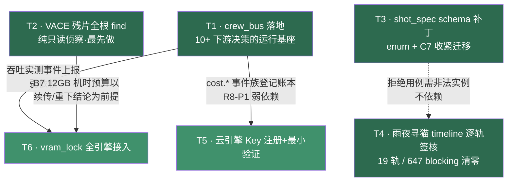

# R0 · 开工实测轮执行计划

> 起草：架构师 高见远 ｜ 日期：2026-10-03 ｜ 性质：任务分解编排（决策均已批准，本计划只排"怎么验"）
> 事实源：`docs/02-决策/DECISIONS.md`（引用一律带轮次前缀，R-5 裁定）｜ 范围依据：`11-development-readiness-report.md` §3B 六项 ｜ 矛盾/未完成判定依据：`06-full-project-audit.md`（AU-C3 / AU-C6 / AU-D1 / AU-U5 / AU-U6）
> 现场核对（2026-10-03 实测，本计划起草时）：`AI影视团队v2\tools\` 仅 jobs.py（无 crew_bus 模块）；`spec\shot_spec.schema.json` duration_s 为 `integer 17~481` 无 enum、aspect_ratio 仍含 `2.39:1|1:1|4:3`；`projects\雨夜寻猫\00_brief\timeline\master_v2.json` 19 轨 items 全部 `signoff: null`、`gaps_by_owner.json` blocking_errs=647；活动根 `D:\aifilmteam\` 下并存 `AI影视团队v2\` 与 `_legacy_projects\`。

---

## 1. 范围与门槛纪律

- **范围**：§3B 六项（T1~T6）+ T0 契约同名消歧（QA 终检 P1 补入，共七项 T0~T6）。里程碑实现类（M4/M5/M6 的 A 系列、A15/A5/A13/A24/A26 等）不在本计划内。
- **门槛纪律（R11-T4/TK4）**：所有 pending 项不计入 R0-accept。crew_bus 落地前挂牌的 pending（R0-1 / R0-7 / R0-O5 / R0-O17，见 DECISIONS.md:552/558/502/514）在本轮随 T1 实测解除或转实红，**不伪装已验证**（R10 §争议②）。
- **"决策批准≠实现就绪"**：R8-P1 / R8-C-1 已批但 v2 零实现（R-SCALE-CB P0：crew_bus 代码零引用）。本计划每项验收断言以**可执行命令+阈值**判定，禁止"确认无误"式结论。
- **引用纪律**：R-5 裁定——决策编号必须带轮次前缀（R8-C-1、R5-C7、R10-OK8 等），禁裸编号。
- **零删除纪律**：全程不移动/删除文件；VACE 残片若判重下，残片先归档（移交 `_legacy_projects/` 或加 `.deprecated` 后缀）再重下。

## 2. 依赖图

**关键结论**：
1. **T2 是全图最快项**（一条 find + 分支判定），且 T6 的机时实测预算挂在 B7（DECISIONS.md:344）之下、以 T2 结论为前提 → **T2 应最先做**。
2. **T1 是唯一"硬基座"**，但只有 T5（cost.* 事件族登记，R8-P1）与 T6（事件上报）**弱依赖**它；T3/T4 是纯文件级工作，与 T1 完全并行。
3. 硬依赖链只有一条：T2 → T6（机时前提）；T1 → T5（账本事件）。
4. T0（契约同名消歧）为纯文件级改名+引用更新，与任何项并行，排批次 0 顺手执行（QA 终检 P1 补入）。

## 3. 任务分解表

### T0 · pipeline 契约同名消歧（QA 终检 P1 补入；07 方案 C.6 / E-N1）

| 项 | 内容 |
|---|---|
| **目标** | `AI影视团队v2\pipeline\delivery_spec.json` 改名 `tech_delivery_spec.json`，消除与 `spec\delivery_spec.json` 同名异 schema 碰撞（红线#2：禁同名不同义） |
| **前置依赖** | 无（批次 0 顺手执行，与 T2 并行） |
| **owner** | 工程师 |
| **关联决策** | 07 方案 §C.6、E-N1（findings-02）、10 号文档 §2 一致性确认① |

**步骤**：
1. **先 grep 引用（防 v2 活动根断链）**：`grep -rn "pipeline/delivery_spec\|pipeline\\\\delivery_spec" AI影视团队v2 --include="*.py" --include="*.md" --include="*.json"`，逐处更新为新名并留档输出。
2. `mv` 改名（无 git 仓库；`_legacy_*` 冻结区不涉及）。
3. 在 `docs/00-索引-状态-身份/VERSION.md` 补登记行。

**验收断言（可执行）**：
- A1：改名后 `grep -rn "pipeline/delivery_spec\.json" AI影视团队v2 --include="*.py" --include="*.md"` 返回 **0 条**（引用全部更新）。
- A2：`AI影视团队v2/pipeline/tech_delivery_spec.json` 存在、旧名不存在；`spec/delivery_spec.json` 原样未动。

### T1 · crew_bus 落地（O5 裁定 R0 必落地；R-SCALE-CB P0）

| 项 | 内容 |
|---|---|
| **目标** | v2 落地 crew_bus 模块，满足 R8-C-1 五要素：WAL + busy_timeout≥5s + 串行写 + 先落档后广播 + 启动重放；消除 R-SCALE-CB"代码零引用"空心阻断（DECISIONS.md:642） |
| **前置依赖** | 无（根节点）。下游：T5（cost.* 事件族，R8-P1）、T6（事件上报）、R10-O2/O3/O7、R13-SC4、R14-RC5、A15 等后续里程碑 |
| **owner** | 工程师（实现）＋ 架构师（契约复核） |
| **关联决策** | R8-P1、R8-C-1、R8-PK8、R0-O5、R0-O17、R-SCALE-CB、R10-O2/O3/O7、R13-SC4/SCK4 |

**步骤**：
1. 新建 `AI影视团队v2/tools/crew_bus.py`：SQLite 落档表 `events(seq, ts, type, aggregate_id, payload_json, idem_key)`，连接设 `PRAGMA journal_mode=WAL` + `PRAGMA busy_timeout=5000`；单写者串行写（dispatcher 单实例，R8-争议③）；`idem_key` 唯一索引。
2. 发布顺序：先 `INSERT` 落档、提交事务，再回调广播（先落档后广播，R8-P1 QA）。
3. 启动重放：进程启动时扫描未消费 seq 按 `idem_key` 去重重放（R0-O17：零丢失零重复）。
4. 现有 `tools/jobs.py` 的 WAL 机制保持不动，crew_bus 为独立事件层。
5. 至少接 1 个真实下游做接线验证（建议 jobs.py 状态变更发 `job.*` 事件）——消"零引用"。

**验收断言（可执行）**：
- A1：`python -c "import sqlite3;c=sqlite3.connect('runtime/crew_bus.db');print(c.execute('PRAGMA journal_mode').fetchone()[0], c.execute('PRAGMA busy_timeout').fetchone()[0])"` 输出 `wal` 且 `≥5000`。
- A2：并发+崩溃：8 进程各写 100 事件 → `SELECT count(*) FROM events` = 800；kill -9 写进程中途 → 重启重放后落档计数与广播去重后计数一致，重复投递数 = 0（R0-7 / R0-O17）。
- A3：顺序断言：在广播回调内 `SELECT` 该事件已存在（先落档后广播），100 次发布全部命中。
- A4：消零引用：`grep -rln "crew_bus" tools/ pipeline/ --include="*.py"` 返回 **≥2 个文件**（模块自身 + ≥1 真实调用方）。

### T2 · VACE 残片全根 find 复核（O1 / AU-C3 P0 矛盾）

| 项 | 内容 |
|---|---|
| **目标** | 一次全根 `find` 终结"R0 真实 ls 证实 196MB .part 存在（06 报告 AU-C3 采信）"vs"R4 断言不存在（06 判证伪，AU-O1）"的矛盾，据事实走续传/重下分支 |
| **前置依赖** | 无（最快项，**最先做**）。下游：T6 的 B7 机时预算前提 |
| **owner** | 工程师（执行 find）＋ 主理人（分支拍板登记） |
| **关联决策** | R0-O1、R11-T4（AU-O1 判证伪确认）、B7（12GB 机时约束，DECISIONS.md:344）、06 报告 AU-C3 |

**步骤**：
1. 全根 find，**必须同时覆盖两个活动区**（项目已重组，禁止只查旧路径）：
   `find /d/aifilmteam/AI影视团队v2 /d/aifilmteam/_legacy_projects -name "*.part" -size +50M 2>/dev/null`
2. 输出（命令原文+结果）原文登记进决策日志，关闭 AU-C3。
3. **分支 A（在）**：走续传，省 4.31GB 重下机时；续传完成后对账。
4. **分支 B（不在）**：残片归档说明写清"find 全根无果"，启动重下流程。
5. 同步修正 `R4-执行计划.md` 中过时断言的标注（标注过时，不删原文）。

**验收断言（可执行）**：
- A1：find 命令已执行且输出留档（含空结果），决策日志新增一条 R0-O1 关闭记录，引用 R-5 前缀规范。
- A2 分支 A：`.part` 清单非空 → 续传完成判据 = 目标文件字节数与源清单对账误差 ≤1MB **且** `ffprobe` 可读出流信息（满足阿里云 VACE 门槛：MP4、≥16fps、≤5s、≤50MB，见 `00-emergency-blockout-position.md:167`）。
- A3 分支 B：清单为空 → 重下工单已开（挂 crew_bus `job.*` 事件，若 T1 已就绪；否则先记 jsonl 工单）。

### T3 · shot_spec.schema 补 duration_s 枚举 + C7 收紧迁移（O3 / AU-C6 / R5-C7）

| 项 | 内容 |
|---|---|
| **目标** | 让 schema 兑现已批决策：① duration_s 落 8k+1 枚举（R1.5-Q12 / D25⑤，现为 `integer 17~481` 裸区间）；② aspect_ratio 收紧为三档（R5-C7 对齐 D25⑥：16:9/9:16/21:9，现为五档含 2.39:1/1:1/4:3）；③ 处置 D-10 矛盾 |
| **前置依赖** | 无，可并行 |
| **owner** | 架构师（补丁+用例设计）＋ 工程师（迁移脚本+校验执行）＋ 分镜/预演师（旧实例判档确认） |
| **关联决策** | R1.5-Q12、R1.5-Q2c/D25⑤、R5-C7、R5-Q2d/D25⑥、R11（D-10→E-D1，09 报告:165/196）、06 报告 AU-C6/AU-D1 |

**步骤**：
1. **duration_s 补 enum**：8k+1 无法用 `multipleOf` 表达（17=8×2+1 非 8 的倍数），采用显式 `enum: [17,25,33,…,481]`（(481−17)/8+1 = **59 个值**），保留 minimum/maximum 双保险。帧数侧校验：管线脚本断言 `engine_routing.num_frames == duration_s`（schema 层外校验，写入 `tests/`）。
2. **D-10 处置（架构师推荐：判伪矛盾，不调低下限、不设豁免开关）**：R1.5-Q12 原文明示"最小 17 **帧**；R4 用 121 帧≈5 秒"——5.04s=121 帧 ≥17，**完全合规**；06 报告 AU-D1 是把 `minimum:17`（帧）与"5.04 秒"混读造成的伪矛盾。处置：schema description 已写明"单位为帧"，本项只需在 R4-执行计划.md 处补一行"5 秒验证镜 = duration_s:121（帧）"标注即闭环。**兜底**：若后续实测确需 <17 帧的特短验证镜，另走决策变更新增 `validation_shot` 豁免字段（allow ≥9），R0 内不实施。
3. **R5-C7 收紧**：aspect_ratio pattern 改 `^(16:9|9:16|21:9)$`。
4. **旧实例迁移**：全根扫描 shot_spec 实例（`projects/` 与 `_legacy_projects/`）：`2.39:1 → 21:9`（D25⑥ 派生表近似映射）；`1:1 / 4:3` 产出人工判档清单（Q2d：4:3/1:1 消费场景窄不首发，逐条判入 16:9 或 9:16）。迁移前后各跑一次校验器留存 diff。
5. **拒绝用例实测**：构造 4 个非法实例（duration_s=24 非 8k+1 / duration_s=9 / aspect_ratio=2.39:1 / aspect_ratio=4:3）+ 2 个合法实例（duration_s=121、aspect_ratio=16:9）。

**验收断言（可执行）**：
- A1：`python -c "import json;s=json.load(open(r'AI影视团队v2\spec\shot_spec.schema.json',encoding='utf-8'));e=s['properties']['duration_s']['enum'];print(len(e),all(n%8==1 and 17<=n<=481 for n in e))"` 输出 `59 True`。
- A2：同法输出 aspect_ratio pattern == `^(16:9|9:16|21:9)$`。
- A3：4 个拒绝用例全部抛 ValidationError（exit≠0），2 个合法用例通过（exit=0）。
- A4：迁移后 `grep -rn '"2\.39:1"\|"4:3"\|"1:1"' AI影视团队v2/projects _legacy_projects --include="*.json"` 在 shot_spec 实例内返回 0 条；人工判档清单落 `docs/`。
- A5：D-10 闭环：duration_s=121 的 5 秒验证镜实例过 jsonschema 校验 exit 0（证明矛盾为伪）。

### T4 · 雨夜寻猫 timeline 逐轨签核（AU-U5）

| 项 | 内容 |
|---|---|
| **目标** | 19 轨契约从 0 签核 / 647 blocking → 全轨签核 / blocking 清零，为 R5-C5 handoffs 工单提供干净输入 |
| **前置依赖** | 无（文件级工作，与 T1/T3 并行）；完成登记建议走 crew_bus（非硬依赖） |
| **owner** | 按 `master_v2.json` 的 `contract_owners` 分派：`agent_virtualdp`（camera/gauge/light）、`agent_set_props`（weather/wardrobe/props…）、`agent_director`（performance）等；主理人汇总进度 |
| **关联决策** | AU-U5（06 报告:74）、R5-C5 / R5-Q8（handoffs jsonl 工单 + crew_bus_event_id 回链）、schema `owner_signoff` 结构（role/by/ts/sha） |

**步骤**：
1. 先跑校验器按 `gaps_by_owner.json` 把 647 条 blocking 按 owner 分组，出各岗清单。
2. 分三批签核（每批 = 一个 owner 的全部轨）：批1 `agent_virtualdp`（camera/gauge/light，轨多权重大头）→ 批2 `agent_set_props` → 批3 其余 owner（含 `agent_director` performance）。
3. 每条 item：owner 逐项 confirm → 写入 `signoff{role, by, ts, sha}`；**sha = 被签 item 内容 sha256 前 12 位**（对齐 shot_spec.schema 的 owner_signoff 语义：sha 不匹配即视为未签）。
4. 每批完成重跑 gaps 校验器，blocking 归零后再开下一批；`needs_owner_confirm` 翻转。
5. `origin: auto_draft` 且无 signoff 的 item 不得进后续 g1_blockout_lock（schema 既有禁令）。

**验收断言（可执行）**：
- A1：`python -c` 扫 `master_v2.json` 19 轨全部 items：`signoff is None` 计数 = **0**。
- A2：sha 防伪：逐条重算 `sha256(item)[:12]` 与 `signoff.sha` 比对，不一致数 = 0。
- A3：`gaps_by_owner.json` 重生成后 `blocking_errs` 合计 = **0**（残留项只允许降级为非 blocking 且逐条带 owner 豁免记录，否则视为未完成）。
- A4：归属一致：每条 `signoff.role` == 该轨 `contract_owners[track]`，越权签核计数 = 0。

### T5 · 云引擎 Key 注册 + 最小验证（AU-U6）

| 项 | 内容 |
|---|---|
| **目标** | 打通"可上云"能力：两云引擎 Key 注册 → 1 镜最小验证 → 账本记录。**注意 R7-B9 已把"上云"设为四条件门（非默认）**——本项只验证管道通，不开启批量上云 |
| **前置依赖** | T1（弱依赖：账本登记走 R8-P1 cost.* 事件族；若 T1 未就绪可先 jsonl 直写，事后补事件回链） |
| **owner** | 主理人/制片（Key 申请与登记）＋ 工程师（最小验证调用+账本落账） |
| **关联决策** | AU-U6（06 报告:75）、R7-B9（四条件门）、R7-B1（cost_ledger 分层 schema：idem_key/price_version/envelope_*）、R7-K3（写入时点锁 fx_rate）、R7-K6（idem_key 唯一+retry_of）、R8-P1（cost.* 事件族） |

**步骤**：
1. 注册两云引擎 Key（对应 `shot_spec.schema.json` engine_routing 云端枚举：`jimeng_seedance25_blockout` / `higgsfield_blender` 等，以 R0 调研证据附录的引擎清单为准），写入 `env/`（不入库、不进 git 跟踪）。
2. 各引擎跑 **1 镜**最小验证（用 T3 校验通过的真实 shot_spec 实例），响应与产出落 `outputs/`。
3. 账本记录按 R7-B1：追加式 jsonl，含 `idem_key`（唯一）+ 写入时点 `fx_rate`（R7-K3：写侧锁定、读侧永不换算）+ `charged_rmb` 单口径。

**验收断言（可执行）**：
- A1：`grep -c "API_KEY" env/*.env` 两引擎各 ≥1；`git check-ignore env/<该文件>` exit 0（明文不进仓库，接 R14 治理）。
- A2：每引擎 ≥1 次真实调用返回成功，产出文件存在于 `outputs/` 且 `ffprobe` 可读。
- A3：账本幂等（R7-K6 实测）：同一 `idem_key` 重试提交 3 次 → 账本新增行数 = 1；`fx_rate` 字段非空且等于写入时点值；`charged_rmb` 非空。
- A4：门禁合规（R7-B9）：验证期结束时账本中该两引擎的行数 ≤2 行/引擎（1 次验证 + 至多 1 次 retry），超限即违规回滚。

### T6 · vram_lock 全引擎接入（R4-T19 / R10-OK8 / R0-O1）

| 项 | 内容 |
|---|---|
| **目标** | vram_lock 从"仅 wan22"扩到**全部本地 GPU 引擎**（Blender 渲染 / ComfyUI / 写实化本地引擎 / TTS·BGM 本地推理）submit 前强制错峰，消 R4-T19 缺口（DECISIONS.md:471 证据：其余裸跑抢显存） |
| **前置依赖** | T2（弱依赖：实测吞吐的 B7 12GB 机时预算以 VACE 续传/重下结论为前提）；T1（弱依赖：错峰等待/获锁事件上报 crew_bus） |
| **owner** | 工程师（接入+实测）＋ 架构师（盘点清单复核） |
| **关联决策** | R4-T19、R10-OK8、R0-O1、R2-A6 实测项③（DECISIONS.md:179/226）、R13-SC2/SC3/SCK2（分时+vram_lock 校验入 runbook）、D23 分时纪律、B7 |

**步骤**：
1. 盘点：`grep -rln` 找出全部本地 GPU 进程启动入口（wan_runtime / ComfyUI / blender 渲染脚本 / acestep·TTS 等），产出《GPU 引擎入口清单》。
2. 抽公共 `vram_lock` 上下文管理器（以 wan22 现有实现为蓝本），所有入口 submit 前统一获取；云引擎调用（fal/即梦）不占本地 VRAM，不接锁但记清单说明。
3. R10-OK8 后半：D23 分时纪律写入 AGENTS.md。
4. 实测：12GB 卡上 ComfyUI + Blender EEVEE（121 帧@832×480 标定镜）并发提交，经 vram_lock 串行化。
5. 吞吐数据入 runbook 素材（R13-SCK2）。

**验收断言（可执行）**：
- A1：清单完备：对《GPU 引擎入口清单》逐文件 `grep -L "vram_lock"` 返回**空集**（无遗漏入口）。
- A2：并发实测：ComfyUI 与 Blender 并发提交期间 `nvidia-smi --query-gpu=memory.used --format=csv` 采样峰值 ≤ **12288 MiB**（12GB），全程无 CUDA OOM。
- A3：串行化证明：两引擎实际执行时间窗重叠 ≤ 锁粒度允许值（日志时间戳比对：获锁-释放区间交集 ≤ 1 个锁抖动周期）。
- A4：分时纪律：AGENTS.md 中存在 D23 分时段条目（`grep -n "分时" AGENTS.md` 命中）。

## 4. 执行顺序与并行批次建议

| 批次 | 内容 | 并行性 | 理由 |
|---|---|---|---|
| **批次 0**（Day 1） | **T0 契约改名**（分钟级）＋ **T2 全根 find**（小时级）＋ **T1 crew_bus 开工** | 三者并行 | T0 顺手清障；T2 最快解锁分支决策与 B7 机时前提；T1 工期最长，先开工才能不阻塞批次 2 |
| **批次 1**（Day 1~2） | **T3 schema 补丁** ＋ **T4 timeline 签核批 1~2** | 互不依赖，完全并行 | 纯文件级；T4 签核按 owner 批次滚动，不占 GPU |
| **批次 2**（Day 2~3） | **T5 云 Key 最小验证** ＋ **T6 vram_lock 接入+实测** | T5 与 T6 并行；T6 需 T1（事件上报）与 T2（机时前提）就绪 | GPU 实测项集中在此时段，受 B7 机时约束一次排满 |
| **收尾** | T4 批 3 + 全项断言复跑 + 决策日志关闭记录 | — | 逐条跑 §3 验收断言，全绿才进 §5 |

原则：**先侦察（T2）→ 基座（T1）与文件级修复（T3/T4）并行 → GPU/云实测收口（T5/T6）**；任何项断言不过即回修，不带病进 R0-accept。

## 5. 退出条件（R0-accept 判定）

R0-accept = **§3 七项（T0~T6）全部验收断言（A 编号共 26 条）逐条复跑全绿**，且满足：

1. **T1 断言全绿** → R0-1 / R0-7 / R0-O5 / R0-O17 四个 pending 项由"pending crew_bus"转为实测绿（或转实红显式登记）；R-SCALE-CB 空心阻断解除（R13-SC4 可升格）。
2. **T2 分支已闭环**：AU-C3 关闭记录入决策日志，无论续传/重下，B7 机时预算基数已按事实更新。
3. **T3 断言全绿**：AU-C6 关闭（enum 落地）；R5-C7 收紧生效且存量迁移完成；D-10 以"伪矛盾判伪"记录关闭（E-D1 建议采纳为"不调低不豁免"）；T0 断言全绿（pipeline 契约 tech_ 前缀消歧，E-N1 关闭）。
4. **T4 断言全绿**：19 轨签核 100%、blocking=0 → R5-C5 handoffs 具备干净输入，g1_blockout_lock 解锁。
5. **T5 断言全绿**："可上云"能力打通；R7-B9 四条件门未被绕过（账本行数门禁 A4 通过）。
6. **T6 断言全绿**：R0-O1（vram_lock 全引擎）关闭；12GB 峰值实测数据入 R13-SCK2 runbook 素材。
7. **遗留登记**：实测中新发现的任何未达项，一律以"pending + 不计入 R0-accept"显式登记（R11-T4 纪律），禁止伪装已验证（R10 §争议②）。

> 全绿之日，R0-accept 登记，团队进入里程碑实现阶段（M4/M5/M6 起步清单见 11 报告 §2.C）。
