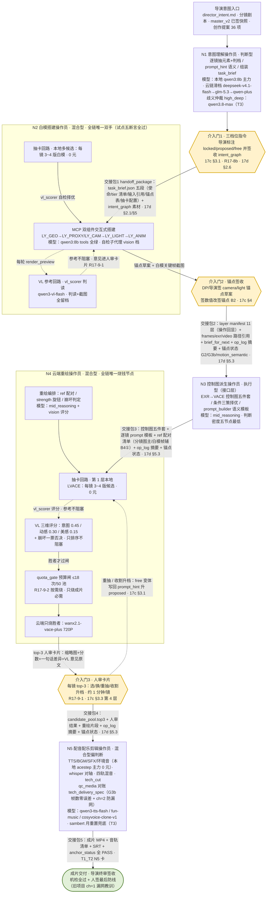
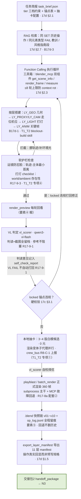
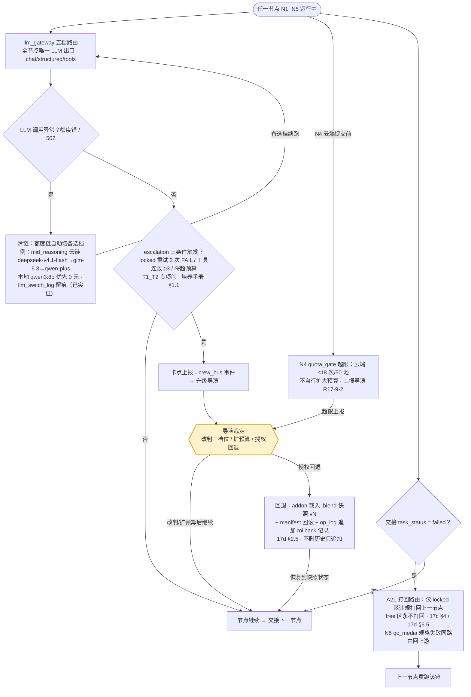

# T4 · 团队协作流程图（五操作员接力全景）

> 起草：流程图设计师（team-flowchart）｜日期：2026-10-04｜性质：并入《LLM 团队构建系统调研》终稿的分节素材（终稿由领导整合，本文只供素材）。
> 输入实读：T1_T2_定位与装备.md（五卡+装备矩阵+专项①~④）、17d-全链路操作员架构-重构版.md §2/§3/§5、17c-控制分层与创意平衡设计.md §3/§4、DECISIONS.md 第十八轮 R17-9-1/2/3、T3_模型映射.md（各节点主模型标注）。
> 硬约束：图中每个元素均有出处（见 §4 出处对照表），无发明环节；模型标注全部来自 T3（百炼 408 台账 + Ollama 本地），无国外件，去国外化口径与 T1_T2 一致；共 3 张图，Mermaid 节点 id 英文、标签中文，已自查括号与箭头闭合。

---

## 图 1 · 主流程图：五节点接力全景（含三介入门 / VL 参考回路 / 抽卡回路）

**说明**（阅读顺序与关键设计点）：

1. 阅读顺序：导演意图入口 → N1 判档（介入门1 导演签收三档位与 intent_graph）→ N2 白模搭建（介入门2 DP/导演签锚点）→ N3 控制图派生 → N4 抽卡重绘（介入门3 top-3 人审卡片）→ N5 音配剪 → 成片终审签收；五跳交接全部走 handoff_package 标准封装（17d §5.2/§5.3），失败交接按 A21 路由打回（见图 3）。
2. 三个六边形=导演三介入门（R17-8b / 17d §2.6）：三档位指令、锚点签收、人审卡片——其余环节导演不介入，"老板只在三处出现"；N5 之后的终审签收是交付动作（机检+人签双保险，T1_T2 N5 卡）。
3. 两类虚线内循环：N2/N4 的 VL 参考回路按 R17-9-1 降级为"参考+人审兜底"，判读与截图全留档但**不阻塞出片、不自动打回**；抽卡回路 N2 本地多候选（每镜 3~4 版 0 元）→ 自检择优，N4 本地评分后**云端只烧胜者**（quota_gate ≤18 次/50 池，R17-9-2 按需烧）。
4. 人审卡片的三条出口均有出处：选（进交接包4）、重抽（回 N4 本地候选池）、收割升档（free 变体写回 prompt_hint 升 proposed，17c §3.1 档位流转）。
5. 各节点模型标注取自 T3 映射（百炼台账 + Ollama 本地），mid 链滑档顺序与 high_deep 仲裁档均为 T3 实读口径，无国外件。

---

## 图 2 · 节点内部微流程：N2 白模搭建操作员（试点已实证节点）

**说明**：

1. 阅读顺序：简报 + RAG 组装上下文（17d §2.7 三检索时机之一）→ Function Calling 循环内"搭一层 → 软护栏 → render_preview 回看 → VL 判定"→ locked 违规硬打回、VL 意见只留档 → 本地抽卡择优 → playblast 正式渲染 → 快照留痕 → manifest 导出交接。
2. 护栏在 VL 判定之前——防怼脸软护栏与打灯 checklist 是 R17-9-3 修复项，把试点踩坑（dolly 末段怼进猫窝 / 室内无环境光致 4 轮全否决）装备化为"渲前强制检查"，属软护栏（提示修正），与 locked 硬校验分属两条线（T1_T2 专项④）。
3. 两条出路对应 17c §3.1 分级验收：只有 locked 锚点违规才打回修正（A21 改写后"只在 locked 区违规打回，free 区永不打回"）；VL 类 FAIL 一律不自动打回，判读原文进 self_check_report.json 并随交接包进人审卡片（R17-9-1）。
4. export_layer_manifest 排在渲染与快照之后：manifest 是"操作的真实回显"而非预写规格（17d §1.5，与旧 scene_skeleton 的本质区别），此顺序保证 manifest 与 .blend 快照状态一致。
5. 正式渲染走 bpy subprocess 主干 + MCP 故障回退（R17-8a 配套②）；候选渲染由渲染变体子代理并行执行（T1_T2 专项①：subagent_policy 长等待/并行化收益）。

---

## 图 3 · 异常流：滑链 / 卡点上报 / 回退 / A21 打回

**说明**：

1. 三条主异常线：①滑链——gateway 额度错/502 时额度链自动切备选档（mid 链示例取自 T3），本地 qwen3:8b 为 0 元基本盘优先，llm_switch_log 留痕（已实证，多条 502 滑档实录）；②卡点上报——escalation 三条件（locked 重试 2 次 FAIL / 工具连败 ≥3 / 将超预算）触发 crew_bus 事件升级导演；③回退——导演授权后 addon 载入指定 .blend 快照 + manifest 回滚 + op_log 追加 rollback 记录（不删历史，17d §2.5）。
2. 第四条：交接失败（task_status=failed）按 A21 打回路由回上一节点——**只打回 locked 区违规，free 区永不打回**（17c §4）；N5 的 qc_media 规格失败（帧数/响度/声道）同样按此路由回上游，不越级。
3. quota_gate 超限不走自动重试：按 R17-9-2"按需烧、不硬烧"与岗位卡"不自行扩大预算"，超限即上报，由导演裁定是否扩预算。
4. 滑链与回退都是"留痕型"异常处理：动作本身写进 llm_switch_log / op_log，与要素⑤全程留痕一致，事后可复盘可重放。

---

## §4 · 出处对照表（图内元素 ↔ 依据）

| 图中元素 | 出处 |
|---|---|
| 导演三介入门（六边形，图 1 G1/G2/G3、图 3 DIRDEC） | R17-8b · 17d §2.6 · T1_T2 专项③ |
| VL 参考回路虚线"参考不阻塞"（N2/N4 内循环） | DECISIONS.md R17-9-1 · 17d §2.4 |
| 抽卡回路：N2 本地多候选 / N4 云端只烧胜者 | 17c §3.3 · 17d §3 N2/N4 行 · R17-9-2 |
| 交接包 2/3 字段（manifest/路径引用/op_log 摘要/锚点状态/candidate_pool） | 17d §5.3 示例同构 |
| 交接包 1（task_brief 五段） | 17d §2.1 |
| 交接包 4/5（top3+人审结果 / 成片+anchor_status 全 PASS） | T1_T2 N4 卡/N5 卡输出清单 |
| 防怼脸软护栏 + 打灯 checklist | R17-9-3 · T1_T2 专项④ |
| 快照链/回退/op_log 留痕 | 17d §2.5 |
| A21 打回路由（仅 locked 区违规） | 17c §4 · 17d §6.5 |
| escalation 三条件 | T1_T2 专项④（培养手册 §1.1） |
| 滑链额度链与留痕 | 17d §2.3 · T3（llm_switch_log 已实证） |
| quota_gate ≤18 次/50 池 | 17d §3 N4 行 · R17-9-2 |
| VL 三维评分权重 0.45/0.30/0.15 + 崩坏否决 | 17c §3.3 · 17d §2.4 |
| 收割升档（free 变体写回 prompt_hint 升 proposed） | 17c §3.1 |
| 11 层搭建顺序 / manifest 操作回显 | B17d-1 · 17d §1.4/§1.5 |
| 各节点模型标注 | T3_模型映射（百炼台账 + Ollama 本地，无国外件） |

## §5 · 与 17d §5 的差异点（如实标注）

1. **交接包 1 与 5 为同构推导**：17d §5.3 示例只覆盖 N2→N3 一跳；#1 按 §2.1 task_brief 五段组织、#5 按 T1_T2 N5 卡输出清单组织，字段结构与 §5.3 三段式（artifacts / op_log_digest / anchor_status）完全同构，非新增规格。
2. **介入门 2 显式画在 N2 与交接包 2 之间**：§5.3 交接动作本身未含签收步骤，本图按 R17-8b 介入门② / T1_T2 专项③ 把"锚点签收"标为 N2 产物出门前的人工闸门——属编排标注，不改交接包字段。
3. **R17-9-1 语义叠加**：anchor_status 中 motion_semantic 类软门在 R17-9-1 后恒为"SOFT_PASS + vl_raw 进人审卡片"，图中以"参考不阻塞"虚线标注，与 §5.3 示例字段一致，无冲突。
4. **无发明环节**：图内全部节点与边均可在上表出处中找到依据；未画入的细节（如 RAG 三时机、工具包装状态）不属于交接协议范畴，留 T1_T2 与 17d 正文承载。
