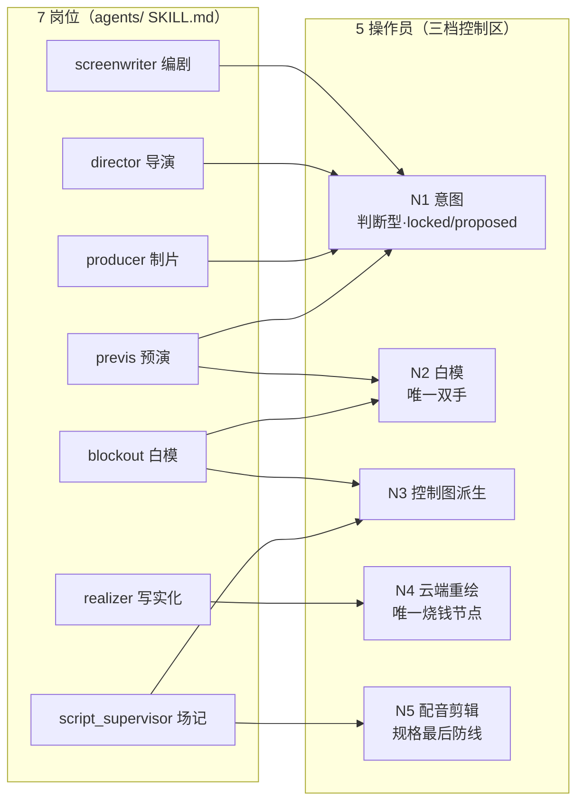

# 00 · 项目基线报告 — CINEAST-3 / AI 影视团队 v2

> 体检批次：2026-10-05｜适配项目：AI 影视团队 v2（C3 / CINEAST-3）一人 AI 制片厂
> 核心路线：Blender 极简白模占位 + 大模型后期写实化
> 本文件是 35 个维度提示词文件的统一依据。执行任何维度前先读本文件。

---

## 1. 基线采集声明（第一步已完成项）

| # | 采集任务 | 完成情况 | 说明 |
|---|---|---|---|
| 1 | 全局通读 | ✅ 已执行 | 以 `D:\aifilmteam\项目完整掌握报告.md`（2026-10-04，8.6 万文件/80GB 七路并行通读的综合结论）为地图，实测 D 盘根、`docs/`、`AI影视团队v2/` 全子目录、`trae_market/`、`runtime/`、`config/`、`outputs/`、`_legacy_projects/` |
| 2 | 版本控制现状 | ✅ 已实测 | `D:\aifilmteam`、`AI影视团队v2`、`D:\ai_film_projects` 三处 `git rev-parse` 均报 fatal: not a git repository；根级 `.gitignore`（422B）已就绪但未 init |
| 3 | 决策与协商历史 | ✅ 已通读 | `DECISIONS.md`（151KB 含 18 轮决议 + C3 前三轮 D/N/A 全量）+ `NEGOTIATION_PROGRESS.md`（15 轮协商 **全部收官**，第 3 轮 2026-10-03 框架收官 27/27） |
| 4 | 机器契约 | ✅ 已通读 | `spec/` 三份（delivery_spec.json v2.0 / qc_rubric.json v1.1.0 / shot_spec.schema.json）+ `pipeline/tech_delivery_spec.json` v1.7 消歧后并存 |
| 5 | 岗位卡 | ✅ 已登记 | `agents/` 7 份 SKILL.md（screenwriter 2200B ~ blockout 5526B）+ `_legacy_roles/` 15 旧岗归档 |
| 6 | 7 路笔记 | ✅ 已引用 | `.runtime/notes/G1~G7.md` 已由《项目完整掌握报告》综合；原始笔记已随清理移入 `D:\_aifilmteam_清理_20261005\.runtime\`；逐路摘要见维度 14 调研台账 |
| 7 | PDF/音视频决策记录 | ⏳ 未见 | 项目内无 PDF 决策记录、无会议录音；[PDF Monster]/[all-in-one-media-notes] 维度 6/14 备而不用 |
| 8 | 插件市场数据 | ✅ 已实测 | `trae_market/` 含四平台市场数据（Trae plugins_all.json 423KB / skills_all.json 214KB + Qoder/SkillHub/WorkBuddy 三平台 xlsx）——**35 维度提示词插件引用合规核查已在此完成** |

---

## 2. 项目阶段时间线（R0→R4 已完成，R5 待启动）

```mermaid
timeline
    title CINEAST-3 阶段演进（2026-09-27 起）
    2026-09-27 R0 盘点： 两个旧目录全量只读盘点（74G+70M）| 真身移入 _ai_film_legacy_2026 归档 | 建新根 AI影视团队v2 骨架 50 目录
    2026-09-27 R1 需求： 需求定稿 10 项全拍板 | 多模态边界=全都要
    2026-09-27 R2 调研： 板块① 竞品20家 | 板块② 四路回齐（fal Schema一手/开源/引擎/获奖团队）| 音频独立链定案
    2026-09-27 R3 架构： 底层架构定稿 14 节 | 19 条修正落点 | 47 项 QC 契约 | 三份 spec v1.1.0 | 老板 18:21 签字
    2026-10-02 C3 立项协商： 15 轮全部收官（白模26项/节点图24项/Agent团队27项/工具MCP 24项/契约25项…15类）| 三.md 124KB 主设计
    2026-10-04 R4 验证： MCP 闭环运镜动感 77.15% | 云端 wanx2.1-vace-plus 写实化打通 1-1/1-2 | 音频母版四项达标 | 生产管控三用例验收
    2026-10-05 R5 待启动： 《雨夜寻猫》重制 | 预算 ≤100 元 | 逐镜真动态 | 补 GB 45438-2025 双标识
```

---

## 3. 目录结构树状图（实测标注）

```
D:\aifilmteam\                            ← 体检工作根（非 git 仓库）
├── 项目完整掌握报告.md                    ← 8.6万文件/80GB 七路通读综合（1138 自写文件/22MB）
├── 体检产出\                              ← 本体检交付物（35 维度体检执行 + 索引.html）
│
│   ⚠️ 2026-10-05 清理：输入提示词/插件市场数据/工具配置已移出 →
│   D:\_aifilmteam_清理_20261005\（.trae / .trae-html-share-packages / trae_market /
│   .runtime（G1~G7 笔记+调研中间产物）/ .workbuddy / 项目全面工程体检-优化提示词.md）
│
├── AI影视团队v2\                          ← ⭐ 当前活动根（唯一事实来源区）
│   ├── spec\                              ← 三份机器契约（shot/delivery/qc_rubric，唯一定义处）
│   ├── agents\                            ← 7 岗位 SKILL.md + _legacy_roles\（15 旧岗只留档）
│   ├── projects\雨夜寻猫\                 ← 实际短片工程（00_brief→07_deliver 八段 + locks/ditmap/clearance）
│   ├── projects\r4_l1\                    ← R4 验证镜产物
│   ├── tools\                             ← 49 个 Python 工具 + _probes（18 探针）+ _selftest + _skills
│   ├── mcp_blender\                       ← baimo_mcp_server.py（13 工具）+ baimo_mcp_addon\（127.0.0.1:17800）
│   ├── pipeline\                          ← timeline_build / tech_cut / audio_mix + jobs.db
│   ├── web\                               ← react-workspace（5 视图）+ showcase + workspace
│   ├── models\wan_vace_1.3b\             ← 🔴 残缺权重（196MB，应 4.3GB）——R4 硬阻塞
│   ├── blender\ assets\ config\ docs\ logs\ runtime\ tests\ wan_runtime\ _inbox\ _legacy\
│   └── PROJECT_STATE.md / AGENTS.md       ← 唯一入口 + D23 GPU 分时纪律
│
├── docs\                                  ← 活动文档库
│   ├── 00-索引-状态-身份\                  ← project_memory / STATUS_MATRIX / VERSION / user_profile
│   ├── 01-主设计\                          ← 一.md 41KB / 二.md 30KB / 三.md 124KB（主设计纲领）
│   ├── 02-决策\                            ← DECISIONS.md 151KB（18 轮）+ NEGOTIATION 15 轮 + 00~17d 轮次文档
│   ├── 03-规划与调研\                      ← 12 份（百炼调研/LLM团队系统调研 154KB+257KB/白模引擎矩阵/额度耗尽计划…）
│   ├── 07-交接与日志\  09-逆向与审计\
│   └── _README_FIRST.md
│
├── config\                                ← REGISTRY.md（config.yaml 三份同名消歧登记）+ scalability_config.json（档位配置）
├── runtime\                               ← llm_router.json（五档路由表）+ bailian_models_408.md（408 模型台账）+ secrets\ + 切换日志
├── outputs\                               ← blockout/control/mcp_pilot*/vace_burn/ref_images + dashscope 试片（生成物不入 git）
├── _legacy_projects\                      ← v1-prototype / v2-intermediate 历史归档（冻结·只读）
│                                          ← （trae_market 已移出 → D:\_aifilmteam_清理_20261005\，合规核查结论见 §7）
│                                          ← （.runtime 已移出 → D:\_aifilmteam_清理_20261005\.runtime\：G1~G7 笔记 + 扫描清单等调研中间产物）
```

---

## 4. 技术栈全景表

| 层 | 技术 | 版本/规格 | 状态 | 备注 |
|---|---|---|---|---|
| 3D 白模 | Blender | 5.2.2 LTS 便携版 | ✅ 可跑 | **本机构建无 FFmpeg/EXR Multilayer**（三重实测），输出走 PNG/EXR 单层 + 外部打包 |
| 白模脚本 | make_r4_l1_blockout.py / blockout_min_v1.py | — | ✅ 已跑通 | R0 待修第 6 行注释（写 Multilayer 实为 OPEN_EXR 单层） |
| 渲染引擎 | EEVEE Next | — | ✅ 已定 | D1 拍板；Standard 显式色彩管理（D4，弃 AgX） |
| 控制图 | exr_to_control.py | depth/normal/canny | ✅ 已跑通 | 白模 EXR → 控制图 |
| 本地 LLM | Ollama qwen3:8b | 127.0.0.1:11434 | ✅ 0 元基本盘 | 2026-10-03 三连测全绿（chat/structured/tools，100% GPU） |
| 云端 LLM | 百炼 DashScope | compatible-mode v1 | ✅ 五档链 | llm_router.json：low_structured/mid_reasoning/high_deep/vision/embedding，额度报错即切链 |
| 云端写实化 | 百炼 wanx2.1-vace-plus | ~114-115s/5s | ✅ 打通 | 白模→深度控制→写实链路端到端实证（1-1/1-2） |
| 云端渲染 | fal 3DREAL render-to-real | $0.0024075/Mpx | ⏳ R4 2 元实测 | 480p 输入接受度待 R4 实测（D2 附注） |
| 本地视频生成 | Wan2.2 5B | 832×480/49帧/127.1s/峰值 10596MiB | ✅ 跑通 | 距 12GB 红线仅余 ~1.4GB；D23 分时纪律强制 vram_lock |
| 本地 VACE | Wan VACE 1.3B | 权重 196MB/应 4.3GB | 🔴 硬阻塞 | R4 主阻塞项；`LNd1SX` 全量权重待下 |
| MCP | baimo_mcp_server + addon | stdio JSON-RPC 13 工具 / TCP 17800 / 20Hz 主线程 bpy | ✅ 闭环 | 运镜动感 77.15% vs 固定脚本 47.87% |
| 事件总线 | crew_bus | SQLite WAL，6 事件类型 | ✅ v2 实测 800 事件不丢 | at-least-once + 幂等；C3 重构版未落地（O2/O3 pending） |
| 任务/成本/审计 | jobs/costs/audit 三件套 | idem 内容哈希 | ✅ 三用例验收 | 成功才计费；18 evidence 快照 |
| 前端 | React + React Flow + Zustand | @xyflow/react 12.3.5 | ✅ 可跑 | 5 视图；仅 SDXL 静图；C3 M18 重构规格已定（N1~N24） |
| 数据库 | SQLite WAL | busy_timeout≥5000 | ✅ | 生产级升级路径见维度 15 |
| 音频 | audio_mix.py + ffmpeg | -14.00 LUFS/TP -1.70/48kHz/2ch/80.000s | ✅ 四项达标 | alimiter 必须显式 :level=disabled；A6 音效双链待实测 |
| TTS | tts_generator.py | ⚠️ edge-tts 🔴 违规 | 🔴 必换 | A6 拍板换 CosyVoice 3 / Qwen3-TTS |
| 合规 | GB 45438-2025 | 2025-09-01 已施行 | 🔴 双缺失 | 显式 overlay + 隐式 4 键元数据均未嵌入成片 |
| 版本控制 | git | 未 init | 🔴 空白 | .gitignore 已备；LFS/sparse 方案见维度 13 |

---

## 5. 关键遗留问题严重度矩阵（7 大债务）

| # | 债务 | 严重度 | 证据 | 阻塞的 R5 能力 |
|---|---|---|---|---|
| 1 | **16/18 镜非视频血缘**（静帧+Ken Burns） | 🔴 红线 | 粗剪 v1→v4、tech_v5 连续 FAIL；血缘标注「PPT 感来源、禁进交付时间线」 | 交付主线本身 |
| 2 | **GB 45438-2025 双标识缺失** | 🔴 红线 | delivery_spec extra_required 未执行；4 键隐式元数据 + 开头 AI overlay 均无 | L2/L3 交付合法性 |
| 3 | **清单与代码漂移**（23 zone 虚标 + 195+ 硬编码路径） | 🟠 高 | 项目完整掌握报告 §7.3；换机即失效 | 跨机迁移/可复现 |
| 4 | **本地 VACE 权重残缺**（196MB/4.3GB） | 🟠 高 | models/wan_vace_1.3b 实测 | 本地 0 元写实化路径 |
| 5 | **timeline_build 重跑覆盖签核** | 🟡 中 | 19 轨 0 签核 + 647 阻塞错误 | QC 签核闭环 |
| 6 | **9 份旧 .env 明文密钥** | 🟡 中（已控） | 已 .gitignore 未入库；R14-RC4 密钥不落库已定 | git init 前置条件 |
| 7 | **edge-tts 违规**（微软自动化条款） | 🟡 中 | A6 拍板必换；tts_generator.py 现用 | 配音链合规 |

> 🟡→🟠 判定依据：是否 blocking R5 交付（红线=硬门 FAIL / 高=能力缺失 / 中=可绕行但须整改）。

---

## 6. 7 岗位 → 5 操作员收敛关系图



> 收敛逻辑：判断型岗位（编剧/导演/制片/预演）归 N1 意图层；执行型岗位（白模/场记）映射 N2/N3/N5；写实化岗映射 N4 烧钱节点。C3 音效师/剪辑师为新增纯工具链岗（A6/A6b）。

---

## 7. 体检输入提示词合规核查结论（trae_market 实拍）

对提示词第一部分 12 类候选索引逐条核查 `trae_market/plugins_parsed.json` + `skills_parsed.json`：

| 核查结果 | 数量 | 明细 |
|---|---|---|
| ✅ 真实存在 | 34 个引用 | 全部网络/调研/开发/部署/文档/可视化类插件均在市场存在（博查搜索/tavily/专业数据集/industry-researcher/data-processing/PDF Monster/all-in-one-media-notes/Personal Workspace Customization/postgresql 等均命中） |
| ⚠️ 名称需修正 | 1 处 | `[设计画布]` 未命中 → 市场现名「Canvas 画布」（trae-remote-official:canvas）；维度 7/23/29 中该引用统一替换为 `[画板]` 或 `[frontend-design]` |
| ⛔ 明确排除 | 飞书全系 | 老板铁律「不用飞书」；lark/飞书系列已在索引中移除（与提示词声明一致） |

> **执行口径**：35 个维度文件中所有 `[名称]` 引用均以本表为准；执行时按当前会话实际可用插件/技能就近替换（市场存在 ≠ 本会话已安装，未安装时回退内置能力，不硬凑）。

---

## 8. 本报告的定位

- 本文件是**基线快照**，非改造成果；全部诊断结论沉淀在各维度提示词文件中，执行方按文件逐项落地。
- 配套交互仪表盘：`技术栈全景.html`（技术栈可视化 + 债务矩阵热力视图）。
- 35 个维度文件导航：`../索引.html`。
