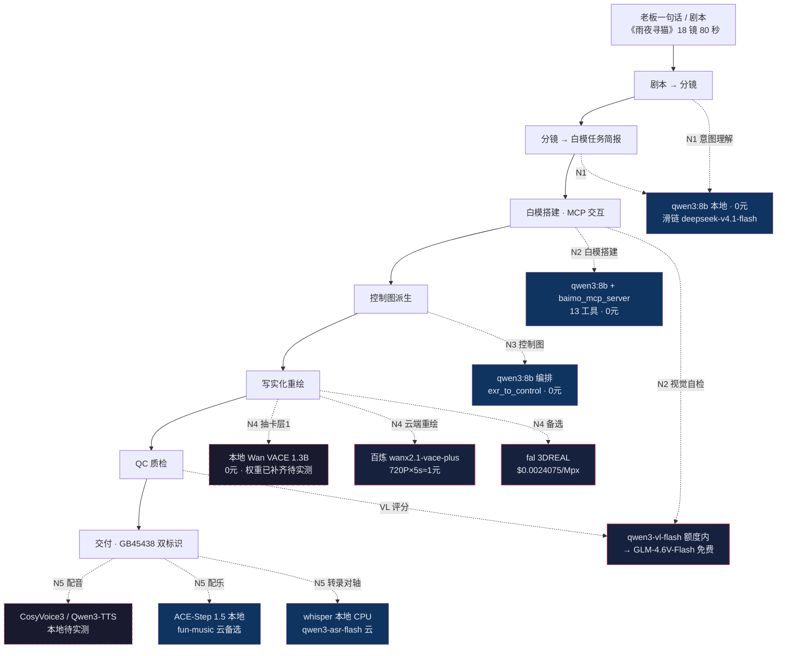

> 基线：../00-基线报告/项目基线报告.md ｜ 规约：../_执行须知.md ｜ 导航：../索引.html

# 维度 1 · 全链路可用性流程图（模型在「剧本→分镜→白模→控制图→写实化→QC→交付」中的位置）

> 说明：实线 = 已实测可用；虚线 = 待实测/规划中。每个节点标注消费模型 + 操作员 + 成本口径。禁用 ` `，用「·」分隔。

---

## 1. 主链路总图

---

## 2. 逐段可用性核对表

| 链路环节 | 消费模型 | 操作员 | 成本口径 | 可用性 | 证据 / 备注 |
|---|---|---|---|---|---|
| 剧本→分镜 | qwen3:8b（本地） | N1 | 0 元 | 已实测 | llm_gateway structured 三连测全绿 |
| 分镜→白模简报 | qwen3:8b + intent 校验 | N1 | 0 元 | 已实测 | shot_spec.schema.json 断言 A1~A6 |
| 白模搭建 | qwen3:8b + MCP 双组件 | N2 | 0 元 | 已实测 | 运镜动感 77.15% vs 脚本版 47.87% |
| 白模视觉自检 | qwen3-vl-flash（额度内） | N2 | 0 元（额度内） | 额度内可用 | 10/27 到期后须切本地 VL（待实测） |
| 控制图派生 | qwen3:8b + exr_to_control | N3 | 0 元 | 已实测 | depth/normal/canny 三图已跑通 |
| 白模打包 MP4 | FFmpeg（pngseq_to_mp4） | N3 | 0 元 | 已实测 | 本机 Blender 无 FFmpeg，须外部打包 |
| 写实化-本地抽卡 | 本地 Wan VACE 1.3B | N4 | 0 元 | 待实测 | 权重 16.4GB 已补齐，r4_vace_runner 未跑 |
| 写实化-云端 | wanx2.1-vace-plus | N4 | 约 1 元/镜 | 已实测 | 1-1/1-2 打通（~114-115s/5s） |
| 写实化-备选 | fal 3DREAL | N4 | 480p≈¥0.72/镜·720p≈¥1.9/镜 | 待实测 | $0.0024075/Mpx；480p 接受度待 R4 实测 |
| VL 评分 | qwen3-vl-flash → GLM-4.6V-Flash | N2/N4 | 0 元 | 额度内可用 | 三维评分+崩坏一票否决 |
| 配音 TTS | CosyVoice 3 / Qwen3-TTS | N5 | 0 元（本地） | 待实测 | edge-tts 违规已换，R5 前必落 |
| 配乐 BGM | ACE-Step 1.5 / fun-music | N5 | 0 元 / 云 | 已实测（smoke） | acestep_client smoke 通过 |
| 转录对轴 | whisper / qwen3-asr-flash | N5 | 0 元 | 已实测 | whisper CPU 档 |
| 混音 | audio_mix.py + ffmpeg | N5 | 0 元 | 已实测 | -14.00 LUFS / TP -1.70 / 48kHz / 80.000s |
| 交付双标识 | ai_label.py | N5 | 0 元 | 已修复 | GB 45438 显式 overlay + 隐式元数据 |

---

## 3. 可用性分级小结

| 分级 | 数量 | 环节 |
|---|---|---|
| 已实测可用（实线） | 11 | 剧本/分镜/白模/控制图/云端写实化/配乐/转录/混音/交付标识 等 |
| 额度内可用（有到期风险） | 2 | 白模 VL 自检、VL 评分（依赖百炼 qwen3-vl-flash，10/27 到期） |
| 待实测（虚线，阻塞 R5） | 3 | 本地 VACE 写实化、CosyVoice3/Qwen3-TTS 配音、fal 3DREAL 2 元实测 |

**结论**：主链路模型落点齐备；R5 前三个「待实测」为关键验证项，其中本地 VACE 权重障碍已清除、只差运行实测。
