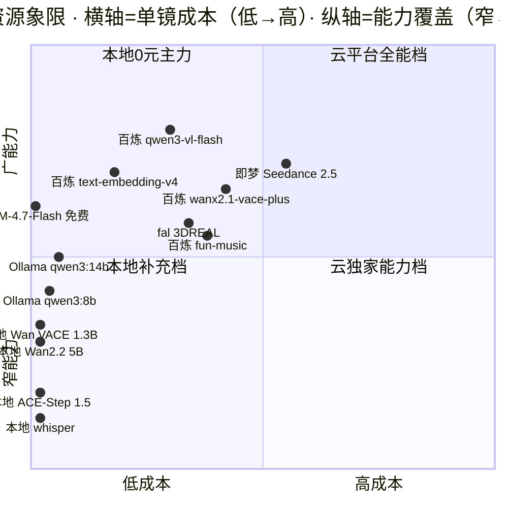

> 基线：../00-基线报告/项目基线报告.md ｜ 规约：../_执行须知.md ｜ 导航：../索引.html

# 维度 1 · 模型资源全景表（百炼 + Hugging Face + 本地 → N1~N5 操作员映射）

> 采集口径：内部事实源 `docs/03-规划与调研/LLM资源版图与数字员工配给-2026-10-04.md`、`runtime/llm_router.json`、`runtime/bailian_models_408.md`、`AI影视团队v2/AGENTS.md`；外部定向调研见文末来源。
> 状态口径：`已实测` = 有本机回显证据；`待实测` = 尚未跑过，禁止当作已通；`额度内` = 百炼免费额度（大头 2026-10-27 到期）。

---

## 1. 一图定位：模型资源象限（成本 × 能力覆盖）

读图：左下 = 本地 0 元基本盘（LLM/视频/音频/ASR 全覆盖但单项能力上限受 12GB 显存约束）；右上 = 云端独家能力（视频重绘/TTS 质量天花板）；左上免费档（GLM Flash）是零成本云备胎。

---

## 2. 平台资源盘点（五平台，2026-10-04 价目）

| 平台 | 模型数 | 价格水平 | 免费政策 | 本项目定位 |
|---|---|---|---|---|
| 本地 Ollama | 12GB 舒适区约百款（LocalIA 口径 166/242 可跑） | 0 元 | 永久 0 元 | **N1~N5 全节点主力**（K-REV-1） |
| 阿里云百炼 | 台账实测 **408 款**有额度 | LLM 0.1~24 元/M·视频 0.1~0.7 元/秒·图像 0.04~0.3 元/张 | 每模型 100 万 token × 70+，90 天，**大头 10/27 到期** | 测试期加速器 + 云端独家能力（视频/图像/TTS） |
| 智谱 GLM | 约 15+ 款 | 中档 4.6/4.7 约 ¥4.3/M 输入 | GLM-4.7-Flash / GLM-4.6V-Flash **永久免费** | 零成本云备胎（文本+视觉） |
| DeepSeek | 2 款 | **全场最低** v4-flash 输入 $0.14/M | 新用户约 ¥10（未验证） | 额度耗尽后**首选付费兜底** |
| Kimi | 现役 3 款 | **全场最贵** K3 输入 ¥20/M 输出 ¥100/M | ¥15 代金券（不含 K3） | 保留项；K3 走百炼免费额度（11/18 前） |

来源：help.aliyun.com 新人免费额度公告；docs.z.ai/guides/overview/pricing；api-docs.deepseek.com/quick_start/pricing；platform.moonshot.cn。

---

## 3. 百炼全模型类型盘点（408 台账，按能力类）

| 类别 | 台账款数 | 代表模型 | 免费额度规格 | 对应操作员 |
|---|---|---|---|---|
| 大语言模型 LLM | 141 | qwen3.8-max/flash 全系、deepseek-v4.x/r1、glm-4.5~5.3、kimi-k2.x/k3、MiniMax-M2.x | 每款 100 万 token | N1/N2/N3/N5 编排 |
| 多模态 | 25 | qwen3.5/3.8-omni、qwen-omni-turbo、qwen-mt-uni | 1M token | N1（多模态意图） |
| 视觉-图像生成 | 98（含视频） | qwen-image 2.0~3.0、wanx2.1-t2i、z-image、qwen-image-edit-max | 100~500 张/款 | N2（概念图）/N3 |
| 视觉-视频生成 | 同上 | wan2.2~3.0 全系（t2v/i2v/r2v/kf2v/vace）、wanx2.1-vace-plus、animate-anyone、liveportrait、emo | 10~50 次/款 | N4（云端重绘） |
| 语音-TTS | 94（含 ASR/音乐） | qwen3-tts、cosyvoice v1~v3.5、sambert 40+ 音色 | 1 万字 / sambert 月重置 30K | N5（配音） |
| 语音-ASR | 同上 | paraformer v1/v2、fun-asr、qwen3-asr-flash | 3.6 万字 / 月重置 | N5（转录对轴） |
| 音乐生成 | 同上 | fun-music、gummy | 3 万（sambert 口径） | N5（BGM） |
| 向量 Embedding | 18 | text-embedding v1~v4、qwen3.7-text-embedding、qwen3-rerank | 0.5M~20M token | N1~N5（RAG 检索） |

来源：`runtime/bailian_models_408.md` 实盘台账 + help.aliyun.com/zh/model-studio/models。

---

## 4. 本地模型（RTX 5070 Laptop 12GB）适配清单

| 模型 | 磁盘/显存 | 能力标签 | 12GB 适配度 | 本项目角色 | 状态 |
|---|---|---|---|---|---|
| qwen3:8b | 5.2GB / 5.6GB 全显存 | chat/structured/tools/thinking | 从容（100% GPU，28 tok/s） | N1~N5 全节点 low/mid 档主力 | 已实测（三连测全绿） |
| qwen3:14b | 9.3GB | chat/reasoning/tools | 勉强（须限 ctx 4K~8K） | 高档候选（意图仲裁） | 待实测 |
| deepseek-r1:14b | 9.0GB | reasoning | 勉强 | 深推理备选 | 待实测 |
| gemma3:12b | 8.1GB | chat/vision/tools | 从容 | 本地 VL 候选（N2/N4 自检离线档） | 待实测 |
| qwen2.5-vl:7b | ~6GB | vision | 从容 | 本地 VL 备选 | 待实测 |
| glm4:9b | 5.6GB(Q4) | chat/tools | 从容 | GLM 路线本地对照 | 待实测 |
| gemma3:4b / qwen3:4b | 3.3 / 2.5GB | chat/vision(gemma) | 极快 | 省钱档（tag/摘要/格式化） | 待实测 |
| qwen3:30b-a3b | ~18.6GB | reasoning/tools | 超 12GB | 不适配 | 排除 |
| qwen3:32b / deepseek-r1-distill-32b | ~20GB | — | 不适配 | 排除 | 排除 |

经验法则：Q4 量化 ≈ 0.6GB/十亿参数 + KV cache 预留 1~3GB；12GB 卡舒适上限 = 14B 档（限上下文）或 12B 多模态档。

---

## 5. 本地 GPU 引擎（非 LLM，走 vram_lock 分时）

| 引擎 | 规格 | 显存占用 | 对应操作员 | 状态 |
|---|---|---|---|---|
| Wan2.2 TI2V 5B | 832×480 / 49 帧 / 127.1s | 峰值 10596MiB（距 12GB 红线余 ~1.4GB） | N4（抽卡层 1） | 已实测 |
| Wan VACE 1.3B | 全量 16.4GB（diffusion 6.8GB + umt5-xxl 10.8GB + VAE 0.5GB，23 文件） | 运行期待实测 | N4（本地 0 元写实化） | 权重已补齐，运行待实测 |
| ACE-Step 1.5 XL Turbo | BGM 生成（权重 MIT + 文本编码器 Apache-2.0） | ≥4GB（DiT-only）/≥6GB | N5（BGM） | smoke 已过 |
| CosyVoice 3 / Qwen3-TTS | TTS 配音（本地 0.5B 档） | 6~8GB（与 VACE 并发须错峰） | N5（配音） | 待实测（R5 前必换） |
| Qwen3-VL-4B | 本地视觉质检 | ~4GB | N2/N4 自检 | 已实测（vlm_check.py） |
| whisper | 语音转录（CPU） | 不占显存 | N5（对轴） | 已实测 |

---

## 6. 五操作员节点配给总表（主力 / 备选滑链 / 省钱档）

| 节点 | 主力（0 元本地） | 备选滑链（云） | 省钱档 | 云端独家能力 |
|---|---|---|---|---|
| **N1 意图理解** | qwen3:8b（mid_reasoning） | deepseek-v4.1-flash → glm-5.3 → qwen-plus；高档仲裁 qwen3.8-max（11/01 到期优先烧） | qwen3:4b | 无 |
| **N2 白模搭建** | qwen3:8b（tools 全绿）+ MCP 双组件 | qwen3.8-flash → qwen-flash；视觉自检 qwen3-vl-flash → GLM-4.6V-Flash（免费） | qwen3:4b | VL 视觉判读 |
| **N3 控制图派生** | qwen3:8b（工具执行为主） | qwen-flash；deepseek-v4-flash 直连 | qwen3:4b | 无 |
| **N4 云端重绘** | local_lvace（本地 Wan VACE/Wan2.2 抽卡 N=3~4） | wanx2.1-vace-plus（720P×5s≈1 元/次）；VL 评分 qwen3-vl-flash → GLM-4.6V-Flash | — | 视频重绘（唯一烧钱节点） |
| **N5 配音剪辑** | whisper + acestep + qwen3:8b 编排 | TTS：qwen3-tts / cosyvoice-v3-flash → sambert（月重置免费）；ASR：qwen3-asr-flash（2027/01/25） | qwen3:4b | 高质量 TTS / 音乐生成 |

---

## 7. 关键缺口与风险（本维度结论）

1. **本地 VACE 权重已补齐但运行未实测**：`models/wan_vace_1.3b` 16.4GB 全量验证通过（2026-10-05），但 `r4_vace_runner.py` 本地实测 + R4 QC 报告未做——N4「本地 0 元写实化」路径仍是 `待实测`。
2. **本地 VL 未实测**：gemma3:12b / qwen2.5-vl:7b 在 12GB 卡上的表现与 tools 兼容性未验证，而 N2/N4 自检依赖 VL 闭环；百炼 qwen3-vl-flash 额度 10/27 到期，**11 月前必须完成本地 VL 切换实测**。
3. **免费额度到期集中（10/27）**：占台账 95%+ 条目；须先开「免费额度用完即停」防超量扣费，再按 burn-down 优先级消耗。
4. **音频双链未实测**：CosyVoice 3 / Qwen3-TTS 本地档「像真人配音」可达性为工作样片级，成片级需云端升级档——A6 双链待 R2 实测。
5. **能力覆盖铁律核查**：文本（LLM 141）/视觉（VL+图像 98+25）/音频（TTS/ASR/音乐 94）/视频（wan 全系）/Embedding（18）/音乐（fun-music、ACE-Step）六类均有落点，无空缺。

---

## 8. 来源

- 内部：`docs/03-规划与调研/LLM资源版图与数字员工配给-2026-10-04.md`；`runtime/llm_router.json`；`runtime/bailian_models_408.md`；`AI影视团队v2/AGENTS.md`；`docs/02-决策/17d-全链路操作员架构-重构版.md` §3。
- 外部（2026-10-05 定向调研）：阿里云百炼产品页 aliyun.com/product/bailian（Wan3.0 发布、30 秒视频）；help.aliyun.com/zh/model-studio/models（音频/语音/音乐模型规格）；help.aliyun.com/zh/model-studio/newly-released-models（wan2.6-i2v-flash、qwen-image-edit-max）；LTX 开源视频模型 2026 全景 ltx.io/blog/open-source-video-generation-models-guide；ComfyUI 官方 changelog docs.comfy.org/changelog。
