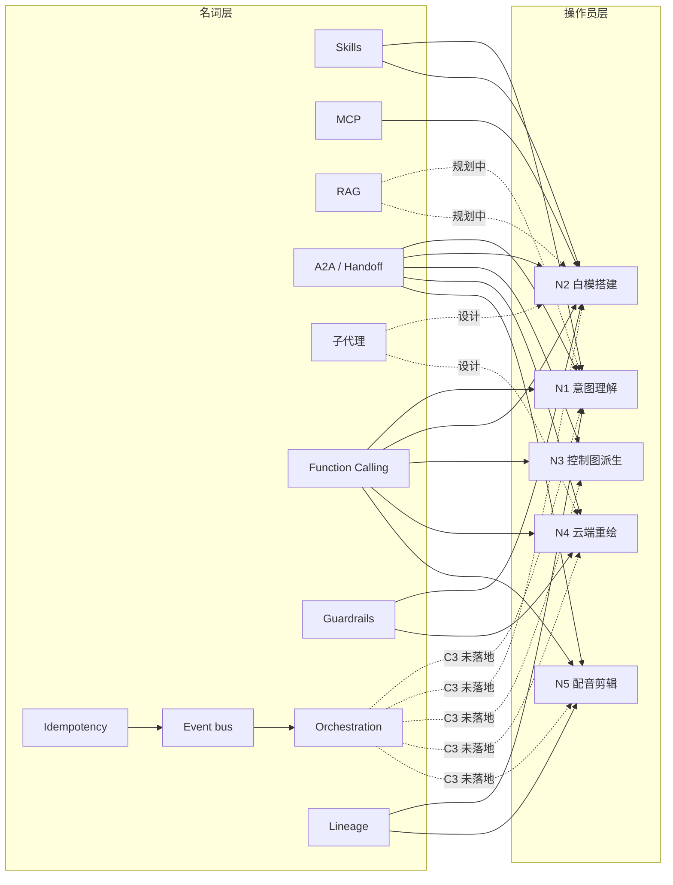

> 基线：../00-基线报告/项目基线报告.md ｜ 规约：../_执行须知.md ｜ 导航：../索引.html

# 维度 2 · Agent 名词-项目环节映射表

> 口径：每个 Agent 领域名词 → 项目中「已有 / 部分实现 / 完全缺失」的具体实现（给文件路径证据）。事实源：`docs/03-规划与调研/A智能体技术全景名词表-2026-10-04.md`、`docs/02-决策/17d-全链路操作员架构-重构版.md`、`AI影视团队v2/` 实盘代码。

---

## 1. 名词映射总表（13 名词）

| # | 名词 | 通俗解释 | 项目实现状态 | 具体实现 / 证据路径 | 缺口 |
|---|---|---|---|---|---|
| 1 | **Skills** | 把「判断」封装成可复用技能卡 | 部分实现 | `agents/*/SKILL.md`（7 份）+ `tools/_skills/` | SKILL.md 为文档级，未全部机器化；C3 岗位卡重写待 M18 |
| 2 | **MCP** | 给 LLM「手」的标准化工具协议 | 已有 | `mcp_blender/baimo_mcp_server.py`（13 工具 stdio）+ `baimo_mcp_addon/server.py`（127.0.0.1:17800） | 双组件为 #40 试点；`export_layer_manifest`/`snapshot_rollback` 规划中 |
| 3 | **RAG** | 给 LLM「查资料」的检索增强 | 缺失（规划中） | 17d §2.7 设计（`rag_kb.py` P1 新建） | 关键词索引 + 向量层均未落地；Embedding 档已配置待启用 |
| 4 | **A2A** | Agent 之间对话的开放协议 | 部分实现（轻量借鉴） | `handoff_package`（17d §5.3）+ `tools/handoff_manager.py` | 不引入完整 HTTP/JSON-RPC 栈；`operator_card.json` 规划中 |
| 5 | **子代理** | 主 Agent 派生的并行执行单元 | 部分实现 | 17d §2.3 设计（"渲染 4 个候选变体"并行） | 无落地代码；crew_bus 事件上报契约已定 |
| 6 | **Tools** | Agent 可调用的函数/脚本 | 已有 | `tools/*.py` 49 个 + `pipeline/*` + 工具注册表（17d §4） | 多数「待包装」为 Function Calling/MCP |
| 7 | **Function Calling** | LLM 按 JSON schema 调工具 | 已有 | `tools/llm_gateway.py`（chat/structured/tools 三连测全绿） | 工具白名单（A12）未接注册表 |
| 8 | **Guardrails** | 给 Agent 划红线的护栏 | 部分实现 | `config/scalability_config.json` 档位 + `tools/vram_lock.py` + A8 铁律三档 | `iron_rules.json`（M4）未落地；纪律多在 prompt 层未全代码化 |
| 9 | **Orchestration** | 多 Agent 编排调度 | 部分实现 | `tools/crew_bus.py`（事件总线）+ `handoff_manager.py` + `jobs.py` | 中央编排器（CrewAI）未落地（C3 M18）；现为 v2 手工编排 |
| 10 | **Handoff** | Agent 间交接 | 已有 | `tools/handoff_manager.py`（pending_check/accepted/rejected/completed）+ handoff_package | 与 crew_bus 事件未完全打通（交接动作须发事件） |
| 11 | **Event bus** | 事件总线（发布订阅） | 已有 | `tools/crew_bus.py`（SQLite WAL，6 事件类型，800 事件不丢） | C3 重构版未落地（O2/O3 pending）；仅 `job.*` 接线 |
| 12 | **Idempotency** | 幂等（重复执行不重复副作用） | 已有 | `crew_bus.py` idem_key 唯一索引 + `jobs.py` 内容哈希 | 订阅者幂等为契约要求，非强制 |
| 13 | **Lineage tracing** | 数据血缘追溯 | 已有 | `tools/dit_ingest.py`（SHA256+零字节+缺引用标记）→ `projects/雨夜寻猫/ditmap/lineage.jsonl` | 16/18 镜非视频血缘已标注；全链血缘未覆盖 |

---

## 2. 覆盖度分级

| 分级 | 数量 | 名词 |
|---|---|---|
| 已有（可运行） | 6 | MCP、Tools、Function Calling、Handoff、Event bus、Idempotency、Lineage tracing（7 项） |
| 部分实现（有设计/半成品） | 4 | Skills、A2A、子代理、Guardrails、Orchestration（5 项） |
| 完全缺失（仅规划） | 1 | RAG |

> 注：上表逐行 13 项，其中「已有」按严格可运行口径为 7 项（MCP/Tools/FC/Handoff/Event bus/Idempotency/Lineage），部分实现 5 项，缺失 1 项。

---

## 3. 与「五操作员」的映射（N1~N5）

---

## 4. 关键结论

1. **「手」与「腿」齐备，「记忆」与「编排」缺失**：MCP（手）+ Function Calling（腿）+ Handoff/Event bus（协作）已可运行；RAG（记忆）与中央编排器（Orchestration）是 C3 M18 的核心待落地项。
2. **名词不悬空**：13 名词中 12 项有项目内具体落点，仅 RAG 为纯规划——不存在「为名词而名词」的空泛对照。
3. **纪律与护栏偏 prompt 层**：Guardrails 目前主要靠 SKILL.md 描述 + 档位配置，A8 铁律三档「可代码化全代码化」须 M4 `iron_rules.json` 落地才闭环。
4. **血缘是亮点**：Lineage tracing 已从「概念」变为可查产物（`lineage.jsonl`），是 7 大债务中唯一自带可审计证据链的名词实现。

---

## 5. 来源

- 内部：`docs/03-规划与调研/A智能体技术全景名词表-2026-10-04.md`（8 分类 43 条）；`docs/02-决策/17d-全链路操作员架构-重构版.md`；`tools/crew_bus.py`；`tools/handoff_manager.py`；`mcp_blender/baimo_mcp_server.py`；`tools/dit_ingest.py`。
- 外部（2026-10-05 定向调研）：Google A2A 协议 developers.googleblog.com/en/a2a-a-new-era-of-agent-interoperability（MCP=agent↔tools，A2A=agent↔agent）。