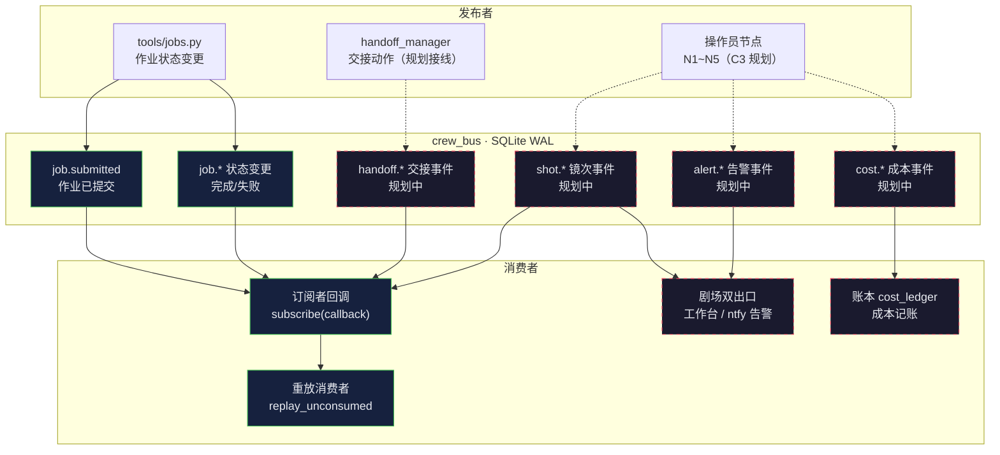

> 基线：../00-基线报告/项目基线报告.md ｜ 规约：../_执行须知.md ｜ 导航：../索引.html

# 维度 2 · crew_bus 事件流图（事件类型 × 消费者关系）

> 事实源：`AI影视团队v2/tools/crew_bus.py`（R8-C-1 契约五要素）、`docs/03-规划与调研/R0-执行计划.md` §3 T1。禁用 ` `，用「·」分隔。

---

## 1. 事件总线机制（五要素）

---

## 2. 事件类型 × 消费者关系图

---

## 3. 事件类型现状表

| 事件类型 | 发布者 | 消费者 | 状态 |
|---|---|---|---|
| job.submitted | tools/jobs.py | 订阅者回调 | 已实现（真实接线，消「零引用」） |
| job.*（完成/失败） | tools/jobs.py | 订阅者回调 | 已实现 |
| test.tick / test.crash / test.order / test.wm | test_crew_bus.py | 测试订阅者 | 已实现（自测） |
| handoff.* | handoff_manager | 剧场出口 | 规划中（交接动作应发事件） |
| shot.* | 操作员 N1~N5 | 剧场出口 | 规划中（C3 剧场数据源） |
| cost.* | 记账层 | cost_ledger | 规划中 |
| alert.* | 熔断/告警 | ntfy / 工作台 | 规划中 |

---

## 4. 契约五要素核对

| 要素 | 实现 | 证据 |
|---|---|---|
| ① SQLite 落档 | events(seq, ts, type, aggregate_id, payload_json, idem_key) | crew_bus.py `_SCHEMA` |
| ② 单写者串行 | 进程内 RLock + WAL + busy_timeout=5000 | crew_bus.py `__init__` |
| ③ 先落档后广播 | publish 先 INSERT+commit 再回调 | crew_bus.py docstring 要素 3 |
| ④ 启动重放 | replay_unconsumed + 水位表 consumers | crew_bus.py docstring 要素 4 |
| ⑤ 真实下游 | jobs.py 状态变更 hook 发 job.* | crew_bus.py docstring 要素 5 |

---

## 5. 结论

1. **机制成熟、事件面窄**：总线本身五要素全绿（800 事件不丢，跨重启零重复），但实际接线只有 `job.*` 一类，`shot.*`/`cost.*`/`alert.*` 均待 C3 M4/M5 落地。
2. **幂等是硬契约**：idem_key 唯一索引 + 订阅者幂等要求，保证「先投递后推进水位」崩溃窗口可兜底。
3. **剧场出口待接**：事件总线是「多 Agent 剧场式可观赏协作」的数据源（业界空白），须由 C3 工作台/ntfy 双出口消费。