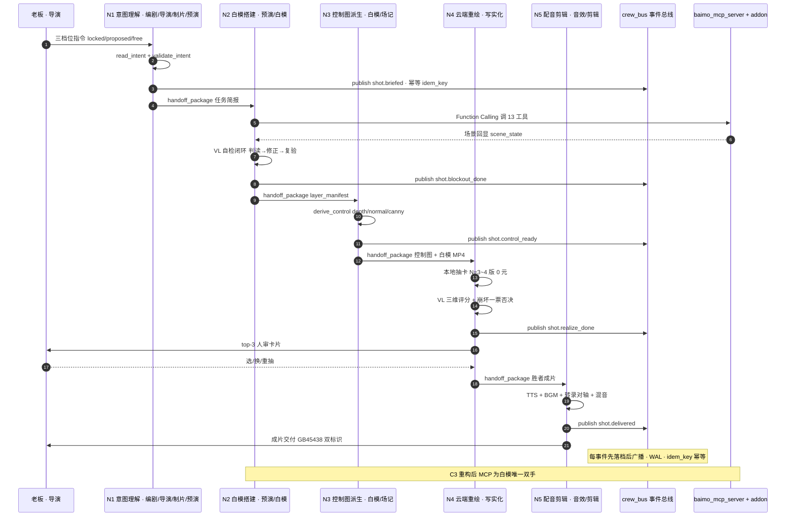

> 基线：../00-基线报告/项目基线报告.md ｜ 规约：../_执行须知.md ｜ 导航：../索引.html

# 维度 2 · 多代理协作泳道图（7 岗位 → 5 操作员：消息流 / 事件流 / 交接流）

> 说明：`sequenceDiagram` 表达 7 岗位（收敛 5 操作员）之间的一次《雨夜寻猫》单镜协作。实线=已实现，虚线=规划中。禁用 ` `，用「·」分隔。

---

## 1. 单镜协作泳道（意图 → 白模 → 控制图 → 写实化 → QC → 交付）

---

## 2. 三层流转对照表

| 流转类型 | 载体 | 实现状态 | 内容 |
|---|---|---|---|
| **消息流** | Function Calling + handoff_package | 已有 | 节点间任务简报、产物引用、tier 三档约束 |
| **事件流** | crew_bus（SQLite WAL） | 已有 | job.submitted 等状态变更；先落档后广播；幂等 |
| **交接流** | handoff_manager（状态机） | 已有 | pending_check → accepted → in_progress → completed / rejected |

---

## 3. 岗位 → 操作员收敛（7 → 5）

| 原 7 岗位 | 收敛操作员 | 判断力归属（A6b） |
|---|---|---|
| screenwriter 编剧 | N1 意图理解 | LLM 决策岗 |
| director 导演 | N1（+ 老板终裁门） | LLM 决策岗 |
| producer 制片 | N1（流程调度） | LLM 决策岗 |
| previs 预演 | N1 / N2 | 混合岗 |
| blockout 白模 | N2 白模搭建 + N3 控制图 | 混合岗 |
| realizer 写实化 | N4 云端重绘 | 混合岗 |
| script_supervisor 场记 | N3 / N5（QC 防线） | 混合岗 |
| 音效师（C3 新增） | N5 | 纯工具链岗（无 LLM 判断） |
| 剪辑师（C3 新增） | N5 | 纯工具链岗（无 LLM 判断） |

---

## 4. 结论

1. **协作骨干在进程内**：消息/事件/交接三流同机同进程，不依赖外部 IM（飞书已降级为可拔插剧场出口）。
2. **交接与事件须双向绑定**：当前 handoff_manager 与 crew_bus 尚未完全打通——交接动作应同时发一条 crew_bus 事件（17d §5.3 要求），此为 P1 接线项。
3. **操作员收敛无职责空洞**：7 岗位全部有映射落点，无悬空岗位。