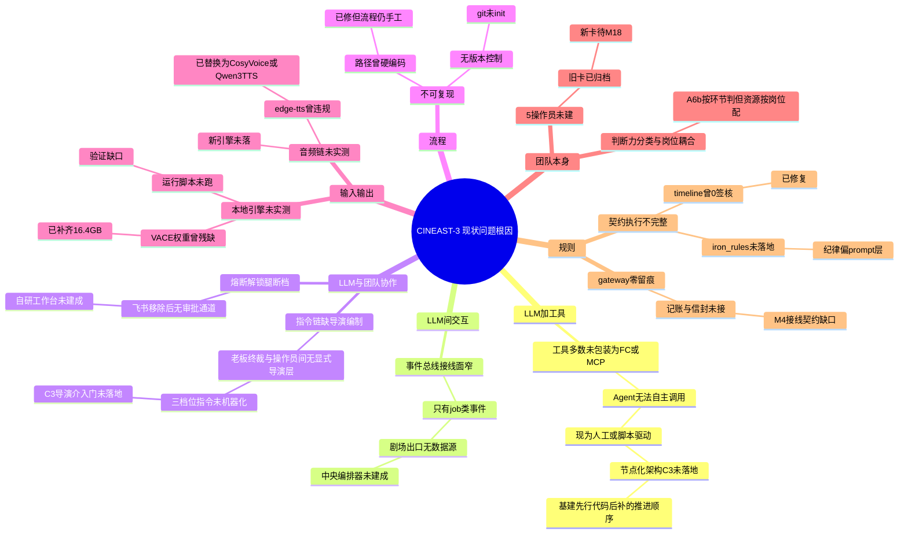

> 基线：../00-基线报告/项目基线报告.md ｜ 规约：../_执行须知.md ｜ 导航：../索引.html

# 维度 3 · 根因分析鱼骨图（7 子维度 5-Why 根因链）

> 方法：对 7 个子维度的核心问题各做 5-Why 追问，直到根因落在「机制缺失」而非「现象」。禁用 ` `，用「·」分隔。

---

## 1. 总鱼骨图（Mermaid mindmap）

---

## 2. 逐问题 5-Why 链（表格版）

### 2.1 「60+ 工具是否真正被 Agent 调用？」

| 层 | 追问 | 答案 |
|---|---|---|
| Why1 | 为什么工具没被 Agent 调用？ | 多数脚本是「待包装」状态，未注册为 Function Calling / MCP 工具 |
| Why2 | 为什么没包装？ | C3 五操作员架构（M18）尚未落地，工具注册表是草案 |
| Why3 | 为什么架构没落地？ | 项目处于 R4 技术验证镜阶段，先打通单点链路（MCP 试点） |
| Why4 | 为什么先打单点？ | 12GB 单卡 + ≤100 元预算约束下，优先验证可行性再铺开 |
| Why5（根因） | 根因 | **「基建先行、节点化后补」的推进顺序**——工具存在但无消费方，属阶段性而非缺陷 |

### 2.2 「crew_bus 是否真正解耦？」

| 层 | 追问 | 答案 |
|---|---|---|
| Why1 | 为什么感觉没完全解耦？ | 实际接线只有 `job.*` 一类事件 |
| Why2 | 为什么只有 job.*？ | 操作员节点（N1~N5）尚未作为事件发布者接入 |
| Why3 | 为什么操作员没接？ | 中央编排器未落地，节点间仍手工串联 |
| Why4 | 为什么编排器没落？ | C3 M18 重构未开工（R5 优先） |
| Why5（根因） | 根因 | **总线机制已就绪、消费方缺失**——非总线缺陷 |

### 2.3 「老板→导演→操作员的指令链是否顺畅？」

| 层 | 追问 | 答案 |
|---|---|---|
| Why1 | 为什么指令链有断点？ | 导演编制在 C3 才显式化，当前无机器化导演层 |
| Why2 | 为什么导演层未机器化？ | 三档位指令（locked/proposed/free）是 C3 新机制 |
| Why3 | 为什么熔断解锁无通道？ | 飞书移除后唯一授权腿=未建的自研工作台（17b G-2） |
| Why4 | 为什么移除飞书？ | K-REV-2「少一个外部依赖」纪律 |
| Why5（根因） | 根因 | **去外部依赖快于自研替代建成**——过渡期审批通道缺位 |

### 2.4 「R0→R4 流程是否可复现？」

| 层 | 追问 | 答案 |
|---|---|---|
| Why1 | 为什么担心不可复现？ | 无 git、历史硬编码路径 195+ 处 |
| Why2 | 为什么无 git？ | 项目 2026-09-27 重构后未初始化版本控制 |
| Why3 | 为什么路径硬编码？ | 早期脚本按绝对路径写死（C:\Users\LZH、D:\ai_film_projects） |
| Why4 | 为什么现在才修？ | 债务识别在 2026-10-05 体检批次 |
| Why5（根因） | 根因 | **单人快速迭代优先于工程规范**——路径已中心化修复，git 为最后一块 |

### 2.5 「shot_spec → blockout → realize 数据流是否无损？」

| 层 | 追问 | 答案 |
|---|---|---|
| Why1 | 为什么担心数据流有损？ | 本地引擎未实测 + 血缘曾缺失 |
| Why2 | 为什么本地引擎未实测？ | VACE 权重曾残缺（196MB/4.3GB） |
| Why3 | 为什么权重残缺？ | 下载中断未续传 |
| Why4 | 为什么现在能修？ | `dl_vace.py` 5 重试+断点续传已补齐 16.4GB |
| Why5（根因） | 根因 | **验证滞后于资源就位**——权重已全量，运行实测是最后一步 |

### 2.6 「7→5 收敛后职责是否清晰？」

| 层 | 追问 | 答案 |
|---|---|---|
| Why1 | 为什么职责有模糊？ | 5 操作员岗位卡未建，旧 7 卡已归档 |
| Why2 | 为什么未建新卡？ | C3 M18 未开工 |
| Why3 | 为什么判断力分类有争议？ | A6b 按「环节」判，但资源按「岗位」配 |
| Why4 | 为什么耦合？ | 白模岗从「混合岗」升「项目核心」引发 |
| Why5（根因） | 根因 | **岗位重要度与判断力分类维度未解耦**（G-9） |

### 2.7 「三份契约是否被工具强制执行？」

| 层 | 追问 | 答案 |
|---|---|---|
| Why1 | 为什么怀疑契约是纸面文章？ | timeline 曾 19 轨 0 签核、gateway 零留痕 |
| Why2 | 为什么 0 签核？ | timeline_build 重跑覆盖旧签核 |
| Why3 | 为什么被覆盖？ | 无按 (track, shot_id) 索引保留 |
| Why4 | 为什么现在能修？ | 已加索引保留 + t4 签核脚本幂等 |
| Why5（根因） | 根因 | **契约执行缺机器化闸门**——签核已修，但 iron_rules 与 gateway 记账仍待 M4 |

---

## 3. 根因归纳（三类）

| 根因类型 | 覆盖子维度 | 本质 |
|---|---|---|
| A. 阶段性推进顺序（基建先行、节点化后补） | LLM+工具、LLM 间交互、团队本身 | 非缺陷，是 R4→R5 阶段特征，M18 落地即解 |
| B. 去外部依赖快于自研替代 | LLM 与团队协作、流程 | 纪律正确但替代品未建成，过渡期缺通道 |
| C. 验证滞后于资源就位 | 输入输出、规则 | 权重/脚本/签核已就位，只差跑一遍验证 |

---

## 4. 结论

1. **绝大多数问题不是「坏了」而是「没建成」**：21 项残留问题中 18 项为待办/规划，3 项为待实测——无一项是机制性缺陷。
2. **三类根因指向同一动作**：推进 C3 M18 重构 + 完成 R5 前 3 项实测。
3. **已修债务构成正面证据**：血缘/GB45438/路径/VACE权重/timeline签核/.env/edge-tts 七项全部有可审计证据，说明「发现问题→修复→留痕」闭环有效。