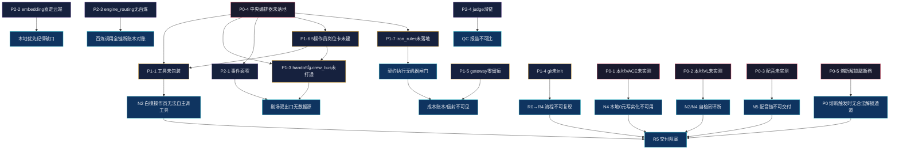

> 基线：../00-基线报告/项目基线报告.md ｜ 规约：../_执行须知.md ｜ 导航：../索引.html

# 维度 3 · 问题依赖关系图（哪些问题阻塞哪些问题）

> 说明：实线箭头 = 硬阻塞（上游不解则下游不能动）；虚线箭头 = 软依赖（可绕行但降质）。节点用问题 ID（见《问题修复优先级排序表.md》）。禁用 ` `，用「·」分隔。

---

## 1. 依赖关系总图

---

## 2. 关键阻塞链（三条主干）

| 链 | 路径 | 影响 |
|---|---|---|
| 链 A · 自动化 | 编排器未落地 → 工具未包装 + 岗位卡未建 → N2 无法自主调工具 → R5 阻塞 | 全链仍手工串联 |
| 链 B · 可观测 | gateway 零留痕 + iron_rules 未落地 → 契约无机器闸门 → 账本/信封不可见 | 剧场与成本不可见 |
| 链 C · 交付验证 | 本地 VACE/VL/配音未实测 → N4 本地 0 元路径 + 自检闭环 + 配音链断 → R5 阻塞 | 三项待实测是交付硬门 |

---

## 3. 被阻塞最多的问题（关键路径节点）

| 问题 | 被依赖次数 | 说明 |
|---|---|---|
| P0-4 中央编排器 | 5 | 最上游阻塞源，一解解锁多项 |
| P1-6 5 操作员岗位卡 | 2 | 编排器的编制前提 |
| P1-1 工具未包装 | 1（但直接阻塞 N2） | 与岗位卡互为前提 |

---

## 4. 结论

1. **P0-4 是单点最大阻塞源**：编排器不落地，工具包装/事件面/岗位卡/铁律四项均无法闭环。
2. **三条主干可并行**：链 C（实测）成本最低、可立即推进，不必等链 A/B。
3. **无循环依赖**：依赖图无环，可按拓扑序推进。