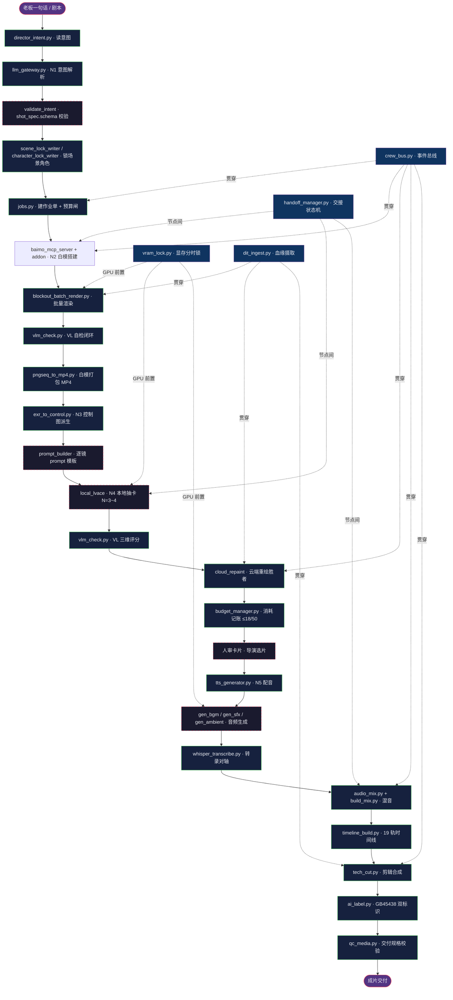

> 基线：../00-基线报告/项目基线报告.md ｜ 规约：../_执行须知.md ｜ 导航：../索引.html

# 维度 4 · 工具链全景流程图（从「老板一句话」到「成片交付」）

> 说明：实线 = 已投产；虚线 = 待包装/规划中。每步标注工具 + 操作员。禁用 ` `，用「·」分隔。

---

## 1. 主流程总图

---

## 2. 分层工具清单

| 层 | 工具 | 状态 |
|---|---|---|
| 意图层（N1） | director_intent / llm_gateway / validate_intent / scene_lock_writer / character_lock_writer | 部分待包装 |
| 白模层（N2） | baimo_mcp_server + addon / blockout_batch_render / vlm_check / measure4 / pngseq_to_mp4 | 核心已投产 |
| 控制层（N3） | exr_to_control / prompt_builder / qc_media | prompt_builder 规划中 |
| 重绘层（N4） | comfyui_client（local_lvace）/ cloud_repaint / vlm_check / budget_manager | cloud_repaint 待包装 |
| 音视频层（N5） | tts_generator / gen_bgm / gen_sfx / gen_ambient / acestep_client / whisper_transcribe / audio_mix / build_mix / tech_cut / timeline_build | 多数待包装 |
| 交付层 | ai_label / qc_media / delivery_spec | 已投产 |
| 基建层 | crew_bus / jobs / handoff_manager / vram_lock / d1_model_queue / dit_ingest / asset_manager / k13_version_tree | 已投产 |

---

## 3. 结论

1. **主链工具齐备**：从意图到交付共 30+ 工具节点，无断点。
2. **基建层贯穿全链**：事件总线 / 显存锁 / 血缘 / 交接四件为横向支撑。
3. **待包装集中在 N3/N4/N5**：`prompt_builder` / `cloud_repaint` / 音频六工具为 P1 包装对象。