> 基线：../00-基线报告/项目基线报告.md ｜ 规约：../_执行须知.md ｜ 导航：../索引.html

# 维度 19 · 任务排程甘特图（VRAM / 温度 / RAM 约束）

## 1. 排程原则

1. **同一时段只允许一个 GPU 重任务持锁**（`vram_lock`，owner 见 `AGENTS.md` GPU 引擎接入索引）。
2. **重任务之间留冷却窗口**：温度熔断阈值待实测，暂按「重任务后冷却 ≥ 5 min」保守排。
3. **云端调用（fal / 百炼 / 即梦）不接锁**，可与其他任务并行，用于填满等待窗口。
4. **RAM 冲突规避**：Ollama（约 5 GiB）与 VLM 质检（约 10 GiB 显存 + 宿主内存）不得与 Blender 渲染同段。

## 2. 单镜生产排程（R5 标准镜）

```mermaid
gantt
    title R5 单镜生产排程 · GPU 串行 + 冷却窗口（时长按实测标称）
    dateFormat HH:mm
    axisFormat %H:%M
    todayMarker off

    section 云端（不接锁·可并行）
    百炼 LLM 编剧分镜    :c1, 09:00, 12min
    百炼 wanx 写实化提交  :c2, after b2, 2min
    云端结果轮询          :c3, after c2, 3min

    section 本地 GPU（接锁·串行）
    Blender EEVEE 白模渲染 :b1, 09:12, 3min
    控制图派生 depth normal :b2, after b1, 2min
    Wan2.2 5B 本地生成     :w1, after b2, 3min
    Qwen3-VL-4B 质检       :v1, after w1, 4min

    section 冷却与整理
    显存回落与冷却窗口      :crit, cool1, after v1, 5min
    音频合成与打包 ffmpeg   :a1, after cool1, 4min
```

> 说明：`Wan2.2 5B` 实测单任务 127.1s（832x480 / 49 帧），此处按 3 min 标称；`Blender EEVEE 121 帧` 独占基线 19s、R0-T6 竞争轮 44s，取 3 min 含启动开销。

## 3. 18 镜批量排程（R5 全片）

```mermaid
gantt
    title R5 18 镜批量排程 · 分时段错峰（重任务分场次）
    dateFormat HH:mm
    axisFormat %H:%M
    todayMarker off

    section 第1场 镜头 1-1 至 1-4
    白模批量渲染        :a1, 09:00, 25min
    本地 Wan2.2 生成    :a2, after a1, 30min
    冷却窗口            :crit, a3, after a2, 10min
    云端写实化并行      :a4, 09:00, 55min

    section 第2场 镜头 2-1 至 2-5
    白模批量渲染        :b1, after a3, 30min
    本地 Wan2.2 生成    :b2, after b1, 35min
    冷却窗口            :crit, b3, after b2, 10min
    云端写实化并行      :b4, after a4, 65min

    section 第3场 镜头 3-1 至 3-6
    白模批量渲染        :c1, after b3, 35min
    本地 Wan2.2 生成    :c2, after c1, 40min
    冷却窗口            :crit, c3, after c2, 10min
    云端写实化并行      :c4, after b4, 75min

    section 第4场 镜头 4-1 至 4-3
    白模批量渲染        :d1, after c3, 20min
    本地 Wan2.2 生成    :d2, after d1, 25min
    质检与音频          :d3, after d2, 30min
    云端写实化并行      :d4, after c4, 40min
```

## 4. 资源冲突检查表

| 时段 | 持锁重任务 | 并发云端 | VRAM 峰值估算 | RAM 压力 | 判定 |
|---|---|---|---|---|---|
| 白模渲染段 | blender-blockout | 百炼 LLM | 实测并发峰值 11194 MiB | 中 | 通过（< 12231） |
| Wan2.2 生成段 | wan22 | 无（禁并发重任务） | 实测 10596 MiB | 低 | 通过 |
| 质检段 | qwen3-vl（约 10GB） | fal 写实化 | 估算 10240 MiB | 高 | 需先释放 ComfyUI 常驻 8.7GB |
| 音频打包段 | 无（CPU） | 云端 | 系统基线 3207 MiB | 低 | 通过 |

## 5. 待实测项

1. 各任务真实耗时（本图为标称排程，非实测时间表）。
2. 冷却窗口时长（依赖散热实测）。
3. Qwen3-VL-4B 实际显存占用（文档记「约 10GB」，未落实测峰值）。
