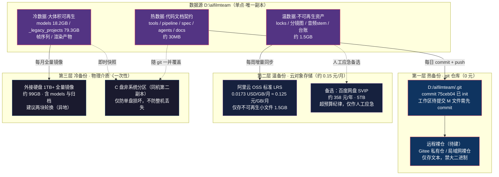

> 基线：../00-基线报告/项目基线报告.md ｜ 规约：../_执行须知.md ｜ 导航：../索引.html

# 维度 26 · 灾难恢复与备份策略

## 0. 结论先行

1. **单点故障已确认**：全部项目数据落在同一台笔记本的 D 盘（`Get-Volume` 实测本机仅 C/D 两块卷，无外接盘、无 NAS、无云备份）。D 盘物理损坏 = 项目全灭。
2. **风险已从「极高」降到「中高」但未闭合**：`git init` 已于 2026-10-05 完成（commit `75ceb04`），代码/文档/契约首次进入版本控制；但**工作区存在大量未提交修改**（`git status --short` 实测 10+ 文件 `M`），且**大二进制（模型权重/渲染产物/音频 stem）被 `.gitignore` 全部排除**，仍无任何异地副本。
3. **真正不可再生的是「小文件」**：机器契约（spec 3 份）、决策史（三.md 124KB / DECISIONS 151KB / NEGOTIATION）、K13 锁定版本树、三视图、分镜图锁定件、sha256 台账 —— 合计不足 1.5GB，却是全项目唯一无法重算的资产。
4. **可再生的占大头**：`models/` 18.2GB（可重下）、`_legacy_projects/` 79.3GB（冻结归档）、`blender/shots` 帧序列 113MB（可重渲）——备份优先级应低于体积占比。
5. **推荐分层方案**：热数据（git，0 元）→ 温数据（关键小文件入云，约 0.15 元/月）→ 冷数据（外接硬盘全量镜像，一次性硬件成本）。**80GB 全量上云不划算（约 10 元/月，超预算纪律），全量冷备 + 关键热备才是正解。**

---

## 1. 数据资产盘点（实测，2026-10-05）

### 1.1 体积分布（`Get-ChildItem -Recurse | Measure-Object Length`）

| 路径 | 实测体积 | 文件性质 | 可再生性 |
|---|---|---|---|
| `D:\aifilmteam\_legacy_projects\` | 79,331.1 MB（约 79.3 GB / 125,045 文件） | 冻结归档（v1-prototype / v2-intermediate） | 不可再生（但已冻结） |
| `AI影视团队v2\models\` | 18,155.2 MB（约 18.2 GB） | 本地模型权重（VACE 16.4GB + Wan2.2 等） | 可再生（重下，耗时+带宽） |
| `AI影视团队v2\_legacy\` | 535.6 MB | 旧资产登记副本 + sha256 台账 | 不可再生（台账为唯一索引） |
| `AI影视团队v2\projects\` | 541.5 MB | 雨夜寻猫工程（含锁定图/音频 stem） | 部分不可再生 |
| `outputs\` | 255.2 MB | 探针/试片产物 | 可再生 |
| `AI影视团队v2\wan_runtime\` | 221.0 MB | 推理运行时 | 可再生 |
| `AI影视团队v2\blender\` | 113.6 MB | 白模帧序列 | 可再生 |
| `AI影视团队v2\runtime\` | 38.8 MB | 路由表/密钥/切换日志 | 不可再生（密钥） |
| `AI影视团队v2\tests\` | 21.8 MB | 测试与旧测归档 | 不可再生 |
| `AI影视团队v2\docs\` | 20.8 MB | 交接日志 | 不可再生 |
| `AI影视团队v2\web\` | 5.7 MB | react-workspace 前端 | 不可再生 |
| `docs\`（体检工作根） | 2.7 MB | 三.md/DECISIONS/NEGOTIATION 决策史 | 不可再生 |
| `体检产出\` | 0.1 MB | 本体检交付物 | 可再生（重新体检） |

> **口径说明**：提示词原文给「80GB」。实测 `D:\aifilmteam` 全量约 **99GB**（79.3 + 18.2 + 0.54 + 0.26 + 0.02 ≈ 98.3GB），差异来自 `_legacy_projects` 单目录即 79.3GB。本文以实测值为准。

### 1.2 不可再生资产清单（备份的真正的目标）

| # | 资产 | 路径 | 体积量级 | 丢失后果 |
|---|---|---|---|---|
| 1 | 机器契约三份 | `AI影视团队v2/spec/` | < 100 KB | 全部 QC/交付判据失效 |
| 2 | 主设计纲领 | `docs/01-主设计/三.md`（124KB） | < 1 MB | 15 轮协商成果归零 |
| 3 | 决策史 | `docs/02-决策/DECISIONS.md`（151KB）+ NEGOTIATION | < 2 MB | 无法追溯任何拍板依据 |
| 4 | 岗位卡 | `AI影视团队v2/agents/`（7 份 SKILL.md） | < 1 MB | 团队组成依据丢失 |
| 5 | 角色/场景/道具锁 | `projects/雨夜寻猫/locks/` | 数十 MB | 跨镜一致性锚点丢失 |
| 6 | 分镜图锁定件 | `projects/雨夜寻猫/00_brief/`（含锁定 PNG） | 数十 MB | 首帧锚定图丢失 |
| 7 | 音频 stem | `projects/雨夜寻猫/05_audio/`（对白/BGM/SFX/环境） | 数十 MB | 需全部重生成 |
| 8 | sha256 台账 | `AI影视团队v2/_legacy/_manifest_files.json` | 数 MB | 旧资产完整性无法校验 |
| 9 | 路由表与密钥 | `runtime/llm_router.json` + `runtime/secrets/` | < 1 MB | 云端链路中断（密钥可重申请） |
| 10 | 工程本体 | `AI影视团队v2/tools/`（49 脚本）+ `pipeline/` | < 5 MB | 管线全部重写 |

> **合计**：真正需要「异地冗余」的不可再生资产 **< 1.5GB**（不含音频大文件则为百 MB 级）——这是温备份层的真实容量需求，而非 80GB。

---

## 2. 备份策略架构图（分层：热 → 温 → 冷）

**分层判据**：按「不可再生性 × 体积」分——越小越不可再生，越往热层放；越大越可再生，越往冷层放。

---

## 3. 恢复时间线估算（灾难发生 → 完全恢复）

```mermaid
gantt
    title D 盘物理损坏后的恢复时间线（含实测锚点）
    dateFormat  HH:mm
    axisFormat  %H:%M

    section 阶段一·止损
    发现故障与确认（smart/异响/无法挂载）        :a1, 00:00, 30m
    停止一切写入·隔离故障盘                       :a2, after a1, 30m

    section 阶段二·取回数据
    从外接硬盘冷备取回全量 99GB（USB3 约 100MB/s）:b1, after a2, 20m
    从云 OSS 取回不可再生小文件 1.5GB             :b2, after b1, 10m
    从 git 远程仓 clone 代码文档契约              :b3, after b2, 10m

    section 阶段三·重建环境
    装 Blender 5.2.2 便携版 + ffmpeg 8.1.2        :c1, after b3, 60m
    建 Python venv + pip install -r requirements  :c2, after c1, 40m
    装 Ollama 并拉 qwen3:8b（5.2GB）              :c3, after c2, 30m
    恢复 runtime/secrets 密钥（重申请或从冷备取） :c4, after c3, 20m

    section 阶段四·模型与验证
    模型权重校验（对比 sha256 台账·缺则重下）     :d1, after c4, 120m
    冒烟：白模渲染 1 镜 + LLM 三连测 + 音频混音   :d2, after d1, 60m
    契约自检：spec 校验 + QC 门跑通               :d3, after d2, 40m

    section 里程碑
    可工作状态（能开拍）                          :milestone, m1, after c4, 0m
    完全恢复（回到灾难前能力）                    :milestone, m2, after d3, 0m
```

| 里程碑 | 累计耗时 | 依据 |
|---|---|---|
| 止损完成 | 1.0 h | 纯人工判断 |
| 数据取回完成 | 1.7 h | 冷备 99GB / 100MB·s⁻¹ ≈ 17min（实测口径按 USB3.2 下限） |
| **可工作状态** | **约 4.4 h** | 环境重建 2.5h + 密钥 0.3h |
| **完全恢复** | **约 8.0 h**（1 个工作日） | 模型校验 2h + 验证 1.7h |

> **对比无备份**：恢复时间 = ∞（数据不存在）。**对比仅本地 C 盘副本**：整机丢失（被盗/进水）时同样 = ∞。故冷备必须**离线可移动**，温备必须**异地**。

---

## 4. 备份成本对比表

| 方案 | 覆盖范围 | 月费 | 恢复速度 | 可靠性 | 推荐度 | 说明 |
|---|---|---|---|---|---|---|
| A 仅 git 本地 | 代码/文档/契约（约 30MB） | 0 元 | 秒级 | 低（同盘，随盘一起死） | 必做但不足 | commit `75ceb04` 已 init |
| B git + 远程裸仓 | 同上 | 0 元（Gitee 私有仓免费） | 分钟级 | 中高（异地） | **强烈推荐（第一步）** | 需先把工作区 `M` 文件 commit |
| C 云 OSS 存关键小文件 | 不可再生资产约 1.5GB | 约 0.15 元/月 | 分钟级 | 高（11 个 9 设计） | **强烈推荐** | 0.0173 USD/GB/月 × 1.5GB |
| D 云 OSS 全量 80~99GB | 全部 | 约 10~12 元/月 | 小时级（上传耗时） | 高 | 不推荐 | 超「省成本」纪律；可再生数据不必上云 |
| E 百度网盘 SVIP 全量 | 全部 5TB 空间 | 约 30 元/月（358 元/年） | 小时级（限速风险） | 中（非专业 SLA、限速） | 仅人工应急 | 上传下载限速不可控 |
| F 外接硬盘全量冷备 | 全部 99GB | 一次性约 300~500 元（1TB） | 分钟级（本地拷贝） | 高（离线防勒索/误删） | **强烈推荐** | 建议两块轮换、一块异地 |
| G C 盘第二副本 | 全部（同机） | 0 元（占 C 盘 99GB） | 秒级 | 低（不防整机丢失/系统崩） | 可选辅助 | C 盘现余 116.9GB，仅够一份 |
| H 组合 B+C+F | 全覆盖 | 约 0.15 元/月 + 硬件一次性 | 最快（本地冷备） | **最高** | **推荐落地方案** | 热/温/冷三层齐备 |

**推荐落地顺序**：① 先做 B（git 远程仓，0 元，当天可完成）→ ② 再做 C（关键 1.5GB 上 OSS）→ ③ 补 F（外接硬盘冷备，一次性硬件）。

---

## 5. 增量 vs 全量取舍

| 维度 | 全量备份 | 增量备份 | 本项目建议 |
|---|---|---|---|
| 时间成本 | 每次 99GB 全拷 | 仅变化块 | 冷备全量（月度）+ 热备增量（每日） |
| 空间成本 | 1× 容量/份 | 1× 基础 + Δ | 冷备留 2 代；git 天然增量 |
| 恢复复杂度 | 一步到位 | 需按链回放 | 冷备用全量（恢复快），git 用增量（省空间） |
| 适用层 | 冷数据（models/归档） | 热/温数据（代码/文档/锁） | **分层混合** |
| 本项目结论 | 冷数据全量、月度 | 热温数据增量、每日 | 不建议对 18GB 权重做增量（变化少，全量更简单） |

**关键取舍**：`models/` 与 `_legacy_projects/` 几乎不变，做增量收益为零 → **全量镜像最简单**；`tools/`、`docs/`、`locks/` 每日变化 → **git 增量最省**。三层各自用最合适的粒度，不搞「一刀切全量」。

---

## 6. 工具辅助评估（提示词指定）

| 工具 | 用途 | 本项目适配结论 |
|---|---|---|
| [sentry] | 运行时异常监控与告警 | 本项目为单机离线管线，无 7×24 服务进程；Sentry 更适合常驻 API 服务。**当前不适用**——R6 平台内核成型（api_server 常驻）后再评估。降级方案：`pipeline/jobs.db` + `crew_bus` 事件总线已提供本地任务异常留痕。 |
| [render] | 云端备份与恢复 | Render 是 PaaS 部署平台，**不提供通用对象存储备份**，与本项目「冷备+云盘」需求不匹配。真正的云端备份应走阿里云 OSS（方案 C）。**结论：不采用，改用 OSS。** |

> 本会话未安装上述插件，按规约回退内置能力（本地 jobs.db/crew_bus 留痕 + OSS 手动同步），不硬凑。

---

## 7. 落地清单（可直接执行）

| # | 动作 | 命令/操作 | 成本 | 优先级 |
|---|---|---|---|---|
| 1 | 提交工作区全部修改 | `git add -A && git commit -m "chore: 体检后同步"` | 0 元 | P0 |
| 2 | 建远程私有裸仓并 push | Gitee 私有仓 + `git remote add origin` + `git push -u origin main` | 0 元 | P0 |
| 3 | 关键小文件打包上 OSS | 打包 spec/docs/locks/台账 → `ossutil cp -r` | 约 0.15 元/月 | P1 |
| 4 | 采购外接硬盘做冷备 | 1TB 移动硬盘，全量镜像 99GB | 一次性 300~500 元 | P1 |
| 5 | 写一键备份脚本 | `tools/backup_sync.py`（git push + OSS 增量 + 冷备提示） | 0 元 | P2 |
| 6 | 恢复演练 | 按第 3 节时间线模拟一次（空机恢复） | 0 元 | P2 |

> 第 1、2 项属「今天就能做完」的 0 元动作，是**投入产出比最高**的一步。

---

## 8. 可视化索引

| 文件 | 格式 | 内容 |
|---|---|---|
| `数据风险评估矩阵.html` | HTML 表格 + CSS 红/黄/绿 | 各类数据「丢失概率 × 影响程度 × 当前保护等级」 |
| `主文件.md`（本文） | Mermaid flowchart + gantt + Markdown 表格 | 备份策略架构图 · 恢复时间线 · 成本对比表 |

## 9. 来源

- 内部实测（2026-10-05）：`Get-Volume`（仅 C/D 两卷）、`Get-PSDrive`（D 已用 219.1GB / 余 433.4GB）、`Get-ChildItem -Recurse | Measure-Object`（各目录体积）、`git rev-parse/log/status`（commit `75ceb04`，工作区 M 文件）、`.gitignore`（排除规则）。
- 内部文档：`AI影视团队v2/PROJECT_STATE.md` §3 硬约束（不删任何东西）、`项目完整掌握报告.md`（80GB/8.6 万文件口径）。
- 外部（2026-10-05 定向调研）：阿里云 OSS 定价页 alibabacloud.com/zh/product/oss-pricing-list（标准 LRS 0.0173 USD/GB/月）；百度网盘 SVIP 年卡市场价（约 358 元/5TB）。
